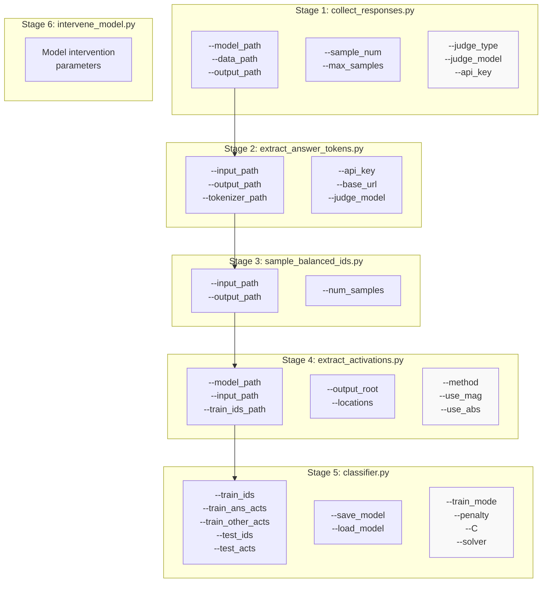
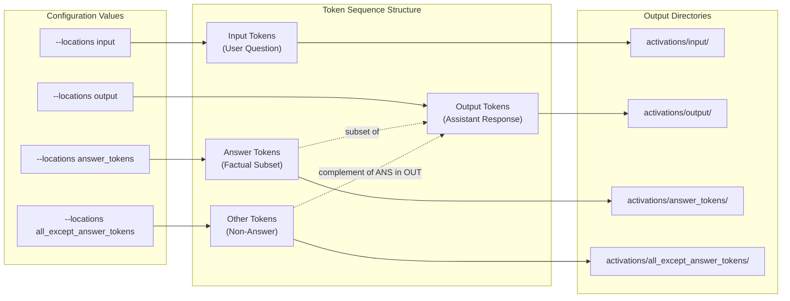
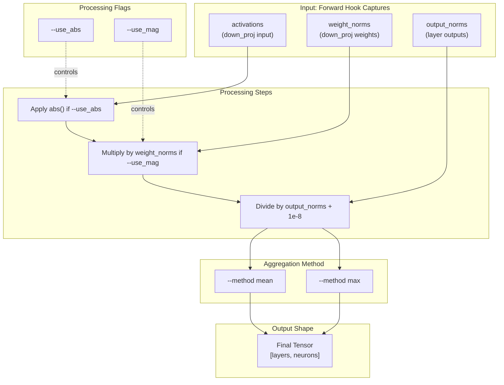
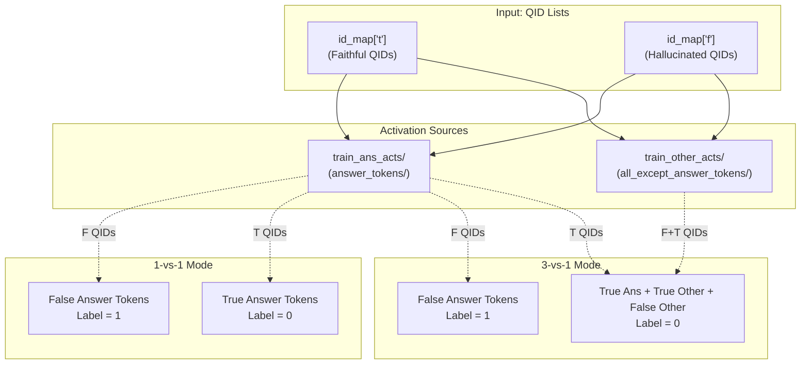
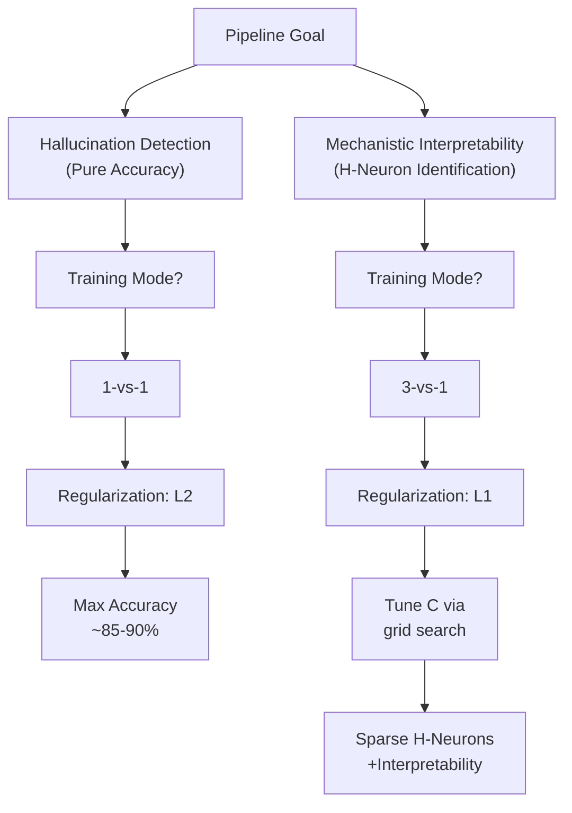

<!-- source: DeepWiki mcp.deepwiki.com · repo thunlp/H-Neurons · page 6 Configuration & Options · fetched 2026-11-02 -->

# Configuration & Options

<details>
<summary>Relevant source files</summary>

The following files were used as context for generating this wiki page:

- [README.md](README.md)
- [scripts/classifier.py](scripts/classifier.py)
- [scripts/extract_activations.py](scripts/extract_activations.py)

</details>


This page provides a comprehensive reference for all configuration options, command-line flags, and parameters available throughout the H-Neurons pipeline. Each script in the 6-stage pipeline exposes various parameters that control behavior, model selection, data processing, and algorithm tuning.

For detailed explanations of specific configuration concepts, see:
- Training mode selection and use cases: [Training Modes (1-vs-1 and 3-vs-1)](#6.1)
- Regularization parameter tuning: [Regularization Options (L1 vs L2)](#6.2)
- Activation extraction strategies: [Activation Extraction Locations](#6.3)
- Response correctness evaluation methods: [Judging Strategies](#6.4)

---

## Configuration Architecture Overview



**Configuration Categories by Stage**: The pipeline's configuration surface is organized hierarchically by processing stage. Each stage has distinct parameter groups controlling I/O paths, algorithm behavior, and external service integration. The three primary algorithmic decision points (shown in gray) are judging strategy (Stage 1), activation processing (Stage 4), and classifier training (Stage 5).

**Sources**: [README.md:40-146](), [scripts/classifier.py:11-35](), [scripts/extract_activations.py:10-24]()

---

## Stage 1: Response Collection Configuration

The `collect_responses.py` script generates labeled LLM responses for training and evaluation.

### Parameters Reference

| Parameter | Type | Required | Default | Description |
|-----------|------|----------|---------|-------------|
| `--model_path` | str | Yes | - | Path to HuggingFace model or model identifier |
| `--data_path` | str | Yes | - | Path to TriviaQA parquet file (train/validation/test split) |
| `--output_path` | str | Yes | - | Output JSONL file path for responses |
| `--sample_num` | int | No | 10 | Number of samples per question (10 for train, 1 for test) |
| `--max_samples` | int | No | 10000 | Maximum number of questions to process |
| `--judge_type` | str | No | `llm` | Judging method: `rule` or `llm` (see [Judging Strategies](#6.4)) |
| `--api_key` | str | Conditional | - | OpenAI API key (required if `judge_type=llm`) |
| `--base_url` | str | No | - | Custom API endpoint for judge model |
| `--judge_model` | str | No | `gpt-4o` | LLM judge model identifier |

### Usage Patterns

**Training Data Collection** (10x sampling for consistency filtering):
```bash
--sample_num 10 --max_samples 10000 --judge_type llm
```

**Test Data Collection** (single sampling for realistic evaluation):
```bash
--sample_num 1 --max_samples 1000 --judge_type llm
```

**Sources**: [README.md:44-63](), [README.md:45-48]()

---

## Stage 2: Answer Token Extraction Configuration

The `extract_answer_tokens.py` script uses LLM-based tagging to identify factual answer tokens within responses.

### Parameters Reference

| Parameter | Type | Required | Default | Description |
|-----------|------|----------|---------|-------------|
| `--input_path` | str | Yes | - | Path to responses JSONL from Stage 1 |
| `--output_path` | str | Yes | - | Output JSONL file with answer token annotations |
| `--tokenizer_path` | str | Yes | - | Path to tokenizer (usually same as model_path) |
| `--api_key` | str | Yes | - | OpenAI API key for GPT-based extraction |
| `--base_url` | str | No | - | Custom API endpoint |
| `--judge_model` | str | No | `gpt-4o` | Model for answer token identification |

### Optional Workflow

This stage can be skipped if training on all output tokens instead of answer-specific tokens. To bypass, create a mock `answer_tokens.jsonl` with empty `answer_tokens: []` fields and use `--locations output` in Stage 4.

**Sources**: [README.md:66-80](), [README.md:70]()

---

## Stage 3: Balanced Sampling Configuration

The `sample_balanced_ids.py` script creates balanced train/test splits with equal faithful and hallucinated samples.

### Parameters Reference

| Parameter | Type | Required | Default | Description |
|-----------|------|----------|---------|-------------|
| `--input_path` | str | Yes | - | Path to answer_tokens.jsonl from Stage 2 |
| `--output_path` | str | Yes | - | Output JSON file containing balanced question IDs |
| `--num_samples` | int | No | 1000 | Number of samples per class (total = 2×num_samples) |

### Output Format

Generates JSON with structure:
```json
{
  "t": ["qid_1", "qid_2", ...],  // Faithful samples
  "f": ["qid_3", "qid_4", ...]   // Hallucinated samples
}
```

**Sources**: [README.md:83-91]()

---

## Stage 4: Activation Extraction Configuration

The `extract_activations.py` script implements the CETT metric and extracts neuron-level activations.

### Parameters Reference

| Parameter | Type | Required | Default | Description |
|-----------|------|----------|---------|-------------|
| `--model_path` | str | Yes | - | Path to target LLM for activation extraction |
| `--input_path` | str | Yes | - | Path to answer_tokens.jsonl |
| `--train_ids_path` | str | Yes | - | Path to train_qids.json or test_qids.json |
| `--output_root` | str | Yes | - | Root directory for .npy activation files |
| `--locations` | list[str] | No | `["answer_tokens"]` | Token regions to extract (see [Activation Extraction Locations](#6.3)) |
| `--method` | str | No | `mean` | Aggregation method: `mean` or `max` |
| `--use_mag` | flag | No | True | Multiply activations by weight magnitudes |
| `--use_abs` | flag | No | True | Apply absolute value to activations |

### Location Options Mapping



**Location-to-Directory Mapping**: Each `--locations` value creates a corresponding subdirectory under `--output_root`. The script implements special logic for `all_except_answer_tokens`, which extracts activations from all output tokens except those identified as answer tokens [scripts/extract_activations.py:135-141]().

### CETT Processing Pipeline



**CETT Computation Pipeline**: The CETTManager class [scripts/extract_activations.py:26-66]() processes raw activations through optional transformations controlled by flags, then aggregates across tokens to produce layer×neuron feature vectors.

**Sources**: [README.md:93-106](), [scripts/extract_activations.py:10-24](), [scripts/extract_activations.py:55-66]()

---

## Stage 5: Classifier Training Configuration

The `classifier.py` script trains the H-Neuron detector using Logistic Regression.

### Parameters Reference

| Parameter | Type | Required | Default | Description |
|-----------|------|----------|---------|-------------|
| `--model_path` | str | Yes | - | Path to model (for configuration loading) |
| `--train_ids` | str | Conditional | - | Path to train_qids.json (required for training) |
| `--train_ans_acts` | str | Conditional | - | Directory containing answer token activations |
| `--train_other_acts` | str | Conditional | - | Directory for other tokens (required for `3-vs-1` mode) |
| `--test_ids` | str | No | - | Path to test_qids.json for evaluation |
| `--test_acts` | str | No | - | Directory containing test activations |
| `--save_model` | str | No | `models/detector.pkl` | Path to save trained classifier |
| `--load_model` | str | No | - | Path to pre-trained model (skips training) |
| `--train_mode` | str | No | `3-vs-1` | Training strategy: `1-vs-1` or `3-vs-1` (see [Training Modes](#6.1)) |
| `--penalty` | str | No | `l1` | Regularization: `l1` or `l2` (see [Regularization Options](#6.2)) |
| `--C` | float | No | 1.0 | Inverse regularization strength (controls sparsity) |
| `--solver` | str | No | `liblinear` | Optimization solver (use `saga` for large datasets) |

### Training Mode Data Loading Strategy



**Data Loading Logic**: The `load_data()` function [scripts/classifier.py:37-74]() implements different sampling strategies based on `--train_mode`. Mode `1-vs-1` loads only answer tokens, while `3-vs-1` additionally loads other tokens for negative samples.

### Regularization Impact Matrix

| Penalty | Sparsity | Accuracy | H-Neuron Count | Use Case |
|---------|----------|----------|----------------|----------|
| `l1` | High | Baseline | Few (~100-1000) | Mechanistic analysis, intervention |
| `l1` (high C) | Medium | Baseline+1% | Medium (~1000-5000) | Balanced approach |
| `l2` | None | Baseline+1-3% | All (~millions) | Pure detection performance |

The `C` parameter inversely controls regularization strength. For L1, lower C enforces stronger sparsity but may sacrifice accuracy. The optimal C value balances classification accuracy and model intervention performance [README.md:131-135]().

**Sources**: [README.md:108-141](), [scripts/classifier.py:11-35](), [scripts/classifier.py:37-74]()

---

## Configuration Decision Tree



**Recommended Configuration Paths**: The choice of configuration should align with research objectives. Detection-focused workflows prioritize accuracy via `1-vs-1` mode with L2 regularization [README.md:124](), while interpretability-focused workflows use `3-vs-1` mode with L1 to isolate hallucination-specific neurons [README.md:125-126]().

**Sources**: [README.md:123-135](), [scripts/classifier.py:30-33]()

---

## Global Configuration Patterns

### File Path Conventions

All scripts follow consistent naming patterns for data artifacts:

```
{model_name}_TriviaQA_{data_type}_{split}.{extension}
```

Examples:
- `Llama33_TriviaQA_answer_tokens_train.jsonl`
- `Mistral24b_TriviaQA_train_qids.json`
- `gemma27b_TriviaQA_answer_tokens_test.jsonl`

### Model Specification

The `--model_path` parameter accepts:
- **HuggingFace Hub identifiers**: `meta-llama/Llama-3.3-70B-Instruct`
- **Local model directories**: `/path/to/local/model/`
- **Cached model paths**: `~/.cache/huggingface/hub/models--meta-llama--Llama-3.3-70B-Instruct`

### External API Dependencies

Scripts requiring OpenAI API access (`collect_responses.py`, `extract_answer_tokens.py`):
- `--api_key`: Required for API authentication
- `--base_url`: Optional custom endpoint (e.g., Azure OpenAI)
- `--judge_model`: Defaults to `gpt-4o`, can use any chat completion model

**Sources**: [README.md:52-63](), [README.md:72-79]()

---

## Environment Variables

While not explicitly documented in the codebase, common environment variables used:

| Variable | Purpose | Used By |
|----------|---------|---------|
| `OPENAI_API_KEY` | Alternative to `--api_key` flag | Stages 1, 2 |
| `HF_HOME` | HuggingFace cache directory | All model-loading stages |
| `CUDA_VISIBLE_DEVICES` | GPU selection | Stages 1, 4, 5 |

**Sources**: Inferred from standard HuggingFace and OpenAI SDK conventions

---

