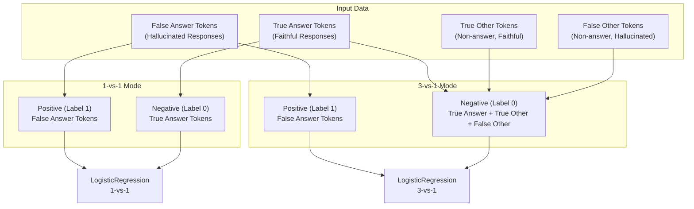
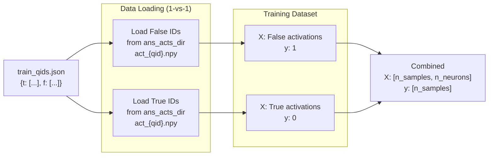
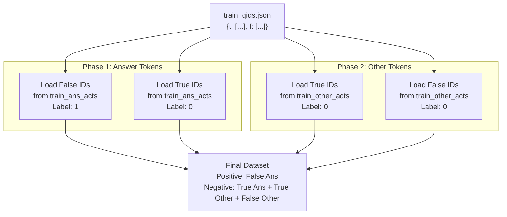
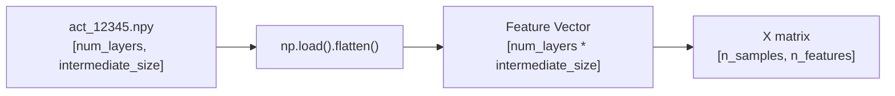

<!-- source: DeepWiki mcp.deepwiki.com · repo thunlp/H-Neurons · page 6.1 Training Modes (1-vs-1 and 3-vs-1) · fetched 2026-11-02 -->

# Training Modes (1-vs-1 and 3-vs-1)

<details>
<summary>Relevant source files</summary>

The following files were used as context for generating this wiki page:

- [README.md](README.md)
- [scripts/classifier.py](scripts/classifier.py)

</details>


## Purpose and Scope

This page describes the two training modes available in the H-Neurons classifier: **1-vs-1** and **3-vs-1**. These modes determine how training data is labeled and combined to create the binary classification task for identifying hallucination-associated neurons.

For information about regularization options (L1 vs L2), see [Regularization Options](#6.2). For details on activation extraction locations, see [Activation Extraction Locations](#6.3). For the complete classifier training workflow, see [Step 5: Classifier Training](#4.5).

## Overview

The H-Neurons classifier uses logistic regression to distinguish between hallucinated and faithful responses based on neuron activations. The training mode determines which activation samples are labeled as positive (hallucinated, label=1) and which are labeled as negative (faithful, label=0).

Both modes use the same underlying algorithm (`LogisticRegression` from scikit-learn) but differ fundamentally in their training set composition, which affects the resulting classifier's behavior and the neurons it identifies.



**Sources:** [README.md:123-125](), [scripts/classifier.py:30](), [scripts/classifier.py:37-42]()

## 1-vs-1 Training Mode

### Definition

In **1-vs-1** mode, the classifier is trained to distinguish between:
- **Positive class (Label 1):** Activations from answer tokens in hallucinated responses
- **Negative class (Label 0):** Activations from answer tokens in faithful responses

This mode creates a direct binary contrast focusing exclusively on answer token activations, comparing how neurons behave when the model produces incorrect versus correct factual content.

### Data Loading Process

The `load_data` function in `classifier.py` implements the 1-vs-1 data loading as follows:



The implementation iterates through question IDs from the `f` (false/hallucinated) and `t` (true/faithful) lists, loading the corresponding activation files from the answer tokens directory.

**Sources:** [scripts/classifier.py:48-60]()

### Use Cases

The 1-vs-1 mode is recommended when:

| Criterion | Recommendation |
|-----------|----------------|
| **Primary Goal** | Maximize classification accuracy for hallucination detection |
| **Application** | Real-time hallucination monitoring or quality control systems |
| **Interpretability** | Not the primary concern; focus is on predictive performance |
| **Training Efficiency** | Smaller training set (only answer tokens from both classes) |

According to the documentation, **if you just want to achieve the highest predictive accuracy, use this setting** [README.md:124]().

**Sources:** [README.md:123-125]()

## 3-vs-1 Training Mode

### Definition

In **3-vs-1** mode, the classifier is trained to distinguish between:
- **Positive class (Label 1):** Activations from answer tokens in hallucinated responses
- **Negative class (Label 0):** Combined activations from:
  1. Answer tokens in faithful responses
  2. Non-answer tokens in faithful responses
  3. Non-answer tokens in hallucinated responses

This mode creates an asymmetric contrast designed to isolate neurons that are **specifically activated for factual errors** rather than general language processing.

### Data Loading Process



The implementation requires both `train_ans_acts` and `train_other_acts` directories. It loads activations from both directories for both true and false question IDs, but only labels false answer tokens as positive.

**Sources:** [scripts/classifier.py:62-72]()

### Theoretical Motivation

The 3-vs-1 mode is the strategy used in the research paper. By contrasting hallucinated answer tokens against all other token types (including non-answer tokens from both faithful and hallucinated responses), this mode identifies neurons whose activation is specifically associated with producing factual errors, not just any token generation.

This design helps isolate neurons that:
- Are active during hallucination but **not** during normal language generation
- Are specifically involved in factual claim generation rather than general fluency

**Sources:** [README.md:125-126]()

### Use Cases

The 3-vs-1 mode is recommended when:

| Criterion | Recommendation |
|-----------|----------------|
| **Primary Goal** | Identify mechanistically interpretable H-Neurons for analysis |
| **Application** | Research into hallucination mechanisms; targeted intervention |
| **Interpretability** | Critical; need to isolate hallucination-specific neurons |
| **Training Set Size** | Larger training set (requires activations from multiple token locations) |
| **Sparsity** | Often combined with L1 regularization for sparse neuron selection |

This mode is essential when the goal is to perform **neuron-level intervention** on the model, as it identifies neurons whose suppression will reduce hallucinations without damaging general language capabilities.

**Sources:** [README.md:125-126](), [README.md:132-135]()

## Implementation Details

### Command Line Configuration

The training mode is specified via the `--train_mode` argument in `classifier.py`:

```bash
# 1-vs-1 Mode Example
python scripts/classifier.py \
    --model_path /path/to/model \
    --train_ids data/train_qids.json \
    --train_ans_acts data/activations/answer_tokens \
    --train_mode 1-vs-1 \
    --penalty l1 \
    --C 1.0

# 3-vs-1 Mode Example
python scripts/classifier.py \
    --model_path /path/to/model \
    --train_ids data/train_qids.json \
    --train_ans_acts data/activations/answer_tokens \
    --train_other_acts data/activations/all_except_answer_tokens \
    --train_mode 3-vs-1 \
    --penalty l1 \
    --C 1.0
```

Note that 3-vs-1 mode **requires** the `--train_other_acts` parameter, pointing to a directory containing non-answer token activations.

**Sources:** [scripts/classifier.py:30](), [scripts/classifier.py:64-65]()

### Data Loading Function Signature

The core data loading logic is implemented in the `load_data` function:

```python
def load_data(ids_path, ans_acts_dir, other_acts_dir=None, mode="1-vs-1")
```

[scripts/classifier.py:37]()

**Parameters:**
- `ids_path`: Path to JSON file containing `{"t": [...], "f": [...]}` question ID lists
- `ans_acts_dir`: Directory containing answer token activation files (`act_{qid}.npy`)
- `other_acts_dir`: Directory for non-answer token activations (required for 3-vs-1)
- `mode`: Either `"1-vs-1"` or `"3-vs-1"`

**Returns:**
- `X`: NumPy array of shape `[n_samples, n_neurons]` containing flattened activations
- `y`: NumPy array of shape `[n_samples]` containing binary labels (0 or 1)

**Sources:** [scripts/classifier.py:37-74]()

### Activation File Structure

Both modes load activation files following the naming convention `act_{qid}.npy`, where each file contains a multi-dimensional array that is flattened before being added to the feature matrix:



**Sources:** [scripts/classifier.py:52](), [scripts/classifier.py:59](), [scripts/classifier.py:71]()

## Comparison Table

| Aspect | 1-vs-1 Mode | 3-vs-1 Mode |
|--------|-------------|-------------|
| **Positive Samples** | False answer tokens | False answer tokens |
| **Negative Samples** | True answer tokens only | True answer tokens + True other tokens + False other tokens |
| **Training Set Size** | ~2N samples (N true, N false) | ~4N samples (N false answer, 3N all other) |
| **Required Directories** | `train_ans_acts` | `train_ans_acts` + `train_other_acts` |
| **Classification Task** | Answer-level hallucination detection | Hallucination-specific neuron isolation |
| **Typical Accuracy** | Higher (recommended for detection) | Slightly lower but more interpretable |
| **Primary Use Case** | Hallucination detection systems | Mechanistic analysis and intervention |
| **Recommended Penalty** | L1 or L2 | L1 (for sparse H-Neuron identification) |
| **Paper Strategy** | Alternative approach | Used in published research |

**Sources:** [README.md:123-126](), [scripts/classifier.py:37-72]()

## Evaluation Behavior

Regardless of training mode, **evaluation is always performed in 1-vs-1 mode** (comparing true vs false answer tokens):

```python
# From classifier.py line 128
X_test, y_test = load_data(args.test_ids, args.test_acts, mode="1-vs-1")
```

This ensures consistent evaluation metrics across different training strategies. The test set only uses answer token activations and directly compares faithful versus hallucinated responses.

**Sources:** [scripts/classifier.py:126-129]()

## Validation Checks

The implementation includes a validation check to ensure required directories are provided for 3-vs-1 mode:

```python
if mode == "3-vs-1":
    if not other_acts_dir:
        raise ValueError("train_other_acts directory is required for 3-vs-1 mode.")
```

[scripts/classifier.py:64-65]()

This prevents runtime errors when attempting to load other token activations without the appropriate directory specified.

**Sources:** [scripts/classifier.py:64-65]()

## Recommended Workflows

### For Maximum Detection Accuracy

```bash
# Extract activations for answer tokens only
python scripts/extract_activations.py \
    --model_path /path/to/model \
    --input_path data/answer_tokens.jsonl \
    --train_ids_path data/train_qids.json \
    --output_root data/activations \
    --locations answer_tokens \
    --method mean \
    --use_mag --use_abs

# Train with 1-vs-1 mode and L2 regularization
python scripts/classifier.py \
    --model_path /path/to/model \
    --train_ids data/train_qids.json \
    --train_ans_acts data/activations/answer_tokens \
    --train_mode 1-vs-1 \
    --penalty l2 \
    --save_model models/detector.pkl
```

### For H-Neuron Identification and Intervention

```bash
# Extract activations for both answer and other tokens
python scripts/extract_activations.py \
    --model_path /path/to/model \
    --input_path data/answer_tokens.jsonl \
    --train_ids_path data/train_qids.json \
    --output_root data/activations \
    --locations answer_tokens all_except_answer_tokens \
    --method mean \
    --use_mag --use_abs

# Train with 3-vs-1 mode and L1 regularization
python scripts/classifier.py \
    --model_path /path/to/model \
    --train_ids data/train_qids.json \
    --train_ans_acts data/activations/answer_tokens \
    --train_other_acts data/activations/all_except_answer_tokens \
    --train_mode 3-vs-1 \
    --penalty l1 \
    --C 1.0 \
    --save_model models/h_neurons.pkl
```

**Sources:** [README.md:97-121]()

---

