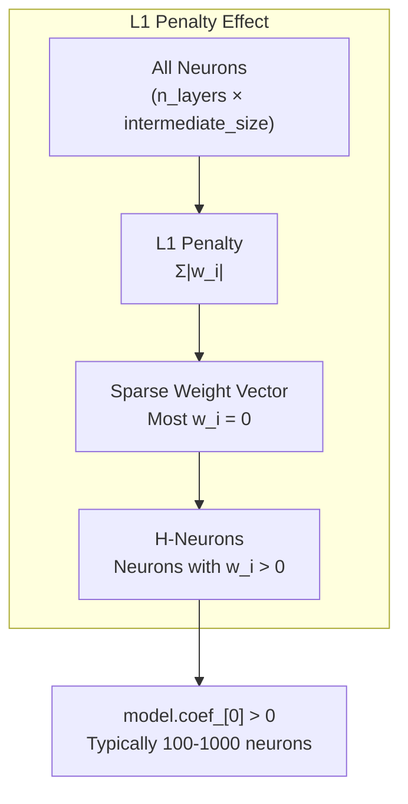
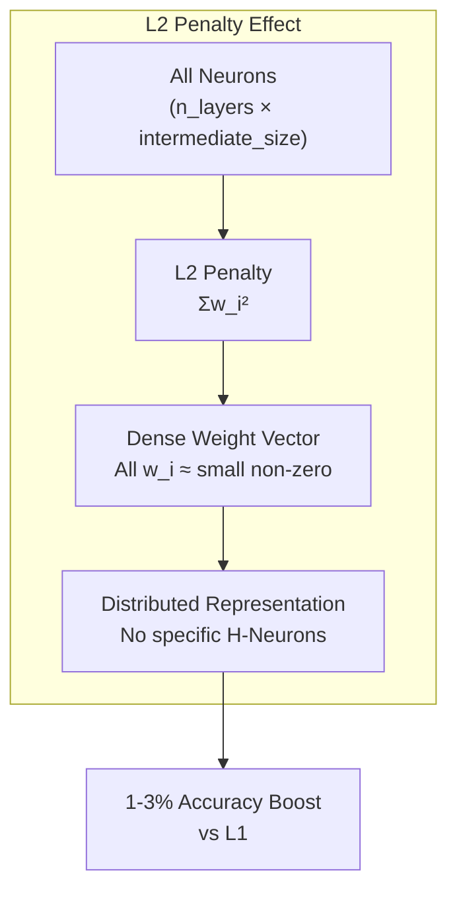
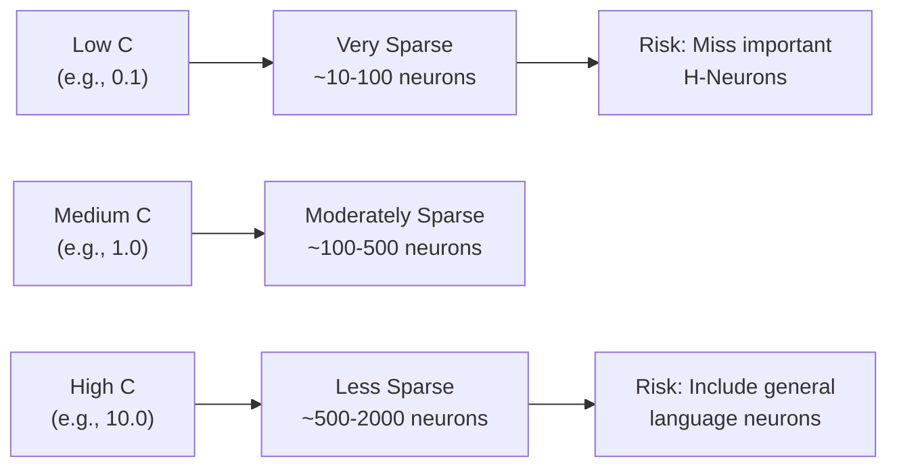
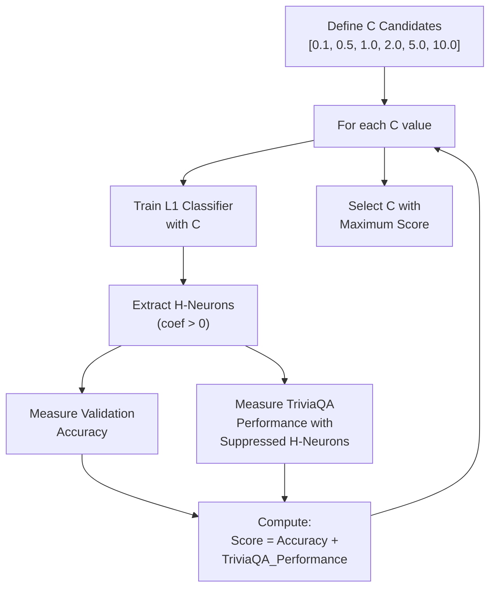
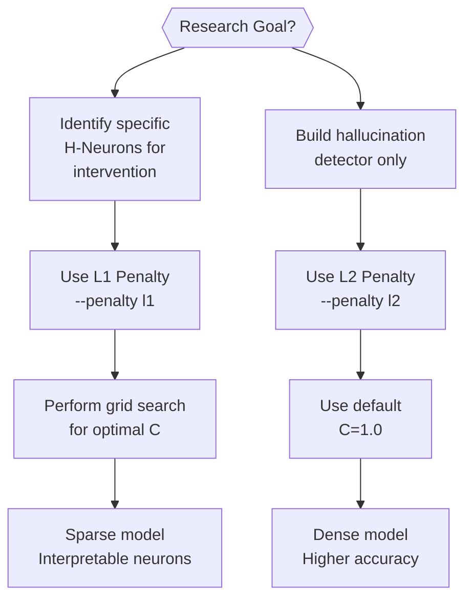

<!-- source: DeepWiki mcp.deepwiki.com · repo thunlp/H-Neurons · page 6.2 Regularization Options (L1 vs L2) · fetched 2026-11-02 -->

# Regularization Options (L1 vs L2)

<details>
<summary>Relevant source files</summary>

The following files were used as context for generating this wiki page:

- [README.md](README.md)
- [scripts/classifier.py](scripts/classifier.py)

</details>


This document explains the regularization options available for training the H-Neuron classifier, specifically comparing L1 (Lasso) and L2 (Ridge) penalties. The choice of regularization fundamentally affects whether the classifier identifies a sparse, interpretable set of H-Neurons or achieves maximum detection accuracy.

For information about training mode selection (1-vs-1 vs 3-vs-1), see [Training Modes](#6.1). For details on the classifier training pipeline, see [Step 5: Classifier Training](#4.5).

## Overview of Regularization in H-Neurons

The H-Neuron detection system uses Logistic Regression with configurable regularization to train a binary classifier that distinguishes hallucinated responses from faithful ones. The regularization penalty serves two distinct purposes depending on the research goal:

- **Mechanistic Interpretability**: Identifying specific neurons causally linked to hallucinations
- **Predictive Performance**: Building an accurate hallucination detector

The regularization choice is specified via the `--penalty` parameter in [scripts/classifier.py](). The system supports both `l1` and `l2` penalties, each with fundamentally different characteristics.

**Sources:** [scripts/classifier.py:31-32](), [README.md:127-135]()

## L1 Regularization (Lasso)

### Sparsity Properties

L1 regularization applies an L1 penalty to the logistic regression loss function, which drives most neuron weights to exactly zero. This produces a sparse model where only a small subset of neurons have non-zero coefficients.



**Diagram: L1 Regularization Flow**

The sparsity-inducing property is essential for identifying specific H-Neurons that can be manipulated during model intervention. After training with L1, the non-zero weights indicate neurons with the strongest association to hallucination behavior.

**Sources:** [scripts/classifier.py:108-117](), [README.md:128-129]()

### Use Cases for L1

L1 regularization should be used when:

| Use Case | Rationale |
|----------|-----------|
| **Neuron-level intervention** | Sparse weights identify specific neurons to suppress/amplify during inference |
| **Mechanistic interpretability** | Non-zero neurons represent interpretable hallucination-associated features |
| **Downstream analysis** | Enables studying properties of identified H-Neurons (e.g., activation patterns, layer distribution) |
| **Model modification** | Provides precise neuron indices for targeted intervention via [scripts/intervene_model.py]() |

The primary output when using L1 is the count of identified H-Neurons, accessible via `np.sum(model.coef_[0] > 0)` after training.

**Sources:** [README.md:128-129](), [scripts/classifier.py:117]()

## L2 Regularization (Ridge)

### Dense Weight Properties

L2 regularization applies an L2 penalty (squared magnitude) to the loss function, which shrinks all weights toward zero but rarely makes them exactly zero. This produces a dense model where all neurons contribute small amounts to the classification decision.



**Diagram: L2 Regularization Flow**

L2 regularization distributes the classification signal across many neurons, leading to better generalization and typically higher accuracy on held-out test sets.

**Sources:** [README.md:129-130]()

### Performance Benefits

According to empirical evaluation, L2 regularization provides a **1-3% boost in accuracy** compared to L1 regularization. This improvement comes from:

1. **Better generalization**: Small weights from all neurons combine to form a more robust decision boundary
2. **Reduced overfitting**: L2 penalty prevents any single neuron from dominating the classification
3. **Stability**: Dense models are less sensitive to activation noise

However, L2 sacrifices interpretability—there is no clear subset of "H-Neurons" to extract for intervention purposes.

**Sources:** [README.md:129-130]()

### Use Cases for L2

L2 regularization should be used when:

| Use Case | Rationale |
|----------|-----------|
| **Hallucination detection only** | Maximum accuracy without need for neuron-level intervention |
| **Production deployment** | Better generalization to unseen data distributions |
| **Evaluation benchmarking** | When comparing classifier performance against baselines |

If the goal is purely detection (not intervention), L2 with default `C=1.0` is recommended.

**Sources:** [README.md:129-130](), [README.md:135]()

## The C Parameter

### Definition and Meaning

The `C` parameter controls the **inverse of regularization strength**:

- **High C** (e.g., 10.0): Weak regularization, model focuses on fitting training data
- **Low C** (e.g., 0.1): Strong regularization, model heavily penalizes large weights

The relationship is: `regularization_strength = 1 / C`

**Sources:** [scripts/classifier.py:32](), [README.md:131-135]()

### Effect on L1 Sparsity

For L1 regularization, `C` directly controls the number of non-zero neurons identified:



**Diagram: C Parameter Effect on Sparsity**

**Sources:** [README.md:131-134]()

### Grid Search Strategy

The optimal `C` value balances two competing objectives:

1. **Classification accuracy** on held-out validation set
2. **Model performance on TriviaQA** when suppressing identified H-Neurons

The recommended approach is:



**Diagram: Grid Search for Optimal C**

This two-metric approach ensures the identified H-Neurons are both (1) predictive of hallucinations and (2) safe to suppress without degrading general language capabilities.

**Sources:** [README.md:131-134]()

## Choosing the Right Regularization

### Decision Criteria

The regularization choice depends entirely on the intended use of the trained classifier:



**Diagram: Regularization Selection Decision Tree**

**Sources:** [README.md:127-135]()

### Trade-off Summary

| Dimension | L1 (Lasso) | L2 (Ridge) |
|-----------|------------|------------|
| **Sparsity** | High (most weights = 0) | None (all weights ≠ 0) |
| **Accuracy** | Baseline | +1-3% improvement |
| **Interpretability** | Identifies specific H-Neurons | Distributed across all neurons |
| **Intervention** | Enables targeted neuron suppression | Not suitable for intervention |
| **C Selection** | Requires grid search | Default C=1.0 sufficient |
| **Primary Use** | Mechanistic research | Hallucination detection |

**Sources:** [README.md:127-135]()

## Implementation Details

### Code Location and Parameters

The regularization configuration is handled in [scripts/classifier.py]():

- **Penalty specification**: [scripts/classifier.py:31]() defines `--penalty` with choices `["l1", "l2"]`
- **C parameter**: [scripts/classifier.py:32]() defines `--C` with default `1.0`
- **Solver specification**: [scripts/classifier.py:33]() defines `--solver` (default `liblinear`)

The LogisticRegression model is instantiated at [scripts/classifier.py:108-111]():

```python
model = LogisticRegression(
    penalty=args.penalty, C=args.C, solver=args.solver, 
    max_iter=1000, random_state=42, verbose=1
)
```

**Sources:** [scripts/classifier.py:31-33](), [scripts/classifier.py:108-111]()

### Solver Compatibility

The `solver` parameter must be compatible with the chosen penalty:

| Solver | L1 Support | L2 Support | Notes |
|--------|------------|------------|-------|
| `liblinear` | ✓ | ✓ | Default, efficient for small datasets |
| `saga` | ✓ | ✓ | Required for large-scale problems |
| `lbfgs` | ✗ | ✓ | Does not support L1 |
| `sag` | ✗ | ✓ | Does not support L1 |

The default `liblinear` solver supports both L1 and L2. For very large activation matrices, consider switching to `saga` via `--solver saga`.

**Sources:** [scripts/classifier.py:33]()

### H-Neuron Extraction

After training with L1 regularization, the number of identified H-Neurons is computed and printed:

```python
print(f"Model saved. Identified {np.sum(model.coef_[0] > 0)} potential H-Neurons.")
```

The coefficient vector `model.coef_[0]` has shape `(n_neurons,)` where `n_neurons = n_layers × intermediate_size`. Positive coefficients indicate neurons associated with hallucination (label 1), while zero coefficients indicate neurons excluded by L1 sparsity.

**Sources:** [scripts/classifier.py:117]()

### Example Commands

**L1 for H-Neuron identification:**
```bash
python scripts/classifier.py \
    --model_path /path/to/model \
    --train_ids data/train_qids.json \
    --train_ans_acts data/activations/answer_tokens \
    --train_other_acts data/activations/all_except_answer_tokens \
    --train_mode 3-vs-1 \
    --penalty l1 \
    --C 1.0 \
    --save_model models/h_neurons_l1.pkl
```

**L2 for maximum detection accuracy:**
```bash
python scripts/classifier.py \
    --model_path /path/to/model \
    --train_ids data/train_qids.json \
    --train_ans_acts data/activations/answer_tokens \
    --train_other_acts data/activations/all_except_answer_tokens \
    --train_mode 1-vs-1 \
    --penalty l2 \
    --C 1.0 \
    --save_model models/detector_l2.pkl
```

**Sources:** [README.md:112-121](), [README.md:124-130]()

---

