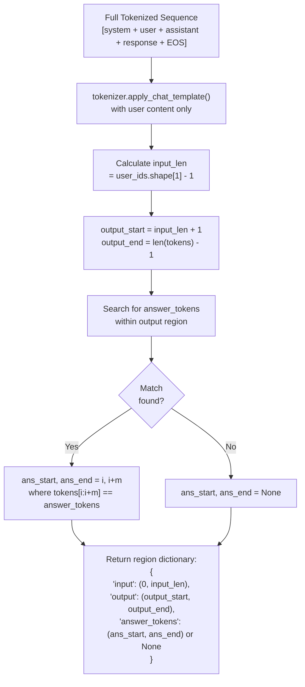
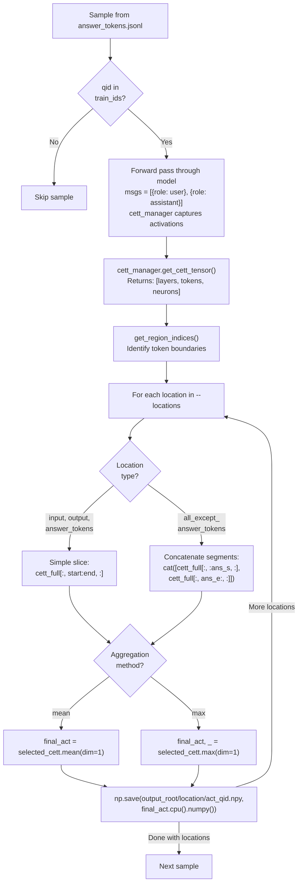
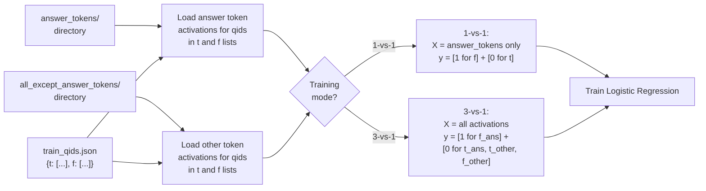

<!-- source: DeepWiki mcp.deepwiki.com · repo thunlp/H-Neurons · page 6.3 Activation Extraction Locations · fetched 2026-11-02 -->

# Activation Extraction Locations

<details>
<summary>Relevant source files</summary>

The following files were used as context for generating this wiki page:

- [README.md](README.md)
- [scripts/extract_activations.py](scripts/extract_activations.py)

</details>


This page explains the different token location options and aggregation methods available when extracting CETT neuron activations using [scripts/extract_activations.py](). These options control which portions of the input-output sequence are used to compute neuron contribution scores, and how those contributions are aggregated into a single activation vector per sample.

For information about the CETT metric itself and how activations are computed, see [7.1](#7.1). For the overall activation extraction process, see [4.4](#4.4).

---

## Overview

The activation extraction system supports four distinct **location options** that determine which tokens' activations are captured:

| Location | Description | Typical Use Case |
|----------|-------------|------------------|
| `input` | User prompt region only | Analyzing prompt-specific effects |
| `output` | Full assistant response | Training without answer token tagging |
| `answer_tokens` | Tokens tagged as factual content | Primary training mode (highest accuracy) |
| `all_except_answer_tokens` | Output tokens excluding answers | Negative class in 3-vs-1 training mode |

Additionally, two **aggregation methods** determine how multiple token activations are combined:

| Method | Operation | When to Use |
|--------|-----------|-------------|
| `mean` | Average across selected tokens | Default; stable representation |
| `max` | Maximum activation per neuron | Emphasizes peak contributions |

Sources: [scripts/extract_activations.py:10-24](), [README.md:95-106]()

---

## Location Options

### Specifying Locations

Locations are specified via the `--locations` command-line argument, which accepts one or more of the four options:

```bash
python scripts/extract_activations.py \
    --model_path /path/to/model \
    --input_path data/answer_tokens.jsonl \
    --train_ids_path data/train_qids.json \
    --output_root data/activations \
    --locations answer_tokens all_except_answer_tokens input output \
    --method mean \
    --use_mag --use_abs
```

Each specified location creates a separate subdirectory under `--output_root` containing `.npy` files for each processed sample.

Sources: [scripts/extract_activations.py:18-20](), [README.md:98-106]()

---

### Token Region Identification

The system identifies token boundaries using the `get_region_indices` function, which analyzes the tokenized sequence to determine where each region begins and ends:



**Token Region Identification Process**

Sources: [scripts/extract_activations.py:68-97]()

---

### Input Location (`input`)

Extracts activations from the **user prompt** portion of the conversation, excluding the system message header and the assistant's response.

**Token Boundaries:**
- Start: Token index `0`
- End: Token index `input_len` (calculated as `user_ids.shape[1] - 1`)

**Implementation:**
```python
# From get_region_indices
user_ids = tokenizer.apply_chat_template([{"role": "user", "content": question}], 
                                         return_tensors="pt")
input_len = user_ids.shape[1] - 1
```

**When to Use:**
- Analyzing how prompt characteristics influence hallucination
- Debugging prompt-specific effects
- Comparative studies of input vs output activations

**Output Structure:**
- Directory: `{output_root}/input/`
- Files: `act_{qid}.npy` for each sample
- Shape: `[num_layers, num_neurons]` per file

Sources: [scripts/extract_activations.py:74-76](), [scripts/extract_activations.py:94]()

---

### Output Location (`output`)

Extracts activations from the **complete assistant response**, from the first response token to the final token before EOS.

**Token Boundaries:**
- Start: Token index `input_len + 1` (after assistant header)
- End: Token index `len(full_tokens) - 1` (excluding EOS token)

**Implementation:**
```python
# From get_region_indices
output_start = input_len + 1 
output_end = len(full_tokens) - 1  # Exclude EOS
```

**When to Use:**
- Training classifiers without the overhead of LLM-based answer token tagging
- Analyzing overall response characteristics
- Avoiding the cost and time of Step 2 (Answer Token Extraction)

**Cost-Saving Note:**
As mentioned in [README.md:70](), if you want to avoid the additional overhead of tagging answer tokens, you can manually construct an `answer_tokens.jsonl` file where the `answer_tokens` field is an empty list `[]` for all entries, then use `--locations output` for both training and testing.

**Output Structure:**
- Directory: `{output_root}/output/`
- Files: `act_{qid}.npy` for each sample
- Shape: `[num_layers, num_neurons]` per file

Sources: [scripts/extract_activations.py:78-81](), [scripts/extract_activations.py:95](), [README.md:68-80]()

---

### Answer Tokens Location (`answer_tokens`)

Extracts activations from **only the tokens identified as factual answer content** by the LLM-based tagging process in Step 2.

**Token Boundaries:**
- Start: Token index `ans_start` (first token of answer match)
- End: Token index `ans_end` (exclusive; last token + 1)
- Value: `None` if no answer tokens were found/tagged

**Implementation:**
The system performs a sliding window search to find the exact position where the tagged answer tokens appear in the output:

```python
# From get_region_indices
ans_start, ans_end = None, None
m = len(answer_tokens)

if m != 0:
    for i in range(output_start, len(full_tokens) - m + 1):
        if full_tokens[i : i + m] == answer_tokens:
            ans_start, ans_end = i, i + m
            break
```

**Token Normalization:**
Answer tokens are normalized to match the tokenizer's format by replacing special characters:
```python
answer_tokens = [token.replace("▁", " ").replace("Ġ", " ") for token in answer_tokens]
```

**When to Use:**
- **Primary training mode** - Yields highest prediction accuracy (as noted in [README.md:68-70]())
- Focusing classifier on factual content rather than reasoning or formatting tokens
- Training in `1-vs-1` mode (hallucinated vs faithful answer tokens)
- Training in `3-vs-1` mode (hallucinated answer tokens vs all else)

**Handling Missing Answer Tokens:**
If the search fails to find matching answer tokens, the region is set to `None`, and the sample is skipped during extraction:

```python
if loc != "all_except_answer_tokens" and indices:
    selected_cett = cett_full[:, indices[0]:indices[1], :]
elif loc != "all_except_answer_tokens":
    continue  # Skip this location for this sample
```

**Output Structure:**
- Directory: `{output_root}/answer_tokens/`
- Files: `act_{qid}.npy` for each sample (only if answer tokens found)
- Shape: `[num_layers, num_neurons]` per file

Sources: [scripts/extract_activations.py:71-72](), [scripts/extract_activations.py:84-91](), [scripts/extract_activations.py:96](), [scripts/extract_activations.py:143-146]()

---

### All Except Answer Tokens Location (`all_except_answer_tokens`)

Extracts activations from **all output tokens excluding the answer tokens**. This is accomplished by concatenating the segments before and after the answer token region.

**Token Selection Logic:**
If answer tokens are found at positions `[ans_start, ans_end)`, this location extracts:
- Segment 1: Output tokens from `output_start` to `ans_start` (exclusive)
- Segment 2: Output tokens from `ans_end` to `output_end` (exclusive)

**Implementation:**
This location uses special concatenation logic rather than simple slicing:

```python
# From main extraction loop
elif loc == "all_except_answer_tokens" and regions["answer_tokens"]:
    # Special logic for inverse slicing
    ans_s, ans_e = regions["answer_tokens"]
    # Concatenate segments before and after answer tokens within the output
    seg1 = cett_full[:, :ans_s, :]
    seg2 = cett_full[:, ans_e:, :]
    selected_cett = torch.cat([seg1, seg2], dim=1)
```

**When to Use:**
- **3-vs-1 training mode** - Forms part of the negative class along with faithful answer tokens
- Analyzing non-factual tokens (reasoning, formatting, conversational tokens)
- Comparative studies of answer vs non-answer token activations

**Dependency:**
This location requires that answer tokens have been successfully identified. If `regions["answer_tokens"]` is `None`, this location is skipped for that sample.

**Output Structure:**
- Directory: `{output_root}/all_except_answer_tokens/`
- Files: `act_{qid}.npy` for each sample (only if answer tokens found)
- Shape: `[num_layers, num_neurons]` per file

Sources: [scripts/extract_activations.py:135-141]()

---

## Aggregation Methods

After selecting tokens based on the location, the system aggregates activations across the token dimension to produce a single `[num_layers, num_neurons]` activation vector per sample.

### Method Selection

The aggregation method is specified via the `--method` argument:

```bash
--method mean  # Default; average across tokens
--method max   # Maximum activation per neuron
```

Sources: [scripts/extract_activations.py:21]()

---

### Mean Aggregation (`mean`)

Computes the **average activation** for each neuron across all selected tokens.

**Implementation:**
```python
if args.method == "mean": 
    final_act = selected_cett.mean(dim=1)
```

**Characteristics:**
- Provides a **stable, balanced representation** of neuron activity
- Reduces impact of outlier token activations
- Recommended for most use cases

**Input Shape:** `[num_layers, num_tokens, num_neurons]`  
**Output Shape:** `[num_layers, num_neurons]`

Sources: [scripts/extract_activations.py:149]()

---

### Max Aggregation (`max`)

Captures the **maximum activation** for each neuron across all selected tokens.

**Implementation:**
```python
else: 
    final_act, _ = selected_cett.max(dim=1)
```

**Characteristics:**
- Emphasizes **peak neuron contributions**
- More sensitive to individual token effects
- Useful for detecting sparse activation patterns

**Input Shape:** `[num_layers, num_tokens, num_neurons]`  
**Output Shape:** `[num_layers, num_neurons]`

Sources: [scripts/extract_activations.py:150]()

---

## Extraction Pipeline Flow

The following diagram illustrates how location and aggregation options flow through the extraction process:



**Complete Activation Extraction Flow**

Sources: [scripts/extract_activations.py:117-154]()

---

## Directory Structure and Output Format

### Output Organization

Each location creates a separate subdirectory under the `--output_root` path:

```
data/activations/
├── answer_tokens/
│   ├── act_12345.npy
│   ├── act_12346.npy
│   └── ...
├── all_except_answer_tokens/
│   ├── act_12345.npy
│   ├── act_12346.npy
│   └── ...
├── input/
│   ├── act_12345.npy
│   └── ...
└── output/
    ├── act_12345.npy
    └── ...
```

Sources: [scripts/extract_activations.py:111-112]()

---

### File Naming Convention

Each activation file follows the pattern:
```
act_{qid}.npy
```

Where `{qid}` is the question ID from the input JSONL file.

**Example:**
```python
save_path = os.path.join(args.output_root, loc, f"act_{qid}.npy")
np.save(save_path, final_act.cpu().float().numpy())
```

Sources: [scripts/extract_activations.py:152-153]()

---

### Activation Array Format

Each `.npy` file contains a 2D NumPy array:

| Dimension | Size | Description |
|-----------|------|-------------|
| Axis 0 | `num_layers` | Number of transformer layers in the model |
| Axis 1 | `num_neurons` | Number of intermediate neurons per layer (FFN dimension) |

**Data Type:** `float32` (converted from `bfloat16` via `.cpu().float()`)

**Example Usage in Classifier:**
```python
# Loading activations for training
import numpy as np

activation = np.load(f"data/activations/answer_tokens/act_{qid}.npy")
# Shape: [num_layers, num_neurons]
```

Sources: [scripts/extract_activations.py:153]()

---

## Usage Recommendations

### For Training Classifiers

The recommended configuration depends on your training mode (see [6.1](#6.1)):

**1-vs-1 Mode (Highest Accuracy):**
```bash
--locations answer_tokens
```
- Use only the `answer_tokens` location
- Classifier distinguishes hallucinated vs faithful answer tokens
- Provides maximum prediction accuracy

**3-vs-1 Mode (Paper's Approach):**
```bash
--locations answer_tokens all_except_answer_tokens
```
- Use both `answer_tokens` and `all_except_answer_tokens`
- Isolates neurons specifically linked to factual errors
- Negative class includes faithful answer tokens + all other tokens

Sources: [README.md:123-125]()

---

### For Cost-Saving Without LLM Tagging

If you want to avoid the computational cost and API expenses of Step 2 (Answer Token Extraction):

```bash
# Step 2 Alternative: Create empty answer_tokens.jsonl manually
# Set answer_tokens field to [] for all entries

# Step 4: Extract from full output
--locations output
```

This approach sacrifices some accuracy but eliminates the need for GPT-4 API calls to tag answer tokens.

Sources: [README.md:68-80]()

---

### Aggregation Method Selection

**Use `mean` (default) when:**
- You want a stable, balanced representation
- Training a classifier for general detection
- Working with variable-length answer spans

**Use `max` when:**
- You want to emphasize peak neuron activations
- Analyzing sparse activation patterns
- Investigating individual token effects

Sources: [scripts/extract_activations.py:21](), [scripts/extract_activations.py:149-150]()

---

## Integration with Classifier Training

The classifier training script ([scripts/classifier.py]()) expects activations in this directory structure:



**Classifier Integration with Activation Locations**

The `--train_ans_acts` argument points to the `answer_tokens/` directory, while `--train_other_acts` points to `all_except_answer_tokens/`:

```bash
python scripts/classifier.py \
    --train_ids data/train_qids.json \
    --train_ans_acts data/activations/answer_tokens \
    --train_other_acts data/activations/all_except_answer_tokens \
    --train_mode 3-vs-1
```

Sources: [README.md:112-121]()

---

## Technical Implementation Details

### CETT Tensor Shape Transformations

The extraction process involves several shape transformations:

| Stage | Shape | Description |
|-------|-------|-------------|
| Captured activations | List of `[batch, tokens, neurons]` | One tensor per layer from hooks |
| Stacked activations | `[tokens, layers, neurons]` | After `torch.stack()` and `transpose(0,1)` |
| Full CETT tensor | `[layers, tokens, neurons]` | After normalization and transpose |
| Location selection | `[layers, selected_tokens, neurons]` | After slicing/concatenation |
| Aggregated output | `[layers, neurons]` | After mean/max along token dimension |

Sources: [scripts/extract_activations.py:55-66](), [scripts/extract_activations.py:129-153]()

---

### Processing Flags

Two additional flags modify how activations are processed before aggregation:

**`--use_mag` (default: True):**
Multiplies activations by weight magnitudes to account for neuron importance:
```python
if use_mag: 
    acts = acts * self.weight_norms.unsqueeze(0)
```

**`--use_abs` (default: True):**
Takes absolute values of activations:
```python
if use_abs: 
    acts = torch.abs(acts)
```

These flags are typically kept enabled for standard CETT extraction.

Sources: [scripts/extract_activations.py:22-23](), [scripts/extract_activations.py:63-64]()

---

## Summary Table

| Location | Token Range | Primary Use | Requires Answer Tagging |
|----------|-------------|-------------|-------------------------|
| `input` | User prompt | Prompt analysis | No |
| `output` | Full response | Cost-effective training | No |
| `answer_tokens` | Tagged factual tokens | Highest accuracy training | Yes |
| `all_except_answer_tokens` | Response minus answers | 3-vs-1 negative class | Yes |

| Aggregation | Operation | Best For |
|-------------|-----------|----------|
| `mean` | Average across tokens | Stable representation, general use |
| `max` | Maximum per neuron | Peak activation analysis |

Sources: [scripts/extract_activations.py:18-24]()

---

