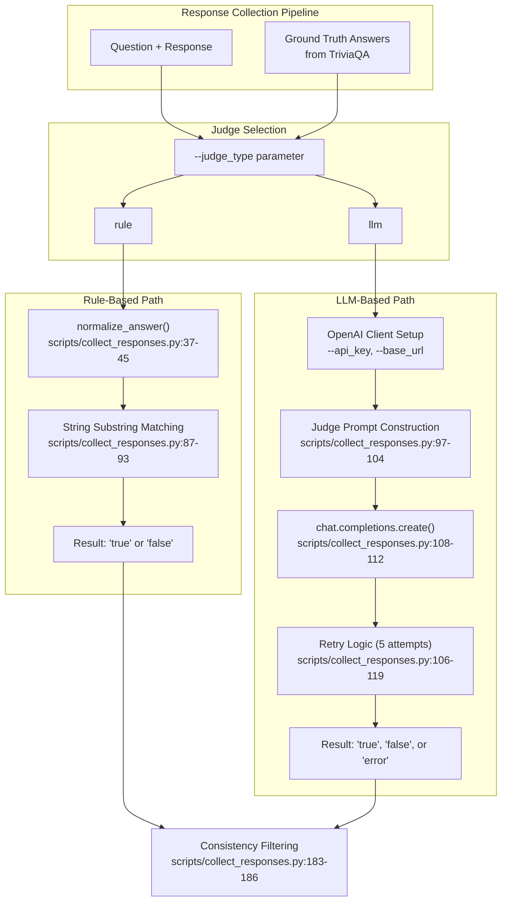
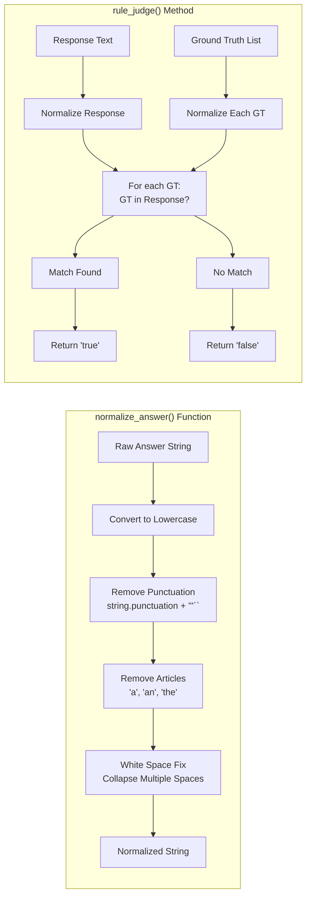
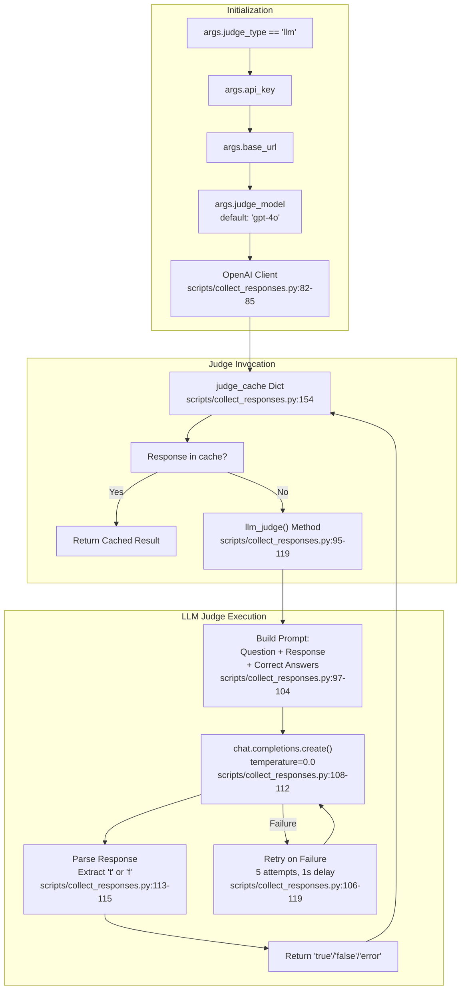
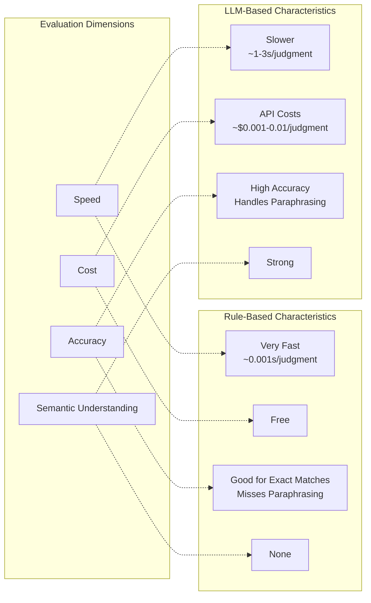
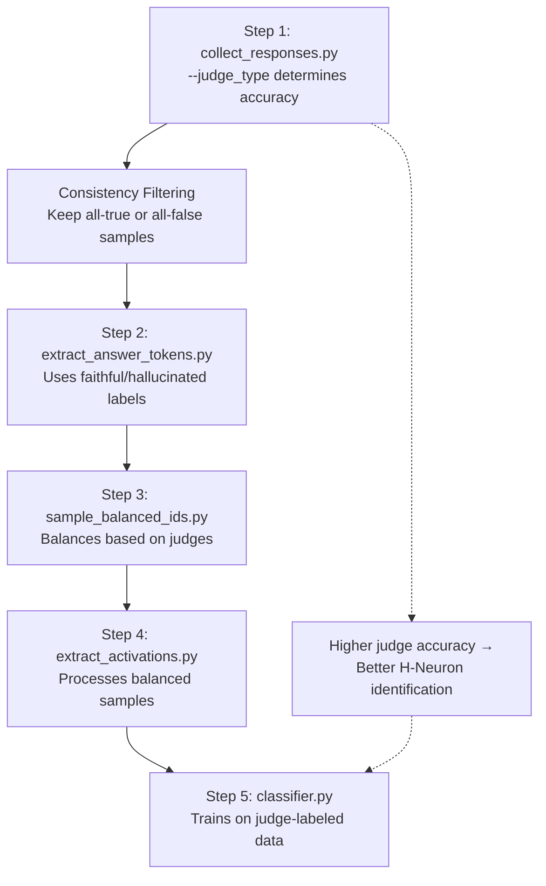

<!-- source: DeepWiki mcp.deepwiki.com · repo thunlp/H-Neurons · page 6.4 Judging Strategies · fetched 2026-11-02 -->

# Judging Strategies

<details>
<summary>Relevant source files</summary>

The following files were used as context for generating this wiki page:

- [README.md](README.md)
- [scripts/collect_responses.py](scripts/collect_responses.py)

</details>


## Purpose and Scope

This page describes the two judging strategies available in the H-Neurons pipeline for evaluating response correctness during the response collection phase. Judging determines whether a model's response to a question is faithful (correct) or hallucinated (incorrect), which is essential for identifying hallucination-associated neurons.

For information about the complete response collection process, see [Step 1: Response Collection](#4.1). For details on how judging impacts the balanced sampling process, see [Step 3: Balanced ID Sampling](#4.3).

---

## Overview of Judging Methods

The H-Neurons pipeline supports two distinct approaches for judging response correctness, controlled by the `--judge_type` parameter in `collect_responses.py`:

1. **Rule-Based Judging** (`rule`): Fast, deterministic string-matching approach
2. **LLM-Based Judging** (`llm`): Flexible, semantically-aware evaluation using an external LLM



**Sources:** [scripts/collect_responses.py:1-205]()

---

## Rule-Based Judging

### Implementation

Rule-based judging uses deterministic string normalization and substring matching to determine correctness. The implementation consists of two primary components:

1. **Answer Normalization** ([scripts/collect_responses.py:37-45]())
2. **Substring Matching** ([scripts/collect_responses.py:87-93]())



### Normalization Process

The `normalize_answer()` function performs the following transformations:

| Step | Transformation | Example |
|------|---------------|---------|
| 1. Lowercase | Convert all characters to lowercase | "The Beatles" → "the beatles" |
| 2. Underscore Replacement | Replace underscores with spaces | "New_York" → "New York" |
| 3. Punctuation Removal | Remove all punctuation marks | "John's" → "Johns" |
| 4. Article Removal | Remove "a", "an", "the" | "the beatles" → "beatles" |
| 5. Whitespace Collapse | Reduce multiple spaces to single space | "the  beatles" → "beatles" |

### Matching Logic

The `rule_judge()` method ([scripts/collect_responses.py:87-93]()):

```python
def rule_judge(self, response: str, norm_gts: List[str]) -> str:
    """Simple string matching judge."""
    norm_res = normalize_answer(response)
    for gt in norm_gts:
        if gt and gt in norm_res:
            return "true"
    return "false"
```

The method returns `"true"` if **any** normalized ground truth answer appears as a substring in the normalized response.

### Characteristics

| Aspect | Description |
|--------|-------------|
| **Speed** | Very fast (~0.001s per judgment) |
| **Cost** | Free (no API calls) |
| **Determinism** | Completely deterministic |
| **Semantic Understanding** | None - purely lexical matching |
| **False Positives** | Can occur when answer appears in negation context |
| **False Negatives** | Can occur with paraphrasing or different phrasing |

**Sources:** [scripts/collect_responses.py:37-45](), [scripts/collect_responses.py:87-93]()

---

## LLM-Based Judging

### Implementation

LLM-based judging leverages an external language model (default: GPT-4o) to evaluate whether a response correctly answers the question. This approach provides semantic understanding beyond simple string matching.



### Prompt Structure

The LLM judge uses a structured prompt ([scripts/collect_responses.py:97-104]()):

```
Question: {question}
Response: {response}
Correct Answers: {answer_list}
Please judge whether the response is correct or not. 
Return 't' if the response is correct, and 'f' if the response is incorrect. 
Don't add any additional information.
```

This prompt design:
- Provides full context (question, response, and ground truth)
- Requests binary output ('t' or 'f')
- Explicitly discourages additional explanation to minimize tokens

### Caching Mechanism

To optimize API usage, the system implements response-level caching ([scripts/collect_responses.py:154-175]()):

```python
judge_cache = {}  # Initialized per question

for _ in range(self.args.sample_num):
    # ... generate response ...
    if ans not in judge_cache:
        judge_cache[ans] = self.llm_judge(question, ans, raw_aliases)
    judges.append(judge_cache[ans])
```

When collecting multiple samples per question (e.g., `--sample_num 10`), identical responses are judged only once, reducing API costs.

### Retry Logic

The `llm_judge()` method implements robust error handling ([scripts/collect_responses.py:106-119]()):

| Attempt | Action | Delay |
|---------|--------|-------|
| 1-5 | Call API and parse response | 1s between attempts |
| All Failed | Return `"error"` | N/A |

The method parses the response by searching for 't' or 'f' characters, making it resilient to minor formatting variations in the LLM's output.

### Characteristics

| Aspect | Description |
|--------|-------------|
| **Speed** | Slower (~1-3s per judgment, depending on API) |
| **Cost** | Requires API credits |
| **Determinism** | Temperature=0.0 for consistency, but not fully deterministic |
| **Semantic Understanding** | High - understands paraphrasing, negation, context |
| **False Positives** | Rare - strong semantic understanding |
| **False Negatives** | Occasional - depends on judge model capability |

**Sources:** [scripts/collect_responses.py:95-119](), [scripts/collect_responses.py:154-175]()

---

## Comparison and Use Cases

### Performance Comparison



### Detailed Comparison Table

| Criterion | Rule-Based (`rule`) | LLM-Based (`llm`) |
|-----------|---------------------|-------------------|
| **Implementation** | `normalize_answer()` + substring matching | OpenAI API call to GPT-4o |
| **Time per Question** | ~0.01s (10 samples) | ~10-30s (10 samples, with caching) |
| **Cost per 1000 Questions** | $0 | ~$10-50 (depends on model, input/output tokens) |
| **Setup Required** | None | API key, base URL, judge model name |
| **Handles Paraphrasing** | ❌ No | ✅ Yes |
| **Handles Negation** | ❌ No (false positives) | ✅ Yes |
| **Handles Abbreviations** | ⚠️ Sometimes | ✅ Yes |
| **Reproducibility** | ✅ Perfect | ⚠️ High (temp=0.0, but not guaranteed) |
| **Error Rate** | 5-15% (dataset-dependent) | 1-5% (model-dependent) |

### Use Case Recommendations

#### Use Rule-Based Judging When:

1. **Dataset has consistent answer formats** - TriviaQA answers are typically short, factual entities
2. **Fast iteration is needed** - Development, debugging, or rapid prototyping
3. **Budget constraints exist** - No API costs
4. **Reproducibility is critical** - Deterministic results across runs
5. **Large-scale processing** - Processing 100k+ questions where speed matters

#### Use LLM-Based Judging When:

1. **Accuracy is paramount** - Research experiments, final evaluations
2. **Answers may be paraphrased** - Model generates varied phrasings of correct answers
3. **Complex answer formats** - Multi-sentence answers, explanations
4. **Negation is common** - Model says "The answer is not X, it is Y"
5. **Official paper reproduction** - Following the exact methodology described in the paper

### Configuration Examples

**Rule-Based Judging:**
```bash
python scripts/collect_responses.py \
    --model_path /path/to/model \
    --data_path data/TriviaQA/rc.nocontext/triviaqa_train.parquet \
    --output_path data/train_samples.jsonl \
    --sample_num 10 \
    --max_samples 10000 \
    --judge_type rule
```

**LLM-Based Judging:**
```bash
python scripts/collect_responses.py \
    --model_path /path/to/model \
    --data_path data/TriviaQA/rc.nocontext/triviaqa_train.parquet \
    --output_path data/train_samples.jsonl \
    --sample_num 10 \
    --max_samples 10000 \
    --judge_type llm \
    --api_key "sk-..." \
    --base_url "https://api.openai.com/v1" \
    --judge_model gpt-4o
```

**Sources:** [scripts/collect_responses.py:15-31](), [README.md:44-63]()

---

## Configuration Reference

### Command-Line Arguments

| Parameter | Type | Default | Description |
|-----------|------|---------|-------------|
| `--judge_type` | `str` | `"rule"` | Judging strategy: `"rule"` or `"llm"` |
| `--api_key` | `str` | `None` | OpenAI API key (required for `llm` mode) |
| `--base_url` | `str` | `"https://api.openai.com/v1"` | API base URL for judge LLM |
| `--judge_model` | `str` | `"gpt-4o"` | Model name for LLM judge |

### Implementation Details

**Class: `ConsistencySampler`** ([scripts/collect_responses.py:62-201]())

Key methods:

| Method | Lines | Purpose |
|--------|-------|---------|
| `__init__()` | 63-85 | Initialize sampling LLM and judge client |
| `rule_judge()` | 87-93 | Perform rule-based judging |
| `llm_judge()` | 95-119 | Perform LLM-based judging with retry |
| `process_data()` | 121-201 | Main processing loop with judge application |

### Special Handling: Uncertain Responses

Before applying either judging strategy, the system applies a rule-based uncertainty filter ([scripts/collect_responses.py:162-166]()):

```python
uncertain_terms = ["don't know", "cannot", "not provided", "no information"]
if any(term in ans.lower() for term in uncertain_terms):
    judges.append("uncertain")
    continue
```

Responses containing uncertainty markers are labeled as `"uncertain"` and excluded from consistency filtering, regardless of the chosen judging strategy.

### Output Format

Both judging strategies produce the same output format in the responses JSONL file:

```json
{
  "question_id": {
    "question": "What is the capital of France? Respond with the answer only, without any explanation.",
    "responses": ["Paris", "Paris", "Paris", ...],
    "judges": ["true", "true", "true", ...],
    "ground_truth": ["Paris", "paris"]
  }
}
```

The `judges` array contains:
- `"true"`: Response is correct
- `"false"`: Response is incorrect/hallucinated
- `"uncertain"`: Response expresses uncertainty
- `"error"`: Judge failed (LLM mode only)

**Sources:** [scripts/collect_responses.py:162-197]()

---

## Integration with Pipeline

The judging strategy impacts downstream pipeline stages:



**Impact on H-Neuron Identification:**

- **Rule-based judging**: Faster pipeline, but potential mislabeling may introduce noise into H-Neuron identification
- **LLM-based judging**: Slower pipeline, but higher label quality improves classifier accuracy and H-Neuron precision

The paper uses LLM-based judging (GPT-4o) for official results to maximize label quality.

**Sources:** [scripts/collect_responses.py:121-201](), [README.md:23-30]()

---

