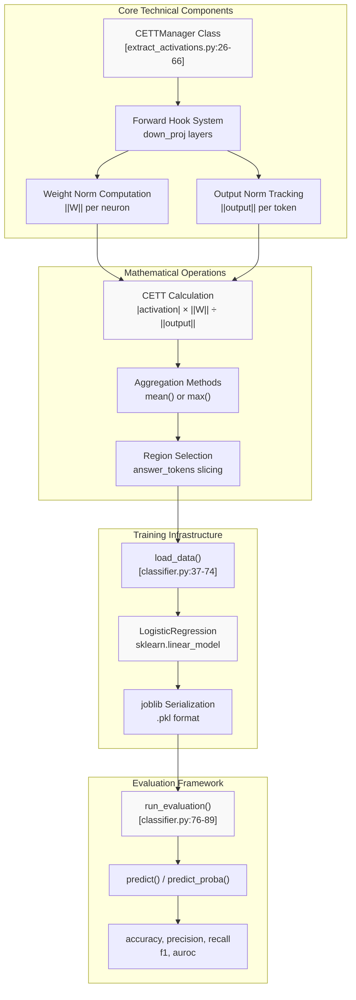
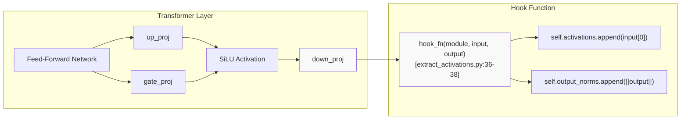
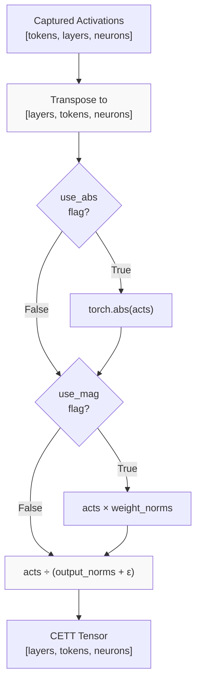
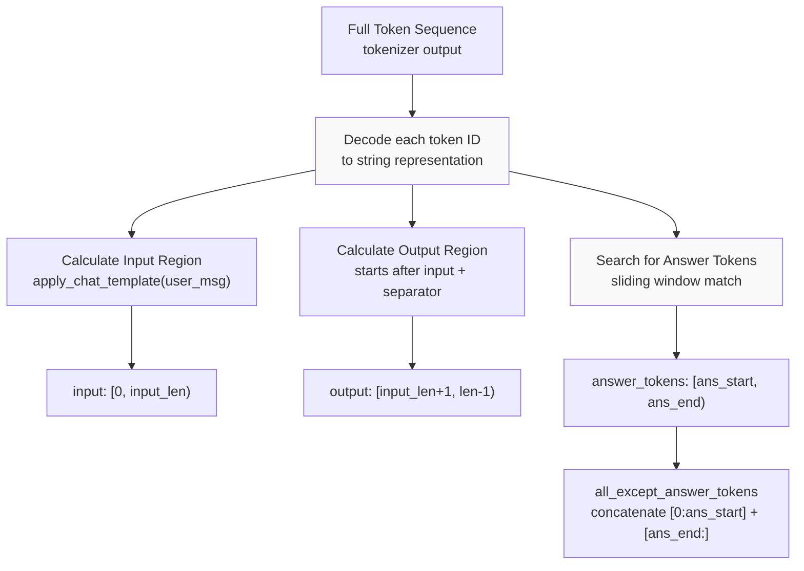
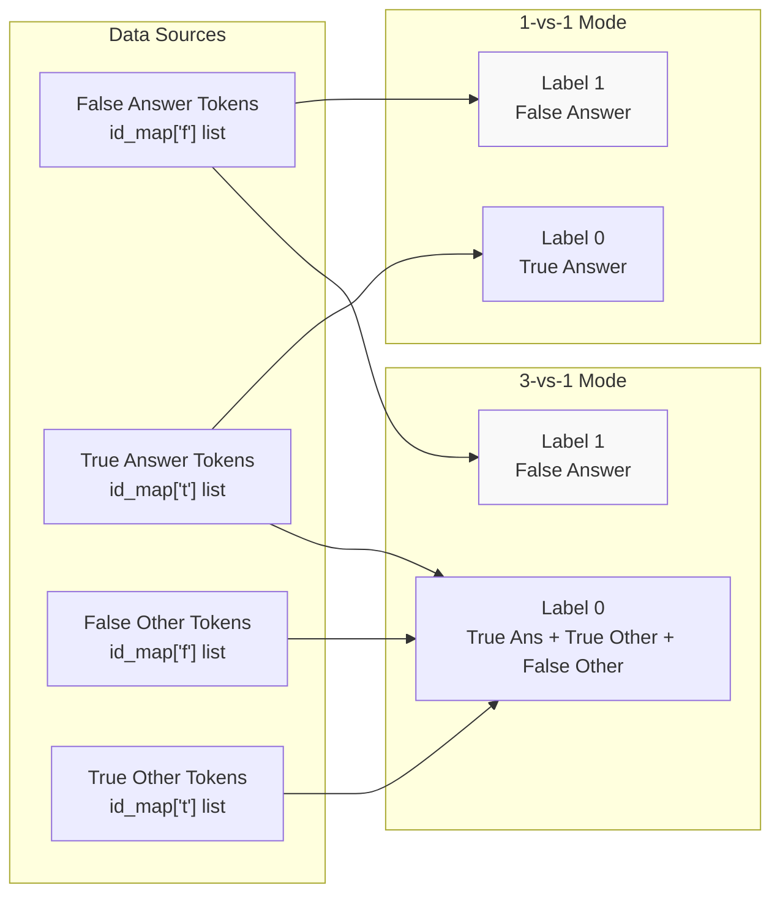
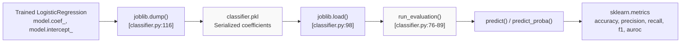
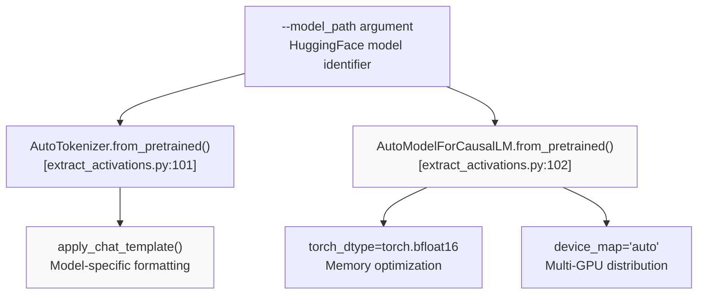
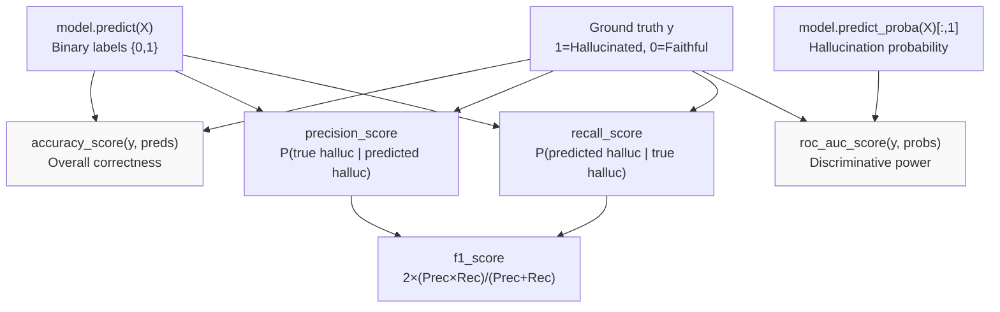

<!-- source: DeepWiki mcp.deepwiki.com · repo thunlp/H-Neurons · page 7 Advanced Topics · fetched 2026-11-02 -->

# Advanced Topics

<details>
<summary>Relevant source files</summary>

The following files were used as context for generating this wiki page:

- [README.md](README.md)
- [scripts/classifier.py](scripts/classifier.py)
- [scripts/extract_activations.py](scripts/extract_activations.py)

</details>


This section provides in-depth technical details for researchers and advanced users who need to understand the internal implementation of the H-Neurons pipeline, extend the system to new architectures, or customize the identification and intervention strategies. Topics covered include the mathematical foundations of the CETT metric, architectural patterns for multi-model support, and the statistical interpretation of evaluation metrics.

For basic pipeline usage, see [Pipeline Guide](#4). For configuration options without implementation details, see [Configuration & Options](#6).

---

## Overview of Advanced Architecture

The H-Neurons system implements a sophisticated mechanistic interpretability pipeline built on three foundational technical components: (1) a PyTorch-based neuron activation extraction system using forward hooks, (2) a scikit-learn logistic regression classifier with configurable regularization, and (3) a model intervention framework that scales neuron activations during inference.



**Sources:** [scripts/extract_activations.py:26-66](), [scripts/classifier.py:37-89]()

---

## CETT Metric Implementation Details

The CETT (Contribution Extraction from Target Tokens) metric quantifies individual neuron contributions to the model's forward pass. The implementation in `CETTManager` uses three key components:

### Forward Hook Architecture

The system registers forward hooks on all `down_proj` layers across the transformer architecture. Each hook captures two critical tensors during the forward pass:



The hook registration occurs in [extract_activations.py:35-42](), iterating through `model.named_modules()` and attaching hooks to any module with `'down_proj'` in its name.

**Sources:** [scripts/extract_activations.py:35-42]()

### Weight Norm Precomputation

The `_get_weight_norms()` method [extract_activations.py:44-49]() computes the L2 norm of each neuron's weight vector from the `down_proj.weight` matrix. This precomputation occurs once during `CETTManager` initialization:

| Operation | Tensor Shape | Purpose |
|-----------|--------------|---------|
| `module.weight.data` | `[output_dim, intermediate_size]` | Down projection weights |
| `torch.norm(weight, dim=0)` | `[intermediate_size]` | Per-neuron magnitude |
| `torch.stack(norms)` | `[num_layers, intermediate_size]` | All layers combined |

The weight norms quantify each neuron's potential impact magnitude on the output space.

**Sources:** [scripts/extract_activations.py:44-49]()

### CETT Tensor Construction

The `get_cett_tensor()` method [extract_activations.py:55-66]() performs the core CETT calculation:



The mathematical formula implemented is:

```
CETT[layer, token, neuron] = (|activation| × ||W_neuron||) / (||layer_output|| + ε)
```

where ε = 1e-8 prevents division by zero [extract_activations.py:66]().

**Sources:** [scripts/extract_activations.py:55-66]()

---

## Token Region Extraction System

The `get_region_indices()` function [extract_activations.py:68-97]() implements precise token boundary detection for extracting activations from specific sequence regions:



The function returns a dictionary mapping location names to `(start_idx, end_idx)` tuples. For `answer_tokens`, it performs exact string matching after normalizing special characters like `"▁"` (SentencePiece) and `"Ġ"` (GPT-2 tokenizer) [extract_activations.py:71]().

The `all_except_answer_tokens` location is handled specially in the main extraction loop [extract_activations.py:135-141](), where it concatenates tensor slices before and after the answer region.

**Sources:** [scripts/extract_activations.py:68-97](), [scripts/extract_activations.py:135-141]()

---

## Classifier Training Architecture

The classifier implementation supports two distinct training paradigms through the `load_data()` function [classifier.py:37-74]():

### Training Mode Implementation



The mode selection occurs at [classifier.py:63-72](), where the `3-vs-1` mode conditionally loads additional negative samples from the `other_acts_dir` directory.

**Sources:** [scripts/classifier.py:37-74]()

### Regularization Parameter Effects

The LogisticRegression initialization [classifier.py:108-111]() accepts `penalty` and `C` parameters that fundamentally alter the learned coefficient structure:

| Parameter | Value | Effect | Coefficient Distribution | Use Case |
|-----------|-------|--------|--------------------------|----------|
| `penalty` | `"l1"` | Sparse weights | Many zeros, few non-zero | H-Neuron identification |
| `penalty` | `"l2"` | Dense weights | All non-zero, smaller magnitude | Maximum accuracy |
| `C` | 0.1 | High regularization | ~100-500 non-zero neurons | Aggressive intervention |
| `C` | 1.0 | Moderate regularization | ~1000-2000 non-zero neurons | Balanced approach |
| `C` | 10.0 | Low regularization | ~5000+ non-zero neurons | Detection-only |

The coefficient inspection occurs after training at [classifier.py:117](): `np.sum(model.coef_[0] > 0)` counts neurons with positive weights, which are designated as H-Neurons.

**Sources:** [scripts/classifier.py:108-117]()

### Model Persistence and Evaluation

The system uses `joblib` for efficient serialization of the trained `LogisticRegression` object and its coefficient matrix:



The evaluation function [classifier.py:76-89]() generates both hard predictions (`predict()`) and probability scores (`predict_proba()`) for comprehensive metric calculation.

**Sources:** [scripts/classifier.py:76-89](), [scripts/classifier.py:98](), [scripts/classifier.py:116]()

---

## Multi-Model Architecture Support

The pipeline's model-agnostic design relies on the Hugging Face `transformers` library's standardized interfaces. The key abstraction points are:

### Model Loading and Device Management



The `device_map="auto"` parameter [extract_activations.py:102]() enables automatic model sharding across available GPUs using the `accelerate` library.

**Sources:** [scripts/extract_activations.py:101-102]()

### Chat Template Compatibility

Different model families use different conversation formatting. The system handles this through `tokenizer.apply_chat_template()` [extract_activations.py:75, 126]():

| Model Family | Template Style | Header Tokens | Example |
|--------------|----------------|---------------|---------|
| Llama-3 | `<\|start_header_id\|>` | user/assistant | Llama-3.3-70B-Instruct |
| Mistral | `[INST]...[/INST]` | User/Assistant | Mistral-Small-3.1-24B |
| Gemma | `<start_of_turn>` | user/model | gemma-2-27b-it |

The template application occurs at two points:
1. [extract_activations.py:75]() - Calculating input region length
2. [extract_activations.py:126]() - Full conversation encoding

This ensures correct token boundary detection across architectures.

**Sources:** [scripts/extract_activations.py:75](), [scripts/extract_activations.py:126]()

### Layer Structure Discovery

The hook registration system [extract_activations.py:40-42]() uses string matching on module names rather than hardcoded layer indices, making it compatible with any transformer architecture that follows the naming convention:

```
model.layers[i].mlp.down_proj
model.model.layers[i].mlp.down_proj  
transformer.h[i].mlp.down_proj
```

The weight norm extraction [extract_activations.py:46-48]() similarly iterates through all matched modules, accommodating different layer counts (e.g., 32 layers in Llama-3-8B, 40 layers in Mistral-7B, 46 layers in Gemma-27B).

**Sources:** [scripts/extract_activations.py:40-48]()

---

## Evaluation Metrics and Statistical Interpretation

The `run_evaluation()` function [classifier.py:76-89]() computes five complementary metrics:

### Binary Classification Metrics



**Sources:** [scripts/classifier.py:76-89]()

### Metric Interpretation Table

| Metric | Formula | Interpretation | Typical Range |
|--------|---------|----------------|---------------|
| Accuracy | `(TP+TN)/(TP+TN+FP+FN)` | Overall correctness rate | 0.75-0.95 |
| Precision | `TP/(TP+FP)` | Reliability of hallucination predictions | 0.70-0.90 |
| Recall | `TP/(TP+FN)` | Coverage of actual hallucinations | 0.70-0.90 |
| F1 | `2×(P×R)/(P+R)` | Harmonic mean of precision/recall | 0.70-0.90 |
| AUROC | `∫TPR(FPR)dFPR` | Threshold-independent discrimination | 0.80-0.98 |

The metrics are computed using `sklearn.metrics` [classifier.py:8]():
- `accuracy_score()` at [classifier.py:80]()
- `precision_recall_fscore_support()` at [classifier.py:81]()
- `roc_auc_score()` at [classifier.py:82]()

All metrics use `average="binary"` mode since this is binary classification (hallucinated vs. faithful).

**Sources:** [scripts/classifier.py:80-82]()

---

## Performance Considerations and Optimization

### Memory Management

The activation extraction process stores tensors of shape `[num_layers, num_tokens, intermediate_size]` in memory. For a model with:
- 32 layers
- 100 tokens (typical sequence)
- 14,336 intermediate neurons (Llama-3-70B)

Each forward pass generates ~180MB of activation data (bfloat16 precision). The system mitigates this through:

1. **Immediate serialization**: Activations saved to disk after each sample [extract_activations.py:153]()
2. **CETT manager clearing**: `clear()` method called per sample [extract_activations.py:122]()
3. **Gradient-free mode**: `torch.no_grad()` context [extract_activations.py:127]()

**Sources:** [scripts/extract_activations.py:122](), [scripts/extract_activations.py:127](), [scripts/extract_activations.py:153]()

### Computational Complexity

| Operation | Time Complexity | Dominant Factor |
|-----------|-----------------|-----------------|
| Forward pass | O(n×d²) | Model inference (n=tokens, d=hidden_dim) |
| CETT calculation | O(l×n×m) | Tensor operations (l=layers, m=intermediate_size) |
| Logistic Regression | O(k×f×i) | Training iterations (k=samples, f=features, i=iterations) |

The bottleneck is typically the forward pass for large models, which is why the pipeline recommends using vLLM for response collection but standard transformers for activation extraction (where fine-grained hook control is needed).

**Sources:** [scripts/extract_activations.py:127](), [scripts/classifier.py:108-112]()

---

## Implementation Notes and Edge Cases

### Tokenizer Special Token Handling

The answer token matching [extract_activations.py:71]() normalizes tokenizer-specific prefixes:
- SentencePiece models (Llama, Mistral): Replace `"▁"` with space
- GPT-2 style (some custom models): Replace `"Ġ"` with space

This normalization ensures consistent matching across tokenizer implementations.

### Batch Size Constraints

The activation extraction loop processes samples individually [extract_activations.py:117-153]() rather than in batches. This is necessary because:
1. Answer token positions vary per sample
2. Sequence lengths differ across questions
3. Region extraction requires per-sample logic

**Sources:** [scripts/extract_activations.py:71](), [scripts/extract_activations.py:117-153]()

### Missing Activation File Handling

The data loader [classifier.py:50-53, 57-60]() checks for file existence before loading. This graceful degradation allows partial datasets where some question IDs may not have corresponding activation files.

**Sources:** [scripts/classifier.py:50-60]()

---

## Extension Points for Researchers

The modular architecture supports several extension strategies:

1. **Custom CETT variants**: Modify `get_cett_tensor()` [extract_activations.py:55-66]() to implement alternative neuron contribution metrics
2. **Different aggregation methods**: Extend the `--method` argument [extract_activations.py:21]() to support percentile-based or weighted aggregation
3. **Alternative classifiers**: Replace `LogisticRegression` [classifier.py:108]() with other sklearn models (SVM, RandomForest, etc.)
4. **Multi-class detection**: Modify `load_data()` [classifier.py:37]() to support finer-grained hallucination categorization

The key abstraction boundaries are:
- Hook registration (model-specific)
- Token region detection (template-specific)  
- Feature engineering (metric-specific)
- Classification algorithm (task-specific)

**Sources:** [scripts/extract_activations.py:55-66](), [scripts/classifier.py:37-74](), [scripts/classifier.py:108-112]()

---

