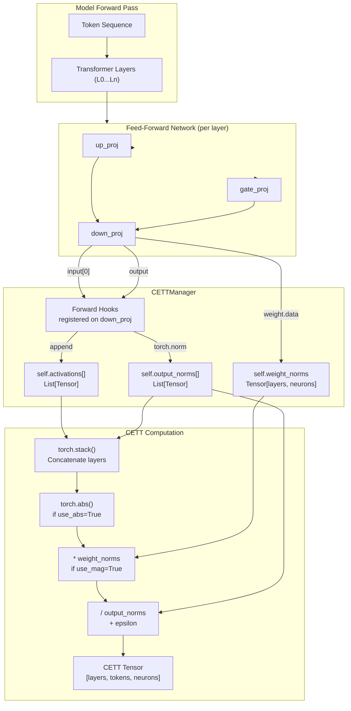
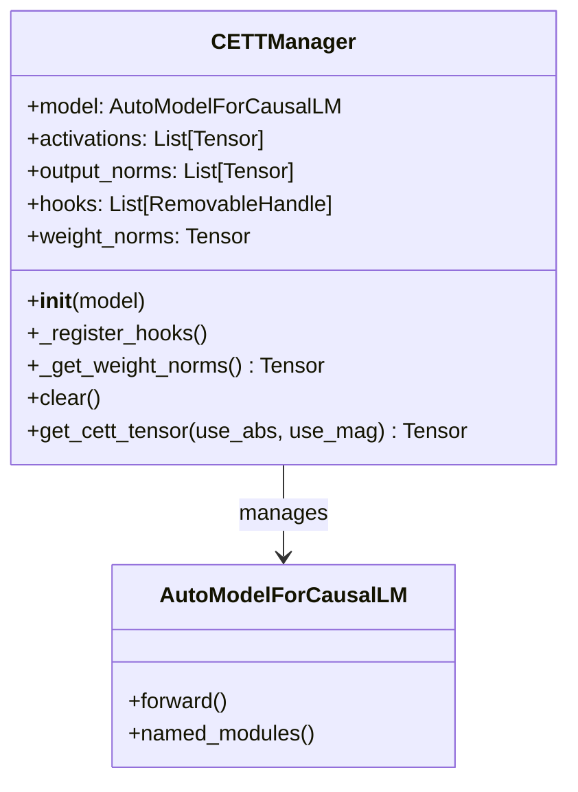
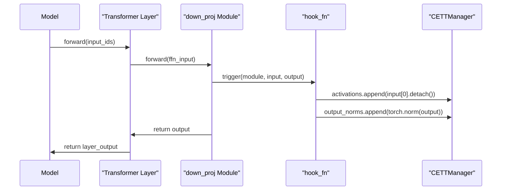
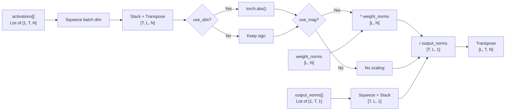
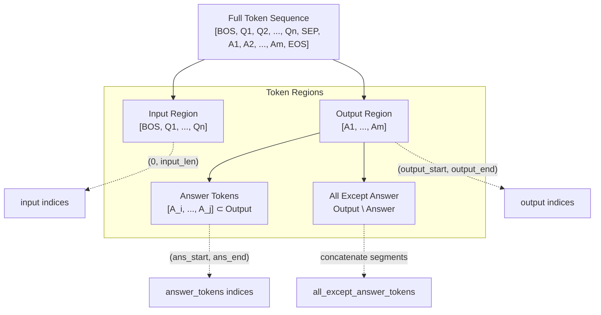
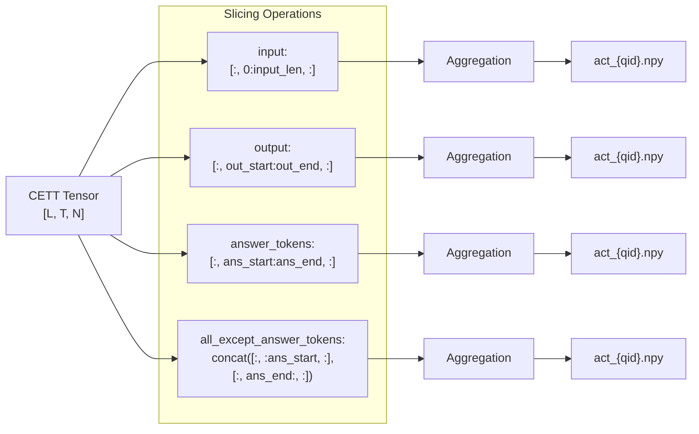
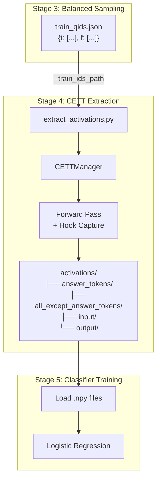

<!-- source: DeepWiki mcp.deepwiki.com · repo thunlp/H-Neurons · page 7.1 CETT Metric Implementation · fetched 2026-11-02 -->

# CETT Metric Implementation

<details>
<summary>Relevant source files</summary>

The following files were used as context for generating this wiki page:

- [README.md](README.md)
- [scripts/extract_activations.py](scripts/extract_activations.py)

</details>


This document provides a deep technical dive into the CETT (neuron Contribution Estimation Through Token-level Tracking) metric implementation, which quantifies the contribution of individual neurons during model inference. CETT is the foundation for identifying H-Neurons by measuring how much each neuron contributes to generating specific tokens.

**Scope**: This page focuses on the technical implementation details of CETT computation, including forward hooks, tensor operations, and normalization strategies. For information about how CETT activations are used in downstream tasks, see [Step 5: Classifier Training](#4.5). For configuration options related to activation extraction, see [Activation Extraction Locations](#6.3).

---

## Overview

The CETT metric measures neuron-level contributions by capturing and processing activations at the input to the `down_proj` layer in transformer feed-forward networks. The metric combines three components:

1. **Raw Activations**: The input tensor to `down_proj` at each layer
2. **Weight Magnitudes**: L2 norms of `down_proj` weight vectors
3. **Output Normalization**: Layer output norms for scaling

The resulting metric provides a normalized, interpretable measure of how much each neuron contributes to the model's output at specific token positions.

**Sources**: [scripts/extract_activations.py:26-66](), [README.md:18]()

---

## Mathematical Foundation

The CETT metric for a neuron $i$ at layer $l$ and token position $t$ is computed as:

$$
\text{CETT}_{l,t,i} = \frac{|a_{l,t,i}| \cdot \|w_{l,i}\|_2}{\|o_{l,t}\|_2 + \epsilon}
$$

Where:
- $a_{l,t,i}$ is the activation of neuron $i$ at layer $l$ for token $t$ (input to `down_proj`)
- $\|w_{l,i}\|_2$ is the L2 norm of the weight vector for neuron $i$ in `down_proj`
- $\|o_{l,t}\|_2$ is the L2 norm of the layer output at token position $t$
- $\epsilon = 10^{-8}$ prevents division by zero

| Component | Purpose | Optional |
|-----------|---------|----------|
| Absolute Value (`use_abs`) | Captures magnitude regardless of sign | Yes (default: True) |
| Weight Norm (`use_mag`) | Weights contribution by downstream impact | Yes (default: True) |
| Output Norm | Normalizes across varying sequence lengths | No (always applied) |

The output normalization ensures CETT values are comparable across different token positions and sequence lengths, making the metric robust for cross-sample analysis.

**Sources**: [scripts/extract_activations.py:55-66]()

---

## System Architecture



**Diagram**: CETT Computation Pipeline - from model forward pass to final CETT tensor

This architecture shows how the `CETTManager` class intercepts activations during the forward pass and processes them into the final CETT metric. The manager maintains state across a single forward pass and can be cleared for subsequent samples.

**Sources**: [scripts/extract_activations.py:26-66]()

---

## CETTManager Class

The `CETTManager` class [scripts/extract_activations.py:26-66]() encapsulates all CETT computation logic. It is instantiated once per model and reused across multiple samples.



**Diagram**: CETTManager Class Structure

### Initialization

The manager is initialized with a loaded model [scripts/extract_activations.py:101-103]():

```python
cett_manager = CETTManager(model)
```

During initialization, it:
1. Registers forward hooks on all `down_proj` modules [scripts/extract_activations.py:35-42]()
2. Pre-computes weight norms for all layers [scripts/extract_activations.py:44-49]()

### State Management

| Attribute | Type | Purpose |
|-----------|------|---------|
| `activations` | `List[Tensor]` | Stores input to `down_proj` for each layer |
| `output_norms` | `List[Tensor]` | Stores L2 norms of layer outputs |
| `hooks` | `List[RemovableHandle]` | References to registered hooks |
| `weight_norms` | `Tensor` | Pre-computed L2 norms of `down_proj` weights |

The `clear()` method [scripts/extract_activations.py:51-53]() resets activation lists between samples:

```python
cett_manager.clear()  # Call before each new forward pass
```

**Sources**: [scripts/extract_activations.py:26-53]()

---

## Forward Hook Mechanism

Forward hooks are PyTorch's mechanism for intercepting intermediate computations during the forward pass. The CETT implementation uses hooks to capture activations without modifying the model architecture.



**Diagram**: Forward Hook Execution Flow

### Hook Registration

Hooks are registered on all `down_proj` modules [scripts/extract_activations.py:35-42]():

```python
def _register_hooks(self):
    def hook_fn(module, input, output):
        self.activations.append(input[0].detach())
        self.output_norms.append(torch.norm(output.detach(), dim=-1, keepdim=True))

    for name, module in self.model.named_modules():
        if 'down_proj' in name:
            self.hooks.append(module.register_forward_hook(hook_fn))
```

The hook function captures:
- **`input[0]`**: The activation tensor entering `down_proj` (shape: `[batch, tokens, neurons]`)
- **`output`**: The layer output for computing normalization factor

Both tensors are detached to prevent gradient tracking, as CETT computation is inference-only.

### Module Targeting

The hook targets modules with `'down_proj'` in their name, which works across different model architectures:

| Model Family | down_proj Location |
|--------------|-------------------|
| Llama-3.x | `model.layers[i].mlp.down_proj` |
| Mistral | `model.layers[i].mlp.down_proj` |
| Gemma-2 | `model.layers[i].mlp.down_proj` |

This naming convention generalizes across modern transformer architectures.

**Sources**: [scripts/extract_activations.py:35-42]()

---

## Weight Norm Computation

Weight norms quantify the potential impact of each neuron on the final output. They are computed once during initialization and cached for efficiency.

### Computation

The `_get_weight_norms()` method [scripts/extract_activations.py:44-49]() computes L2 norms along the output dimension:

```python
def _get_weight_norms(self):
    norms = []
    for name, module in self.model.named_modules():
        if 'down_proj' in name:
            norms.append(torch.norm(module.weight.data, dim=0))
    return torch.stack(norms).to(self.model.device)
```

For a `down_proj` weight matrix $W \in \mathbb{R}^{d_{model} \times d_{ffn}}$:
- Each column $w_i \in \mathbb{R}^{d_{model}}$ corresponds to one neuron
- The L2 norm $\|w_i\|_2 = \sqrt{\sum_{j=1}^{d_{model}} w_{i,j}^2}$ measures the neuron's contribution magnitude

### Result Structure

The resulting `weight_norms` tensor has shape `[num_layers, intermediate_size]`:

| Dimension | Size | Meaning |
|-----------|------|---------|
| 0 | `num_layers` | Transformer layer index |
| 1 | `intermediate_size` | Neuron index within layer (typically 4x hidden size) |

For Llama-3-8B: `[32, 14336]`  
For Llama-3-70B: `[80, 28672]`

**Sources**: [scripts/extract_activations.py:44-49]()

---

## CETT Tensor Computation

The `get_cett_tensor()` method [scripts/extract_activations.py:55-66]() processes captured activations into the final CETT metric.

### Processing Steps



**Diagram**: CETT Tensor Processing Pipeline

### Implementation

```python
def get_cett_tensor(self, use_abs=True, use_mag=True):
    """Returns tensor of shape [layers, tokens, neurons]"""
    # Squeeze batch dimension if present
    self.activations = [act.squeeze(0) if act.dim() == 3 and act.size(0) == 1 
                        else act for act in self.activations]
    self.output_norms = [norm.squeeze(0) if norm.dim() == 3 and norm.size(0) == 1 
                         else norm for norm in self.output_norms]

    # Stack and transpose: [tokens, layers, neurons]
    acts = torch.stack(self.activations).transpose(0, 1).to(self.model.device)
    norms = torch.stack(self.output_norms).transpose(0, 1).to(self.model.device)

    # Apply transformations
    if use_abs: acts = torch.abs(acts)
    if use_mag: acts = acts * self.weight_norms.unsqueeze(0)
    
    # Normalize and transpose to [layers, tokens, neurons]
    return (acts / (norms + 1e-8)).transpose(0, 1)
```

### Tensor Shapes

| Stage | Shape | Description |
|-------|-------|-------------|
| Raw activations (list) | `L × [1, T, N]` | One tensor per layer |
| After stack | `[L, T, N]` | All layers concatenated |
| After transpose | `[T, L, N]` | Token-major ordering |
| After abs/mag | `[T, L, N]` | Transformed values |
| After normalization | `[T, L, N]` | CETT values |
| Final output | `[L, T, N]` | Layer-major ordering |

Where:
- `L` = number of layers
- `T` = sequence length (varies per sample)
- `N` = intermediate size (number of neurons per layer)

**Sources**: [scripts/extract_activations.py:55-66]()

---

## Token Region Extraction

The CETT tensor contains contributions for all tokens in the sequence. The `get_region_indices()` function [scripts/extract_activations.py:68-97]() identifies specific regions for targeted extraction.



**Diagram**: Token Region Identification

### Region Identification Logic

The function returns a dictionary mapping location names to `(start, end)` tuples [scripts/extract_activations.py:93-97]():

```python
return {
    "input": (0, input_len),
    "output": (output_start, output_end),
    "answer_tokens": (ans_start, ans_end) if ans_start is not None else None
}
```

### Input Region

The input region spans the user prompt [scripts/extract_activations.py:75-76]():

```python
user_ids = tokenizer.apply_chat_template([{"role": "user", "content": question}], 
                                         return_tensors="pt")
input_len = user_ids.shape[1] - 1  # Exclude separator
```

### Output Region

The output region spans the assistant response [scripts/extract_activations.py:79-81]():

```python
output_start = input_len + 1  # After assistant header
output_end = len(full_tokens) - 1  # Exclude EOS
```

### Answer Tokens Region

Answer tokens are located by exact string matching [scripts/extract_activations.py:84-91]():

```python
answer_tokens = [token.replace("▁", " ").replace("Ġ", " ") 
                 for token in answer_tokens]  # Normalize
m = len(answer_tokens)

if m != 0:
    for i in range(output_start, len(full_tokens) - m + 1):
        if full_tokens[i : i + m] == answer_tokens:
            ans_start, ans_end = i, i + m
            break
```

The normalization handles tokenizer-specific formatting (SentencePiece `▁` vs. BPE `Ġ`).

**Sources**: [scripts/extract_activations.py:68-97]()

---

## Extraction and Aggregation

After computing the full CETT tensor, the system extracts and aggregates activations for each configured location [scripts/extract_activations.py:131-154]().

### Location-Based Slicing



**Diagram**: Location-Based CETT Extraction and Saving

### Implementation

For standard regions [scripts/extract_activations.py:133-144]():

```python
if loc in ["input", "output", "answer_tokens"]:
    indices = regions[loc]

if loc != "all_except_answer_tokens" and indices:
    selected_cett = cett_full[:, indices[0]:indices[1], :]
```

For inverse selection [scripts/extract_activations.py:135-141]():

```python
elif loc == "all_except_answer_tokens" and regions["answer_tokens"]:
    ans_s, ans_e = regions["answer_tokens"]
    seg1 = cett_full[:, :ans_s, :]
    seg2 = cett_full[:, ans_e:, :]
    selected_cett = torch.cat([seg1, seg2], dim=1)
```

### Aggregation Methods

After slicing, CETT values are aggregated over the token dimension [scripts/extract_activations.py:148-150]():

| Method | Operation | Result Shape | Use Case |
|--------|-----------|--------------|----------|
| `mean` | `selected_cett.mean(dim=1)` | `[L, N]` | Average contribution across tokens |
| `max` | `selected_cett.max(dim=1)` | `[L, N]` | Peak contribution (returns values only) |

The `mean` method is recommended [README.md:104]() as it provides a more stable estimate of neuron contribution across variable-length token sequences.

### Output Files

Each sample produces one `.npy` file per configured location [scripts/extract_activations.py:152-153]():

```python
save_path = os.path.join(args.output_root, loc, f"act_{qid}.npy")
np.save(save_path, final_act.cpu().float().numpy())
```

File structure:
```
activations/
├── answer_tokens/
│   ├── act_000000.npy  # Shape: [layers, neurons]
│   ├── act_000001.npy
│   └── ...
├── all_except_answer_tokens/
│   ├── act_000000.npy
│   └── ...
├── input/
└── output/
```

**Sources**: [scripts/extract_activations.py:131-154]()

---

## Configuration and Usage

The CETT extraction system is invoked via the command-line script with multiple configuration options.

### Command-Line Interface

```bash
python scripts/extract_activations.py \
    --model_path /path/to/model \
    --input_path data/answer_tokens.jsonl \
    --train_ids_path data/train_qids.json \
    --output_root data/activations \
    --locations answer_tokens all_except_answer_tokens input output \
    --method mean \
    --use_mag \
    --use_abs
```

### Configuration Parameters

| Parameter | Type | Default | Description |
|-----------|------|---------|-------------|
| `--locations` | List[str] | `["answer_tokens"]` | Token regions to extract |
| `--method` | str | `"mean"` | Aggregation method (`mean` or `max`) |
| `--use_mag` | flag | `True` | Multiply by weight norms |
| `--use_abs` | flag | `True` | Apply absolute value |

### Location Options

The `--locations` parameter accepts [scripts/extract_activations.py:18-20]():

| Location | Token Region | Typical Use |
|----------|--------------|-------------|
| `answer_tokens` | Tokens tagged as factual answers | Training H-Neuron classifier (positive class) |
| `all_except_answer_tokens` | All output tokens except answers | Training classifier (negative class in 3-vs-1 mode) |
| `input` | User prompt tokens | Analyzing prompt influence |
| `output` | Full assistant response | Alternative to answer-token-specific training |

Multiple locations can be specified to extract activations for different regions in a single pass [README.md:103]().

### Typical Configuration

The recommended configuration for H-Neuron identification [README.md:98-106]():

```bash
--locations answer_tokens all_except_answer_tokens input output
--method mean
--use_mag --use_abs
```

This extracts CETT values averaged over tokens, scaled by weight magnitudes and absolute-valued, for all major token regions.

**Sources**: [scripts/extract_activations.py:10-24](), [README.md:93-106]()

---

## Integration with Pipeline

The CETT extraction step sits between balanced sampling and classifier training in the full H-Neurons pipeline.



**Diagram**: CETT Extraction in Pipeline Context

### Input Requirements

The extraction script requires:

1. **Model**: Loaded via `transformers.AutoModelForCausalLM` [scripts/extract_activations.py:102]()
2. **Answer Tokens File**: JSONL with question IDs, responses, and tagged answer tokens [scripts/extract_activations.py:114-115]()
3. **Question IDs**: JSON mapping with `"t"` (faithful) and `"f"` (hallucinated) lists [scripts/extract_activations.py:105-107]()

### Processing Flow

For each sample in the filtered set [scripts/extract_activations.py:117-154]():

1. Filter by question ID (only process samples in train_qids)
2. Clear CETTManager state
3. Perform forward pass with chat template
4. Compute CETT tensor
5. Extract regions based on `--locations`
6. Aggregate over token dimension
7. Save as `.npy` file

### Output Usage

The saved activations are consumed by `classifier.py` [README.md:113-120]():

```bash
python scripts/classifier.py \
    --train_ans_acts data/activations/answer_tokens \
    --train_other_acts data/activations/all_except_answer_tokens \
    --train_mode 3-vs-1
```

The classifier loads `.npy` files based on question IDs from the train/test ID files, labels them according to the ID list (`"t"` → 0, `"f"` → 1), and trains a logistic regression model.

**Sources**: [scripts/extract_activations.py:99-156](), [README.md:93-120]()

---

## Performance Considerations

### Memory Management

The `CETTManager` maintains activation tensors in memory during forward pass. For long sequences:

- **Activations**: `L × [T, N]` tensors (one per layer)
- **Output norms**: `L × [T, 1]` tensors
- **CETT tensor**: `[L, T, N]` final tensor

For Llama-3-70B with 1000-token sequence:
- 80 layers × 1000 tokens × 28672 neurons × 2 bytes (bfloat16) ≈ 4.3 GB

The `clear()` method [scripts/extract_activations.py:51-53]() must be called between samples to prevent memory accumulation.

### Computation Efficiency

Weight norms are pre-computed [scripts/extract_activations.py:33]() to avoid redundant calculation across samples:

```python
self.weight_norms = self._get_weight_norms()  # Called once in __init__
```

This saves `L × N` norm computations per forward pass.

### Batch Processing

The current implementation processes samples individually [scripts/extract_activations.py:117-154](). The single-sample approach is necessary because:

1. Different samples have different sequence lengths (variable `T`)
2. Answer token positions vary per sample
3. Region extraction requires sample-specific indexing

**Sources**: [scripts/extract_activations.py:26-66](), [scripts/extract_activations.py:99-156]()

---

## Comparison with Alternative Metrics

The CETT metric differs from other neuron attribution methods:

| Metric | Captures | Normalization | Sparsity |
|--------|----------|---------------|----------|
| **CETT** | Input to `down_proj` × weight norm | Output norm | Dense |
| Raw Activations | Input to `down_proj` | None | Dense |
| Gradient-based | Gradients w.r.t. loss | None | Sparse (backprop) |
| Attention Weights | Self-attention scores | Softmax | Sparse (attention) |

CETT is specifically designed for identifying neurons causally linked to specific behaviors (hallucination) by measuring their contribution to output generation at the token level. The weight norm scaling ensures neurons with larger downstream impact are weighted appropriately, and output normalization makes comparisons across different sequence contexts meaningful.

**Sources**: [README.md:18](), [scripts/extract_activations.py:55-66]()

---

