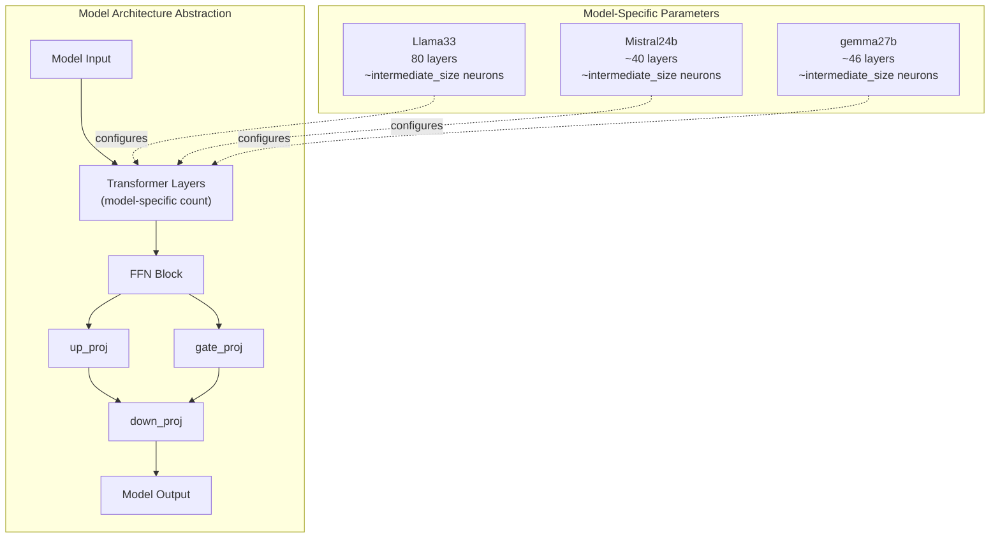
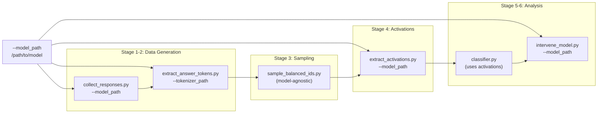
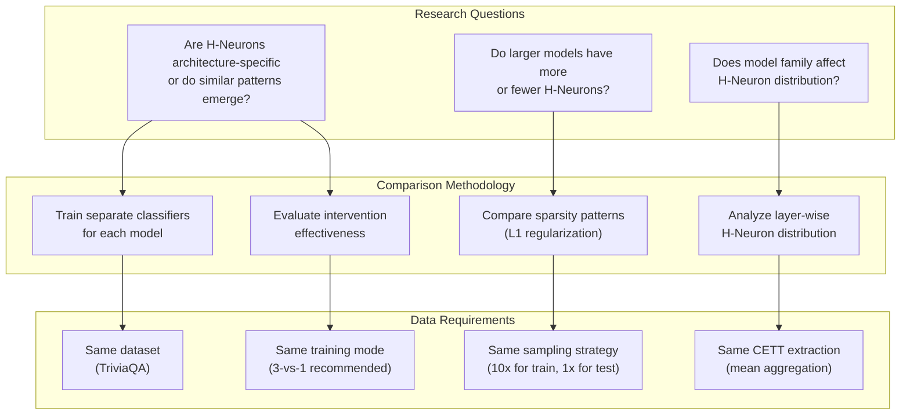

<!-- source: DeepWiki mcp.deepwiki.com · repo thunlp/H-Neurons · page 7.2 Multi-Model Support · fetched 2026-11-02 -->

# Multi-Model Support

<details>
<summary>Relevant source files</summary>

The following files were used as context for generating this wiki page:

- [README.md](README.md)
- [data/examples/Llama33_TriviaQA_answer_tokens_train.jsonl](data/examples/Llama33_TriviaQA_answer_tokens_train.jsonl)
- [data/examples/Mistral24b_TriviaQA_answer_tokens_train.jsonl](data/examples/Mistral24b_TriviaQA_answer_tokens_train.jsonl)
- [data/examples/gemma27b_TriviaQA_answer_tokens_train.jsonl](data/examples/gemma27b_TriviaQA_answer_tokens_train.jsonl)

</details>


This page explains how the H-Neurons pipeline supports multiple large language model (LLM) architectures and how to work with different models within the same framework.

For information about the overall pipeline structure, see [Pipeline Guide](#4). For details on data organization, see [Data Organization](#5).

---

## Overview

The H-Neurons pipeline is designed to be **model-agnostic** at the algorithmic level while maintaining **model-specific data artifacts** due to inherent differences in tokenization, architecture, and activation patterns across LLM families. The same six-stage pipeline (response collection, answer token extraction, balanced sampling, activation extraction, classifier training, and model intervention) can be applied to any transformer-based LLM without code modifications.

The pipeline currently provides example data for three model families:
- **Llama-3.3-70B-Instruct** (referred to as Llama33)
- **Mistral-Small-3.1-24B-Instruct-2503** (referred to as Mistral24b)
- **Gemma-2-27B-it** (referred to as gemma27b)

---

## Pipeline Architecture for Multiple Models

The following diagram illustrates how the same pipeline processes different models independently:

```mermaid
flowchart TB
    subgraph "Model-Agnostic Pipeline"
        P1[Stage 1: collect_responses.py]
        P2[Stage 2: extract_answer_tokens.py]
        P3[Stage 3: sample_balanced_ids.py]
        P4[Stage 4: extract_activations.py]
        P5[Stage 5: classifier.py]
        P6[Stage 6: intervene_model.py]
    end
    
    subgraph "Llama33 Artifacts"
        L_RESP["Llama33_responses.jsonl"]
        L_ANS["Llama33_TriviaQA_answer_tokens_train.jsonl"]
        L_QIDS["Llama33_TriviaQA_train_qids.json"]
        L_ACTS["activations/llama33/"]
        L_CLF["classifier_llama33.pkl"]
    end
    
    subgraph "Mistral24b Artifacts"
        M_RESP["Mistral24b_responses.jsonl"]
        M_ANS["Mistral24b_TriviaQA_answer_tokens_train.jsonl"]
        M_QIDS["Mistral24b_TriviaQA_train_qids.json"]
        M_ACTS["activations/mistral24b/"]
        M_CLF["classifier_mistral24b.pkl"]
    end
    
    subgraph "gemma27b Artifacts"
        G_RESP["gemma27b_responses.jsonl"]
        G_ANS["gemma27b_TriviaQA_answer_tokens_train.jsonl"]
        G_QIDS["gemma27b_TriviaQA_train_qids.json"]
        G_ACTS["activations/gemma27b/"]
        G_CLF["classifier_gemma27b.pkl"]
    end
    
    P1 --> L_RESP
    P1 --> M_RESP
    P1 --> G_RESP
    
    P2 --> L_ANS
    P2 --> M_ANS
    P2 --> G_ANS
    
    P3 --> L_QIDS
    P3 --> M_QIDS
    P3 --> G_QIDS
    
    P4 --> L_ACTS
    P4 --> M_ACTS
    P4 --> G_ACTS
    
    P5 --> L_CLF
    P5 --> M_CLF
    P5 --> G_CLF
```



**Sources:** [README.md:42-79](), [data/examples/]()

---

## Model-Specific Considerations

### Tokenization Differences

Each model family uses a different tokenizer, which produces different token sequences for the same text. This is critical because H-Neuron identification depends on precise token-level activations.

**Example tokenization of "Taurus" across models:**

| Model | Token Sequence | File Reference |
|-------|---------------|----------------|
| Llama33 | `["T", "aurus"]` | [Llama33_TriviaQA_answer_tokens_train.jsonl:1]() |
| Mistral24b | `["T", "aurus"]` | [Mistral24b_TriviaQA_answer_tokens_train.jsonl:1]() |
| gemma27b | `["T", "aurus"]` | [gemma27b_TriviaQA_answer_tokens_train.jsonl:1]() |

**Example tokenization of "Oxygen" across models:**

| Model | Token Sequence | File Reference |
|-------|---------------|----------------|
| Llama33 | `["O", "xygen"]` | [Llama33_TriviaQA_answer_tokens_train.jsonl:3]() |
| Mistral24b | `["O", "xygen"]` | [Mistral24b_TriviaQA_answer_tokens_train.jsonl:3]() |
| gemma27b | `["O", "xygen"]` | [gemma27b_TriviaQA_answer_tokens_train.jsonl:3]() |

Note the different whitespace handling:
- **Llama models**: Use `Ġ` prefix for space tokens (GPT-style BPE)
- **Mistral models**: Use `Ġ` prefix for space tokens (similar to GPT-style)
- **gemma models**: Use `▁` prefix for space tokens (SentencePiece-style)

**Sources:** [data/examples/Llama33_TriviaQA_answer_tokens_train.jsonl:1-10](), [data/examples/Mistral24b_TriviaQA_answer_tokens_train.jsonl:1-10](), [data/examples/gemma27b_TriviaQA_answer_tokens_train.jsonl:1-10]()

---

### Architecture Differences

While all supported models are transformer-based, they differ in:

1. **Number of layers**: Different models have different depths
   - Llama-3.3-70B: 80 layers
   - Mistral-Small-24B: ~40 layers (varies by version)
   - Gemma-2-27B: ~46 layers (varies by version)

2. **Hidden dimensions**: FFN intermediate sizes vary
   - Affects the total number of neurons available for H-Neuron identification
   - Classifier output dimensions must match the model's FFN structure

3. **FFN architecture**: All use gated FFNs but with potential variations
   - `up_proj`, `gate_proj`, `down_proj` structure is common
   - CETT metric extracts from `down_proj` input



**Sources:** [README.md:93-106]()

---

### Activation Dimensions

The activation arrays saved by `extract_activations.py` have dimensions that depend on the model architecture:

```
activation_shape = (num_layers, intermediate_size)
```

Where:
- `num_layers`: Model-specific layer count
- `intermediate_size`: FFN intermediate dimension (model-specific)

This means:
- **Classifiers are not transferable** between models
- **H-Neurons identified in one model** cannot be directly mapped to another
- Each model requires separate training and produces a unique set of H-Neurons

**Sources:** [README.md:93-106]()

---

## Data Organization for Multiple Models

The pipeline uses a consistent naming convention to organize model-specific artifacts:

### File Naming Pattern

```
{model_name}_TriviaQA_{artifact_type}_{split}.{extension}
```

Where:
- `{model_name}`: Short identifier (e.g., `Llama33`, `Mistral24b`, `gemma27b`)
- `{artifact_type}`: Type of data (`answer_tokens`, `responses`, etc.)
- `{split}`: Data split (`train`, `test`, `validation`)
- `{extension}`: File format (`.jsonl`, `.json`, `.npy`)

### Directory Structure

```mermaid
graph TB
    ROOT["data/"]
    
    subgraph "Source Data"
        TRIVIA["TriviaQA/"]
        TRAIN["triviaqa_train.parquet"]
        VAL["triviaqa_validation.parquet"]
        TEST["triviaqa_test.parquet"]
    end
    
    subgraph "Example Data"
        EXAMPLES["examples/"]
        L33_ANS_TR["Llama33_TriviaQA_answer_tokens_train.jsonl"]
        L33_ANS_TE["Llama33_TriviaQA_answer_tokens_test.jsonl"]
        L33_QID_TR["Llama33_TriviaQA_train_qids.json"]
        L33_QID_TE["Llama33_TriviaQA_test_qids.json"]
        M24_ANS_TR["Mistral24b_TriviaQA_answer_tokens_train.jsonl"]
        M24_QID_TR["Mistral24b_TriviaQA_train_qids.json"]
        G27_ANS_TR["gemma27b_TriviaQA_answer_tokens_train.jsonl"]
        G27_QID_TR["gemma27b_TriviaQA_train_qids.json"]
    end
    
    subgraph "Generated Activations"
        ACTS["activations/"]
        ANS_TOK["answer_tokens/"]
        OTHER_TOK["all_except_answer_tokens/"]
    end
    
    ROOT --> TRIVIA
    ROOT --> EXAMPLES
    ROOT --> ACTS
    
    TRIVIA --> TRAIN
    TRIVIA --> VAL
    TRIVIA --> TEST
    
    EXAMPLES --> L33_ANS_TR
    EXAMPLES --> L33_ANS_TE
    EXAMPLES --> L33_QID_TR
    EXAMPLES --> L33_QID_TE
    EXAMPLES --> M24_ANS_TR
    EXAMPLES --> M24_QID_TR
    EXAMPLES --> G27_ANS_TR
    EXAMPLES --> G27_QID_TR
    
    ACTS --> ANS_TOK
    ACTS --> OTHER_TOK
```



**Sources:** [data/examples/](), [README.md:50-51]()

---

## Running the Pipeline for Different Models

### Specifying the Model

All pipeline scripts accept a `--model_path` parameter to specify which model to use:

```bash
# For Llama-3.3-70B-Instruct
python scripts/collect_responses.py \
    --model_path /path/to/Meta-Llama-3.3-70B-Instruct \
    --output_path data/Llama33_responses.jsonl

# For Mistral-Small-24B
python scripts/collect_responses.py \
    --model_path /path/to/Mistral-Small-3.1-24B-Instruct-2503 \
    --output_path data/Mistral24b_responses.jsonl

# For Gemma-2-27B
python scripts/collect_responses.py \
    --model_path /path/to/gemma-2-27b-it \
    --output_path data/gemma27b_responses.jsonl
```

**Sources:** [README.md:52-63]()

### Model-Specific Workflow



**Sources:** [README.md:44-121]()

---

## Example Data Provided

The repository includes pre-processed example data for three models to facilitate quick experimentation:

### Llama-3.3-70B-Instruct (Llama33)

| File | Records | Purpose |
|------|---------|---------|
| `Llama33_TriviaQA_answer_tokens_train.jsonl` | 10,000+ | Training set with extracted answer tokens |
| `Llama33_TriviaQA_answer_tokens_test.jsonl` | 1,000+ | Test set with extracted answer tokens |
| `Llama33_TriviaQA_train_qids.json` | Balanced subset | Question IDs for training |
| `Llama33_TriviaQA_test_qids.json` | Balanced subset | Question IDs for testing |

**Sources:** [data/examples/Llama33_TriviaQA_answer_tokens_train.jsonl](), [README.md:50]()

### Mistral-Small-3.1-24B-Instruct-2503 (Mistral24b)

| File | Records | Purpose |
|------|---------|---------|
| `Mistral24b_TriviaQA_answer_tokens_train.jsonl` | 10,000+ | Training set with extracted answer tokens |
| `Mistral24b_TriviaQA_answer_tokens_test.jsonl` | 1,000+ | Test set with extracted answer tokens |
| `Mistral24b_TriviaQA_train_qids.json` | Balanced subset | Question IDs for training |
| `Mistral24b_TriviaQA_test_qids.json` | Balanced subset | Question IDs for testing |

**Sources:** [data/examples/Mistral24b_TriviaQA_answer_tokens_train.jsonl](), [README.md:50]()

### Gemma-2-27B-it (gemma27b)

| File | Records | Purpose |
|------|---------|---------|
| `gemma27b_TriviaQA_answer_tokens_train.jsonl` | 10,000+ | Training set with extracted answer tokens |
| `gemma27b_TriviaQA_answer_tokens_test.jsonl` | 1,000+ | Test set with extracted answer tokens |
| `gemma27b_TriviaQA_train_qids.json` | Balanced subset | Question IDs for training |
| `gemma27b_TriviaQA_test_qids.json` | Balanced subset | Question IDs for testing |

**Sources:** [data/examples/gemma27b_TriviaQA_answer_tokens_train.jsonl](), [README.md:50]()

---

## Adding Support for New Models

To use the pipeline with a new model:

1. **Ensure model compatibility**:
   - Transformer-based architecture
   - Uses gated FFN with `down_proj` layer
   - Supported by HuggingFace `transformers` library

2. **Run the full pipeline** with appropriate `--model_path`:
   - Stage 1: `collect_responses.py --model_path /path/to/new/model`
   - Stage 2: `extract_answer_tokens.py --tokenizer_path /path/to/new/model`
   - Stage 3: `sample_balanced_ids.py` (model-agnostic)
   - Stage 4: `extract_activations.py --model_path /path/to/new/model`
   - Stage 5: `classifier.py` (uses extracted activations)
   - Stage 6: `intervene_model.py --model_path /path/to/new/model`

3. **Follow naming conventions**:
   - Use a short, unique identifier (e.g., `GPT4o`, `Claude3`)
   - Name files as `{identifier}_TriviaQA_{type}_{split}.{ext}`

4. **Verify tokenization**:
   - Inspect `tokenized_response` and `answer_tokens` fields
   - Ensure answer token extraction is accurate for the new tokenizer

**Sources:** [README.md:42-142]()

---

## Model-Agnostic vs Model-Specific Components

### Model-Agnostic Components

The following pipeline stages work identically across all models:

| Component | Purpose | Why Model-Agnostic |
|-----------|---------|-------------------|
| `sample_balanced_ids.py` | Balance dataset | Operates on question IDs only |
| `classifier.py` (training logic) | Train H-Neuron detector | Works with activation arrays of any shape |

**Sources:** [README.md:82-91](), [README.md:108-136]()

### Model-Specific Components

The following require model-specific parameters or handling:

| Component | Model-Specific Aspect | Parameter |
|-----------|----------------------|-----------|
| `collect_responses.py` | Model inference | `--model_path` |
| `extract_answer_tokens.py` | Tokenization | `--tokenizer_path` |
| `extract_activations.py` | Architecture & hooks | `--model_path` |
| `intervene_model.py` | Model loading & modification | `--model_path` |
| Classifier `.pkl` files | Activation dimensions | Implicitly via saved weights |

**Sources:** [README.md:52-63](), [README.md:72-80](), [README.md:97-106](), [README.md:142-146]()

---

## Cross-Model Comparisons

The multi-model support enables comparative analysis of H-Neurons across different architectures:



**Sources:** [README.md:14-20]()

---

## Summary

The H-Neurons pipeline achieves multi-model support through:

1. **Separation of concerns**: Model-agnostic algorithms + model-specific data artifacts
2. **Consistent interfaces**: All scripts use `--model_path` or `--tokenizer_path`
3. **Standardized naming**: `{model}_{dataset}_{type}_{split}` convention
4. **Isolated artifacts**: Each model's data is self-contained and non-interfering
5. **Extensibility**: Adding new models requires no code changes, only running the pipeline

This design enables reproducible, comparative research across LLM families while maintaining the scientific rigor needed for mechanistic interpretability studies.

**Sources:** [README.md:1-162](), [data/examples/]()

---

