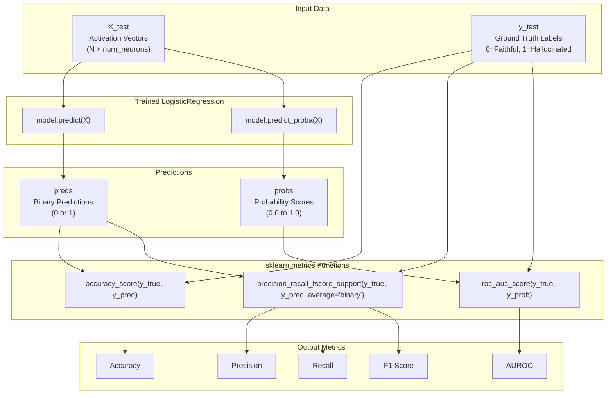
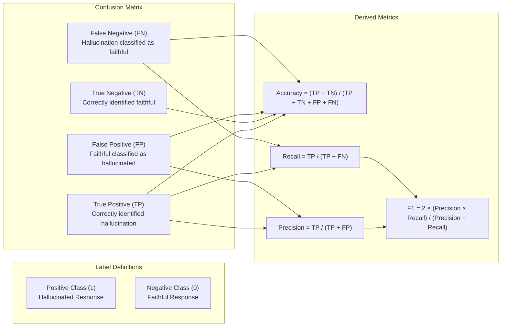
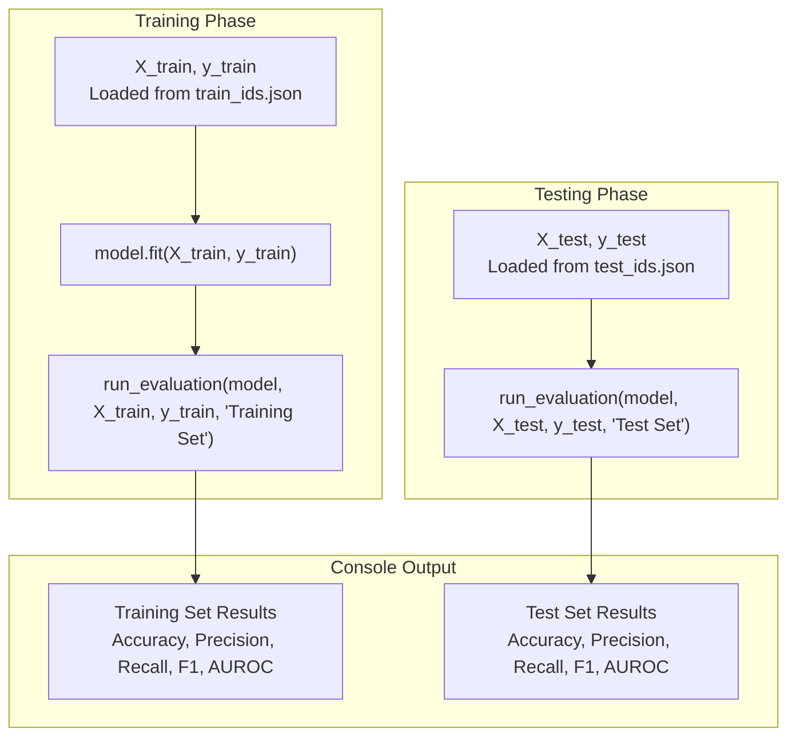
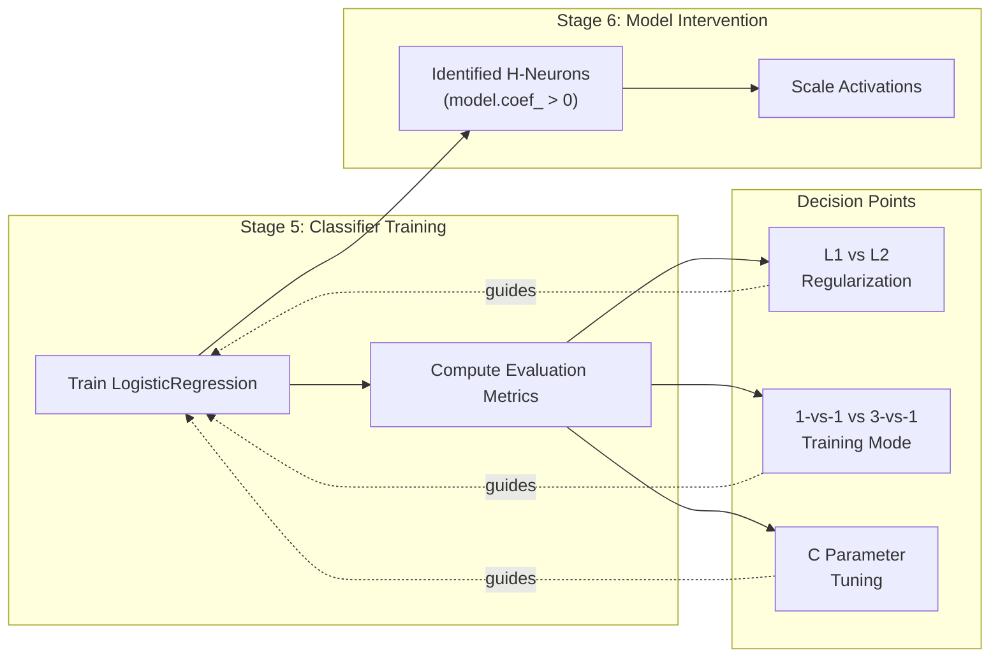

<!-- source: DeepWiki mcp.deepwiki.com · repo thunlp/H-Neurons · page 7.3 Evaluation Metrics · fetched 2026-11-02 -->

# Evaluation Metrics

<details>
<summary>Relevant source files</summary>

The following files were used as context for generating this wiki page:

- [README.md](README.md)
- [scripts/classifier.py](scripts/classifier.py)

</details>


This page provides detailed technical documentation of the evaluation metrics used to assess the performance of H-Neuron classifiers. These metrics quantify how effectively the trained logistic regression model distinguishes between hallucinated and faithful responses.

For information about the classifier training process itself, see [Classifier Training](#4.5). For details on training modes and regularization strategies, see [Training Modes](#6.1) and [Regularization Options](#6.2).

---

## Overview

The H-Neurons pipeline uses a comprehensive suite of five binary classification metrics to evaluate classifier performance. All metrics are computed using scikit-learn functions on the test set predictions and are reported in the console output by the `run_evaluation` function.

| Metric | Purpose | Optimization Target |
|--------|---------|---------------------|
| **Accuracy** | Overall classification correctness | General performance baseline |
| **Precision** | Reliability of hallucination predictions | Minimize false positives |
| **Recall** | Coverage of actual hallucinations | Minimize false negatives |
| **F1 Score** | Harmonic mean of precision and recall | Balanced performance |
| **AUROC** | Discrimination ability across thresholds | Ranking quality |

Sources: [scripts/classifier.py:76-89]()

---

## Evaluation Pipeline Architecture

The following diagram illustrates how predictions flow through the evaluation system to produce the five metrics:



Sources: [scripts/classifier.py:76-82]()

---

## Confusion Matrix Foundation

All classification metrics (except AUROC) are derived from the confusion matrix, which categorizes predictions into four cases:



Sources: [scripts/classifier.py:80-82]()

---

## Metric Definitions

### Accuracy

**Formula**: `(TP + TN) / (TP + TN + FP + FN)`

**Implementation**: [scripts/classifier.py:80]()
```python
acc = accuracy_score(y, preds)
```

**Interpretation**: The proportion of all predictions (both faithful and hallucinated) that are correct. In the context of H-Neurons:
- High accuracy indicates the classifier correctly distinguishes hallucinated from faithful responses
- Baseline accuracy depends on class balance in the test set
- Typical values: 0.85-0.95 for well-tuned classifiers

**Limitations**: Can be misleading with imbalanced datasets. If 90% of responses are faithful, a classifier that always predicts "faithful" achieves 90% accuracy despite being useless.

---

### Precision

**Formula**: `TP / (TP + FP)`

**Implementation**: [scripts/classifier.py:81]()
```python
prec, rec, f1, _ = precision_recall_fscore_support(y, preds, average="binary")
```

**Interpretation**: Among all responses predicted as hallucinated, what proportion are actually hallucinated? In the context of H-Neurons:
- High precision means when the classifier flags a response as hallucinated, it is highly reliable
- Low precision means many faithful responses are incorrectly flagged (false alarms)
- Critical for applications where false positives are costly

**Trade-off**: Increasing precision typically decreases recall. A conservative classifier that only flags clear hallucinations will have high precision but may miss subtle cases (low recall).

---

### Recall

**Formula**: `TP / (TP + FN)`

**Implementation**: [scripts/classifier.py:81]()
```python
prec, rec, f1, _ = precision_recall_fscore_support(y, preds, average="binary")
```

**Interpretation**: Among all actually hallucinated responses, what proportion does the classifier detect? In the context of H-Neurons:
- High recall means the classifier catches most hallucinations
- Low recall means many hallucinations slip through undetected (false negatives)
- Critical for safety-critical applications where missing hallucinations is dangerous

**Trade-off**: Increasing recall typically decreases precision. An aggressive classifier that flags anything suspicious will have high recall but many false alarms (low precision).

---

### F1 Score

**Formula**: `2 × (Precision × Recall) / (Precision + Recall)`

**Implementation**: [scripts/classifier.py:81]()
```python
prec, rec, f1, _ = precision_recall_fscore_support(y, preds, average="binary")
```

**Interpretation**: The harmonic mean of precision and recall. In the context of H-Neurons:
- Balances precision and recall into a single metric
- Useful when you want good performance on both dimensions
- Penalizes extreme imbalances (e.g., 0.95 precision + 0.40 recall → F1 = 0.56)

**Use Case**: F1 is the primary metric for comparing different training configurations (1-vs-1 vs 3-vs-1, L1 vs L2) when you want balanced performance.

---

### AUROC (Area Under ROC Curve)

**Formula**: Area under the curve plotting True Positive Rate vs False Positive Rate across all classification thresholds

**Implementation**: [scripts/classifier.py:82]()
```python
auroc = roc_auc_score(y, probs)
```

**Interpretation**: Probability that the classifier ranks a random hallucinated response higher than a random faithful response. In the context of H-Neurons:
- AUROC = 0.5: Random guessing (no discrimination ability)
- AUROC = 1.0: Perfect separation (hallucinated always scored higher)
- Typical values: 0.90-0.98 for well-trained H-Neuron classifiers

**Advantages**:
- Threshold-independent: Evaluates ranking quality regardless of classification threshold
- Uses probability scores (`predict_proba`) rather than binary predictions
- Robust to class imbalance

**Use Case**: AUROC is particularly useful when you want to understand the classifier's fundamental discrimination ability, independent of any specific decision threshold.

Sources: [scripts/classifier.py:78-82]()

---

## Code Implementation

The `run_evaluation` function in [scripts/classifier.py:76-89]() computes all five metrics and formats them for console output:

```python
def run_evaluation(model, X, y, dataset_name="Test"):
    preds = model.predict(X)              # Binary predictions (0 or 1)
    probs = model.predict_proba(X)[:, 1]  # Probability of class 1 (hallucinated)
    
    acc = accuracy_score(y, preds)
    prec, rec, f1, _ = precision_recall_fscore_support(y, preds, average="binary")
    auroc = roc_auc_score(y, probs)
    
    print(f"\n--- Results: {dataset_name} ---")
    print(f"Accuracy:  {acc:.4f}")
    print(f"Precision: {prec:.4f}")
    print(f"Recall:    {rec:.4f}")
    print(f"F1 Score:  {f1:.4f}")
    print(f"AUROC:     {auroc:.4f}")
```

### Key Implementation Details

| Aspect | Implementation | Location |
|--------|---------------|----------|
| **Prediction Generation** | `model.predict(X)` for binary labels | [scripts/classifier.py:77]() |
| **Probability Extraction** | `model.predict_proba(X)[:, 1]` for class 1 probabilities | [scripts/classifier.py:78]() |
| **Binary Averaging** | `average="binary"` in `precision_recall_fscore_support` | [scripts/classifier.py:81]() |
| **Output Formatting** | 4 decimal places (`.4f`) for all metrics | [scripts/classifier.py:85-89]() |

Sources: [scripts/classifier.py:76-89]()

---

## Evaluation Contexts

The evaluation system is invoked in two contexts during the pipeline:



### Training Set Evaluation

**Purpose**: Assess model fit and detect overfitting

**Location**: [scripts/classifier.py:119]()

**Typical Behavior**:
- High training accuracy (>0.95) indicates the model successfully learned the training patterns
- If training accuracy is low, increase `C` parameter or switch to L2 regularization
- Training metrics are always higher than test metrics; large gaps indicate overfitting

### Test Set Evaluation

**Purpose**: Measure generalization performance on unseen data

**Location**: [scripts/classifier.py:125-129]()

**Typical Behavior**:
- Test metrics reflect real-world performance
- Used for model selection and hyperparameter tuning
- Evaluation mode uses `1-vs-1` training mode regardless of training configuration ([scripts/classifier.py:128]())

Sources: [scripts/classifier.py:95-129]()

---

## Metric Selection Guidance

Different use cases prioritize different metrics:

| Use Case | Primary Metric | Rationale |
|----------|----------------|-----------|
| **H-Neuron Identification** | Accuracy + Sparsity | Need correct classification with minimal neurons ([README.md:132-135]()) |
| **Hallucination Detector** | F1 Score | Balance between catching hallucinations and avoiding false alarms |
| **Safety-Critical Systems** | Recall | Must catch all hallucinations, false positives acceptable |
| **User-Facing Applications** | Precision | False alarms damage user trust, some misses acceptable |
| **Model Comparison** | AUROC | Threshold-independent measure of discrimination ability |

### Regularization Impact on Metrics

From [README.md:127-129]():

| Regularization | Sparsity | Accuracy Impact | Use Case |
|----------------|----------|-----------------|----------|
| **L1** (`penalty=l1`) | High | Baseline | H-Neuron identification for intervention |
| **L2** (`penalty=l2`) | Low | +1-3% | Pure hallucination detection (no intervention) |

### Training Mode Impact on Metrics

From [README.md:123-125]():

| Training Mode | Classes | Accuracy | Interpretability |
|---------------|---------|----------|------------------|
| **1-vs-1** | Hallucinated Ans vs Faithful Ans | Higher | Lower |
| **3-vs-1** | Hallucinated Ans vs (Faithful Ans + All Other) | Lower | Higher |

Sources: [README.md:123-135]()

---

## Example Console Output

When running [scripts/classifier.py](), the evaluation output appears as:

```
--- Results: Training Set ---
Accuracy:  0.9234
Precision: 0.9156
Recall:    0.9289
F1 Score:  0.9222
AUROC:     0.9756

--- Results: Test Set ---
Accuracy:  0.8891
Precision: 0.8723
Recall:    0.9012
F1 Score:  0.8865
AUROC:     0.9423
```

**Interpretation**:
- Training accuracy (0.92) > Test accuracy (0.89): Normal generalization gap
- High AUROC (0.94): Strong discrimination ability
- Balanced precision (0.87) and recall (0.90): Good F1 score (0.89)
- All metrics formatted to 4 decimal places for precision

Sources: [scripts/classifier.py:84-89]()

---

## Integration with Pipeline

The evaluation metrics serve multiple purposes across the H-Neurons pipeline:



**Workflow**:
1. Train classifier with initial hyperparameters
2. Evaluate using all five metrics
3. Compare metrics across configurations (L1/L2, 1-vs-1/3-vs-1, different C values)
4. Select configuration balancing accuracy and sparsity
5. Use identified H-Neurons (those with `model.coef_[0] > 0`) for intervention

Sources: [scripts/classifier.py:95-129](), [README.md:132-135]()