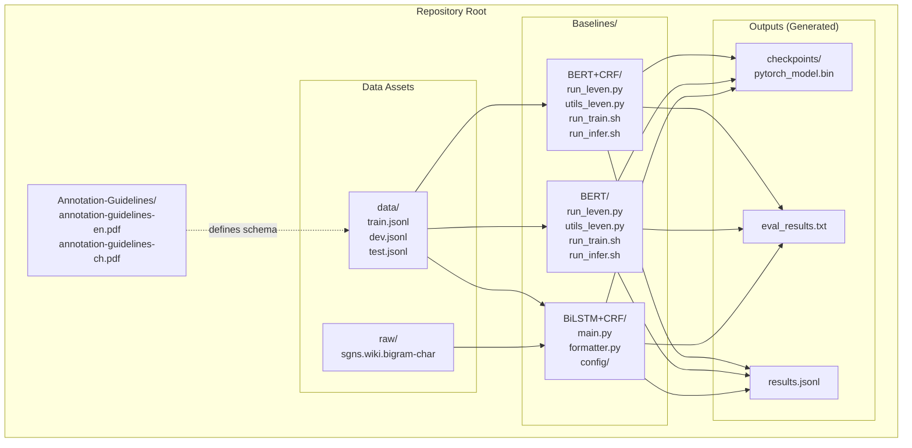
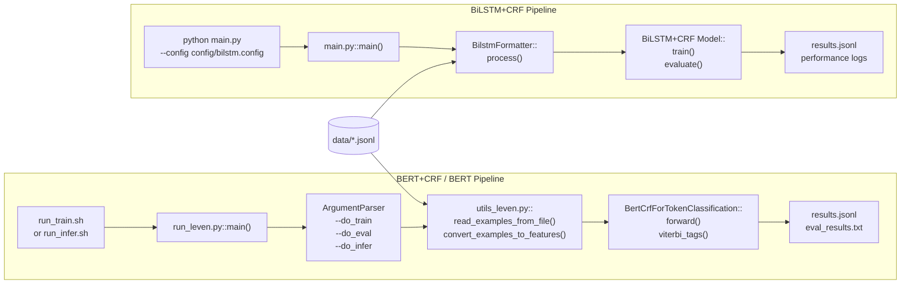
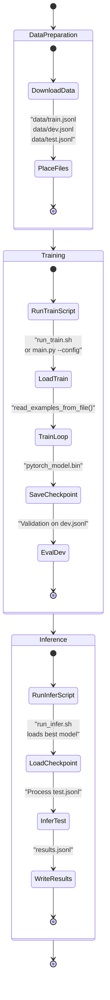

<!-- source: DeepWiki mcp.deepwiki.com · repo thunlp/LEVEN · page 1 Home · fetched 2026-11-02 -->

# Home

<details>
<summary>Relevant source files</summary>

The following files were used as context for generating this wiki page:

- [Annotation-Guidelines/annotation-guidelines-en.pdf](Annotation-Guidelines/annotation-guidelines-en.pdf)
- [Baselines/BERT+CRF/README.md](Baselines/BERT+CRF/README.md)
- [Baselines/BERT/README.md](Baselines/BERT/README.md)
- [Baselines/BiLSTM+CRF/README.md](Baselines/BiLSTM+CRF/README.md)

</details>


## Purpose and Scope

This wiki documents the **LEVEN** (Legal EVent Extraction) repository, a benchmark for event detection in Chinese legal and incident text. The repository contains:

- **Annotation guidelines** defining a schema of 110 event types
- **Dataset files** in JSONL format with BIO-tagged event mentions
- **Three baseline implementations** (BERT+CRF, BERT, BiLSTM+CRF) with training and inference pipelines

This Home page provides a high-level overview of the repository structure and baseline models. For detailed information about specific subsystems:
- Event type taxonomy and annotation process: see [LEVEN Task and Annotation](#2)
- Data format specifications: see [Data Format](#3)
- Comparative analysis of baselines: see [Baselines Comparison](#4)
- Individual baseline documentation: see [BERT+CRF Baseline](#5), [BERT Baseline](#6), [BiLSTM+CRF Baseline](#7)

---

## What is LEVEN?

LEVEN is an event extraction benchmark focusing on Chinese legal and incident documents. The task involves identifying event mentions in text and classifying them into one of 110 predefined event types organized into semantic domains:

| Domain | Example Event Types | Count |
|--------|-------------------|-------|
| Legal Actions | 盗窃财物 (theft), 抢劫财物 (robbery), 贩卖毒品 (drug trafficking) | ~40 |
| Financial Events | 买入 (buy), 卖出 (sell), 支付/给付 (payment) | ~25 |
| Violent Events | 伤害人身 (assault), 杀害 (homicide), 强奸 (rape) | ~20 |
| Procedural Events | 拘捕 (arrest), 搜查/扣押 (search/seizure), 投案 (surrender) | ~25 |

The dataset uses BIO tagging (Beginning, Inside, Outside) to annotate event mentions at the token level, resulting in approximately 221 total labels (110 event types × 2 for B-/I- variants + O tag).

**Sources:** [Annotation-Guidelines/annotation-guidelines-en.pdf]()

---

## Repository Structure

The following diagram maps the repository's directory structure to actual code and data assets:



**Sources:** [Baselines/BERT+CRF/README.md](), [Baselines/BERT/README.md](), [Baselines/BiLSTM+CRF/README.md]()

---

## Baseline Implementations

The repository provides three neural baseline models for event detection, each with complete training and inference infrastructure:

### BERT+CRF Baseline

The most extensively documented baseline, combining BERT contextual embeddings with a Conditional Random Field (CRF) layer for sequence labeling.

| Component | Implementation |
|-----------|---------------|
| **Entry Point** | `run_leven.py` |
| **Data Processing** | `utils_leven.py`: `read_examples_from_file()`, `convert_examples_to_features()` |
| **Model Class** | `BertCrfForTokenClassification` (in `run_leven.py`) |
| **Training Script** | `run_train.sh` |
| **Inference Script** | `run_infer.sh` |

**Key Features:**
- BERT encoder from HuggingFace Transformers (`BertForTokenClassification`)
- Custom CRF layer with Viterbi decoding
- Feature caching for efficiency
- Distributed training support (multi-GPU)
- Mixed precision training (fp16)

**Sources:** [Baselines/BERT+CRF/README.md:1-30]()

### BERT Baseline

Structurally similar to BERT+CRF, with identical file structure and class names.

| Component | Implementation |
|-----------|---------------|
| **Entry Point** | `run_leven.py` |
| **Data Processing** | `utils_leven.py` |
| **Model Class** | `BertCrfForTokenClassification` |
| **Scripts** | `run_train.sh`, `run_infer.sh` |

**Sources:** [Baselines/BERT/README.md:1-30]()

### BiLSTM+CRF Baseline

A traditional neural architecture using bidirectional LSTMs instead of BERT.

| Component | Implementation |
|-----------|---------------|
| **Entry Point** | `main.py` |
| **Data Formatter** | `formatter.py`: `BilstmFormatter` class |
| **Configuration** | `config/bilstm.config`, `config/crf.config` |
| **Model Type** | Bidirectional LSTM + CRF |
| **Word Embeddings** | Pre-trained from `raw/sgns.wiki.bigram-char` |

**Key Differences:**
- Configuration-based approach (vs. command-line arguments)
- Requires external word embeddings
- Traditional RNN architecture instead of Transformer

**Sources:** [Baselines/BiLSTM+CRF/README.md:1-22]()

---

## Baseline Execution Flow

The following diagram shows how the baseline systems execute, mapping high-level operations to actual code entry points:



**Sources:** [Baselines/BERT+CRF/README.md:20-28](), [Baselines/BERT/README.md:20-28](), [Baselines/BiLSTM+CRF/README.md:12-19]()

---

## Training and Inference Workflow

All baselines follow a consistent workflow pattern:



**Sources:** [Baselines/BERT+CRF/README.md:20-28](), [Baselines/BERT/README.md:20-28](), [Baselines/BiLSTM+CRF/README.md:18-19]()

---

## Key File Purposes

| File Path | Purpose | Baseline(s) |
|-----------|---------|-------------|
| `run_leven.py` | Main training/inference script with `BertCrfForTokenClassification` model definition | BERT+CRF, BERT |
| `utils_leven.py` | Data loading, tokenization, feature conversion, BIO label processing | BERT+CRF, BERT |
| `run_train.sh` | Shell wrapper for training with GPU/distributed settings | BERT+CRF, BERT |
| `run_infer.sh` | Shell wrapper for inference on test set | BERT+CRF, BERT |
| `main.py` | Entry point for BiLSTM model with config-based setup | BiLSTM+CRF |
| `formatter.py` | `BilstmFormatter` class for data preprocessing | BiLSTM+CRF |
| `config/*.config` | Hyperparameter configuration files | BiLSTM+CRF |
| `data/train.jsonl` | Training data with documents, events, and BIO labels | All |
| `data/dev.jsonl` | Development/validation data | All |
| `data/test.jsonl` | Test data for final predictions | All |
| `results.jsonl` | Inference output with predicted event type IDs | All |

**Sources:** [Baselines/BERT+CRF/README.md](), [Baselines/BERT/README.md](), [Baselines/BiLSTM+CRF/README.md]()

---

## Requirements

All baselines require Python 3.6+ with PyTorch. Specific dependencies:

**BERT+CRF and BERT:**
- `python==3.6.9`
- `torch==1.2.0`
- `transformers==2.6.0`
- `sklearn==0.20.2`
- `seqeval`

**BiLSTM+CRF:**
- `torch==1.6`
- `numpy`
- `sklearn`
- `seqeval==1.2.2`
- `tqdm==4.44.0`
- Pre-trained word embeddings: `sgns.wiki.bigram-char` from [Chinese-Word-Vectors](https://github.com/Embedding/Chinese-Word-Vectors)

**Sources:** [Baselines/BERT+CRF/README.md:6-16](), [Baselines/BERT/README.md:6-16](), [Baselines/BiLSTM+CRF/README.md:4-10]()

---

## Quick Start

1. **Download Data:** Place LEVEN dataset files (`train.jsonl`, `dev.jsonl`, `test.jsonl`) in the appropriate `data/` directory under each baseline folder.

2. **Choose a Baseline:**
   - For BERT+CRF (recommended): Navigate to `Baselines/BERT+CRF/`
   - For BERT: Navigate to `Baselines/BERT/`
   - For BiLSTM+CRF: Navigate to `Baselines/BiLSTM+CRF/` and download word embeddings to `raw/`

3. **Train:**
   ```bash
   # BERT+CRF or BERT
   bash run_train.sh
   
   # BiLSTM+CRF
   python main.py --config config/bilstm.config --gpu 0
   ```

4. **Inference:**
   ```bash
   # BERT+CRF or BERT
   bash run_infer.sh
   
   # BiLSTM+CRF (automatic during training)
   # Results saved to results.jsonl
   ```

For detailed setup instructions and parameter configuration, see [Quick Start Guide](#8).

**Sources:** [Baselines/BERT+CRF/README.md:20-28](), [Baselines/BERT/README.md:20-28](), [Baselines/BiLSTM+CRF/README.md:14-19]()

---

## Next Steps

- **Understand the Task:** Read [LEVEN Task and Annotation](#2) for the full event type taxonomy and annotation scheme
- **Data Format:** See [Data Format](#3) for JSONL structure and BIO label encoding
- **Compare Baselines:** Review [Baselines Comparison](#4) for architecture differences and performance characteristics
- **Deep Dive:** Explore detailed documentation for [BERT+CRF](#5), [BERT](#6), or [BiLSTM+CRF](#7) baselines

---

