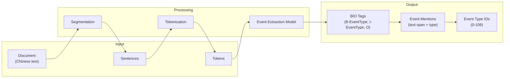
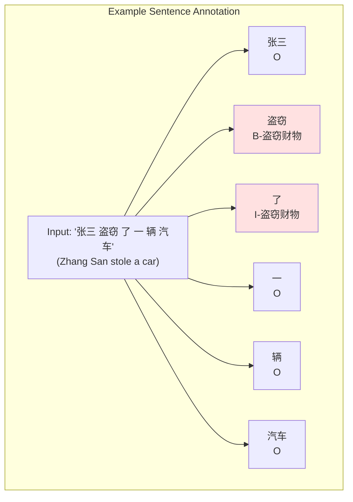
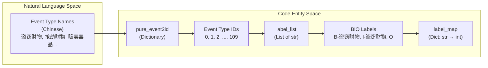
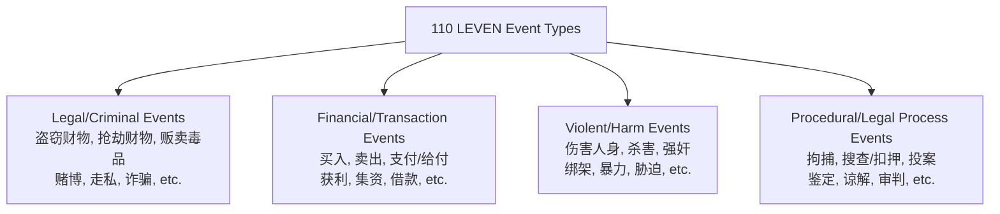
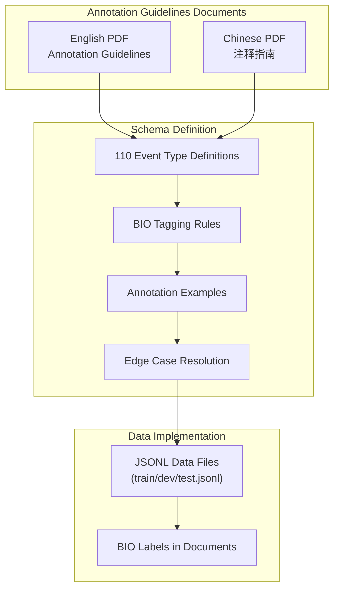
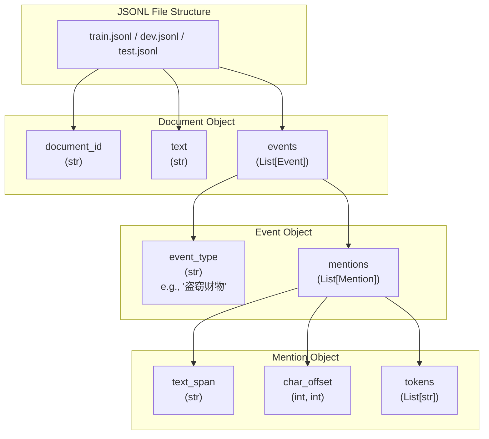
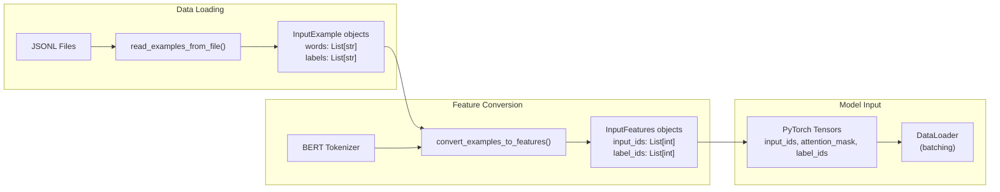
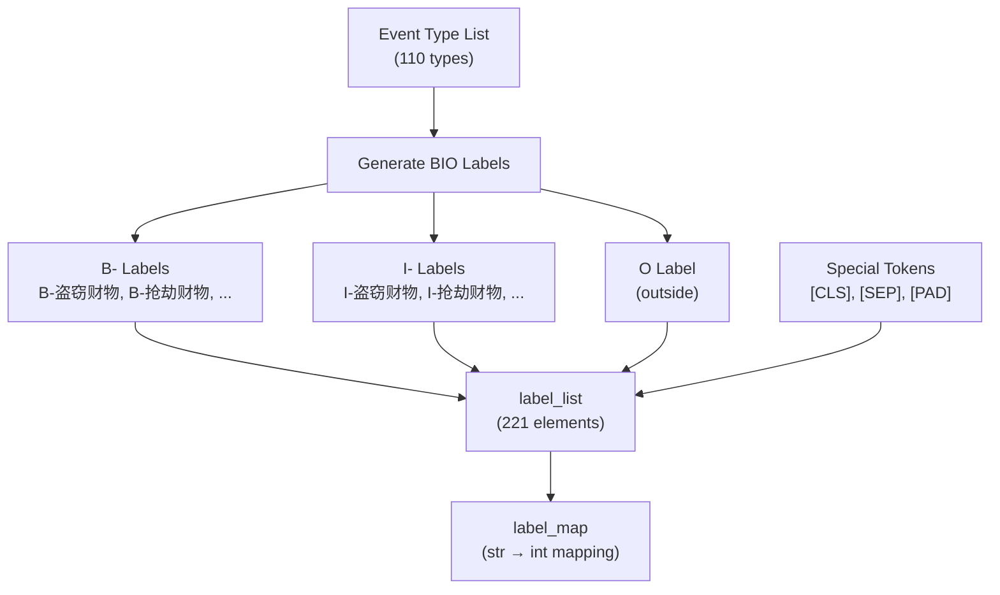

<!-- source: DeepWiki mcp.deepwiki.com · repo thunlp/LEVEN · page 2 LEVEN Task and Annotation · fetched 2026-11-02 -->

# LEVEN Task and Annotation

<details>
<summary>Relevant source files</summary>

The following files were used as context for generating this wiki page:

- [Annotation-Guidelines/annotation-guidelines-en.pdf](Annotation-Guidelines/annotation-guidelines-en.pdf)
- [Annotation-Guidelines/annotation-guidelines-zh.pdf](Annotation-Guidelines/annotation-guidelines-zh.pdf)

</details>


## Purpose and Scope

This document provides a comprehensive overview of the LEVEN event extraction task, its annotation schema, and the underlying taxonomy of 110 event types. LEVEN is a benchmark dataset for extracting structured event information from Chinese legal and incident-related documents. This page covers the fundamental task definition, annotation principles, and how the schema is represented in the codebase.

For detailed breakdowns of specific aspects, see:
- [Event Type Taxonomy](#2.1) — Complete enumeration and categorization of the 110 event types
- [Annotation Process](#2.2) — Detailed annotation procedures including BIO tagging, entity/relation annotation, and coreference resolution
- [Data Format](#3) — Technical specification of JSONL data structures
- [Baselines Comparison](#4) — Model implementations that operate on this annotation schema

## Task Definition

The LEVEN task is a **sequence labeling problem** where the goal is to identify and classify event mentions in Chinese text into one of 110 predefined event types. The task operates at the token level using the BIO (Beginning-Inside-Outside) tagging scheme.

### Input and Output Structure



**Diagram: LEVEN Task Input-Output Flow**

The task involves:
- **Input**: Raw Chinese documents containing descriptions of legal incidents, financial transactions, or procedural actions
- **Processing**: Token-level classification using contextual embeddings
- **Output**: Each token receives a BIO tag indicating whether it is part of an event mention (B- prefix for beginning, I- prefix for inside) or not (O tag)

Sources: High-level system diagrams (Diagram 4)

### Event Mention Types

LEVEN distinguishes between two types of event indicators in the data:

| Mention Type | Description | Annotation |
|-------------|-------------|------------|
| **Positive Event Mentions** | Tokens that trigger an actual event of one of the 110 types | Tagged with `B-{EventType}` or `I-{EventType}` |
| **Negative Triggers** | Tokens that superficially resemble event triggers but do not constitute events in context | Tagged with `O` (Outside) |

This distinction is critical for training models to avoid false positives on lexically similar but contextually different phrases.

Sources: High-level system diagrams (Diagram 1, Diagram 4)

## Annotation Schema Overview

### BIO Tagging Scheme

The annotation uses the standard BIO scheme extended to 110 event types, resulting in approximately **221 total labels**:

```
Labels = {O} ∪ {B-EventType₁, I-EventType₁, ..., B-EventType₁₁₀, I-EventType₁₁₀}
```

Each event type has two BIO variants:
- **B-** prefix: Beginning of an event mention span
- **I-** prefix: Inside/continuation of an event mention span
- **O**: Tokens outside any event mention



**Diagram: BIO Tagging Example**

Sources: High-level system diagrams (Diagram 4)

### Label Representation in Code

The event type taxonomy is mapped to integer identifiers through the `pure_event2id` dictionary, which provides a canonical mapping from event type names (in Chinese) to numeric IDs in the range [0, 109].



**Diagram: Event Type to Code Entity Mapping**

The label processing pipeline in the codebase:
1. `pure_event2id` stores the canonical event type to ID mapping
2. `label_list` contains all BIO labels in string format (e.g., `["O", "B-盗窃财物", "I-盗窃财物", ...]`)
3. `label_map` provides the inverse mapping from BIO label strings to integer indices for model training

Sources: High-level system diagrams (Diagram 4)

## Event Type Organization

The 110 event types are organized into **four primary semantic domains**:



**Diagram: Event Type Domain Organization**

| Domain | Examples | Characteristics |
|--------|----------|-----------------|
| **Legal/Criminal** | 盗窃财物 (theft), 抢劫财物 (robbery), 贩卖毒品 (drug trafficking) | Criminal acts and illegal activities |
| **Financial** | 买入 (purchase), 卖出 (sale), 支付/给付 (payment) | Economic transactions and monetary flows |
| **Violent** | 伤害人身 (bodily harm), 杀害 (homicide), 绑架 (kidnapping) | Physical violence and coercion |
| **Procedural** | 拘捕 (arrest), 投案 (surrender), 审判 (trial) | Legal process and judicial actions |

For a complete enumeration of all 110 event types with detailed descriptions, see [Event Type Taxonomy](#2.1).

Sources: High-level system diagrams (Diagram 4)

## Annotation Guidelines

The LEVEN repository includes comprehensive annotation guidelines in both **English and Chinese** (PDF format) that define:

1. **Event type definitions**: Precise criteria for when each of the 110 event types should be applied
2. **Boundary rules**: How to determine the span of event mention tokens
3. **Disambiguation guidelines**: How to resolve cases where multiple event types might apply
4. **Negative trigger identification**: When lexically similar phrases should not be annotated as events



**Diagram: Annotation Guidelines to Data Pipeline**

These guidelines ensure **inter-annotator consistency** and provide the formal specification that all baseline models are trained to predict.

Sources: High-level system diagrams (Diagram 1)

## Data Structure and Code Integration

### Document-Level Structure

Each LEVEN document contains:
- **Text**: Raw Chinese text of the document
- **Events**: List of event mentions with type annotations
- **Mentions**: Specific token spans for each event mention
- **Negative Triggers** (optional): Explicitly annotated non-events



**Diagram: JSONL Data Structure Hierarchy**

Sources: High-level system diagrams (Diagram 4), Data Format specifications

### Tokenization and Label Assignment

The data processing pipeline converts JSONL documents into token-level BIO sequences:



**Diagram: Data Pipeline from JSONL to Model Input**

Key code entities:
- `read_examples_from_file()`: Parses JSONL and extracts token-label pairs
- `InputExample`: Data class containing raw tokens and BIO label strings
- `convert_examples_to_features()`: Tokenizes and converts to integer IDs
- `InputFeatures`: Data class containing model-ready tensors
- `label_map`: Dictionary mapping BIO label strings to integer IDs

For detailed documentation of data utilities, see [BERT+CRF Data Utilities](#5.4) and [BERT Data Utilities](#6.4).

Sources: High-level system diagrams (Diagram 3)

## Label Processing and Validation

### Label List Construction

The complete set of BIO labels is constructed dynamically from the event type taxonomy:



**Diagram: Label List Construction Process**

The `label_list` includes:
1. `O` tag for non-event tokens
2. `B-{EventType}` for each of the 110 event types (110 labels)
3. `I-{EventType}` for each of the 110 event types (110 labels)
4. Special labels for BERT tokenization artifacts (e.g., `[CLS]`, `[SEP]`, `[PAD]`)

Total: ~221 labels

Sources: High-level system diagrams (Diagram 3, Diagram 4)

## Summary

The LEVEN task provides a comprehensive benchmark for event extraction with:

- **110 event types** covering legal, financial, violent, and procedural domains
- **BIO tagging scheme** for token-level sequence labeling
- **Bilingual annotation guidelines** ensuring consistent, high-quality annotations
- **Structured JSONL format** with document, event, and mention hierarchies
- **Code integration** through `pure_event2id`, `label_list`, and `label_map` dictionaries

The annotation schema balances **fine-grained event classification** with practical considerations for model training, providing both positive event mentions and explicitly annotated negative triggers to improve model precision.

For implementation details on how models process this annotation schema, see the baseline documentation:
- [BERT+CRF Baseline](#5) — Most extensively documented baseline
- [BERT Baseline](#6) — Similar architecture with minor variations
- [BiLSTM+CRF Baseline](#7) — Traditional neural architecture

Sources: High-level system diagrams (all diagrams)

---

