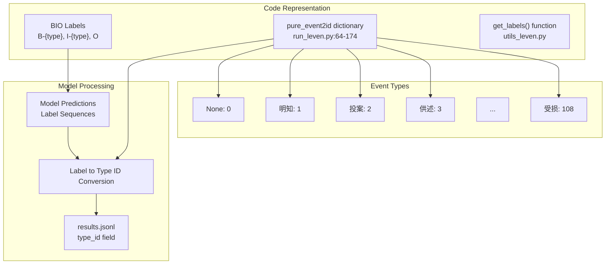
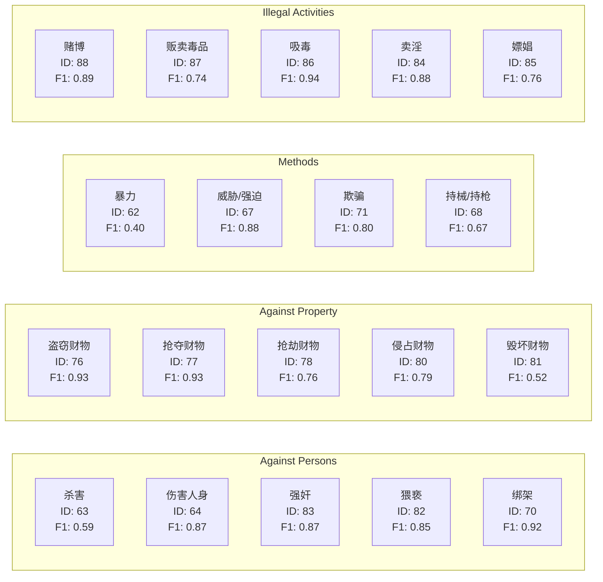
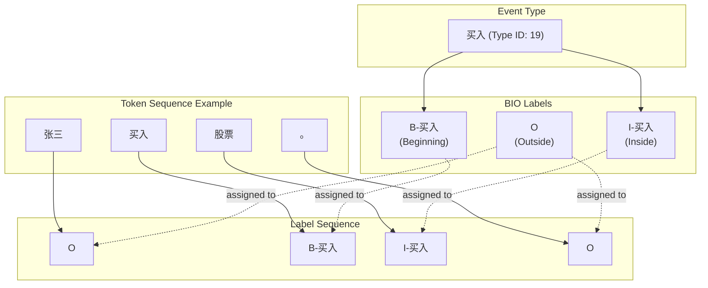
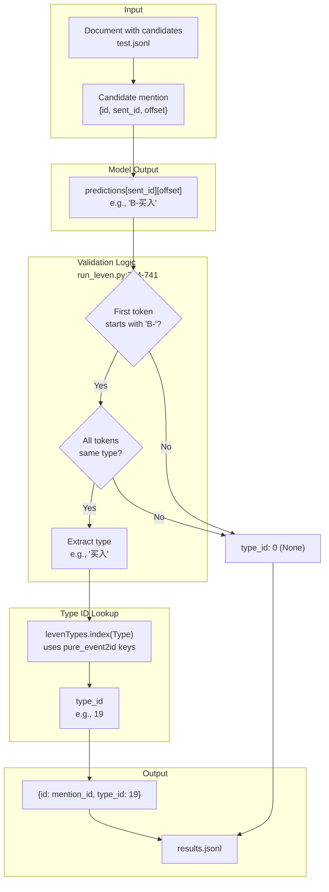
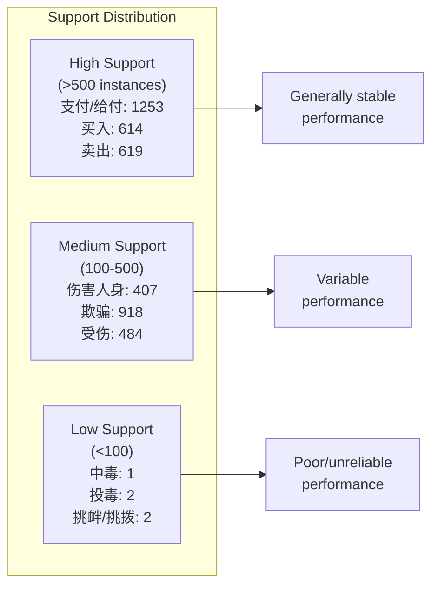

<!-- source: DeepWiki mcp.deepwiki.com · repo thunlp/LEVEN · page 2.1 Event Type Taxonomy · fetched 2026-11-02 -->

# Event Type Taxonomy

Relevant source files

The following files were used as context for generating this wiki page:

- [Annotation-Guidelines/annotation-guidelines-en.pdf](Annotation-Guidelines/annotation-guidelines-en.pdf)
- [Baselines/BERT+CRF/performance/bertcrf-prf_report.txt](Baselines/BERT+CRF/performance/bertcrf-prf_report.txt)
- [Baselines/BERT+CRF/run_leven.py](Baselines/BERT+CRF/run_leven.py)

## Purpose and Scope

This page provides a detailed breakdown of the 110 event types defined in the LEVEN benchmark, organized by semantic domains. It documents the mapping between event type names (in Chinese) and their numeric identifiers, the distribution across semantic categories, and their representation in the codebase. For information about how these event types are annotated using the BIO scheme, see [Annotation Process](#2.2).

---

## Taxonomy Overview

The LEVEN taxonomy defines **110 distinct event types** that represent specific actions, occurrences, and states relevant to legal case documents. Each event type is assigned a unique integer ID from 0 to 109, with ID 0 reserved for "None" (no event).

**Sources:** [Baselines/BERT+CRF/run_leven.py:64-174]()

---

## Event Type ID Mapping

The canonical mapping between event type names and numeric identifiers is defined in the `pure_event2id` dictionary in [Baselines/BERT+CRF/run_leven.py:64-174](). This mapping is critical for:

- Converting model predictions (label sequences) to event type IDs for evaluation
- Standardizing event type representation across all baseline models
- Generating final prediction output in JSONL format

**Sources:** [Baselines/BERT+CRF/run_leven.py:64-174](), [Baselines/BERT+CRF/run_leven.py:720-746]()

---

## Semantic Domain Organization

The 110 event types are organized into six major semantic domains based on their functional and thematic characteristics.

### Domain 1: Investigation and Legal Procedure (15 types)

Events related to criminal investigations, legal proceedings, and judicial processes.

| Event Type (Chinese) | Type ID | Description |
|---------------------|---------|-------------|
| 明知 | 1 | Knowledge/awareness |
| 投案 | 2 | Surrender to authorities |
| 供述 | 3 | Confession/statement |
| 谅解 | 4 | Reconciliation |
| 搜查/扣押 | 9 | Search and seizure |
| 举报 | 10 | Report to authorities |
| 拘捕 | 11 | Arrest/detention |
| 报警/报案 | 12 | Report to police |
| 鉴定 | 13 | Forensic examination |

**Sources:** [Baselines/BERT+CRF/run_leven.py:64-174](), [Baselines/BERT+CRF/performance/bertcrf-prf_report.txt:1-1]()

### Domain 2: Financial and Transaction Events (17 types)

Events involving monetary transactions, property transfers, and economic activities.

| Event Type (Chinese) | Type ID | F1 Score | Description |
|---------------------|---------|----------|-------------|
| 买入 | 19 | 0.92 | Purchase/buy |
| 卖出 | 18 | 0.85 | Sell |
| 买卖 | 17 | 0.74 | Trade/transaction |
| 租用/借用 | 22 | 0.75 | Rent/borrow |
| 出租/出借 | 21 | 0.53 | Rent out/lend |
| 归还/偿还 | 23 | 0.86 | Return/repay |
| 获利 | 24 | 0.62 | Profit/gain |
| 雇佣 | 25 | 0.89 | Employment |
| 支付/给付 | 28 | 0.82 | Payment |
| 赔偿 | 5 | 0.90 | Compensation |
| 退赃 | 6 | 0.82 | Return stolen goods |
| 销赃 | 7 | 0.58 | Fence stolen goods |
| 分赃 | 8 | 0.82 | Divide stolen goods |

**Sources:** [Baselines/BERT+CRF/run_leven.py:64-174](), [Baselines/BERT+CRF/performance/bertcrf-prf_report.txt:1-1]()

### Domain 3: Violent and Criminal Acts (28 types)

Events representing violent actions, assaults, and criminal activities.

**Sources:** [Baselines/BERT+CRF/run_leven.py:64-174](), [Baselines/BERT+CRF/performance/bertcrf-prf_report.txt:1-1]()

### Domain 4: Social Interaction and Communication (20 types)

Events capturing communication, cooperation, and interpersonal relationships.

| Event Type (Chinese) | Type ID | F1 Score | Description |
|---------------------|---------|----------|-------------|
| 联络 | 36 | 0.84 | Contact/communication |
| 通知/提醒 | 37 | 0.88 | Notify/remind |
| 介绍/引荐 | 38 | 0.97 | Introduce/recommend |
| 邀请/招揽 | 39 | 0.86 | Invite/solicit |
| 帮助/救助 | 43 | 0.88 | Help/rescue |
| 提供 | 44 | 0.91 | Provide |
| 同意/接受 | 47 | 0.72 | Agree/accept |
| 拒绝/抗拒 | 48 | 0.82 | Refuse/resist |
| 要求/请求 | 50 | 0.85 | Request/demand |
| 建议 | 51 | 0.90 | Suggest |
| 约定 | 52 | 0.87 | Agree upon |
| 共谋 | 91 | 0.67 | Conspire |
| 指使/教唆 | 90 | 0.77 | Instigate |

**Sources:** [Baselines/BERT+CRF/run_leven.py:64-174](), [Baselines/BERT+CRF/performance/bertcrf-prf_report.txt:1-1]()

### Domain 5: Incidents and Accidents (11 types)

Events representing accidents, natural disasters, and unintentional occurrences.

| Event Type (Chinese) | Type ID | Support | Description |
|---------------------|---------|---------|-------------|
| 交通事故 | 59 | 262 | Traffic accident |
| 火灾事故 | 60 | 66 | Fire accident |
| 爆炸事故 | 61 | 72 | Explosion accident |
| 事故 | 58 | 59 | General accident |
| 洪涝 | 55 | 4 | Flood |
| 干旱 | 56 | 4 | Drought |
| 死亡 | 102 | 183 | Death |
| 受伤 | 103 | 484 | Injury |
| 中毒 | 105 | 1 | Poisoning |
| 昏迷 | 106 | 10 | Loss of consciousness |
| 受损 | 108 | 299 | Damage |

**Sources:** [Baselines/BERT+CRF/run_leven.py:64-174](), [Baselines/BERT+CRF/performance/bertcrf-prf_report.txt:1-1]()

### Domain 6: Conflict and Confrontation (8 types)

Events representing various forms of conflict, both verbal and physical.

| Event Type (Chinese) | Type ID | F1 Score |
|---------------------|---------|----------|
| 冲突 | 14 | 0.82 |
| 言语冲突 | 15 | 0.83 |
| 肢体冲突 | 16 | 0.89 |
| 言语辱骂 | 65 | 0.86 |
| 敲诈勒索 | 66 | 0.75 |
| 挑衅/挑拨 | 42 | 0.67 |
| 阻止/妨碍 | 41 | 0.79 |
| 逃匿 | 97 | 0.86 |

**Sources:** [Baselines/BERT+CRF/run_leven.py:64-174](), [Baselines/BERT+CRF/performance/bertcrf-prf_report.txt:1-1]()

---

## Label Encoding in BIO Scheme

Each event type generates two label variants in the BIO tagging scheme, plus one universal "O" label:

This encoding produces approximately **221 total labels**:
- 110 event types × 2 (B- and I- prefixes) = 220 labels
- 1 "O" label for tokens outside any event mention
- Total: 221 labels

The `get_labels()` function in `utils_leven.py` generates the complete label list dynamically.

**Sources:** [Baselines/BERT+CRF/run_leven.py:64-174]()

---

## Complete Event Type Table

The following table provides the complete mapping of all 110 event types:

Click to expand complete event type mapping (110 types)

| ID | Event Type (Chinese) | Domain | ID | Event Type (Chinese) | Domain |
|----|---------------------|--------|----|--------------------|--------|
| 0 | None | - | 55 | 洪涝 | Incident |
| 1 | 明知 | Legal | 56 | 干旱 | Incident |
| 2 | 投案 | Legal | 57 | 山体滑坡 | Incident |
| 3 | 供述 | Legal | 58 | 事故 | Incident |
| 4 | 谅解 | Legal | 59 | 交通事故 | Incident |
| 5 | 赔偿 | Financial | 60 | 火灾事故 | Incident |
| 6 | 退赃 | Financial | 61 | 爆炸事故 | Incident |
| 7 | 销赃 | Financial | 62 | 暴力 | Violent |
| 8 | 分赃 | Financial | 63 | 杀害 | Violent |
| 9 | 搜查/扣押 | Legal | 64 | 伤害人身 | Violent |
| 10 | 举报 | Legal | 65 | 言语辱骂 | Conflict |
| 11 | 拘捕 | Legal | 66 | 敲诈勒索 | Violent |
| 12 | 报警/报案 | Legal | 67 | 威胁/强迫 | Violent |
| 13 | 鉴定 | Legal | 68 | 持械/持枪 | Violent |
| 14 | 冲突 | Conflict | 69 | 拘束/拘禁 | Violent |
| 15 | 言语冲突 | Conflict | 70 | 绑架 | Violent |
| 16 | 肢体冲突 | Conflict | 71 | 欺骗 | Violent |
| 17 | 买卖 | Financial | 72 | 拐骗 | Violent |
| 18 | 卖出 | Financial | 73 | 冒充 | Violent |
| 19 | 买入 | Financial | 74 | 伪造 | Violent |
| 20 | 租/借 | Financial | 75 | 变造 | Violent |
| 21 | 出租/出借 | Financial | 76 | 盗窃财物 | Violent |
| 22 | 租用/借用 | Financial | 77 | 抢夺财物 | Violent |
| 23 | 归还/偿还 | Financial | 78 | 抢劫财物 | Violent |
| 24 | 获利 | Financial | 79 | 挪用财物 | Violent |
| 25 | 雇佣 | Financial | 80 | 侵占财物 | Violent |
| 26 | 放贷 | Financial | 81 | 毁坏财物 | Violent |
| 27 | 集资 | Financial | 82 | 猥亵 | Violent |
| 28 | 支付/给付 | Financial | 83 | 强奸 | Violent |
| 29 | 签订合同/订立协议 | Financial | 84 | 卖淫 | Violent |
| 30 | 制造 | Social | 85 | 嫖娼 | Violent |
| 31 | 遗弃 | Social | 86 | 吸毒 | Violent |
| 32 | 运输/运送 | Social | 87 | 贩卖毒品 | Violent |
| 33 | 邮寄 | Social | 88 | 赌博 | Violent |
| 34 | 组织/安排 | Social | 89 | 开设赌场 | Violent |
| 35 | 散布 | Social | 90 | 指使/教唆 | Social |
| 36 | 联络 | Social | 91 | 共谋 | Social |
| 37 | 通知/提醒 | Social | 92 | 违章驾驶 | Violent |
| 38 | 介绍/引荐 | Social | 93 | 泄露信息 | Violent |
| 39 | 邀请/招揽 | Social | 94 | 私藏/藏匿 | Violent |
| 40 | 纠集 | Social | 95 | 入室/入户 | Violent |
| 41 | 阻止/妨碍 | Conflict | 96 | 贿赂 | Violent |
| 42 | 挑衅/挑拨 | Conflict | 97 | 逃匿 | Conflict |
| 43 | 帮助/救助 | Social | 98 | 放火 | Violent |
| 44 | 提供 | Social | 99 | 走私 | Violent |
| 45 | 放纵 | Social | 100 | 投毒 | Violent |
| 46 | 跟踪 | Social | 101 | 自杀 | Incident |
| 47 | 同意/接受 | Social | 102 | 死亡 | Incident |
| 48 | 拒绝/抗拒 | Social | 103 | 受伤 | Incident |
| 49 | 放弃/停止 | Social | 104 | 被困 | Incident |
| 50 | 要求/请求 | Social | 105 | 中毒 | Incident |
| 51 | 建议 | Social | 106 | 昏迷 | Incident |
| 52 | 约定 | Social | 107 | 遗失 | Incident |
| 53 | 饮酒 | Social | 108 | 受损 | Incident |
| 54 | 自然灾害 | Incident |

**Sources:** [Baselines/BERT+CRF/run_leven.py:64-174]()

---

## Type ID Conversion During Inference

During inference, the model outputs label sequences which must be converted back to event type IDs for submission:

**Sources:** [Baselines/BERT+CRF/run_leven.py:720-746]()

---

## Performance Characteristics by Domain

Analysis of the performance report reveals domain-specific patterns:

### High-Performing Domains (F1 > 0.85)
- **Legal/Procedural**: 投案 (0.98), 供述 (0.99), 谅解 (0.98), 报警/报案 (0.99)
- **Well-defined actions**: 介绍/引荐 (0.97), 鉴定 (0.96)

### Mid-Range Domains (F1 0.70-0.85)
- **Financial transactions**: Most types in 0.75-0.92 range
- **Social interactions**: 联络 (0.84), 通知/提醒 (0.88)

### Challenging Types (F1 < 0.70)
- **Rare events**: 租/借 (0.00), 投毒 (0.00), 被困 (0.00) - very low support
- **Ambiguous categories**: 暴力 (0.40), 放贷 (0.40), 销赃 (0.58)
- **Fine-grained distinctions**: 变造 (0.67), 共谋 (0.67)

**Sources:** [Baselines/BERT+CRF/performance/bertcrf-prf_report.txt:1-1]()

---

## Data Distribution

Types with fewer than 10 training instances show highly unstable performance, often achieving 0.0 F1 score.

**Sources:** [Baselines/BERT+CRF/performance/bertcrf-prf_report.txt:1-1]()

---

