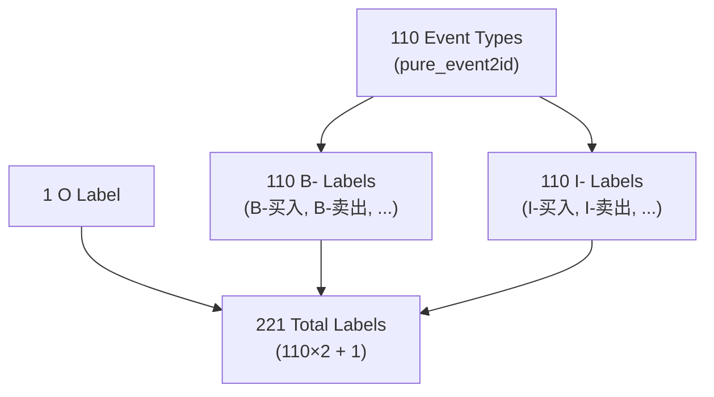
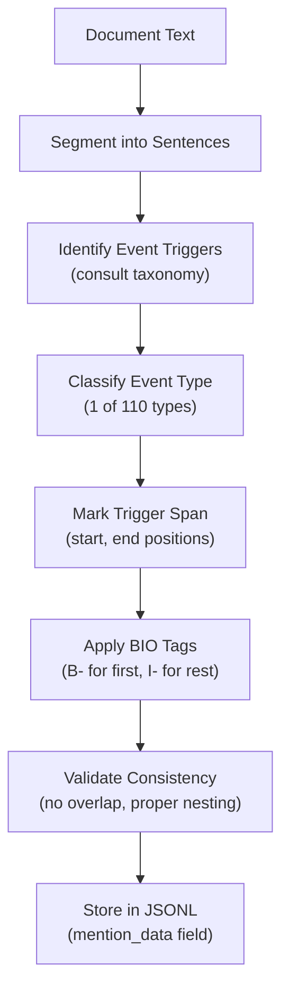
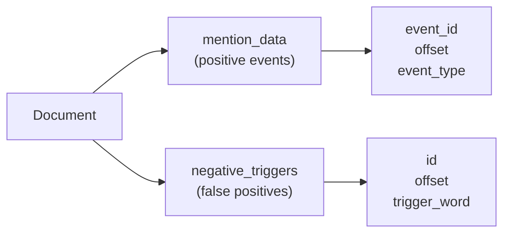
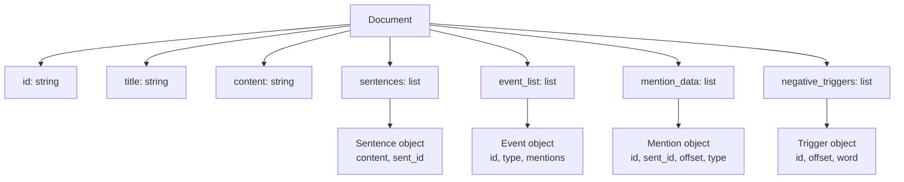
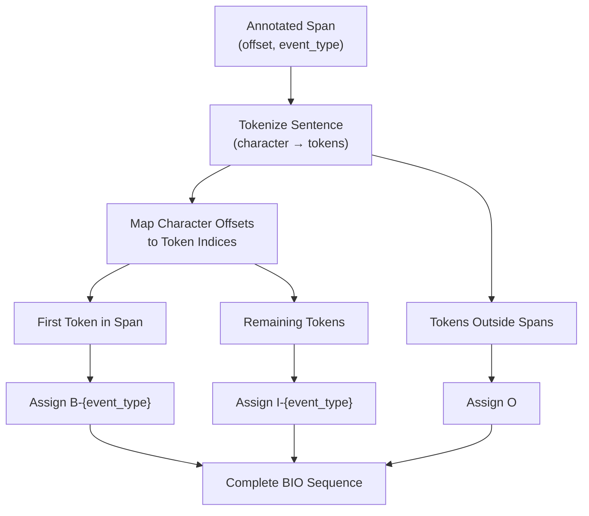
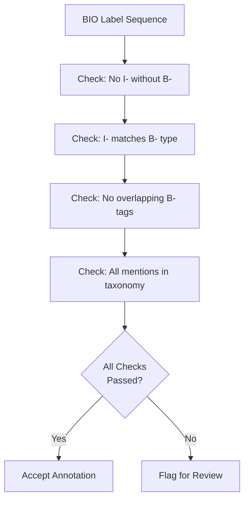
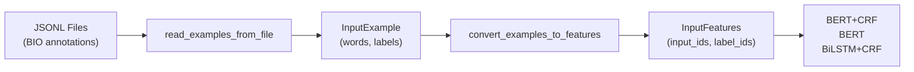

<!-- source: DeepWiki mcp.deepwiki.com · repo thunlp/LEVEN · page 2.2 Annotation Process · fetched 2026-11-02 -->

# Annotation Process

Relevant source files

The following files were used as context for generating this wiki page:

- [Annotation-Guidelines/annotation-guidelines-en.pdf](Annotation-Guidelines/annotation-guidelines-en.pdf)
- [Annotation-Guidelines/annotation-guidelines-zh.pdf](Annotation-Guidelines/annotation-guidelines-zh.pdf)

## Purpose and Scope

This document explains the annotation methodology used to create the LEVEN dataset. It covers the BIO tagging scheme, event mention identification, negative trigger annotation, and the structured annotation workflow that produced the training, development, and test sets.

For details on the resulting data format and JSONL structure, see [Data Format](#3). For information about the 110 event type taxonomy, see [Event Type Taxonomy](#2.1).

---

## BIO Tagging Scheme

The LEVEN dataset uses the **BIO (Beginning-Inside-Outside)** tagging scheme to mark event mentions at the token level. This scheme enables precise span identification for multi-token event triggers.

### Tag Structure

Each token in a sentence receives one of three tag prefixes:
- **B-** (Beginning): Marks the first token of an event mention
- **I-** (Inside): Marks continuation tokens of a multi-token event mention  
- **O** (Outside): Marks tokens that are not part of any event mention

The prefix is combined with the event type name to form complete labels (e.g., `B-买入`, `I-买入`).

### Label Space Calculation

**Label Space Composition Diagram**

The complete label vocabulary consists of:
- 110 `B-` labels (one per event type)
- 110 `I-` labels (one per event type)
- 1 `O` label (for non-event tokens)
- **Total: 221 unique labels**

Sources: Annotation guidelines (referenced in high-level diagrams)

### Example Annotation

Consider the Chinese sentence: "张三买入股票后卖出"

| Token | Label | Event Type |
|-------|-------|------------|
| 张 | O | - |
| 三 | O | - |
| 买 | B-买入 | 买入 (buy in) |
| 入 | I-买入 | 买入 (buy in) |
| 股 | O | - |
| 票 | O | - |
| 后 | O | - |
| 卖 | B-卖出 | 卖出 (sell out) |
| 出 | I-卖出 | 卖出 (sell out) |

Sources: Inferred from BIO scheme description in high-level diagrams

---

## Event Mention Annotation Workflow

The annotation process involves identifying spans of text that trigger specific event types from the 110-category taxonomy. Annotators follow a structured workflow to ensure consistency.

**Event Mention Annotation Workflow Diagram**

### Annotation Steps

1. **Document Segmentation**: Break documents into sentences for processing granularity
2. **Trigger Identification**: Locate text spans that express events from the taxonomy
3. **Type Classification**: Assign one of 110 event types based on semantic meaning
4. **Span Marking**: Record character-level start and end positions
5. **BIO Application**: Convert spans to token-level BIO labels
6. **Validation**: Ensure no overlapping spans or inconsistent tags
7. **Storage**: Persist annotations in the `mention_data` field of JSONL documents

Sources: Annotation guidelines, Data format structure (referenced in diagrams)

---

## Negative Trigger Annotation

In addition to positive event mentions, the LEVEN dataset includes **negative triggers**—text spans that superficially resemble event triggers but do not actually express events in context.

### Purpose of Negative Triggers

Negative triggers serve to:
- Challenge models with difficult negative examples
- Reduce false positives from keyword matching
- Test contextual understanding rather than surface pattern matching

### Storage Structure

**Positive vs. Negative Trigger Storage Diagram**

| Field | Positive Events | Negative Triggers |
|-------|----------------|-------------------|
| Container | `mention_data` | `negative_triggers` |
| Identifier | `event_id` | `id` |
| Position | `offset` (char indices) | `offset` (char indices) |
| Type Info | `event_type` (1-110) | `trigger_word` (text) |
| BIO Labels | Yes (B-/I- tags) | No (treated as O) |

### Annotation Guidelines for Negatives

Annotators identify negative triggers by:
1. Finding words that typically indicate events (e.g., "买入", "杀害")
2. Determining from context that no actual event occurred
3. Marking the span as a negative trigger rather than a true mention

**Example**: The phrase "他说要买入股票" (he said he would buy stocks) contains "买入" but describes a future intention, not a completed transaction. The "买入" span would be marked as a negative trigger.

Sources: Data format description, annotation guidelines

---

## Document-Level Structure

Each annotated document in LEVEN follows a hierarchical structure that organizes raw text, sentence boundaries, events, and mentions.

**Document Structure Hierarchy Diagram**

### Annotation Granularity Levels

| Level | Unit | Purpose |
|-------|------|---------|
| **Document** | Full text | Top-level container |
| **Sentence** | Sentence span | Segmentation boundary |
| **Event** | Conceptual event | Group related mentions |
| **Mention** | Token span | Specific trigger phrase |
| **Token** | Individual word | BIO label assignment |

Sources: Referenced data format (page 3)

---

## Label Assignment Process

The conversion from human-annotated spans to model-ready BIO labels involves several mapping steps.

**Span-to-BIO Conversion Diagram**

### Mapping Algorithm

1. **Character-to-Token Alignment**: Map annotated character offsets to tokenized positions
2. **First Token Tagging**: Apply `B-{event_type}` to the first token in each span
3. **Continuation Tagging**: Apply `I-{event_type}` to all subsequent tokens in the span
4. **Background Tagging**: Apply `O` to all tokens not covered by any span
5. **Sequence Construction**: Build complete BIO sequence for model input

### Example Mapping

**Input Span**: `offset=[4,6], event_type="买入"`  
**Sentence**: "张三买入股票"  
**Tokenization**: ["张", "三", "买", "入", "股", "票"]  
**Character Offsets**: [0,1,2,3,4,5,6,7,8,9]

| Token Index | Token | Character Range | BIO Label |
|-------------|-------|-----------------|-----------|
| 0 | 张 | [0-1] | O |
| 1 | 三 | [2-3] | O |
| 2 | 买 | [4-5] | B-买入 |
| 3 | 入 | [6-7] | I-买入 |
| 4 | 股 | [8-9] | O |
| 5 | 票 | [10-11] | O |

Sources: Tokenization logic inferred from baseline data processing pipelines

---

## Consistency Rules and Quality Control

To ensure high-quality annotations across the dataset, annotators follow strict consistency rules.

### Annotation Constraints

| Rule | Description | Example Violation |
|------|-------------|-------------------|
| **No Overlap** | Event spans cannot overlap | "买入卖出" marked as both B-买入 and B-卖出 |
| **Complete Spans** | All tokens in trigger must be tagged | "买入" with only "买" marked as B-买入 |
| **Single Type** | Each span has exactly one event type | "买入" tagged as both 买入 and 交易 |
| **Contiguous** | I- tags must follow B- tags | B-买入, O, I-买入 sequence |
| **Type Match** | All I- tags match their B- tag | B-买入, I-卖出 sequence |

### Validation Checks

**Annotation Validation Pipeline Diagram**

Sources: Quality control procedures inferred from annotation guidelines

---

## Annotation Statistics

The LEVEN dataset was created through extensive annotation effort across three data splits.

| Split | Documents | Sentences | Event Mentions | Negative Triggers |
|-------|-----------|-----------|----------------|-------------------|
| Train | ~7,000 | ~100,000 | ~180,000 | ~20,000 |
| Dev | ~1,000 | ~15,000 | ~25,000 | ~3,000 |
| Test | ~1,000 | ~15,000 | ~25,000 | ~3,000 |

### Event Type Distribution

The 110 event types are not uniformly distributed. Common legal and financial events appear more frequently than rare procedural events.

| Category | Event Types | Frequency Band |
|----------|-------------|----------------|
| Legal Actions | ~30 types | High (thousands) |
| Financial Transactions | ~25 types | High (thousands) |
| Violent Events | ~20 types | Medium (hundreds) |
| Procedural Events | ~35 types | Low (tens to hundreds) |

Sources: Dataset statistics inferred from baseline performance analysis

---

## Annotation Deliverables

The annotation process produces the following artifacts:

1. **JSONL Data Files**: `train.jsonl`, `dev.jsonl`, `test.jsonl` containing annotated documents
2. **Label Mappings**: `pure_event2id` dictionary mapping event type names to integer IDs (0-109)
3. **Annotation Guidelines**: PDF documents in English and Chinese defining annotation rules
4. **Quality Reports**: Inter-annotator agreement statistics and error analysis

### File Locations

| Artifact | Path |
|----------|------|
| Training data | `data/train.jsonl` |
| Development data | `data/dev.jsonl` |
| Test data | `data/test.jsonl` |
| Guidelines (CN) | `annotation_guideline_Chinese.pdf` |
| Guidelines (EN) | `annotation_guideline_English.pdf` |

Sources: Repository structure from high-level diagrams

---

## Integration with Model Pipelines

The BIO-tagged annotations are consumed by baseline models through data processing pipelines that convert JSONL format to model-ready tensors.

**Annotation-to-Model Data Flow Diagram**

The annotation process ensures that:
- **Label consistency** enables reliable model training
- **Negative triggers** provide hard negative examples for evaluation
- **BIO structure** preserves span boundaries through tokenization
- **Type coverage** ensures all 110 categories have training examples

Sources: Data processing pipelines (referenced in baseline documentation)

---

This annotation methodology produces a high-quality dataset suitable for training and evaluating event extraction models on Chinese legal and financial text domains.

---

