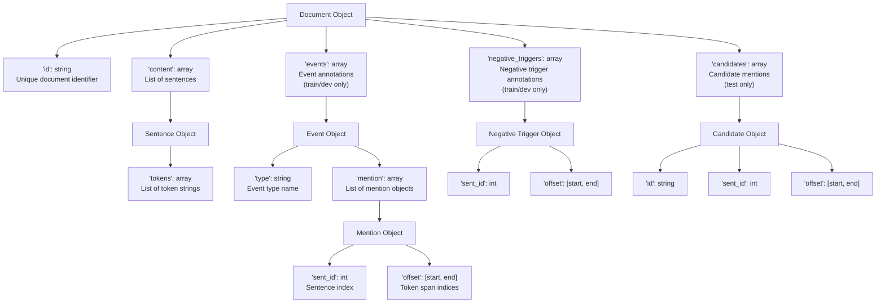
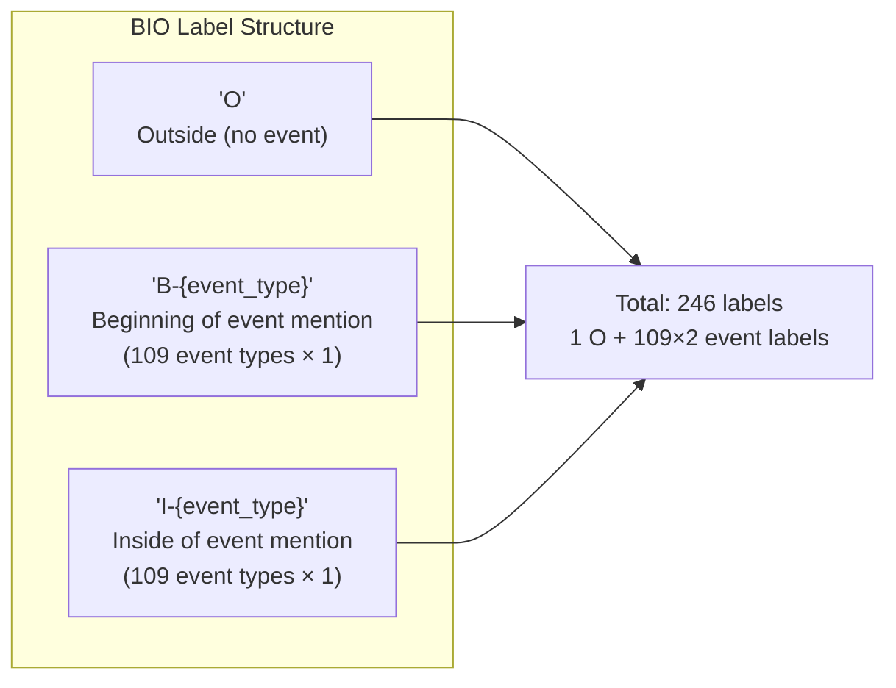
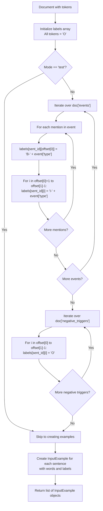
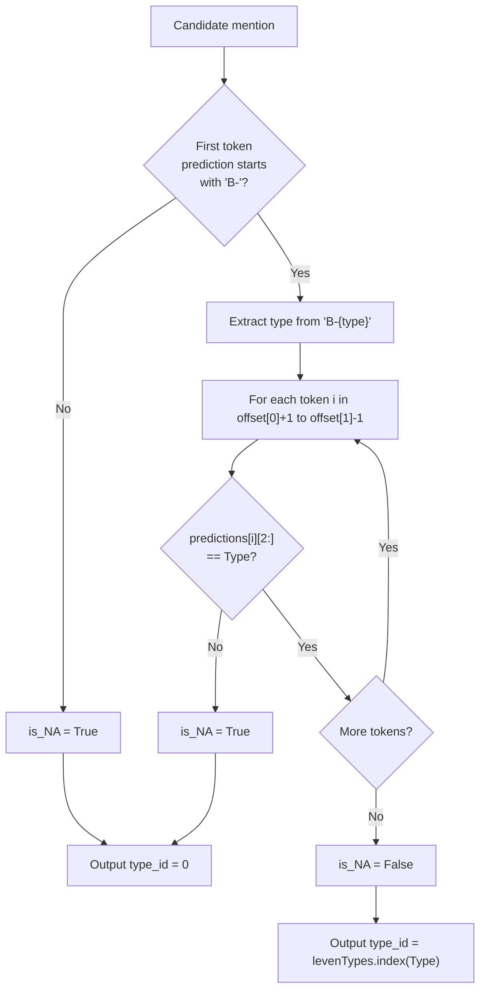
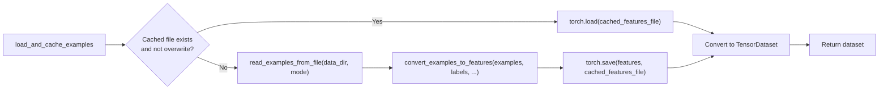

<!-- source: DeepWiki mcp.deepwiki.com · repo thunlp/LEVEN · page 3 Data Format · fetched 2026-11-02 -->

# Data Format

<details>
<summary>Relevant source files</summary>

The following files were used as context for generating this wiki page:

- [Baselines/BERT+CRF/run_leven.py](Baselines/BERT+CRF/run_leven.py)
- [Baselines/BERT+CRF/utils_leven.py](Baselines/BERT+CRF/utils_leven.py)
- [Baselines/BERT/utils_leven.py](Baselines/BERT/utils_leven.py)

</details>


This page documents the JSONL data format used by the LEVEN event extraction benchmark, including the structure of training, validation, and test files, the BIO tagging scheme, and event type mappings.

For information about the 110 event types and their semantic organization, see [Event Type Taxonomy](#2.1). For details about the annotation process and guidelines, see [Annotation Process](#2.2).

---

## Overview

LEVEN data is stored in JSONL (JSON Lines) format, with one document per line. The dataset is split into three files:
- `train.jsonl` - Training documents with annotated events and negative triggers
- `dev.jsonl` - Validation documents with annotated events and negative triggers  
- `test.jsonl` - Test documents with candidate mentions requiring prediction

All baseline systems read this format using the `read_examples_from_file` function, which parses documents and converts them to BIO-tagged sequences for model training and evaluation.

---

## File Format and Location

Data files are located in the `data/` directory and loaded by specifying the `--data_dir` argument. Each file follows the JSONL specification where each line is a valid JSON object representing a single document.

**Sources:** [Baselines/BERT+CRF/run_leven.py:480-481](), [Baselines/BERT+CRF/utils_leven.py:271-272]()

---

## Document Structure

Each JSONL line represents a document with the following top-level structure:



**Sources:** [Baselines/BERT+CRF/utils_leven.py:275-290](), [Baselines/BERT+CRF/run_leven.py:721-747]()

---

## Content Field

The `content` field contains a list of sentence objects. Each sentence is a dictionary with a `tokens` field containing a list of token strings.

| Field | Type | Description |
|-------|------|-------------|
| `tokens` | `list[str]` | Ordered list of tokens (words/characters) in the sentence |

**Example:**
```json
{
  "content": [
    {"tokens": ["被", "告", "人", "王", "某", "某", "因", "琐", "事"]},
    {"tokens": ["持", "刀", "将", "被", "害", "人", "刺", "伤"]}
  ]
}
```

The `read_examples_from_file` function extracts tokens using `[c['tokens'] for c in doc['content']]` and creates a separate label list initialized with "O" (outside) tags for each token.

**Sources:** [Baselines/BERT+CRF/utils_leven.py:276-277]()

---

## Events Field

The `events` field (present only in `train.jsonl` and `dev.jsonl`) contains annotations for all event mentions in the document. Each event has a type and one or more mentions.

| Field | Type | Description |
|-------|------|-------------|
| `type` | `str` | Event type name (one of 109 valid types, see [Event Type Taxonomy](#2.1)) |
| `mention` | `list[dict]` | List of mentions for this event in the document |

Each mention object contains:

| Field | Type | Description |
|-------|------|-------------|
| `sent_id` | `int` | Index of the sentence containing this mention (0-indexed) |
| `offset` | `[int, int]` | Token span `[start, end)` within the sentence (end is exclusive) |

**Example:**
```json
{
  "events": [
    {
      "type": "伤害人身",
      "mention": [
        {"sent_id": 1, "offset": [6, 8]},
        {"sent_id": 3, "offset": [2, 4]}
      ]
    }
  ]
}
```

The BIO tagging logic assigns "B-{type}" to the first token and "I-{type}" to subsequent tokens within each mention span.

**Sources:** [Baselines/BERT+CRF/utils_leven.py:280-284]()

---

## Negative Triggers Field

The `negative_triggers` field (present only in `train.jsonl` and `dev.jsonl`) contains mentions that superficially resemble event triggers but are not actual events. These are explicitly marked to help models learn discrimination.

| Field | Type | Description |
|-------|------|-------------|
| `sent_id` | `int` | Sentence index containing the negative trigger |
| `offset` | `[int, int]` | Token span `[start, end)` of the negative trigger |

**Example:**
```json
{
  "negative_triggers": [
    {"sent_id": 0, "offset": [15, 17]},
    {"sent_id": 2, "offset": [8, 9]}
  ]
}
```

Negative triggers are processed after event annotations, overwriting any BIO tags with "O" labels to explicitly mark these spans as non-events.

**Sources:** [Baselines/BERT+CRF/utils_leven.py:286-289]()

---

## Candidates Field (Test Set Only)

The `candidates` field appears only in `test.jsonl` and contains mentions that require type prediction. During inference, models predict the event type ID for each candidate.

| Field | Type | Description |
|-------|------|-------------|
| `id` | `str` | Unique identifier for this candidate mention |
| `sent_id` | `int` | Sentence index containing the candidate |
| `offset` | `[int, int]` | Token span `[start, end)` of the candidate mention |

**Example:**
```json
{
  "candidates": [
    {"id": "m001", "sent_id": 0, "offset": [3, 5]},
    {"id": "m002", "sent_id": 1, "offset": [6, 8]}
  ]
}
```

**Sources:** [Baselines/BERT+CRF/run_leven.py:728-745]()

---

## BIO Tagging Scheme

LEVEN uses the BIO (Beginning-Inside-Outside) tagging scheme for sequence labeling. The complete label set consists of 246 labels defined in the `bio_labels` list:



### Label Categories

| Category | Count | Pattern | Example |
|----------|-------|---------|---------|
| Outside | 1 | `O` | `O` |
| Event Beginning | 109 | `B-{type}` | `B-伤害人身`, `B-盗窃财物` |
| Event Inside | 109 | `I-{type}` | `I-伤害人身`, `I-盗窃财物` |

### Label Assignment Rules

The `read_examples_from_file` function applies the following tagging logic:

1. Initialize all tokens with "O" labels
2. For each event mention:
   - Assign "B-{type}" to the first token at `offset[0]`
   - Assign "I-{type}" to all subsequent tokens from `offset[0]+1` to `offset[1]-1`
3. For each negative trigger:
   - Override all tokens in the span with "O" labels

**Sources:** [Baselines/BERT+CRF/utils_leven.py:28-246](), [Baselines/BERT+CRF/utils_leven.py:277-289]()

---

## BIO Label Processing Flow



**Sources:** [Baselines/BERT+CRF/utils_leven.py:271-296]()

---

## Event Type to ID Mapping

The `pure_event2id` dictionary maps event type names to integer IDs for prediction output. This mapping contains 110 entries (including "None" for non-events).

| Type ID | Event Type | Type ID | Event Type | Type ID | Event Type |
|---------|------------|---------|------------|---------|------------|
| 0 | None | 37 | 通知/提醒 | 74 | 伪造 |
| 1 | 明知 | 38 | 介绍/引荐 | 75 | 变造 |
| 2 | 投案 | 39 | 邀请/招揽 | 76 | 盗窃财物 |
| 3 | 供述 | 40 | 纠集 | 77 | 抢夺财物 |
| 4 | 谅解 | 41 | 阻止/妨碍 | 78 | 抢劫财物 |
| 5 | 赔偿 | 42 | 挑衅/挑拨 | 79 | 挪用财物 |
| ... | ... | ... | ... | ... | ... |

The complete mapping is defined in [Baselines/BERT+CRF/run_leven.py:64-174](). During inference, predicted BIO labels are converted to event type IDs using this dictionary via `levenTypes.index(Type)`.

**Sources:** [Baselines/BERT+CRF/run_leven.py:64-174](), [Baselines/BERT+CRF/run_leven.py:720-743]()

---

## InputExample Class

The `InputExample` class represents a single training/test example containing one sentence with its tokens and BIO labels.

| Attribute | Type | Description |
|-----------|------|-------------|
| `guid` | `str` | Unique identifier in format `"{mode}-{doc_id}-{sent_idx}"` |
| `words` | `list[str]` | List of tokens in the sentence |
| `labels` | `list[str]` | List of BIO labels (same length as `words`) |

**Example instantiation:**
```python
InputExample(
    guid="train-doc_001-0",
    words=["被", "告", "人", "王", "某"],
    labels=["O", "O", "O", "O", "O"]
)
```

**Sources:** [Baselines/BERT+CRF/utils_leven.py:249-258](), [Baselines/BERT+CRF/utils_leven.py:292-294]()

---

## InputFeatures Class

The `InputFeatures` class represents the tokenized and encoded features ready for model input after processing by `convert_examples_to_features`.

| Attribute | Type | Description |
|-----------|------|-------------|
| `input_ids` | `list[int]` | Token IDs from BERT tokenizer (length = `max_seq_length`) |
| `input_mask` | `list[int]` | Attention mask (1 for real tokens, 0 for padding) |
| `segment_ids` | `list[int]` | Segment IDs (all 0 for single sequences) |
| `label_ids` | `list[int]` | Label IDs mapped from BIO labels (padded with -100) |

All fields are padded to `max_seq_length` (default: 512). Special tokens `[CLS]` and `[SEP]` are added with padding label ID -100.

**Sources:** [Baselines/BERT+CRF/utils_leven.py:261-268](), [Baselines/BERT+CRF/utils_leven.py:299-436]()

---

## Prediction Output Format

During inference (`--do_infer`), predictions are written to `results.jsonl` in the output directory. Each line contains predictions for one test document.

**Structure:**
```json
{
  "id": "doc_id",
  "predictions": [
    {"id": "candidate_mention_id", "type_id": 76},
    {"id": "another_mention_id", "type_id": 0}
  ]
}
```

| Field | Type | Description |
|-------|------|-------------|
| `id` | `str` | Document ID (matches input test document) |
| `predictions` | `list[dict]` | List of predictions for all candidates in the document |

Each prediction object contains:

| Field | Type | Description |
|-------|------|-------------|
| `id` | `str` | Candidate mention ID (from test data `candidates` field) |
| `type_id` | `int` | Predicted event type ID (0-109, where 0 = "None"/non-event) |

**Prediction Logic:**



The inference logic ensures that all tokens within a candidate span must have consistent BIO tags (all "I-{type}" after the initial "B-{type}") for the mention to be classified as that event type. Otherwise, it is classified as type ID 0 (non-event).

**Sources:** [Baselines/BERT+CRF/run_leven.py:717-747]()

---

## Data Loading and Caching

The `load_and_cache_examples` function implements efficient data loading with automatic caching:



**Cached file naming pattern:**
```
cached_{mode}_{model_name}_{max_seq_length}
```

Example: `cached_train_bert-base-chinese_512`

The cache significantly speeds up subsequent training runs by avoiding repeated tokenization and feature conversion.

**Sources:** [Baselines/BERT+CRF/run_leven.py:425-470]()

---

## Complete Document Example

**Training/Validation Document:**
```json
{
  "id": "doc_12345",
  "content": [
    {"tokens": ["被", "告", "人", "持", "刀", "伤", "人"]},
    {"tokens": ["后", "逃", "离", "现", "场"]}
  ],
  "events": [
    {
      "type": "伤害人身",
      "mention": [
        {"sent_id": 0, "offset": [5, 7]}
      ]
    },
    {
      "type": "逃匿",
      "mention": [
        {"sent_id": 1, "offset": [1, 3]}
      ]
    }
  ],
  "negative_triggers": [
    {"sent_id": 0, "offset": [1, 3]}
  ]
}
```

**Resulting BIO labels:**
- Sentence 0: `["O", "O", "O", "O", "O", "B-伤害人身", "I-伤害人身"]`
- Sentence 1: `["O", "B-逃匿", "I-逃匿", "O", "O"]`

**Test Document:**
```json
{
  "id": "doc_12345",
  "content": [
    {"tokens": ["被", "告", "人", "持", "刀", "伤", "人"]},
    {"tokens": ["后", "逃", "离", "现", "场"]}
  ],
  "candidates": [
    {"id": "m001", "sent_id": 0, "offset": [5, 7]},
    {"id": "m002", "sent_id": 1, "offset": [1, 3]}
  ]
}
```

**Prediction Output:**
```json
{
  "id": "doc_12345",
  "predictions": [
    {"id": "m001", "type_id": 64},
    {"id": "m002", "type_id": 97}
  ]
}
```

**Sources:** [Baselines/BERT+CRF/utils_leven.py:271-296](), [Baselines/BERT+CRF/run_leven.py:721-747]()

---

