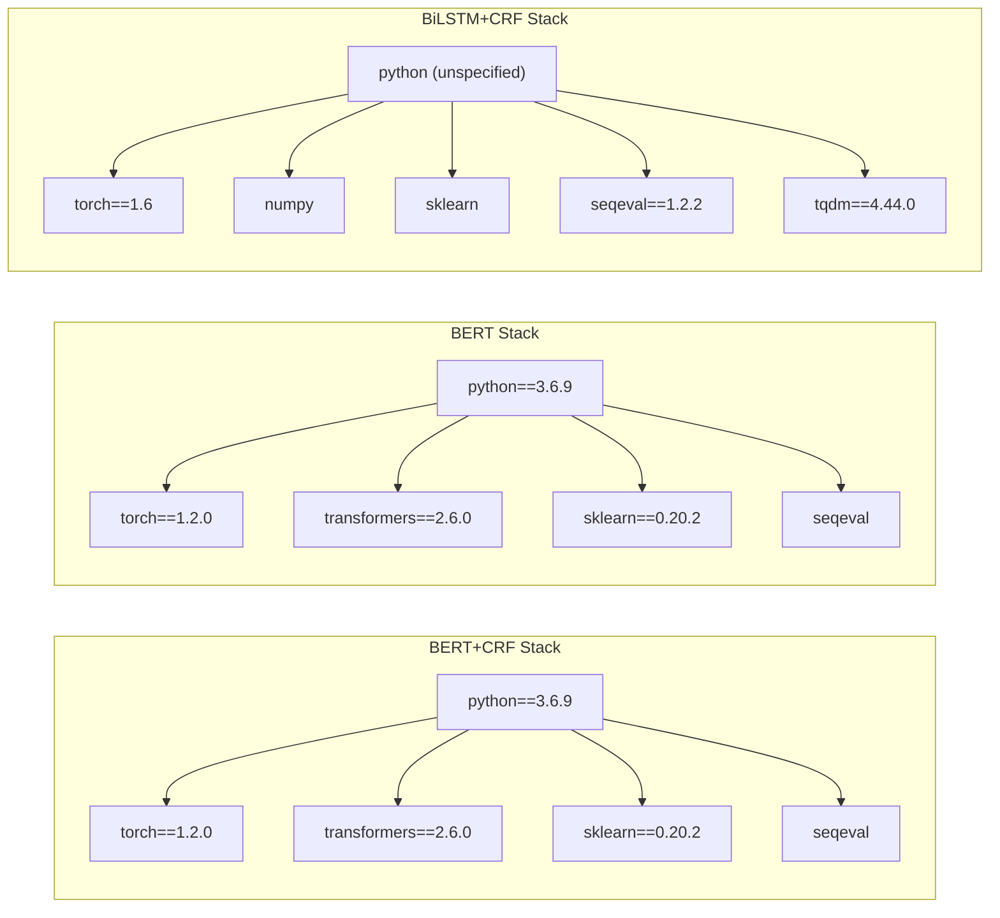

<!-- source: DeepWiki mcp.deepwiki.com · repo thunlp/LEVEN · page 4 Baselines Comparison · fetched 2026-11-02 -->

# Baselines Comparison

Relevant source files

The following files were used as context for generating this wiki page:

- [Baselines/BERT+CRF/README.md](Baselines/BERT+CRF/README.md)
- [Baselines/BERT+CRF/performance/bertcrf-prf_report.txt](Baselines/BERT+CRF/performance/bertcrf-prf_report.txt)
- [Baselines/BERT/README.md](Baselines/BERT/README.md)
- [Baselines/BiLSTM+CRF/README.md](Baselines/BiLSTM+CRF/README.md)

This document provides a comparative analysis of the three baseline implementations for the LEVEN event extraction benchmark: BERT+CRF, BERT, and BiLSTM+CRF. It examines their architectural differences, implementation approaches, dependencies, execution patterns, and performance characteristics to guide users in selecting and understanding the appropriate baseline for their needs.

For detailed documentation of individual baselines, see [BERT+CRF Baseline](#5), [BERT Baseline](#6), and [BiLSTM+CRF Baseline](#7). For information about the LEVEN task and annotation schema, see [LEVEN Task and Annotation](#2).

## Overview

All three baseline models address the same sequence labeling task: identifying and classifying event mentions from the 110 event types defined in the LEVEN taxonomy. Each model follows the encoder-CRF architecture pattern but differs in the choice of encoder and implementation approach.

| Baseline | Encoder | Framework | Configuration Approach | Primary Use Case |
|----------|---------|-----------|----------------------|------------------|
| BERT+CRF | BERT (transformers) | Custom CRF integration | Shell scripts + CLI arguments | Most extensively documented, recommended starting point |
| BERT | BERT (transformers) | Huggingface Transformers | Shell scripts + CLI arguments | Simpler alternative to BERT+CRF |
| BiLSTM+CRF | BiLSTM (PyTorch) | Custom implementation | Config files (`.config`) | Traditional neural baseline, word embedding-based |

**Sources:** [Baselines/BERT+CRF/README.md:1-30](), [Baselines/BERT/README.md:1-30](), [Baselines/BiLSTM+CRF/README.md:1-22]()

## Architecture Comparison

The three baselines share a common high-level architecture: an encoder generates contextual representations, which are then fed into a CRF layer for structured prediction. The CRF layer models transition constraints between labels using Viterbi decoding to find the optimal label sequence.

### Encoder-CRF Architecture Diagram

**Key Architectural Differences:**

1. **BERT+CRF and BERT**: Use pre-trained BERT contextual embeddings (`bert-base-chinese`) that capture bidirectional context through the transformer architecture. The models encode entire sequences through multi-head self-attention mechanisms.

2. **BiLSTM+CRF**: Uses static word embeddings loaded from pre-trained vectors (`sgns.wiki.bigram-char`) and learns context through bidirectional LSTM layers. This represents a more traditional neural sequence labeling approach.

**Sources:** [Baselines/BERT+CRF/README.md:3](), [Baselines/BERT/README.md:3](), [Baselines/BiLSTM+CRF/README.md:17]()

## Implementation Stack Comparison

The three baselines differ significantly in their implementation approaches, dependencies, and code organization patterns.

### Dependencies and Framework Versions

**Dependency Analysis:**

| Component | BERT+CRF | BERT | BiLSTM+CRF |
|-----------|----------|------|------------|
| Python | 3.6.9 | 3.6.9 | Unspecified |
| PyTorch | 1.2.0 | 1.2.0 | 1.6 (newer) |
| Transformers | 2.6.0 | 2.6.0 | Not required |
| Evaluation | seqeval | seqeval | seqeval==1.2.2 |
| Additional | - | - | tqdm for progress bars |

The BERT-based models share identical dependency requirements and appear to be implementation variants of the same approach. BiLSTM+CRF uses a newer PyTorch version (1.6 vs 1.2.0) and explicitly pins `seqeval` to version 1.2.2.

**Sources:** [Baselines/BERT+CRF/README.md:6-16](), [Baselines/BERT/README.md:6-16](), [Baselines/BiLSTM+CRF/README.md:4-10]()

## Configuration and Execution Patterns

The baselines employ different strategies for parameter configuration and model execution.

### Execution Workflow Comparison

```mermaid
graph TD
    subgraph "BERT+CRF Execution"
        BC_DATA["Download LEVEN data<br/>Place in data/ folder"]
        BC_TRAIN["run_train.sh<br/>Shell script with CLI args"]
        BC_RUN_TRAIN["run_leven.py --do_train<br/>Training + dev evaluation"]
        BC_INFER["run_infer.sh<br/>Shell script for inference"]
        BC_RUN_INFER["run_leven.py --do_infer<br/>Test set predictions"]
        BC_OUTPUT["OUTPUT_PATH/results.jsonl"]
        
        BC_DATA --> BC_TRAIN
        BC_TRAIN --> BC_RUN_TRAIN
        BC_DATA --> BC_INFER
        BC_INFER --> BC_RUN_INFER
        BC_RUN_INFER --> BC_OUTPUT
    end
    
    subgraph "BERT Execution"
        B_DATA["Download LEVEN data<br/>Place in data/ folder"]
        B_TRAIN["run_train.sh<br/>Shell script with CLI args"]
        B_RUN_TRAIN["run_leven.py --do_train<br/>Training + validation"]
        B_INFER["run_infer.sh<br/>Shell script for inference"]
        B_RUN_INFER["run_leven.py --do_infer<br/>Test set predictions"]
        B_OUTPUT["OUTPUT_PATH/results.jsonl"]
        
        B_DATA --> B_TRAIN
        B_TRAIN --> B_RUN_TRAIN
        B_DATA --> B_INFER
        B_INFER --> B_RUN_INFER
        B_RUN_INFER --> B_OUTPUT
    end
    
    subgraph "BiLSTM+CRF Execution"
        BL_DATA["Download LEVEN data<br/>Place in ./raw/"]
        BL_EMB["Download word embeddings<br/>sgns.wiki.bigram-char<br/>Place in ./raw/"]
        BL_CONFIG["Select config file<br/>./config/*.config"]
        BL_MAIN["main.py --config path<br/>--gpu [optional]"]
        BL_ALL["Train + Eval + Test<br/>Every epoch"]
        BL_OUTPUT["Test result files<br/>For CodaLab submission"]
        
        BL_DATA --> BL_MAIN
        BL_EMB --> BL_MAIN
        BL_CONFIG --> BL_MAIN
        BL_MAIN --> BL_ALL
        BL_ALL --> BL_OUTPUT
    end
```

**Configuration Approach Differences:**

1. **BERT+CRF and BERT**: Use shell scripts (`run_train.sh`, `run_infer.sh`) that wrap calls to `run_leven.py` with command-line arguments. This allows flexible parameter tuning through script modification. Users must manually run separate scripts for training and inference.

2. **BiLSTM+CRF**: Uses configuration files in `./config/` directory (e.g., `bilstm.config`, `crf.config`). The `main.py` entry point performs training, evaluation, and testing in a single run, outputting results after every epoch. This integrated approach simplifies workflow but requires config file modification for parameter changes.

**Data Placement:**
- BERT-based models: `data/` folder
- BiLSTM+CRF: `./raw/` folder (also requires pre-trained word embeddings)

**Sources:** [Baselines/BERT+CRF/README.md:20-28](), [Baselines/BERT/README.md:20-28](), [Baselines/BiLSTM+CRF/README.md:12-21]()

## Code Organization Comparison

The three baselines organize their codebases differently, reflecting their distinct implementation philosophies.

### File Structure and Key Components

```mermaid
graph TB
    subgraph "BERT+CRF Structure"
        BC_README["README.md<br/>Documentation"]
        BC_TRAIN_SH["run_train.sh<br/>Training script"]
        BC_INFER_SH["run_infer.sh<br/>Inference script"]
        BC_MAIN["run_leven.py<br/>Main training engine"]
        BC_UTILS["utils_leven.py<br/>Data processing"]
        BC_DATA["data/<br/>JSONL files"]
        BC_PERF["performance/<br/>bertcrf-prf_report.txt"]
        
        BC_README -.->|"documents"| BC_TRAIN_SH
        BC_README -.->|"documents"| BC_INFER_SH
        BC_TRAIN_SH -->|"executes"| BC_MAIN
        BC_INFER_SH -->|"executes"| BC_MAIN
        BC_MAIN -->|"imports"| BC_UTILS
        BC_UTILS -->|"reads"| BC_DATA
        BC_MAIN -->|"outputs"| BC_PERF
    end
    
    subgraph "BERT Structure"
        B_README["README.md<br/>Documentation"]
        B_TRAIN_SH["run_train.sh<br/>Training script"]
        B_INFER_SH["run_infer.sh<br/>Inference script"]
        B_MAIN["run_leven.py<br/>Main training engine"]
        B_UTILS["utils_leven.py<br/>Data processing"]
        B_DATA["data/<br/>JSONL files"]
        
        B_README -.->|"documents"| B_TRAIN_SH
        B_README -.->|"documents"| B_INFER_SH
        B_TRAIN_SH -->|"executes"| B_MAIN
        B_INFER_SH -->|"executes"| B_MAIN
        B_MAIN -->|"imports"| B_UTILS
        B_UTILS -->|"reads"| B_DATA
    end
    
    subgraph "BiLSTM+CRF Structure"
        BL_README["README.md<br/>Documentation"]
        BL_MAIN["main.py<br/>Entry point"]
        BL_CONFIG["config/<br/>*.config files"]
        BL_FORMATTER["BilstmFormatter<br/>Data preparation"]
        BL_RAW["raw/<br/>LEVEN data + embeddings"]
        
        BL_README -.->|"documents"| BL_MAIN
        BL_CONFIG -->|"configures"| BL_MAIN
        BL_MAIN -->|"imports"| BL_FORMATTER
        BL_FORMATTER -->|"reads"| BL_RAW
    end
```

**Key Organizational Differences:**

1. **BERT+CRF and BERT**: 
   - `run_leven.py`: Central training engine with `--do_train`, `--do_eval`, `--do_infer` modes
   - `utils_leven.py`: Data processing utilities (tokenization, feature conversion)
   - Shell scripts provide user-friendly interface to the Python code
   - Modular separation between training logic and data utilities

2. **BiLSTM+CRF**:
   - `main.py`: Single entry point handling all operations
   - `BilstmFormatter`: Data preparation class
   - Config files in `config/` directory for parameter management
   - Unified workflow (no separate scripts for different modes)

**Sources:** [Baselines/BERT+CRF/README.md:1-30](), [Baselines/BERT/README.md:1-30](), [Baselines/BiLSTM+CRF/README.md:1-22]()

## Data Processing Pipeline Comparison

Each baseline implements distinct data processing strategies that align with their encoder architectures.

### Data Processing Flow

```mermaid
graph TD
    subgraph "BERT-based Models"
        BERT_JSONL["JSONL files<br/>documents + events + mentions"]
        BERT_READ["read_examples_from_file()<br/>Parse JSONL to InputExample"]
        BERT_CONVERT["convert_examples_to_features()<br/>BERT tokenization<br/>BIO label alignment"]
        BERT_FEATURES["InputFeatures<br/>input_ids, attention_mask<br/>token_type_ids, label_ids"]
        BERT_CACHE["Cached features<br/>For efficiency"]
        BERT_LOADER["DataLoader<br/>Batching"]
        
        BERT_JSONL --> BERT_READ
        BERT_READ --> BERT_CONVERT
        BERT_CONVERT --> BERT_FEATURES
        BERT_FEATURES --> BERT_CACHE
        BERT_CACHE --> BERT_LOADER
    end
    
    subgraph "BiLSTM+CRF Model"
        BL_JSONL["JSONL files<br/>documents + events + mentions"]
        BL_FORMATTER["BilstmFormatter<br/>Data preparation"]
        BL_EMBED["Load word embeddings<br/>sgns.wiki.bigram-char"]
        BL_PROCESS["Sequence padding<br/>Tensor conversion"]
        BL_TENSORS["PyTorch tensors<br/>word_ids, labels"]
        
        BL_JSONL --> BL_FORMATTER
        BL_EMBED --> BL_FORMATTER
        BL_FORMATTER --> BL_PROCESS
        BL_PROCESS --> BL_TENSORS
    end
```

**Processing Strategy Differences:**

| Aspect | BERT-based Models | BiLSTM+CRF |
|--------|-------------------|------------|
| Tokenization | BERT WordPiece tokenizer (subword) | Character/word-level tokenization |
| Label Alignment | Align BIO labels with BERT subword tokens | Direct character-to-label mapping |
| Embeddings | Generated on-the-fly by BERT encoder | Pre-loaded from `sgns.wiki.bigram-char` file |
| Caching | Feature caching for efficiency (`cached_*` files) | No explicit caching mentioned |
| Data Class | `InputExample` → `InputFeatures` | `BilstmFormatter` custom class |

The BERT-based models handle the complexity of subword tokenization by aligning BIO labels with BERT's WordPiece tokens, while BiLSTM+CRF works directly with character or word-level sequences using static embeddings.

**Sources:** [Baselines/BERT+CRF/README.md:24](), [Baselines/BiLSTM+CRF/README.md:15-17]()

## Performance Characteristics

The baselines demonstrate varying performance profiles based on their architectural choices and training configurations.

### BERT+CRF Performance Metrics

The BERT+CRF baseline includes comprehensive performance reporting showing results across all 110 event types:

| Metric | Micro Average | Macro Average | Weighted Average |
|--------|---------------|---------------|------------------|
| Precision | 0.82 | 0.78 | 0.83 |
| Recall | 0.85 | 0.77 | 0.85 |
| F1-Score | 0.83 | 0.77 | 0.83 |

**Total Support**: 22,849 event mentions in the evaluation set.

**High-Performing Event Types** (F1 ≥ 0.90):
- `供述` (confession): P=0.99, R=0.99, F1=0.99 (511 mentions)
- `谅解` (settlement): P=0.97, R=1.00, F1=0.98 (261 mentions)
- `报警/报案` (report to police): P=1.00, R=0.98, F1=0.99 (184 mentions)
- `鉴定` (appraisal): P=0.97, R=0.96, F1=0.96 (592 mentions)
- `搜查/扣押` (search/seizure): P=0.94, R=0.92, F1=0.93 (847 mentions)
- `拘捕` (arrest): P=0.93, R=0.95, F1=0.94 (605 mentions)

**Challenging Event Types** (F1 < 0.60):
- `投毒` (poisoning): P=0.00, R=0.00, F1=0.00 (2 mentions - very rare)
- `自然灾害` (natural disaster): P=0.00, R=0.00, F1=0.00 (0 mentions in eval set)
- `租/借` (rent/borrow): P=0.00, R=0.00, F1=0.00 (5 mentions)
- `放贷` (lending): P=0.45, R=0.36, F1=0.40 (56 mentions)
- `暴力` (violence): P=0.44, R=0.38, F1=0.40 (56 mentions)

The performance data reveals that BERT+CRF excels at high-frequency procedural and legal event types but struggles with rare events and semantically ambiguous categories. The micro average (0.83) being higher than macro average (0.77) indicates better performance on frequent event types.

**Sources:** [Baselines/BERT+CRF/performance/bertcrf-prf_report.txt:1]()

## Model Selection Guidance

### Selection Criteria Matrix

| Criterion | BERT+CRF | BERT | BiLSTM+CRF |
|-----------|----------|------|------------|
| **Documentation** | Most comprehensive with performance reports | Standard documentation | Configuration-focused |
| **Setup Complexity** | Moderate (BERT model download) | Moderate (BERT model download) | Higher (requires word embeddings) |
| **Training Speed** | Slower (transformer) | Slower (transformer) | Faster (LSTM) |
| **Memory Requirements** | High (BERT parameters) | High (BERT parameters) | Lower (embedding matrix only) |
| **Interpretability** | Lower (transformer black box) | Lower (transformer black box) | Higher (traditional neural) |
| **Extensibility** | Shell script + CLI args | Shell script + CLI args | Config file approach |
| **External Resources** | BERT checkpoint | BERT checkpoint | Word embeddings required |

### Recommended Use Cases

**Choose BERT+CRF when:**
- You need a well-documented reference implementation
- Performance is the primary concern
- You have computational resources for BERT models
- You want detailed performance analysis across event types

**Choose BERT when:**
- You want a simpler BERT-based alternative
- You're familiar with Huggingface Transformers ecosystem
- You need a baseline similar to BERT+CRF but with potentially different hyperparameters

**Choose BiLSTM+CRF when:**
- You need faster training iterations
- You have limited computational resources
- You prefer traditional neural architectures
- You want to experiment with configuration-based parameter tuning
- You need a non-transformer baseline for comparison

### Implementation Origins

**BERT+CRF**: Based on a custom fork of Huggingface Transformers with CRF integration from [github.com/mezig351/transformers](https://github.com/mezig351/transformers/tree/ner_crf/examples/ner), specifically the NER+CRF branch.

**BERT**: Based on standard [Huggingface's Transformers](https://github.com/huggingface/transformers) library.

**BiLSTM+CRF**: Custom implementation using PyTorch, requiring pre-trained word embeddings from the [Chinese-Word-Vectors](https://github.com/Embedding/Chinese-Word-Vectors) project (specifically Wikipedia_zh with Word+Character+Ngram context features).

**Sources:** [Baselines/BERT+CRF/README.md:3](), [Baselines/BERT/README.md:3](), [Baselines/BiLSTM+CRF/README.md:2](), [Baselines/BiLSTM+CRF/README.md:17]()

## Common Elements Across Baselines

Despite their differences, all three baselines share several common elements:

1. **Evaluation Methodology**: All use the `seqeval` library for computing precision, recall, and F1-score metrics at the entity level (respecting BIO boundaries).

2. **Data Format**: All consume the same JSONL data format defined by the LEVEN benchmark (see [Data Format](#3)).

3. **CRF Layer**: All models incorporate a CRF layer for structured prediction, recognizing that event extraction benefits from modeling label transition constraints.

4. **BIO Tagging Scheme**: All models use the Begin-Inside-Outside labeling scheme to handle multi-token event mentions.

5. **Output Format**: All models can generate predictions in `results.jsonl` format for evaluation or submission.

6. **Shell Script Interface**: BERT-based models use `.sh` scripts; BiLSTM+CRF uses Python directly but follows similar workflow patterns.

These commonalities enable fair comparison across the baselines while allowing architectural diversity in the encoder components.

**Sources:** [Baselines/BERT+CRF/README.md:14-16](), [Baselines/BERT/README.md:14-16](), [Baselines/BiLSTM+CRF/README.md:9]()

---

