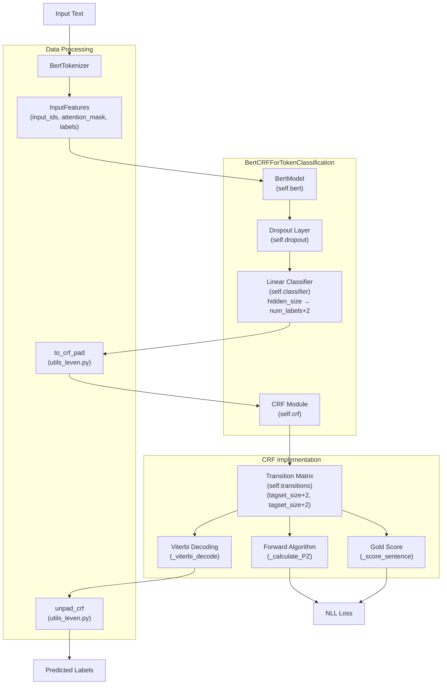
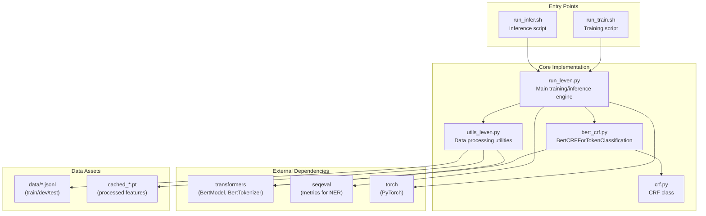
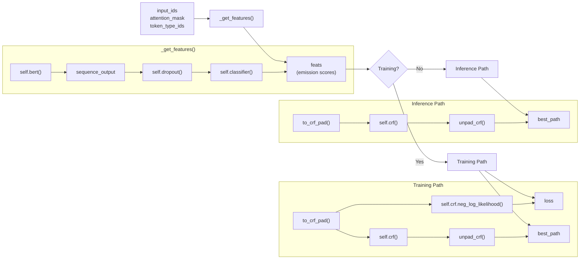
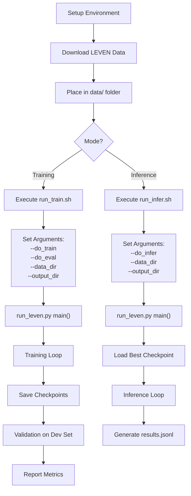

<!-- source: DeepWiki mcp.deepwiki.com · repo thunlp/LEVEN · page 5 BERT+CRF Baseline · fetched 2026-11-02 -->

# BERT+CRF Baseline

<details>
<summary>Relevant source files</summary>

The following files were used as context for generating this wiki page:

- [Baselines/BERT+CRF/README.md](Baselines/BERT+CRF/README.md)
- [Baselines/BERT+CRF/bert_crf.py](Baselines/BERT+CRF/bert_crf.py)
- [Baselines/BERT+CRF/crf.py](Baselines/BERT+CRF/crf.py)

</details>


The BERT+CRF baseline is the primary and most extensively documented implementation in the LEVEN repository for event type classification. It combines BERT contextual embeddings with a Conditional Random Field (CRF) layer to perform sequence labeling on Chinese legal documents, classifying event mentions into 110 distinct event types using the BIO tagging scheme.

This page provides a comprehensive overview of the BERT+CRF baseline system, including its architecture, workflow, and key components. For detailed documentation on specific aspects:
- Architecture details: see [BERT+CRF Architecture](#5.1)
- Training procedures: see [BERT+CRF Training](#5.2)
- Inference procedures: see [BERT+CRF Inference](#5.3)
- Data processing utilities: see [BERT+CRF Data Utilities](#5.4)
- Performance analysis: see [BERT+CRF Performance Analysis](#5.5)

For comparison with other baseline implementations, see [Baselines Comparison](#4).

## System Overview

The BERT+CRF baseline implements a neural sequence labeling model that processes tokenized Chinese text through BERT to generate contextualized embeddings, then uses a CRF layer to decode the optimal label sequence while modeling label dependencies. The system is built on HuggingFace Transformers and adapted from an existing NER implementation.

### Key Characteristics

| Characteristic | Description |
|---------------|-------------|
| **Base Model** | BERT (Chinese pretrained: `bert-base-chinese`) |
| **Sequence Labeling** | CRF with Viterbi decoding |
| **Label Space** | ~220 labels (110 event types × 2 for BIO + O tag) |
| **Framework** | PyTorch with HuggingFace Transformers |
| **Training Strategy** | Adam optimizer with linear warmup, gradient accumulation, mixed precision (fp16) support |
| **Input Format** | JSONL with documents, events, and mentions |
| **Output Format** | JSONL with per-mention event type predictions |

**Sources:** [Baselines/BERT+CRF/README.md:1-30]()

## Core Architecture Components



**Sources:** [Baselines/BERT+CRF/bert_crf.py:15-87](), [Baselines/BERT+CRF/crf.py:29-281]()

### BertCRFForTokenClassification Class

The `BertCRFForTokenClassification` class is the main model implementation, inheriting from `BertPreTrainedModel`. It integrates BERT with a CRF layer for sequence labeling.

**Key Components:**

| Component | Type | Purpose |
|-----------|------|---------|
| `self.bert` | `BertModel` | Generates contextualized token embeddings |
| `self.dropout` | `nn.Dropout` | Regularization layer (dropout probability from config) |
| `self.classifier` | `nn.Linear` | Projects BERT hidden states to emission scores (size: `hidden_size → num_labels+2`) |
| `self.crf` | `CRF` | Conditional Random Field for sequence decoding |
| `self.num_labels` | `int` | Number of distinct labels (excluding START/STOP tags) |

**Sources:** [Baselines/BERT+CRF/bert_crf.py:15-29]()

### CRF Layer Implementation

The `CRF` class implements a Conditional Random Field with learnable transition parameters and Viterbi decoding.

**Key Components:**

| Component | Type | Dimensions | Purpose |
|-----------|------|------------|---------|
| `self.transitions` | `nn.Parameter` | `(tagset_size+2, tagset_size+2)` | Transition scores from tag_i to tag_j |
| `START_TAG` | `int` | `-2` | Special tag ID for sequence start |
| `STOP_TAG` | `int` | `-1` | Special tag ID for sequence end |
| `_calculate_PZ()` | method | - | Computes partition function (forward algorithm) |
| `_viterbi_decode()` | method | - | Finds best label sequence (Viterbi algorithm) |
| `_score_sentence()` | method | - | Scores gold label sequences |

The transition matrix is initialized with `-10000.0` for invalid transitions (transitions to `START_TAG` and from `STOP_TAG`), ensuring these paths have negligible probability.

**Sources:** [Baselines/BERT+CRF/crf.py:29-51](), [Baselines/BERT+CRF/crf.py:113-216]()

## File Structure and Dependencies



**Directory Structure:**

```
Baselines/BERT+CRF/
├── README.md                    # Usage instructions and requirements
├── run_train.sh                 # Training shell script
├── run_infer.sh                 # Inference shell script
├── run_leven.py                 # Main training/inference engine
├── bert_crf.py                  # BertCRFForTokenClassification model
├── crf.py                       # CRF layer implementation
├── utils_leven.py               # Data processing utilities
├── data/                        # LEVEN dataset (train/dev/test.jsonl)
└── outputs/                     # Model checkpoints and results
```

**Sources:** [Baselines/BERT+CRF/README.md:20-28](), [Baselines/BERT+CRF/bert_crf.py:1-6]()

## System Requirements

The BERT+CRF baseline has specific version requirements for compatibility:

| Dependency | Version | Purpose |
|-----------|---------|---------|
| Python | 3.6.9 | Runtime environment |
| PyTorch | 1.2.0 | Deep learning framework |
| Transformers | 2.6.0 | BERT model and tokenizer |
| scikit-learn | 0.20.2 | Evaluation utilities |
| seqeval | latest | NER-specific metrics (precision, recall, F1) |

**Note:** The specific transformers version (2.6.0) is required for compatibility with the custom CRF integration, which is based on a fork that adds NER-CRF capabilities to the library.

**Sources:** [Baselines/BERT+CRF/README.md:6-16]()

## Model Forward Pass

The forward pass through `BertCRFForTokenClassification` follows a multi-stage pipeline:



**Training Mode:** When `labels` are provided, the model computes:
1. Emission scores from the classifier
2. CRF loss via `neg_log_likelihood()` (forward score - gold score)
3. Best path predictions via Viterbi decoding
4. Returns: `(loss, logits, hidden_states, best_path)`

**Inference Mode:** When `labels` are not provided:
1. Emission scores from the classifier
2. Best path predictions via Viterbi decoding
3. Returns: `(logits, hidden_states, best_path)`

**Sources:** [Baselines/BERT+CRF/bert_crf.py:31-86]()

## CRF Padding and Unpadding

The BERT+CRF system uses special padding utilities to handle variable-length sequences with the CRF layer:

### to_crf_pad Function

The `to_crf_pad()` function reshapes tensors for CRF processing by:
- Filtering out padding tokens (where `mask == False`)
- Packing sequences into a batch-compatible format
- Creating a new mask for the CRF layer

**Input:** `(tensor, mask, pad_value)`
**Output:** `(padded_tensor, crf_mask)`

### unpad_crf Function

The `unpad_crf()` function reverses the padding operation:
- Restores original sequence lengths
- Places predictions back into their original positions
- Fills padding positions with `pad_token_label_id`

**Input:** `(crf_output, crf_mask, original_labels, original_mask)`
**Output:** `unpacked_predictions`

These utilities are critical for interfacing between BERT's token-level processing (which uses attention masks for variable-length sequences) and the CRF layer's requirement for packed sequences without padding.

**Sources:** [Baselines/BERT+CRF/bert_crf.py:6](), [Baselines/BERT+CRF/bert_crf.py:63-64](), [Baselines/BERT+CRF/bert_crf.py:79-83]()

## Training and Inference Workflow

### Basic Usage Pattern



**Training Workflow:**
1. Execute `run_train.sh` with appropriate arguments
2. The script calls `run_leven.py` with `--do_train` and `--do_eval` flags
3. Model trains on training set with periodic validation
4. Best checkpoint is saved based on validation F1 score
5. Evaluation metrics are reported

**Inference Workflow:**
1. Execute `run_infer.sh` with test data path
2. The script calls `run_leven.py` with `--do_infer` flag
3. Best checkpoint is loaded from `--output_dir`
4. Predictions are generated for test set
5. Results are written to `OUTPUT_PATH/results.jsonl`

**Sources:** [Baselines/BERT+CRF/README.md:20-28]()

## Key Implementation Details

### Label Space Configuration

The model uses `num_labels + 2` for the classifier output dimension, where:
- `num_labels`: Number of BIO labels from the dataset (~220 for 110 event types)
- `+2`: Additional dimensions for CRF START and STOP tags

**Sources:** [Baselines/BERT+CRF/bert_crf.py:26]()

### Loss Calculation

The model uses negative log-likelihood loss computed by the CRF layer:

```
loss = forward_score - gold_score
```

Where:
- `forward_score`: Log partition function (sum of scores over all possible paths)
- `gold_score`: Score of the gold label sequence

This formulation encourages the model to increase the score of the gold path while normalizing across all possible paths.

**Sources:** [Baselines/BERT+CRF/crf.py:269-280]()

### Viterbi Decoding

During inference, the CRF layer uses the Viterbi algorithm to find the highest-scoring label sequence:
1. Initialize with START tag scores
2. Iterate through sequence, computing maximum scores and backpointers
3. Terminate with STOP tag transition
4. Backtrack to recover best path

This ensures that the predicted label sequence respects transition constraints learned by the CRF.

**Sources:** [Baselines/BERT+CRF/crf.py:113-215]()

## Integration with LEVEN Data Format

The BERT+CRF baseline processes LEVEN JSONL data through a series of transformations:


The system maintains compatibility with the LEVEN annotation schema by:
- Preserving document IDs and mention spans
- Mapping BIO tags to event type IDs using `pure_event2id` dictionary
- Handling negative triggers appropriately
- Supporting evaluation on both development and test sets

**Sources:** Referenced from high-level diagrams and typical data processing flow

## Advantages of BERT+CRF Architecture

| Advantage | Description |
|-----------|-------------|
| **Contextual Embeddings** | BERT provides rich, context-aware representations of Chinese characters and words |
| **Label Dependencies** | CRF models transition probabilities between adjacent labels (e.g., B-买入 → I-买入) |
| **Global Optimization** | Viterbi decoding ensures globally optimal label sequences, not just locally optimal labels |
| **Pretrained Knowledge** | Leverages BERT's pretraining on large-scale Chinese corpora |
| **Structured Prediction** | CRF layer enforces valid BIO tag sequences (e.g., prevents I-tag without preceding B-tag) |

The combination of BERT's semantic understanding with CRF's structured prediction makes this baseline particularly effective for sequence labeling tasks with complex label dependencies.

## Performance Characteristics

The BERT+CRF baseline is designed for:
- **Large label space**: ~220 labels (110 event types with BIO encoding)
- **Variable-length sequences**: Handles documents with different lengths via padding and masking
- **GPU acceleration**: Optimized for CUDA with optional mixed precision training
- **Distributed training**: Supports multi-GPU training for faster convergence

For detailed performance metrics and analysis, see [BERT+CRF Performance Analysis](#5.5).

---

This overview establishes the foundation for understanding the BERT+CRF baseline. The child pages provide detailed documentation on specific aspects of the implementation, training procedures, and performance characteristics.

---

