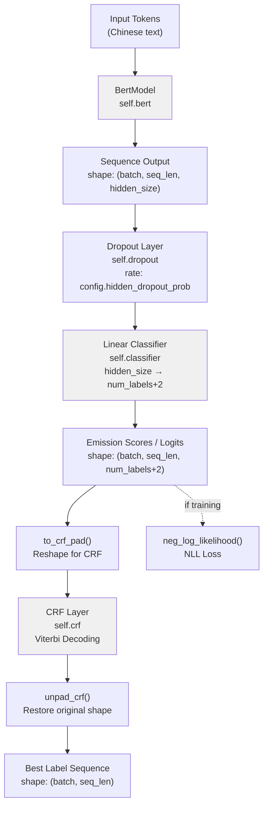
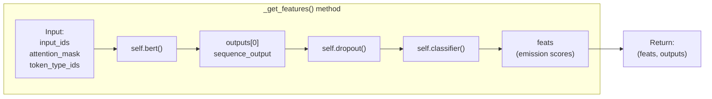
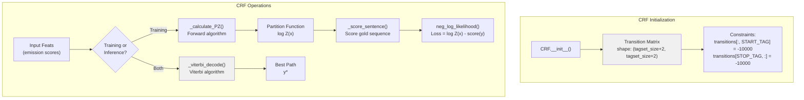
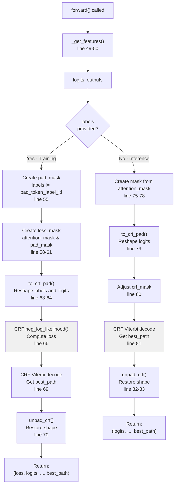
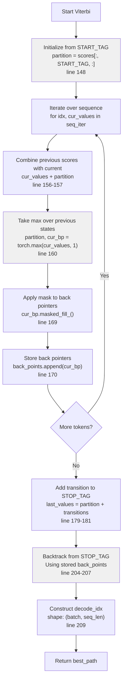

<!-- source: DeepWiki mcp.deepwiki.com · repo thunlp/LEVEN · page 5.1 BERT+CRF Architecture · fetched 2026-11-02 -->

# BERT+CRF Architecture

<details>
<summary>Relevant source files</summary>

The following files were used as context for generating this wiki page:

- [Baselines/BERT+CRF/bert_crf.py](Baselines/BERT+CRF/bert_crf.py)
- [Baselines/BERT+CRF/crf.py](Baselines/BERT+CRF/crf.py)

</details>


This page documents the neural network architecture of the BERT+CRF baseline model for event extraction in the LEVEN dataset. The architecture combines a pre-trained BERT encoder with a Conditional Random Field (CRF) layer to perform token-level sequence labeling, classifying each token into one of 110+ event type labels using the BIO tagging scheme.

For information about training procedures, see [BERT+CRF Training](#5.2). For inference procedures, see [BERT+CRF Inference](#5.3). For data processing utilities, see [BERT+CRF Data Utilities](#5.4).

## Architecture Overview

The BERT+CRF model implements a stacked architecture that transforms input text into event type predictions through multiple layers. The architecture is defined in the `BertCRFForTokenClassification` class.



**Sources:** [Baselines/BERT+CRF/bert_crf.py:15-86]()

## Model Components

### BertCRFForTokenClassification Class

The main model class inherits from `BertPreTrainedModel` and integrates all components. The constructor initializes four key components:

| Component | Type | Purpose | Dimensions |
|-----------|------|---------|------------|
| `self.bert` | `BertModel` | Contextual encoder | Input → 768-dim embeddings |
| `self.dropout` | `nn.Dropout` | Regularization | Dropout rate from config |
| `self.classifier` | `nn.Linear` | Emission scoring | 768 → `num_labels+2` |
| `self.crf` | `CRF` | Sequence modeling | `num_labels` tag states |

The classifier output size is `num_labels + 2` to account for the special `START_TAG` and `STOP_TAG` tokens used internally by the CRF layer.

**Sources:** [Baselines/BERT+CRF/bert_crf.py:20-29]()

### BERT Encoder

The BERT encoder is a pre-trained `BertModel` from the HuggingFace transformers library. For Chinese text, the model uses `bert-base-chinese` with 12 transformer layers and 768 hidden dimensions.

The `_get_features()` method handles the BERT encoding:



The method returns both the emission scores (`feats`) and the full BERT outputs (which include hidden states and attention weights if configured).

**Sources:** [Baselines/BERT+CRF/bert_crf.py:31-44]()

### Classifier Layer

The classifier is a simple linear projection layer that maps BERT's hidden representations to emission scores for each possible label:

- **Input dimension:** `config.hidden_size` (768 for bert-base)
- **Output dimension:** `config.num_labels + 2` (approximately 220-222 for LEVEN with 110 event types)
- **Purpose:** Produces unary potentials (emission scores) for each token-label pair

The `+2` in the output dimension accounts for special CRF tags:
- `START_TAG` (index -2): marks sequence beginning
- `STOP_TAG` (index -1): marks sequence end

**Sources:** [Baselines/BERT+CRF/bert_crf.py:26]()

### CRF Layer

The CRF layer models label dependencies through a learned transition matrix. The `CRF` class implements:

1. **Transition matrix:** `self.transitions` with shape `(tagset_size+2, tagset_size+2)`
2. **Initialization constraints:** Invalid transitions are initialized to -10000.0
3. **Forward algorithm:** `_calculate_PZ()` computes partition function
4. **Viterbi algorithm:** `_viterbi_decode()` finds optimal label sequence



**Sources:** [Baselines/BERT+CRF/crf.py:29-50](), [Baselines/BERT+CRF/crf.py:113-210](), [Baselines/BERT+CRF/crf.py:269-280]()

## Forward Pass Logic

The `forward()` method implements different logic paths depending on whether labels are provided (training mode) or not (inference mode).

### Data Flow with Code References



**Sources:** [Baselines/BERT+CRF/bert_crf.py:46-86]()

### Training Mode (labels provided)

When labels are provided, the forward pass computes both loss and predictions:

1. **Mask creation:** Two masks are created:
   - `pad_mask`: Identifies non-padded tokens (`labels != pad_token_label_id`)
   - `loss_mask`: Combines attention mask with pad mask to identify valid positions for loss calculation

2. **CRF padding:** `to_crf_pad()` reshapes tensors to CRF-compatible format by:
   - Filtering out padded positions
   - Grouping tokens into sequences suitable for CRF
   - Returning reshaped tensors and corresponding masks

3. **Loss calculation:** `self.crf.neg_log_likelihood()` computes negative log-likelihood:
   ```
   loss = log Z(x) - score(y_gold)
   ```
   Where `Z(x)` is the partition function and `score(y_gold)` is the score of the gold label sequence.

4. **Prediction:** Even during training, the Viterbi algorithm produces predictions for evaluation purposes.

**Sources:** [Baselines/BERT+CRF/bert_crf.py:53-71]()

### Inference Mode (no labels)

When labels are not provided, the forward pass only generates predictions:

1. **Mask creation:** A simple binary mask is created from the attention mask
2. **CRF padding:** Similar reshaping as training, but without gold labels
3. **Viterbi decoding:** The CRF's `forward()` method calls `_viterbi_decode()` to find the highest-scoring label sequence
4. **Unpadding:** `unpad_crf()` restores the predictions to the original sequence shape

**Sources:** [Baselines/BERT+CRF/bert_crf.py:72-84]()

## CRF Padding and Unpadding Operations

The CRF layer requires special tensor reshaping to handle variable-length sequences and masked positions. These operations are implemented in `utils_leven.py` and called from the model.

### to_crf_pad Function

The `to_crf_pad()` function transforms tensors from the standard BERT format to CRF-compatible format:

- **Input:** Tensor of shape `(batch_size, seq_len, num_labels+2)` and a boolean mask
- **Output:** Reshaped tensor where only valid (non-masked) positions are retained
- **Purpose:** Removes padding and creates properly shaped tensors for CRF operations

**Sources:** [Baselines/BERT+CRF/bert_crf.py:63-64, 79](), [Baselines/BERT+CRF/utils_leven.py]()

### unpad_crf Function

The `unpad_crf()` function reverses the padding operation:

- **Input:** CRF output tensor and the original mask information
- **Output:** Tensor restored to shape `(batch_size, seq_len)`
- **Purpose:** Maps CRF predictions back to the original sequence positions, inserting padding values where needed

**Sources:** [Baselines/BERT+CRF/bert_crf.py:70, 83](), [Baselines/BERT+CRF/utils_leven.py]()

## Viterbi Decoding Algorithm

The Viterbi algorithm finds the highest-scoring label sequence by dynamic programming. The `_viterbi_decode()` method implements this with special handling for START and STOP tags.

### Algorithm Steps



**Sources:** [Baselines/BERT+CRF/crf.py:113-210]()

### Key Implementation Details

| Aspect | Implementation | Line Reference |
|--------|----------------|----------------|
| Initialization | Start from `START_TAG` with scores `[:, START_TAG, :]` | [crf.py:148]() |
| Dynamic programming | Store `partition` and `back_points` at each step | [crf.py:160, 170]() |
| Masking | Use `masked_fill_` to handle variable-length sequences | [crf.py:169]() |
| Termination | Add transitions to `STOP_TAG` only at true sequence end | [crf.py:179-182]() |
| Backtracking | Traverse `back_points` in reverse to construct path | [crf.py:204-207]() |

## Transition Matrix

The CRF's transition matrix encodes compatibility scores between consecutive labels. The matrix is learned during training.

### Structure

- **Shape:** `(tagset_size + 2, tagset_size + 2)`
- **Rows:** Previous label (from state)
- **Columns:** Current label (to state)
- **Special tags:** Indices `-2` (START_TAG) and `-1` (STOP_TAG)

### Initialization Constraints

```python
# Invalid transitions initialized to -10000.0
transitions[:, START_TAG] = -10000.0  # Cannot transition TO start
transitions[STOP_TAG, :] = -10000.0   # Cannot transition FROM stop
```

These hard constraints ensure:
- No label can transition to START_TAG (it only appears at sequence beginning)
- STOP_TAG cannot transition to any label (it only appears at sequence end)

**Sources:** [Baselines/BERT+CRF/crf.py:45-50]()

## Loss Calculation

The CRF loss is the negative log-likelihood of the gold label sequence:

### Mathematical Formulation

```
loss = -log P(y | x) = log Z(x) - score(y, x)
```

Where:
- `Z(x)` is the partition function (sum over all possible label sequences)
- `score(y, x)` is the score of the gold sequence y given input x

### Implementation Components

1. **Forward algorithm** (`_calculate_PZ()`): Computes `log Z(x)` using dynamic programming
   - Returns the partition function and intermediate scores
   - Uses `log_sum_exp` for numerical stability

2. **Gold sequence scoring** (`_score_sentence()`): Computes `score(y, x)` for the gold labels
   - Sums emission scores along the gold path
   - Adds transition scores between consecutive gold labels
   - Includes transition from final label to STOP_TAG

3. **Negative log-likelihood** (`neg_log_likelihood()`): Returns `forward_score - gold_score`

**Sources:** [Baselines/BERT+CRF/crf.py:56-111](), [Baselines/BERT+CRF/crf.py:217-267](), [Baselines/BERT+CRF/crf.py:269-280]()

## Configuration and Initialization

The model is configured through the `BertConfig` object and initialized using the `init_weights()` method inherited from `BertPreTrainedModel`.

### Key Configuration Parameters

| Parameter | Source | Purpose |
|-----------|--------|---------|
| `num_labels` | `config.num_labels` | Number of event type labels (~220 for LEVEN with BIO tagging) |
| `hidden_size` | `config.hidden_size` | BERT hidden dimension (768 for bert-base) |
| `hidden_dropout_prob` | `config.hidden_dropout_prob` | Dropout rate for regularization |

### Pre-trained Model

The model supports loading pre-trained BERT weights:

```python
BERT_PRETRAINED_MODEL_ARCHIVE_MAP = {
    'bert-base-chinese': "https://s3.amazonaws.com/models.huggingface.co/bert/bert-base-chinese-pytorch_model.bin"
}
```

**Sources:** [Baselines/BERT+CRF/bert_crf.py:10-22]()

## Model Output Structure

The forward pass returns different outputs depending on the mode:

### Training Mode Output

```python
(loss, logits, *hidden_states_and_attentions, best_path)
```

- `loss`: Negative log-likelihood (scalar)
- `logits`: Emission scores before CRF (batch, seq_len, num_labels+2)
- `hidden_states_and_attentions`: Optional BERT outputs
- `best_path`: Viterbi-decoded predictions (batch, seq_len)

### Inference Mode Output

```python
(logits, *hidden_states_and_attentions, best_path)
```

- No loss is returned
- Other components identical to training mode

**Sources:** [Baselines/BERT+CRF/bert_crf.py:52-84]()

---

