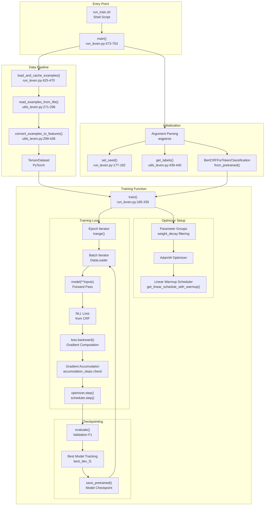
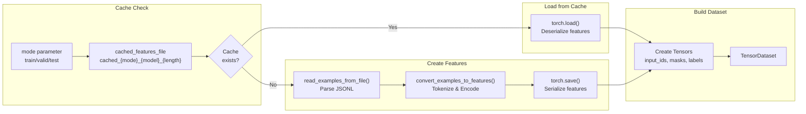
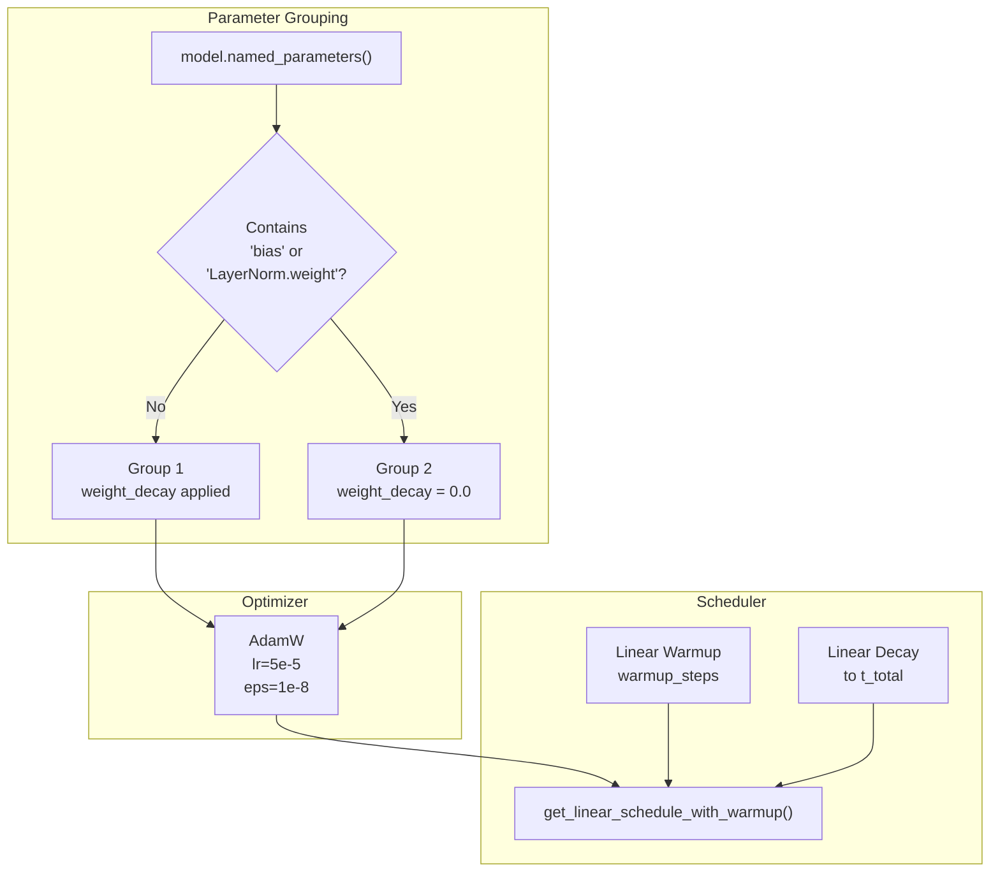
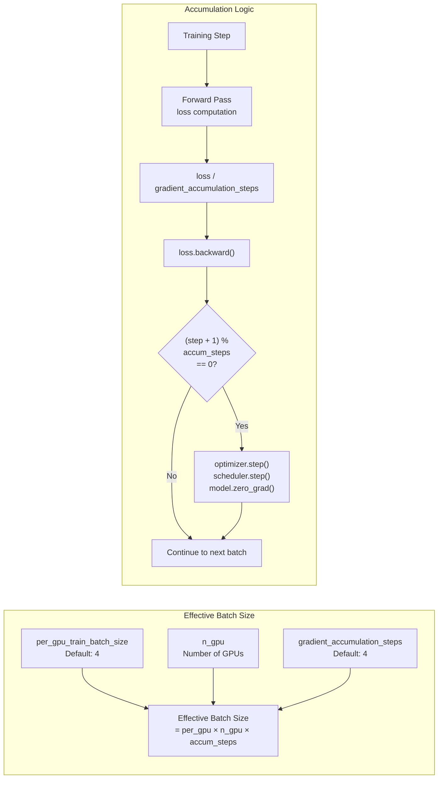
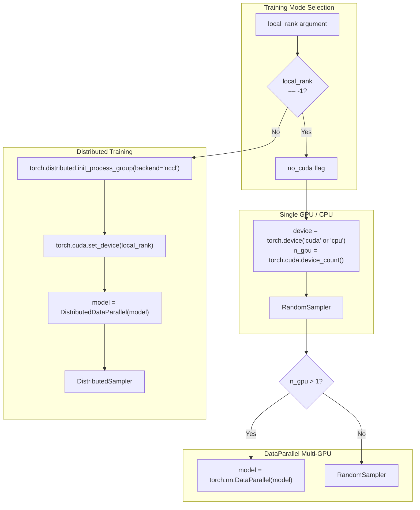
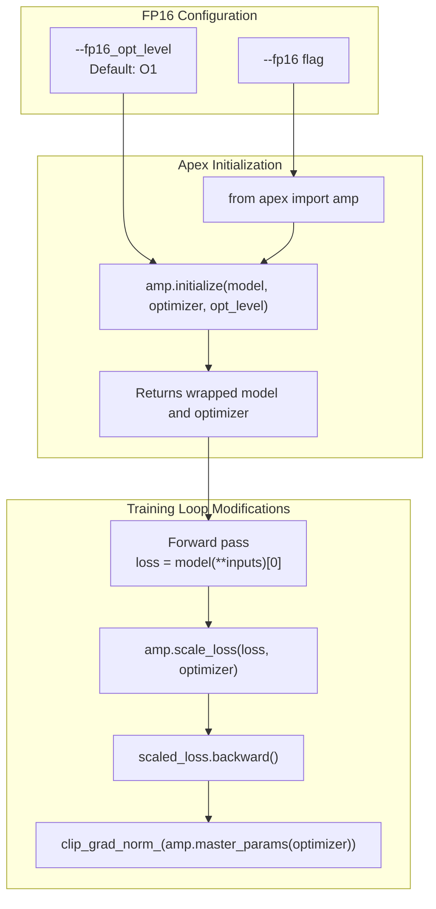
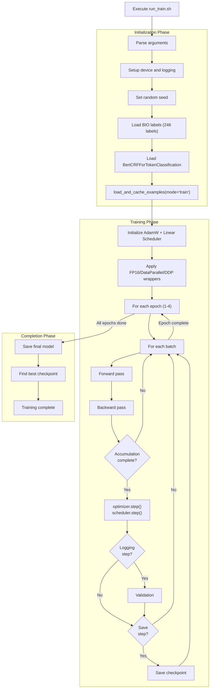

<!-- source: DeepWiki mcp.deepwiki.com · repo thunlp/LEVEN · page 5.2 BERT+CRF Training · fetched 2026-11-02 -->

# BERT+CRF Training

<details>
<summary>Relevant source files</summary>

The following files were used as context for generating this wiki page:

- [Baselines/BERT+CRF/run_leven.py](Baselines/BERT+CRF/run_leven.py)
- [Baselines/BERT+CRF/run_train.sh](Baselines/BERT+CRF/run_train.sh)
- [Baselines/BERT+CRF/utils_leven.py](Baselines/BERT+CRF/utils_leven.py)

</details>


This page documents the training pipeline for the BERT+CRF baseline, covering data loading, optimization, gradient accumulation, distributed training, and checkpoint management. For information about the model architecture itself, see [BERT+CRF Architecture](#5.1). For inference procedures, see [BERT+CRF Inference](#5.3). For data processing utilities, see [BERT+CRF Data Utilities](#5.4).

## Overview

The BERT+CRF training pipeline is implemented in the `train()` function in [Baselines/BERT+CRF/run_leven.py:185-335]() and orchestrated through the `main()` function. The pipeline supports advanced features including:

- **Gradient accumulation** for effective large batch training
- **Distributed training** across multiple GPUs
- **Mixed precision (FP16)** training via NVIDIA Apex
- **Automatic checkpoint management** with validation-based model selection
- **Feature caching** for efficient data loading across epochs

The training is invoked through shell scripts that set hyperparameters and execution flags.

## Training Pipeline Architecture



**Sources:** [Baselines/BERT+CRF/run_leven.py:185-335](), [Baselines/BERT+CRF/run_leven.py:425-470](), [Baselines/BERT+CRF/utils_leven.py:271-296]()

## Data Loading and Caching

The `load_and_cache_examples()` function implements efficient data loading with automatic caching to disk:



The cached file naming convention is: `cached_{mode}_{model_name}_{max_seq_length}`, stored in the data directory. This enables fast reloading across training runs without re-tokenizing.

**Key implementation details:**

| Aspect | Implementation | Code Reference |
|--------|----------------|----------------|
| Cache file path | `cached_{mode}_{model}_{length}` | [run_leven.py:430-435]() |
| Cache check | `os.path.exists()` with `--overwrite_cache` flag | [run_leven.py:436-438]() |
| Feature loading | `torch.load(cached_features_file)` | [run_leven.py:438]() |
| Feature creation | `read_examples_from_file()` + `convert_examples_to_features()` | [run_leven.py:441-455]() |
| Cache saving | `torch.save(features, cached_features_file)` | [run_leven.py:458]() |
| Tensor conversion | All features converted to `torch.long` tensors | [run_leven.py:464-467]() |

**Sources:** [Baselines/BERT+CRF/run_leven.py:425-470]()

## Optimizer and Scheduler Configuration

The training uses the AdamW optimizer with linear warmup scheduling and weight decay regularization applied selectively:



**Parameter groups configuration** [run_leven.py:199-204]():

```python
no_decay = ["bias", "LayerNorm.weight"]
optimizer_grouped_parameters = [
    {"params": [p for n, p in model.named_parameters() if not any(nd in n for nd in no_decay)],
     "weight_decay": args.weight_decay},
    {"params": [p for n, p in model.named_parameters() if any(nd in n for nd in no_decay)], 
     "weight_decay": 0.0}
]
```

This prevents weight decay from being applied to bias terms and LayerNorm parameters, following BERT fine-tuning best practices.

**Scheduler configuration:**

| Parameter | Default Value | Purpose |
|-----------|---------------|---------|
| `learning_rate` | `5e-5` | Initial learning rate |
| `adam_epsilon` | `1e-8` | Epsilon for numerical stability |
| `warmup_steps` | `0` (configurable) | Linear warmup steps |
| `t_total` | `len(dataloader) // gradient_accumulation_steps * num_epochs` | Total optimization steps |
| `weight_decay` | `0.0` (configurable) | L2 regularization strength |

The total number of training steps is computed based on dataset size, gradient accumulation, and number of epochs [run_leven.py:192-196]().

**Sources:** [Baselines/BERT+CRF/run_leven.py:199-209]()

## Training Loop

The training loop implements gradient accumulation and periodic validation with best model tracking:

```mermaid
stateDiagram-v2
    [*] --> InitializeTracking
    
    InitializeTracking: global_step = 0<br/>best_dev_f1 = 0.0<br/>tr_loss = 0.0
    
    InitializeTracking --> EpochLoop
    
    state EpochLoop {
        [*] --> BatchLoop
        
        state BatchLoop {
            [*] --> ForwardPass
            
            ForwardPass: model.train()<br/>outputs = model(**inputs)<br/>loss = outputs[0]
            
            ForwardPass --> AverageMultiGPU
            AverageMultiGPU: loss.mean() if n_gpu > 1
            
            AverageMultiGPU --> ScaleGradient
            ScaleGradient: loss / gradient_accumulation_steps
            
            ScaleGradient --> Backward
            Backward: loss.backward()<br/>or amp.scale_loss() for fp16
            
            Backward --> CheckAccumulation
            
            state CheckAccumulation <<choice>>
            CheckAccumulation --> ClipGradients: step % accum_steps == 0
            CheckAccumulation --> ContinueBatch: else
            
            ClipGradients: torch.nn.utils.clip_grad_norm_<br/>max_grad_norm = 1.0
            
            ClipGradients --> OptimizerStep
            OptimizerStep: optimizer.step()<br/>scheduler.step()<br/>model.zero_grad()
            
            OptimizerStep --> CheckLogging
            
            state CheckLogging <<choice>>
            CheckLogging --> Validate: global_step % logging_steps == 0
            CheckLogging --> CheckSave: else
            
            Validate: evaluate(mode='valid')<br/>Track best_dev_f1
            
            state CheckSave <<choice>>
            CheckSave --> SaveCheckpoint: global_step % save_steps == 0
            CheckSave --> ContinueBatch: else
            
            SaveCheckpoint: save_pretrained()<br/>save optimizer/scheduler
            
            Validate --> CheckSave
            SaveCheckpoint --> ContinueBatch
            ContinueBatch --> [*]
        }
        
        BatchLoop --> CheckMaxSteps
        
        state CheckMaxSteps <<choice>>
        CheckMaxSteps --> [*]: max_steps reached
        CheckMaxSteps --> BatchLoop: continue
    }
    
    EpochLoop --> ReturnMetrics
    ReturnMetrics: return global_step, tr_loss/global_step
    ReturnMetrics --> [*]
```



**Key loop variables:**

| Variable | Purpose | Updated When |
|----------|---------|--------------|
| `global_step` | Total optimization steps across all epochs | After each optimizer step [run_leven.py:282]() |
| `tr_loss` | Accumulated training loss | After each forward pass [run_leven.py:272]() |
| `best_dev_f1` | Best validation F1 score observed | During validation [run_leven.py:289-291]() |
| `best_steps` | Global step with best validation F1 | When new best F1 is found [run_leven.py:291]() |

**Sources:** [Baselines/BERT+CRF/run_leven.py:246-335]()

## Gradient Accumulation Mechanism

Gradient accumulation allows training with effective batch sizes larger than GPU memory permits:



With the default settings in [run_train.sh]():
- `per_gpu_train_batch_size = 4`
- `gradient_accumulation_steps = 4`
- Using 4 GPUs

The effective batch size is: **4 × 4 × 4 = 64 samples per update**

The loss is scaled by `gradient_accumulation_steps` [run_leven.py:263-264]() to ensure gradients have the correct magnitude when accumulated.

**Sources:** [Baselines/BERT+CRF/run_leven.py:263-282](), [Baselines/BERT+CRF/run_train.sh:6-8]()

## Distributed Training Support

The pipeline supports both DataParallel (single-node multi-GPU) and DistributedDataParallel (multi-node) training:



**Distributed training configuration** [run_leven.py:576-585]():

| Configuration | Single GPU | DataParallel | DistributedDataParallel |
|---------------|------------|--------------|-------------------------|
| `local_rank` | `-1` | `-1` | `0, 1, 2, ...` (per process) |
| Device setup | Auto-detect | Auto-detect | Set via `local_rank` |
| `n_gpu` | `torch.cuda.device_count()` | `torch.cuda.device_count()` | `1` (per process) |
| Model wrapper | None | `torch.nn.DataParallel` | `torch.nn.parallel.DistributedDataParallel` |
| Sampler | `RandomSampler` | `RandomSampler` | `DistributedSampler` |
| Backend | N/A | N/A | `nccl` |

The DataParallel wrapper is applied after FP16 initialization [run_leven.py:218-219](), and DistributedDataParallel is applied after both FP16 and DataParallel checks [run_leven.py:222-225]().

**Sources:** [Baselines/BERT+CRF/run_leven.py:576-585](), [Baselines/BERT+CRF/run_leven.py:188](), [Baselines/BERT+CRF/run_leven.py:218-225]()

## Mixed Precision (FP16) Training

The pipeline supports FP16 training through NVIDIA Apex for faster training and reduced memory usage:



**FP16 implementation details:**

| Aspect | FP16 Enabled | FP32 (Default) |
|--------|-------------|----------------|
| Initialization | `amp.initialize(model, optimizer, opt_level)` [run_leven.py:215]() | No change |
| Loss scaling | `amp.scale_loss(loss, optimizer)` [run_leven.py:267]() | Direct `loss.backward()` [run_leven.py:270]() |
| Gradient clipping | `clip_grad_norm_(amp.master_params(optimizer))` [run_leven.py:275]() | `clip_grad_norm_(model.parameters())` [run_leven.py:277]() |
| Optimization levels | O0, O1, O2, O3 | N/A |

The default optimization level `O1` provides mixed precision training with dynamic loss scaling, balancing speed and numerical stability.

**Sources:** [Baselines/BERT+CRF/run_leven.py:210-215](), [Baselines/BERT+CRF/run_leven.py:266-277]()

## Checkpoint Management

Checkpoints are saved periodically and the best model is tracked based on validation F1 score:

```mermaid
flowchart TD
    subgraph "Periodic Checkpoint Saving"
        CHECK1{"global_step %<br/>save_steps<br/>== 0?"}
        CREATEDIR["Create checkpoint-{global_step} directory"]
        SAVEMODEL["model_to_save.save_pretrained()"]
        SAVETOK["tokenizer.save_vocabulary()"]
        SAVEARGS["torch.save(args, 'training_args.bin')"]
        SAVEOPT["torch.save(optimizer, 'optimizer.pt')"]
        SAVESCHED["torch.save(scheduler, 'scheduler.pt')"]
    end
    
    subgraph "Validation and Best Model Tracking"
        CHECK2{"global_step %<br/>logging_steps<br/>== 0?"}
        EVALUATE["evaluate(mode='valid')"]
        COMPARE{"f1-micro ><br/>best_dev_f1?"}
        UPDATE["Update best_dev_f1<br/>Update best_steps"]
        SAVEJSON["Save best_step_info.txt"]
    end
    
    subgraph "Final Model Saving"
        TRAINEND["Training complete"]
        SAVEFINAL["save_pretrained(output_dir)"]
    end
    
    CHECK1 -->|Yes| CREATEDIR
    CREATEDIR --> SAVEMODEL
    SAVEMODEL --> SAVETOK
    SAVETOK --> SAVEARGS
    SAVEARGS --> SAVEOPT
    SAVEOPT --> SAVESCHED
    
    CHECK2 -->|Yes| EVALUATE
    EVALUATE --> COMPARE
    COMPARE -->|Yes| UPDATE
    UPDATE --> SAVEJSON
    
    TRAINEND --> SAVEFINAL
```



**Checkpoint directory structure:**

```
saved/
├── checkpoint-100/
│   ├── config.json
│   ├── pytorch_model.bin
│   ├── training_args.bin
│   ├── optimizer.pt
│   ├── scheduler.pt
│   └── vocab.txt
├── checkpoint-200/
│   └── ...
├── best_step_info.txt          # Best checkpoint metadata
├── prf_report_dict.json        # Classification report
└── prf_report.txt              # Human-readable report
```

**Checkpoint metadata** [run_leven.py:304-307]():

The `best_step_info.txt` file contains:
```json
{
    "best_checkpoint": 2500,
    "f1": 0.8234,
    "precision": 0.8456,
    "recall": 0.8021
}
```

**Checkpoint saving frequency:**

| Parameter | Default | Purpose |
|-----------|---------|---------|
| `--save_steps` | `500` (in run_train.sh: `100`) | Steps between checkpoint saves [run_leven.py:311-327]() |
| `--logging_steps` | `1000` (in run_train.sh: `100`) | Steps between validation runs [run_leven.py:284-309]() |

**Sources:** [Baselines/BERT+CRF/run_leven.py:284-327](), [Baselines/BERT+CRF/run_train.sh:11-12]()

## Validation During Training

Validation is performed periodically during training when `--evaluate_during_training` is enabled:

```mermaid
sequenceDiagram
    participant Loop as Training Loop
    participant Check as Logging Step Check
    participant Eval as evaluate() Function
    participant Model as BERT+CRF Model
    participant Metrics as seqeval Metrics
    participant Best as Best Model Tracker
    
    Loop->>Check: global_step % logging_steps == 0
    Check->>Eval: evaluate(mode='valid')
    Eval->>Model: Forward pass (no grad)
    Model->>Eval: Predictions
    Eval->>Metrics: Compute P/R/F1
    Metrics->>Eval: Return metrics dict
    Eval->>Best: Compare f1-micro with best_dev_f1
    
    alt New Best F1
        Best->>Best: Update best_dev_f1 and best_steps
        Best->>Loop: Save best_step_info.txt
    end
    
    Eval->>Loop: Return results
```

**Evaluation metrics computed** [run_leven.py:397-406]():

| Metric | Averaging | Seqeval Function |
|--------|-----------|------------------|
| `p-micro` | Micro | `precision_score(..., average='micro')` |
| `r-micro` | Micro | `recall_score(..., average='micro')` |
| `f1-micro` | Micro | `f1_score(..., average='micro')` |
| `p-macro` | Macro | `precision_score(..., average='macro')` |
| `r-macro` | Macro | `recall_score(..., average='macro')` |
| `f1-macro` | Macro | `f1_score(..., average='macro')` |

The micro-averaged F1 score is used for best model selection because it accounts for label imbalance in the 110 event type taxonomy.

**Sources:** [Baselines/BERT+CRF/run_leven.py:286-309](), [Baselines/BERT+CRF/run_leven.py:397-422]()

## Training Configuration

The training behavior is controlled through command-line arguments:

### Core Training Arguments

| Argument | Default | Description | Code Reference |
|----------|---------|-------------|----------------|
| `--do_train` | False | Enable training mode | [run_leven.py:503-504]() |
| `--num_train_epochs` | `1.0` | Number of training epochs | [run_leven.py:528-529]() |
| `--per_gpu_train_batch_size` | `8` | Batch size per GPU | [run_leven.py:514-515]() |
| `--gradient_accumulation_steps` | `2` | Gradient accumulation steps | [run_leven.py:518-519]() |
| `--learning_rate` | `5e-5` | Initial learning rate | [run_leven.py:520-521]() |
| `--weight_decay` | `0.0` | L2 regularization | [run_leven.py:522-523]() |
| `--max_grad_norm` | `1.0` | Gradient clipping threshold | [run_leven.py:526-527]() |
| `--warmup_steps` | `0` | Linear warmup steps | [run_leven.py:532-533]() |

### Checkpoint and Logging Arguments

| Argument | Default | Description |
|----------|---------|-------------|
| `--output_dir` | `./saved` | Output directory for checkpoints |
| `--save_steps` | `500` | Steps between checkpoint saves |
| `--logging_steps` | `1000` | Steps between log messages |
| `--evaluate_during_training` | False | Enable periodic validation |
| `--overwrite_output_dir` | False | Overwrite existing output directory |

### Data and Model Arguments

| Argument | Default | Description |
|----------|---------|-------------|
| `--data_dir` | `./data` | Input data directory |
| `--model_type` | Required | Model type (`bertcrf`) |
| `--model_name_or_path` | `./bert-base-chinese` | Pretrained model path |
| `--max_seq_length` | `512` | Maximum sequence length |
| `--overwrite_cache` | False | Regenerate cached features |

### Advanced Training Arguments

| Argument | Default | Description |
|----------|---------|-------------|
| `--fp16` | False | Enable mixed precision training |
| `--fp16_opt_level` | `O1` | Apex optimization level |
| `--local_rank` | `-1` | Local rank for distributed training |
| `--seed` | `42` | Random seed |

**Sources:** [Baselines/BERT+CRF/run_leven.py:475-559]()

## Shell Script Interface

The `run_train.sh` script provides a convenient interface for training with preset hyperparameters:

```bash
CUDA_VISIBLE_DEVICES=4,5,6,7 python run_leven.py \
	--data_dir ./data \
	--model_type bertcrf \
	--output_dir ./saved \
	--max_seq_length 512 \
	--per_gpu_train_batch_size 4\
	--per_gpu_eval_batch_size 4\
	--gradient_accumulation_steps 4\
	--learning_rate 5e-5\
	--num_train_epochs 4\
	--save_steps 100\
	--logging_steps 100\
	--seed 100\
	--do_train \
	--do_eval \
  --eval_all_checkpoints \
  --overwrite_output_dir
```

**Key configuration choices in the default script:**

| Setting | Value | Rationale |
|---------|-------|-----------|
| GPUs | 4,5,6,7 | Uses 4 GPUs for DataParallel training |
| Effective batch size | 64 | `4 per_gpu × 4 gpus × 4 accum = 64` |
| Epochs | 4 | Sufficient for convergence on LEVEN |
| Save frequency | 100 steps | More frequent than default for early stopping |
| Logging frequency | 100 steps | Matches save frequency for validation |
| Sequence length | 512 | Maximum BERT sequence length |
| Seed | 100 | For reproducibility |

The script enables both training (`--do_train`) and evaluation (`--do_eval`) modes, with `--eval_all_checkpoints` to find the best checkpoint across all saved models.

**Sources:** [Baselines/BERT+CRF/run_train.sh:1-18]()

## Training Workflow Summary



**Typical training timeline** (with default settings from run_train.sh):

1. **Feature caching**: First run processes ~10K examples and caches them (1-2 minutes)
2. **Subsequent runs**: Load from cache (5-10 seconds)
3. **Training speed**: ~3-4 steps/second with 4 GPUs and batch size 64
4. **Validation**: ~30 seconds every 100 steps
5. **Checkpoint saving**: ~5 seconds every 100 steps
6. **Total training time**: ~2-3 hours for 4 epochs on LEVEN dataset

**Sources:** [Baselines/BERT+CRF/run_leven.py:473-661](), [Baselines/BERT+CRF/run_train.sh:1-18]()

---

