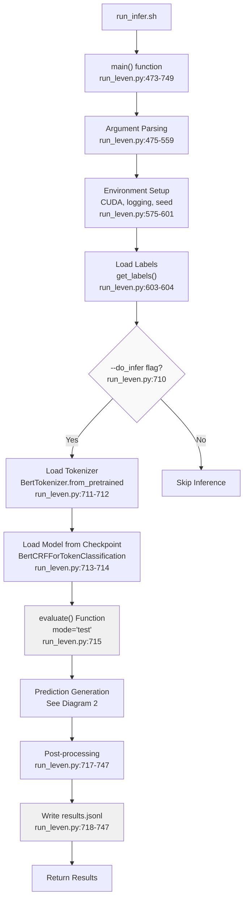
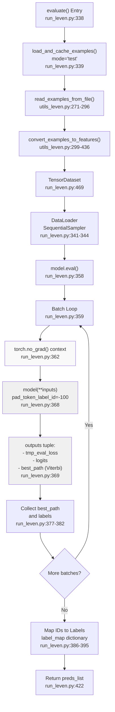
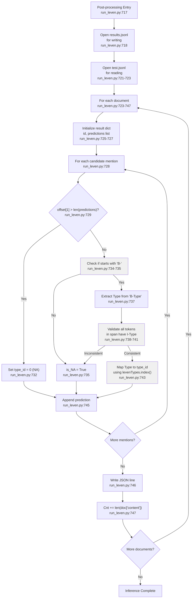
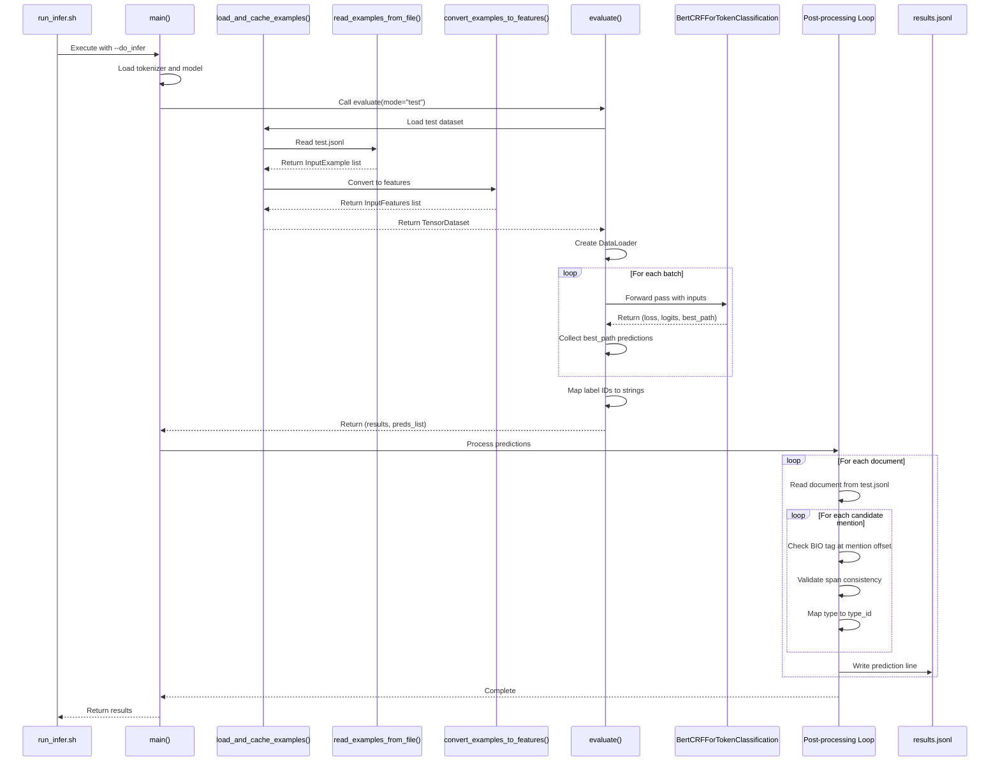

<!-- source: DeepWiki mcp.deepwiki.com · repo thunlp/LEVEN · page 5.3 BERT+CRF Inference · fetched 2026-11-02 -->

# BERT+CRF Inference

<details>
<summary>Relevant source files</summary>

The following files were used as context for generating this wiki page:

- [Baselines/BERT+CRF/run_infer.sh](Baselines/BERT+CRF/run_infer.sh)
- [Baselines/BERT+CRF/run_leven.py](Baselines/BERT+CRF/run_leven.py)
- [Baselines/BERT+CRF/utils_leven.py](Baselines/BERT+CRF/utils_leven.py)

</details>


This page documents the inference pipeline for the BERT+CRF baseline, which loads a trained checkpoint and generates predictions for the LEVEN test set. The inference process includes model loading, forward pass with Viterbi decoding, post-processing to map token-level predictions to event type IDs, and output generation in JSONL format.

For information about the training process, see [BERT+CRF Training](#5.2). For details on the model architecture, see [BERT+CRF Architecture](#5.1). For data processing utilities used during inference, see [BERT+CRF Data Utilities](#5.4).

## Inference Entry Point

Inference is triggered using the `run_infer.sh` shell script, which invokes `run_leven.py` with the `--do_infer` flag. This flag activates the inference mode in the main execution pipeline.

**Script Configuration**

[Baselines/BERT+CRF/run_infer.sh:1-14]() contains the inference command with the following key parameters:

| Parameter | Value | Purpose |
|-----------|-------|---------|
| `--model_type` | `bertcrf` | Specifies the BERT+CRF model class |
| `--output_dir` | `./saved/checkpoint-100` | Path to trained checkpoint and output location |
| `--max_seq_length` | `512` | Maximum sequence length for tokenization |
| `--do_lower_case` | flag set | Apply lowercase normalization |
| `--per_gpu_eval_batch_size` | `8` | Batch size for inference |
| `--do_infer` | flag set | Activates inference mode |

The `output_dir` serves dual purposes: it specifies the checkpoint to load and the directory where `results.jsonl` will be written.

**Sources:** [Baselines/BERT+CRF/run_infer.sh:1-14]()

## Inference Pipeline Overview



**Sources:** [Baselines/BERT+CRF/run_leven.py:710-749]()

## Model Loading

The inference pipeline loads both the tokenizer and model from the checkpoint directory specified in `--output_dir`.

**Tokenizer Loading**

[Baselines/BERT+CRF/run_leven.py:711-712]() loads the `BertTokenizer` using the `from_pretrained()` method. The tokenizer is loaded from either the `--tokenizer_name` argument or falls back to `--model_name_or_path`:

```python
tokenizer = tokenizer_class.from_pretrained(
    args.tokenizer_name if args.tokenizer_name else args.model_name_or_path, 
    do_lower_case=args.do_lower_case
)
```

**Model Loading**

[Baselines/BERT+CRF/run_leven.py:713-714]() loads the trained `BertCRFForTokenClassification` model from the checkpoint directory and moves it to the appropriate device (CPU or CUDA):

```python
model = model_class.from_pretrained(args.output_dir)
model.to(args.device)
```

The model class is determined by the `MODEL_CLASSES` dictionary at [Baselines/BERT+CRF/run_leven.py:59-62](), which maps `"bertcrf"` to `BertCRFForTokenClassification`.

**Sources:** [Baselines/BERT+CRF/run_leven.py:710-714](), [Baselines/BERT+CRF/run_leven.py:59-62]()

## Prediction Generation



**Prediction Process Details**

The `evaluate()` function at [Baselines/BERT+CRF/run_leven.py:338-422]() generates predictions through the following steps:

1. **Data Loading**: [Baselines/BERT+CRF/run_leven.py:339]() calls `load_and_cache_examples()` with `mode="test"` to load test data. This function checks for cached features and loads them if available, otherwise processes the raw JSONL file.

2. **DataLoader Setup**: [Baselines/BERT+CRF/run_leven.py:341-344]() creates a `DataLoader` with `SequentialSampler` (not random) to ensure consistent ordering for mapping predictions back to mentions.

3. **Model Evaluation Mode**: [Baselines/BERT+CRF/run_leven.py:358]() sets the model to evaluation mode, disabling dropout and batch normalization updates.

4. **Forward Pass**: [Baselines/BERT+CRF/run_leven.py:362-369]() performs inference within a `torch.no_grad()` context to disable gradient computation. The model returns three outputs:
   - `tmp_eval_loss`: Loss value (not used during pure inference)
   - `logits`: Raw emission scores from the classifier
   - `best_path`: Viterbi-decoded label sequence from the CRF layer

5. **Prediction Collection**: [Baselines/BERT+CRF/run_leven.py:377-382]() accumulates the `best_path` predictions across all batches using numpy arrays.

6. **Label Mapping**: [Baselines/BERT+CRF/run_leven.py:386-395]() converts numeric label IDs back to string labels (e.g., "B-买入", "I-买入", "O") using the `label_map` dictionary, while filtering out padding tokens (`pad_token_label_id = -100`).

**Sources:** [Baselines/BERT+CRF/run_leven.py:338-422](), [Baselines/BERT+CRF/run_leven.py:425-470]()

## Post-processing and Output Generation

The post-processing logic at [Baselines/BERT+CRF/run_leven.py:717-747]() transforms token-level BIO predictions into document-level event type IDs for each candidate mention.



**Post-processing Algorithm**

The algorithm processes each candidate mention in the test set and determines its event type ID:

1. **Document Iteration**: [Baselines/BERT+CRF/run_leven.py:723-747]() iterates through each document in `test.jsonl`.

2. **Sentence Counter**: The `Cnt` variable tracks the cumulative number of sentences processed, used to index into the global `predictions` list which contains predictions for all sentences sequentially.

3. **Mention Processing**: For each candidate mention [Baselines/BERT+CRF/run_leven.py:728-745]():
   - Extract the mention's `sent_id` and `offset` (start, end token positions)
   - Access the prediction for that sentence: `predictions[Cnt + mention['sent_id']]`
   - Check the first token at `offset[0]`

4. **Type Determination**:
   - **Start Token Check** [Baselines/BERT+CRF/run_leven.py:734-735](): If the first token doesn't start with "B-", the mention is classified as NA (type_id = 0)
   - **Type Extraction** [Baselines/BERT+CRF/run_leven.py:737](): Extract the event type from the BIO tag (e.g., "B-买入" → "买入")
   - **Span Validation** [Baselines/BERT+CRF/run_leven.py:738-741](): Verify all subsequent tokens in the span have the matching "I-" tag (e.g., "I-买入")
   - **Type Mapping** [Baselines/BERT+CRF/run_leven.py:743](): Map the event type string to its numeric ID using `levenTypes.index(Type)` where `levenTypes = list(pure_event2id.keys())`

5. **Counter Update**: After processing all mentions in a document, increment `Cnt` by the number of sentences in that document [Baselines/BERT+CRF/run_leven.py:747]().

**Event Type Mapping**

The `pure_event2id` dictionary at [Baselines/BERT+CRF/run_leven.py:64-174]() defines the mapping from event type strings to numeric IDs (0-109). The mapping includes:

| Type ID | Event Type | Example |
|---------|------------|---------|
| 0 | None | No event (NA) |
| 1 | 明知 | Knowing |
| 18 | 卖出 | Sell |
| 19 | 买入 | Buy |
| 76 | 盗窃财物 | Theft |
| 87 | 贩卖毒品 | Drug trafficking |
| ... | ... | (110 total types) |

**Sources:** [Baselines/BERT+CRF/run_leven.py:717-747](), [Baselines/BERT+CRF/run_leven.py:64-174]()

## Results Format

The inference output is written to `results.jsonl` in the checkpoint directory specified by `--output_dir`. Each line in the file represents one document.

**Output Schema**

```json
{
    "id": "document_id_string",
    "predictions": [
        {"id": "mention_id_1", "type_id": 19},
        {"id": "mention_id_2", "type_id": 0},
        {"id": "mention_id_3", "type_id": 76}
    ]
}
```

**Field Descriptions**

| Field | Type | Description |
|-------|------|-------------|
| `id` | string | Document identifier from the input test data |
| `predictions` | array | List of predictions for all candidate mentions in the document |
| `predictions[].id` | string | Unique identifier for the candidate mention |
| `predictions[].type_id` | integer | Predicted event type ID (0-109, where 0 = NA) |

**Output Location**

[Baselines/BERT+CRF/run_leven.py:717]() creates the output file at:
```
{args.output_dir}/results.jsonl
```

For example, if `--output_dir ./saved/checkpoint-100`, the results are written to:
```
./saved/checkpoint-100/results.jsonl
```

**Sources:** [Baselines/BERT+CRF/run_leven.py:717-747]()

## Inference Execution Flow



**Execution Summary**

The complete inference flow follows these stages:

1. **Initialization** [Baselines/BERT+CRF/run_leven.py:710-714](): Load tokenizer and model from checkpoint
2. **Data Loading** [Baselines/BERT+CRF/run_leven.py:425-470](): Load and cache test features
3. **Batch Inference** [Baselines/BERT+CRF/run_leven.py:359-382](): Generate predictions using Viterbi decoding
4. **Label Conversion** [Baselines/BERT+CRF/run_leven.py:386-395](): Map numeric IDs to BIO string labels
5. **Post-processing** [Baselines/BERT+CRF/run_leven.py:717-747](): Convert token predictions to mention-level event type IDs
6. **Output** [Baselines/BERT+CRF/run_leven.py:718-746](): Write results in JSONL format

**Sources:** [Baselines/BERT+CRF/run_leven.py:710-749](), [Baselines/BERT+CRF/run_leven.py:338-422](), [Baselines/BERT+CRF/run_leven.py:425-470]()

---

