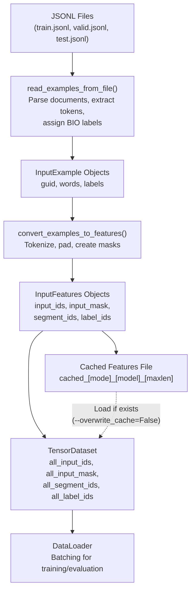
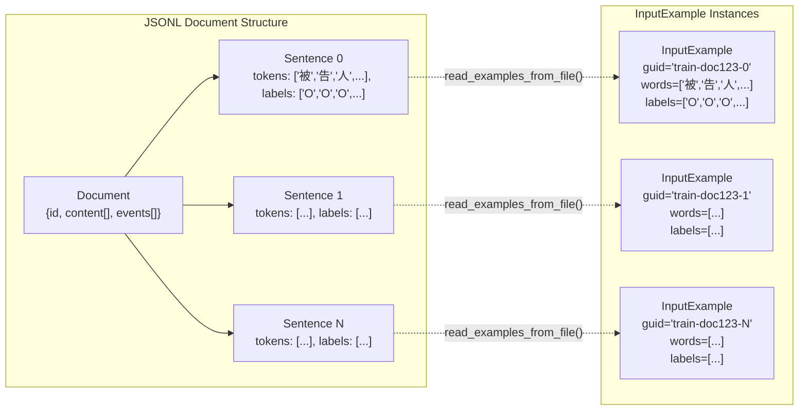
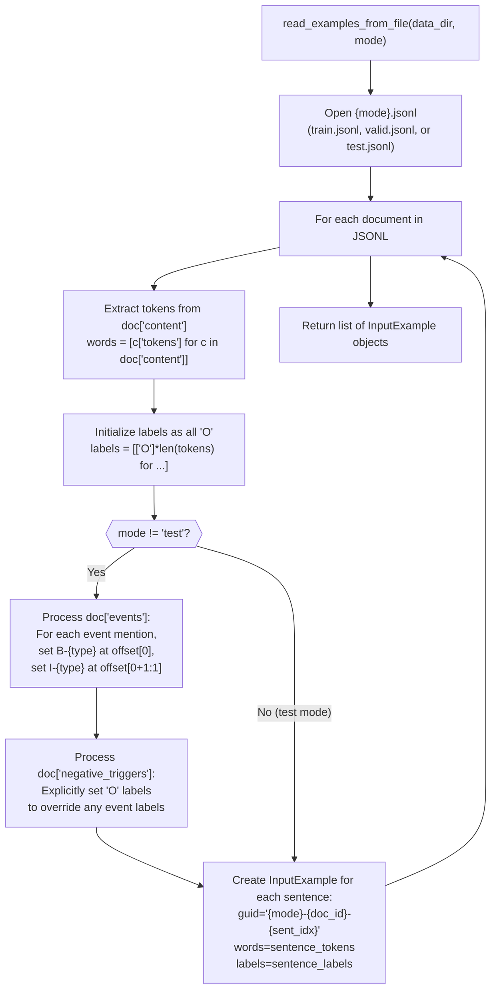
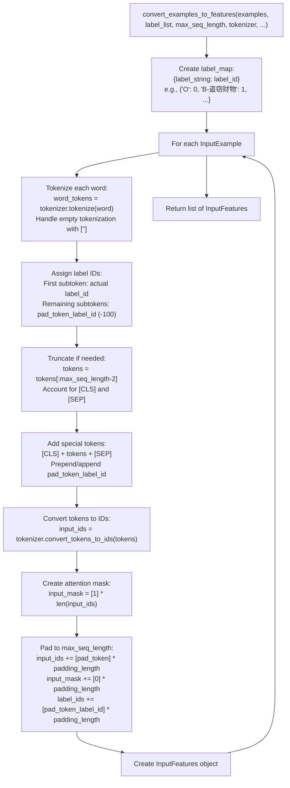
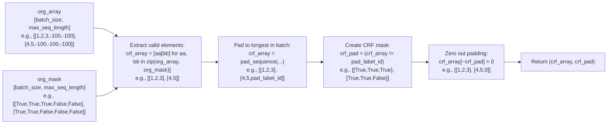
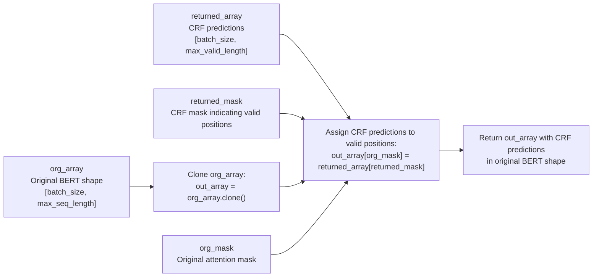
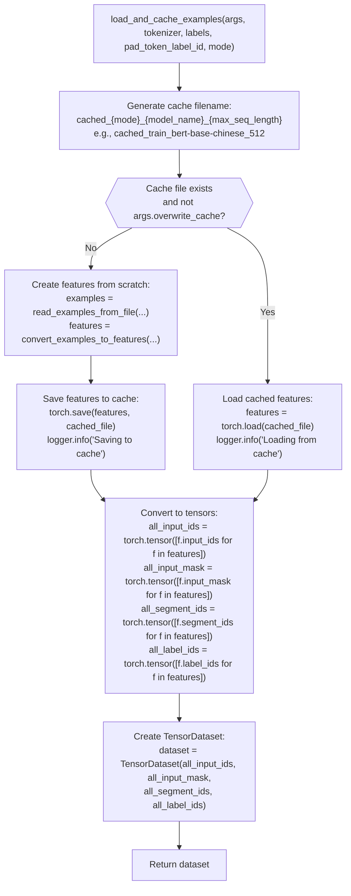
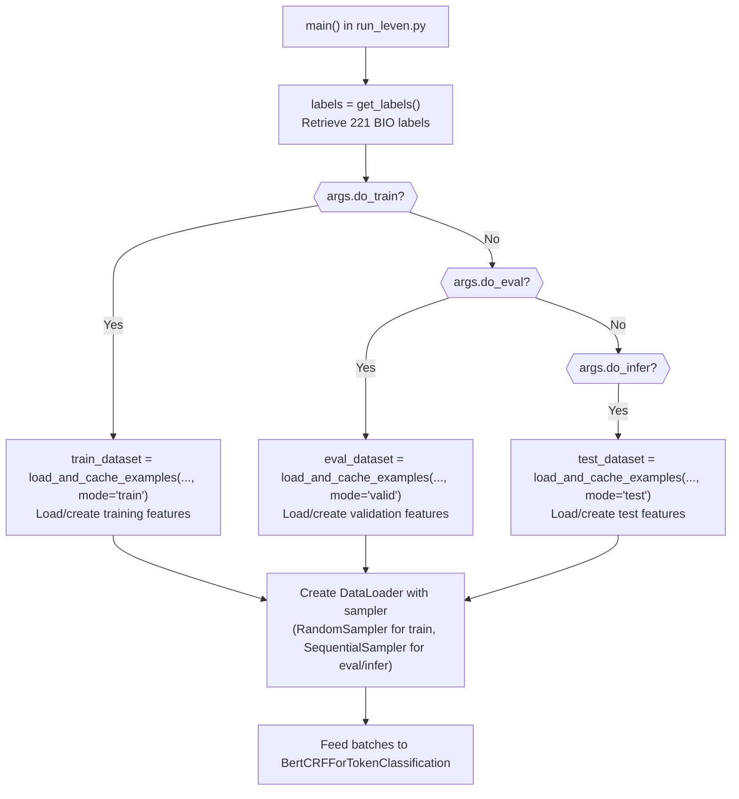

<!-- source: DeepWiki mcp.deepwiki.com · repo thunlp/LEVEN · page 5.4 BERT+CRF Data Utilities · fetched 2026-11-02 -->

# BERT+CRF Data Utilities

<details>
<summary>Relevant source files</summary>

The following files were used as context for generating this wiki page:

- [Baselines/BERT+CRF/run_leven.py](Baselines/BERT+CRF/run_leven.py)
- [Baselines/BERT+CRF/utils_leven.py](Baselines/BERT+CRF/utils_leven.py)

</details>


This page documents the data processing utilities for the BERT+CRF baseline, including JSONL parsing, tokenization, feature conversion, and CRF-specific padding mechanisms. For information about how these utilities are used during training, see [BERT+CRF Training](#5.2). For information about the model architecture that consumes these features, see [BERT+CRF Architecture](#5.1).

## Overview and Scope

The BERT+CRF data utilities provide a complete pipeline for transforming raw JSONL documents into tensor features suitable for the BERT+CRF model. The primary responsibilities include:

- Reading LEVEN JSONL files and extracting token sequences with BIO labels
- Converting raw text into BERT-compatible input features (token IDs, attention masks, segment IDs)
- Handling CRF-specific padding requirements due to variable sequence lengths
- Implementing feature caching to accelerate repeated data loading

All utilities are implemented in [Baselines/BERT+CRF/utils_leven.py](). The orchestration and caching logic is implemented in [Baselines/BERT+CRF/run_leven.py:425-470]().

**Sources:** [Baselines/BERT+CRF/utils_leven.py:1-457](), [Baselines/BERT+CRF/run_leven.py:425-470]()

## Data Processing Pipeline

The following diagram illustrates the complete data transformation pipeline from raw JSONL documents to tensor features:



**Sources:** [Baselines/BERT+CRF/utils_leven.py:271-296](), [Baselines/BERT+CRF/utils_leven.py:299-436](), [Baselines/BERT+CRF/run_leven.py:425-470]()

## Data Structure Classes

### InputExample

The `InputExample` class represents a single sentence from the LEVEN dataset after parsing from JSONL format. Each document contains multiple sentences, and each sentence becomes one `InputExample`.

| Field | Type | Description |
|-------|------|-------------|
| `guid` | `str` | Unique identifier in format `{mode}-{doc_id}-{sent_idx}` |
| `words` | `List[str]` | List of tokens (words/characters) in the sentence |
| `labels` | `List[str]` | BIO labels for each token (e.g., "B-盗窃财物", "I-盗窃财物", "O") |



**Sources:** [Baselines/BERT+CRF/utils_leven.py:249-258](), [Baselines/BERT+CRF/utils_leven.py:271-296]()

### InputFeatures

The `InputFeatures` class represents a tokenized and padded sequence ready for BERT model input. Each `InputExample` is converted to one `InputFeatures` object.

| Field | Type | Description |
|-------|------|-------------|
| `input_ids` | `List[int]` | BERT vocabulary indices for tokens, padded to `max_seq_length` |
| `input_mask` | `List[int]` | Attention mask (1 for real tokens, 0 for padding) |
| `segment_ids` | `List[int]` | Segment/token type IDs (all 0 for single sequences) |
| `label_ids` | `List[int]` | Integer label IDs corresponding to BIO labels, padded to `max_seq_length` |

All fields have length equal to `max_seq_length` (default 512) after padding.

**Sources:** [Baselines/BERT+CRF/utils_leven.py:261-268]()

## JSONL Reading and BIO Tagging

The `read_examples_from_file()` function parses LEVEN JSONL files and constructs `InputExample` objects with BIO-tagged labels.



**Key Logic:**

1. **Token Extraction**: Tokens are extracted from `doc['content'][sent_idx]['tokens']` for each sentence
2. **Event Tagging**: For training/validation, events are tagged using BIO scheme:
   - First token of mention: `B-{event_type}` (e.g., "B-盗窃财物")
   - Subsequent tokens: `I-{event_type}` (e.g., "I-盗窃财物")
   - All other tokens: `O` (outside any event)
3. **Negative Triggers**: Explicitly override labels to `O` for negative trigger spans to handle ambiguous cases
4. **Test Mode**: Labels are initialized as all `O` since ground truth is not available

**Sources:** [Baselines/BERT+CRF/utils_leven.py:271-296]()

## Feature Conversion and Tokenization

The `convert_examples_to_features()` function performs BERT tokenization, creates attention masks, and applies padding to create uniform-length sequences.



### Subword Tokenization Handling

BERT's WordPiece tokenizer may split Chinese characters or words into multiple subtokens. The first subtoken receives the actual BIO label, while subsequent subtokens are assigned `pad_token_label_id` (-100) to exclude them from loss calculation:

```
Word:    "盗窃"
Tokens:  ["盗", "窃"]
Labels:  [label_id_for_B-盗窃财物, -100]
```

This ensures only the first subtoken of each word contributes to the model's predictions and loss.

**Sources:** [Baselines/BERT+CRF/utils_leven.py:299-436]()

### Padding Configuration

The function supports multiple tokenizer configurations through boolean flags:

| Parameter | Default | Description |
|-----------|---------|-------------|
| `cls_token_at_end` | `False` | If `True`, CLS token at end (XLNet pattern); if `False`, at beginning (BERT pattern) |
| `pad_on_left` | `False` | Pad on left side (for XLNet) or right side (for BERT) |
| `sep_token_extra` | `False` | Add extra SEP token (for RoBERTa) |
| `pad_token_label_id` | `-100` | Label ID for padding positions (ignored in CrossEntropyLoss) |
| `mask_padding_with_zero` | `True` | Use 0 for padding in attention mask (1 for real tokens) |

**Sources:** [Baselines/BERT+CRF/utils_leven.py:299-436]()

## CRF Padding Utilities

The CRF layer requires variable-length sequences without padding, but BERT outputs fixed-length tensors. Two utility functions handle conversion between these representations.

### to_crf_pad()

Converts fixed-length BERT tensors to variable-length sequences suitable for CRF by removing padding tokens.



**Purpose**: The CRF Viterbi decoder relies on multiplicative masking (multiplying by 0 to ignore padded positions). This function ensures padding positions contain 0 values.

**Sources:** [Baselines/BERT+CRF/utils_leven.py:443-450]()

### unpad_crf()

Converts CRF output back to the original BERT tensor shape by restoring padding positions.



**Purpose**: After CRF decoding, predictions need to be restored to the original fixed-length tensor format to match the input shape for evaluation and post-processing.

**Sources:** [Baselines/BERT+CRF/utils_leven.py:453-456]()

## Feature Caching Mechanism

The `load_and_cache_examples()` function in `run_leven.py` implements feature caching to avoid redundant tokenization across training runs.



### Cache File Naming Convention

Cache files are stored in the data directory with the following naming pattern:

```
cached_{mode}_{model_identifier}_{max_seq_length}
```

Example: `cached_train_bert-base-chinese_512`

The cache can be invalidated using the `--overwrite_cache` command-line flag.

**Sources:** [Baselines/BERT+CRF/run_leven.py:425-470]()

## Label System

### BIO Label List

The complete label set is defined in `bio_labels` at [Baselines/BERT+CRF/utils_leven.py:28-246](). It includes:

- 1 "O" label (outside any event)
- 220 BIO labels (2 labels per event type × 110 event types):
  - "B-{event_type}" for the beginning of an event mention
  - "I-{event_type}" for inside/continuation of an event mention

Total: 221 labels

### Label Retrieval

The `get_labels()` function returns the complete label list:

```python
def get_labels():
    return bio_labels
```

This function is called by the main training script to determine `num_labels` for model initialization.

**Sources:** [Baselines/BERT+CRF/utils_leven.py:439-440](), [Baselines/BERT+CRF/run_leven.py:603-604]()

## Integration with Training Pipeline

The data utilities integrate with the training pipeline as follows:



**Sources:** [Baselines/BERT+CRF/run_leven.py:603-640]()

## Summary Table

| Function/Class | Location | Purpose |
|----------------|----------|---------|
| `InputExample` | [utils_leven.py:249-258]() | Container for raw words and BIO labels from a single sentence |
| `InputFeatures` | [utils_leven.py:261-268]() | Container for tokenized and padded features ready for BERT |
| `read_examples_from_file()` | [utils_leven.py:271-296]() | Parse JSONL documents and create InputExample objects with BIO tagging |
| `convert_examples_to_features()` | [utils_leven.py:299-436]() | Tokenize, pad, and convert InputExample to InputFeatures |
| `get_labels()` | [utils_leven.py:439-440]() | Return the complete list of 221 BIO labels |
| `to_crf_pad()` | [utils_leven.py:443-450]() | Remove padding to create variable-length sequences for CRF |
| `unpad_crf()` | [utils_leven.py:453-456]() | Restore CRF output to original fixed-length BERT shape |
| `load_and_cache_examples()` | [run_leven.py:425-470]() | Orchestrate data loading with caching mechanism |

**Sources:** [Baselines/BERT+CRF/utils_leven.py:1-457](), [Baselines/BERT+CRF/run_leven.py:425-470]()

---

