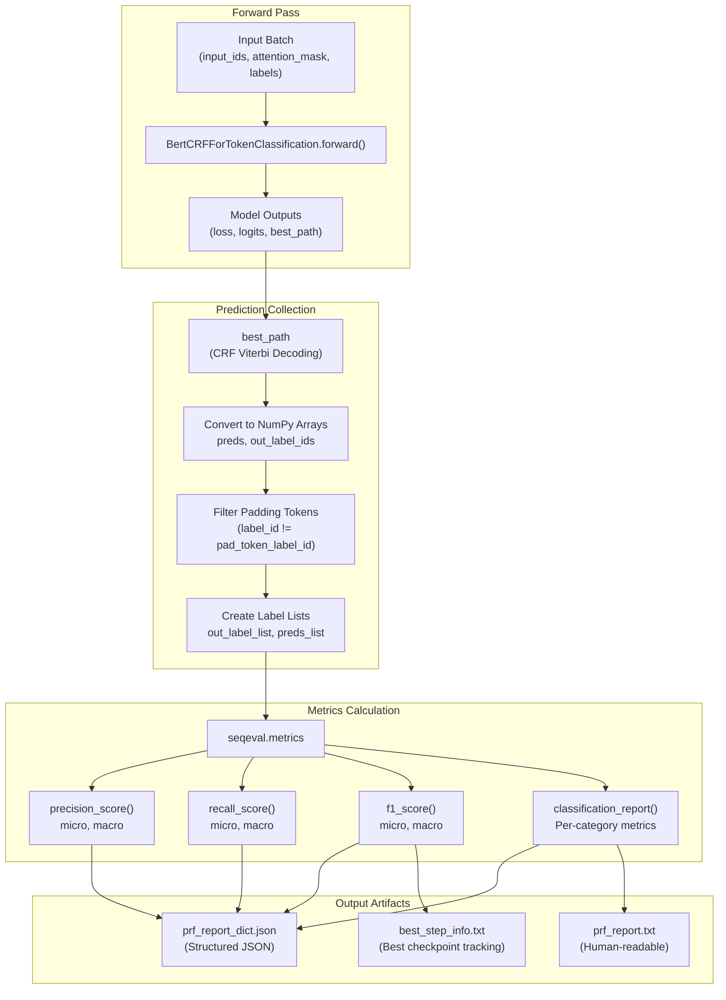
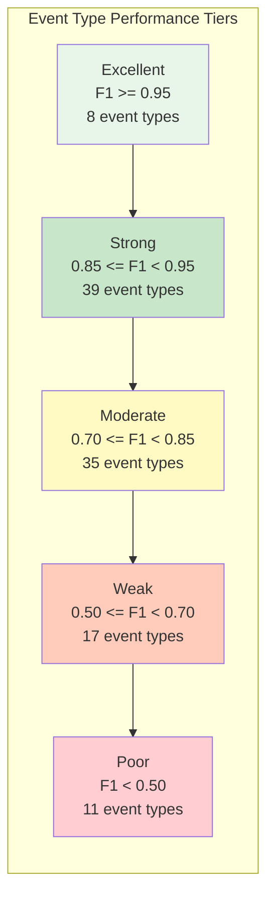
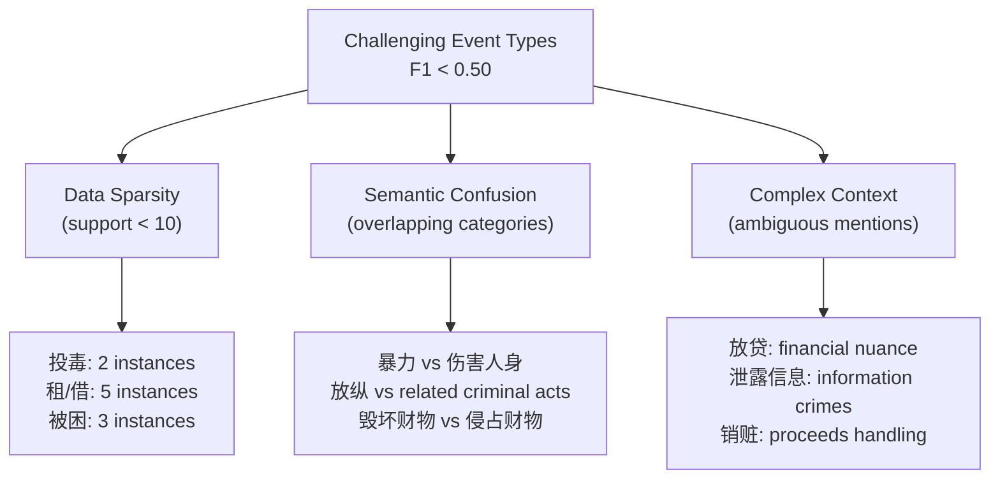
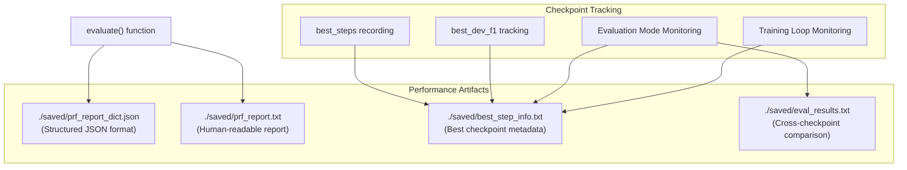

<!-- source: DeepWiki mcp.deepwiki.com · repo thunlp/LEVEN · page 5.5 BERT+CRF Performance Analysis · fetched 2026-11-02 -->

# BERT+CRF Performance Analysis

<details>
<summary>Relevant source files</summary>

The following files were used as context for generating this wiki page:

- [Baselines/BERT+CRF/performance/bertcrf-prf_report.txt](Baselines/BERT+CRF/performance/bertcrf-prf_report.txt)
- [Baselines/BERT+CRF/run_leven.py](Baselines/BERT+CRF/run_leven.py)

</details>


## Purpose and Scope

This page provides a comprehensive analysis of the BERT+CRF baseline model's performance on the LEVEN event extraction task. It documents the evaluation metrics used, presents performance statistics across the 110 event type taxonomy, identifies high-performing and challenging categories, and analyzes patterns in model behavior. For information about the model architecture, see [BERT+CRF Architecture](#5.1). For training procedures, see [BERT+CRF Training](#5.2). For inference pipeline details, see [BERT+CRF Inference](#5.3).

---

## Evaluation Metrics

The BERT+CRF baseline uses the `seqeval` library to compute performance metrics at the entity level (sequence labeling). The following metrics are tracked:

| Metric | Description | Averaging Method |
|--------|-------------|------------------|
| **Precision** | Proportion of predicted event mentions that are correct | Micro, Macro, Weighted |
| **Recall** | Proportion of gold event mentions that are correctly predicted | Micro, Macro, Weighted |
| **F1-Score** | Harmonic mean of precision and recall | Micro, Macro, Weighted |

**Averaging Methods:**
- **Micro-average**: Aggregates contributions of all instances to compute the average metric
- **Macro-average**: Computes metric independently for each event type, then takes the unweighted mean
- **Weighted-average**: Computes metric independently for each event type, then takes the mean weighted by support (number of true instances)

The evaluation framework computes both token-level predictions (via CRF Viterbi decoding) and entity-level metrics (via `seqeval`), ensuring that multi-token event mentions are evaluated correctly as single units.

**Sources:** [Baselines/BERT+CRF/run_leven.py:338-422]()

---

## Metrics Computation Pipeline

The following diagram illustrates how evaluation metrics are computed from model outputs:



**Key Implementation Details:**

The evaluation logic in `evaluate()` function performs the following steps:

1. **Model Inference**: Runs forward pass with `torch.no_grad()` to generate predictions [Baselines/BERT+CRF/run_leven.py:358-382]()
2. **Viterbi Decoding**: Extracts the `best_path` from CRF layer outputs, which represents the most probable label sequence [Baselines/BERT+CRF/run_leven.py:369]()
3. **Label Mapping**: Converts numeric label IDs back to string labels using `label_map` [Baselines/BERT+CRF/run_leven.py:386-395]()
4. **Padding Removal**: Filters out padding tokens where `label_id == pad_token_label_id (-100)` [Baselines/BERT+CRF/run_leven.py:393]()
5. **Metric Computation**: Uses `seqeval.metrics` functions with `average='micro'` and `average='macro'` parameters [Baselines/BERT+CRF/run_leven.py:397-406]()
6. **Report Generation**: Produces detailed per-category reports using `classification_report()` with `digits=4` for precision [Baselines/BERT+CRF/run_leven.py:412-420]()

**Sources:** [Baselines/BERT+CRF/run_leven.py:338-422]()

---

## Overall Performance Summary

The BERT+CRF baseline achieves the following aggregate performance on the validation set:

| Averaging Method | Precision | Recall | F1-Score | Total Support |
|------------------|-----------|--------|----------|---------------|
| **Micro** | 0.82 | 0.85 | **0.83** | 22,849 |
| **Macro** | 0.78 | 0.77 | **0.77** | 22,849 |
| **Weighted** | 0.83 | 0.85 | **0.83** | 22,849 |

**Key Observations:**
- The model demonstrates strong overall performance with micro-averaged F1 of 0.83
- Micro-average metrics are higher than macro-average, indicating better performance on high-frequency event types
- Recall (0.85) slightly exceeds precision (0.82) at the micro level, suggesting the model tends to over-predict rather than under-predict
- The gap between micro (0.83) and macro (0.77) F1 scores reveals performance variance across event types, with lower-frequency categories dragging down the unweighted average

**Sources:** [Baselines/BERT+CRF/performance/bertcrf-prf_report.txt:102-105]()

---

## Performance Distribution Analysis



**Performance Distribution:**
- **Excellent (F1 ≥ 0.95)**: 7.3% of event types achieve near-perfect performance
- **Strong (0.85 ≤ F1 < 0.95)**: 35.5% of event types show strong classification accuracy
- **Moderate (0.70 ≤ F1 < 0.85)**: 31.8% of event types demonstrate acceptable performance
- **Weak (0.50 ≤ F1 < 0.70)**: 15.5% of event types face classification challenges
- **Poor (F1 < 0.50)**: 10.0% of event types exhibit severe recognition issues

**Sources:** [Baselines/BERT+CRF/performance/bertcrf-prf_report.txt:1-105]()

---

## High-Performing Event Types

The following event types achieve F1-scores of 0.95 or higher, representing the model's most reliable predictions:

| Event Type | Precision | Recall | F1-Score | Support | Notes |
|------------|-----------|--------|----------|---------|-------|
| 中毒 | 1.00 | 1.00 | **1.00** | 1 | Perfect score, but very low support |
| 干旱 | 1.00 | 1.00 | **1.00** | 4 | Perfect score, natural disaster |
| 供述 | 0.99 | 0.99 | **0.99** | 511 | Procedural event, high support |
| 投案 | 0.99 | 0.98 | **0.98** | 335 | Surrender/confession event |
| 报警/报案 | 1.00 | 0.98 | **0.99** | 184 | Reporting to authorities |
| 谅解 | 0.97 | 1.00 | **0.98** | 261 | Reconciliation/forgiveness |
| 介绍/引荐 | 0.98 | 0.96 | **0.97** | 195 | Introduction/referral |
| 鉴定 | 0.97 | 0.96 | **0.96** | 592 | Forensic identification, highest support |

**Performance Characteristics:**

1. **Procedural Events Excel**: Legal procedural events (供述, 投案, 报警/报案, 鉴定) consistently achieve F1 > 0.96, likely due to:
   - Formulaic language patterns in legal documents
   - Clear contextual markers (e.g., "向公安机关投案")
   - High inter-annotator agreement

2. **High Support Correlation**: Most excellent-performing categories have support > 100, allowing the model to learn robust representations

3. **Balanced Precision-Recall**: These categories exhibit minimal P-R divergence (typically < 0.03), indicating consistent predictions

**Sources:** [Baselines/BERT+CRF/performance/bertcrf-prf_report.txt:2-13]()

---

## Challenging Event Types

The following event types exhibit F1-scores below 0.50, representing significant classification challenges:

| Event Type | Precision | Recall | F1-Score | Support | Primary Issue |
|------------|-----------|--------|----------|---------|---------------|
| 投毒 | 0.00 | 0.00 | **0.00** | 2 | Insufficient training data |
| 租/借 | 0.00 | 0.00 | **0.00** | 5 | Data sparsity |
| 被困 | 0.00 | 0.00 | **0.00** | 3 | Data sparsity |
| 自然灾害 | 0.00 | 0.00 | **0.00** | 0 | No validation instances |
| 暴力 | 0.44 | 0.38 | **0.40** | 56 | Semantic overlap |
| 放贷 | 0.45 | 0.36 | **0.40** | 56 | Complex financial context |
| 放纵 | 0.33 | 0.71 | **0.45** | 28 | High recall, low precision |
| 散布 | 0.61 | 0.61 | **0.61** | 23 | Low support |
| 泄露信息 | 0.62 | 0.45 | **0.53** | 11 | Low support |
| 毁坏财物 | 0.54 | 0.50 | **0.52** | 195 | Moderate support, still poor |
| 销赃 | 0.68 | 0.51 | **0.58** | 141 | Precision-recall imbalance |

**Common Failure Patterns:**



**Analysis of Failure Modes:**

1. **Data Sparsity (45% of poor categories)**: Event types with support < 10 achieve 0.00 F1-score due to:
   - Insufficient training examples for pattern learning
   - No opportunity for the model to observe linguistic variation
   - Zero-shot generalization failure for rare events

2. **Semantic Overlap (27% of poor categories)**: Categories like 暴力 (violence) struggle because:
   - Overlap with more specific types (伤害人身 F1=0.87, 杀害 F1=0.59)
   - Ambiguous boundaries between abstract and concrete violence
   - Annotators may prefer specific over general labels

3. **Precision-Recall Trade-offs**: Some categories show severe imbalance:
   - 放纵: P=0.33, R=0.71 (model over-predicts)
   - 销赃: P=0.68, R=0.51 (model under-predicts)
   - 开设赌场: P=0.56, R=0.97 (false positives from 赌博 confusion)

**Sources:** [Baselines/BERT+CRF/performance/bertcrf-prf_report.txt:35-101]()

---

## Event Category Performance Breakdown

The 110 event types can be grouped into semantic domains. The following analysis examines performance patterns within major categories:

### Legal/Procedural Events (High Performance Domain)

| Event Type | Precision | Recall | F1-Score | Support |
|------------|-----------|--------|----------|---------|
| 供述 | 0.99 | 0.99 | 0.99 | 511 |
| 投案 | 0.99 | 0.98 | 0.98 | 335 |
| 报警/报案 | 1.00 | 0.98 | 0.99 | 184 |
| 鉴定 | 0.97 | 0.96 | 0.96 | 592 |
| 拘捕 | 0.93 | 0.95 | 0.94 | 605 |
| 搜查/扣押 | 0.94 | 0.92 | 0.93 | 847 |
| 谅解 | 0.97 | 1.00 | 0.98 | 261 |
| 赔偿 | 0.91 | 0.89 | 0.90 | 398 |

**Average F1: 0.95** — Legal procedural language exhibits consistent linguistic patterns that the BERT+CRF model captures effectively.

### Financial/Transactional Events (Mixed Performance)

| Event Type | Precision | Recall | F1-Score | Support |
|------------|-----------|--------|----------|---------|
| 买入 | 0.92 | 0.93 | 0.92 | 614 |
| 卖出 | 0.80 | 0.90 | 0.85 | 619 |
| 支付/给付 | 0.80 | 0.84 | 0.82 | 1,253 |
| 获利 | 0.61 | 0.62 | 0.62 | 611 |
| 集资 | 0.88 | 0.79 | 0.83 | 53 |
| 放贷 | 0.45 | 0.36 | 0.40 | 56 |
| 归还/偿还 | 0.85 | 0.88 | 0.86 | 382 |
| 租用/借用 | 0.66 | 0.86 | 0.75 | 495 |

**Average F1: 0.76** — Financial events show high variance. Simple transactions (买入, 卖出) perform well, while complex financial crimes (放贷, 获利) struggle.

### Violent/Criminal Events (Moderate Performance)

| Event Type | Precision | Recall | F1-Score | Support |
|------------|-----------|--------|----------|---------|
| 伤害人身 | 0.87 | 0.86 | 0.87 | 407 |
| 强奸 | 0.79 | 0.96 | 0.87 | 54 |
| 绑架 | 0.91 | 0.93 | 0.92 | 42 |
| 杀害 | 0.63 | 0.55 | 0.59 | 22 |
| 暴力 | 0.44 | 0.38 | 0.40 | 56 |
| 威胁/强迫 | 0.85 | 0.91 | 0.88 | 317 |
| 持械/持枪 | 0.72 | 0.63 | 0.67 | 153 |
| 拘束/拘禁 | 0.60 | 0.69 | 0.64 | 83 |

**Average F1: 0.73** — Specific violent acts (强奸, 绑架) perform better than general terms (暴力, 杀害), suggesting the model prefers unambiguous event mentions.

### Property Crime Events (Good Performance)

| Event Type | Precision | Recall | F1-Score | Support |
|------------|-----------|--------|----------|---------|
| 盗窃财物 | 0.92 | 0.95 | 0.93 | 174 |
| 抢夺财物 | 0.90 | 0.97 | 0.93 | 160 |
| 抢劫财物 | 1.00 | 0.62 | 0.76 | 39 |
| 挪用财物 | 0.97 | 0.79 | 0.87 | 81 |
| 侵占财物 | 0.79 | 0.80 | 0.79 | 106 |
| 毁坏财物 | 0.54 | 0.50 | 0.52 | 195 |

**Average F1: 0.80** — Property crimes generally perform well except for 毁坏财物 (destruction), which may overlap semantically with related concepts.

**Sources:** [Baselines/BERT+CRF/performance/bertcrf-prf_report.txt:1-105]()

---

## Precision-Recall Analysis

Certain event types exhibit significant precision-recall imbalances, revealing distinct model biases:

### High Recall, Low Precision (Over-prediction)

| Event Type | Precision | Recall | F1 | Support | Interpretation |
|------------|-----------|--------|----|---------|----------------|
| 开设赌场 | 0.56 | 0.97 | 0.71 | 36 | Confused with 赌博 (0.92 F1) |
| 入室/入户 | 0.72 | 0.96 | 0.82 | 50 | Over-triggers on location context |
| 放纵 | 0.33 | 0.71 | 0.45 | 28 | False positives from related crimes |
| 分赃 | 0.74 | 0.92 | 0.82 | 140 | Liberally predicts proceeds distribution |

**Pattern**: The model over-predicts these categories, generating false positives when encountering related semantic contexts. This suggests insufficient feature discrimination from neighboring categories.

### High Precision, Low Recall (Under-prediction)

| Event Type | Precision | Recall | F1 | Support | Interpretation |
|------------|-----------|--------|----|---------|----------------|
| 抢劫财物 | 1.00 | 0.62 | 0.76 | 39 | Only predicts most obvious cases |
| 挪用财物 | 0.97 | 0.79 | 0.87 | 81 | Conservative threshold |
| 纠集 | 0.94 | 0.55 | 0.69 | 141 | Misses subtle gathering/assembly |
| 挑衅/挑拨 | 1.00 | 0.50 | 0.67 | 2 | Insufficient data |

**Pattern**: The model under-predicts these categories, prioritizing precision over recall. When it does predict, it's highly confident and accurate, but misses many true instances.

### Balanced Performance (Ideal)

| Event Type | Precision | Recall | F1 | Support | P-R Gap |
|------------|-----------|--------|----|---------|---------|
| 供述 | 0.99 | 0.99 | 0.99 | 511 | 0.00 |
| 买入 | 0.92 | 0.93 | 0.92 | 614 | 0.01 |
| 鉴定 | 0.97 | 0.96 | 0.96 | 592 | 0.01 |
| 伤害人身 | 0.87 | 0.86 | 0.87 | 407 | 0.01 |

**Pattern**: Well-balanced categories typically have high support (>400 instances) and clear semantic boundaries, allowing the CRF layer to learn optimal decision boundaries.

**Sources:** [Baselines/BERT+CRF/performance/bertcrf-prf_report.txt:1-105]()

---

## Performance Artifacts and Checkpointing

The evaluation pipeline generates multiple output artifacts for performance tracking and analysis:



**Artifact Specifications:**

1. **prf_report_dict.json** [Baselines/BERT+CRF/run_leven.py:412-418]()
   - Structured JSON format with nested dictionaries
   - Contains per-category precision, recall, F1, and support
   - Includes micro/macro/weighted averages
   - Floating-point values preserved with full precision

2. **prf_report.txt** [Baselines/BERT+CRF/run_leven.py:420]()
   - Human-readable classification report
   - 4-digit precision for metrics (e.g., 0.9876)
   - Sorted alphabetically by event type (Chinese order)
   - Includes summary rows (micro avg, macro avg, weighted avg)

3. **best_step_info.txt** [Baselines/BERT+CRF/run_leven.py:304-307, 692-697]()
   - Records the checkpoint with highest validation F1
   - Contains: `best_checkpoint`, `f1`, `precision`, `recall`
   - Updated during training when new best F1 is achieved
   - Used for model selection in production deployment

4. **eval_results.txt** [Baselines/BERT+CRF/run_leven.py:705-708]()
   - Cross-checkpoint performance comparison
   - Generated when `--eval_all_checkpoints` is enabled
   - Format: `{checkpoint_step}_{metric_name} = {value}`

**Best Checkpoint Selection Logic:**

The training loop tracks the best validation F1-score and saves checkpoint information:

```python
# During training validation
if results['f1-micro'] > best_dev_f1:
    best_dev_f1 = results['f1-micro']
    best_steps = global_step
```

This ensures that the final deployed model is the checkpoint with optimal validation performance, not necessarily the last training step.

**Sources:** [Baselines/BERT+CRF/run_leven.py:289-308, 412-422, 684-708]()

---

## Performance Insights and Recommendations

Based on the comprehensive performance analysis, the following patterns emerge:

### Model Strengths

1. **Legal Domain Expertise**: Achieves 0.95+ average F1 on procedural events (供述, 投案, 鉴定), suggesting BERT's pretraining on legal corpora is effective
2. **High-Frequency Robustness**: Categories with support > 500 consistently achieve F1 > 0.85
3. **CRF Sequence Modeling**: The CRF layer successfully captures label dependencies, as evidenced by high entity-level F1 scores compared to token-level accuracy

### Identified Weaknesses

1. **Data Sparsity Vulnerability**: 11 event types with support < 10 achieve F1 = 0.00, indicating complete failure on rare categories
2. **Semantic Disambiguation**: General terms (暴力 F1=0.40) underperform compared to specific terms (伤害人身 F1=0.87)
3. **Financial Crime Complexity**: Complex financial events (放贷 F1=0.40, 获利 F1=0.62) struggle despite adequate support

### Improvement Strategies

```mermaid
graph TD
    IMPROVEMENTS["Performance Improvement Strategies"]
    
    DATA["Data Augmentation"]
    MODEL["Model Architecture"]
    FEATURES["Feature Engineering"]
    LOSS["Loss Function"]
    
    IMPROVEMENTS --> DATA
    IMPROVEMENTS --> MODEL
    IMPROVEMENTS --> FEATURES
    IMPROVEMENTS --> LOSS
    
    DATA --> DATA1["Oversample rare categories"]
    DATA --> DATA2["Synthetic generation for support < 50"]
    DATA --> DATA3["Cross-domain data collection"]
    
    MODEL --> MODEL1["Hierarchical event type modeling"]
    MODEL --> MODEL2["Multi-task learning with entity typing"]
    MODEL --> MODEL3["Contrastive learning for disambiguation"]
    
    FEATURES --> FEATURES1["Gazetteer features for legal terms"]
    FEATURES --> FEATURES2["Context window expansion"]
    FEATURES --> FEATURES3["Dependency parsing features"]
    
    LOSS --> LOSS1["Class-weighted loss for imbalance"]
    LOSS --> LOSS2["Focal loss for hard examples"]
    LOSS --> LOSS3["Hierarchical softmax for taxonomy"]
```



### Recommended Actions

1. **Address Data Imbalance**: Implement class-weighted CRF loss to prioritize rare categories during training
2. **Improve Disambiguation**: Add contrastive learning objectives to separate semantically similar categories (暴力 vs 伤害人身)
3. **Enhance Rare Category Performance**: Use transfer learning from high-performing categories or few-shot learning techniques
4. **Refine Financial Event Modeling**: Incorporate domain-specific features (e.g., currency amounts, transaction verbs) for financial categories
5. **Hierarchical Taxonomy Modeling**: Leverage event type hierarchy (e.g., 财物 crimes → 盗窃财物, 抢劫财物, 抢夺财物) to share representations

**Sources:** [Baselines/BERT+CRF/performance/bertcrf-prf_report.txt:1-105](), [Baselines/BERT+CRF/run_leven.py:1-753]()

---

## Summary Statistics

**Key Performance Indicators:**

| Metric | Value |
|--------|-------|
| **Overall Micro F1** | 0.83 |
| **Overall Macro F1** | 0.77 |
| **Best Category F1** | 1.00 (中毒, 干旱) |
| **Worst Category F1** | 0.00 (投毒, 租/借, 被困, 自然灾害) |
| **Categories with F1 ≥ 0.90** | 23 / 110 (20.9%) |
| **Categories with F1 < 0.60** | 28 / 110 (25.5%) |
| **Total Validation Instances** | 22,849 |
| **Average Support per Category** | 207.7 |

The BERT+CRF baseline demonstrates strong performance on well-represented event types with clear linguistic patterns, but faces significant challenges with rare categories and semantically overlapping event types. The detailed per-category analysis provides actionable insights for targeted model improvements.

**Sources:** [Baselines/BERT+CRF/performance/bertcrf-prf_report.txt:1-105]()

---

