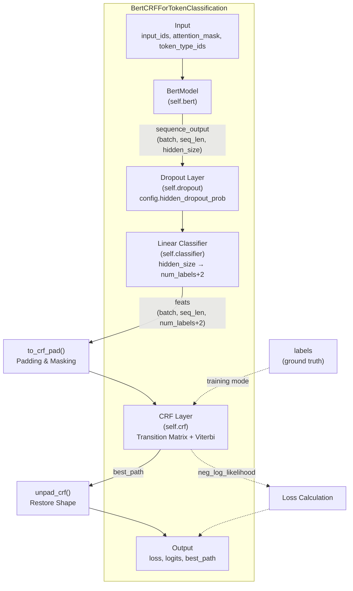
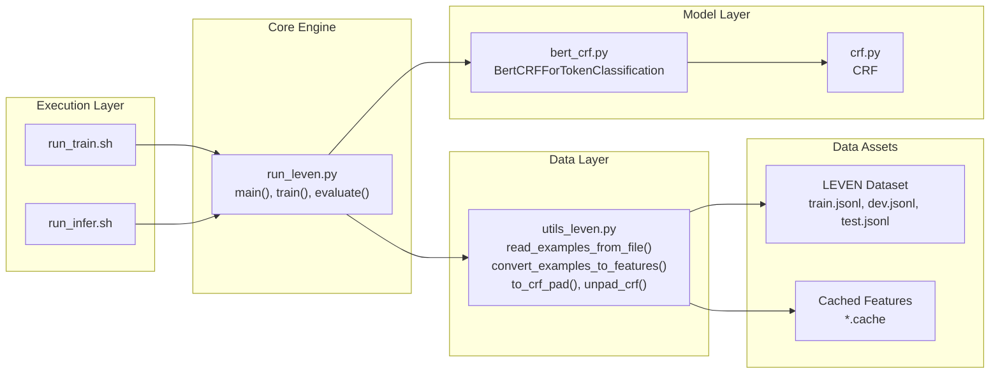
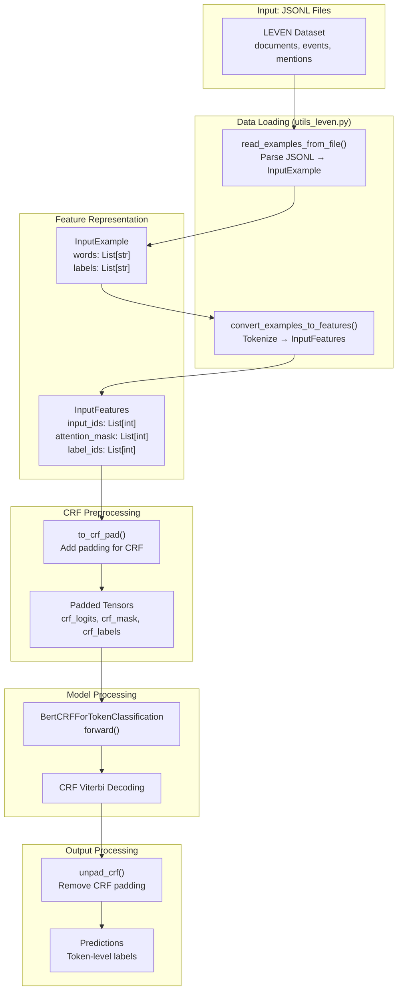

<!-- source: DeepWiki mcp.deepwiki.com · repo thunlp/LEVEN · page 6 BERT Baseline · fetched 2026-11-02 -->

# BERT Baseline

<details>
<summary>Relevant source files</summary>

The following files were used as context for generating this wiki page:

- [Baselines/BERT/README.md](Baselines/BERT/README.md)
- [Baselines/BERT/bert_crf.py](Baselines/BERT/bert_crf.py)
- [Baselines/BERT/crf.py](Baselines/BERT/crf.py)

</details>


## Purpose and Scope

This document provides an overview of the BERT baseline implementation in the LEVEN repository. The BERT baseline uses a BERT encoder with a CRF layer for event type classification through sequence labeling. Despite being structurally similar to the BERT+CRF baseline (see [BERT+CRF Baseline](#5)), this implementation is maintained as a separate baseline in the repository.

For detailed documentation on specific aspects of this baseline:
- Model architecture details: [BERT Architecture](#6.1)
- Training procedures: [BERT Training](#6.2)
- Inference procedures: [BERT Inference](#6.3)
- Data processing utilities: [BERT Data Utilities](#6.4)

For comparison with other baseline models: [Baselines Comparison](#4)

## Overview

The BERT baseline is implemented using HuggingFace's Transformers library and combines a pre-trained BERT encoder with a CRF layer for token-level event classification. The model processes Chinese text using the `bert-base-chinese` pre-trained model and performs sequence labeling to identify event mentions and their types using the BIO tagging scheme.

The implementation consists of:
- A custom `BertCRFForTokenClassification` model class that extends `BertPreTrainedModel`
- A standalone `CRF` module implementing conditional random field logic with Viterbi decoding
- Training and inference scripts similar to the BERT+CRF baseline structure
- Data utilities for converting JSONL documents to model-ready features

**Sources:** [Baselines/BERT/README.md:1-30](), [Baselines/BERT/bert_crf.py:15-87]()

## Model Architecture Overview

The following diagram illustrates the `BertCRFForTokenClassification` architecture and its key components:



**Diagram: BertCRFForTokenClassification Forward Pass**

The model architecture follows a straightforward pipeline:
1. **BERT Encoder** processes tokenized input to generate contextualized embeddings
2. **Dropout** applies regularization to the sequence output
3. **Linear Classifier** projects hidden states to emission scores for `num_labels + 2` classes (the extra 2 account for START and STOP tags used by the CRF)
4. **CRF Layer** models label dependencies and decodes the optimal label sequence using Viterbi algorithm
5. **Padding Utilities** (`to_crf_pad` and `unpad_crf`) handle batch padding for CRF processing

**Sources:** [Baselines/BERT/bert_crf.py:15-87](), [Baselines/BERT/utils_leven.py]()

## Implementation Structure

The BERT baseline is organized into several key files located in `Baselines/BERT/`:

| File | Purpose | Key Components |
|------|---------|----------------|
| `bert_crf.py` | Model definition | `BertCRFForTokenClassification` class |
| `crf.py` | CRF implementation | `CRF` class, Viterbi decoding, partition function |
| `utils_leven.py` | Data processing | Feature conversion, padding utilities |
| `run_leven.py` | Training/inference engine | Main execution loop, optimizer setup, evaluation |
| `run_train.sh` | Training script | Shell wrapper for training configuration |
| `run_infer.sh` | Inference script | Shell wrapper for test predictions |



**Diagram: BERT Baseline File Dependencies**

**Sources:** [Baselines/BERT/README.md:20-28]()

## Key Components

### BertCRFForTokenClassification

The main model class that integrates BERT with CRF for token classification. Located in [Baselines/BERT/bert_crf.py:15-87]().

**Key attributes:**
- `self.bert`: Pre-trained BERT model instance
- `self.dropout`: Dropout layer using `config.hidden_dropout_prob`
- `self.classifier`: Linear layer mapping from `hidden_size` to `num_labels + 2`
- `self.crf`: CRF layer instance for sequence labeling

**Key methods:**
- `_get_features()`: Extracts BERT embeddings and applies classifier [bert_crf.py:31-44]()
- `forward()`: Main forward pass handling both training and inference modes [bert_crf.py:46-86]()

The forward method handles two execution paths:
- **Training mode** (when `labels` is provided): Computes CRF loss via `neg_log_likelihood()` and returns loss, logits, and best path
- **Inference mode** (when `labels` is None): Only performs Viterbi decoding and returns logits and best path

### CRF Layer

The `CRF` class implements conditional random field functionality. Located in [Baselines/BERT/crf.py:29-281]().

**Key attributes:**
- `self.transitions`: Learnable transition matrix of shape `(tagset_size + 2, tagset_size + 2)` [crf.py:45-50]()
- `self.START_TAG = -2` and `self.STOP_TAG = -1`: Special tags for sequence boundaries

**Key methods:**
- `forward()`: Performs Viterbi decoding to find best label sequence [crf.py:212-215]()
- `_viterbi_decode()`: Implements Viterbi algorithm for optimal path finding [crf.py:113-210]()
- `neg_log_likelihood()`: Computes negative log-likelihood loss for training [crf.py:269-280]()
- `_calculate_PZ()`: Computes partition function using forward algorithm [crf.py:56-111]()
- `_score_sentence()`: Calculates score for a given label sequence [crf.py:217-267]()

The CRF transition matrix is initialized with constraints preventing transitions to START_TAG and from STOP_TAG, ensuring valid sequence boundaries.

**Sources:** [Baselines/BERT/bert_crf.py:15-87](), [Baselines/BERT/crf.py:29-281]()

## Data Processing Pipeline

The following diagram shows how raw JSONL data is transformed into model inputs and outputs:



**Diagram: Data Transformation Pipeline**

The data flows through several transformation stages:

1. **JSONL Parsing**: Raw documents are read and converted to `InputExample` objects containing word sequences and BIO labels
2. **Tokenization**: BERT tokenizer processes examples into `InputFeatures` with token IDs, attention masks, and label IDs
3. **CRF Padding**: The `to_crf_pad()` utility function reshapes tensors for CRF processing, handling variable-length sequences
4. **Model Forward**: `BertCRFForTokenClassification` processes features through BERT encoder, classifier, and CRF layers
5. **Decoding**: Viterbi algorithm finds optimal label sequence
6. **Unpadding**: The `unpad_crf()` utility restores original tensor shapes, removing CRF-specific padding

**Sources:** [Baselines/BERT/utils_leven.py](), [Baselines/BERT/bert_crf.py:46-86]()

## Requirements and Dependencies

The BERT baseline requires the following environment:

| Component | Version | Purpose |
|-----------|---------|---------|
| Python | 3.6.9 | Runtime environment |
| PyTorch | 1.2.0 | Deep learning framework |
| Transformers | 2.6.0 | BERT model implementation |
| scikit-learn | 0.20.2 | Evaluation metrics support |
| seqeval | (any) | Sequence labeling evaluation |

The implementation depends on HuggingFace's Transformers library for the `BertModel` and `BertPreTrainedModel` base classes, with custom CRF layer integration for sequence labeling tasks.

**Sources:** [Baselines/BERT/README.md:6-16]()

## Usage Pattern

The BERT baseline supports three operational modes, controlled by shell scripts:

### Training and Evaluation

```bash
bash run_train.sh
```

This script executes training on the training set with periodic evaluation on the validation set. Checkpoints are saved based on validation performance.

### Inference

```bash
bash run_infer.sh
```

This script loads a trained checkpoint and generates predictions on the test set, saving results to `OUTPUT_PATH/results.jsonl`.

### Configuration

Both scripts accept command-line arguments to configure:
- Model checkpoint paths
- Data directory locations
- Training hyperparameters (learning rate, batch size, epochs)
- Output directories

**Important**: The README notes that comments after backslashes in the shell scripts must be deleted before execution [README.md:22]().

**Sources:** [Baselines/BERT/README.md:20-28]()

## Relationship to BERT+CRF Baseline

The BERT baseline shares substantial structural similarity with the BERT+CRF baseline (see [BERT+CRF Baseline](#5)). Both implementations:
- Use `BertCRFForTokenClassification` as the model class
- Integrate BERT encoder with CRF layer
- Employ the same CRF implementation with Viterbi decoding
- Use similar data processing utilities
- Share training and inference infrastructure

The key differences, if any, would be in hyperparameter configurations, training scripts, or experimental settings used during baseline evaluation. The separate baseline directories suggest they may have been used for different experimental conditions or configurations during the LEVEN benchmark development.

For detailed architecture documentation: [BERT Architecture](#6.1)  
For training procedures: [BERT Training](#6.2)  
For inference procedures: [BERT Inference](#6.3)  
For data utilities: [BERT Data Utilities](#6.4)

**Sources:** [Baselines/BERT/bert_crf.py:15-87](), [Baselines/BERT/crf.py:29-281]()

---

