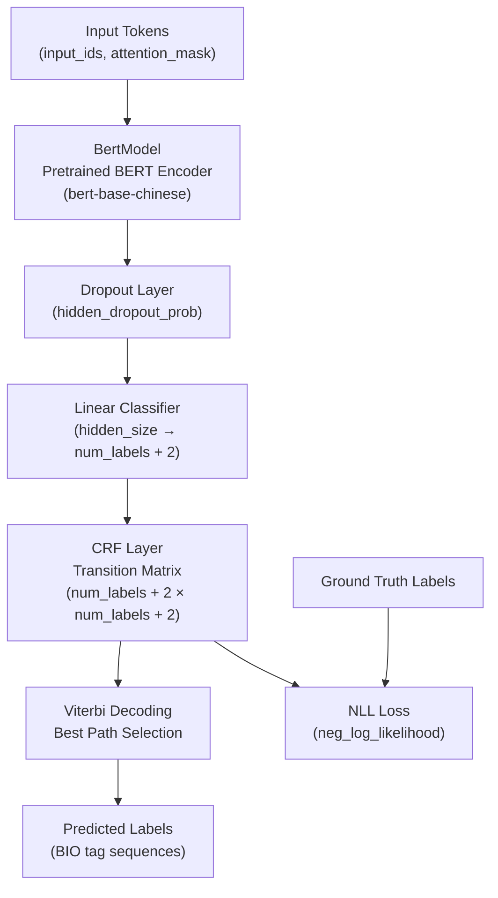
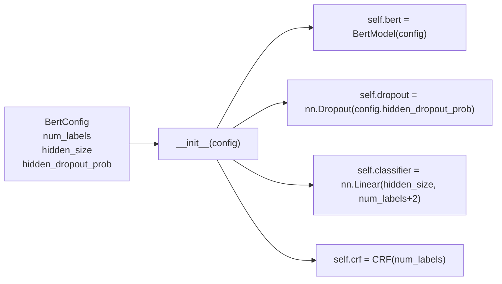
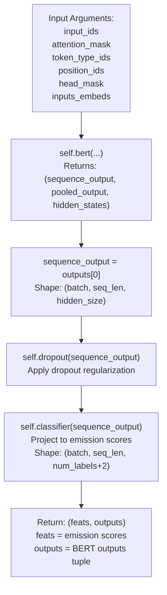
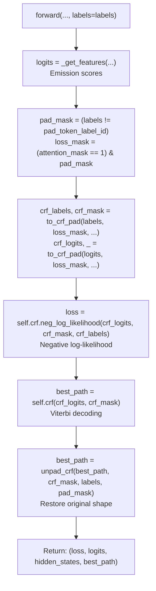
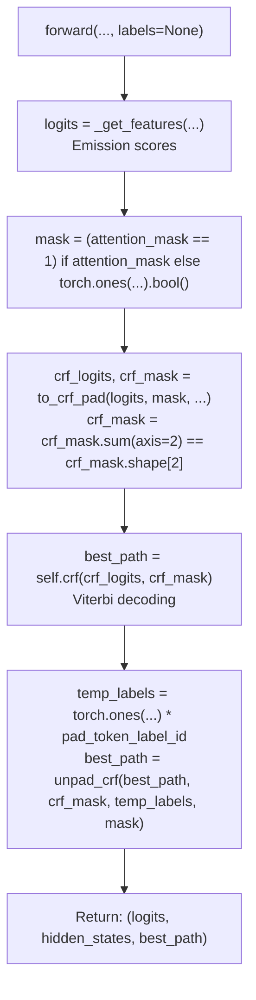
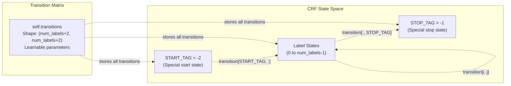
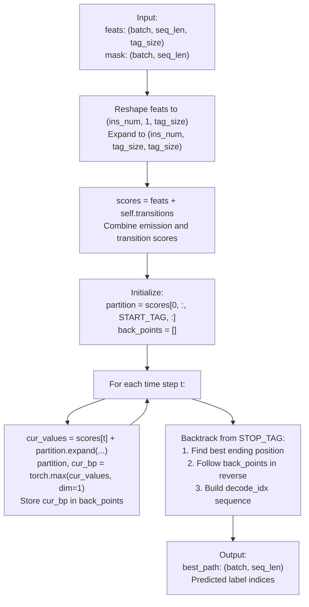
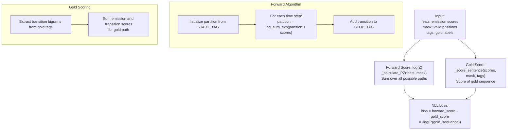

<!-- source: DeepWiki mcp.deepwiki.com · repo thunlp/LEVEN · page 6.1 BERT Architecture · fetched 2026-11-02 -->

# BERT Architecture

<details>
<summary>Relevant source files</summary>

The following files were used as context for generating this wiki page:

- [Baselines/BERT/bert_crf.py](Baselines/BERT/bert_crf.py)
- [Baselines/BERT/crf.py](Baselines/BERT/crf.py)

</details>


This page documents the model architecture of the BERT baseline for LEVEN event extraction. The architecture combines a pretrained BERT encoder with a Conditional Random Field (CRF) layer for sequence labeling, implemented in the `BertCRFForTokenClassification` class.

**Scope**: This page covers the model architecture components, tensor flow through the network, CRF integration mechanics, and Viterbi decoding. For training procedures, see [BERT Training](#6.2). For data processing utilities, see [BERT Data Utilities](#6.4). For comparison with the BERT+CRF baseline, see [BERT+CRF Architecture](#5.1).

## Architecture Overview

The BERT baseline implements a neural sequence labeling model that processes Chinese text to identify and classify event mentions according to the LEVEN taxonomy. The architecture consists of four main components arranged in a sequential pipeline.

### High-Level Component Stack



**Sources**: [Baselines/BERT/bert_crf.py:15-86]()

### Component Summary

| Component | Class/Module | Input Shape | Output Shape | Parameters |
|-----------|-------------|-------------|--------------|------------|
| BERT Encoder | `BertModel` | (batch, seq_len) | (batch, seq_len, 768) | ~102M (bert-base-chinese) |
| Dropout | `nn.Dropout` | (batch, seq_len, 768) | (batch, seq_len, 768) | 0 (dropout rate only) |
| Classifier | `nn.Linear` | (batch, seq_len, 768) | (batch, seq_len, num_labels+2) | 768 × (num_labels+2) |
| CRF Layer | `CRF` | (batch, seq_len, num_labels+2) | (batch, seq_len) | (num_labels+2)² transitions |

**Sources**: [Baselines/BERT/bert_crf.py:20-29]()

## BertCRFForTokenClassification Class

The `BertCRFForTokenClassification` class extends `BertPreTrainedModel` from HuggingFace Transformers to integrate CRF capabilities for structured prediction.

### Class Initialization



The initialization process ([bert_crf.py:20-29]()) performs the following steps:

1. **Stores `num_labels`**: The number of event types in the LEVEN taxonomy (~220 including B-/I- prefixes)
2. **Initializes BERT encoder**: Loads pretrained `bert-base-chinese` weights
3. **Creates dropout layer**: Uses `hidden_dropout_prob` from config (typically 0.1)
4. **Creates classifier**: Linear layer projecting BERT hidden states (768-dim) to `num_labels + 2` dimensions (the +2 accounts for START_TAG and STOP_TAG in CRF)
5. **Creates CRF layer**: Initializes transition matrix for modeling label dependencies
6. **Initializes weights**: Calls `init_weights()` for proper weight initialization

**Sources**: [Baselines/BERT/bert_crf.py:20-29]()

## Feature Extraction Pipeline

The `_get_features` method ([bert_crf.py:31-44]()) extracts contextualized representations from input tokens.

### Feature Extraction Flow



**Key operations**:
- **BERT forward pass** ([bert_crf.py:33-38]()): Processes input tokens through 12 transformer layers
- **Sequence output extraction** ([bert_crf.py:40]()): Takes the first element of BERT outputs (hidden states for all tokens)
- **Dropout** ([bert_crf.py:42]()): Regularization to prevent overfitting
- **Classification** ([bert_crf.py:43]()): Projects 768-dimensional BERT embeddings to `num_labels + 2` dimensions, producing emission scores for CRF

**Sources**: [Baselines/BERT/bert_crf.py:31-44]()

## Forward Pass Mechanics

The `forward` method ([bert_crf.py:46-86]()) implements different logic for training and inference modes based on whether labels are provided.

### Training Mode (labels provided)



**Training mode operations** ([bert_crf.py:53-71]()):
1. **Mask creation**: Identifies valid (non-padded) positions using `pad_token_label_id`
2. **CRF padding**: Converts sequences to CRF-compatible format using `to_crf_pad` (see [BERT Data Utilities](#6.4))
3. **Loss computation**: Calculates negative log-likelihood using CRF forward-backward algorithm
4. **Viterbi decoding**: Finds best label sequence for monitoring (not used for backpropagation)
5. **Unpadding**: Restores predictions to original sequence format using `unpad_crf`

**Sources**: [Baselines/BERT/bert_crf.py:53-71]()

### Inference Mode (no labels)



**Inference mode operations** ([bert_crf.py:72-84]()):
1. **Mask creation**: Uses attention mask to identify valid positions (creates all-ones mask if not provided)
2. **CRF padding**: Converts logits to CRF format
3. **Mask normalization**: Ensures CRF mask has correct shape for decoding
4. **Viterbi decoding**: Finds best label sequence (primary output for predictions)
5. **Unpadding**: Creates temporary labels for unpacking, then restores original shape

**Sources**: [Baselines/BERT/bert_crf.py:72-84]()

## CRF Layer Implementation

The `CRF` class ([crf.py:29-281]()) implements a linear-chain Conditional Random Field for modeling label dependencies in sequence labeling.

### CRF Components



**CRF initialization** ([crf.py:31-50]()):
- **Special tags**: Defines `START_TAG = -2` and `STOP_TAG = -1` for sequence boundaries
- **Transition matrix**: Creates learnable parameter matrix of shape `(tagset_size + 2, tagset_size + 2)`
- **Invalid transitions**: Initializes transitions to/from START and to/from STOP with large negative values (-10000) to prevent invalid paths
- **GPU support**: Moves transition matrix to CUDA if available

**Sources**: [Baselines/BERT/crf.py:31-50]()

### Transition Matrix Structure

| From \ To | START_TAG | Label 0 | Label 1 | ... | Label N | STOP_TAG |
|-----------|-----------|---------|---------|-----|---------|----------|
| **START_TAG** | -10000 | learnable | learnable | ... | learnable | -10000 |
| **Label 0** | -10000 | learnable | learnable | ... | learnable | learnable |
| **Label 1** | -10000 | learnable | learnable | ... | learnable | learnable |
| **...** | -10000 | learnable | learnable | ... | learnable | learnable |
| **Label N** | -10000 | learnable | learnable | ... | learnable | learnable |
| **STOP_TAG** | -10000 | -10000 | -10000 | ... | -10000 | -10000 |

**Sources**: [Baselines/BERT/crf.py:45-50]()

## Viterbi Decoding

The `_viterbi_decode` method ([crf.py:113-210]()) implements the Viterbi algorithm to find the most likely label sequence given emission scores and the learned transition matrix.

### Viterbi Algorithm Flow



**Viterbi algorithm steps** ([crf.py:113-210]()):

1. **Score computation** ([crf.py:132-135]()): Combines emission scores from classifier with transition scores
   - Shape: `(seq_len, batch_size, tag_size, tag_size)`
   - `scores[t, b, i, j]` = score of transitioning from tag i to tag j at time t for batch b

2. **Initialization** ([crf.py:146-150]()): 
   - Start from `START_TAG` with initial scores
   - Initialize empty `back_points` list to track best previous states
   - Initialize `partition_history` to store scores at each step

3. **Forward pass** ([crf.py:152-170]()): For each time step:
   - Compute scores for all possible transitions: `cur_values = scores[t] + partition`
   - Find maximum score and corresponding previous state: `partition, cur_bp = torch.max(cur_values, 1)`
   - Mask padded positions (set backpointer to 0)
   - Store backpointer for later traceback

4. **Final transition** ([crf.py:176-186]()): 
   - Compute scores to `STOP_TAG` from last valid position in each sequence
   - Find best final state: `pointer = last_bp[:, STOP_TAG]`

5. **Backtracking** ([crf.py:200-207]()): 
   - Start from best ending state
   - Follow `back_points` in reverse chronological order
   - Build `decode_idx` tensor with predicted labels

**Sources**: [Baselines/BERT/crf.py:113-210]()

## Loss Computation

The CRF loss is computed as the negative log-likelihood of the gold label sequence under the model.

### Loss Calculation Components



**Forward algorithm** ([crf.py:56-111]()): Computes partition function Z (normalization constant)
- Uses dynamic programming to sum over all possible label sequences
- Employs `log_sum_exp` for numerical stability
- Returns total score: `log(Σ exp(score(path)))`

**Gold scoring** ([crf.py:217-267]()): Computes score of the gold label sequence
- Converts label sequence to transition bigrams
- Sums emission scores and transition scores along gold path
- Adds final transition to `STOP_TAG`

**NLL loss** ([crf.py:269-280]()):
```
loss = log(Z) - score(gold_sequence)
     = -log(exp(score(gold_sequence)) / Z)
     = -log(P(gold_sequence | input))
```

**Sources**: [Baselines/BERT/crf.py:56-111](), [Baselines/BERT/crf.py:217-267](), [Baselines/BERT/crf.py:269-280]()

## Model Configuration

The `BertCRFForTokenClassification` class uses standard HuggingFace configuration attributes:

| Attribute | Value | Description |
|-----------|-------|-------------|
| `config_class` | `BertConfig` | Configuration class for model |
| `pretrained_model_archive_map` | `BERT_PRETRAINED_MODEL_ARCHIVE_MAP` | Maps model names to URLs |
| `base_model_prefix` | `"bert"` | Prefix for BERT encoder parameters |

**Pretrained models** ([bert_crf.py:10-12]()):
- Default: `bert-base-chinese` from HuggingFace model hub
- URL points to PyTorch checkpoint for Chinese BERT

**Sources**: [Baselines/BERT/bert_crf.py:10-18]()

## Tensor Shapes Through the Network

The following table tracks tensor dimensions as data flows through the architecture:

| Stage | Tensor | Shape | Description |
|-------|--------|-------|-------------|
| Input | `input_ids` | `(B, L)` | Token indices |
| Input | `attention_mask` | `(B, L)` | 1 for valid, 0 for padding |
| BERT output | `sequence_output` | `(B, L, H)` | Contextualized embeddings (H=768) |
| After dropout | `sequence_output` | `(B, L, H)` | Regularized embeddings |
| After classifier | `logits` / `feats` | `(B, L, T+2)` | Emission scores (T=num_labels) |
| CRF padding | `crf_logits` | `(B, L_max, T+2)` | Padded to max length in batch |
| CRF padding | `crf_mask` | `(B, L_max)` | Boolean mask for valid positions |
| Viterbi output | `best_path` | `(B, L_max)` | Predicted label indices |
| After unpadding | `best_path` | `(B, L)` | Restored to original length |

Where: B = batch size, L = sequence length, H = hidden size (768), T = num_labels

**Sources**: [Baselines/BERT/bert_crf.py:31-86]()

---

