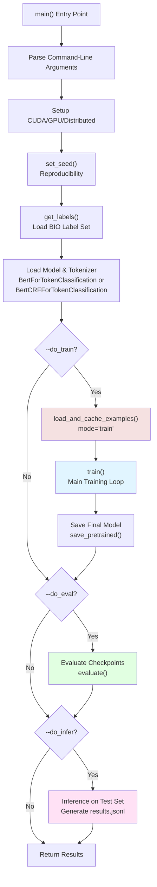
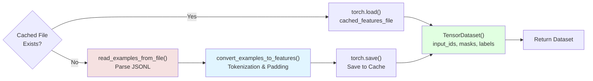
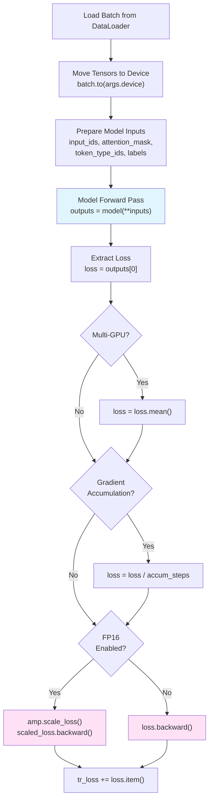
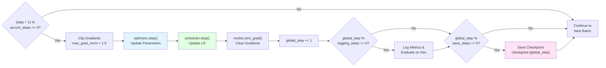
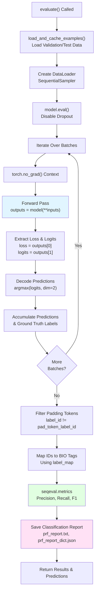
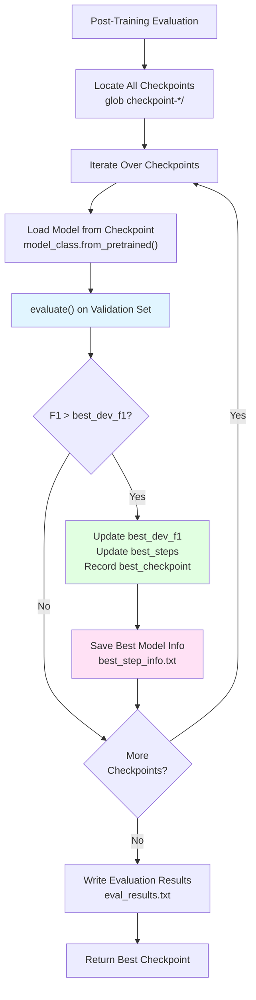

<!-- source: DeepWiki mcp.deepwiki.com · repo thunlp/LEVEN · page 6.2 BERT Training · fetched 2026-11-02 -->

# BERT Training

<details>
<summary>Relevant source files</summary>

The following files were used as context for generating this wiki page:

- [Baselines/BERT/run_leven.py](Baselines/BERT/run_leven.py)
- [Baselines/BERT/run_train.sh](Baselines/BERT/run_train.sh)
- [Baselines/BERT/utils_leven.py](Baselines/BERT/utils_leven.py)

</details>


This page documents the training procedures for the BERT baseline implementation in the LEVEN repository. It covers the training pipeline, configuration options, optimization strategy, checkpoint management, and advanced features such as distributed training and mixed precision.

For information about the BERT model architecture, see [BERT Architecture](#6.1). For inference procedures, see [BERT Inference](#6.3). For data processing utilities, see [BERT Data Utilities](#6.4). For comparison with the BERT+CRF baseline training, see [BERT+CRF Training](#5.2).

## Overview

The BERT baseline training system uses the `run_leven.py` script as its primary entry point, which orchestrates data loading, model training, periodic evaluation, and checkpoint management. The training process supports both standard BERT token classification (`BertForTokenClassification`) and BERT with CRF decoding (`BertCRFForTokenClassification`), selectable via the `--model_type` parameter.

The training implementation leverages HuggingFace Transformers and PyTorch, with support for advanced features including gradient accumulation, distributed training, and mixed precision (FP16) computation.

**Sources:** [Baselines/BERT/run_leven.py:1-753]()

## Training Configuration

### Command-Line Arguments

The training script accepts configuration through command-line arguments parsed in the `main()` function. Key training parameters are organized into several categories:

| Parameter Category | Key Arguments | Default Values |
|-------------------|---------------|----------------|
| **Model Selection** | `--model_type`, `--model_name_or_path` | Required, `./bert-base-chinese` |
| **Data Paths** | `--data_dir`, `--output_dir` | `./data`, `./saved` |
| **Training Control** | `--do_train`, `--do_eval`, `--do_infer` | Action flags |
| **Batch Sizes** | `--per_gpu_train_batch_size`, `--per_gpu_eval_batch_size` | 8, 8 |
| **Optimization** | `--learning_rate`, `--weight_decay`, `--adam_epsilon` | 5e-5, 0.0, 1e-8 |
| **Training Duration** | `--num_train_epochs`, `--max_steps` | 1.0, -1 |
| **Checkpointing** | `--save_steps`, `--logging_steps` | 500, 1000 |
| **Gradient Control** | `--gradient_accumulation_steps`, `--max_grad_norm` | 2, 1.0 |
| **Advanced Features** | `--fp16`, `--local_rank`, `--warmup_steps` | False, -1, 0 |

**Sources:** [Baselines/BERT/run_leven.py:474-558]()

### Shell Script Configuration

The `run_train.sh` script provides a convenient wrapper with pre-configured training parameters:

```bash
CUDA_VISIBLE_DEVICES=0,1,2,3 python run_leven.py \
    --data_dir ./data \
    --model_type bert \
    --output_dir ./saved \
    --max_seq_length 512 \
    --per_gpu_train_batch_size 8 \
    --per_gpu_eval_batch_size 4 \
    --gradient_accumulation_steps 2 \
    --learning_rate 5e-5 \
    --num_train_epochs 4 \
    --save_steps 100 \
    --logging_steps 100 \
    --seed 100 \
    --do_train \
    --do_eval \
    --eval_all_checkpoints \
    --overwrite_output_dir
```

This configuration trains for 4 epochs with 4 GPUs, effective batch size of 64 (8 per GPU × 4 GPUs × 2 accumulation steps), and evaluates all saved checkpoints after training.

**Sources:** [Baselines/BERT/run_train.sh:1-17]()

## Training Pipeline Architecture



**Sources:** [Baselines/BERT/run_leven.py:472-752]()

## Data Loading and Caching

### Data Loading Function

The `load_and_cache_examples()` function implements efficient data loading with feature caching:



The cached feature filename format is: `cached_{mode}_{model_name}_{max_seq_length}`, where mode is "train", "valid", or "test".

**Key Implementation Details:**

- **Distributed Barrier:** Uses `torch.distributed.barrier()` to synchronize cache creation across distributed processes [Baselines/BERT/run_leven.py:425-426]()
- **Feature Conversion:** Calls `convert_examples_to_features()` from `utils_leven.py` to tokenize text and create model inputs [Baselines/BERT/run_leven.py:441-454]()
- **Tensor Creation:** Converts features to PyTorch tensors (input_ids, attention_mask, token_type_ids, label_ids) [Baselines/BERT/run_leven.py:463-466]()
- **Cache Overwrite:** Respects `--overwrite_cache` flag to force feature regeneration [Baselines/BERT/run_leven.py:435]()

**Sources:** [Baselines/BERT/run_leven.py:424-469](), [Baselines/BERT/utils_leven.py:299-436]()

## Training Function Architecture

### Training Loop Overview

```mermaid
stateDiagram-v2
    [*] --> PrepareDataLoader
    PrepareDataLoader --> CalculateTotalSteps
    CalculateTotalSteps --> InitializeOptimizer
    InitializeOptimizer --> SetupFP16
    SetupFP16 --> SetupMultiGPU
    SetupMultiGPU --> SetupDistributed
    
    SetupDistributed --> EpochLoop
    
    state EpochLoop {
        [*] --> BatchIteration
        
        state BatchIteration {
            [*] --> ForwardPass
            ForwardPass --> ComputeLoss
            ComputeLoss --> ScaleLoss
            ScaleLoss --> Backward
            Backward --> AccumulateGradients
            
            state AccumulateGradients <<choice>>
            AccumulateGradients --> ClipGradients: step % accum_steps == 0
            AccumulateGradients --> ForwardPass: continue
            
            ClipGradients --> OptimizerStep
            OptimizerStep --> SchedulerStep
            SchedulerStep --> ZeroGrad
            
            ZeroGrad --> CheckLogging
            state CheckLogging <<choice>>
            CheckLogging --> EvaluateModel: global_step % logging_steps == 0
            CheckLogging --> CheckSaving: else
            
            EvaluateModel --> UpdateBestModel
            UpdateBestModel --> CheckSaving
            
            state CheckSaving <<choice>>
            CheckSaving --> SaveCheckpoint: global_step % save_steps == 0
            CheckSaving --> ForwardPass: continue
            
            SaveCheckpoint --> ForwardPass
        }
        
        BatchIteration --> CheckMaxSteps
        state CheckMaxSteps <<choice>>
        CheckMaxSteps --> [*]: max_steps reached
        CheckMaxSteps --> BatchIteration: continue
    }
    
    EpochLoop --> ReturnMetrics
    ReturnMetrics --> [*]
```



**Sources:** [Baselines/BERT/run_leven.py:184-331]()

### Optimizer and Scheduler Setup

The training function initializes the AdamW optimizer with weight decay and a linear warmup scheduler:

**Optimizer Configuration:**

```python
# Parameter grouping for weight decay
no_decay = ["bias", "LayerNorm.weight"]
optimizer_grouped_parameters = [
    {
        "params": [p for n, p in model.named_parameters() 
                   if not any(nd in n for nd in no_decay)],
        "weight_decay": args.weight_decay  # Default: 0.0
    },
    {
        "params": [p for n, p in model.named_parameters() 
                   if any(nd in n for nd in no_decay)],
        "weight_decay": 0.0
    }
]

optimizer = AdamW(optimizer_grouped_parameters, 
                  lr=args.learning_rate,  # Default: 5e-5
                  eps=args.adam_epsilon)  # Default: 1e-8
```

**Learning Rate Scheduler:**

The linear warmup scheduler gradually increases the learning rate from 0 to the target learning rate during the warmup phase, then linearly decreases it to 0:

- **Warmup Steps:** Controlled by `--warmup_steps` (default: 0)
- **Total Steps:** Computed based on `num_train_epochs` and dataset size
- **Schedule Type:** Linear decay after warmup

**Sources:** [Baselines/BERT/run_leven.py:198-208]()

## Training Loop Execution

### Batch Processing

The training loop processes batches with the following structure:



**Input Dictionary Structure:**

The model inputs dictionary varies based on model type:

| Key | Description | Required |
|-----|-------------|----------|
| `input_ids` | Token IDs from batch[0] | Always |
| `attention_mask` | Attention mask from batch[1] | Always |
| `token_type_ids` | Segment IDs from batch[2] | Not for DistilBERT |
| `labels` | Gold labels from batch[3] | Always |

**Sources:** [Baselines/BERT/run_leven.py:247-269]()

### Gradient Update Step

After gradient accumulation, the optimizer performs an update step:



**Sources:** [Baselines/BERT/run_leven.py:272-323]()

## Evaluation During Training

### Periodic Evaluation

When `--evaluate_during_training` is enabled, the model is evaluated on the validation set at intervals defined by `--logging_steps`:

**Evaluation Process:**

1. **Model Evaluation:** Calls `evaluate(args, model, tokenizer, labels, pad_token_label_id, mode="valid")`
2. **Metric Extraction:** Retrieves F1-micro score from results
3. **Best Model Tracking:** Compares current F1 with `best_dev_f1`
4. **Best Checkpoint Update:** Records `best_steps` when F1 improves
5. **Logging:** Outputs precision, recall, and F1 to logger

**Metrics Computed:**

- **Micro-averaged:** Precision, Recall, F1 (used for model selection)
- **Macro-averaged:** Precision, Recall, F1

The micro F1 score (`f1-micro`) is used as the primary metric for selecting the best checkpoint.

**Sources:** [Baselines/BERT/run_leven.py:285-305]()

### Evaluation Function Details

The `evaluate()` function implements model evaluation with the following components:



**Sources:** [Baselines/BERT/run_leven.py:334-421]()

## Checkpoint Management

### Checkpoint Saving Strategy

Checkpoints are saved at regular intervals defined by `--save_steps`:

**Checkpoint Contents:**

Each checkpoint directory contains:

| File | Description |
|------|-------------|
| `pytorch_model.bin` | Model weights |
| `config.json` | Model configuration |
| `vocab.txt` | Tokenizer vocabulary |
| `optimizer.pt` | Optimizer state |
| `scheduler.pt` | Scheduler state |
| `training_args.bin` | Training arguments |

**Directory Structure:**

```
output_dir/
├── checkpoint-100/
│   ├── pytorch_model.bin
│   ├── config.json
│   ├── vocab.txt
│   ├── optimizer.pt
│   └── scheduler.pt
├── checkpoint-200/
│   └── ...
└── (final model files)
```

**Sources:** [Baselines/BERT/run_leven.py:307-323](), [Baselines/BERT/run_leven.py:644-660]()

### Best Model Selection

During post-training evaluation (when `--do_eval` is enabled), the system evaluates all checkpoints if `--eval_all_checkpoints` is specified:



The best checkpoint information is saved to `./saved/best_step_info.txt` with the following structure:

```json
{
    "best_checkpoint": "checkpoint-1500",
    "p-micro": 0.8234,
    "r-micro": 0.8156,
    "f1-micro": 0.8195,
    "p-marco": 0.7892,
    "r-marco": 0.7834,
    "f1-macro": 0.7863
}
```

**Sources:** [Baselines/BERT/run_leven.py:666-708]()

## Distributed Training Support

### Multi-GPU Configuration

The training script supports three execution modes:

**1. Single-GPU Training:**
```bash
CUDA_VISIBLE_DEVICES=0 python run_leven.py --model_type bert --do_train
```

**2. Data Parallel (Multi-GPU, Single Node):**
```bash
CUDA_VISIBLE_DEVICES=0,1,2,3 python run_leven.py --model_type bert --do_train
```
- Uses `torch.nn.DataParallel` automatically when `args.n_gpu > 1`
- Replicates model across GPUs, splits batch data
- Averages gradients and loss across GPUs

**3. Distributed Data Parallel (Multi-GPU, Multi-Node):**
```bash
python -m torch.distributed.launch --nproc_per_node=4 run_leven.py \
    --model_type bert --do_train --local_rank 0
```
- Uses `torch.nn.parallel.DistributedDataParallel`
- More efficient than DataParallel
- Requires `--local_rank` parameter

**Sources:** [Baselines/BERT/run_leven.py:216-224](), [Baselines/BERT/run_leven.py:574-584]()

### Distributed Sampler

When using distributed training (`args.local_rank != -1`), the data loader uses `DistributedSampler` instead of `RandomSampler`:

```python
train_sampler = RandomSampler(train_dataset) if args.local_rank == -1 \
                else DistributedSampler(train_dataset)
train_dataloader = DataLoader(train_dataset, 
                              sampler=train_sampler, 
                              batch_size=args.train_batch_size)
```

The `DistributedSampler` ensures each process gets a unique subset of the training data without overlap, enabling efficient distributed training.

**Sources:** [Baselines/BERT/run_leven.py:186-188]()

## Advanced Training Features

### Mixed Precision Training (FP16)

When `--fp16` is enabled, the training uses NVIDIA Apex for automatic mixed precision:

**Setup:**
```python
from apex import amp
model, optimizer = amp.initialize(model, optimizer, 
                                  opt_level=args.fp16_opt_level)
```

**Backward Pass:**
```python
with amp.scale_loss(loss, optimizer) as scaled_loss:
    scaled_loss.backward()
```

**Gradient Clipping:**
```python
torch.nn.utils.clip_grad_norm_(amp.master_params(optimizer), 
                               args.max_grad_norm)
```

**Benefits:**
- Reduced memory usage (approximately 50%)
- Faster training (1.5-2x speedup on modern GPUs)
- Maintained model accuracy through loss scaling

**Optimization Levels:**
- `O1` (default): Mixed precision (recommended)
- `O2`: Almost FP16, more aggressive
- `O3`: Full FP16

**Sources:** [Baselines/BERT/run_leven.py:209-214](), [Baselines/BERT/run_leven.py:265-267](), [Baselines/BERT/run_leven.py:273-274]()

### Gradient Accumulation

Gradient accumulation enables training with larger effective batch sizes without increasing memory requirements:

**Configuration:**
- `--gradient_accumulation_steps`: Number of forward passes before optimizer step (default: 2)
- Effective batch size = `per_gpu_batch_size × n_gpu × gradient_accumulation_steps`

**Implementation:**

```python
if args.gradient_accumulation_steps > 1:
    loss = loss / args.gradient_accumulation_steps

# ... backward pass ...

if (step + 1) % args.gradient_accumulation_steps == 0:
    # Perform optimizer step only after accumulating gradients
    optimizer.step()
    scheduler.step()
    model.zero_grad()
    global_step += 1
```

With the default shell script configuration:
- Per-GPU batch size: 8
- Number of GPUs: 4
- Accumulation steps: 2
- **Effective batch size: 64**

**Sources:** [Baselines/BERT/run_leven.py:262-263](), [Baselines/BERT/run_leven.py:272-281]()

### Gradient Clipping

Gradient norms are clipped to prevent exploding gradients:

```python
torch.nn.utils.clip_grad_norm_(model.parameters(), args.max_grad_norm)
```

- **Default max_grad_norm:** 1.0
- **Purpose:** Stabilize training, especially with CRF layers
- **Applied:** After backward pass, before optimizer step

**Sources:** [Baselines/BERT/run_leven.py:276]()

### Reproducibility

The training script ensures reproducibility through the `set_seed()` function:

```python
def set_seed(args):
    random.seed(args.seed)
    np.random.seed(args.seed)
    torch.manual_seed(args.seed)
    if args.n_gpu > 0:
        torch.cuda.manual_seed_all(args.seed)
```

The seed is set:
1. At initialization (before model loading)
2. At the start of each training epoch

**Default seed:** 42 (can be overridden with `--seed`)

**Sources:** [Baselines/BERT/run_leven.py:176-181](), [Baselines/BERT/run_leven.py:243](), [Baselines/BERT/run_leven.py:600]()

## Training Metrics and Logging

### Logging Configuration

The training script uses Python's logging module with configurable verbosity:

**Log Levels:**
- `logging.INFO`: For primary process (`local_rank` in [-1, 0])
- `logging.WARN`: For distributed worker processes

**Logged Information:**

At training start:
- Number of training examples
- Number of epochs
- Batch size per GPU
- Total batch size (with distributed and accumulation)
- Gradient accumulation steps
- Total optimization steps

During training:
- Loss values (every `logging_steps`)
- Validation metrics (when `evaluate_during_training` enabled)
- Best checkpoint information
- Checkpoint save confirmations

**Sources:** [Baselines/BERT/run_leven.py:589-597](), [Baselines/BERT/run_leven.py:227-235]()

### Performance Reports

The evaluation function generates detailed classification reports:

**Report Files:**

1. **`prf_report.txt`**: Human-readable classification report with per-label precision, recall, and F1
2. **`prf_report_dict.json`**: Structured JSON format for programmatic access
3. **`best_step_info.txt`**: Best checkpoint metadata with overall metrics
4. **`eval_results.txt`**: Complete evaluation results for all checkpoints

**Metrics Computed:**

```python
results = {
    "p-micro": seqeval.precision_score(labels, preds, average='micro'),
    "r-micro": seqeval.recall_score(labels, preds, average='micro'),
    "f1-micro": seqeval.f1_score(labels, preds, average='micro'),
    "p-marco": seqeval.precision_score(labels, preds, average='macro'),
    "r-marco": seqeval.recall_score(labels, preds, average='macro'),
    "f1-macro": seqeval.f1_score(labels, preds, average='macro')
}
```

The `seqeval` library is used for sequence labeling evaluation, which correctly handles BIO tagging schemes.

**Sources:** [Baselines/BERT/run_leven.py:396-420]()

## Training Workflow Summary

The complete training workflow integrates all components:

```mermaid
graph TB
    subgraph "Initialization Phase"
        Args["Parse Arguments"] --> Device["Setup Device & GPU"]
        Device --> Seed["Set Random Seed"]
        Seed --> Labels["Load BIO Label Set<br/>get_labels()"]
        Labels --> LoadModel["Load Pre-trained Model<br/>BertForTokenClassification"]
    end
    
    subgraph "Training Phase"
        LoadModel --> LoadTrain["Load Training Dataset<br/>load_and_cache_examples()"]
        LoadTrain --> CreateLoader["Create DataLoader<br/>RandomSampler or DistributedSampler"]
        CreateLoader --> InitOpt["Initialize AdamW Optimizer<br/>Linear Warmup Scheduler"]
        InitOpt --> SetupFP16["Setup FP16 (Optional)<br/>amp.initialize()"]
        SetupFP16 --> SetupDDP["Setup Multi-GPU<br/>DataParallel or DistributedDataParallel"]
        
        SetupDDP --> EpochLoop["For Each Epoch"]
        EpochLoop --> BatchLoop["For Each Batch"]
        BatchLoop --> Forward["Forward Pass<br/>Compute Loss"]
        Forward --> Backward["Backward Pass<br/>Gradient Accumulation"]
        Backward --> OptStep["Optimizer Step<br/>Every N Accumulation Steps"]
        OptStep --> EvalCheck{"Logging<br/>Step?"}
        EvalCheck -->|Yes| ValEval["Evaluate on Dev Set<br/>Track Best F1"]
        EvalCheck -->|No| SaveCheck
        ValEval --> SaveCheck{"Save<br/>Step?"}
        SaveCheck -->|Yes| SaveCkpt["Save Checkpoint<br/>checkpoint-{step}/"]
        SaveCheck -->|No| NextBatch
        SaveCkpt --> NextBatch{"More<br/>Batches?"}
        NextBatch -->|Yes| BatchLoop
        NextBatch -->|No| NextEpoch{"More<br/>Epochs?"}
        NextEpoch -->|Yes| EpochLoop
        NextEpoch -->|No| SaveFinal
        
        SaveFinal["Save Final Model<br/>output_dir/"] --> TrainEnd["Training Complete"]
    end
    
    subgraph "Evaluation Phase (Optional)"
        TrainEnd --> DoEval{"--do_eval?"}
        DoEval -->|Yes| EvalAll["Evaluate All Checkpoints<br/>Select Best by F1"]
        DoEval -->|No| DoInfer
        EvalAll --> WriteBest["Write best_step_info.txt"]
        WriteBest --> DoInfer{"--do_infer?"}
        DoInfer -->|Yes| Inference["Run Inference on Test Set<br/>Generate results.jsonl"]
        DoInfer -->|No| End
        Inference --> End["Complete"]
    end
    
    style Forward fill:#e1f5ff
    style Backward fill:#ffe1f5
    style ValEval fill:#e1ffe1
    style SaveCkpt fill:#fff4e1
```



**Sources:** [Baselines/BERT/run_leven.py:472-752](), [Baselines/BERT/run_leven.py:184-331]()

---

