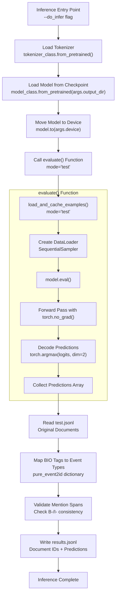
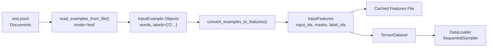
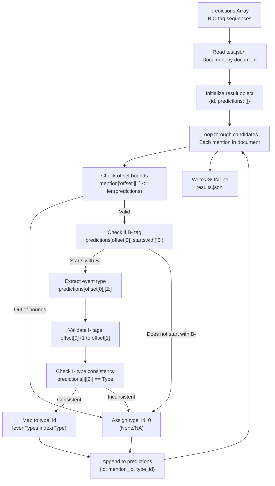
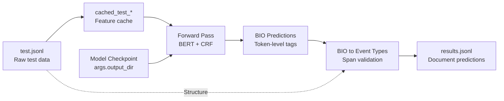

<!-- source: DeepWiki mcp.deepwiki.com · repo thunlp/LEVEN · page 6.3 BERT Inference · fetched 2026-11-02 -->

# BERT Inference

<details>
<summary>Relevant source files</summary>

The following files were used as context for generating this wiki page:

- [Baselines/BERT/run_infer.sh](Baselines/BERT/run_infer.sh)
- [Baselines/BERT/run_leven.py](Baselines/BERT/run_leven.py)
- [Baselines/BERT/utils_leven.py](Baselines/BERT/utils_leven.py)

</details>


This page documents the inference pipeline for the BERT baseline, which generates event type predictions on unlabeled test data. The BERT baseline uses the same model architecture as the BERT+CRF baseline but is run independently. For architecture details, see [BERT Architecture](#6.1). For training procedures, see [BERT Training](#6.2). For the more extensively documented BERT+CRF inference pipeline, see [BERT+CRF Inference](#5.3).

## Overview

The BERT inference pipeline loads a trained model checkpoint, processes test data, generates BIO tag predictions, and converts them to event type IDs in JSONL format for submission. The pipeline reuses the `evaluate` function from the training script but operates on test data where ground truth labels are not available.

**Sources:** [Baselines/BERT/run_leven.py:709-748]()

## Inference Workflow



**Sources:** [Baselines/BERT/run_leven.py:709-748]()

## Command-Line Execution

Inference is triggered by the `run_infer.sh` shell script, which calls `run_leven.py` with the `--do_infer` flag.

### Shell Script Configuration

| Parameter | Value | Description |
|-----------|-------|-------------|
| `--data_dir` | `./data/` | Path to test data directory |
| `--model_type` | `bert` | Model architecture identifier |
| `--output_dir` | `./saved/checkpoint-100` | Checkpoint directory (also output location) |
| `--max_seq_length` | `512` | Maximum sequence length |
| `--do_lower_case` | flag | Enable lowercase tokenization |
| `--per_gpu_eval_batch_size` | `4` | Batch size for inference |
| `--do_infer` | flag | **Activates inference mode** |

**Important:** The comment in `run_infer.sh` warns to delete cached feature files before inference to prevent data shuffling issues [Baselines/BERT/run_infer.sh:2]().

**Sources:** [Baselines/BERT/run_infer.sh:1-15]()

## Model and Tokenizer Loading

The inference pipeline begins by loading the tokenizer and model from the specified checkpoint directory.

### Tokenizer Loading

```python
# Load tokenizer from checkpoint or pretrained path
tokenizer = tokenizer_class.from_pretrained(
    args.tokenizer_name if args.tokenizer_name else args.model_name_or_path, 
    do_lower_case=args.do_lower_case
)
```

**Sources:** [Baselines/BERT/run_leven.py:710-711]()

### Model Loading

```python
# Load model from output_dir (checkpoint directory)
model = model_class.from_pretrained(args.output_dir)
model.to(args.device)
```

The model is loaded from `args.output_dir`, which points to the trained checkpoint directory (e.g., `./saved/checkpoint-100`). The model is then moved to the appropriate device (CPU or GPU).

**Sources:** [Baselines/BERT/run_leven.py:712-713]()

## Prediction Generation

Inference reuses the `evaluate` function, which performs forward passes without gradient computation and returns both evaluation metrics and predictions.

### Evaluate Function Call

```python
result, predictions = evaluate(
    args, 
    model, 
    tokenizer, 
    labels, 
    pad_token_label_id, 
    mode="test"
)
```

**Sources:** [Baselines/BERT/run_leven.py:714]()

### Data Loading and Processing



For test data, labels are initialized to all `"O"` tags since ground truth is not available [Baselines/BERT/utils_leven.py:277]().

**Sources:** [Baselines/BERT/run_leven.py:424-469](), [Baselines/BERT/utils_leven.py:271-296]()

### Forward Pass and Decoding

The evaluation loop performs forward passes in `torch.no_grad()` mode to disable gradient computation:

```python
for batch in tqdm(eval_dataloader, desc="Evaluating"):
    batch = tuple(t.to(args.device) for t in batch)
    
    with torch.no_grad():
        inputs = {
            "input_ids": batch[0],
            "attention_mask": batch[1],
            "labels": batch[3]
        }
        if args.model_type != "distilbert":
            inputs["token_type_ids"] = batch[2]
        outputs = model(**inputs)
        
        tmp_eval_loss = outputs[0]
        logits = outputs[1]
        best_path = torch.argmax(logits, dim=2)  # Decode predictions
```

The `torch.argmax` operation selects the most probable BIO tag for each token position [Baselines/BERT/run_leven.py:368]().

**Sources:** [Baselines/BERT/run_leven.py:355-381]()

## Output Formatting and Event Type Mapping

After generating token-level predictions, the pipeline converts them to document-level event type predictions in JSONL format.

### Prediction Mapping Pipeline



**Sources:** [Baselines/BERT/run_leven.py:716-746]()

### Event Type Mapping Logic

The conversion from BIO tags to event type IDs involves several validation steps:

1. **Boundary Check**: Verify that mention offsets are within the prediction array bounds [Baselines/BERT/run_leven.py:728-732]()
2. **B-tag Check**: Ensure the first token has a `"B-"` prefix, indicating the beginning of an event mention [Baselines/BERT/run_leven.py:733-734]()
3. **Type Extraction**: Extract the event type name (e.g., `"买入"` from `"B-买入"`) [Baselines/BERT/run_leven.py:736]()
4. **Span Validation**: Check that all subsequent tokens have matching `"I-"` tags [Baselines/BERT/run_leven.py:737-740]()
5. **ID Mapping**: Convert the event type name to its numeric ID using `pure_event2id` dictionary [Baselines/BERT/run_leven.py:742]()

If any validation step fails, the mention is assigned `type_id: 0`, representing the `"None"` class [Baselines/BERT/run_leven.py:744]().

### pure_event2id Dictionary

The `pure_event2id` dictionary maps event type names to numeric IDs (0-108):

| Event Type | Type ID | Example Usage |
|------------|---------|---------------|
| `"None"` | 0 | Default for invalid/NA mentions |
| `"明知"` | 1 | Knowledge events |
| `"买入"` | 19 | Purchase events |
| `"盗窃财物"` | 76 | Theft events |
| `"受损"` | 108 | Damage events |

The complete mapping is defined in [Baselines/BERT/run_leven.py:63-173]() with 109 entries total.

**Sources:** [Baselines/BERT/run_leven.py:63-173](), [Baselines/BERT/run_leven.py:719-742]()

### Output File Format

The results are written to `results.jsonl` in the checkpoint directory. Each line represents one document:

```json
{
    "id": "document_id",
    "predictions": [
        {"id": "mention_id_1", "type_id": 19},
        {"id": "mention_id_2", "type_id": 0},
        {"id": "mention_id_3", "type_id": 76}
    ]
}
```

The `Cnt` variable tracks the cumulative sentence count across documents to correctly index into the flattened predictions array [Baselines/BERT/run_leven.py:718-746]().

**Sources:** [Baselines/BERT/run_leven.py:716-746]()

## Key Differences from Training and Evaluation

| Aspect | Training/Evaluation | Inference |
|--------|-------------------|-----------|
| **Labels** | Ground truth from annotations | Initialized to `"O"` tags |
| **Loss Calculation** | Loss computed and backpropagated | Loss computed but not used |
| **Metrics** | Precision, recall, F1 scores | Metrics computed but not meaningful |
| **Output** | Evaluation reports | JSONL predictions file |
| **Data Mode** | `mode="train"` or `"valid"` | `mode="test"` |
| **Gradient Computation** | Enabled during training | Disabled with `torch.no_grad()` |
| **Post-processing** | None | BIO-to-event type conversion |

The `evaluate` function is reused for inference, computing metrics on placeholder labels that are not meaningful. The primary output is the `predictions` array, which undergoes document-level post-processing.

**Sources:** [Baselines/BERT/run_leven.py:334-421](), [Baselines/BERT/run_leven.py:709-748]()

## Error Handling

The inference pipeline includes bounds checking to handle edge cases:

```python
if mention['offset'][1] > len(predictions[Cnt + mention['sent_id']]):
    print(len(doc['content'][mention['sent_id']]['tokens']),
          len(predictions[Cnt + mention['sent_id']]))
    res['predictions'].append({"id": mention['id'], "type_id": 0})
    continue
```

This prevents index errors when mention offsets exceed the prediction array length, assigning `type_id: 0` to such cases [Baselines/BERT/run_leven.py:728-732]().

**Sources:** [Baselines/BERT/run_leven.py:728-732]()

## Data Flow Summary



**Sources:** [Baselines/BERT/run_leven.py:709-748](), [Baselines/BERT/run_leven.py:424-469]()

---

