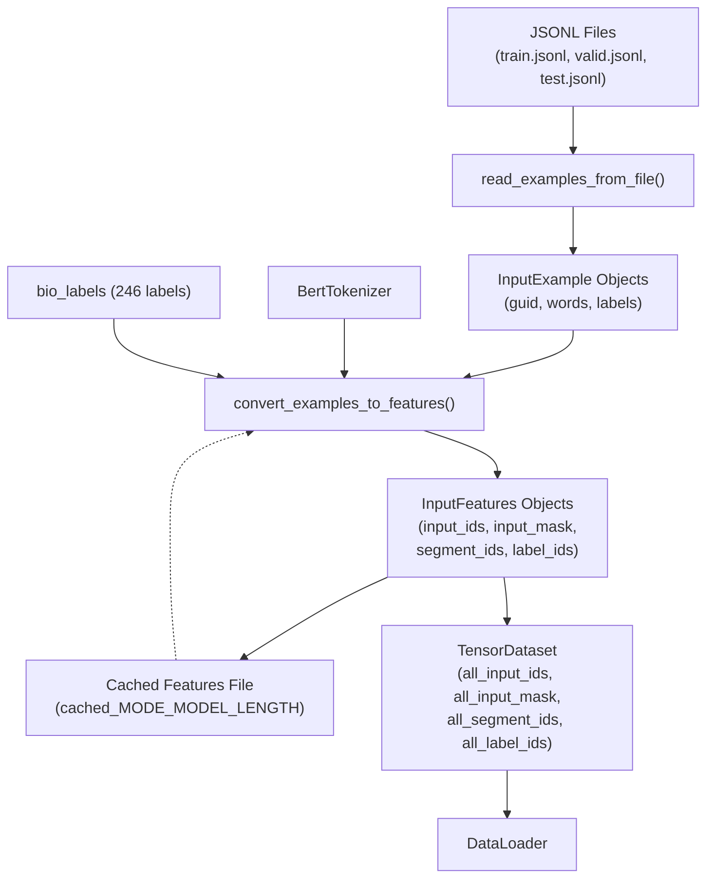
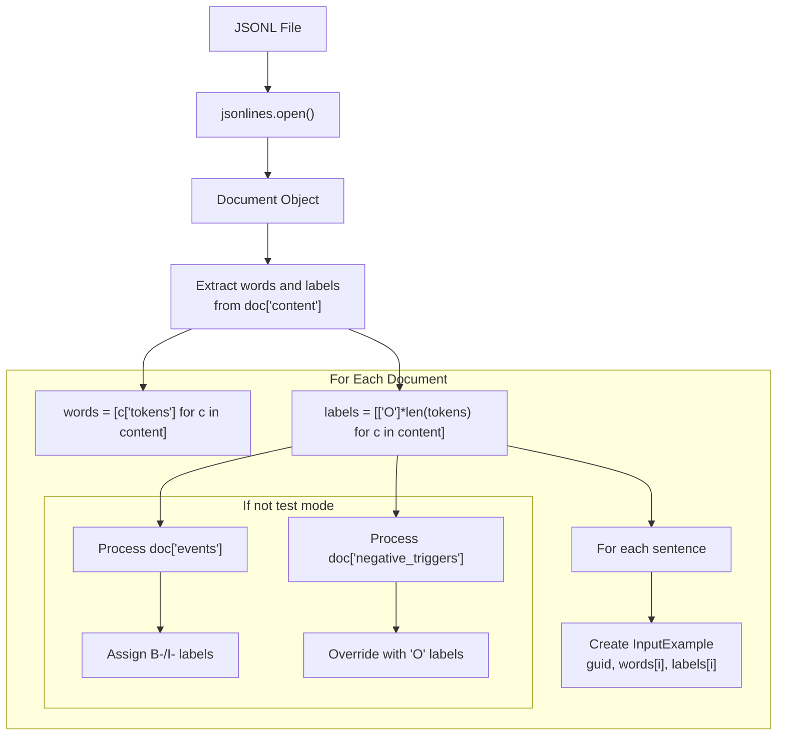
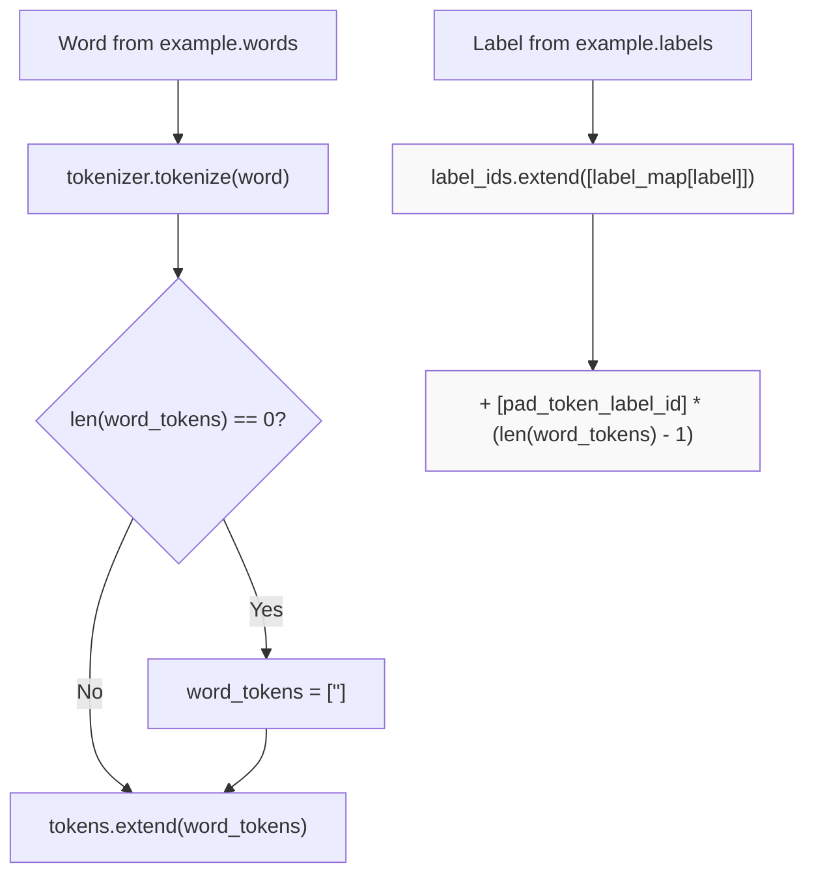
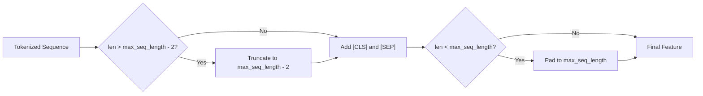
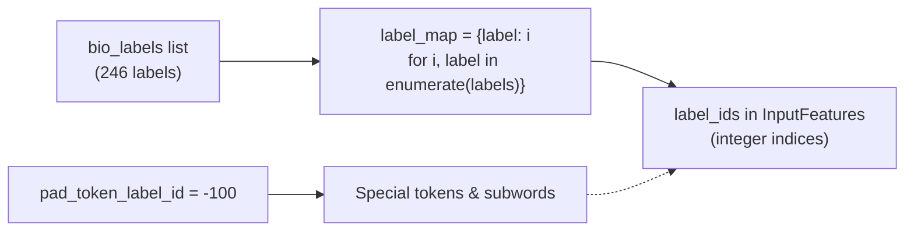
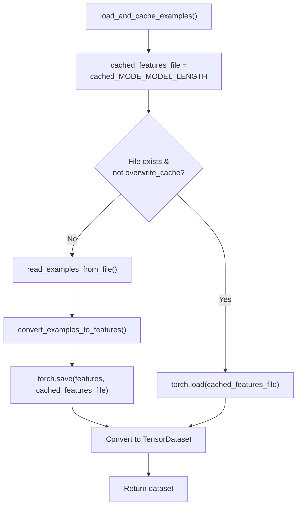
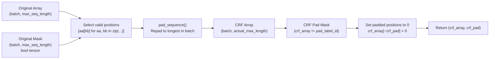
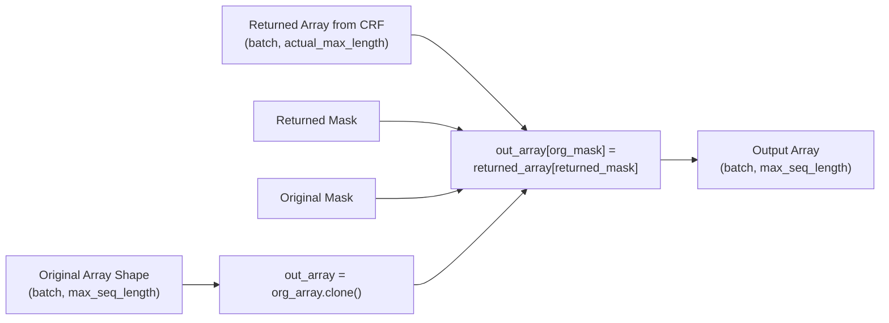
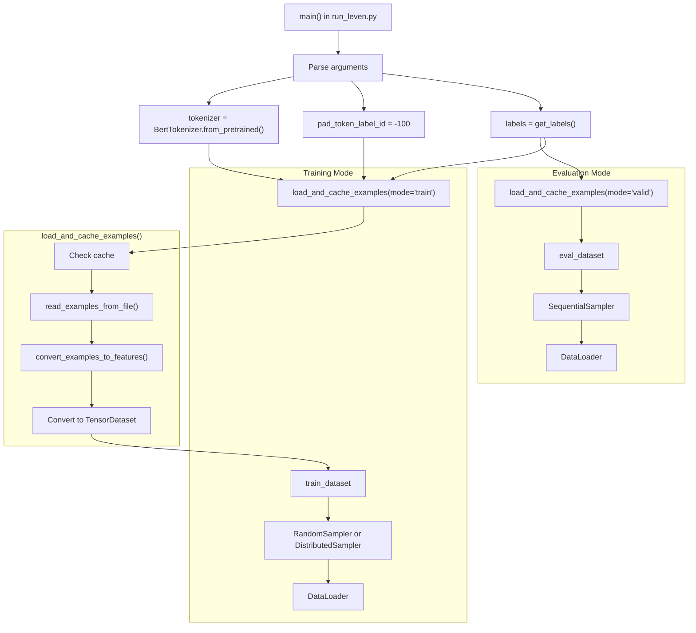

<!-- source: DeepWiki mcp.deepwiki.com · repo thunlp/LEVEN · page 6.4 BERT Data Utilities · fetched 2026-11-02 -->

# BERT Data Utilities

<details>
<summary>Relevant source files</summary>

The following files were used as context for generating this wiki page:

- [Baselines/BERT/run_leven.py](Baselines/BERT/run_leven.py)
- [Baselines/BERT/utils_leven.py](Baselines/BERT/utils_leven.py)

</details>


## Purpose and Scope

This document describes the data processing utilities for the BERT baseline implementation. These utilities handle the transformation of raw JSONL data into tensor features suitable for training and inference with the BERT model.

For information about the BERT+CRF baseline's data utilities, which share a similar structure but are used in a different baseline, see [BERT+CRF Data Utilities](#5.4). For the overall BERT baseline architecture, see [BERT Architecture](#6.1).

**Sources:** [Baselines/BERT/utils_leven.py:1-457](), [Baselines/BERT/run_leven.py:1-753]()

## Data Processing Overview

The BERT data utilities implement a multi-stage pipeline that transforms raw JSONL documents into PyTorch tensors. The pipeline handles BIO tagging, BERT tokenization, sequence padding, and feature caching.



**Sources:** [Baselines/BERT/utils_leven.py:271-296](), [Baselines/BERT/utils_leven.py:299-436](), [Baselines/BERT/run_leven.py:424-469]()

## Data Structures

### InputExample

The `InputExample` class represents a single sequence (one sentence from a document) with its token-level labels.

| Attribute | Type | Description |
|-----------|------|-------------|
| `guid` | str | Unique identifier in format `{mode}-{doc_id}-{sent_idx}` |
| `words` | List[str] | List of tokens/words in the sentence |
| `labels` | List[str] | List of BIO labels, one per token |

**Sources:** [Baselines/BERT/utils_leven.py:249-258]()

### InputFeatures

The `InputFeatures` class represents the tokenized and padded features ready for model input.

| Attribute | Type | Description |
|-----------|------|-------------|
| `input_ids` | List[int] | Token IDs including [CLS] and [SEP], padded to `max_seq_length` |
| `input_mask` | List[int] | Attention mask (1 for real tokens, 0 for padding) |
| `segment_ids` | List[int] | Segment IDs (all 0 for single sequences) |
| `label_ids` | List[int] | Label IDs with padding label -100 for special tokens |

**Sources:** [Baselines/BERT/utils_leven.py:261-268]()

## Reading JSONL Data

The `read_examples_from_file()` function parses JSONL files and creates `InputExample` objects.



### Key Logic

1. **Sentence-level Examples**: Each sentence in a document becomes a separate `InputExample` [Baselines/BERT/utils_leven.py:291-294]()
2. **BIO Label Assignment**: For training/validation, event mentions are tagged with B-{type} at the start and I-{type} for continuation tokens [Baselines/BERT/utils_leven.py:280-284]()
3. **Negative Triggers**: Explicitly marked as "O" to prevent false positives [Baselines/BERT/utils_leven.py:286-289]()
4. **Test Mode**: Labels remain all "O" when `mode == 'test'` [Baselines/BERT/utils_leven.py:279]()

**Sources:** [Baselines/BERT/utils_leven.py:271-296]()

## Feature Conversion and Tokenization

The `convert_examples_to_features()` function transforms `InputExample` objects into `InputFeatures` using BERT tokenization.

### Tokenization Process



**Key Behavior**: Only the first subword token of each word receives the actual label; subsequent subword tokens are assigned `pad_token_label_id` (-100) to exclude them from loss calculation [Baselines/BERT/utils_leven.py:337-343]().

### Special Token Handling

The function adds BERT special tokens following the standard pattern:

```
[CLS] token1 token2 ... tokenN [SEP]
```

| Position | Token | Label ID | Segment ID |
|----------|-------|----------|------------|
| 0 | [CLS] | -100 | 0 |
| 1 to N | Regular tokens | Actual labels / -100 | 0 |
| N+1 | [SEP] | -100 | 0 |
| N+2 to max_seq_length | [PAD] | -100 | 0 |

**Sources:** [Baselines/BERT/utils_leven.py:368-415]()

### Sequence Truncation and Padding



The default `max_seq_length` is 512 [Baselines/BERT/run_leven.py:499](). Sequences exceeding this limit are truncated; shorter sequences are padded [Baselines/BERT/utils_leven.py:346-415]().

**Sources:** [Baselines/BERT/utils_leven.py:299-436]()

## Label Management

### BIO Label Set

The `bio_labels` list defines 246 labels covering:
- 1 "O" label for non-event tokens
- 245 BIO labels (B-{type} and I-{type}) for 109 event types plus additional events

The complete label set is defined in [Baselines/BERT/utils_leven.py:28-246]() and retrieved via `get_labels()` [Baselines/BERT/utils_leven.py:439-440]().

### Label Mapping



**Important**: `pad_token_label_id` (-100) is used for:
- Special tokens ([CLS], [SEP], [PAD])
- Subword tokens beyond the first
- This value is the default `ignore_index` for PyTorch's `CrossEntropyLoss`

**Sources:** [Baselines/BERT/utils_leven.py:28-246](), [Baselines/BERT/utils_leven.py:322-326](), [Baselines/BERT/run_leven.py:602-607]()

## Caching Mechanism

The `load_and_cache_examples()` function in `run_leven.py` implements feature caching to avoid redundant tokenization.



### Cache File Naming

Cache files follow the pattern:
```
cached_{mode}_{model_name}_{max_seq_length}
```

Example: `cached_train_bert-base-chinese_512`

This ensures different configurations use separate caches [Baselines/BERT/run_leven.py:429-434]().

### Cache Invalidation

The cache can be regenerated by setting `--overwrite_cache` flag [Baselines/BERT/run_leven.py:435-436]().

**Sources:** [Baselines/BERT/run_leven.py:424-469]()

## CRF Padding Utilities

The BERT baseline includes CRF padding utilities for compatibility with the CRF layer used in the model architecture.

### to_crf_pad Function

Transforms fixed-length padded tensors into variable-length sequences suitable for CRF processing.



**Purpose**: Removes padding from sequences, then re-pads to the longest actual sequence in the batch. This optimizes CRF computation by avoiding unnecessary padding [Baselines/BERT/utils_leven.py:443-450]().

### unpad_crf Function

Reverses the `to_crf_pad` operation, restoring CRF outputs to the original shape.



**Purpose**: Maps CRF predictions back to the original padded format, placing predictions only at valid positions [Baselines/BERT/utils_leven.py:453-456]().

**Sources:** [Baselines/BERT/utils_leven.py:443-456]()

## Integration with Training Pipeline

The data utilities integrate into the training pipeline through `load_and_cache_examples()`.

### Data Loading Flow



### Tensor Conversion

The final step converts `InputFeatures` to PyTorch tensors:

```python
all_input_ids = torch.tensor([f.input_ids for f in features], dtype=torch.long)
all_input_mask = torch.tensor([f.input_mask for f in features], dtype=torch.long)
all_segment_ids = torch.tensor([f.segment_ids for f in features], dtype=torch.long)
all_label_ids = torch.tensor([f.label_ids for f in features], dtype=torch.long)
dataset = TensorDataset(all_input_ids, all_input_mask, all_segment_ids, all_label_ids)
```

This creates a `TensorDataset` where each batch contains four tensors [Baselines/BERT/run_leven.py:463-468]().

**Sources:** [Baselines/BERT/run_leven.py:424-469](), [Baselines/BERT/run_leven.py:637-639]()

## Configuration Parameters

Key parameters controlling the data utilities:

| Parameter | Default | Description |
|-----------|---------|-------------|
| `--data_dir` | `./data` | Directory containing JSONL files |
| `--max_seq_length` | 512 | Maximum sequence length after tokenization |
| `--overwrite_cache` | False | Force regeneration of cached features |
| `--do_lower_case` | False | Whether to lowercase input (not typical for Chinese) |
| `--model_name_or_path` | `./bert-base-chinese` | Path to pretrained BERT model and tokenizer |

**Sources:** [Baselines/BERT/run_leven.py:479-511]()

---

