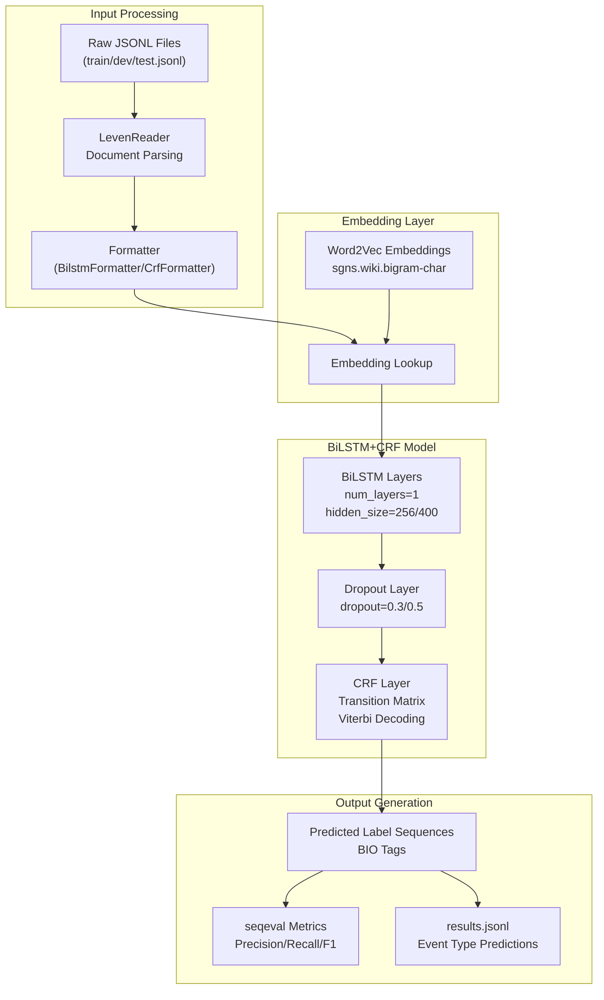
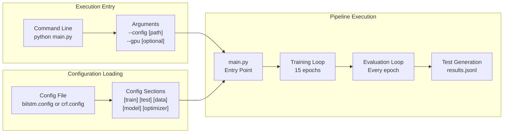
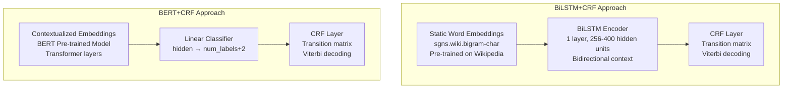

<!-- source: DeepWiki mcp.deepwiki.com · repo thunlp/LEVEN · page 7 BiLSTM+CRF Baseline · fetched 2026-11-02 -->

# BiLSTM+CRF Baseline

<details>
<summary>Relevant source files</summary>

The following files were used as context for generating this wiki page:

- [Baselines/BiLSTM+CRF/README.md](Baselines/BiLSTM+CRF/README.md)
- [Baselines/BiLSTM+CRF/config/bilstm.config](Baselines/BiLSTM+CRF/config/bilstm.config)
- [Baselines/BiLSTM+CRF/config/crf.config](Baselines/BiLSTM+CRF/config/crf.config)

</details>


## Purpose and Scope

This document provides an overview of the BiLSTM+CRF baseline implementation for event detection on the LEVEN dataset. The BiLSTM+CRF baseline represents a traditional neural sequence labeling approach that uses bidirectional Long Short-Term Memory (LSTM) networks combined with Conditional Random Fields (CRF) for structured prediction.

This page covers the architecture, execution workflow, and key characteristics of the BiLSTM+CRF baseline. For detailed configuration parameters, see [BiLSTM+CRF Configuration](#7.1). For data preparation and formatting, see [BiLSTM+CRF Data Formatting](#7.2). For comparison with BERT-based approaches, see [Baselines Comparison](#4).

**Sources:** [Baselines/BiLSTM+CRF/README.md:1-22]()

## Overview

The BiLSTM+CRF baseline implements a traditional neural architecture for sequence labeling that predates transformer-based models. Unlike the BERT+CRF and BERT baselines which rely on pre-trained language models, this baseline uses:

- **Pre-trained word embeddings** (`sgns.wiki.bigram-char`) from Chinese-Word-Vectors trained on Wikipedia_zh with Word+Character+Ngram context features
- **Bidirectional LSTM layers** for encoding sequential context
- **CRF layer** for modeling label dependencies and structured prediction
- **Configuration-based execution** using INI-style config files instead of command-line arguments

The baseline is located in `Baselines/BiLSTM+CRF/` and provides two model variants through different configuration files: `bilstm.config` and `crf.config`.

**Sources:** [Baselines/BiLSTM+CRF/README.md:1-22](), [Baselines/BiLSTM+CRF/config/bilstm.config:1-27](), [Baselines/BiLSTM+CRF/config/crf.config:1-30]()

## Architecture

### High-Level Architecture Diagram



**Sources:** [Baselines/BiLSTM+CRF/config/bilstm.config:18-22](), [Baselines/BiLSTM+CRF/config/crf.config:21-24]()

### Architecture Components

The BiLSTM+CRF architecture consists of the following layers:

| Layer | Component | Configuration (bilstm.config) | Configuration (crf.config) |
|-------|-----------|-------------------------------|----------------------------|
| **Input** | Word Embeddings | `sgns.wiki.bigram-char` | `sgns.wiki.bigram-char` |
| **Encoder** | BiLSTM | `num_layers=1`, `hidden_size=256` | `num_layers=1`, `hidden_size=400` |
| **Regularization** | Dropout | `dropout=0.5` | `dropout=0.3` |
| **Decoder** | CRF | Transition matrix + Viterbi | Transition matrix + Viterbi |
| **Output** | BIO Tags | Via formatter | `BIO=True` |

**Sources:** [Baselines/BiLSTM+CRF/config/bilstm.config:18-22](), [Baselines/BiLSTM+CRF/config/crf.config:21-24]()

## Model Variants

The BiLSTM+CRF baseline provides two configuration variants with different hyperparameters:

### bilstm.config Variant

This variant uses the `BilstmFormatter` and has the following characteristics:

- **Model name:** `Bilstm` [Baselines/BiLSTM+CRF/config/bilstm.config:19]()
- **Batch size:** 200 for both training and testing [Baselines/BiLSTM+CRF/config/bilstm.config:3,9]()
- **Hidden size:** 256 [Baselines/BiLSTM+CRF/config/bilstm.config:21]()
- **Dropout:** 0.5 [Baselines/BiLSTM+CRF/config/bilstm.config:22]()
- **Data formatter:** `BilstmFormatter` with `split_labels=True` [Baselines/BiLSTM+CRF/config/bilstm.config:14,16]()

### crf.config Variant

This variant uses the `CrfFormatter` with explicit CRF-specific settings:

- **Model name:** `Crf` [Baselines/BiLSTM+CRF/config/crf.config:21]()
- **Batch size:** 100 for both training and testing [Baselines/BiLSTM+CRF/config/crf.config:3,9]()
- **Hidden size:** 400 [Baselines/BiLSTM+CRF/config/crf.config:23]()
- **Dropout:** 0.3 [Baselines/BiLSTM+CRF/config/crf.config:24]()
- **Sequence length:** 512 [Baselines/BiLSTM+CRF/config/crf.config:16]()
- **BIO tagging:** Explicitly enabled with `BIO=True` [Baselines/BiLSTM+CRF/config/crf.config:17]()
- **Padding label:** `-100` [Baselines/BiLSTM+CRF/config/crf.config:18]()
- **Data formatter:** `CrfFormatter` [Baselines/BiLSTM+CRF/config/crf.config:14]()

Both variants share common training parameters:
- **Epochs:** 15 [Baselines/BiLSTM+CRF/config/bilstm.config:2](), [Baselines/BiLSTM+CRF/config/crf.config:2]()
- **Optimizer:** Adam with `lr=1e-3`, `weight_decay=1e-8` [Baselines/BiLSTM+CRF/config/bilstm.config:25-27](), [Baselines/BiLSTM+CRF/config/crf.config:27-29]()
- **Validation strategy:** Evaluate every epoch with `save_best` strategy [Baselines/BiLSTM+CRF/config/bilstm.config:5-6](), [Baselines/BiLSTM+CRF/config/crf.config:5-6]()

**Sources:** [Baselines/BiLSTM+CRF/config/bilstm.config:1-27](), [Baselines/BiLSTM+CRF/config/crf.config:1-30]()

## Execution Workflow

### Entry Point and Configuration System



**Sources:** [Baselines/BiLSTM+CRF/README.md:18-21]()

### Workflow Steps

The BiLSTM+CRF baseline follows a unified training-evaluation-testing workflow:

1. **Initialization:**
   - Parse command-line arguments (`--config`, `--gpu`)
   - Load configuration from INI file (e.g., `config/bilstm.config` or `config/crf.config`)
   - Initialize data reader (`LevenReader`) and formatter (`BilstmFormatter` or `CrfFormatter`)
   - Load pre-trained word embeddings from `sgns.wiki.bigram-char`

2. **Training Phase:**
   - Load training data from `raw/train.jsonl`
   - Train for 15 epochs with batch sizes of 100-200
   - Shuffle training data (`shuffle=True`)
   - Output training performance metrics

3. **Validation Phase:**
   - Evaluate on development set every epoch (`valid_interval=1`)
   - Calculate precision, recall, and F1 scores using `seqeval==1.2.2`
   - Save best model based on validation performance (`save_strategy=save_best`)

4. **Testing Phase:**
   - Generate predictions on test set
   - Output results to `results.jsonl` for CodaLab submission

**Sources:** [Baselines/BiLSTM+CRF/README.md:14-21](), [Baselines/BiLSTM+CRF/config/bilstm.config:1-6]()

## Comparison with BERT-based Baselines

### Key Architectural Differences



**Sources:** [Baselines/BiLSTM+CRF/config/bilstm.config:15,19-21]()

| Aspect | BiLSTM+CRF | BERT+CRF / BERT |
|--------|------------|-----------------|
| **Embeddings** | Static word embeddings (`sgns.wiki.bigram-char`) | Contextualized BERT embeddings |
| **Encoder** | BiLSTM (256-400 hidden units, 1 layer) | BERT transformer (12-24 layers) |
| **Configuration** | INI config files (`bilstm.config`, `crf.config`) | Command-line arguments |
| **Entry Point** | `main.py` | `run_leven.py` |
| **Data Formatter** | `BilstmFormatter` or `CrfFormatter` | Custom `convert_examples_to_features` |
| **Dependencies** | `torch==1.6`, basic libraries | HuggingFace Transformers |
| **Batch Size** | 100-200 | Typically smaller (due to BERT size) |
| **Training Speed** | Faster (smaller model) | Slower (larger model) |
| **Memory Requirements** | Lower | Higher |

**Sources:** [Baselines/BiLSTM+CRF/README.md:4-10](), [Baselines/BiLSTM+CRF/config/bilstm.config:1-27]()

## Key Components

The BiLSTM+CRF baseline is organized around the following key components:

### Data Pipeline Components

| Component | Description | Reference |
|-----------|-------------|-----------|
| `LevenReader` | Reads and parses JSONL files from the LEVEN dataset | [Baselines/BiLSTM+CRF/config/bilstm.config:13]() |
| `BilstmFormatter` | Formats data for BiLSTM model variant | [Baselines/BiLSTM+CRF/config/bilstm.config:14]() |
| `CrfFormatter` | Formats data for CRF model variant with sequence padding | [Baselines/BiLSTM+CRF/config/crf.config:14]() |
| `sgns.wiki.bigram-char` | Pre-trained word embeddings file | [Baselines/BiLSTM+CRF/config/bilstm.config:15]() |

### Model Components

| Component | Description | Configuration |
|-----------|-------------|---------------|
| `Bilstm` | BiLSTM model variant | [Baselines/BiLSTM+CRF/config/bilstm.config:19]() |
| `Crf` | CRF model variant with explicit BIO tagging | [Baselines/BiLSTM+CRF/config/crf.config:21]() |

### Training Components

| Component | Description | Value |
|-----------|-------------|-------|
| `Adam` optimizer | Optimization algorithm | `lr=1e-3`, `weight_decay=1e-8` |
| `valid_interval` | Validation frequency | Every 1 epoch |
| `save_strategy` | Checkpoint strategy | `save_best` |

For detailed documentation of configuration parameters, see [BiLSTM+CRF Configuration](#7.1). For data formatting and preparation details, see [BiLSTM+CRF Data Formatting](#7.2).

**Sources:** [Baselines/BiLSTM+CRF/config/bilstm.config:1-27](), [Baselines/BiLSTM+CRF/config/crf.config:1-30]()

## Requirements and Dependencies

The BiLSTM+CRF baseline has minimal dependencies compared to the BERT-based baselines:

```
torch==1.6
numpy
sklearn
seqeval==1.2.2
tqdm==4.44.0
```

**External Resources:**

1. **LEVEN Dataset:** Raw JSONL files (`train.jsonl`, `dev.jsonl`, `test.jsonl`) must be placed in `./raw/`
2. **Word Embeddings:** Pre-trained embeddings from [Chinese-Word-Vectors](https://github.com/Embedding/Chinese-Word-Vectors) must be downloaded and placed in `./raw/`
   - Specifically: Wikipedia_zh with Word+Character+Ngram context features
   - Filename: `sgns.wiki.bigram-char`

**Sources:** [Baselines/BiLSTM+CRF/README.md:4-16]()

## Usage

To execute the BiLSTM+CRF baseline:

```bash
python main.py --config [path/to/config] --gpu [gpu_id]
```

**Examples:**

```bash
# Run BiLSTM variant
python main.py --config config/bilstm.config --gpu 0

# Run CRF variant
python main.py --config config/crf.config --gpu 1
```

The execution will:
- Train the model for 15 epochs
- Evaluate on the development set every epoch
- Output training and evaluation performance metrics
- Generate test predictions in `results.jsonl` format for CodaLab submission

All hyperparameters are controlled through the configuration files in `config/` and can be modified as needed. See [BiLSTM+CRF Configuration](#7.1) for detailed parameter descriptions.

**Sources:** [Baselines/BiLSTM+CRF/README.md:18-21]()

---

