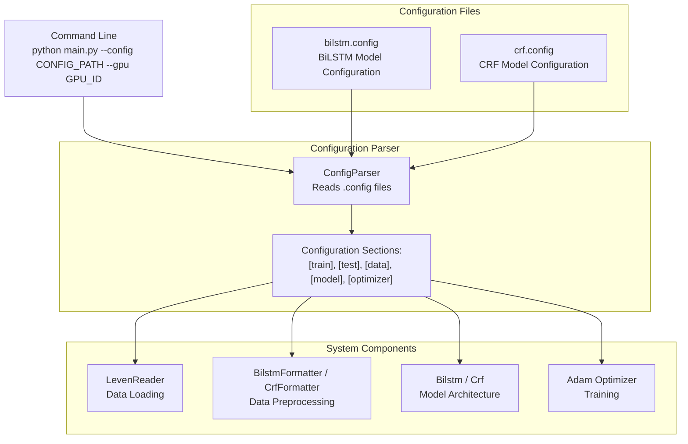
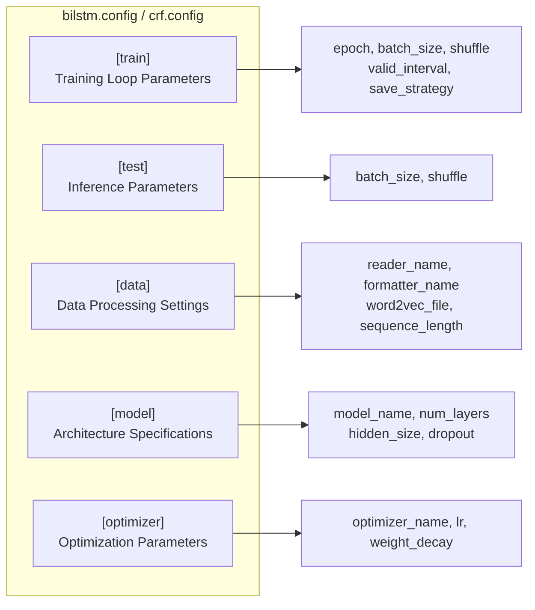
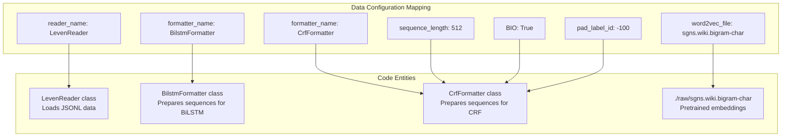
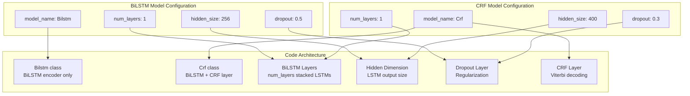

<!-- source: DeepWiki mcp.deepwiki.com · repo thunlp/LEVEN · page 7.1 BiLSTM+CRF Configuration · fetched 2026-11-02 -->

# BiLSTM+CRF Configuration

<details>
<summary>Relevant source files</summary>

The following files were used as context for generating this wiki page:

- [Baselines/BiLSTM+CRF/README.md](Baselines/BiLSTM+CRF/README.md)
- [Baselines/BiLSTM+CRF/config/bilstm.config](Baselines/BiLSTM+CRF/config/bilstm.config)
- [Baselines/BiLSTM+CRF/config/crf.config](Baselines/BiLSTM+CRF/config/crf.config)

</details>


This document explains the configuration system for the BiLSTM+CRF baseline implementation. Unlike the BERT-based baselines which use command-line arguments, the BiLSTM+CRF system uses configuration files to specify training parameters, model architecture, data processing settings, and optimizer configurations.

For information about the BiLSTM+CRF architecture and model components, see [BiLSTM+CRF Baseline](#7). For data formatting and preparation, see [BiLSTM+CRF Data Formatting](#7.2).

## Configuration System Overview

The BiLSTM+CRF baseline uses a file-based configuration system where all hyperparameters are stored in `.config` files located in `Baselines/BiLSTM+CRF/config/`. The main entry point [Baselines/BiLSTM+CRF/main.py]() accepts a `--config` argument to specify which configuration file to use.



**Configuration File Selection Flow**

Sources: [Baselines/BiLSTM+CRF/README.md:18](), [Baselines/BiLSTM+CRF/config/bilstm.config:1-27](), [Baselines/BiLSTM+CRF/config/crf.config:1-29]()

## Configuration File Structure

Both configuration files follow the INI file format with five main sections:



**Configuration Section Organization**

Sources: [Baselines/BiLSTM+CRF/config/bilstm.config:1-27](), [Baselines/BiLSTM+CRF/config/crf.config:1-29]()

## Training Configuration

The `[train]` section controls the training loop behavior and checkpoint management.

| Parameter | BiLSTM Value | CRF Value | Description |
|-----------|-------------|-----------|-------------|
| `epoch` | `15` | `15` | Number of training epochs |
| `batch_size` | `200` | `100` | Training batch size (CRF uses smaller batches due to computational complexity) |
| `shuffle` | `True` | `True` | Whether to shuffle training data each epoch |
| `valid_interval` | `1` | `1` | Evaluate on validation set every N epochs |
| `save_strategy` | `save_best` | `save_best` | Checkpoint saving strategy (saves model with best validation performance) |

The CRF model uses a smaller batch size (`100` vs `200`) because CRF inference is computationally expensive compared to the BiLSTM-only model.

Sources: [Baselines/BiLSTM+CRF/config/bilstm.config:1-6](), [Baselines/BiLSTM+CRF/config/crf.config:1-6]()

## Test Configuration

The `[test]` section specifies parameters for inference on the test set.

| Parameter | BiLSTM Value | CRF Value | Description |
|-----------|-------------|-----------|-------------|
| `batch_size` | `200` | `100` | Batch size for test inference (matches training batch size) |
| `shuffle` | `False` | `False` | No shuffling during inference to maintain document order |

Test batch sizes match training batch sizes for each model. Shuffling is disabled to preserve the original order of test instances for proper result alignment.

Sources: [Baselines/BiLSTM+CRF/config/bilstm.config:8-10](), [Baselines/BiLSTM+CRF/config/crf.config:8-10]()

## Data Configuration

The `[data]` section specifies data processing components and embedding files.



**Data Configuration to Code Entity Mapping**

### BiLSTM Data Configuration

| Parameter | Value | Description |
|-----------|-------|-------------|
| `reader_name` | `LevenReader` | Class name for reading LEVEN JSONL files |
| `formatter_name` | `BilstmFormatter` | Class name for BiLSTM-specific data formatting |
| `word2vec_file` | `sgns.wiki.bigram-char` | Pretrained word embedding file from Chinese-Word-Vectors |
| `split_labels` | `True` | Whether to split BIO labels (B-event_type, I-event_type) |

### CRF Data Configuration

| Parameter | Value | Description |
|-----------|-------|-------------|
| `reader_name` | `LevenReader` | Class name for reading LEVEN JSONL files |
| `formatter_name` | `CrfFormatter` | Class name for CRF-specific data formatting |
| `word2vec_file` | `sgns.wiki.bigram-char` | Pretrained word embedding file from Chinese-Word-Vectors |
| `sequence_length` | `512` | Maximum sequence length for padding/truncation |
| `BIO` | `True` | Use BIO tagging scheme (B-begin, I-inside, O-outside) |
| `pad_label_id` | `-100` | Label ID for padding tokens (ignored in loss calculation) |

The `word2vec_file` references embeddings trained on Wikipedia_zh with Word+Character+Ngram context features. The file should be placed in the `./raw` directory as specified in [Baselines/BiLSTM+CRF/README.md:15]().

Sources: [Baselines/BiLSTM+CRF/config/bilstm.config:12-16](), [Baselines/BiLSTM+CRF/config/crf.config:12-18](), [Baselines/BiLSTM+CRF/README.md:15-17]()

## Model Configuration

The `[model]` section defines the neural architecture parameters.



**Model Configuration to Architecture Mapping**

### Architecture Parameters

| Parameter | BiLSTM Value | CRF Value | Description |
|-----------|-------------|-----------|-------------|
| `model_name` | `Bilstm` | `Crf` | Model class to instantiate (BiLSTM only vs BiLSTM+CRF) |
| `num_layers` | `1` | `1` | Number of stacked BiLSTM layers |
| `hidden_size` | `256` | `400` | Hidden dimension of BiLSTM (CRF uses larger capacity) |
| `dropout` | `0.5` | `0.3` | Dropout probability for regularization (CRF uses lower dropout) |

The CRF model uses a larger hidden size (`400` vs `256`) and lower dropout (`0.3` vs `0.5`) compared to the BiLSTM-only model. This configuration difference reflects that the CRF layer provides additional regularization through structured prediction, allowing for a higher-capacity encoder with less aggressive dropout.

Sources: [Baselines/BiLSTM+CRF/config/bilstm.config:18-22](), [Baselines/BiLSTM+CRF/config/crf.config:20-24]()

## Optimizer Configuration

The `[optimizer]` section specifies the optimization algorithm and hyperparameters.

| Parameter | BiLSTM Value | CRF Value | Description |
|-----------|-------------|-----------|-------------|
| `optimizer_name` | `Adam` | `Adam` | Optimizer class (Adam with adaptive learning rates) |
| `lr` | `1e-3` | `1e-3` | Initial learning rate |
| `weight_decay` | `1e-8` | `1e-8` | L2 regularization penalty |

Both models use identical optimizer configurations with the Adam optimizer at a learning rate of `1e-3` and minimal weight decay (`1e-8`) for L2 regularization.

Sources: [Baselines/BiLSTM+CRF/config/bilstm.config:24-27](), [Baselines/BiLSTM+CRF/config/crf.config:26-29]()

## Configuration Comparison

The following table summarizes the key differences between the two configuration files:

| Aspect | bilstm.config | crf.config | Rationale |
|--------|--------------|------------|-----------|
| **Formatter** | `BilstmFormatter` | `CrfFormatter` | Different data preparation requirements |
| **Batch Size** | `200` | `100` | CRF requires more memory per instance |
| **Model Class** | `Bilstm` | `Crf` | Different architectures (with/without CRF layer) |
| **Hidden Size** | `256` | `400` | CRF model uses higher capacity encoder |
| **Dropout** | `0.5` | `0.3` | CRF layer provides implicit regularization |
| **Sequence Length** | Not specified | `512` | CRF requires fixed-length sequences |
| **BIO Setting** | Not specified | `True` | CRF explicitly uses BIO tagging |
| **Pad Label ID** | Not specified | `-100` | CRF needs special padding label handling |

The CRF configuration includes additional parameters (`sequence_length`, `BIO`, `pad_label_id`) specific to CRF data processing requirements, while the BiLSTM configuration is simpler with fewer data-specific constraints.

Sources: [Baselines/BiLSTM+CRF/config/bilstm.config:1-27](), [Baselines/BiLSTM+CRF/config/crf.config:1-29]()

## Usage

To use a configuration file, run the main script with the `--config` argument:

```bash
# Train BiLSTM model
python main.py --config config/bilstm.config --gpu 0

# Train CRF model
python main.py --config config/crf.config --gpu 0
```

The system will:
1. Parse the configuration file using Python's `ConfigParser`
2. Instantiate the specified `reader_name` class to load data
3. Instantiate the specified `formatter_name` class to prepare data
4. Build the model specified by `model_name` with the given architecture parameters
5. Initialize the optimizer specified by `optimizer_name`
6. Execute training, evaluation, and testing according to the training parameters

All hyperparameters can be modified by editing the `.config` files directly without changing code.

Sources: [Baselines/BiLSTM+CRF/README.md:18-21]()

---

