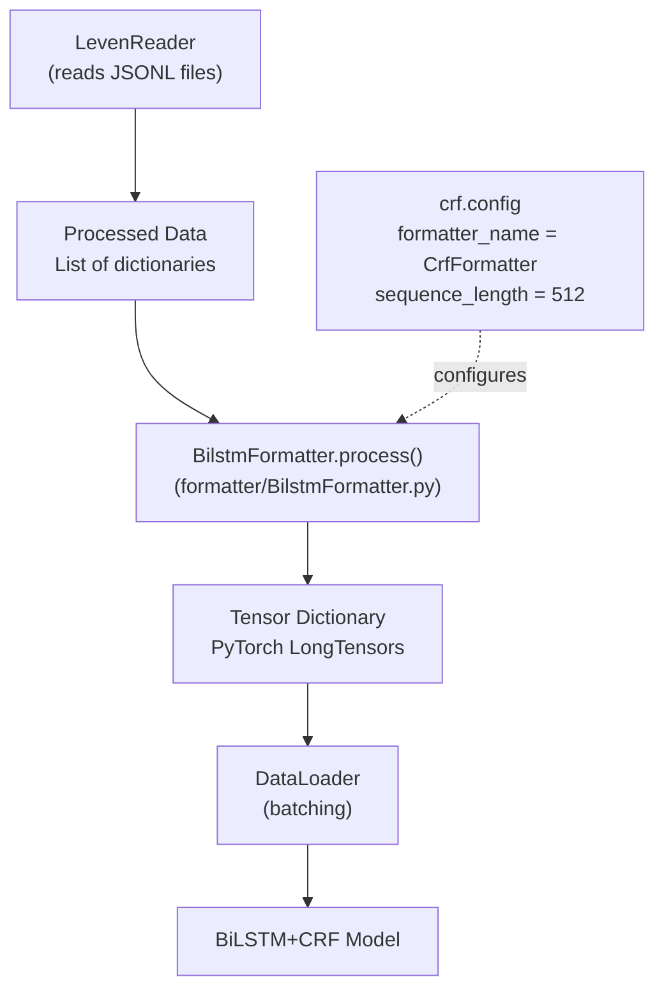
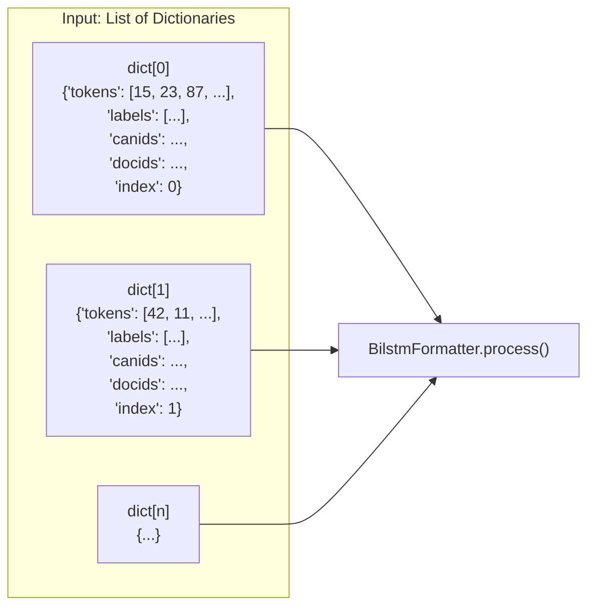
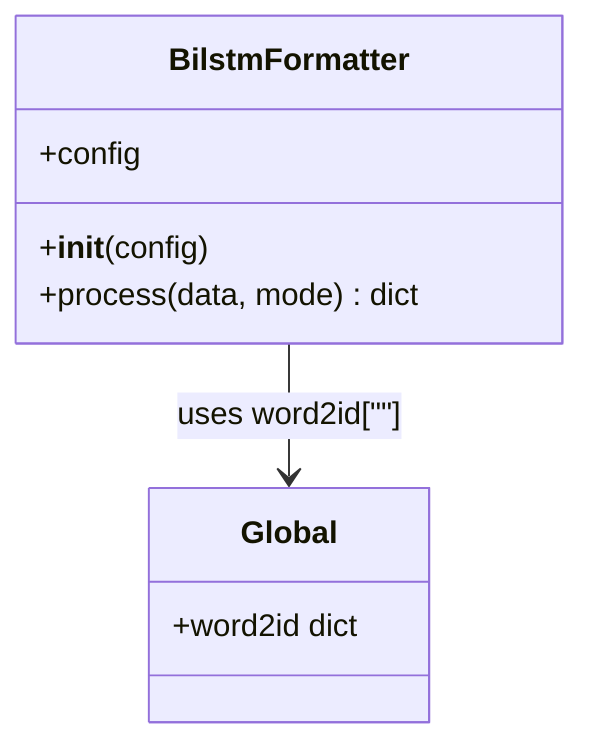
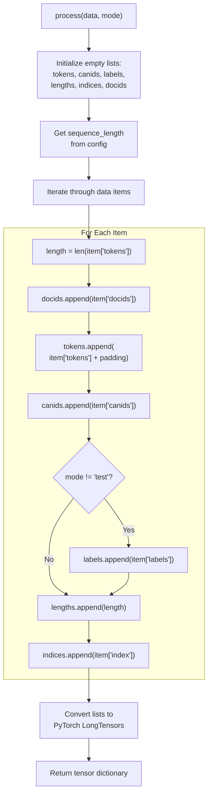
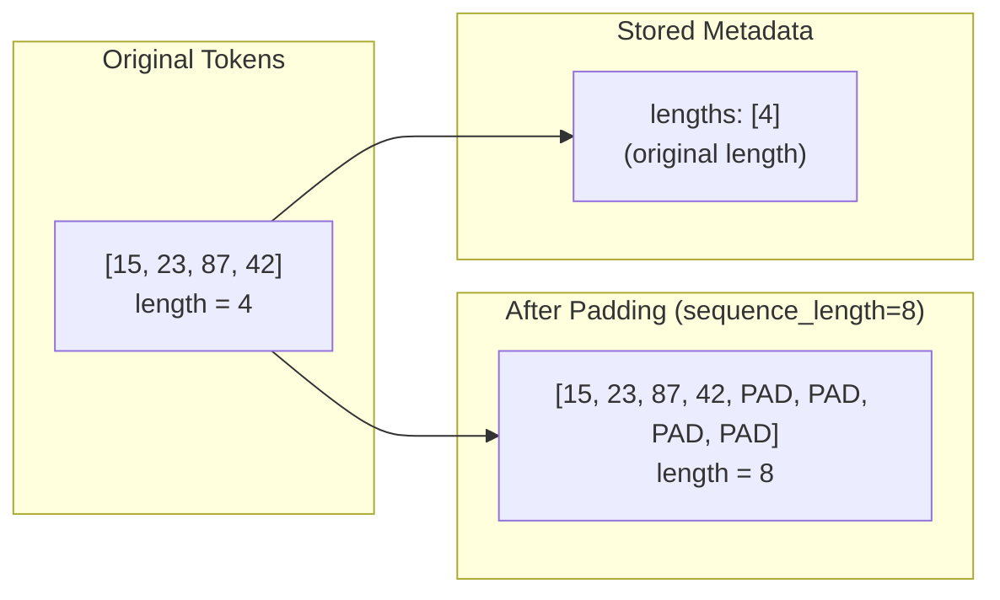
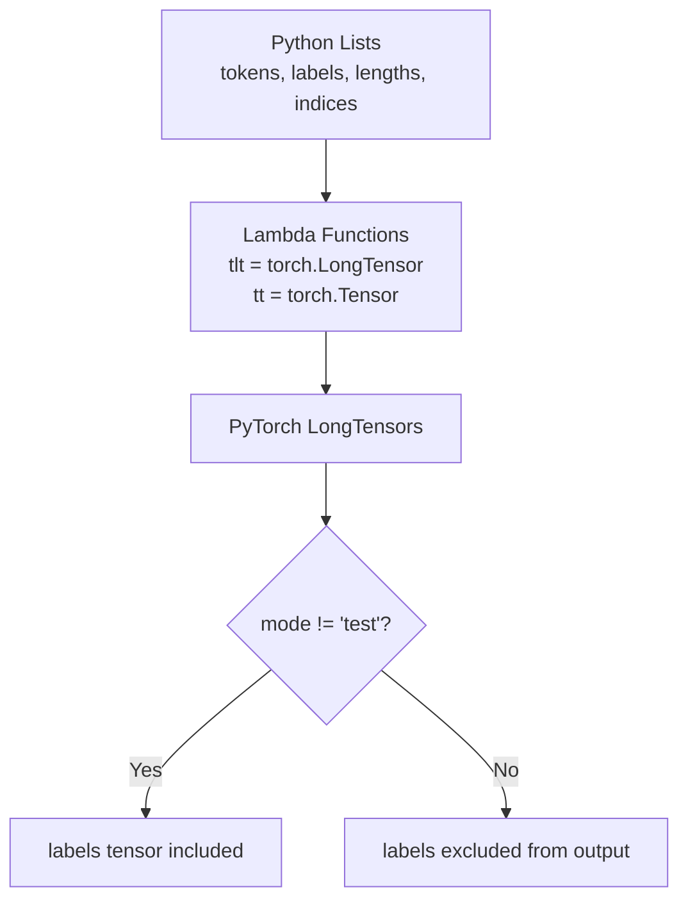
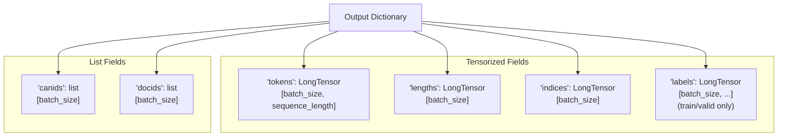

<!-- source: DeepWiki mcp.deepwiki.com · repo thunlp/LEVEN · page 7.2 BiLSTM+CRF Data Formatting · fetched 2026-11-02 -->

# BiLSTM+CRF Data Formatting

<details>
<summary>Relevant source files</summary>

The following files were used as context for generating this wiki page:

- [Baselines/BiLSTM+CRF/config/crf.config](Baselines/BiLSTM+CRF/config/crf.config)
- [Baselines/BiLSTM+CRF/formatter/BilstmFormatter.py](Baselines/BiLSTM+CRF/formatter/BilstmFormatter.py)

</details>


## Purpose and Scope

This page documents the data formatting system used by the BiLSTM+CRF baseline implementation. The `BilstmFormatter` class is responsible for converting processed data from the reader into PyTorch tensors suitable for model training and inference. This includes sequence padding, tensor conversion, and batch preparation.

For information about the overall BiLSTM+CRF configuration system, see [BiLSTM+CRF Configuration](#7.1). For details on other baseline data processing approaches, see [BERT+CRF Data Utilities](#5.4) and [BERT Data Utilities](#6.4).

## Data Formatting Pipeline Overview

The BiLSTM+CRF baseline uses a formatter-based architecture where data flows from the reader through the formatter to produce batched tensors for the model.

**Pipeline: Reader to Model Data Flow**



Sources: [Baselines/BiLSTM+CRF/formatter/BilstmFormatter.py:1-50](), [Baselines/BiLSTM+CRF/config/crf.config:12-18]()

## Input Data Format

The `BilstmFormatter` expects input data as a list of dictionaries, where each dictionary represents a single example with the following structure:

| Field | Type | Description |
|-------|------|-------------|
| `tokens` | `list[int]` | Token IDs converted from text using word2id mapping |
| `labels` | `int` or `list[int]` | Label IDs for the tokens (not present in test mode) |
| `canids` | Variable | Candidate IDs associated with the example |
| `docids` | Variable | Document IDs for tracking |
| `index` | `int` | Index of the example for ordering |

**Input Data Structure**



Sources: [Baselines/BiLSTM+CRF/formatter/BilstmFormatter.py:10-17]()

## BilstmFormatter Class

The `BilstmFormatter` class implements the data formatting logic for the BiLSTM+CRF baseline.

### Class Structure



### Constructor

The formatter is initialized with a configuration object [Baselines/BiLSTM+CRF/formatter/BilstmFormatter.py:6-7]():

```python
def __init__(self, config):
    self.config = config
```

### Process Method

The `process` method is the main entry point for data formatting [Baselines/BiLSTM+CRF/formatter/BilstmFormatter.py:9-49](). It accepts two parameters:

| Parameter | Type | Description |
|-----------|------|-------------|
| `data` | `list[dict]` | List of data examples from the reader |
| `mode` | `str` | One of "train", "valid", or "test" |

**Process Method Workflow**



Sources: [Baselines/BiLSTM+CRF/formatter/BilstmFormatter.py:9-49]()

## Padding Strategy

The formatter implements a fixed-length padding strategy to ensure all sequences in a batch have the same length.

### Padding Logic

The padding is applied using the `<PAD>` token from the global word2id mapping [Baselines/BiLSTM+CRF/formatter/BilstmFormatter.py:20-25]():

```python
sequence_length = self.config.getint("runtime", "sequence_length")
for item in data:
    length = len(item["tokens"])
    tokens.append(item["tokens"] + [Global.word2id["<PAD>"]] * (sequence_length - length))
```

### Padding Parameters

| Parameter | Location | Default Value | Description |
|-----------|----------|---------------|-------------|
| `sequence_length` | config file | 512 | Maximum sequence length for padding |
| `pad_label_id` | config file | -100 | Padding value for labels (not used in BilstmFormatter) |

**Padding Example**



The original sequence lengths are preserved in the `lengths` tensor to enable proper masking during model forward pass [Baselines/BiLSTM+CRF/formatter/BilstmFormatter.py:29]().

Sources: [Baselines/BiLSTM+CRF/formatter/BilstmFormatter.py:20-30](), [Baselines/BiLSTM+CRF/config/crf.config:16]()

## Tensor Conversion

The formatter converts Python lists to PyTorch tensors using helper lambda functions [Baselines/BiLSTM+CRF/formatter/BilstmFormatter.py:32-36]():

```python
tlt = lambda t: torch.LongTensor(t)
tt = lambda t: torch.Tensor(t)
tokens, lengths, indices = tlt(tokens), tlt(lengths), tlt(indices)
if mode != "test":
    labels = tlt(labels)
```

**Tensor Conversion Process**



Sources: [Baselines/BiLSTM+CRF/formatter/BilstmFormatter.py:32-36]()

## Output Tensor Format

The `process` method returns a dictionary containing PyTorch tensors organized for efficient batching and model consumption.

### Training/Validation Mode Output

When `mode` is "train" or "valid", the output dictionary contains [Baselines/BiLSTM+CRF/formatter/BilstmFormatter.py:38-43]():

| Key | Tensor Type | Shape | Description |
|-----|-------------|-------|-------------|
| `tokens` | `LongTensor` | `[batch_size, sequence_length]` | Padded token IDs |
| `labels` | `LongTensor` | `[batch_size, ...]` | Label IDs for supervision |
| `lengths` | `LongTensor` | `[batch_size]` | Original sequence lengths before padding |
| `indices` | `LongTensor` | `[batch_size]` | Example indices for ordering |
| `canids` | `list` | `[batch_size]` | Candidate IDs (not tensorized) |
| `docids` | `list` | `[batch_size]` | Document IDs (not tensorized) |

### Test Mode Output

When `mode` is "test", the output dictionary excludes the `labels` field [Baselines/BiLSTM+CRF/formatter/BilstmFormatter.py:44-49]():

| Key | Tensor Type | Shape | Description |
|-----|-------------|-------|-------------|
| `tokens` | `LongTensor` | `[batch_size, sequence_length]` | Padded token IDs |
| `lengths` | `LongTensor` | `[batch_size]` | Original sequence lengths before padding |
| `indices` | `LongTensor` | `[batch_size]` | Example indices for ordering |
| `canids` | `list` | `[batch_size]` | Candidate IDs (not tensorized) |
| `docids` | `list` | `[batch_size]` | Document IDs (not tensorized) |

**Output Dictionary Structure**



Sources: [Baselines/BiLSTM+CRF/formatter/BilstmFormatter.py:38-49]()

## Configuration Parameters

The formatter's behavior is controlled by configuration parameters defined in `crf.config`.

### Data Section Parameters

The `[data]` section in the configuration file specifies formatter-related settings [Baselines/BiLSTM+CRF/config/crf.config:12-18]():

| Parameter | Value | Usage |
|-----------|-------|-------|
| `reader_name` | `LevenReader` | Specifies the reader class to use |
| `formatter_name` | `CrfFormatter` | Specifies the formatter class (note: actual implementation is `BilstmFormatter`) |
| `word2vec_file` | `sgns.wiki.bigram-char` | Word embedding file for vocabulary |
| `sequence_length` | `512` | Maximum sequence length for padding |
| `BIO` | `True` | Indicates BIO tagging scheme is used |
| `pad_label_id` | `-100` | Label ID for padding positions |

### Runtime Access

The formatter accesses the `sequence_length` parameter at runtime using [Baselines/BiLSTM+CRF/formatter/BilstmFormatter.py:20]():

```python
sequence_length = self.config.getint("runtime", "sequence_length")
```

This suggests that configuration values may be copied to a `[runtime]` section during initialization or the config object provides a unified interface for accessing parameters across sections.

Sources: [Baselines/BiLSTM+CRF/config/crf.config:12-18](), [Baselines/BiLSTM+CRF/formatter/BilstmFormatter.py:20]()

## Key Implementation Details

### Global Variables Dependency

The formatter depends on the `Global.word2id` dictionary for padding token IDs [Baselines/BiLSTM+CRF/formatter/BilstmFormatter.py:2,25]():

```python
from utils.global_variables import Global
# ...
[Global.word2id["<PAD>"]] * (sequence_length - length)
```

This global dictionary must be initialized with the vocabulary before the formatter is used.

### Mode-Based Processing

The formatter adjusts its output based on the `mode` parameter:
- **Training/Validation modes**: Include labels for computing loss
- **Test mode**: Exclude labels as they are not available

This design allows the same formatter to handle all three operational modes [Baselines/BiLSTM+CRF/formatter/BilstmFormatter.py:27-28,38-49]().

### Preservation of Original Lengths

The formatter stores original sequence lengths before padding in the `lengths` tensor [Baselines/BiLSTM+CRF/formatter/BilstmFormatter.py:29](). This enables the model to:
- Apply proper masking to ignore padding positions
- Compute loss only on valid tokens
- Use packed sequences for efficient BiLSTM processing

Sources: [Baselines/BiLSTM+CRF/formatter/BilstmFormatter.py:1-50]()

---

