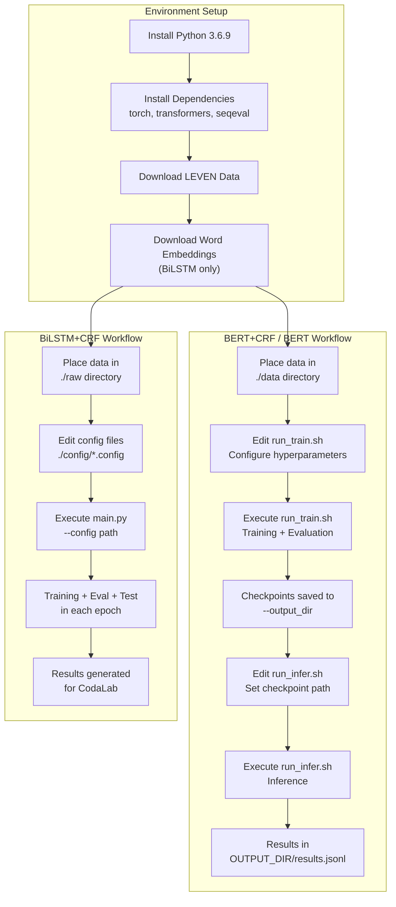
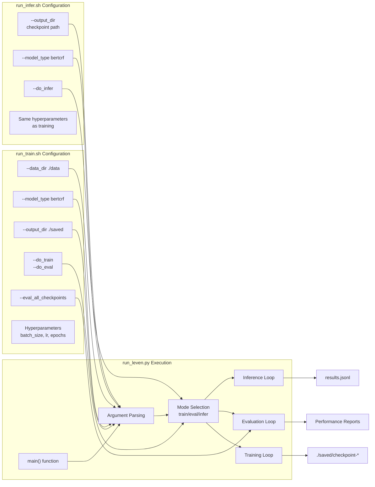
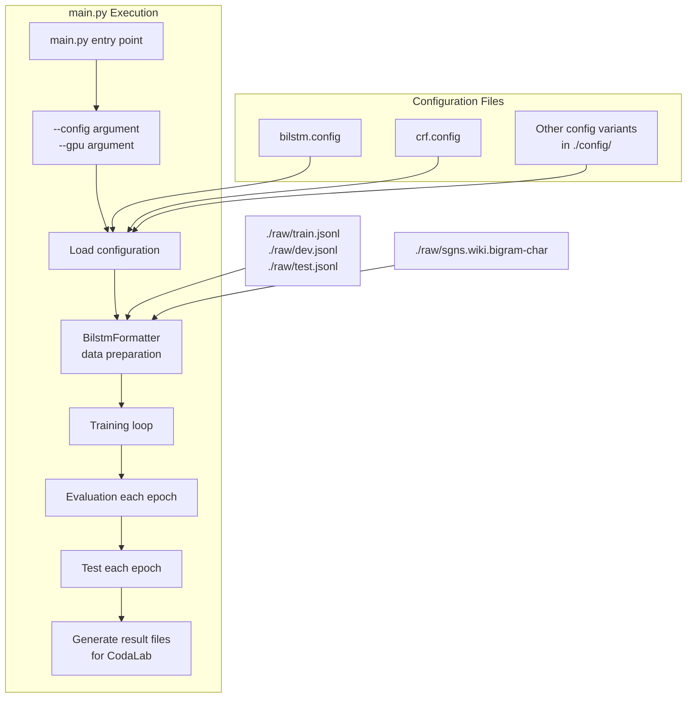
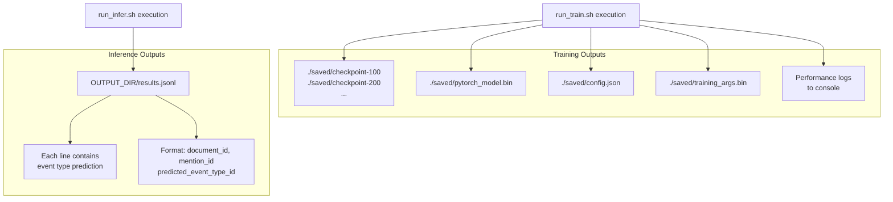

<!-- source: DeepWiki mcp.deepwiki.com · repo thunlp/LEVEN · page 8 Quick Start Guide · fetched 2026-11-02 -->

# Quick Start Guide

<details>
<summary>Relevant source files</summary>

The following files were used as context for generating this wiki page:

- [Baselines/BERT+CRF/README.md](Baselines/BERT+CRF/README.md)
- [Baselines/BERT+CRF/run_infer.sh](Baselines/BERT+CRF/run_infer.sh)
- [Baselines/BERT+CRF/run_train.sh](Baselines/BERT+CRF/run_train.sh)
- [Baselines/BERT/README.md](Baselines/BERT/README.md)
- [Baselines/BiLSTM+CRF/README.md](Baselines/BiLSTM+CRF/README.md)

</details>


This guide provides step-by-step instructions for setting up the LEVEN repository environment and running training and inference for all three baseline models. It covers installation of dependencies, data preparation, execution of training scripts, and generation of predictions.

For detailed architectural information about each baseline, see [BERT+CRF Baseline](#5), [BERT Baseline](#6), and [BiLSTM+CRF Baseline](#7). For information about the LEVEN task and annotation schema, see [LEVEN Task and Annotation](#2).

---

## Overview of Baseline Execution Workflows



**Sources:** [Baselines/BERT+CRF/README.md:1-30](), [Baselines/BERT/README.md:1-30](), [Baselines/BiLSTM+CRF/README.md:1-22]()

---

## Prerequisites and Environment Setup

### System Requirements

All baselines require Python 3.6.9. The following table summarizes the dependency requirements for each baseline:

| Baseline | PyTorch Version | Key Dependencies | Additional Requirements |
|----------|----------------|------------------|-------------------------|
| BERT+CRF | 1.2.0 | transformers==2.6.0, seqeval, sklearn==0.20.2 | None |
| BERT | 1.2.0 | transformers==2.6.0, seqeval, sklearn==0.20.2 | None |
| BiLSTM+CRF | 1.6 | numpy, sklearn, seqeval==1.2.2, tqdm==4.44.0 | Pre-trained word embeddings |

**Sources:** [Baselines/BERT+CRF/README.md:6-16](), [Baselines/BERT/README.md:6-16](), [Baselines/BiLSTM+CRF/README.md:4-10]()

### Installation Steps

1. **Install Python 3.6.9** (if not already available)
2. **Create a virtual environment** (recommended):
   ```bash
   python3 -m venv leven_env
   source leven_env/bin/activate
   ```
3. **Install dependencies for BERT-based models**:
   ```bash
   pip install torch==1.2.0
   pip install transformers==2.6.0
   pip install scikit-learn==0.20.2
   pip install seqeval
   ```
4. **For BiLSTM+CRF, install its specific dependencies**:
   ```bash
   pip install torch==1.6
   pip install numpy
   pip install scikit-learn
   pip install seqeval==1.2.2
   pip install tqdm==4.44.0
   ```

**Sources:** [Baselines/BERT+CRF/README.md:6-16](), [Baselines/BiLSTM+CRF/README.md:4-10]()

---

## Data Preparation

### BERT+CRF and BERT Baselines

1. **Download LEVEN dataset files** (train.jsonl, dev.jsonl, test.jsonl)
2. **Create data directory** in the baseline folder:
   ```bash
   mkdir -p Baselines/BERT+CRF/data
   ```
3. **Place data files** in the `data` folder:
   - `Baselines/BERT+CRF/data/train.jsonl`
   - `Baselines/BERT+CRF/data/dev.jsonl`
   - `Baselines/BERT+CRF/data/test.jsonl`

The same process applies to the BERT baseline directory.

**Sources:** [Baselines/BERT+CRF/README.md:24](), [Baselines/BERT/README.md:24]()

### BiLSTM+CRF Baseline

1. **Download LEVEN dataset files**
2. **Download pre-trained word embeddings** from [Chinese-Word-Vectors](https://github.com/Embedding/Chinese-Word-Vectors)
   - Use embeddings trained on Wikipedia_zh with Word+Character+Ngram context features
   - File: `sgns.wiki.bigram-char`
3. **Create raw directory**:
   ```bash
   mkdir -p Baselines/BiLSTM+CRF/raw
   ```
4. **Place files** in the `./raw` directory:
   - LEVEN data files (train.jsonl, dev.jsonl, test.jsonl)
   - Word embedding file (`sgns.wiki.bigram-char`)

**Sources:** [Baselines/BiLSTM+CRF/README.md:14-17]()

---

## Running BERT+CRF Baseline

### Script Configuration Map



**Sources:** [Baselines/BERT+CRF/run_train.sh:1-18](), [Baselines/BERT+CRF/run_infer.sh:1-15]()

### Training and Evaluation

1. **Navigate to the BERT+CRF directory**:
   ```bash
   cd Baselines/BERT+CRF
   ```

2. **Edit `run_train.sh`** to configure training parameters. Key parameters from [run_train.sh:1-18]():

   | Parameter | Default Value | Description |
   |-----------|--------------|-------------|
   | `CUDA_VISIBLE_DEVICES` | 4,5,6,7 | GPU devices to use |
   | `--data_dir` | ./data | Path to LEVEN data files |
   | `--model_type` | bertcrf | Model architecture identifier |
   | `--output_dir` | ./saved | Directory for checkpoints |
   | `--max_seq_length` | 512 | Maximum sequence length |
   | `--per_gpu_train_batch_size` | 4 | Training batch size per GPU |
   | `--per_gpu_eval_batch_size` | 4 | Evaluation batch size per GPU |
   | `--gradient_accumulation_steps` | 4 | Gradient accumulation steps |
   | `--learning_rate` | 5e-5 | Learning rate |
   | `--num_train_epochs` | 4 | Number of training epochs |
   | `--save_steps` | 100 | Checkpoint saving frequency |
   | `--logging_steps` | 100 | Logging frequency |
   | `--seed` | 100 | Random seed |

3. **Remove comments from the script**. The script contains inline comments after backslashes that must be deleted before execution, as noted in [README.md:22]().

4. **Execute training**:
   ```bash
   bash run_train.sh
   ```

5. **Monitor output**. The script will:
   - Load training data from `./data/train.jsonl`
   - Train the model with periodic validation on `./data/dev.jsonl`
   - Save checkpoints to `./saved/checkpoint-{step}` at intervals specified by `--save_steps`
   - Evaluate all checkpoints if `--eval_all_checkpoints` flag is present
   - Track best model based on validation F1 score

**Sources:** [Baselines/BERT+CRF/README.md:20-28](), [Baselines/BERT+CRF/run_train.sh:1-18]()

### Inference

1. **Edit `run_infer.sh`** to specify the checkpoint path. Modify the `--output_dir` parameter at [run_infer.sh:3]() to point to your trained checkpoint:
   ```bash
   --output_dir ./saved/checkpoint-100
   ```

2. **Remove comments** from the script as in training.

3. **Execute inference**:
   ```bash
   bash run_infer.sh
   ```

4. **Locate results**. Predictions will be written to `{OUTPUT_DIR}/results.jsonl`, where `OUTPUT_DIR` is the checkpoint directory specified in the script.

**Sources:** [Baselines/BERT+CRF/README.md:26](), [Baselines/BERT+CRF/run_infer.sh:1-15]()

---

## Running BERT Baseline

The BERT baseline follows an identical workflow to BERT+CRF:

1. **Navigate to BERT directory**:
   ```bash
   cd Baselines/BERT
   ```

2. **Prepare data** in `./data` directory (same as BERT+CRF)

3. **Edit and execute `run_train.sh`** for training and evaluation

4. **Edit and execute `run_infer.sh`** for inference

The script parameters and structure are identical to BERT+CRF. Both baselines use the same `run_leven.py` script with the `--model_type` flag determining the architecture variant.

**Sources:** [Baselines/BERT/README.md:1-30]()

---

## Running BiLSTM+CRF Baseline

### Configuration and Execution Flow



**Sources:** [Baselines/BiLSTM+CRF/README.md:1-22]()

### Training, Evaluation, and Testing

1. **Navigate to BiLSTM+CRF directory**:
   ```bash
   cd Baselines/BiLSTM+CRF
   ```

2. **Verify data placement**:
   - LEVEN data files in `./raw/`
   - Word embeddings file `sgns.wiki.bigram-char` in `./raw/`

3. **Select and edit configuration file**. Configuration files are located in `./config/` directory. Key hyperparameters can be modified in these files (see [README.md:21]()).

4. **Execute training**:
   ```bash
   python main.py --config ./config/bilstm.config --gpu 0
   ```
   
   Optional parameters:
   - `--config [path]`: Path to configuration file (required)
   - `--gpu [id]`: GPU device ID (optional)

5. **Monitor execution**. The script performs training, evaluation, and test inference in every epoch, as noted in [README.md:19]():
   - Outputs performance metrics during training and evaluation
   - Generates test result files suitable for CodaLab submission
   - All processes occur automatically within the same script execution

**Sources:** [Baselines/BiLSTM+CRF/README.md:12-22]()

---

## Understanding Output Files

### BERT+CRF and BERT Output Structure



**Sources:** [Baselines/BERT+CRF/run_train.sh:4](), [Baselines/BERT+CRF/run_infer.sh:3](), [Baselines/BERT+CRF/README.md:26]()

| Output Type | Location | Description |
|-------------|----------|-------------|
| Checkpoints | `{output_dir}/checkpoint-{step}/` | Model checkpoints saved at intervals |
| Best Model | `{output_dir}/` | Final best model based on validation F1 |
| Results | `{checkpoint_dir}/results.jsonl` | Inference predictions in JSONL format |
| Logs | Console output | Training loss, evaluation metrics (precision, recall, F1) |

### BiLSTM+CRF Output Structure

The BiLSTM+CRF baseline generates test result files during execution that are formatted for CodaLab submission, as mentioned in [README.md:19](). The exact output directory and file naming convention are determined by the configuration file settings.

**Sources:** [Baselines/BiLSTM+CRF/README.md:19-20]()

---

## Command-Line Reference

### BERT+CRF and BERT Common Flags

| Flag | Type | Description |
|------|------|-------------|
| `--data_dir` | Path | Directory containing LEVEN data files |
| `--model_type` | String | Model architecture (bertcrf or bert) |
| `--output_dir` | Path | Directory for saving checkpoints and results |
| `--max_seq_length` | Integer | Maximum token sequence length (default: 512) |
| `--do_train` | Boolean | Enable training mode |
| `--do_eval` | Boolean | Enable evaluation mode |
| `--do_infer` | Boolean | Enable inference mode |
| `--eval_all_checkpoints` | Boolean | Evaluate all saved checkpoints |
| `--overwrite_output_dir` | Boolean | Overwrite existing output directory |
| `--per_gpu_train_batch_size` | Integer | Training batch size per GPU |
| `--per_gpu_eval_batch_size` | Integer | Evaluation batch size per GPU |
| `--gradient_accumulation_steps` | Integer | Number of gradient accumulation steps |
| `--learning_rate` | Float | Learning rate for optimizer |
| `--num_train_epochs` | Integer | Total number of training epochs |
| `--save_steps` | Integer | Checkpoint saving interval |
| `--logging_steps` | Integer | Logging interval |
| `--seed` | Integer | Random seed for reproducibility |
| `--do_lower_case` | Boolean | Convert text to lowercase |

**Sources:** [Baselines/BERT+CRF/run_train.sh:1-18](), [Baselines/BERT+CRF/run_infer.sh:1-15]()

### BiLSTM+CRF Command-Line Arguments

| Argument | Type | Description |
|----------|------|-------------|
| `--config` | Path | Path to configuration file (required) |
| `--gpu` | Integer | GPU device ID (optional) |

**Sources:** [Baselines/BiLSTM+CRF/README.md:18]()

---

## Common Issues and Tips

### Script Preparation

**Important:** Before running any `.sh` script, remove all inline comments (text after backslashes). The README files for both BERT+CRF and BERT specifically note this requirement at [BERT+CRF/README.md:22]() and [BERT/README.md:22]().

Example transformation:
```bash
# Before (will cause errors):
--output_dir ./saved \#path to checkpoints

# After (correct):
--output_dir ./saved \
```

### GPU Configuration

For BERT-based models, specify GPU devices using the `CUDA_VISIBLE_DEVICES` environment variable in the shell scripts, as shown in [run_train.sh:1]():
```bash
CUDA_VISIBLE_DEVICES=4,5,6,7 python run_leven.py ...
```

For BiLSTM+CRF, use the `--gpu` command-line argument.

### Data Location

Ensure data files are placed in the correct directories:
- **BERT+CRF and BERT**: `./data/` directory within each baseline folder
- **BiLSTM+CRF**: `./raw/` directory with both LEVEN data and word embeddings

### Memory Considerations

If encountering out-of-memory errors, adjust:
- `--per_gpu_train_batch_size` and `--per_gpu_eval_batch_size` (reduce batch size)
- `--gradient_accumulation_steps` (increase to maintain effective batch size)
- `--max_seq_length` (reduce maximum sequence length)

**Sources:** [Baselines/BERT+CRF/run_train.sh:6-8]()

---

## Quick Reference: End-to-End Workflows

### BERT+CRF Minimal Example

```bash
# Setup
cd Baselines/BERT+CRF
mkdir -p data
# (Place train.jsonl, dev.jsonl, test.jsonl in ./data)

# Train
CUDA_VISIBLE_DEVICES=0 python run_leven.py \
    --data_dir ./data \
    --model_type bertcrf \
    --output_dir ./saved \
    --max_seq_length 512 \
    --per_gpu_train_batch_size 4 \
    --per_gpu_eval_batch_size 4 \
    --gradient_accumulation_steps 4 \
    --learning_rate 5e-5 \
    --num_train_epochs 4 \
    --save_steps 100 \
    --logging_steps 100 \
    --do_train \
    --do_eval

# Infer
python run_leven.py \
    --model_type bertcrf \
    --output_dir ./saved/checkpoint-100 \
    --max_seq_length 512 \
    --do_infer
```

### BiLSTM+CRF Minimal Example

```bash
# Setup
cd Baselines/BiLSTM+CRF
mkdir -p raw
# (Place LEVEN data and sgns.wiki.bigram-char in ./raw)

# Train, Evaluate, and Test
python main.py --config ./config/bilstm.config --gpu 0
```

**Sources:** [Baselines/BERT+CRF/run_train.sh:1-18](), [Baselines/BERT+CRF/run_infer.sh:1-15](), [Baselines/BiLSTM+CRF/README.md:18]()