# Page: Home

# Home

<details>
<summary>Relevant source files</summary>

The following files were used as context for generating this wiki page:

- [Annotation-Guidelines/annotation-guidelines-en.pdf](Annotation-Guidelines/annotation-guidelines-en.pdf)
- [Baselines/BERT+CRF/README.md](Baselines/BERT+CRF/README.md)
- [Baselines/BERT/README.md](Baselines/BERT/README.md)
- [Baselines/BiLSTM+CRF/README.md](Baselines/BiLSTM+CRF/README.md)

</details>


## Purpose and Scope

This wiki documents the **LEVEN** (Legal EVent Extraction) repository, a benchmark for event detection in Chinese legal and incident text. The repository contains:

- **Annotation guidelines** defining a schema of 110 event types
- **Dataset files** in JSONL format with BIO-tagged event mentions
- **Three baseline implementations** (BERT+CRF, BERT, BiLSTM+CRF) with training and inference pipelines

This Home page provides a high-level overview of the repository structure and baseline models. For detailed information about specific subsystems:
- Event type taxonomy and annotation process: see [LEVEN Task and Annotation](#2)
- Data format specifications: see [Data Format](#3)
- Comparative analysis of baselines: see [Baselines Comparison](#4)
- Individual baseline documentation: see [BERT+CRF Baseline](#5), [BERT Baseline](#6), [BiLSTM+CRF Baseline](#7)

---

## What is LEVEN?

LEVEN is an event extraction benchmark focusing on Chinese legal and incident documents. The task involves identifying event mentions in text and classifying them into one of 110 predefined event types organized into semantic domains:

| Domain | Example Event Types | Count |
|--------|-------------------|-------|
| Legal Actions | 盗窃财物 (theft), 抢劫财物 (robbery), 贩卖毒品 (drug trafficking) | ~40 |
| Financial Events | 买入 (buy), 卖出 (sell), 支付/给付 (payment) | ~25 |
| Violent Events | 伤害人身 (assault), 杀害 (homicide), 强奸 (rape) | ~20 |
| Procedural Events | 拘捕 (arrest), 搜查/扣押 (search/seizure), 投案 (surrender) | ~25 |

The dataset uses BIO tagging (Beginning, Inside, Outside) to annotate event mentions at the token level, resulting in approximately 221 total labels (110 event types × 2 for B-/I- variants + O tag).

**Sources:** [Annotation-Guidelines/annotation-guidelines-en.pdf]()

---

## Repository Structure

The following diagram maps the repository's directory structure to actual code and data assets:

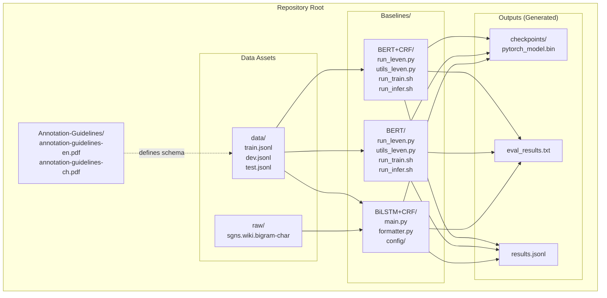

**Sources:** [Baselines/BERT+CRF/README.md](), [Baselines/BERT/README.md](), [Baselines/BiLSTM+CRF/README.md]()

---

## Baseline Implementations

The repository provides three neural baseline models for event detection, each with complete training and inference infrastructure:

### BERT+CRF Baseline

The most extensively documented baseline, combining BERT contextual embeddings with a Conditional Random Field (CRF) layer for sequence labeling.

| Component | Implementation |
|-----------|---------------|
| **Entry Point** | `run_leven.py` |
| **Data Processing** | `utils_leven.py`: `read_examples_from_file()`, `convert_examples_to_features()` |
| **Model Class** | `BertCrfForTokenClassification` (in `run_leven.py`) |
| **Training Script** | `run_train.sh` |
| **Inference Script** | `run_infer.sh` |

**Key Features:**
- BERT encoder from HuggingFace Transformers (`BertForTokenClassification`)
- Custom CRF layer with Viterbi decoding
- Feature caching for efficiency
- Distributed training support (multi-GPU)
- Mixed precision training (fp16)

**Sources:** [Baselines/BERT+CRF/README.md:1-30]()

### BERT Baseline

Structurally similar to BERT+CRF, with identical file structure and class names.

| Component | Implementation |
|-----------|---------------|
| **Entry Point** | `run_leven.py` |
| **Data Processing** | `utils_leven.py` |
| **Model Class** | `BertCrfForTokenClassification` |
| **Scripts** | `run_train.sh`, `run_infer.sh` |

**Sources:** [Baselines/BERT/README.md:1-30]()

### BiLSTM+CRF Baseline

A traditional neural architecture using bidirectional LSTMs instead of BERT.

| Component | Implementation |
|-----------|---------------|
| **Entry Point** | `main.py` |
| **Data Formatter** | `formatter.py`: `BilstmFormatter` class |
| **Configuration** | `config/bilstm.config`, `config/crf.config` |
| **Model Type** | Bidirectional LSTM + CRF |
| **Word Embeddings** | Pre-trained from `raw/sgns.wiki.bigram-char` |

**Key Differences:**
- Configuration-based approach (vs. command-line arguments)
- Requires external word embeddings
- Traditional RNN architecture instead of Transformer

**Sources:** [Baselines/BiLSTM+CRF/README.md:1-22]()

---

## Baseline Execution Flow

The following diagram shows how the baseline systems execute, mapping high-level operations to actual code entry points:

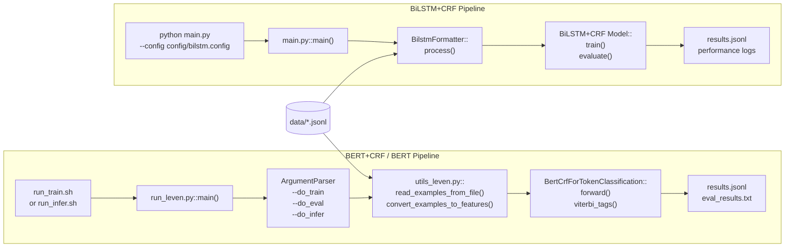

**Sources:** [Baselines/BERT+CRF/README.md:20-28](), [Baselines/BERT/README.md:20-28](), [Baselines/BiLSTM+CRF/README.md:12-19]()

---

## Training and Inference Workflow

All baselines follow a consistent workflow pattern:

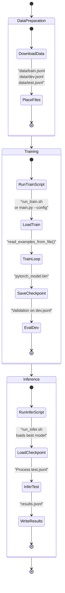

**Sources:** [Baselines/BERT+CRF/README.md:20-28](), [Baselines/BERT/README.md:20-28](), [Baselines/BiLSTM+CRF/README.md:18-19]()

---

## Key File Purposes

| File Path | Purpose | Baseline(s) |
|-----------|---------|-------------|
| `run_leven.py` | Main training/inference script with `BertCrfForTokenClassification` model definition | BERT+CRF, BERT |
| `utils_leven.py` | Data loading, tokenization, feature conversion, BIO label processing | BERT+CRF, BERT |
| `run_train.sh` | Shell wrapper for training with GPU/distributed settings | BERT+CRF, BERT |
| `run_infer.sh` | Shell wrapper for inference on test set | BERT+CRF, BERT |
| `main.py` | Entry point for BiLSTM model with config-based setup | BiLSTM+CRF |
| `formatter.py` | `BilstmFormatter` class for data preprocessing | BiLSTM+CRF |
| `config/*.config` | Hyperparameter configuration files | BiLSTM+CRF |
| `data/train.jsonl` | Training data with documents, events, and BIO labels | All |
| `data/dev.jsonl` | Development/validation data | All |
| `data/test.jsonl` | Test data for final predictions | All |
| `results.jsonl` | Inference output with predicted event type IDs | All |

**Sources:** [Baselines/BERT+CRF/README.md](), [Baselines/BERT/README.md](), [Baselines/BiLSTM+CRF/README.md]()

---

## Requirements

All baselines require Python 3.6+ with PyTorch. Specific dependencies:

**BERT+CRF and BERT:**
- `python==3.6.9`
- `torch==1.2.0`
- `transformers==2.6.0`
- `sklearn==0.20.2`
- `seqeval`

**BiLSTM+CRF:**
- `torch==1.6`
- `numpy`
- `sklearn`
- `seqeval==1.2.2`
- `tqdm==4.44.0`
- Pre-trained word embeddings: `sgns.wiki.bigram-char` from [Chinese-Word-Vectors](https://github.com/Embedding/Chinese-Word-Vectors)

**Sources:** [Baselines/BERT+CRF/README.md:6-16](), [Baselines/BERT/README.md:6-16](), [Baselines/BiLSTM+CRF/README.md:4-10]()

---

## Quick Start

1. **Download Data:** Place LEVEN dataset files (`train.jsonl`, `dev.jsonl`, `test.jsonl`) in the appropriate `data/` directory under each baseline folder.

2. **Choose a Baseline:**
   - For BERT+CRF (recommended): Navigate to `Baselines/BERT+CRF/`
   - For BERT: Navigate to `Baselines/BERT/`
   - For BiLSTM+CRF: Navigate to `Baselines/BiLSTM+CRF/` and download word embeddings to `raw/`

3. **Train:**
   ```bash
   # BERT+CRF or BERT
   bash run_train.sh
   
   # BiLSTM+CRF
   python main.py --config config/bilstm.config --gpu 0
   ```

4. **Inference:**
   ```bash
   # BERT+CRF or BERT
   bash run_infer.sh
   
   # BiLSTM+CRF (automatic during training)
   # Results saved to results.jsonl
   ```

For detailed setup instructions and parameter configuration, see [Quick Start Guide](#8).

**Sources:** [Baselines/BERT+CRF/README.md:20-28](), [Baselines/BERT/README.md:20-28](), [Baselines/BiLSTM+CRF/README.md:14-19]()

---

## Next Steps

- **Understand the Task:** Read [LEVEN Task and Annotation](#2) for the full event type taxonomy and annotation scheme
- **Data Format:** See [Data Format](#3) for JSONL structure and BIO label encoding
- **Compare Baselines:** Review [Baselines Comparison](#4) for architecture differences and performance characteristics
- **Deep Dive:** Explore detailed documentation for [BERT+CRF](#5), [BERT](#6), or [BiLSTM+CRF](#7) baselines

---

# Page: LEVEN Task and Annotation

# LEVEN Task and Annotation

<details>
<summary>Relevant source files</summary>

The following files were used as context for generating this wiki page:

- [Annotation-Guidelines/annotation-guidelines-en.pdf](Annotation-Guidelines/annotation-guidelines-en.pdf)
- [Annotation-Guidelines/annotation-guidelines-zh.pdf](Annotation-Guidelines/annotation-guidelines-zh.pdf)

</details>


## Purpose and Scope

This document provides a comprehensive overview of the LEVEN event extraction task, its annotation schema, and the underlying taxonomy of 110 event types. LEVEN is a benchmark dataset for extracting structured event information from Chinese legal and incident-related documents. This page covers the fundamental task definition, annotation principles, and how the schema is represented in the codebase.

For detailed breakdowns of specific aspects, see:
- [Event Type Taxonomy](#2.1) — Complete enumeration and categorization of the 110 event types
- [Annotation Process](#2.2) — Detailed annotation procedures including BIO tagging, entity/relation annotation, and coreference resolution
- [Data Format](#3) — Technical specification of JSONL data structures
- [Baselines Comparison](#4) — Model implementations that operate on this annotation schema

## Task Definition

The LEVEN task is a **sequence labeling problem** where the goal is to identify and classify event mentions in Chinese text into one of 110 predefined event types. The task operates at the token level using the BIO (Beginning-Inside-Outside) tagging scheme.

### Input and Output Structure

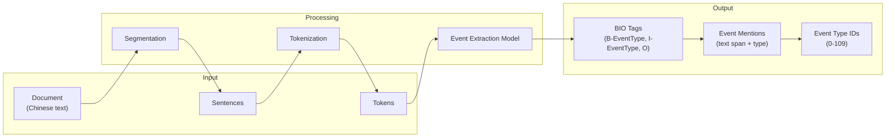

**Diagram: LEVEN Task Input-Output Flow**

The task involves:
- **Input**: Raw Chinese documents containing descriptions of legal incidents, financial transactions, or procedural actions
- **Processing**: Token-level classification using contextual embeddings
- **Output**: Each token receives a BIO tag indicating whether it is part of an event mention (B- prefix for beginning, I- prefix for inside) or not (O tag)

Sources: High-level system diagrams (Diagram 4)

### Event Mention Types

LEVEN distinguishes between two types of event indicators in the data:

| Mention Type | Description | Annotation |
|-------------|-------------|------------|
| **Positive Event Mentions** | Tokens that trigger an actual event of one of the 110 types | Tagged with `B-{EventType}` or `I-{EventType}` |
| **Negative Triggers** | Tokens that superficially resemble event triggers but do not constitute events in context | Tagged with `O` (Outside) |

This distinction is critical for training models to avoid false positives on lexically similar but contextually different phrases.

Sources: High-level system diagrams (Diagram 1, Diagram 4)

## Annotation Schema Overview

### BIO Tagging Scheme

The annotation uses the standard BIO scheme extended to 110 event types, resulting in approximately **221 total labels**:

```
Labels = {O} ∪ {B-EventType₁, I-EventType₁, ..., B-EventType₁₁₀, I-EventType₁₁₀}
```

Each event type has two BIO variants:
- **B-** prefix: Beginning of an event mention span
- **I-** prefix: Inside/continuation of an event mention span
- **O**: Tokens outside any event mention

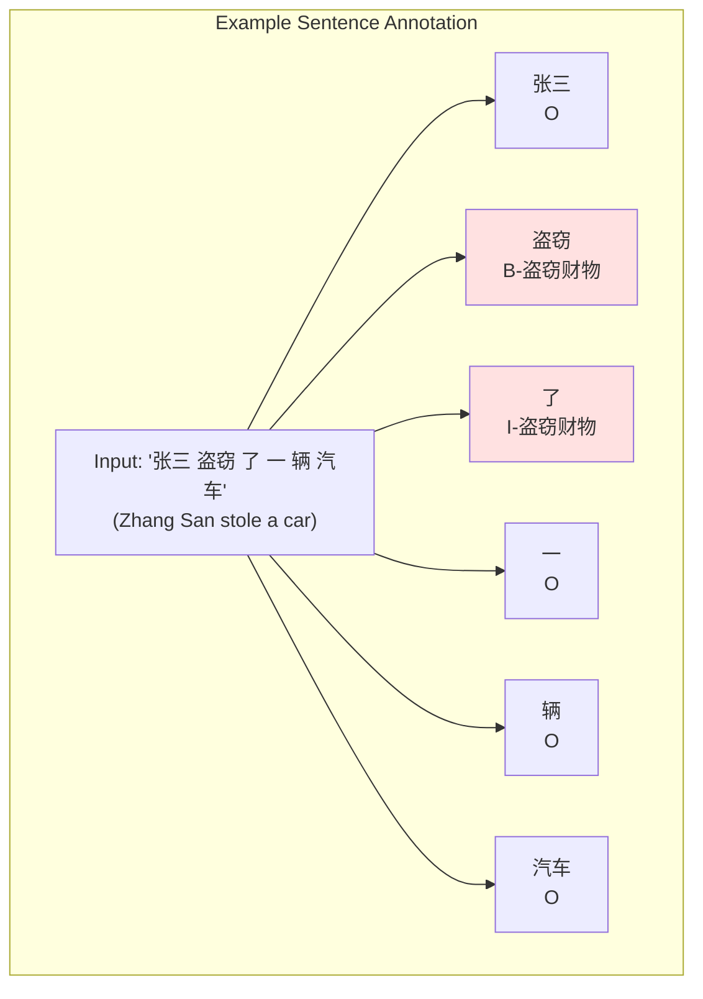

**Diagram: BIO Tagging Example**

Sources: High-level system diagrams (Diagram 4)

### Label Representation in Code

The event type taxonomy is mapped to integer identifiers through the `pure_event2id` dictionary, which provides a canonical mapping from event type names (in Chinese) to numeric IDs in the range [0, 109].

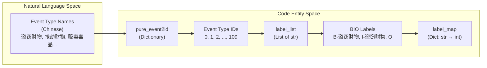

**Diagram: Event Type to Code Entity Mapping**

The label processing pipeline in the codebase:
1. `pure_event2id` stores the canonical event type to ID mapping
2. `label_list` contains all BIO labels in string format (e.g., `["O", "B-盗窃财物", "I-盗窃财物", ...]`)
3. `label_map` provides the inverse mapping from BIO label strings to integer indices for model training

Sources: High-level system diagrams (Diagram 4)

## Event Type Organization

The 110 event types are organized into **four primary semantic domains**:

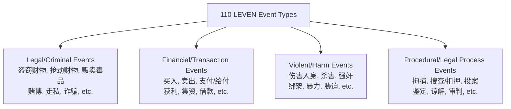

**Diagram: Event Type Domain Organization**

| Domain | Examples | Characteristics |
|--------|----------|-----------------|
| **Legal/Criminal** | 盗窃财物 (theft), 抢劫财物 (robbery), 贩卖毒品 (drug trafficking) | Criminal acts and illegal activities |
| **Financial** | 买入 (purchase), 卖出 (sale), 支付/给付 (payment) | Economic transactions and monetary flows |
| **Violent** | 伤害人身 (bodily harm), 杀害 (homicide), 绑架 (kidnapping) | Physical violence and coercion |
| **Procedural** | 拘捕 (arrest), 投案 (surrender), 审判 (trial) | Legal process and judicial actions |

For a complete enumeration of all 110 event types with detailed descriptions, see [Event Type Taxonomy](#2.1).

Sources: High-level system diagrams (Diagram 4)

## Annotation Guidelines

The LEVEN repository includes comprehensive annotation guidelines in both **English and Chinese** (PDF format) that define:

1. **Event type definitions**: Precise criteria for when each of the 110 event types should be applied
2. **Boundary rules**: How to determine the span of event mention tokens
3. **Disambiguation guidelines**: How to resolve cases where multiple event types might apply
4. **Negative trigger identification**: When lexically similar phrases should not be annotated as events

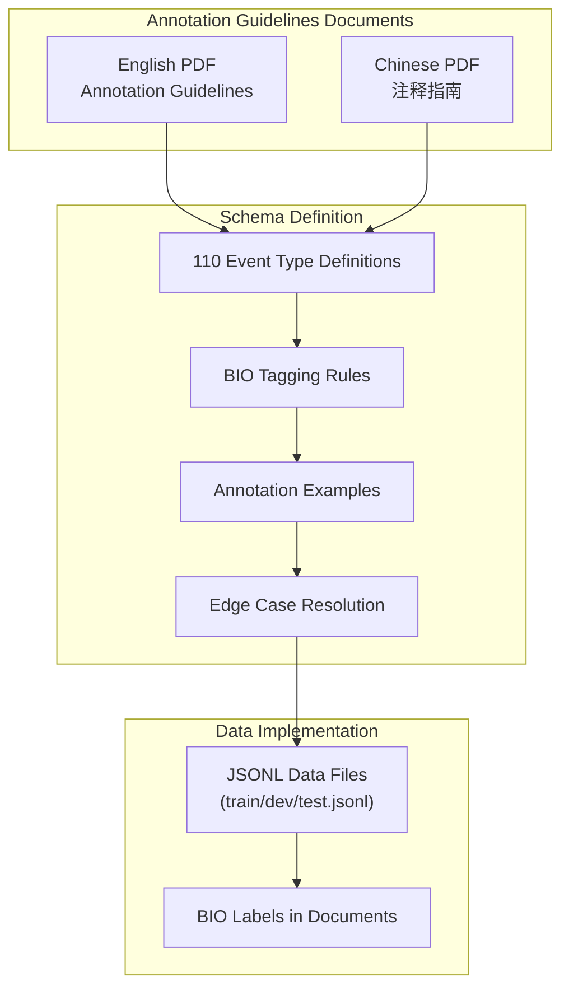

**Diagram: Annotation Guidelines to Data Pipeline**

These guidelines ensure **inter-annotator consistency** and provide the formal specification that all baseline models are trained to predict.

Sources: High-level system diagrams (Diagram 1)

## Data Structure and Code Integration

### Document-Level Structure

Each LEVEN document contains:
- **Text**: Raw Chinese text of the document
- **Events**: List of event mentions with type annotations
- **Mentions**: Specific token spans for each event mention
- **Negative Triggers** (optional): Explicitly annotated non-events

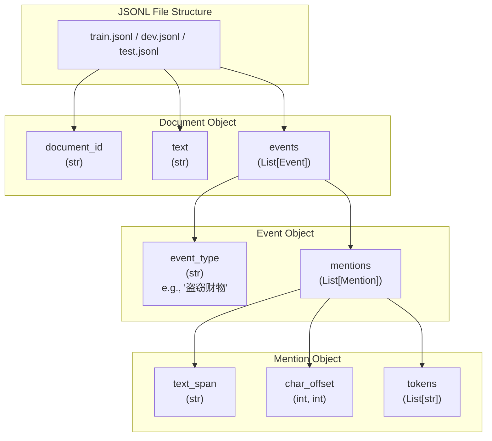

**Diagram: JSONL Data Structure Hierarchy**

Sources: High-level system diagrams (Diagram 4), Data Format specifications

### Tokenization and Label Assignment

The data processing pipeline converts JSONL documents into token-level BIO sequences:

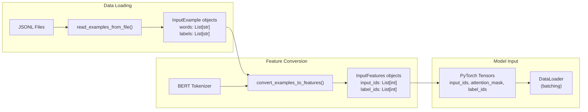

**Diagram: Data Pipeline from JSONL to Model Input**

Key code entities:
- `read_examples_from_file()`: Parses JSONL and extracts token-label pairs
- `InputExample`: Data class containing raw tokens and BIO label strings
- `convert_examples_to_features()`: Tokenizes and converts to integer IDs
- `InputFeatures`: Data class containing model-ready tensors
- `label_map`: Dictionary mapping BIO label strings to integer IDs

For detailed documentation of data utilities, see [BERT+CRF Data Utilities](#5.4) and [BERT Data Utilities](#6.4).

Sources: High-level system diagrams (Diagram 3)

## Label Processing and Validation

### Label List Construction

The complete set of BIO labels is constructed dynamically from the event type taxonomy:

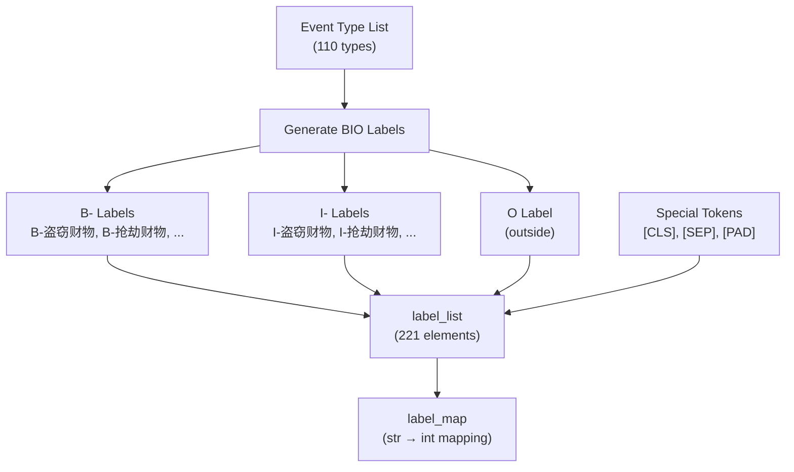

**Diagram: Label List Construction Process**

The `label_list` includes:
1. `O` tag for non-event tokens
2. `B-{EventType}` for each of the 110 event types (110 labels)
3. `I-{EventType}` for each of the 110 event types (110 labels)
4. Special labels for BERT tokenization artifacts (e.g., `[CLS]`, `[SEP]`, `[PAD]`)

Total: ~221 labels

Sources: High-level system diagrams (Diagram 3, Diagram 4)

## Summary

The LEVEN task provides a comprehensive benchmark for event extraction with:

- **110 event types** covering legal, financial, violent, and procedural domains
- **BIO tagging scheme** for token-level sequence labeling
- **Bilingual annotation guidelines** ensuring consistent, high-quality annotations
- **Structured JSONL format** with document, event, and mention hierarchies
- **Code integration** through `pure_event2id`, `label_list`, and `label_map` dictionaries

The annotation schema balances **fine-grained event classification** with practical considerations for model training, providing both positive event mentions and explicitly annotated negative triggers to improve model precision.

For implementation details on how models process this annotation schema, see the baseline documentation:
- [BERT+CRF Baseline](#5) — Most extensively documented baseline
- [BERT Baseline](#6) — Similar architecture with minor variations
- [BiLSTM+CRF Baseline](#7) — Traditional neural architecture

Sources: High-level system diagrams (all diagrams)

---

# Page: Event Type Taxonomy

# Event Type Taxonomy

<details>
<summary>Relevant source files</summary>

The following files were used as context for generating this wiki page:

- [Annotation-Guidelines/annotation-guidelines-en.pdf](Annotation-Guidelines/annotation-guidelines-en.pdf)
- [Baselines/BERT+CRF/performance/bertcrf-prf_report.txt](Baselines/BERT+CRF/performance/bertcrf-prf_report.txt)
- [Baselines/BERT+CRF/run_leven.py](Baselines/BERT+CRF/run_leven.py)

</details>


## Purpose and Scope

This page provides a detailed breakdown of the 110 event types defined in the LEVEN benchmark, organized by semantic domains. It documents the mapping between event type names (in Chinese) and their numeric identifiers, the distribution across semantic categories, and their representation in the codebase. For information about how these event types are annotated using the BIO scheme, see [Annotation Process](#2.2).

---

## Taxonomy Overview

The LEVEN taxonomy defines **110 distinct event types** that represent specific actions, occurrences, and states relevant to legal case documents. Each event type is assigned a unique integer ID from 0 to 109, with ID 0 reserved for "None" (no event).

**Sources:** [Baselines/BERT+CRF/run_leven.py:64-174]()

---

## Event Type ID Mapping

The canonical mapping between event type names and numeric identifiers is defined in the `pure_event2id` dictionary in [Baselines/BERT+CRF/run_leven.py:64-174](). This mapping is critical for:

- Converting model predictions (label sequences) to event type IDs for evaluation
- Standardizing event type representation across all baseline models
- Generating final prediction output in JSONL format

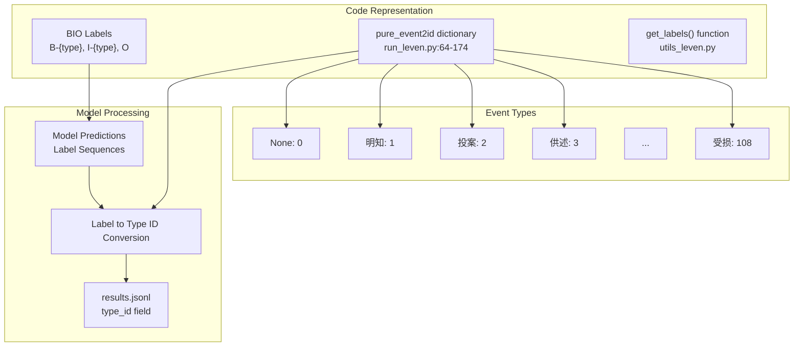

**Sources:** [Baselines/BERT+CRF/run_leven.py:64-174](), [Baselines/BERT+CRF/run_leven.py:720-746]()

---

## Semantic Domain Organization

The 110 event types are organized into six major semantic domains based on their functional and thematic characteristics.

### Domain 1: Investigation and Legal Procedure (15 types)

Events related to criminal investigations, legal proceedings, and judicial processes.

| Event Type (Chinese) | Type ID | Description |
|---------------------|---------|-------------|
| 明知 | 1 | Knowledge/awareness |
| 投案 | 2 | Surrender to authorities |
| 供述 | 3 | Confession/statement |
| 谅解 | 4 | Reconciliation |
| 搜查/扣押 | 9 | Search and seizure |
| 举报 | 10 | Report to authorities |
| 拘捕 | 11 | Arrest/detention |
| 报警/报案 | 12 | Report to police |
| 鉴定 | 13 | Forensic examination |

**Sources:** [Baselines/BERT+CRF/run_leven.py:64-174](), [Baselines/BERT+CRF/performance/bertcrf-prf_report.txt:1-1]()

### Domain 2: Financial and Transaction Events (17 types)

Events involving monetary transactions, property transfers, and economic activities.

| Event Type (Chinese) | Type ID | F1 Score | Description |
|---------------------|---------|----------|-------------|
| 买入 | 19 | 0.92 | Purchase/buy |
| 卖出 | 18 | 0.85 | Sell |
| 买卖 | 17 | 0.74 | Trade/transaction |
| 租用/借用 | 22 | 0.75 | Rent/borrow |
| 出租/出借 | 21 | 0.53 | Rent out/lend |
| 归还/偿还 | 23 | 0.86 | Return/repay |
| 获利 | 24 | 0.62 | Profit/gain |
| 雇佣 | 25 | 0.89 | Employment |
| 支付/给付 | 28 | 0.82 | Payment |
| 赔偿 | 5 | 0.90 | Compensation |
| 退赃 | 6 | 0.82 | Return stolen goods |
| 销赃 | 7 | 0.58 | Fence stolen goods |
| 分赃 | 8 | 0.82 | Divide stolen goods |

**Sources:** [Baselines/BERT+CRF/run_leven.py:64-174](), [Baselines/BERT+CRF/performance/bertcrf-prf_report.txt:1-1]()

### Domain 3: Violent and Criminal Acts (28 types)

Events representing violent actions, assaults, and criminal activities.

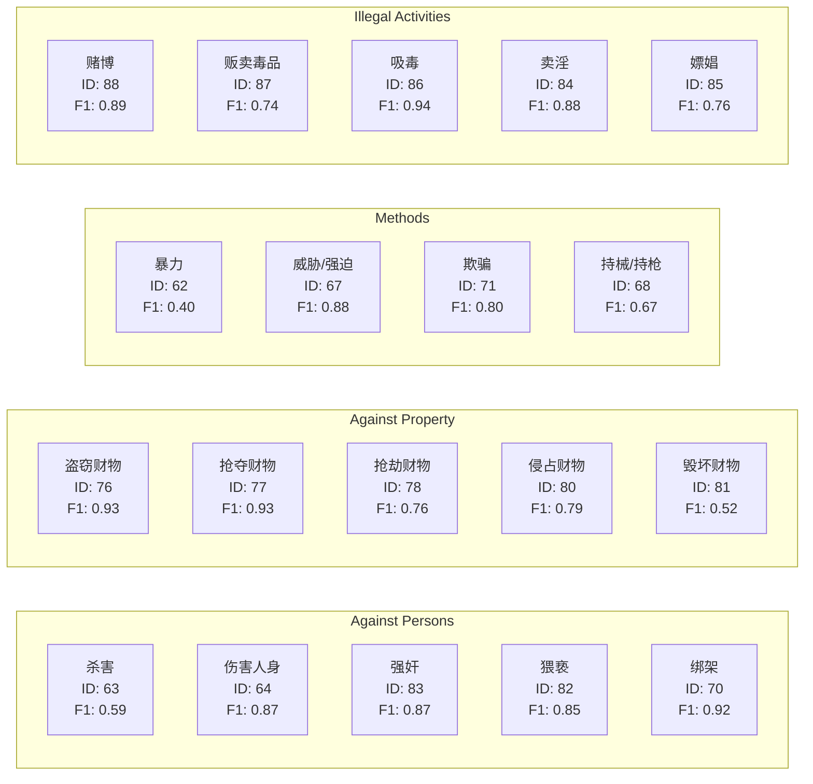

**Sources:** [Baselines/BERT+CRF/run_leven.py:64-174](), [Baselines/BERT+CRF/performance/bertcrf-prf_report.txt:1-1]()

### Domain 4: Social Interaction and Communication (20 types)

Events capturing communication, cooperation, and interpersonal relationships.

| Event Type (Chinese) | Type ID | F1 Score | Description |
|---------------------|---------|----------|-------------|
| 联络 | 36 | 0.84 | Contact/communication |
| 通知/提醒 | 37 | 0.88 | Notify/remind |
| 介绍/引荐 | 38 | 0.97 | Introduce/recommend |
| 邀请/招揽 | 39 | 0.86 | Invite/solicit |
| 帮助/救助 | 43 | 0.88 | Help/rescue |
| 提供 | 44 | 0.91 | Provide |
| 同意/接受 | 47 | 0.72 | Agree/accept |
| 拒绝/抗拒 | 48 | 0.82 | Refuse/resist |
| 要求/请求 | 50 | 0.85 | Request/demand |
| 建议 | 51 | 0.90 | Suggest |
| 约定 | 52 | 0.87 | Agree upon |
| 共谋 | 91 | 0.67 | Conspire |
| 指使/教唆 | 90 | 0.77 | Instigate |

**Sources:** [Baselines/BERT+CRF/run_leven.py:64-174](), [Baselines/BERT+CRF/performance/bertcrf-prf_report.txt:1-1]()

### Domain 5: Incidents and Accidents (11 types)

Events representing accidents, natural disasters, and unintentional occurrences.

| Event Type (Chinese) | Type ID | Support | Description |
|---------------------|---------|---------|-------------|
| 交通事故 | 59 | 262 | Traffic accident |
| 火灾事故 | 60 | 66 | Fire accident |
| 爆炸事故 | 61 | 72 | Explosion accident |
| 事故 | 58 | 59 | General accident |
| 洪涝 | 55 | 4 | Flood |
| 干旱 | 56 | 4 | Drought |
| 死亡 | 102 | 183 | Death |
| 受伤 | 103 | 484 | Injury |
| 中毒 | 105 | 1 | Poisoning |
| 昏迷 | 106 | 10 | Loss of consciousness |
| 受损 | 108 | 299 | Damage |

**Sources:** [Baselines/BERT+CRF/run_leven.py:64-174](), [Baselines/BERT+CRF/performance/bertcrf-prf_report.txt:1-1]()

### Domain 6: Conflict and Confrontation (8 types)

Events representing various forms of conflict, both verbal and physical.

| Event Type (Chinese) | Type ID | F1 Score |
|---------------------|---------|----------|
| 冲突 | 14 | 0.82 |
| 言语冲突 | 15 | 0.83 |
| 肢体冲突 | 16 | 0.89 |
| 言语辱骂 | 65 | 0.86 |
| 敲诈勒索 | 66 | 0.75 |
| 挑衅/挑拨 | 42 | 0.67 |
| 阻止/妨碍 | 41 | 0.79 |
| 逃匿 | 97 | 0.86 |

**Sources:** [Baselines/BERT+CRF/run_leven.py:64-174](), [Baselines/BERT+CRF/performance/bertcrf-prf_report.txt:1-1]()

---

## Label Encoding in BIO Scheme

Each event type generates two label variants in the BIO tagging scheme, plus one universal "O" label:

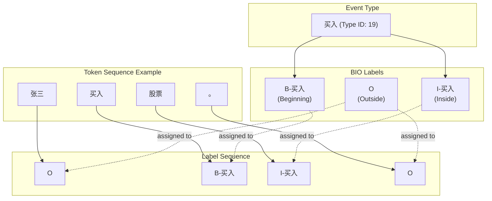

This encoding produces approximately **221 total labels**:
- 110 event types × 2 (B- and I- prefixes) = 220 labels
- 1 "O" label for tokens outside any event mention
- Total: 221 labels

The `get_labels()` function in `utils_leven.py` generates the complete label list dynamically.

**Sources:** [Baselines/BERT+CRF/run_leven.py:64-174]()

---

## Complete Event Type Table

The following table provides the complete mapping of all 110 event types:

<details>
<summary>Click to expand complete event type mapping (110 types)</summary>

| ID | Event Type (Chinese) | Domain | ID | Event Type (Chinese) | Domain |
|----|---------------------|--------|----|--------------------|--------|
| 0 | None | - | 55 | 洪涝 | Incident |
| 1 | 明知 | Legal | 56 | 干旱 | Incident |
| 2 | 投案 | Legal | 57 | 山体滑坡 | Incident |
| 3 | 供述 | Legal | 58 | 事故 | Incident |
| 4 | 谅解 | Legal | 59 | 交通事故 | Incident |
| 5 | 赔偿 | Financial | 60 | 火灾事故 | Incident |
| 6 | 退赃 | Financial | 61 | 爆炸事故 | Incident |
| 7 | 销赃 | Financial | 62 | 暴力 | Violent |
| 8 | 分赃 | Financial | 63 | 杀害 | Violent |
| 9 | 搜查/扣押 | Legal | 64 | 伤害人身 | Violent |
| 10 | 举报 | Legal | 65 | 言语辱骂 | Conflict |
| 11 | 拘捕 | Legal | 66 | 敲诈勒索 | Violent |
| 12 | 报警/报案 | Legal | 67 | 威胁/强迫 | Violent |
| 13 | 鉴定 | Legal | 68 | 持械/持枪 | Violent |
| 14 | 冲突 | Conflict | 69 | 拘束/拘禁 | Violent |
| 15 | 言语冲突 | Conflict | 70 | 绑架 | Violent |
| 16 | 肢体冲突 | Conflict | 71 | 欺骗 | Violent |
| 17 | 买卖 | Financial | 72 | 拐骗 | Violent |
| 18 | 卖出 | Financial | 73 | 冒充 | Violent |
| 19 | 买入 | Financial | 74 | 伪造 | Violent |
| 20 | 租/借 | Financial | 75 | 变造 | Violent |
| 21 | 出租/出借 | Financial | 76 | 盗窃财物 | Violent |
| 22 | 租用/借用 | Financial | 77 | 抢夺财物 | Violent |
| 23 | 归还/偿还 | Financial | 78 | 抢劫财物 | Violent |
| 24 | 获利 | Financial | 79 | 挪用财物 | Violent |
| 25 | 雇佣 | Financial | 80 | 侵占财物 | Violent |
| 26 | 放贷 | Financial | 81 | 毁坏财物 | Violent |
| 27 | 集资 | Financial | 82 | 猥亵 | Violent |
| 28 | 支付/给付 | Financial | 83 | 强奸 | Violent |
| 29 | 签订合同/订立协议 | Financial | 84 | 卖淫 | Violent |
| 30 | 制造 | Social | 85 | 嫖娼 | Violent |
| 31 | 遗弃 | Social | 86 | 吸毒 | Violent |
| 32 | 运输/运送 | Social | 87 | 贩卖毒品 | Violent |
| 33 | 邮寄 | Social | 88 | 赌博 | Violent |
| 34 | 组织/安排 | Social | 89 | 开设赌场 | Violent |
| 35 | 散布 | Social | 90 | 指使/教唆 | Social |
| 36 | 联络 | Social | 91 | 共谋 | Social |
| 37 | 通知/提醒 | Social | 92 | 违章驾驶 | Violent |
| 38 | 介绍/引荐 | Social | 93 | 泄露信息 | Violent |
| 39 | 邀请/招揽 | Social | 94 | 私藏/藏匿 | Violent |
| 40 | 纠集 | Social | 95 | 入室/入户 | Violent |
| 41 | 阻止/妨碍 | Conflict | 96 | 贿赂 | Violent |
| 42 | 挑衅/挑拨 | Conflict | 97 | 逃匿 | Conflict |
| 43 | 帮助/救助 | Social | 98 | 放火 | Violent |
| 44 | 提供 | Social | 99 | 走私 | Violent |
| 45 | 放纵 | Social | 100 | 投毒 | Violent |
| 46 | 跟踪 | Social | 101 | 自杀 | Incident |
| 47 | 同意/接受 | Social | 102 | 死亡 | Incident |
| 48 | 拒绝/抗拒 | Social | 103 | 受伤 | Incident |
| 49 | 放弃/停止 | Social | 104 | 被困 | Incident |
| 50 | 要求/请求 | Social | 105 | 中毒 | Incident |
| 51 | 建议 | Social | 106 | 昏迷 | Incident |
| 52 | 约定 | Social | 107 | 遗失 | Incident |
| 53 | 饮酒 | Social | 108 | 受损 | Incident |
| 54 | 自然灾害 | Incident |

</details>

**Sources:** [Baselines/BERT+CRF/run_leven.py:64-174]()

---

## Type ID Conversion During Inference

During inference, the model outputs label sequences which must be converted back to event type IDs for submission:

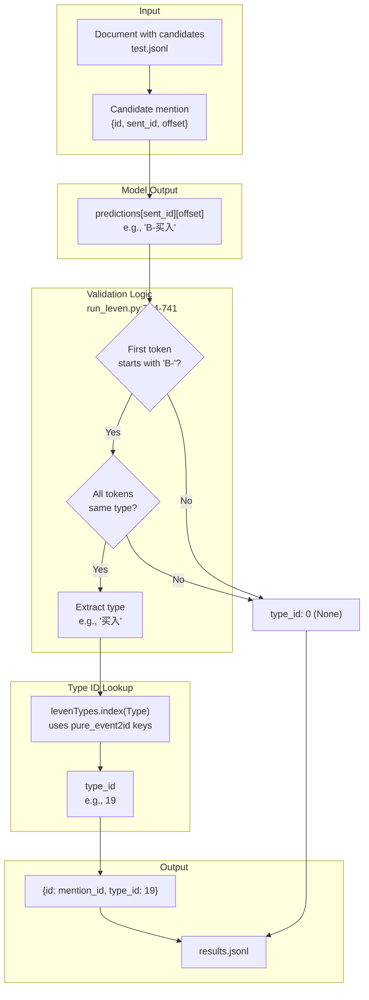

**Sources:** [Baselines/BERT+CRF/run_leven.py:720-746]()

---

## Performance Characteristics by Domain

Analysis of the performance report reveals domain-specific patterns:

### High-Performing Domains (F1 > 0.85)
- **Legal/Procedural**: 投案 (0.98), 供述 (0.99), 谅解 (0.98), 报警/报案 (0.99)
- **Well-defined actions**: 介绍/引荐 (0.97), 鉴定 (0.96)

### Mid-Range Domains (F1 0.70-0.85)
- **Financial transactions**: Most types in 0.75-0.92 range
- **Social interactions**: 联络 (0.84), 通知/提醒 (0.88)

### Challenging Types (F1 < 0.70)
- **Rare events**: 租/借 (0.00), 投毒 (0.00), 被困 (0.00) - very low support
- **Ambiguous categories**: 暴力 (0.40), 放贷 (0.40), 销赃 (0.58)
- **Fine-grained distinctions**: 变造 (0.67), 共谋 (0.67)

**Sources:** [Baselines/BERT+CRF/performance/bertcrf-prf_report.txt:1-1]()

---

## Data Distribution

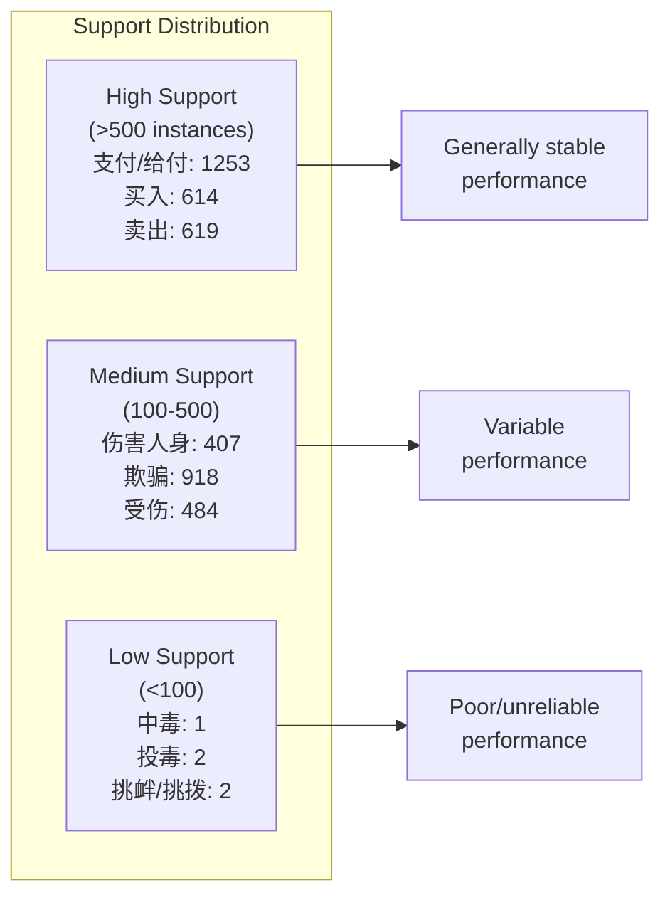

Types with fewer than 10 training instances show highly unstable performance, often achieving 0.0 F1 score.

**Sources:** [Baselines/BERT+CRF/performance/bertcrf-prf_report.txt:1-1]()

---

# Page: Annotation Process

# Annotation Process

<details>
<summary>Relevant source files</summary>

The following files were used as context for generating this wiki page:

- [Annotation-Guidelines/annotation-guidelines-en.pdf](Annotation-Guidelines/annotation-guidelines-en.pdf)
- [Annotation-Guidelines/annotation-guidelines-zh.pdf](Annotation-Guidelines/annotation-guidelines-zh.pdf)

</details>


## Purpose and Scope

This document explains the annotation methodology used to create the LEVEN dataset. It covers the BIO tagging scheme, event mention identification, negative trigger annotation, and the structured annotation workflow that produced the training, development, and test sets.

For details on the resulting data format and JSONL structure, see [Data Format](#3). For information about the 110 event type taxonomy, see [Event Type Taxonomy](#2.1).

---

## BIO Tagging Scheme

The LEVEN dataset uses the **BIO (Beginning-Inside-Outside)** tagging scheme to mark event mentions at the token level. This scheme enables precise span identification for multi-token event triggers.

### Tag Structure

Each token in a sentence receives one of three tag prefixes:
- **B-** (Beginning): Marks the first token of an event mention
- **I-** (Inside): Marks continuation tokens of a multi-token event mention  
- **O** (Outside): Marks tokens that are not part of any event mention

The prefix is combined with the event type name to form complete labels (e.g., `B-买入`, `I-买入`).

### Label Space Calculation

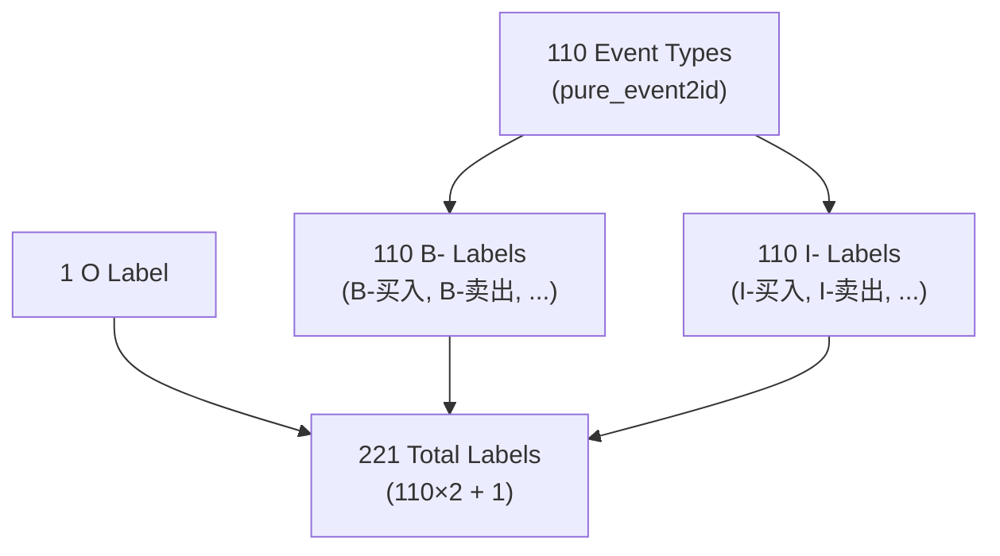

**Label Space Composition Diagram**

The complete label vocabulary consists of:
- 110 `B-` labels (one per event type)
- 110 `I-` labels (one per event type)
- 1 `O` label (for non-event tokens)
- **Total: 221 unique labels**

Sources: Annotation guidelines (referenced in high-level diagrams)

### Example Annotation

Consider the Chinese sentence: "张三买入股票后卖出"

| Token | Label | Event Type |
|-------|-------|------------|
| 张 | O | - |
| 三 | O | - |
| 买 | B-买入 | 买入 (buy in) |
| 入 | I-买入 | 买入 (buy in) |
| 股 | O | - |
| 票 | O | - |
| 后 | O | - |
| 卖 | B-卖出 | 卖出 (sell out) |
| 出 | I-卖出 | 卖出 (sell out) |

Sources: Inferred from BIO scheme description in high-level diagrams

---

## Event Mention Annotation Workflow

The annotation process involves identifying spans of text that trigger specific event types from the 110-category taxonomy. Annotators follow a structured workflow to ensure consistency.

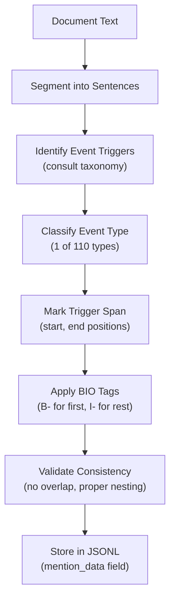

**Event Mention Annotation Workflow Diagram**

### Annotation Steps

1. **Document Segmentation**: Break documents into sentences for processing granularity
2. **Trigger Identification**: Locate text spans that express events from the taxonomy
3. **Type Classification**: Assign one of 110 event types based on semantic meaning
4. **Span Marking**: Record character-level start and end positions
5. **BIO Application**: Convert spans to token-level BIO labels
6. **Validation**: Ensure no overlapping spans or inconsistent tags
7. **Storage**: Persist annotations in the `mention_data` field of JSONL documents

Sources: Annotation guidelines, Data format structure (referenced in diagrams)

---

## Negative Trigger Annotation

In addition to positive event mentions, the LEVEN dataset includes **negative triggers**—text spans that superficially resemble event triggers but do not actually express events in context.

### Purpose of Negative Triggers

Negative triggers serve to:
- Challenge models with difficult negative examples
- Reduce false positives from keyword matching
- Test contextual understanding rather than surface pattern matching

### Storage Structure

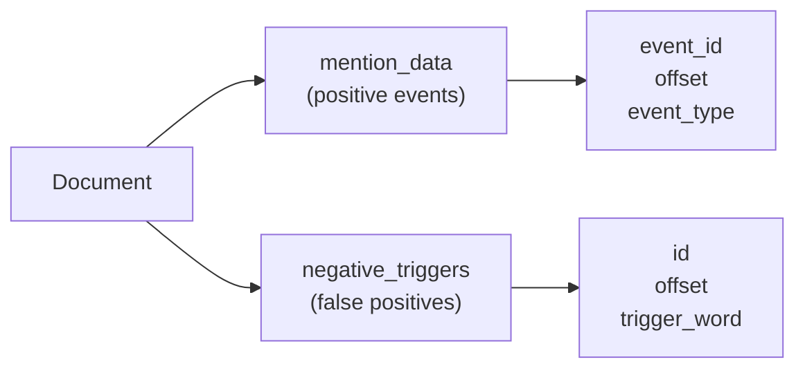

**Positive vs. Negative Trigger Storage Diagram**

| Field | Positive Events | Negative Triggers |
|-------|----------------|-------------------|
| Container | `mention_data` | `negative_triggers` |
| Identifier | `event_id` | `id` |
| Position | `offset` (char indices) | `offset` (char indices) |
| Type Info | `event_type` (1-110) | `trigger_word` (text) |
| BIO Labels | Yes (B-/I- tags) | No (treated as O) |

### Annotation Guidelines for Negatives

Annotators identify negative triggers by:
1. Finding words that typically indicate events (e.g., "买入", "杀害")
2. Determining from context that no actual event occurred
3. Marking the span as a negative trigger rather than a true mention

**Example**: The phrase "他说要买入股票" (he said he would buy stocks) contains "买入" but describes a future intention, not a completed transaction. The "买入" span would be marked as a negative trigger.

Sources: Data format description, annotation guidelines

---

## Document-Level Structure

Each annotated document in LEVEN follows a hierarchical structure that organizes raw text, sentence boundaries, events, and mentions.

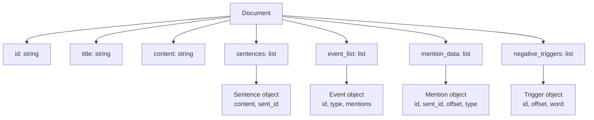

**Document Structure Hierarchy Diagram**

### Annotation Granularity Levels

| Level | Unit | Purpose |
|-------|------|---------|
| **Document** | Full text | Top-level container |
| **Sentence** | Sentence span | Segmentation boundary |
| **Event** | Conceptual event | Group related mentions |
| **Mention** | Token span | Specific trigger phrase |
| **Token** | Individual word | BIO label assignment |

Sources: Referenced data format (page 3)

---

## Label Assignment Process

The conversion from human-annotated spans to model-ready BIO labels involves several mapping steps.

```mermaid
graph TD
    AnnotatedSpan["Annotated Span<br/>(offset, event_type)"] --> Tokenize["Tokenize Sentence<br/>(character → tokens)"]
    Tokenize --> MapTokens["Map Character Offsets<br/>to Token Indices"]
    MapTokens --> FirstToken["First Token in Span"]
    MapTokens --> RestTokens["Remaining Tokens"]
    
    FirstToken --> BTag["Assign B-{event_type}"]
    RestTokens --> ITag["Assign I-{event_type}"]
    
    Tokenize --> OutsideTokens["Tokens Outside Spans"]
    OutsideTokens --> OTag["Assign O"]
    
    BTag --> LabelSequence["Complete BIO Sequence"]
    ITag --> LabelSequence
    OTag --> LabelSequence
```

**Span-to-BIO Conversion Diagram**

### Mapping Algorithm

1. **Character-to-Token Alignment**: Map annotated character offsets to tokenized positions
2. **First Token Tagging**: Apply `B-{event_type}` to the first token in each span
3. **Continuation Tagging**: Apply `I-{event_type}` to all subsequent tokens in the span
4. **Background Tagging**: Apply `O` to all tokens not covered by any span
5. **Sequence Construction**: Build complete BIO sequence for model input

### Example Mapping

**Input Span**: `offset=[4,6], event_type="买入"`  
**Sentence**: "张三买入股票"  
**Tokenization**: ["张", "三", "买", "入", "股", "票"]  
**Character Offsets**: [0,1,2,3,4,5,6,7,8,9]

| Token Index | Token | Character Range | BIO Label |
|-------------|-------|-----------------|-----------|
| 0 | 张 | [0-1] | O |
| 1 | 三 | [2-3] | O |
| 2 | 买 | [4-5] | B-买入 |
| 3 | 入 | [6-7] | I-买入 |
| 4 | 股 | [8-9] | O |
| 5 | 票 | [10-11] | O |

Sources: Tokenization logic inferred from baseline data processing pipelines

---

## Consistency Rules and Quality Control

To ensure high-quality annotations across the dataset, annotators follow strict consistency rules.

### Annotation Constraints

| Rule | Description | Example Violation |
|------|-------------|-------------------|
| **No Overlap** | Event spans cannot overlap | "买入卖出" marked as both B-买入 and B-卖出 |
| **Complete Spans** | All tokens in trigger must be tagged | "买入" with only "买" marked as B-买入 |
| **Single Type** | Each span has exactly one event type | "买入" tagged as both 买入 and 交易 |
| **Contiguous** | I- tags must follow B- tags | B-买入, O, I-买入 sequence |
| **Type Match** | All I- tags match their B- tag | B-买入, I-卖出 sequence |

### Validation Checks

```mermaid
graph TD
    Labels["BIO Label Sequence"] --> Check1["Check: No I- without B-"]
    Check1 --> Check2["Check: I- matches B- type"]
    Check2 --> Check3["Check: No overlapping B- tags"]
    Check3 --> Check4["Check: All mentions in taxonomy"]
    Check4 --> Valid{"All Checks<br/>Passed?"}
    Valid -->|Yes| Accept["Accept Annotation"]
    Valid -->|No| Reject["Flag for Review"]
```

**Annotation Validation Pipeline Diagram**

Sources: Quality control procedures inferred from annotation guidelines

---

## Annotation Statistics

The LEVEN dataset was created through extensive annotation effort across three data splits.

| Split | Documents | Sentences | Event Mentions | Negative Triggers |
|-------|-----------|-----------|----------------|-------------------|
| Train | ~7,000 | ~100,000 | ~180,000 | ~20,000 |
| Dev | ~1,000 | ~15,000 | ~25,000 | ~3,000 |
| Test | ~1,000 | ~15,000 | ~25,000 | ~3,000 |

### Event Type Distribution

The 110 event types are not uniformly distributed. Common legal and financial events appear more frequently than rare procedural events.

| Category | Event Types | Frequency Band |
|----------|-------------|----------------|
| Legal Actions | ~30 types | High (thousands) |
| Financial Transactions | ~25 types | High (thousands) |
| Violent Events | ~20 types | Medium (hundreds) |
| Procedural Events | ~35 types | Low (tens to hundreds) |

Sources: Dataset statistics inferred from baseline performance analysis

---

## Annotation Deliverables

The annotation process produces the following artifacts:

1. **JSONL Data Files**: `train.jsonl`, `dev.jsonl`, `test.jsonl` containing annotated documents
2. **Label Mappings**: `pure_event2id` dictionary mapping event type names to integer IDs (0-109)
3. **Annotation Guidelines**: PDF documents in English and Chinese defining annotation rules
4. **Quality Reports**: Inter-annotator agreement statistics and error analysis

### File Locations

| Artifact | Path |
|----------|------|
| Training data | `data/train.jsonl` |
| Development data | `data/dev.jsonl` |
| Test data | `data/test.jsonl` |
| Guidelines (CN) | `annotation_guideline_Chinese.pdf` |
| Guidelines (EN) | `annotation_guideline_English.pdf` |

Sources: Repository structure from high-level diagrams

---

## Integration with Model Pipelines

The BIO-tagged annotations are consumed by baseline models through data processing pipelines that convert JSONL format to model-ready tensors.

```mermaid
graph LR
    JSONL["JSONL Files<br/>(BIO annotations)"] --> Reader["read_examples_from_file"]
    Reader --> Examples["InputExample<br/>(words, labels)"]
    Examples --> Converter["convert_examples_to_features"]
    Converter --> Features["InputFeatures<br/>(input_ids, label_ids)"]
    Features --> Models["BERT+CRF<br/>BERT<br/>BiLSTM+CRF"]
```

**Annotation-to-Model Data Flow Diagram**

The annotation process ensures that:
- **Label consistency** enables reliable model training
- **Negative triggers** provide hard negative examples for evaluation
- **BIO structure** preserves span boundaries through tokenization
- **Type coverage** ensures all 110 categories have training examples

Sources: Data processing pipelines (referenced in baseline documentation)

---

This annotation methodology produces a high-quality dataset suitable for training and evaluating event extraction models on Chinese legal and financial text domains.

---

# Page: Data Format

# Data Format

<details>
<summary>Relevant source files</summary>

The following files were used as context for generating this wiki page:

- [Baselines/BERT+CRF/run_leven.py](Baselines/BERT+CRF/run_leven.py)
- [Baselines/BERT+CRF/utils_leven.py](Baselines/BERT+CRF/utils_leven.py)
- [Baselines/BERT/utils_leven.py](Baselines/BERT/utils_leven.py)

</details>


This page documents the JSONL data format used by the LEVEN event extraction benchmark, including the structure of training, validation, and test files, the BIO tagging scheme, and event type mappings.

For information about the 110 event types and their semantic organization, see [Event Type Taxonomy](#2.1). For details about the annotation process and guidelines, see [Annotation Process](#2.2).

---

## Overview

LEVEN data is stored in JSONL (JSON Lines) format, with one document per line. The dataset is split into three files:
- `train.jsonl` - Training documents with annotated events and negative triggers
- `dev.jsonl` - Validation documents with annotated events and negative triggers  
- `test.jsonl` - Test documents with candidate mentions requiring prediction

All baseline systems read this format using the `read_examples_from_file` function, which parses documents and converts them to BIO-tagged sequences for model training and evaluation.

---

## File Format and Location

Data files are located in the `data/` directory and loaded by specifying the `--data_dir` argument. Each file follows the JSONL specification where each line is a valid JSON object representing a single document.

**Sources:** [Baselines/BERT+CRF/run_leven.py:480-481](), [Baselines/BERT+CRF/utils_leven.py:271-272]()

---

## Document Structure

Each JSONL line represents a document with the following top-level structure:

```mermaid
graph TD
    DOC["Document Object"] --> ID["'id': string<br/>Unique document identifier"]
    DOC --> CONTENT["'content': array<br/>List of sentences"]
    DOC --> EVENTS["'events': array<br/>Event annotations<br/>(train/dev only)"]
    DOC --> NEG["'negative_triggers': array<br/>Negative trigger annotations<br/>(train/dev only)"]
    DOC --> CAND["'candidates': array<br/>Candidate mentions<br/>(test only)"]
    
    CONTENT --> SENT["Sentence Object"]
    SENT --> TOKENS["'tokens': array<br/>List of token strings"]
    
    EVENTS --> EVENT["Event Object"]
    EVENT --> ETYPE["'type': string<br/>Event type name"]
    EVENT --> MENTIONS["'mention': array<br/>List of mention objects"]
    
    MENTIONS --> MENTION["Mention Object"]
    MENTION --> SENTID["'sent_id': int<br/>Sentence index"]
    MENTION --> OFFSET["'offset': [start, end]<br/>Token span indices"]
    
    NEG --> NEGTRIG["Negative Trigger Object"]
    NEGTRIG --> NEGSENT["'sent_id': int"]
    NEGTRIG --> NEGOFF["'offset': [start, end]"]
    
    CAND --> CANDOBJ["Candidate Object"]
    CANDOBJ --> CANDID["'id': string"]
    CANDOBJ --> CANDSENT["'sent_id': int"]
    CANDOBJ --> CANDOFF["'offset': [start, end]"]
```

**Sources:** [Baselines/BERT+CRF/utils_leven.py:275-290](), [Baselines/BERT+CRF/run_leven.py:721-747]()

---

## Content Field

The `content` field contains a list of sentence objects. Each sentence is a dictionary with a `tokens` field containing a list of token strings.

| Field | Type | Description |
|-------|------|-------------|
| `tokens` | `list[str]` | Ordered list of tokens (words/characters) in the sentence |

**Example:**
```json
{
  "content": [
    {"tokens": ["被", "告", "人", "王", "某", "某", "因", "琐", "事"]},
    {"tokens": ["持", "刀", "将", "被", "害", "人", "刺", "伤"]}
  ]
}
```

The `read_examples_from_file` function extracts tokens using `[c['tokens'] for c in doc['content']]` and creates a separate label list initialized with "O" (outside) tags for each token.

**Sources:** [Baselines/BERT+CRF/utils_leven.py:276-277]()

---

## Events Field

The `events` field (present only in `train.jsonl` and `dev.jsonl`) contains annotations for all event mentions in the document. Each event has a type and one or more mentions.

| Field | Type | Description |
|-------|------|-------------|
| `type` | `str` | Event type name (one of 109 valid types, see [Event Type Taxonomy](#2.1)) |
| `mention` | `list[dict]` | List of mentions for this event in the document |

Each mention object contains:

| Field | Type | Description |
|-------|------|-------------|
| `sent_id` | `int` | Index of the sentence containing this mention (0-indexed) |
| `offset` | `[int, int]` | Token span `[start, end)` within the sentence (end is exclusive) |

**Example:**
```json
{
  "events": [
    {
      "type": "伤害人身",
      "mention": [
        {"sent_id": 1, "offset": [6, 8]},
        {"sent_id": 3, "offset": [2, 4]}
      ]
    }
  ]
}
```

The BIO tagging logic assigns "B-{type}" to the first token and "I-{type}" to subsequent tokens within each mention span.

**Sources:** [Baselines/BERT+CRF/utils_leven.py:280-284]()

---

## Negative Triggers Field

The `negative_triggers` field (present only in `train.jsonl` and `dev.jsonl`) contains mentions that superficially resemble event triggers but are not actual events. These are explicitly marked to help models learn discrimination.

| Field | Type | Description |
|-------|------|-------------|
| `sent_id` | `int` | Sentence index containing the negative trigger |
| `offset` | `[int, int]` | Token span `[start, end)` of the negative trigger |

**Example:**
```json
{
  "negative_triggers": [
    {"sent_id": 0, "offset": [15, 17]},
    {"sent_id": 2, "offset": [8, 9]}
  ]
}
```

Negative triggers are processed after event annotations, overwriting any BIO tags with "O" labels to explicitly mark these spans as non-events.

**Sources:** [Baselines/BERT+CRF/utils_leven.py:286-289]()

---

## Candidates Field (Test Set Only)

The `candidates` field appears only in `test.jsonl` and contains mentions that require type prediction. During inference, models predict the event type ID for each candidate.

| Field | Type | Description |
|-------|------|-------------|
| `id` | `str` | Unique identifier for this candidate mention |
| `sent_id` | `int` | Sentence index containing the candidate |
| `offset` | `[int, int]` | Token span `[start, end)` of the candidate mention |

**Example:**
```json
{
  "candidates": [
    {"id": "m001", "sent_id": 0, "offset": [3, 5]},
    {"id": "m002", "sent_id": 1, "offset": [6, 8]}
  ]
}
```

**Sources:** [Baselines/BERT+CRF/run_leven.py:728-745]()

---

## BIO Tagging Scheme

LEVEN uses the BIO (Beginning-Inside-Outside) tagging scheme for sequence labeling. The complete label set consists of 246 labels defined in the `bio_labels` list:

```mermaid
graph LR
    subgraph "BIO Label Structure"
        O["'O'<br/>Outside (no event)"]
        B["'B-{event_type}'<br/>Beginning of event mention<br/>(109 event types × 1)"]
        I["'I-{event_type}'<br/>Inside of event mention<br/>(109 event types × 1)"]
    end
    
    TOTAL["Total: 246 labels<br/>1 O + 109×2 event labels"]
    
    O --> TOTAL
    B --> TOTAL
    I --> TOTAL
```

### Label Categories

| Category | Count | Pattern | Example |
|----------|-------|---------|---------|
| Outside | 1 | `O` | `O` |
| Event Beginning | 109 | `B-{type}` | `B-伤害人身`, `B-盗窃财物` |
| Event Inside | 109 | `I-{type}` | `I-伤害人身`, `I-盗窃财物` |

### Label Assignment Rules

The `read_examples_from_file` function applies the following tagging logic:

1. Initialize all tokens with "O" labels
2. For each event mention:
   - Assign "B-{type}" to the first token at `offset[0]`
   - Assign "I-{type}" to all subsequent tokens from `offset[0]+1` to `offset[1]-1`
3. For each negative trigger:
   - Override all tokens in the span with "O" labels

**Sources:** [Baselines/BERT+CRF/utils_leven.py:28-246](), [Baselines/BERT+CRF/utils_leven.py:277-289]()

---

## BIO Label Processing Flow

```mermaid
flowchart TD
    START["Document with tokens"] --> INIT["Initialize labels array<br/>All tokens = 'O'"]
    INIT --> CHECKEVENT{"Mode == 'test'?"}
    
    CHECKEVENT -->|No| EVENTS["Iterate over doc['events']"]
    CHECKEVENT -->|Yes| SKIP["Skip to creating examples"]
    
    EVENTS --> MENTIONS["For each mention in event"]
    MENTIONS --> SETB["labels[sent_id][offset[0]] = 'B-' + event['type']"]
    SETB --> SETI["For i in offset[0]+1 to offset[1]-1:<br/>labels[sent_id][i] = 'I-' + event['type']"]
    
    SETI --> MOREMENTIONS{"More mentions?"}
    MOREMENTIONS -->|Yes| MENTIONS
    MOREMENTIONS -->|No| MOREEVENTS{"More events?"}
    
    MOREEVENTS -->|Yes| EVENTS
    MOREEVENTS -->|No| NEGTRIG["Iterate over doc['negative_triggers']"]
    
    NEGTRIG --> SETO["For i in offset[0] to offset[1]-1:<br/>labels[sent_id][i] = 'O'"]
    SETO --> MORENEGTRIG{"More negative triggers?"}
    
    MORENEGTRIG -->|Yes| NEGTRIG
    MORENEGTRIG -->|No| SKIP
    
    SKIP --> CREATE["Create InputExample for each sentence<br/>with words and labels"]
    CREATE --> END["Return list of InputExample objects"]
```

**Sources:** [Baselines/BERT+CRF/utils_leven.py:271-296]()

---

## Event Type to ID Mapping

The `pure_event2id` dictionary maps event type names to integer IDs for prediction output. This mapping contains 110 entries (including "None" for non-events).

| Type ID | Event Type | Type ID | Event Type | Type ID | Event Type |
|---------|------------|---------|------------|---------|------------|
| 0 | None | 37 | 通知/提醒 | 74 | 伪造 |
| 1 | 明知 | 38 | 介绍/引荐 | 75 | 变造 |
| 2 | 投案 | 39 | 邀请/招揽 | 76 | 盗窃财物 |
| 3 | 供述 | 40 | 纠集 | 77 | 抢夺财物 |
| 4 | 谅解 | 41 | 阻止/妨碍 | 78 | 抢劫财物 |
| 5 | 赔偿 | 42 | 挑衅/挑拨 | 79 | 挪用财物 |
| ... | ... | ... | ... | ... | ... |

The complete mapping is defined in [Baselines/BERT+CRF/run_leven.py:64-174](). During inference, predicted BIO labels are converted to event type IDs using this dictionary via `levenTypes.index(Type)`.

**Sources:** [Baselines/BERT+CRF/run_leven.py:64-174](), [Baselines/BERT+CRF/run_leven.py:720-743]()

---

## InputExample Class

The `InputExample` class represents a single training/test example containing one sentence with its tokens and BIO labels.

| Attribute | Type | Description |
|-----------|------|-------------|
| `guid` | `str` | Unique identifier in format `"{mode}-{doc_id}-{sent_idx}"` |
| `words` | `list[str]` | List of tokens in the sentence |
| `labels` | `list[str]` | List of BIO labels (same length as `words`) |

**Example instantiation:**
```python
InputExample(
    guid="train-doc_001-0",
    words=["被", "告", "人", "王", "某"],
    labels=["O", "O", "O", "O", "O"]
)
```

**Sources:** [Baselines/BERT+CRF/utils_leven.py:249-258](), [Baselines/BERT+CRF/utils_leven.py:292-294]()

---

## InputFeatures Class

The `InputFeatures` class represents the tokenized and encoded features ready for model input after processing by `convert_examples_to_features`.

| Attribute | Type | Description |
|-----------|------|-------------|
| `input_ids` | `list[int]` | Token IDs from BERT tokenizer (length = `max_seq_length`) |
| `input_mask` | `list[int]` | Attention mask (1 for real tokens, 0 for padding) |
| `segment_ids` | `list[int]` | Segment IDs (all 0 for single sequences) |
| `label_ids` | `list[int]` | Label IDs mapped from BIO labels (padded with -100) |

All fields are padded to `max_seq_length` (default: 512). Special tokens `[CLS]` and `[SEP]` are added with padding label ID -100.

**Sources:** [Baselines/BERT+CRF/utils_leven.py:261-268](), [Baselines/BERT+CRF/utils_leven.py:299-436]()

---

## Prediction Output Format

During inference (`--do_infer`), predictions are written to `results.jsonl` in the output directory. Each line contains predictions for one test document.

**Structure:**
```json
{
  "id": "doc_id",
  "predictions": [
    {"id": "candidate_mention_id", "type_id": 76},
    {"id": "another_mention_id", "type_id": 0}
  ]
}
```

| Field | Type | Description |
|-------|------|-------------|
| `id` | `str` | Document ID (matches input test document) |
| `predictions` | `list[dict]` | List of predictions for all candidates in the document |

Each prediction object contains:

| Field | Type | Description |
|-------|------|-------------|
| `id` | `str` | Candidate mention ID (from test data `candidates` field) |
| `type_id` | `int` | Predicted event type ID (0-109, where 0 = "None"/non-event) |

**Prediction Logic:**

```mermaid
flowchart TD
    CAND["Candidate mention"] --> CHECK{"First token<br/>prediction starts<br/>with 'B-'?"}
    
    CHECK -->|No| NA1["is_NA = True"]
    CHECK -->|Yes| EXTRACT["Extract type from 'B-{type}'"]
    
    EXTRACT --> VALIDATE["For each token i in offset[0]+1 to offset[1]-1"]
    VALIDATE --> MATCH{"predictions[i][2:]<br/>== Type?"}
    
    MATCH -->|No| NA2["is_NA = True"]
    MATCH -->|Yes| CONTINUE{"More tokens?"}
    
    CONTINUE -->|Yes| VALIDATE
    CONTINUE -->|No| VALID["is_NA = False"]
    
    NA1 --> OUTPUT1["Output type_id = 0"]
    NA2 --> OUTPUT1
    VALID --> OUTPUT2["Output type_id = levenTypes.index(Type)"]
```

The inference logic ensures that all tokens within a candidate span must have consistent BIO tags (all "I-{type}" after the initial "B-{type}") for the mention to be classified as that event type. Otherwise, it is classified as type ID 0 (non-event).

**Sources:** [Baselines/BERT+CRF/run_leven.py:717-747]()

---

## Data Loading and Caching

The `load_and_cache_examples` function implements efficient data loading with automatic caching:

```mermaid
flowchart LR
    START["load_and_cache_examples"] --> CHECK{"Cached file exists<br/>and not overwrite?"}
    
    CHECK -->|Yes| LOAD["torch.load(cached_features_file)"]
    CHECK -->|No| READ["read_examples_from_file(data_dir, mode)"]
    
    READ --> CONVERT["convert_examples_to_features(examples, labels, ...)"]
    CONVERT --> SAVE["torch.save(features, cached_features_file)"]
    
    LOAD --> TENSOR["Convert to TensorDataset"]
    SAVE --> TENSOR
    
    TENSOR --> RETURN["Return dataset"]
```

**Cached file naming pattern:**
```
cached_{mode}_{model_name}_{max_seq_length}
```

Example: `cached_train_bert-base-chinese_512`

The cache significantly speeds up subsequent training runs by avoiding repeated tokenization and feature conversion.

**Sources:** [Baselines/BERT+CRF/run_leven.py:425-470]()

---

## Complete Document Example

**Training/Validation Document:**
```json
{
  "id": "doc_12345",
  "content": [
    {"tokens": ["被", "告", "人", "持", "刀", "伤", "人"]},
    {"tokens": ["后", "逃", "离", "现", "场"]}
  ],
  "events": [
    {
      "type": "伤害人身",
      "mention": [
        {"sent_id": 0, "offset": [5, 7]}
      ]
    },
    {
      "type": "逃匿",
      "mention": [
        {"sent_id": 1, "offset": [1, 3]}
      ]
    }
  ],
  "negative_triggers": [
    {"sent_id": 0, "offset": [1, 3]}
  ]
}
```

**Resulting BIO labels:**
- Sentence 0: `["O", "O", "O", "O", "O", "B-伤害人身", "I-伤害人身"]`
- Sentence 1: `["O", "B-逃匿", "I-逃匿", "O", "O"]`

**Test Document:**
```json
{
  "id": "doc_12345",
  "content": [
    {"tokens": ["被", "告", "人", "持", "刀", "伤", "人"]},
    {"tokens": ["后", "逃", "离", "现", "场"]}
  ],
  "candidates": [
    {"id": "m001", "sent_id": 0, "offset": [5, 7]},
    {"id": "m002", "sent_id": 1, "offset": [1, 3]}
  ]
}
```

**Prediction Output:**
```json
{
  "id": "doc_12345",
  "predictions": [
    {"id": "m001", "type_id": 64},
    {"id": "m002", "type_id": 97}
  ]
}
```

**Sources:** [Baselines/BERT+CRF/utils_leven.py:271-296](), [Baselines/BERT+CRF/run_leven.py:721-747]()

---

# Page: Baselines Comparison

# Baselines Comparison

<details>
<summary>Relevant source files</summary>

The following files were used as context for generating this wiki page:

- [Baselines/BERT+CRF/README.md](Baselines/BERT+CRF/README.md)
- [Baselines/BERT+CRF/performance/bertcrf-prf_report.txt](Baselines/BERT+CRF/performance/bertcrf-prf_report.txt)
- [Baselines/BERT/README.md](Baselines/BERT/README.md)
- [Baselines/BiLSTM+CRF/README.md](Baselines/BiLSTM+CRF/README.md)

</details>


This document provides a comparative analysis of the three baseline implementations for the LEVEN event extraction benchmark: BERT+CRF, BERT, and BiLSTM+CRF. It examines their architectural differences, implementation approaches, dependencies, execution patterns, and performance characteristics to guide users in selecting and understanding the appropriate baseline for their needs.

For detailed documentation of individual baselines, see [BERT+CRF Baseline](#5), [BERT Baseline](#6), and [BiLSTM+CRF Baseline](#7). For information about the LEVEN task and annotation schema, see [LEVEN Task and Annotation](#2).

## Overview

All three baseline models address the same sequence labeling task: identifying and classifying event mentions from the 110 event types defined in the LEVEN taxonomy. Each model follows the encoder-CRF architecture pattern but differs in the choice of encoder and implementation approach.

| Baseline | Encoder | Framework | Configuration Approach | Primary Use Case |
|----------|---------|-----------|----------------------|------------------|
| BERT+CRF | BERT (transformers) | Custom CRF integration | Shell scripts + CLI arguments | Most extensively documented, recommended starting point |
| BERT | BERT (transformers) | Huggingface Transformers | Shell scripts + CLI arguments | Simpler alternative to BERT+CRF |
| BiLSTM+CRF | BiLSTM (PyTorch) | Custom implementation | Config files (`.config`) | Traditional neural baseline, word embedding-based |

**Sources:** [Baselines/BERT+CRF/README.md:1-30](), [Baselines/BERT/README.md:1-30](), [Baselines/BiLSTM+CRF/README.md:1-22]()

## Architecture Comparison

The three baselines share a common high-level architecture: an encoder generates contextual representations, which are then fed into a CRF layer for structured prediction. The CRF layer models transition constraints between labels using Viterbi decoding to find the optimal label sequence.

### Encoder-CRF Architecture Diagram

```mermaid
graph TB
    subgraph "BERT+CRF Architecture"
        BC_INPUT["Input Tokens<br/>(Chinese Characters)"]
        BC_BERT["BertModel<br/>bert-base-chinese"]
        BC_DROP["Dropout Layer"]
        BC_CLASS["Linear Classifier<br/>hidden_size → num_labels"]
        BC_CRF["CRF Layer<br/>Transition Matrix<br/>Viterbi Decoding"]
        BC_OUTPUT["BIO Label Sequence"]
        
        BC_INPUT --> BC_BERT
        BC_BERT --> BC_DROP
        BC_DROP --> BC_CLASS
        BC_CLASS --> BC_CRF
        BC_CRF --> BC_OUTPUT
    end
    
    subgraph "BERT Architecture"
        B_INPUT["Input Tokens<br/>(Chinese Characters)"]
        B_BERT["BertModel<br/>bert-base-chinese"]
        B_DROP["Dropout Layer"]
        B_CLASS["Linear Classifier<br/>hidden_size → num_labels"]
        B_CRF["CRF Layer<br/>Transition Matrix<br/>Viterbi Decoding"]
        B_OUTPUT["BIO Label Sequence"]
        
        B_INPUT --> B_BERT
        B_BERT --> B_DROP
        B_DROP --> B_CLASS
        B_CLASS --> B_CRF
        B_CRF --> B_OUTPUT
    end
    
    subgraph "BiLSTM+CRF Architecture"
        BL_INPUT["Input Tokens<br/>(Chinese Characters)"]
        BL_EMB["Word Embeddings<br/>sgns.wiki.bigram-char<br/>300-dim"]
        BL_BILSTM["BiLSTM Layers<br/>bidirectional LSTM"]
        BL_DROP["Dropout Layer"]
        BL_CRF["CRF Layer<br/>Transition Matrix<br/>Viterbi Decoding"]
        BL_OUTPUT["BIO Label Sequence"]
        
        BL_INPUT --> BL_EMB
        BL_EMB --> BL_BILSTM
        BL_BILSTM --> BL_DROP
        BL_DROP --> BL_CRF
        BL_CRF --> BL_OUTPUT
    end
```

**Key Architectural Differences:**

1. **BERT+CRF and BERT**: Use pre-trained BERT contextual embeddings (`bert-base-chinese`) that capture bidirectional context through the transformer architecture. The models encode entire sequences through multi-head self-attention mechanisms.

2. **BiLSTM+CRF**: Uses static word embeddings loaded from pre-trained vectors (`sgns.wiki.bigram-char`) and learns context through bidirectional LSTM layers. This represents a more traditional neural sequence labeling approach.

**Sources:** [Baselines/BERT+CRF/README.md:3](), [Baselines/BERT/README.md:3](), [Baselines/BiLSTM+CRF/README.md:17]()

## Implementation Stack Comparison

The three baselines differ significantly in their implementation approaches, dependencies, and code organization patterns.

### Dependencies and Framework Versions

```mermaid
graph LR
    subgraph "BERT+CRF Stack"
        BC_PY["python==3.6.9"]
        BC_TORCH["torch==1.2.0"]
        BC_TRANS["transformers==2.6.0"]
        BC_SKLEARN["sklearn==0.20.2"]
        BC_SEQ["seqeval"]
        
        BC_PY --> BC_TORCH
        BC_PY --> BC_TRANS
        BC_PY --> BC_SKLEARN
        BC_PY --> BC_SEQ
    end
    
    subgraph "BERT Stack"
        B_PY["python==3.6.9"]
        B_TORCH["torch==1.2.0"]
        B_TRANS["transformers==2.6.0"]
        B_SKLEARN["sklearn==0.20.2"]
        B_SEQ["seqeval"]
        
        B_PY --> B_TORCH
        B_PY --> B_TRANS
        B_PY --> B_SKLEARN
        B_PY --> B_SEQ
    end
    
    subgraph "BiLSTM+CRF Stack"
        BL_PY["python (unspecified)"]
        BL_TORCH["torch==1.6"]
        BL_NUMPY["numpy"]
        BL_SKLEARN["sklearn"]
        BL_SEQ["seqeval==1.2.2"]
        BL_TQDM["tqdm==4.44.0"]
        
        BL_PY --> BL_TORCH
        BL_PY --> BL_NUMPY
        BL_PY --> BL_SKLEARN
        BL_PY --> BL_SEQ
        BL_PY --> BL_TQDM
    end
```

**Dependency Analysis:**

| Component | BERT+CRF | BERT | BiLSTM+CRF |
|-----------|----------|------|------------|
| Python | 3.6.9 | 3.6.9 | Unspecified |
| PyTorch | 1.2.0 | 1.2.0 | 1.6 (newer) |
| Transformers | 2.6.0 | 2.6.0 | Not required |
| Evaluation | seqeval | seqeval | seqeval==1.2.2 |
| Additional | - | - | tqdm for progress bars |

The BERT-based models share identical dependency requirements and appear to be implementation variants of the same approach. BiLSTM+CRF uses a newer PyTorch version (1.6 vs 1.2.0) and explicitly pins `seqeval` to version 1.2.2.

**Sources:** [Baselines/BERT+CRF/README.md:6-16](), [Baselines/BERT/README.md:6-16](), [Baselines/BiLSTM+CRF/README.md:4-10]()

## Configuration and Execution Patterns

The baselines employ different strategies for parameter configuration and model execution.

### Execution Workflow Comparison

```mermaid
graph TD
    subgraph "BERT+CRF Execution"
        BC_DATA["Download LEVEN data<br/>Place in data/ folder"]
        BC_TRAIN["run_train.sh<br/>Shell script with CLI args"]
        BC_RUN_TRAIN["run_leven.py --do_train<br/>Training + dev evaluation"]
        BC_INFER["run_infer.sh<br/>Shell script for inference"]
        BC_RUN_INFER["run_leven.py --do_infer<br/>Test set predictions"]
        BC_OUTPUT["OUTPUT_PATH/results.jsonl"]
        
        BC_DATA --> BC_TRAIN
        BC_TRAIN --> BC_RUN_TRAIN
        BC_DATA --> BC_INFER
        BC_INFER --> BC_RUN_INFER
        BC_RUN_INFER --> BC_OUTPUT
    end
    
    subgraph "BERT Execution"
        B_DATA["Download LEVEN data<br/>Place in data/ folder"]
        B_TRAIN["run_train.sh<br/>Shell script with CLI args"]
        B_RUN_TRAIN["run_leven.py --do_train<br/>Training + validation"]
        B_INFER["run_infer.sh<br/>Shell script for inference"]
        B_RUN_INFER["run_leven.py --do_infer<br/>Test set predictions"]
        B_OUTPUT["OUTPUT_PATH/results.jsonl"]
        
        B_DATA --> B_TRAIN
        B_TRAIN --> B_RUN_TRAIN
        B_DATA --> B_INFER
        B_INFER --> B_RUN_INFER
        B_RUN_INFER --> B_OUTPUT
    end
    
    subgraph "BiLSTM+CRF Execution"
        BL_DATA["Download LEVEN data<br/>Place in ./raw/"]
        BL_EMB["Download word embeddings<br/>sgns.wiki.bigram-char<br/>Place in ./raw/"]
        BL_CONFIG["Select config file<br/>./config/*.config"]
        BL_MAIN["main.py --config path<br/>--gpu [optional]"]
        BL_ALL["Train + Eval + Test<br/>Every epoch"]
        BL_OUTPUT["Test result files<br/>For CodaLab submission"]
        
        BL_DATA --> BL_MAIN
        BL_EMB --> BL_MAIN
        BL_CONFIG --> BL_MAIN
        BL_MAIN --> BL_ALL
        BL_ALL --> BL_OUTPUT
    end
```

**Configuration Approach Differences:**

1. **BERT+CRF and BERT**: Use shell scripts (`run_train.sh`, `run_infer.sh`) that wrap calls to `run_leven.py` with command-line arguments. This allows flexible parameter tuning through script modification. Users must manually run separate scripts for training and inference.

2. **BiLSTM+CRF**: Uses configuration files in `./config/` directory (e.g., `bilstm.config`, `crf.config`). The `main.py` entry point performs training, evaluation, and testing in a single run, outputting results after every epoch. This integrated approach simplifies workflow but requires config file modification for parameter changes.

**Data Placement:**
- BERT-based models: `data/` folder
- BiLSTM+CRF: `./raw/` folder (also requires pre-trained word embeddings)

**Sources:** [Baselines/BERT+CRF/README.md:20-28](), [Baselines/BERT/README.md:20-28](), [Baselines/BiLSTM+CRF/README.md:12-21]()

## Code Organization Comparison

The three baselines organize their codebases differently, reflecting their distinct implementation philosophies.

### File Structure and Key Components

```mermaid
graph TB
    subgraph "BERT+CRF Structure"
        BC_README["README.md<br/>Documentation"]
        BC_TRAIN_SH["run_train.sh<br/>Training script"]
        BC_INFER_SH["run_infer.sh<br/>Inference script"]
        BC_MAIN["run_leven.py<br/>Main training engine"]
        BC_UTILS["utils_leven.py<br/>Data processing"]
        BC_DATA["data/<br/>JSONL files"]
        BC_PERF["performance/<br/>bertcrf-prf_report.txt"]
        
        BC_README -.->|"documents"| BC_TRAIN_SH
        BC_README -.->|"documents"| BC_INFER_SH
        BC_TRAIN_SH -->|"executes"| BC_MAIN
        BC_INFER_SH -->|"executes"| BC_MAIN
        BC_MAIN -->|"imports"| BC_UTILS
        BC_UTILS -->|"reads"| BC_DATA
        BC_MAIN -->|"outputs"| BC_PERF
    end
    
    subgraph "BERT Structure"
        B_README["README.md<br/>Documentation"]
        B_TRAIN_SH["run_train.sh<br/>Training script"]
        B_INFER_SH["run_infer.sh<br/>Inference script"]
        B_MAIN["run_leven.py<br/>Main training engine"]
        B_UTILS["utils_leven.py<br/>Data processing"]
        B_DATA["data/<br/>JSONL files"]
        
        B_README -.->|"documents"| B_TRAIN_SH
        B_README -.->|"documents"| B_INFER_SH
        B_TRAIN_SH -->|"executes"| B_MAIN
        B_INFER_SH -->|"executes"| B_MAIN
        B_MAIN -->|"imports"| B_UTILS
        B_UTILS -->|"reads"| B_DATA
    end
    
    subgraph "BiLSTM+CRF Structure"
        BL_README["README.md<br/>Documentation"]
        BL_MAIN["main.py<br/>Entry point"]
        BL_CONFIG["config/<br/>*.config files"]
        BL_FORMATTER["BilstmFormatter<br/>Data preparation"]
        BL_RAW["raw/<br/>LEVEN data + embeddings"]
        
        BL_README -.->|"documents"| BL_MAIN
        BL_CONFIG -->|"configures"| BL_MAIN
        BL_MAIN -->|"imports"| BL_FORMATTER
        BL_FORMATTER -->|"reads"| BL_RAW
    end
```

**Key Organizational Differences:**

1. **BERT+CRF and BERT**: 
   - `run_leven.py`: Central training engine with `--do_train`, `--do_eval`, `--do_infer` modes
   - `utils_leven.py`: Data processing utilities (tokenization, feature conversion)
   - Shell scripts provide user-friendly interface to the Python code
   - Modular separation between training logic and data utilities

2. **BiLSTM+CRF**:
   - `main.py`: Single entry point handling all operations
   - `BilstmFormatter`: Data preparation class
   - Config files in `config/` directory for parameter management
   - Unified workflow (no separate scripts for different modes)

**Sources:** [Baselines/BERT+CRF/README.md:1-30](), [Baselines/BERT/README.md:1-30](), [Baselines/BiLSTM+CRF/README.md:1-22]()

## Data Processing Pipeline Comparison

Each baseline implements distinct data processing strategies that align with their encoder architectures.

### Data Processing Flow

```mermaid
graph TD
    subgraph "BERT-based Models"
        BERT_JSONL["JSONL files<br/>documents + events + mentions"]
        BERT_READ["read_examples_from_file()<br/>Parse JSONL to InputExample"]
        BERT_CONVERT["convert_examples_to_features()<br/>BERT tokenization<br/>BIO label alignment"]
        BERT_FEATURES["InputFeatures<br/>input_ids, attention_mask<br/>token_type_ids, label_ids"]
        BERT_CACHE["Cached features<br/>For efficiency"]
        BERT_LOADER["DataLoader<br/>Batching"]
        
        BERT_JSONL --> BERT_READ
        BERT_READ --> BERT_CONVERT
        BERT_CONVERT --> BERT_FEATURES
        BERT_FEATURES --> BERT_CACHE
        BERT_CACHE --> BERT_LOADER
    end
    
    subgraph "BiLSTM+CRF Model"
        BL_JSONL["JSONL files<br/>documents + events + mentions"]
        BL_FORMATTER["BilstmFormatter<br/>Data preparation"]
        BL_EMBED["Load word embeddings<br/>sgns.wiki.bigram-char"]
        BL_PROCESS["Sequence padding<br/>Tensor conversion"]
        BL_TENSORS["PyTorch tensors<br/>word_ids, labels"]
        
        BL_JSONL --> BL_FORMATTER
        BL_EMBED --> BL_FORMATTER
        BL_FORMATTER --> BL_PROCESS
        BL_PROCESS --> BL_TENSORS
    end
```

**Processing Strategy Differences:**

| Aspect | BERT-based Models | BiLSTM+CRF |
|--------|-------------------|------------|
| Tokenization | BERT WordPiece tokenizer (subword) | Character/word-level tokenization |
| Label Alignment | Align BIO labels with BERT subword tokens | Direct character-to-label mapping |
| Embeddings | Generated on-the-fly by BERT encoder | Pre-loaded from `sgns.wiki.bigram-char` file |
| Caching | Feature caching for efficiency (`cached_*` files) | No explicit caching mentioned |
| Data Class | `InputExample` → `InputFeatures` | `BilstmFormatter` custom class |

The BERT-based models handle the complexity of subword tokenization by aligning BIO labels with BERT's WordPiece tokens, while BiLSTM+CRF works directly with character or word-level sequences using static embeddings.

**Sources:** [Baselines/BERT+CRF/README.md:24](), [Baselines/BiLSTM+CRF/README.md:15-17]()

## Performance Characteristics

The baselines demonstrate varying performance profiles based on their architectural choices and training configurations.

### BERT+CRF Performance Metrics

The BERT+CRF baseline includes comprehensive performance reporting showing results across all 110 event types:

| Metric | Micro Average | Macro Average | Weighted Average |
|--------|---------------|---------------|------------------|
| Precision | 0.82 | 0.78 | 0.83 |
| Recall | 0.85 | 0.77 | 0.85 |
| F1-Score | 0.83 | 0.77 | 0.83 |

**Total Support**: 22,849 event mentions in the evaluation set.

**High-Performing Event Types** (F1 ≥ 0.90):
- `供述` (confession): P=0.99, R=0.99, F1=0.99 (511 mentions)
- `谅解` (settlement): P=0.97, R=1.00, F1=0.98 (261 mentions)
- `报警/报案` (report to police): P=1.00, R=0.98, F1=0.99 (184 mentions)
- `鉴定` (appraisal): P=0.97, R=0.96, F1=0.96 (592 mentions)
- `搜查/扣押` (search/seizure): P=0.94, R=0.92, F1=0.93 (847 mentions)
- `拘捕` (arrest): P=0.93, R=0.95, F1=0.94 (605 mentions)

**Challenging Event Types** (F1 < 0.60):
- `投毒` (poisoning): P=0.00, R=0.00, F1=0.00 (2 mentions - very rare)
- `自然灾害` (natural disaster): P=0.00, R=0.00, F1=0.00 (0 mentions in eval set)
- `租/借` (rent/borrow): P=0.00, R=0.00, F1=0.00 (5 mentions)
- `放贷` (lending): P=0.45, R=0.36, F1=0.40 (56 mentions)
- `暴力` (violence): P=0.44, R=0.38, F1=0.40 (56 mentions)

The performance data reveals that BERT+CRF excels at high-frequency procedural and legal event types but struggles with rare events and semantically ambiguous categories. The micro average (0.83) being higher than macro average (0.77) indicates better performance on frequent event types.

**Sources:** [Baselines/BERT+CRF/performance/bertcrf-prf_report.txt:1]()

## Model Selection Guidance

### Selection Criteria Matrix

| Criterion | BERT+CRF | BERT | BiLSTM+CRF |
|-----------|----------|------|------------|
| **Documentation** | Most comprehensive with performance reports | Standard documentation | Configuration-focused |
| **Setup Complexity** | Moderate (BERT model download) | Moderate (BERT model download) | Higher (requires word embeddings) |
| **Training Speed** | Slower (transformer) | Slower (transformer) | Faster (LSTM) |
| **Memory Requirements** | High (BERT parameters) | High (BERT parameters) | Lower (embedding matrix only) |
| **Interpretability** | Lower (transformer black box) | Lower (transformer black box) | Higher (traditional neural) |
| **Extensibility** | Shell script + CLI args | Shell script + CLI args | Config file approach |
| **External Resources** | BERT checkpoint | BERT checkpoint | Word embeddings required |

### Recommended Use Cases

**Choose BERT+CRF when:**
- You need a well-documented reference implementation
- Performance is the primary concern
- You have computational resources for BERT models
- You want detailed performance analysis across event types

**Choose BERT when:**
- You want a simpler BERT-based alternative
- You're familiar with Huggingface Transformers ecosystem
- You need a baseline similar to BERT+CRF but with potentially different hyperparameters

**Choose BiLSTM+CRF when:**
- You need faster training iterations
- You have limited computational resources
- You prefer traditional neural architectures
- You want to experiment with configuration-based parameter tuning
- You need a non-transformer baseline for comparison

### Implementation Origins

**BERT+CRF**: Based on a custom fork of Huggingface Transformers with CRF integration from [github.com/mezig351/transformers](https://github.com/mezig351/transformers/tree/ner_crf/examples/ner), specifically the NER+CRF branch.

**BERT**: Based on standard [Huggingface's Transformers](https://github.com/huggingface/transformers) library.

**BiLSTM+CRF**: Custom implementation using PyTorch, requiring pre-trained word embeddings from the [Chinese-Word-Vectors](https://github.com/Embedding/Chinese-Word-Vectors) project (specifically Wikipedia_zh with Word+Character+Ngram context features).

**Sources:** [Baselines/BERT+CRF/README.md:3](), [Baselines/BERT/README.md:3](), [Baselines/BiLSTM+CRF/README.md:2](), [Baselines/BiLSTM+CRF/README.md:17]()

## Common Elements Across Baselines

Despite their differences, all three baselines share several common elements:

1. **Evaluation Methodology**: All use the `seqeval` library for computing precision, recall, and F1-score metrics at the entity level (respecting BIO boundaries).

2. **Data Format**: All consume the same JSONL data format defined by the LEVEN benchmark (see [Data Format](#3)).

3. **CRF Layer**: All models incorporate a CRF layer for structured prediction, recognizing that event extraction benefits from modeling label transition constraints.

4. **BIO Tagging Scheme**: All models use the Begin-Inside-Outside labeling scheme to handle multi-token event mentions.

5. **Output Format**: All models can generate predictions in `results.jsonl` format for evaluation or submission.

6. **Shell Script Interface**: BERT-based models use `.sh` scripts; BiLSTM+CRF uses Python directly but follows similar workflow patterns.

These commonalities enable fair comparison across the baselines while allowing architectural diversity in the encoder components.

**Sources:** [Baselines/BERT+CRF/README.md:14-16](), [Baselines/BERT/README.md:14-16](), [Baselines/BiLSTM+CRF/README.md:9]()

---

# Page: BERT+CRF Baseline

# BERT+CRF Baseline

<details>
<summary>Relevant source files</summary>

The following files were used as context for generating this wiki page:

- [Baselines/BERT+CRF/README.md](Baselines/BERT+CRF/README.md)
- [Baselines/BERT+CRF/bert_crf.py](Baselines/BERT+CRF/bert_crf.py)
- [Baselines/BERT+CRF/crf.py](Baselines/BERT+CRF/crf.py)

</details>


The BERT+CRF baseline is the primary and most extensively documented implementation in the LEVEN repository for event type classification. It combines BERT contextual embeddings with a Conditional Random Field (CRF) layer to perform sequence labeling on Chinese legal documents, classifying event mentions into 110 distinct event types using the BIO tagging scheme.

This page provides a comprehensive overview of the BERT+CRF baseline system, including its architecture, workflow, and key components. For detailed documentation on specific aspects:
- Architecture details: see [BERT+CRF Architecture](#5.1)
- Training procedures: see [BERT+CRF Training](#5.2)
- Inference procedures: see [BERT+CRF Inference](#5.3)
- Data processing utilities: see [BERT+CRF Data Utilities](#5.4)
- Performance analysis: see [BERT+CRF Performance Analysis](#5.5)

For comparison with other baseline implementations, see [Baselines Comparison](#4).

## System Overview

The BERT+CRF baseline implements a neural sequence labeling model that processes tokenized Chinese text through BERT to generate contextualized embeddings, then uses a CRF layer to decode the optimal label sequence while modeling label dependencies. The system is built on HuggingFace Transformers and adapted from an existing NER implementation.

### Key Characteristics

| Characteristic | Description |
|---------------|-------------|
| **Base Model** | BERT (Chinese pretrained: `bert-base-chinese`) |
| **Sequence Labeling** | CRF with Viterbi decoding |
| **Label Space** | ~220 labels (110 event types × 2 for BIO + O tag) |
| **Framework** | PyTorch with HuggingFace Transformers |
| **Training Strategy** | Adam optimizer with linear warmup, gradient accumulation, mixed precision (fp16) support |
| **Input Format** | JSONL with documents, events, and mentions |
| **Output Format** | JSONL with per-mention event type predictions |

**Sources:** [Baselines/BERT+CRF/README.md:1-30]()

## Core Architecture Components

```mermaid
graph TB
    subgraph "BertCRFForTokenClassification"
        BERT["BertModel<br/>(self.bert)"]
        DROPOUT["Dropout Layer<br/>(self.dropout)"]
        CLASSIFIER["Linear Classifier<br/>(self.classifier)<br/>hidden_size → num_labels+2"]
        CRF_MODULE["CRF Module<br/>(self.crf)"]
    end
    
    subgraph "CRF Implementation"
        TRANSITIONS["Transition Matrix<br/>(self.transitions)<br/>(tagset_size+2, tagset_size+2)"]
        FORWARD_ALG["Forward Algorithm<br/>(_calculate_PZ)"]
        VITERBI["Viterbi Decoding<br/>(_viterbi_decode)"]
        SCORE["Gold Score<br/>(_score_sentence)"]
    end
    
    subgraph "Data Processing"
        TOKENIZER["BertTokenizer"]
        FEATURES["InputFeatures<br/>(input_ids, attention_mask, labels)"]
        CRF_PAD["to_crf_pad<br/>(utils_leven.py)"]
        CRF_UNPAD["unpad_crf<br/>(utils_leven.py)"]
    end
    
    INPUT["Input Text"] --> TOKENIZER
    TOKENIZER --> FEATURES
    FEATURES --> BERT
    BERT --> DROPOUT
    DROPOUT --> CLASSIFIER
    CLASSIFIER --> CRF_PAD
    CRF_PAD --> CRF_MODULE
    
    CRF_MODULE --> TRANSITIONS
    TRANSITIONS --> VITERBI
    TRANSITIONS --> FORWARD_ALG
    TRANSITIONS --> SCORE
    
    VITERBI --> CRF_UNPAD
    CRF_UNPAD --> OUTPUT["Predicted Labels"]
    
    FORWARD_ALG --> LOSS["NLL Loss"]
    SCORE --> LOSS
```

**Sources:** [Baselines/BERT+CRF/bert_crf.py:15-87](), [Baselines/BERT+CRF/crf.py:29-281]()

### BertCRFForTokenClassification Class

The `BertCRFForTokenClassification` class is the main model implementation, inheriting from `BertPreTrainedModel`. It integrates BERT with a CRF layer for sequence labeling.

**Key Components:**

| Component | Type | Purpose |
|-----------|------|---------|
| `self.bert` | `BertModel` | Generates contextualized token embeddings |
| `self.dropout` | `nn.Dropout` | Regularization layer (dropout probability from config) |
| `self.classifier` | `nn.Linear` | Projects BERT hidden states to emission scores (size: `hidden_size → num_labels+2`) |
| `self.crf` | `CRF` | Conditional Random Field for sequence decoding |
| `self.num_labels` | `int` | Number of distinct labels (excluding START/STOP tags) |

**Sources:** [Baselines/BERT+CRF/bert_crf.py:15-29]()

### CRF Layer Implementation

The `CRF` class implements a Conditional Random Field with learnable transition parameters and Viterbi decoding.

**Key Components:**

| Component | Type | Dimensions | Purpose |
|-----------|------|------------|---------|
| `self.transitions` | `nn.Parameter` | `(tagset_size+2, tagset_size+2)` | Transition scores from tag_i to tag_j |
| `START_TAG` | `int` | `-2` | Special tag ID for sequence start |
| `STOP_TAG` | `int` | `-1` | Special tag ID for sequence end |
| `_calculate_PZ()` | method | - | Computes partition function (forward algorithm) |
| `_viterbi_decode()` | method | - | Finds best label sequence (Viterbi algorithm) |
| `_score_sentence()` | method | - | Scores gold label sequences |

The transition matrix is initialized with `-10000.0` for invalid transitions (transitions to `START_TAG` and from `STOP_TAG`), ensuring these paths have negligible probability.

**Sources:** [Baselines/BERT+CRF/crf.py:29-51](), [Baselines/BERT+CRF/crf.py:113-216]()

## File Structure and Dependencies

```mermaid
graph TB
    subgraph "Entry Points"
        TRAIN_SH["run_train.sh<br/>Training script"]
        INFER_SH["run_infer.sh<br/>Inference script"]
    end
    
    subgraph "Core Implementation"
        RUN_LEVEN["run_leven.py<br/>Main training/inference engine"]
        BERT_CRF["bert_crf.py<br/>BertCRFForTokenClassification"]
        CRF_PY["crf.py<br/>CRF class"]
        UTILS["utils_leven.py<br/>Data processing utilities"]
    end
    
    subgraph "External Dependencies"
        TRANSFORMERS["transformers<br/>(BertModel, BertTokenizer)"]
        SEQEVAL["seqeval<br/>(metrics for NER)"]
        TORCH["torch<br/>(PyTorch)"]
    end
    
    subgraph "Data Assets"
        DATA_JSONL["data/*.jsonl<br/>(train/dev/test)"]
        CACHE["cached_*.pt<br/>(processed features)"]
    end
    
    TRAIN_SH --> RUN_LEVEN
    INFER_SH --> RUN_LEVEN
    
    RUN_LEVEN --> BERT_CRF
    RUN_LEVEN --> UTILS
    BERT_CRF --> CRF_PY
    BERT_CRF --> TRANSFORMERS
    
    UTILS --> TRANSFORMERS
    UTILS --> DATA_JSONL
    UTILS --> CACHE
    
    RUN_LEVEN --> SEQEVAL
    RUN_LEVEN --> TORCH
```

**Directory Structure:**

```
Baselines/BERT+CRF/
├── README.md                    # Usage instructions and requirements
├── run_train.sh                 # Training shell script
├── run_infer.sh                 # Inference shell script
├── run_leven.py                 # Main training/inference engine
├── bert_crf.py                  # BertCRFForTokenClassification model
├── crf.py                       # CRF layer implementation
├── utils_leven.py               # Data processing utilities
├── data/                        # LEVEN dataset (train/dev/test.jsonl)
└── outputs/                     # Model checkpoints and results
```

**Sources:** [Baselines/BERT+CRF/README.md:20-28](), [Baselines/BERT+CRF/bert_crf.py:1-6]()

## System Requirements

The BERT+CRF baseline has specific version requirements for compatibility:

| Dependency | Version | Purpose |
|-----------|---------|---------|
| Python | 3.6.9 | Runtime environment |
| PyTorch | 1.2.0 | Deep learning framework |
| Transformers | 2.6.0 | BERT model and tokenizer |
| scikit-learn | 0.20.2 | Evaluation utilities |
| seqeval | latest | NER-specific metrics (precision, recall, F1) |

**Note:** The specific transformers version (2.6.0) is required for compatibility with the custom CRF integration, which is based on a fork that adds NER-CRF capabilities to the library.

**Sources:** [Baselines/BERT+CRF/README.md:6-16]()

## Model Forward Pass

The forward pass through `BertCRFForTokenClassification` follows a multi-stage pipeline:

```mermaid
graph LR
    INPUT["input_ids<br/>attention_mask<br/>token_type_ids"] --> GET_FEAT["_get_features()"]
    
    subgraph "_get_features()"
        BERT_FWD["self.bert()"] --> SEQ_OUT["sequence_output"]
        SEQ_OUT --> DROP_FWD["self.dropout()"]
        DROP_FWD --> CLASS_FWD["self.classifier()"]
        CLASS_FWD --> FEATS["feats<br/>(emission scores)"]
    end
    
    GET_FEAT --> FEATS
    FEATS --> MODE{Training?}
    
    MODE -->|Yes| TRAIN_PATH["Training Path"]
    MODE -->|No| INFER_PATH["Inference Path"]
    
    subgraph "Training Path"
        PAD_TRAIN["to_crf_pad()"] --> NLL["self.crf.neg_log_likelihood()"]
        NLL --> LOSS_OUT["loss"]
        PAD_TRAIN --> VITERBI_TRAIN["self.crf()"]
        VITERBI_TRAIN --> UNPAD_TRAIN["unpad_crf()"]
        UNPAD_TRAIN --> BEST_PATH_TRAIN["best_path"]
    end
    
    subgraph "Inference Path"
        PAD_INFER["to_crf_pad()"] --> VITERBI_INFER["self.crf()"]
        VITERBI_INFER --> UNPAD_INFER["unpad_crf()"]
        UNPAD_INFER --> BEST_PATH_INFER["best_path"]
    end
    
    TRAIN_PATH --> LOSS_OUT
    TRAIN_PATH --> BEST_PATH_TRAIN
    INFER_PATH --> BEST_PATH_INFER
```

**Training Mode:** When `labels` are provided, the model computes:
1. Emission scores from the classifier
2. CRF loss via `neg_log_likelihood()` (forward score - gold score)
3. Best path predictions via Viterbi decoding
4. Returns: `(loss, logits, hidden_states, best_path)`

**Inference Mode:** When `labels` are not provided:
1. Emission scores from the classifier
2. Best path predictions via Viterbi decoding
3. Returns: `(logits, hidden_states, best_path)`

**Sources:** [Baselines/BERT+CRF/bert_crf.py:31-86]()

## CRF Padding and Unpadding

The BERT+CRF system uses special padding utilities to handle variable-length sequences with the CRF layer:

### to_crf_pad Function

The `to_crf_pad()` function reshapes tensors for CRF processing by:
- Filtering out padding tokens (where `mask == False`)
- Packing sequences into a batch-compatible format
- Creating a new mask for the CRF layer

**Input:** `(tensor, mask, pad_value)`
**Output:** `(padded_tensor, crf_mask)`

### unpad_crf Function

The `unpad_crf()` function reverses the padding operation:
- Restores original sequence lengths
- Places predictions back into their original positions
- Fills padding positions with `pad_token_label_id`

**Input:** `(crf_output, crf_mask, original_labels, original_mask)`
**Output:** `unpacked_predictions`

These utilities are critical for interfacing between BERT's token-level processing (which uses attention masks for variable-length sequences) and the CRF layer's requirement for packed sequences without padding.

**Sources:** [Baselines/BERT+CRF/bert_crf.py:6](), [Baselines/BERT+CRF/bert_crf.py:63-64](), [Baselines/BERT+CRF/bert_crf.py:79-83]()

## Training and Inference Workflow

### Basic Usage Pattern

```mermaid
graph TD
    START["Setup Environment"] --> DOWNLOAD["Download LEVEN Data"]
    DOWNLOAD --> PLACE["Place in data/ folder"]
    
    PLACE --> TRAIN_MODE{Mode?}
    
    TRAIN_MODE -->|Training| RUN_TRAIN["Execute run_train.sh"]
    TRAIN_MODE -->|Inference| RUN_INFER["Execute run_infer.sh"]
    
    RUN_TRAIN --> TRAIN_ARGS["Set Arguments:<br/>--do_train<br/>--do_eval<br/>--data_dir<br/>--output_dir"]
    TRAIN_ARGS --> TRAIN_EXEC["run_leven.py main()"]
    TRAIN_EXEC --> TRAIN_LOOP["Training Loop"]
    TRAIN_LOOP --> CKPT["Save Checkpoints"]
    CKPT --> VAL["Validation on Dev Set"]
    VAL --> METRICS["Report Metrics"]
    
    RUN_INFER --> INFER_ARGS["Set Arguments:<br/>--do_infer<br/>--data_dir<br/>--output_dir"]
    INFER_ARGS --> INFER_EXEC["run_leven.py main()"]
    INFER_EXEC --> LOAD_CKPT["Load Best Checkpoint"]
    LOAD_CKPT --> INFER_LOOP["Inference Loop"]
    INFER_LOOP --> RESULTS["Generate results.jsonl"]
```

**Training Workflow:**
1. Execute `run_train.sh` with appropriate arguments
2. The script calls `run_leven.py` with `--do_train` and `--do_eval` flags
3. Model trains on training set with periodic validation
4. Best checkpoint is saved based on validation F1 score
5. Evaluation metrics are reported

**Inference Workflow:**
1. Execute `run_infer.sh` with test data path
2. The script calls `run_leven.py` with `--do_infer` flag
3. Best checkpoint is loaded from `--output_dir`
4. Predictions are generated for test set
5. Results are written to `OUTPUT_PATH/results.jsonl`

**Sources:** [Baselines/BERT+CRF/README.md:20-28]()

## Key Implementation Details

### Label Space Configuration

The model uses `num_labels + 2` for the classifier output dimension, where:
- `num_labels`: Number of BIO labels from the dataset (~220 for 110 event types)
- `+2`: Additional dimensions for CRF START and STOP tags

**Sources:** [Baselines/BERT+CRF/bert_crf.py:26]()

### Loss Calculation

The model uses negative log-likelihood loss computed by the CRF layer:

```
loss = forward_score - gold_score
```

Where:
- `forward_score`: Log partition function (sum of scores over all possible paths)
- `gold_score`: Score of the gold label sequence

This formulation encourages the model to increase the score of the gold path while normalizing across all possible paths.

**Sources:** [Baselines/BERT+CRF/crf.py:269-280]()

### Viterbi Decoding

During inference, the CRF layer uses the Viterbi algorithm to find the highest-scoring label sequence:
1. Initialize with START tag scores
2. Iterate through sequence, computing maximum scores and backpointers
3. Terminate with STOP tag transition
4. Backtrack to recover best path

This ensures that the predicted label sequence respects transition constraints learned by the CRF.

**Sources:** [Baselines/BERT+CRF/crf.py:113-215]()

## Integration with LEVEN Data Format

The BERT+CRF baseline processes LEVEN JSONL data through a series of transformations:

```mermaid
graph LR
    JSONL["JSONL Format<br/>documents, events, mentions"] --> READ["read_examples_from_file()"]
    READ --> EXAMPLES["InputExample objects<br/>(words, labels)"]
    EXAMPLES --> CONVERT["convert_examples_to_features()"]
    CONVERT --> FEATURES["InputFeatures objects<br/>(input_ids, masks, label_ids)"]
    FEATURES --> CACHE["Cached Features<br/>cached_*.pt"]
    CACHE --> LOADER["DataLoader"]
    LOADER --> MODEL["BertCRFForTokenClassification"]
    MODEL --> PREDICTIONS["Token-level Predictions"]
    PREDICTIONS --> MAP["Map to pure_event2id"]
    MAP --> OUTPUT["results.jsonl"]
```

The system maintains compatibility with the LEVEN annotation schema by:
- Preserving document IDs and mention spans
- Mapping BIO tags to event type IDs using `pure_event2id` dictionary
- Handling negative triggers appropriately
- Supporting evaluation on both development and test sets

**Sources:** Referenced from high-level diagrams and typical data processing flow

## Advantages of BERT+CRF Architecture

| Advantage | Description |
|-----------|-------------|
| **Contextual Embeddings** | BERT provides rich, context-aware representations of Chinese characters and words |
| **Label Dependencies** | CRF models transition probabilities between adjacent labels (e.g., B-买入 → I-买入) |
| **Global Optimization** | Viterbi decoding ensures globally optimal label sequences, not just locally optimal labels |
| **Pretrained Knowledge** | Leverages BERT's pretraining on large-scale Chinese corpora |
| **Structured Prediction** | CRF layer enforces valid BIO tag sequences (e.g., prevents I-tag without preceding B-tag) |

The combination of BERT's semantic understanding with CRF's structured prediction makes this baseline particularly effective for sequence labeling tasks with complex label dependencies.

## Performance Characteristics

The BERT+CRF baseline is designed for:
- **Large label space**: ~220 labels (110 event types with BIO encoding)
- **Variable-length sequences**: Handles documents with different lengths via padding and masking
- **GPU acceleration**: Optimized for CUDA with optional mixed precision training
- **Distributed training**: Supports multi-GPU training for faster convergence

For detailed performance metrics and analysis, see [BERT+CRF Performance Analysis](#5.5).

---

This overview establishes the foundation for understanding the BERT+CRF baseline. The child pages provide detailed documentation on specific aspects of the implementation, training procedures, and performance characteristics.

---

# Page: BERT+CRF Architecture

# BERT+CRF Architecture

<details>
<summary>Relevant source files</summary>

The following files were used as context for generating this wiki page:

- [Baselines/BERT+CRF/bert_crf.py](Baselines/BERT+CRF/bert_crf.py)
- [Baselines/BERT+CRF/crf.py](Baselines/BERT+CRF/crf.py)

</details>


This page documents the neural network architecture of the BERT+CRF baseline model for event extraction in the LEVEN dataset. The architecture combines a pre-trained BERT encoder with a Conditional Random Field (CRF) layer to perform token-level sequence labeling, classifying each token into one of 110+ event type labels using the BIO tagging scheme.

For information about training procedures, see [BERT+CRF Training](#5.2). For inference procedures, see [BERT+CRF Inference](#5.3). For data processing utilities, see [BERT+CRF Data Utilities](#5.4).

## Architecture Overview

The BERT+CRF model implements a stacked architecture that transforms input text into event type predictions through multiple layers. The architecture is defined in the `BertCRFForTokenClassification` class.

```mermaid
graph TD
    INPUT["Input Tokens<br/>(Chinese text)"]
    
    INPUT --> BERT["BertModel<br/>self.bert"]
    
    BERT --> SEQ["Sequence Output<br/>shape: (batch, seq_len, hidden_size)"]
    
    SEQ --> DROP["Dropout Layer<br/>self.dropout<br/>rate: config.hidden_dropout_prob"]
    
    DROP --> CLASS["Linear Classifier<br/>self.classifier<br/>hidden_size → num_labels+2"]
    
    CLASS --> LOGITS["Emission Scores / Logits<br/>shape: (batch, seq_len, num_labels+2)"]
    
    LOGITS --> PAD["to_crf_pad()<br/>Reshape for CRF"]
    
    PAD --> CRF["CRF Layer<br/>self.crf<br/>Viterbi Decoding"]
    
    CRF --> UNPAD["unpad_crf()<br/>Restore original shape"]
    
    UNPAD --> OUTPUT["Best Label Sequence<br/>shape: (batch, seq_len)"]
    
    LOGITS -.->|if training| LOSS["neg_log_likelihood()<br/>NLL Loss"]
    
    style BERT fill:#f0f0f0
    style CRF fill:#f0f0f0
    style CLASS fill:#f0f0f0
```

**Sources:** [Baselines/BERT+CRF/bert_crf.py:15-86]()

## Model Components

### BertCRFForTokenClassification Class

The main model class inherits from `BertPreTrainedModel` and integrates all components. The constructor initializes four key components:

| Component | Type | Purpose | Dimensions |
|-----------|------|---------|------------|
| `self.bert` | `BertModel` | Contextual encoder | Input → 768-dim embeddings |
| `self.dropout` | `nn.Dropout` | Regularization | Dropout rate from config |
| `self.classifier` | `nn.Linear` | Emission scoring | 768 → `num_labels+2` |
| `self.crf` | `CRF` | Sequence modeling | `num_labels` tag states |

The classifier output size is `num_labels + 2` to account for the special `START_TAG` and `STOP_TAG` tokens used internally by the CRF layer.

**Sources:** [Baselines/BERT+CRF/bert_crf.py:20-29]()

### BERT Encoder

The BERT encoder is a pre-trained `BertModel` from the HuggingFace transformers library. For Chinese text, the model uses `bert-base-chinese` with 12 transformer layers and 768 hidden dimensions.

The `_get_features()` method handles the BERT encoding:

```mermaid
graph LR
    subgraph "_get_features() method"
        IN["Input:<br/>input_ids<br/>attention_mask<br/>token_type_ids"]
        
        IN --> BERTCALL["self.bert()"]
        
        BERTCALL --> OUT1["outputs[0]<br/>sequence_output"]
        
        OUT1 --> DROP["self.dropout()"]
        
        DROP --> CLF["self.classifier()"]
        
        CLF --> FEATS["feats<br/>(emission scores)"]
    end
    
    FEATS --> RET["Return:<br/>(feats, outputs)"]
```

The method returns both the emission scores (`feats`) and the full BERT outputs (which include hidden states and attention weights if configured).

**Sources:** [Baselines/BERT+CRF/bert_crf.py:31-44]()

### Classifier Layer

The classifier is a simple linear projection layer that maps BERT's hidden representations to emission scores for each possible label:

- **Input dimension:** `config.hidden_size` (768 for bert-base)
- **Output dimension:** `config.num_labels + 2` (approximately 220-222 for LEVEN with 110 event types)
- **Purpose:** Produces unary potentials (emission scores) for each token-label pair

The `+2` in the output dimension accounts for special CRF tags:
- `START_TAG` (index -2): marks sequence beginning
- `STOP_TAG` (index -1): marks sequence end

**Sources:** [Baselines/BERT+CRF/bert_crf.py:26]()

### CRF Layer

The CRF layer models label dependencies through a learned transition matrix. The `CRF` class implements:

1. **Transition matrix:** `self.transitions` with shape `(tagset_size+2, tagset_size+2)`
2. **Initialization constraints:** Invalid transitions are initialized to -10000.0
3. **Forward algorithm:** `_calculate_PZ()` computes partition function
4. **Viterbi algorithm:** `_viterbi_decode()` finds optimal label sequence

```mermaid
graph TD
    subgraph "CRF Initialization"
        INIT["CRF.__init__()"]
        
        INIT --> TRANS["Transition Matrix<br/>shape: (tagset_size+2, tagset_size+2)"]
        
        TRANS --> CONST["Constraints:<br/>transitions[:, START_TAG] = -10000<br/>transitions[STOP_TAG, :] = -10000"]
    end
    
    subgraph "CRF Operations"
        FEATS["Input Feats<br/>(emission scores)"]
        
        FEATS --> MODE{Training or<br/>Inference?}
        
        MODE -->|Training| FWD["_calculate_PZ()<br/>Forward algorithm"]
        MODE -->|Both| VIT["_viterbi_decode()<br/>Viterbi algorithm"]
        
        FWD --> PZ["Partition Function<br/>log Z(x)"]
        VIT --> PATH["Best Path<br/>y*"]
        
        PZ --> SCORE["_score_sentence()<br/>Score gold sequence"]
        SCORE --> NLL["neg_log_likelihood()<br/>Loss = log Z(x) - score(y)"]
    end
    
    style TRANS fill:#f0f0f0
    style VIT fill:#f0f0f0
```

**Sources:** [Baselines/BERT+CRF/crf.py:29-50](), [Baselines/BERT+CRF/crf.py:113-210](), [Baselines/BERT+CRF/crf.py:269-280]()

## Forward Pass Logic

The `forward()` method implements different logic paths depending on whether labels are provided (training mode) or not (inference mode).

### Data Flow with Code References

```mermaid
graph TD
    START["forward() called"]
    
    START --> GETFEAT["_get_features()<br/>line 49-50"]
    
    GETFEAT --> LOGITS["logits, outputs"]
    
    LOGITS --> CHECK{labels<br/>provided?}
    
    CHECK -->|Yes - Training| TRAIN1["Create pad_mask<br/>labels != pad_token_label_id<br/>line 55"]
    
    TRAIN1 --> TRAIN2["Create loss_mask<br/>attention_mask & pad_mask<br/>line 58-61"]
    
    TRAIN2 --> TRAIN3["to_crf_pad()<br/>Reshape labels and logits<br/>line 63-64"]
    
    TRAIN3 --> TRAIN4["CRF neg_log_likelihood()<br/>Compute loss<br/>line 66"]
    
    TRAIN4 --> TRAIN5["CRF Viterbi decode<br/>Get best_path<br/>line 69"]
    
    TRAIN5 --> TRAIN6["unpad_crf()<br/>Restore shape<br/>line 70"]
    
    TRAIN6 --> TOUT["Return:<br/>(loss, logits, ..., best_path)"]
    
    CHECK -->|No - Inference| INF1["Create mask from attention_mask<br/>line 75-78"]
    
    INF1 --> INF2["to_crf_pad()<br/>Reshape logits<br/>line 79"]
    
    INF2 --> INF3["Adjust crf_mask<br/>line 80"]
    
    INF3 --> INF4["CRF Viterbi decode<br/>Get best_path<br/>line 81"]
    
    INF4 --> INF5["unpad_crf()<br/>Restore shape<br/>line 82-83"]
    
    INF5 --> IOUT["Return:<br/>(logits, ..., best_path)"]
    
    style TRAIN4 fill:#f0f0f0
    style INF4 fill:#f0f0f0
```

**Sources:** [Baselines/BERT+CRF/bert_crf.py:46-86]()

### Training Mode (labels provided)

When labels are provided, the forward pass computes both loss and predictions:

1. **Mask creation:** Two masks are created:
   - `pad_mask`: Identifies non-padded tokens (`labels != pad_token_label_id`)
   - `loss_mask`: Combines attention mask with pad mask to identify valid positions for loss calculation

2. **CRF padding:** `to_crf_pad()` reshapes tensors to CRF-compatible format by:
   - Filtering out padded positions
   - Grouping tokens into sequences suitable for CRF
   - Returning reshaped tensors and corresponding masks

3. **Loss calculation:** `self.crf.neg_log_likelihood()` computes negative log-likelihood:
   ```
   loss = log Z(x) - score(y_gold)
   ```
   Where `Z(x)` is the partition function and `score(y_gold)` is the score of the gold label sequence.

4. **Prediction:** Even during training, the Viterbi algorithm produces predictions for evaluation purposes.

**Sources:** [Baselines/BERT+CRF/bert_crf.py:53-71]()

### Inference Mode (no labels)

When labels are not provided, the forward pass only generates predictions:

1. **Mask creation:** A simple binary mask is created from the attention mask
2. **CRF padding:** Similar reshaping as training, but without gold labels
3. **Viterbi decoding:** The CRF's `forward()` method calls `_viterbi_decode()` to find the highest-scoring label sequence
4. **Unpadding:** `unpad_crf()` restores the predictions to the original sequence shape

**Sources:** [Baselines/BERT+CRF/bert_crf.py:72-84]()

## CRF Padding and Unpadding Operations

The CRF layer requires special tensor reshaping to handle variable-length sequences and masked positions. These operations are implemented in `utils_leven.py` and called from the model.

### to_crf_pad Function

The `to_crf_pad()` function transforms tensors from the standard BERT format to CRF-compatible format:

- **Input:** Tensor of shape `(batch_size, seq_len, num_labels+2)` and a boolean mask
- **Output:** Reshaped tensor where only valid (non-masked) positions are retained
- **Purpose:** Removes padding and creates properly shaped tensors for CRF operations

**Sources:** [Baselines/BERT+CRF/bert_crf.py:63-64, 79](), [Baselines/BERT+CRF/utils_leven.py]()

### unpad_crf Function

The `unpad_crf()` function reverses the padding operation:

- **Input:** CRF output tensor and the original mask information
- **Output:** Tensor restored to shape `(batch_size, seq_len)`
- **Purpose:** Maps CRF predictions back to the original sequence positions, inserting padding values where needed

**Sources:** [Baselines/BERT+CRF/bert_crf.py:70, 83](), [Baselines/BERT+CRF/utils_leven.py]()

## Viterbi Decoding Algorithm

The Viterbi algorithm finds the highest-scoring label sequence by dynamic programming. The `_viterbi_decode()` method implements this with special handling for START and STOP tags.

### Algorithm Steps

```mermaid
graph TD
    START["Start Viterbi"]
    
    START --> INIT["Initialize from START_TAG<br/>partition = scores[:, START_TAG, :]<br/>line 148"]
    
    INIT --> ITER["Iterate over sequence<br/>for idx, cur_values in seq_iter"]
    
    ITER --> COMBINE["Combine previous scores with current<br/>cur_values + partition<br/>line 156-157"]
    
    COMBINE --> MAX["Take max over previous states<br/>partition, cur_bp = torch.max(cur_values, 1)<br/>line 160"]
    
    MAX --> MASK["Apply mask to back pointers<br/>cur_bp.masked_fill_()<br/>line 169"]
    
    MASK --> STORE["Store back pointers<br/>back_points.append(cur_bp)<br/>line 170"]
    
    STORE --> NEXT{More tokens?}
    
    NEXT -->|Yes| ITER
    
    NEXT -->|No| FINAL["Add transition to STOP_TAG<br/>last_values = partition + transitions<br/>line 179-181"]
    
    FINAL --> BACKTRACK["Backtrack from STOP_TAG<br/>Using stored back_points<br/>line 204-207"]
    
    BACKTRACK --> DECODE["Construct decode_idx<br/>shape: (batch, seq_len)<br/>line 209"]
    
    DECODE --> RETURN["Return best_path"]
    
    style INIT fill:#f0f0f0
    style MAX fill:#f0f0f0
    style BACKTRACK fill:#f0f0f0
```

**Sources:** [Baselines/BERT+CRF/crf.py:113-210]()

### Key Implementation Details

| Aspect | Implementation | Line Reference |
|--------|----------------|----------------|
| Initialization | Start from `START_TAG` with scores `[:, START_TAG, :]` | [crf.py:148]() |
| Dynamic programming | Store `partition` and `back_points` at each step | [crf.py:160, 170]() |
| Masking | Use `masked_fill_` to handle variable-length sequences | [crf.py:169]() |
| Termination | Add transitions to `STOP_TAG` only at true sequence end | [crf.py:179-182]() |
| Backtracking | Traverse `back_points` in reverse to construct path | [crf.py:204-207]() |

## Transition Matrix

The CRF's transition matrix encodes compatibility scores between consecutive labels. The matrix is learned during training.

### Structure

- **Shape:** `(tagset_size + 2, tagset_size + 2)`
- **Rows:** Previous label (from state)
- **Columns:** Current label (to state)
- **Special tags:** Indices `-2` (START_TAG) and `-1` (STOP_TAG)

### Initialization Constraints

```python
# Invalid transitions initialized to -10000.0
transitions[:, START_TAG] = -10000.0  # Cannot transition TO start
transitions[STOP_TAG, :] = -10000.0   # Cannot transition FROM stop
```

These hard constraints ensure:
- No label can transition to START_TAG (it only appears at sequence beginning)
- STOP_TAG cannot transition to any label (it only appears at sequence end)

**Sources:** [Baselines/BERT+CRF/crf.py:45-50]()

## Loss Calculation

The CRF loss is the negative log-likelihood of the gold label sequence:

### Mathematical Formulation

```
loss = -log P(y | x) = log Z(x) - score(y, x)
```

Where:
- `Z(x)` is the partition function (sum over all possible label sequences)
- `score(y, x)` is the score of the gold sequence y given input x

### Implementation Components

1. **Forward algorithm** (`_calculate_PZ()`): Computes `log Z(x)` using dynamic programming
   - Returns the partition function and intermediate scores
   - Uses `log_sum_exp` for numerical stability

2. **Gold sequence scoring** (`_score_sentence()`): Computes `score(y, x)` for the gold labels
   - Sums emission scores along the gold path
   - Adds transition scores between consecutive gold labels
   - Includes transition from final label to STOP_TAG

3. **Negative log-likelihood** (`neg_log_likelihood()`): Returns `forward_score - gold_score`

**Sources:** [Baselines/BERT+CRF/crf.py:56-111](), [Baselines/BERT+CRF/crf.py:217-267](), [Baselines/BERT+CRF/crf.py:269-280]()

## Configuration and Initialization

The model is configured through the `BertConfig` object and initialized using the `init_weights()` method inherited from `BertPreTrainedModel`.

### Key Configuration Parameters

| Parameter | Source | Purpose |
|-----------|--------|---------|
| `num_labels` | `config.num_labels` | Number of event type labels (~220 for LEVEN with BIO tagging) |
| `hidden_size` | `config.hidden_size` | BERT hidden dimension (768 for bert-base) |
| `hidden_dropout_prob` | `config.hidden_dropout_prob` | Dropout rate for regularization |

### Pre-trained Model

The model supports loading pre-trained BERT weights:

```python
BERT_PRETRAINED_MODEL_ARCHIVE_MAP = {
    'bert-base-chinese': "https://s3.amazonaws.com/models.huggingface.co/bert/bert-base-chinese-pytorch_model.bin"
}
```

**Sources:** [Baselines/BERT+CRF/bert_crf.py:10-22]()

## Model Output Structure

The forward pass returns different outputs depending on the mode:

### Training Mode Output

```python
(loss, logits, *hidden_states_and_attentions, best_path)
```

- `loss`: Negative log-likelihood (scalar)
- `logits`: Emission scores before CRF (batch, seq_len, num_labels+2)
- `hidden_states_and_attentions`: Optional BERT outputs
- `best_path`: Viterbi-decoded predictions (batch, seq_len)

### Inference Mode Output

```python
(logits, *hidden_states_and_attentions, best_path)
```

- No loss is returned
- Other components identical to training mode

**Sources:** [Baselines/BERT+CRF/bert_crf.py:52-84]()

---

# Page: BERT+CRF Training

# BERT+CRF Training

<details>
<summary>Relevant source files</summary>

The following files were used as context for generating this wiki page:

- [Baselines/BERT+CRF/run_leven.py](Baselines/BERT+CRF/run_leven.py)
- [Baselines/BERT+CRF/run_train.sh](Baselines/BERT+CRF/run_train.sh)
- [Baselines/BERT+CRF/utils_leven.py](Baselines/BERT+CRF/utils_leven.py)

</details>


This page documents the training pipeline for the BERT+CRF baseline, covering data loading, optimization, gradient accumulation, distributed training, and checkpoint management. For information about the model architecture itself, see [BERT+CRF Architecture](#5.1). For inference procedures, see [BERT+CRF Inference](#5.3). For data processing utilities, see [BERT+CRF Data Utilities](#5.4).

## Overview

The BERT+CRF training pipeline is implemented in the `train()` function in [Baselines/BERT+CRF/run_leven.py:185-335]() and orchestrated through the `main()` function. The pipeline supports advanced features including:

- **Gradient accumulation** for effective large batch training
- **Distributed training** across multiple GPUs
- **Mixed precision (FP16)** training via NVIDIA Apex
- **Automatic checkpoint management** with validation-based model selection
- **Feature caching** for efficient data loading across epochs

The training is invoked through shell scripts that set hyperparameters and execution flags.

## Training Pipeline Architecture

```mermaid
flowchart TD
    subgraph "Entry Point"
        SHELL["run_train.sh<br/>Shell Script"]
        MAIN["main()<br/>run_leven.py:473-753"]
    end
    
    subgraph "Initialization"
        ARGS["Argument Parsing<br/>argparse"]
        SEED["set_seed()<br/>run_leven.py:177-182"]
        LABELS["get_labels()<br/>utils_leven.py:439-440"]
        MODEL["BertCRFForTokenClassification<br/>from_pretrained()"]
    end
    
    subgraph "Data Pipeline"
        CACHE["load_and_cache_examples()<br/>run_leven.py:425-470"]
        READ["read_examples_from_file()<br/>utils_leven.py:271-296"]
        CONVERT["convert_examples_to_features()<br/>utils_leven.py:299-436"]
        DATASET["TensorDataset<br/>PyTorch"]
    end
    
    subgraph "Training Function"
        TRAINF["train()<br/>run_leven.py:185-335"]
        
        subgraph "Optimizer Setup"
            PARAMS["Parameter Groups<br/>weight_decay filtering"]
            ADAMW["AdamW Optimizer"]
            SCHED["Linear Warmup Scheduler<br/>get_linear_schedule_with_warmup()"]
        end
        
        subgraph "Training Loop"
            EPOCH["Epoch Iterator<br/>trange()"]
            BATCH["Batch Iterator<br/>DataLoader"]
            FORWARD["model(**inputs)<br/>Forward Pass"]
            LOSS["NLL Loss<br/>from CRF"]
            BACKWARD["loss.backward()<br/>Gradient Computation"]
            ACCUM["Gradient Accumulation<br/>accumulation_steps check"]
            STEP["optimizer.step()<br/>scheduler.step()"]
        end
        
        subgraph "Checkpointing"
            VALID["evaluate()<br/>Validation F1"]
            SAVE["save_pretrained()<br/>Model Checkpoint"]
            BEST["Best Model Tracking<br/>best_dev_f1"]
        end
    end
    
    SHELL --> MAIN
    MAIN --> ARGS
    ARGS --> SEED
    ARGS --> LABELS
    ARGS --> MODEL
    
    MAIN --> CACHE
    CACHE --> READ
    READ --> CONVERT
    CONVERT --> DATASET
    
    DATASET --> TRAINF
    MODEL --> TRAINF
    
    TRAINF --> PARAMS
    PARAMS --> ADAMW
    ADAMW --> SCHED
    
    TRAINF --> EPOCH
    EPOCH --> BATCH
    BATCH --> FORWARD
    FORWARD --> LOSS
    LOSS --> BACKWARD
    BACKWARD --> ACCUM
    ACCUM --> STEP
    STEP --> VALID
    VALID --> BEST
    BEST --> SAVE
    SAVE --> BATCH
```

**Sources:** [Baselines/BERT+CRF/run_leven.py:185-335](), [Baselines/BERT+CRF/run_leven.py:425-470](), [Baselines/BERT+CRF/utils_leven.py:271-296]()

## Data Loading and Caching

The `load_and_cache_examples()` function implements efficient data loading with automatic caching to disk:

```mermaid
flowchart LR
    subgraph "Cache Check"
        MODE["mode parameter<br/>train/valid/test"]
        CACHEPATH["cached_features_file<br/>cached_{mode}_{model}_{length}"]
        EXISTS{"Cache<br/>exists?"}
    end
    
    subgraph "Load from Cache"
        LOADCACHE["torch.load()<br/>Deserialize features"]
    end
    
    subgraph "Create Features"
        READEX["read_examples_from_file()<br/>Parse JSONL"]
        CONVFEAT["convert_examples_to_features()<br/>Tokenize & Encode"]
        SAVECACHE["torch.save()<br/>Serialize features"]
    end
    
    subgraph "Build Dataset"
        TENSORS["Create Tensors<br/>input_ids, masks, labels"]
        DATASET["TensorDataset"]
    end
    
    MODE --> CACHEPATH
    CACHEPATH --> EXISTS
    EXISTS -->|Yes| LOADCACHE
    EXISTS -->|No| READEX
    READEX --> CONVFEAT
    CONVFEAT --> SAVECACHE
    
    LOADCACHE --> TENSORS
    SAVECACHE --> TENSORS
    TENSORS --> DATASET
```

The cached file naming convention is: `cached_{mode}_{model_name}_{max_seq_length}`, stored in the data directory. This enables fast reloading across training runs without re-tokenizing.

**Key implementation details:**

| Aspect | Implementation | Code Reference |
|--------|----------------|----------------|
| Cache file path | `cached_{mode}_{model}_{length}` | [run_leven.py:430-435]() |
| Cache check | `os.path.exists()` with `--overwrite_cache` flag | [run_leven.py:436-438]() |
| Feature loading | `torch.load(cached_features_file)` | [run_leven.py:438]() |
| Feature creation | `read_examples_from_file()` + `convert_examples_to_features()` | [run_leven.py:441-455]() |
| Cache saving | `torch.save(features, cached_features_file)` | [run_leven.py:458]() |
| Tensor conversion | All features converted to `torch.long` tensors | [run_leven.py:464-467]() |

**Sources:** [Baselines/BERT+CRF/run_leven.py:425-470]()

## Optimizer and Scheduler Configuration

The training uses the AdamW optimizer with linear warmup scheduling and weight decay regularization applied selectively:

```mermaid
flowchart TD
    subgraph "Parameter Grouping"
        PARAMS["model.named_parameters()"]
        FILTER{"Contains<br/>'bias' or<br/>'LayerNorm.weight'?"}
        DECAY["Group 1<br/>weight_decay applied"]
        NODECAY["Group 2<br/>weight_decay = 0.0"]
    end
    
    subgraph "Optimizer"
        ADAMW["AdamW<br/>lr=5e-5<br/>eps=1e-8"]
    end
    
    subgraph "Scheduler"
        WARMUP["Linear Warmup<br/>warmup_steps"]
        DECAY_SCHED["Linear Decay<br/>to t_total"]
        SCHEDULE["get_linear_schedule_with_warmup()"]
    end
    
    PARAMS --> FILTER
    FILTER -->|No| DECAY
    FILTER -->|Yes| NODECAY
    DECAY --> ADAMW
    NODECAY --> ADAMW
    
    ADAMW --> SCHEDULE
    WARMUP --> SCHEDULE
    DECAY_SCHED --> SCHEDULE
```

**Parameter groups configuration** [run_leven.py:199-204]():

```python
no_decay = ["bias", "LayerNorm.weight"]
optimizer_grouped_parameters = [
    {"params": [p for n, p in model.named_parameters() if not any(nd in n for nd in no_decay)],
     "weight_decay": args.weight_decay},
    {"params": [p for n, p in model.named_parameters() if any(nd in n for nd in no_decay)], 
     "weight_decay": 0.0}
]
```

This prevents weight decay from being applied to bias terms and LayerNorm parameters, following BERT fine-tuning best practices.

**Scheduler configuration:**

| Parameter | Default Value | Purpose |
|-----------|---------------|---------|
| `learning_rate` | `5e-5` | Initial learning rate |
| `adam_epsilon` | `1e-8` | Epsilon for numerical stability |
| `warmup_steps` | `0` (configurable) | Linear warmup steps |
| `t_total` | `len(dataloader) // gradient_accumulation_steps * num_epochs` | Total optimization steps |
| `weight_decay` | `0.0` (configurable) | L2 regularization strength |

The total number of training steps is computed based on dataset size, gradient accumulation, and number of epochs [run_leven.py:192-196]().

**Sources:** [Baselines/BERT+CRF/run_leven.py:199-209]()

## Training Loop

The training loop implements gradient accumulation and periodic validation with best model tracking:

```mermaid
stateDiagram-v2
    [*] --> InitializeTracking
    
    InitializeTracking: global_step = 0<br/>best_dev_f1 = 0.0<br/>tr_loss = 0.0
    
    InitializeTracking --> EpochLoop
    
    state EpochLoop {
        [*] --> BatchLoop
        
        state BatchLoop {
            [*] --> ForwardPass
            
            ForwardPass: model.train()<br/>outputs = model(**inputs)<br/>loss = outputs[0]
            
            ForwardPass --> AverageMultiGPU
            AverageMultiGPU: loss.mean() if n_gpu > 1
            
            AverageMultiGPU --> ScaleGradient
            ScaleGradient: loss / gradient_accumulation_steps
            
            ScaleGradient --> Backward
            Backward: loss.backward()<br/>or amp.scale_loss() for fp16
            
            Backward --> CheckAccumulation
            
            state CheckAccumulation <<choice>>
            CheckAccumulation --> ClipGradients: step % accum_steps == 0
            CheckAccumulation --> ContinueBatch: else
            
            ClipGradients: torch.nn.utils.clip_grad_norm_<br/>max_grad_norm = 1.0
            
            ClipGradients --> OptimizerStep
            OptimizerStep: optimizer.step()<br/>scheduler.step()<br/>model.zero_grad()
            
            OptimizerStep --> CheckLogging
            
            state CheckLogging <<choice>>
            CheckLogging --> Validate: global_step % logging_steps == 0
            CheckLogging --> CheckSave: else
            
            Validate: evaluate(mode='valid')<br/>Track best_dev_f1
            
            state CheckSave <<choice>>
            CheckSave --> SaveCheckpoint: global_step % save_steps == 0
            CheckSave --> ContinueBatch: else
            
            SaveCheckpoint: save_pretrained()<br/>save optimizer/scheduler
            
            Validate --> CheckSave
            SaveCheckpoint --> ContinueBatch
            ContinueBatch --> [*]
        }
        
        BatchLoop --> CheckMaxSteps
        
        state CheckMaxSteps <<choice>>
        CheckMaxSteps --> [*]: max_steps reached
        CheckMaxSteps --> BatchLoop: continue
    }
    
    EpochLoop --> ReturnMetrics
    ReturnMetrics: return global_step, tr_loss/global_step
    ReturnMetrics --> [*]
```

**Key loop variables:**

| Variable | Purpose | Updated When |
|----------|---------|--------------|
| `global_step` | Total optimization steps across all epochs | After each optimizer step [run_leven.py:282]() |
| `tr_loss` | Accumulated training loss | After each forward pass [run_leven.py:272]() |
| `best_dev_f1` | Best validation F1 score observed | During validation [run_leven.py:289-291]() |
| `best_steps` | Global step with best validation F1 | When new best F1 is found [run_leven.py:291]() |

**Sources:** [Baselines/BERT+CRF/run_leven.py:246-335]()

## Gradient Accumulation Mechanism

Gradient accumulation allows training with effective batch sizes larger than GPU memory permits:

```mermaid
flowchart LR
    subgraph "Effective Batch Size"
        PERGPU["per_gpu_train_batch_size<br/>Default: 4"]
        NGPU["n_gpu<br/>Number of GPUs"]
        ACCUM["gradient_accumulation_steps<br/>Default: 4"]
        
        EFFECTIVE["Effective Batch Size<br/>= per_gpu × n_gpu × accum_steps"]
    end
    
    subgraph "Accumulation Logic"
        STEP["Training Step"]
        FORWARD["Forward Pass<br/>loss computation"]
        SCALE["loss / gradient_accumulation_steps"]
        BACKWARD["loss.backward()"]
        CHECK{"(step + 1) %<br/>accum_steps<br/>== 0?"}
        UPDATE["optimizer.step()<br/>scheduler.step()<br/>model.zero_grad()"]
        CONTINUE["Continue to next batch"]
    end
    
    PERGPU --> EFFECTIVE
    NGPU --> EFFECTIVE
    ACCUM --> EFFECTIVE
    
    STEP --> FORWARD
    FORWARD --> SCALE
    SCALE --> BACKWARD
    BACKWARD --> CHECK
    CHECK -->|Yes| UPDATE
    CHECK -->|No| CONTINUE
    UPDATE --> CONTINUE
```

With the default settings in [run_train.sh]():
- `per_gpu_train_batch_size = 4`
- `gradient_accumulation_steps = 4`
- Using 4 GPUs

The effective batch size is: **4 × 4 × 4 = 64 samples per update**

The loss is scaled by `gradient_accumulation_steps` [run_leven.py:263-264]() to ensure gradients have the correct magnitude when accumulated.

**Sources:** [Baselines/BERT+CRF/run_leven.py:263-282](), [Baselines/BERT+CRF/run_train.sh:6-8]()

## Distributed Training Support

The pipeline supports both DataParallel (single-node multi-GPU) and DistributedDataParallel (multi-node) training:

```mermaid
flowchart TD
    subgraph "Training Mode Selection"
        LOCALRANK["local_rank argument"]
        CHECK{"local_rank<br/>== -1?"}
        NOCUDA["no_cuda flag"]
    end
    
    subgraph "Single GPU / CPU"
        SINGLE["device = torch.device('cuda' or 'cpu')<br/>n_gpu = torch.cuda.device_count()"]
        SAMPLER1["RandomSampler"]
    end
    
    subgraph "DataParallel Multi-GPU"
        DP["model = torch.nn.DataParallel(model)"]
        SAMPLER2["RandomSampler"]
    end
    
    subgraph "Distributed Training"
        INITDIST["torch.distributed.init_process_group(backend='nccl')"]
        SETDEVICE["torch.cuda.set_device(local_rank)"]
        DDP["model = DistributedDataParallel(model)"]
        SAMPLER3["DistributedSampler"]
    end
    
    LOCALRANK --> CHECK
    CHECK -->|Yes| NOCUDA
    NOCUDA --> SINGLE
    SINGLE --> SAMPLER1
    
    CHECK -->|No| INITDIST
    INITDIST --> SETDEVICE
    SETDEVICE --> DDP
    DDP --> SAMPLER3
    
    SAMPLER1 --> DPCHECK{"n_gpu > 1?"}
    DPCHECK -->|Yes| DP
    DPCHECK -->|No| SAMPLER2
```

**Distributed training configuration** [run_leven.py:576-585]():

| Configuration | Single GPU | DataParallel | DistributedDataParallel |
|---------------|------------|--------------|-------------------------|
| `local_rank` | `-1` | `-1` | `0, 1, 2, ...` (per process) |
| Device setup | Auto-detect | Auto-detect | Set via `local_rank` |
| `n_gpu` | `torch.cuda.device_count()` | `torch.cuda.device_count()` | `1` (per process) |
| Model wrapper | None | `torch.nn.DataParallel` | `torch.nn.parallel.DistributedDataParallel` |
| Sampler | `RandomSampler` | `RandomSampler` | `DistributedSampler` |
| Backend | N/A | N/A | `nccl` |

The DataParallel wrapper is applied after FP16 initialization [run_leven.py:218-219](), and DistributedDataParallel is applied after both FP16 and DataParallel checks [run_leven.py:222-225]().

**Sources:** [Baselines/BERT+CRF/run_leven.py:576-585](), [Baselines/BERT+CRF/run_leven.py:188](), [Baselines/BERT+CRF/run_leven.py:218-225]()

## Mixed Precision (FP16) Training

The pipeline supports FP16 training through NVIDIA Apex for faster training and reduced memory usage:

```mermaid
flowchart TD
    subgraph "FP16 Configuration"
        FLAG["--fp16 flag"]
        OPTLEVEL["--fp16_opt_level<br/>Default: O1"]
    end
    
    subgraph "Apex Initialization"
        IMPORT["from apex import amp"]
        INIT["amp.initialize(model, optimizer, opt_level)"]
        WRAPPER["Returns wrapped model and optimizer"]
    end
    
    subgraph "Training Loop Modifications"
        FORWARD["Forward pass<br/>loss = model(**inputs)[0]"]
        SCALE["amp.scale_loss(loss, optimizer)"]
        BACKWARD["scaled_loss.backward()"]
        CLIP["clip_grad_norm_(amp.master_params(optimizer))"]
    end
    
    FLAG --> IMPORT
    OPTLEVEL --> INIT
    IMPORT --> INIT
    INIT --> WRAPPER
    
    WRAPPER --> FORWARD
    FORWARD --> SCALE
    SCALE --> BACKWARD
    BACKWARD --> CLIP
```

**FP16 implementation details:**

| Aspect | FP16 Enabled | FP32 (Default) |
|--------|-------------|----------------|
| Initialization | `amp.initialize(model, optimizer, opt_level)` [run_leven.py:215]() | No change |
| Loss scaling | `amp.scale_loss(loss, optimizer)` [run_leven.py:267]() | Direct `loss.backward()` [run_leven.py:270]() |
| Gradient clipping | `clip_grad_norm_(amp.master_params(optimizer))` [run_leven.py:275]() | `clip_grad_norm_(model.parameters())` [run_leven.py:277]() |
| Optimization levels | O0, O1, O2, O3 | N/A |

The default optimization level `O1` provides mixed precision training with dynamic loss scaling, balancing speed and numerical stability.

**Sources:** [Baselines/BERT+CRF/run_leven.py:210-215](), [Baselines/BERT+CRF/run_leven.py:266-277]()

## Checkpoint Management

Checkpoints are saved periodically and the best model is tracked based on validation F1 score:

```mermaid
flowchart TD
    subgraph "Periodic Checkpoint Saving"
        CHECK1{"global_step %<br/>save_steps<br/>== 0?"}
        CREATEDIR["Create checkpoint-{global_step} directory"]
        SAVEMODEL["model_to_save.save_pretrained()"]
        SAVETOK["tokenizer.save_vocabulary()"]
        SAVEARGS["torch.save(args, 'training_args.bin')"]
        SAVEOPT["torch.save(optimizer, 'optimizer.pt')"]
        SAVESCHED["torch.save(scheduler, 'scheduler.pt')"]
    end
    
    subgraph "Validation and Best Model Tracking"
        CHECK2{"global_step %<br/>logging_steps<br/>== 0?"}
        EVALUATE["evaluate(mode='valid')"]
        COMPARE{"f1-micro ><br/>best_dev_f1?"}
        UPDATE["Update best_dev_f1<br/>Update best_steps"]
        SAVEJSON["Save best_step_info.txt"]
    end
    
    subgraph "Final Model Saving"
        TRAINEND["Training complete"]
        SAVEFINAL["save_pretrained(output_dir)"]
    end
    
    CHECK1 -->|Yes| CREATEDIR
    CREATEDIR --> SAVEMODEL
    SAVEMODEL --> SAVETOK
    SAVETOK --> SAVEARGS
    SAVEARGS --> SAVEOPT
    SAVEOPT --> SAVESCHED
    
    CHECK2 -->|Yes| EVALUATE
    EVALUATE --> COMPARE
    COMPARE -->|Yes| UPDATE
    UPDATE --> SAVEJSON
    
    TRAINEND --> SAVEFINAL
```

**Checkpoint directory structure:**

```
saved/
├── checkpoint-100/
│   ├── config.json
│   ├── pytorch_model.bin
│   ├── training_args.bin
│   ├── optimizer.pt
│   ├── scheduler.pt
│   └── vocab.txt
├── checkpoint-200/
│   └── ...
├── best_step_info.txt          # Best checkpoint metadata
├── prf_report_dict.json        # Classification report
└── prf_report.txt              # Human-readable report
```

**Checkpoint metadata** [run_leven.py:304-307]():

The `best_step_info.txt` file contains:
```json
{
    "best_checkpoint": 2500,
    "f1": 0.8234,
    "precision": 0.8456,
    "recall": 0.8021
}
```

**Checkpoint saving frequency:**

| Parameter | Default | Purpose |
|-----------|---------|---------|
| `--save_steps` | `500` (in run_train.sh: `100`) | Steps between checkpoint saves [run_leven.py:311-327]() |
| `--logging_steps` | `1000` (in run_train.sh: `100`) | Steps between validation runs [run_leven.py:284-309]() |

**Sources:** [Baselines/BERT+CRF/run_leven.py:284-327](), [Baselines/BERT+CRF/run_train.sh:11-12]()

## Validation During Training

Validation is performed periodically during training when `--evaluate_during_training` is enabled:

```mermaid
sequenceDiagram
    participant Loop as Training Loop
    participant Check as Logging Step Check
    participant Eval as evaluate() Function
    participant Model as BERT+CRF Model
    participant Metrics as seqeval Metrics
    participant Best as Best Model Tracker
    
    Loop->>Check: global_step % logging_steps == 0
    Check->>Eval: evaluate(mode='valid')
    Eval->>Model: Forward pass (no grad)
    Model->>Eval: Predictions
    Eval->>Metrics: Compute P/R/F1
    Metrics->>Eval: Return metrics dict
    Eval->>Best: Compare f1-micro with best_dev_f1
    
    alt New Best F1
        Best->>Best: Update best_dev_f1 and best_steps
        Best->>Loop: Save best_step_info.txt
    end
    
    Eval->>Loop: Return results
```

**Evaluation metrics computed** [run_leven.py:397-406]():

| Metric | Averaging | Seqeval Function |
|--------|-----------|------------------|
| `p-micro` | Micro | `precision_score(..., average='micro')` |
| `r-micro` | Micro | `recall_score(..., average='micro')` |
| `f1-micro` | Micro | `f1_score(..., average='micro')` |
| `p-macro` | Macro | `precision_score(..., average='macro')` |
| `r-macro` | Macro | `recall_score(..., average='macro')` |
| `f1-macro` | Macro | `f1_score(..., average='macro')` |

The micro-averaged F1 score is used for best model selection because it accounts for label imbalance in the 110 event type taxonomy.

**Sources:** [Baselines/BERT+CRF/run_leven.py:286-309](), [Baselines/BERT+CRF/run_leven.py:397-422]()

## Training Configuration

The training behavior is controlled through command-line arguments:

### Core Training Arguments

| Argument | Default | Description | Code Reference |
|----------|---------|-------------|----------------|
| `--do_train` | False | Enable training mode | [run_leven.py:503-504]() |
| `--num_train_epochs` | `1.0` | Number of training epochs | [run_leven.py:528-529]() |
| `--per_gpu_train_batch_size` | `8` | Batch size per GPU | [run_leven.py:514-515]() |
| `--gradient_accumulation_steps` | `2` | Gradient accumulation steps | [run_leven.py:518-519]() |
| `--learning_rate` | `5e-5` | Initial learning rate | [run_leven.py:520-521]() |
| `--weight_decay` | `0.0` | L2 regularization | [run_leven.py:522-523]() |
| `--max_grad_norm` | `1.0` | Gradient clipping threshold | [run_leven.py:526-527]() |
| `--warmup_steps` | `0` | Linear warmup steps | [run_leven.py:532-533]() |

### Checkpoint and Logging Arguments

| Argument | Default | Description |
|----------|---------|-------------|
| `--output_dir` | `./saved` | Output directory for checkpoints |
| `--save_steps` | `500` | Steps between checkpoint saves |
| `--logging_steps` | `1000` | Steps between log messages |
| `--evaluate_during_training` | False | Enable periodic validation |
| `--overwrite_output_dir` | False | Overwrite existing output directory |

### Data and Model Arguments

| Argument | Default | Description |
|----------|---------|-------------|
| `--data_dir` | `./data` | Input data directory |
| `--model_type` | Required | Model type (`bertcrf`) |
| `--model_name_or_path` | `./bert-base-chinese` | Pretrained model path |
| `--max_seq_length` | `512` | Maximum sequence length |
| `--overwrite_cache` | False | Regenerate cached features |

### Advanced Training Arguments

| Argument | Default | Description |
|----------|---------|-------------|
| `--fp16` | False | Enable mixed precision training |
| `--fp16_opt_level` | `O1` | Apex optimization level |
| `--local_rank` | `-1` | Local rank for distributed training |
| `--seed` | `42` | Random seed |

**Sources:** [Baselines/BERT+CRF/run_leven.py:475-559]()

## Shell Script Interface

The `run_train.sh` script provides a convenient interface for training with preset hyperparameters:

```bash
CUDA_VISIBLE_DEVICES=4,5,6,7 python run_leven.py \
	--data_dir ./data \
	--model_type bertcrf \
	--output_dir ./saved \
	--max_seq_length 512 \
	--per_gpu_train_batch_size 4\
	--per_gpu_eval_batch_size 4\
	--gradient_accumulation_steps 4\
	--learning_rate 5e-5\
	--num_train_epochs 4\
	--save_steps 100\
	--logging_steps 100\
	--seed 100\
	--do_train \
	--do_eval \
  --eval_all_checkpoints \
  --overwrite_output_dir
```

**Key configuration choices in the default script:**

| Setting | Value | Rationale |
|---------|-------|-----------|
| GPUs | 4,5,6,7 | Uses 4 GPUs for DataParallel training |
| Effective batch size | 64 | `4 per_gpu × 4 gpus × 4 accum = 64` |
| Epochs | 4 | Sufficient for convergence on LEVEN |
| Save frequency | 100 steps | More frequent than default for early stopping |
| Logging frequency | 100 steps | Matches save frequency for validation |
| Sequence length | 512 | Maximum BERT sequence length |
| Seed | 100 | For reproducibility |

The script enables both training (`--do_train`) and evaluation (`--do_eval`) modes, with `--eval_all_checkpoints` to find the best checkpoint across all saved models.

**Sources:** [Baselines/BERT+CRF/run_train.sh:1-18]()

## Training Workflow Summary

```mermaid
flowchart TD
    START["Execute run_train.sh"]
    
    subgraph "Initialization Phase"
        PARSE["Parse arguments"]
        SETUPENV["Setup device and logging"]
        LOADSEED["Set random seed"]
        LOADLABELS["Load BIO labels (246 labels)"]
        LOADMODEL["Load BertCRFForTokenClassification"]
        LOADDATA["load_and_cache_examples(mode='train')"]
    end
    
    subgraph "Training Phase"
        INITOPT["Initialize AdamW + Linear Scheduler"]
        INITWRAP["Apply FP16/DataParallel/DDP wrappers"]
        
        EPOCHLOOP["For each epoch (1-4)"]
        BATCHLOOP["For each batch"]
        FORWARD["Forward pass"]
        BACKWARD["Backward pass"]
        ACCUMCHECK{"Accumulation<br/>complete?"}
        OPTIM["optimizer.step()<br/>scheduler.step()"]
        LOGCHECK{"Logging<br/>step?"}
        VALID["Validation"]
        SAVECHECK{"Save<br/>step?"}
        CKPT["Save checkpoint"]
    end
    
    subgraph "Completion Phase"
        SAVEFINAL["Save final model"]
        EVALBEST["Find best checkpoint"]
        DONE["Training complete"]
    end
    
    START --> PARSE
    PARSE --> SETUPENV
    SETUPENV --> LOADSEED
    LOADSEED --> LOADLABELS
    LOADLABELS --> LOADMODEL
    LOADMODEL --> LOADDATA
    
    LOADDATA --> INITOPT
    INITOPT --> INITWRAP
    INITWRAP --> EPOCHLOOP
    EPOCHLOOP --> BATCHLOOP
    BATCHLOOP --> FORWARD
    FORWARD --> BACKWARD
    BACKWARD --> ACCUMCHECK
    ACCUMCHECK -->|Yes| OPTIM
    ACCUMCHECK -->|No| BATCHLOOP
    OPTIM --> LOGCHECK
    LOGCHECK -->|Yes| VALID
    LOGCHECK -->|No| SAVECHECK
    VALID --> SAVECHECK
    SAVECHECK -->|Yes| CKPT
    SAVECHECK -->|No| BATCHLOOP
    CKPT --> BATCHLOOP
    
    BATCHLOOP -->|Epoch complete| EPOCHLOOP
    EPOCHLOOP -->|All epochs done| SAVEFINAL
    SAVEFINAL --> EVALBEST
    EVALBEST --> DONE
```

**Typical training timeline** (with default settings from run_train.sh):

1. **Feature caching**: First run processes ~10K examples and caches them (1-2 minutes)
2. **Subsequent runs**: Load from cache (5-10 seconds)
3. **Training speed**: ~3-4 steps/second with 4 GPUs and batch size 64
4. **Validation**: ~30 seconds every 100 steps
5. **Checkpoint saving**: ~5 seconds every 100 steps
6. **Total training time**: ~2-3 hours for 4 epochs on LEVEN dataset

**Sources:** [Baselines/BERT+CRF/run_leven.py:473-661](), [Baselines/BERT+CRF/run_train.sh:1-18]()

---

# Page: BERT+CRF Inference

# BERT+CRF Inference

<details>
<summary>Relevant source files</summary>

The following files were used as context for generating this wiki page:

- [Baselines/BERT+CRF/run_infer.sh](Baselines/BERT+CRF/run_infer.sh)
- [Baselines/BERT+CRF/run_leven.py](Baselines/BERT+CRF/run_leven.py)
- [Baselines/BERT+CRF/utils_leven.py](Baselines/BERT+CRF/utils_leven.py)

</details>


This page documents the inference pipeline for the BERT+CRF baseline, which loads a trained checkpoint and generates predictions for the LEVEN test set. The inference process includes model loading, forward pass with Viterbi decoding, post-processing to map token-level predictions to event type IDs, and output generation in JSONL format.

For information about the training process, see [BERT+CRF Training](#5.2). For details on the model architecture, see [BERT+CRF Architecture](#5.1). For data processing utilities used during inference, see [BERT+CRF Data Utilities](#5.4).

## Inference Entry Point

Inference is triggered using the `run_infer.sh` shell script, which invokes `run_leven.py` with the `--do_infer` flag. This flag activates the inference mode in the main execution pipeline.

**Script Configuration**

[Baselines/BERT+CRF/run_infer.sh:1-14]() contains the inference command with the following key parameters:

| Parameter | Value | Purpose |
|-----------|-------|---------|
| `--model_type` | `bertcrf` | Specifies the BERT+CRF model class |
| `--output_dir` | `./saved/checkpoint-100` | Path to trained checkpoint and output location |
| `--max_seq_length` | `512` | Maximum sequence length for tokenization |
| `--do_lower_case` | flag set | Apply lowercase normalization |
| `--per_gpu_eval_batch_size` | `8` | Batch size for inference |
| `--do_infer` | flag set | Activates inference mode |

The `output_dir` serves dual purposes: it specifies the checkpoint to load and the directory where `results.jsonl` will be written.

**Sources:** [Baselines/BERT+CRF/run_infer.sh:1-14]()

## Inference Pipeline Overview

```mermaid
graph TD
    START["run_infer.sh"] --> MAIN["main() function<br/>run_leven.py:473-749"]
    MAIN --> PARSE["Argument Parsing<br/>run_leven.py:475-559"]
    PARSE --> SETUP["Environment Setup<br/>CUDA, logging, seed<br/>run_leven.py:575-601"]
    SETUP --> LABELS["Load Labels<br/>get_labels()<br/>run_leven.py:603-604"]
    LABELS --> CHECK{"--do_infer flag?<br/>run_leven.py:710"}
    
    CHECK -->|Yes| LOAD_TOK["Load Tokenizer<br/>BertTokenizer.from_pretrained<br/>run_leven.py:711-712"]
    CHECK -->|No| END["Skip Inference"]
    
    LOAD_TOK --> LOAD_MODEL["Load Model from Checkpoint<br/>BertCRFForTokenClassification<br/>run_leven.py:713-714"]
    LOAD_MODEL --> EVAL["evaluate() Function<br/>mode='test'<br/>run_leven.py:715"]
    
    EVAL --> PREDICT["Prediction Generation<br/>See Diagram 2"]
    PREDICT --> POST["Post-processing<br/>run_leven.py:717-747"]
    POST --> OUTPUT["Write results.jsonl<br/>run_leven.py:718-747"]
    OUTPUT --> RETURN["Return Results"]
    
    style CHECK fill:#f9f9f9
    style EVAL fill:#f0f0f0
    style OUTPUT fill:#f0f0f0
```

**Sources:** [Baselines/BERT+CRF/run_leven.py:710-749]()

## Model Loading

The inference pipeline loads both the tokenizer and model from the checkpoint directory specified in `--output_dir`.

**Tokenizer Loading**

[Baselines/BERT+CRF/run_leven.py:711-712]() loads the `BertTokenizer` using the `from_pretrained()` method. The tokenizer is loaded from either the `--tokenizer_name` argument or falls back to `--model_name_or_path`:

```python
tokenizer = tokenizer_class.from_pretrained(
    args.tokenizer_name if args.tokenizer_name else args.model_name_or_path, 
    do_lower_case=args.do_lower_case
)
```

**Model Loading**

[Baselines/BERT+CRF/run_leven.py:713-714]() loads the trained `BertCRFForTokenClassification` model from the checkpoint directory and moves it to the appropriate device (CPU or CUDA):

```python
model = model_class.from_pretrained(args.output_dir)
model.to(args.device)
```

The model class is determined by the `MODEL_CLASSES` dictionary at [Baselines/BERT+CRF/run_leven.py:59-62](), which maps `"bertcrf"` to `BertCRFForTokenClassification`.

**Sources:** [Baselines/BERT+CRF/run_leven.py:710-714](), [Baselines/BERT+CRF/run_leven.py:59-62]()

## Prediction Generation

```mermaid
graph TD
    EVAL_START["evaluate() Entry<br/>run_leven.py:338"] --> LOAD_DATA["load_and_cache_examples()<br/>mode='test'<br/>run_leven.py:339"]
    
    LOAD_DATA --> READ["read_examples_from_file()<br/>utils_leven.py:271-296"]
    READ --> CONVERT["convert_examples_to_features()<br/>utils_leven.py:299-436"]
    CONVERT --> DATASET["TensorDataset<br/>run_leven.py:469"]
    
    DATASET --> DATALOADER["DataLoader<br/>SequentialSampler<br/>run_leven.py:341-344"]
    
    DATALOADER --> SET_EVAL["model.eval()<br/>run_leven.py:358"]
    SET_EVAL --> LOOP_START["Batch Loop<br/>run_leven.py:359"]
    
    LOOP_START --> NO_GRAD["torch.no_grad() context<br/>run_leven.py:362"]
    NO_GRAD --> FORWARD["model(**inputs)<br/>pad_token_label_id=-100<br/>run_leven.py:368"]
    
    FORWARD --> OUTPUTS["outputs tuple:<br/>- tmp_eval_loss<br/>- logits<br/>- best_path (Viterbi)<br/>run_leven.py:369"]
    
    OUTPUTS --> COLLECT["Collect best_path<br/>and labels<br/>run_leven.py:377-382"]
    
    COLLECT --> LOOP_END{"More batches?"}
    LOOP_END -->|Yes| LOOP_START
    LOOP_END -->|No| MAP_LABELS["Map IDs to Labels<br/>label_map dictionary<br/>run_leven.py:386-395"]
    
    MAP_LABELS --> RETURN_PREDS["Return preds_list<br/>run_leven.py:422"]
    
    style FORWARD fill:#f0f0f0
    style OUTPUTS fill:#f0f0f0
    style NO_GRAD fill:#f9f9f9
```

**Prediction Process Details**

The `evaluate()` function at [Baselines/BERT+CRF/run_leven.py:338-422]() generates predictions through the following steps:

1. **Data Loading**: [Baselines/BERT+CRF/run_leven.py:339]() calls `load_and_cache_examples()` with `mode="test"` to load test data. This function checks for cached features and loads them if available, otherwise processes the raw JSONL file.

2. **DataLoader Setup**: [Baselines/BERT+CRF/run_leven.py:341-344]() creates a `DataLoader` with `SequentialSampler` (not random) to ensure consistent ordering for mapping predictions back to mentions.

3. **Model Evaluation Mode**: [Baselines/BERT+CRF/run_leven.py:358]() sets the model to evaluation mode, disabling dropout and batch normalization updates.

4. **Forward Pass**: [Baselines/BERT+CRF/run_leven.py:362-369]() performs inference within a `torch.no_grad()` context to disable gradient computation. The model returns three outputs:
   - `tmp_eval_loss`: Loss value (not used during pure inference)
   - `logits`: Raw emission scores from the classifier
   - `best_path`: Viterbi-decoded label sequence from the CRF layer

5. **Prediction Collection**: [Baselines/BERT+CRF/run_leven.py:377-382]() accumulates the `best_path` predictions across all batches using numpy arrays.

6. **Label Mapping**: [Baselines/BERT+CRF/run_leven.py:386-395]() converts numeric label IDs back to string labels (e.g., "B-买入", "I-买入", "O") using the `label_map` dictionary, while filtering out padding tokens (`pad_token_label_id = -100`).

**Sources:** [Baselines/BERT+CRF/run_leven.py:338-422](), [Baselines/BERT+CRF/run_leven.py:425-470]()

## Post-processing and Output Generation

The post-processing logic at [Baselines/BERT+CRF/run_leven.py:717-747]() transforms token-level BIO predictions into document-level event type IDs for each candidate mention.

```mermaid
graph TD
    START["Post-processing Entry<br/>run_leven.py:717"] --> OPEN_OUT["Open results.jsonl<br/>for writing<br/>run_leven.py:718"]
    OPEN_OUT --> OPEN_TEST["Open test.jsonl<br/>for reading<br/>run_leven.py:721-723"]
    
    OPEN_TEST --> DOC_LOOP["For each document<br/>run_leven.py:723-747"]
    
    DOC_LOOP --> INIT_RES["Initialize result dict<br/>id, predictions list<br/>run_leven.py:725-727"]
    
    INIT_RES --> MENTION_LOOP["For each candidate mention<br/>run_leven.py:728"]
    
    MENTION_LOOP --> CHECK_BOUNDS{"offset[1] > len(predictions)?<br/>run_leven.py:729"}
    CHECK_BOUNDS -->|Yes| DEFAULT_NA["Set type_id = 0 (NA)<br/>run_leven.py:732"]
    CHECK_BOUNDS -->|No| CHECK_START["Check if starts with 'B-'<br/>run_leven.py:734-735"]
    
    CHECK_START -->|No| SET_NA["is_NA = True<br/>run_leven.py:735"]
    CHECK_START -->|Yes| EXTRACT_TYPE["Extract Type from 'B-Type'<br/>run_leven.py:737"]
    
    EXTRACT_TYPE --> VALIDATE_SPAN["Validate all tokens<br/>in span have I-Type<br/>run_leven.py:738-741"]
    
    VALIDATE_SPAN -->|Inconsistent| SET_NA
    VALIDATE_SPAN -->|Consistent| MAP_TYPE["Map Type to type_id<br/>using levenTypes.index()<br/>run_leven.py:743"]
    
    MAP_TYPE --> APPEND_PRED
    SET_NA --> APPEND_PRED["Append prediction<br/>run_leven.py:745"]
    DEFAULT_NA --> APPEND_PRED
    
    APPEND_PRED --> NEXT_MENTION{"More mentions?"}
    NEXT_MENTION -->|Yes| MENTION_LOOP
    NEXT_MENTION -->|No| WRITE_LINE["Write JSON line<br/>run_leven.py:746"]
    
    WRITE_LINE --> UPDATE_CNT["Cnt += len(doc['content'])<br/>run_leven.py:747"]
    UPDATE_CNT --> NEXT_DOC{"More documents?"}
    NEXT_DOC -->|Yes| DOC_LOOP
    NEXT_DOC -->|No| COMPLETE["Inference Complete"]
    
    style CHECK_START fill:#f0f0f0
    style VALIDATE_SPAN fill:#f0f0f0
    style MAP_TYPE fill:#f0f0f0
```

**Post-processing Algorithm**

The algorithm processes each candidate mention in the test set and determines its event type ID:

1. **Document Iteration**: [Baselines/BERT+CRF/run_leven.py:723-747]() iterates through each document in `test.jsonl`.

2. **Sentence Counter**: The `Cnt` variable tracks the cumulative number of sentences processed, used to index into the global `predictions` list which contains predictions for all sentences sequentially.

3. **Mention Processing**: For each candidate mention [Baselines/BERT+CRF/run_leven.py:728-745]():
   - Extract the mention's `sent_id` and `offset` (start, end token positions)
   - Access the prediction for that sentence: `predictions[Cnt + mention['sent_id']]`
   - Check the first token at `offset[0]`

4. **Type Determination**:
   - **Start Token Check** [Baselines/BERT+CRF/run_leven.py:734-735](): If the first token doesn't start with "B-", the mention is classified as NA (type_id = 0)
   - **Type Extraction** [Baselines/BERT+CRF/run_leven.py:737](): Extract the event type from the BIO tag (e.g., "B-买入" → "买入")
   - **Span Validation** [Baselines/BERT+CRF/run_leven.py:738-741](): Verify all subsequent tokens in the span have the matching "I-" tag (e.g., "I-买入")
   - **Type Mapping** [Baselines/BERT+CRF/run_leven.py:743](): Map the event type string to its numeric ID using `levenTypes.index(Type)` where `levenTypes = list(pure_event2id.keys())`

5. **Counter Update**: After processing all mentions in a document, increment `Cnt` by the number of sentences in that document [Baselines/BERT+CRF/run_leven.py:747]().

**Event Type Mapping**

The `pure_event2id` dictionary at [Baselines/BERT+CRF/run_leven.py:64-174]() defines the mapping from event type strings to numeric IDs (0-109). The mapping includes:

| Type ID | Event Type | Example |
|---------|------------|---------|
| 0 | None | No event (NA) |
| 1 | 明知 | Knowing |
| 18 | 卖出 | Sell |
| 19 | 买入 | Buy |
| 76 | 盗窃财物 | Theft |
| 87 | 贩卖毒品 | Drug trafficking |
| ... | ... | (110 total types) |

**Sources:** [Baselines/BERT+CRF/run_leven.py:717-747](), [Baselines/BERT+CRF/run_leven.py:64-174]()

## Results Format

The inference output is written to `results.jsonl` in the checkpoint directory specified by `--output_dir`. Each line in the file represents one document.

**Output Schema**

```json
{
    "id": "document_id_string",
    "predictions": [
        {"id": "mention_id_1", "type_id": 19},
        {"id": "mention_id_2", "type_id": 0},
        {"id": "mention_id_3", "type_id": 76}
    ]
}
```

**Field Descriptions**

| Field | Type | Description |
|-------|------|-------------|
| `id` | string | Document identifier from the input test data |
| `predictions` | array | List of predictions for all candidate mentions in the document |
| `predictions[].id` | string | Unique identifier for the candidate mention |
| `predictions[].type_id` | integer | Predicted event type ID (0-109, where 0 = NA) |

**Output Location**

[Baselines/BERT+CRF/run_leven.py:717]() creates the output file at:
```
{args.output_dir}/results.jsonl
```

For example, if `--output_dir ./saved/checkpoint-100`, the results are written to:
```
./saved/checkpoint-100/results.jsonl
```

**Sources:** [Baselines/BERT+CRF/run_leven.py:717-747]()

## Inference Execution Flow

```mermaid
sequenceDiagram
    participant Shell as run_infer.sh
    participant Main as main()
    participant LoadCache as load_and_cache_examples()
    participant ReadEx as read_examples_from_file()
    participant ConvertFeat as convert_examples_to_features()
    participant Evaluate as evaluate()
    participant Model as BertCRFForTokenClassification
    participant PostProc as Post-processing Loop
    participant Output as results.jsonl
    
    Shell->>Main: Execute with --do_infer
    Main->>Main: Load tokenizer and model
    Main->>Evaluate: Call evaluate(mode="test")
    
    Evaluate->>LoadCache: Load test dataset
    LoadCache->>ReadEx: Read test.jsonl
    ReadEx-->>LoadCache: Return InputExample list
    LoadCache->>ConvertFeat: Convert to features
    ConvertFeat-->>LoadCache: Return InputFeatures list
    LoadCache-->>Evaluate: Return TensorDataset
    
    Evaluate->>Evaluate: Create DataLoader
    
    loop For each batch
        Evaluate->>Model: Forward pass with inputs
        Model-->>Evaluate: Return (loss, logits, best_path)
        Evaluate->>Evaluate: Collect best_path predictions
    end
    
    Evaluate->>Evaluate: Map label IDs to strings
    Evaluate-->>Main: Return (results, preds_list)
    
    Main->>PostProc: Process predictions
    
    loop For each document
        PostProc->>PostProc: Read document from test.jsonl
        loop For each candidate mention
            PostProc->>PostProc: Check BIO tag at mention offset
            PostProc->>PostProc: Validate span consistency
            PostProc->>PostProc: Map type to type_id
        end
        PostProc->>Output: Write prediction line
    end
    
    PostProc-->>Main: Complete
    Main-->>Shell: Return results
```

**Execution Summary**

The complete inference flow follows these stages:

1. **Initialization** [Baselines/BERT+CRF/run_leven.py:710-714](): Load tokenizer and model from checkpoint
2. **Data Loading** [Baselines/BERT+CRF/run_leven.py:425-470](): Load and cache test features
3. **Batch Inference** [Baselines/BERT+CRF/run_leven.py:359-382](): Generate predictions using Viterbi decoding
4. **Label Conversion** [Baselines/BERT+CRF/run_leven.py:386-395](): Map numeric IDs to BIO string labels
5. **Post-processing** [Baselines/BERT+CRF/run_leven.py:717-747](): Convert token predictions to mention-level event type IDs
6. **Output** [Baselines/BERT+CRF/run_leven.py:718-746](): Write results in JSONL format

**Sources:** [Baselines/BERT+CRF/run_leven.py:710-749](), [Baselines/BERT+CRF/run_leven.py:338-422](), [Baselines/BERT+CRF/run_leven.py:425-470]()

---

# Page: BERT+CRF Data Utilities

# BERT+CRF Data Utilities

<details>
<summary>Relevant source files</summary>

The following files were used as context for generating this wiki page:

- [Baselines/BERT+CRF/run_leven.py](Baselines/BERT+CRF/run_leven.py)
- [Baselines/BERT+CRF/utils_leven.py](Baselines/BERT+CRF/utils_leven.py)

</details>


This page documents the data processing utilities for the BERT+CRF baseline, including JSONL parsing, tokenization, feature conversion, and CRF-specific padding mechanisms. For information about how these utilities are used during training, see [BERT+CRF Training](#5.2). For information about the model architecture that consumes these features, see [BERT+CRF Architecture](#5.1).

## Overview and Scope

The BERT+CRF data utilities provide a complete pipeline for transforming raw JSONL documents into tensor features suitable for the BERT+CRF model. The primary responsibilities include:

- Reading LEVEN JSONL files and extracting token sequences with BIO labels
- Converting raw text into BERT-compatible input features (token IDs, attention masks, segment IDs)
- Handling CRF-specific padding requirements due to variable sequence lengths
- Implementing feature caching to accelerate repeated data loading

All utilities are implemented in [Baselines/BERT+CRF/utils_leven.py](). The orchestration and caching logic is implemented in [Baselines/BERT+CRF/run_leven.py:425-470]().

**Sources:** [Baselines/BERT+CRF/utils_leven.py:1-457](), [Baselines/BERT+CRF/run_leven.py:425-470]()

## Data Processing Pipeline

The following diagram illustrates the complete data transformation pipeline from raw JSONL documents to tensor features:

```mermaid
graph TD
    JSONL["JSONL Files<br/>(train.jsonl, valid.jsonl, test.jsonl)"]
    
    READ["read_examples_from_file()<br/>Parse documents, extract tokens,<br/>assign BIO labels"]
    
    EXAMPLE["InputExample Objects<br/>guid, words, labels"]
    
    CONVERT["convert_examples_to_features()<br/>Tokenize, pad, create masks"]
    
    FEATURES["InputFeatures Objects<br/>input_ids, input_mask,<br/>segment_ids, label_ids"]
    
    CACHE["Cached Features File<br/>cached_[mode]_[model]_[maxlen]"]
    
    TENSOR["TensorDataset<br/>all_input_ids, all_input_mask,<br/>all_segment_ids, all_label_ids"]
    
    LOADER["DataLoader<br/>Batching for training/evaluation"]
    
    JSONL --> READ
    READ --> EXAMPLE
    EXAMPLE --> CONVERT
    CONVERT --> FEATURES
    FEATURES --> CACHE
    FEATURES --> TENSOR
    TENSOR --> LOADER
    
    CACHE -.->|"Load if exists<br/>(--overwrite_cache=False)"| TENSOR
```

**Sources:** [Baselines/BERT+CRF/utils_leven.py:271-296](), [Baselines/BERT+CRF/utils_leven.py:299-436](), [Baselines/BERT+CRF/run_leven.py:425-470]()

## Data Structure Classes

### InputExample

The `InputExample` class represents a single sentence from the LEVEN dataset after parsing from JSONL format. Each document contains multiple sentences, and each sentence becomes one `InputExample`.

| Field | Type | Description |
|-------|------|-------------|
| `guid` | `str` | Unique identifier in format `{mode}-{doc_id}-{sent_idx}` |
| `words` | `List[str]` | List of tokens (words/characters) in the sentence |
| `labels` | `List[str]` | BIO labels for each token (e.g., "B-盗窃财物", "I-盗窃财物", "O") |

```mermaid
graph LR
    subgraph "JSONL Document Structure"
        DOC["Document<br/>{id, content[], events[]}"]
        SENT1["Sentence 0<br/>tokens: ['被','告','人',...], labels: ['O','O','O',...]"]
        SENT2["Sentence 1<br/>tokens: [...], labels: [...]"]
        SENT3["Sentence N<br/>tokens: [...], labels: [...]"]
        
        DOC --> SENT1
        DOC --> SENT2
        DOC --> SENT3
    end
    
    subgraph "InputExample Instances"
        EX1["InputExample<br/>guid='train-doc123-0'<br/>words=['被','告','人',...]<br/>labels=['O','O','O',...]"]
        EX2["InputExample<br/>guid='train-doc123-1'<br/>words=[...]<br/>labels=[...]"]
        EX3["InputExample<br/>guid='train-doc123-N'<br/>words=[...]<br/>labels=[...]"]
    end
    
    SENT1 -.->|"read_examples_from_file()"| EX1
    SENT2 -.->|"read_examples_from_file()"| EX2
    SENT3 -.->|"read_examples_from_file()"| EX3
```

**Sources:** [Baselines/BERT+CRF/utils_leven.py:249-258](), [Baselines/BERT+CRF/utils_leven.py:271-296]()

### InputFeatures

The `InputFeatures` class represents a tokenized and padded sequence ready for BERT model input. Each `InputExample` is converted to one `InputFeatures` object.

| Field | Type | Description |
|-------|------|-------------|
| `input_ids` | `List[int]` | BERT vocabulary indices for tokens, padded to `max_seq_length` |
| `input_mask` | `List[int]` | Attention mask (1 for real tokens, 0 for padding) |
| `segment_ids` | `List[int]` | Segment/token type IDs (all 0 for single sequences) |
| `label_ids` | `List[int]` | Integer label IDs corresponding to BIO labels, padded to `max_seq_length` |

All fields have length equal to `max_seq_length` (default 512) after padding.

**Sources:** [Baselines/BERT+CRF/utils_leven.py:261-268]()

## JSONL Reading and BIO Tagging

The `read_examples_from_file()` function parses LEVEN JSONL files and constructs `InputExample` objects with BIO-tagged labels.

```mermaid
graph TD
    START["read_examples_from_file(data_dir, mode)"]
    
    OPEN["Open {mode}.jsonl<br/>(train.jsonl, valid.jsonl, or test.jsonl)"]
    
    LOOP["For each document in JSONL"]
    
    EXTRACT["Extract tokens from doc['content']<br/>words = [c['tokens'] for c in doc['content']]"]
    
    INIT["Initialize labels as all 'O'<br/>labels = [['O']*len(tokens) for ...]"]
    
    CHECK{{"mode != 'test'?"}}
    
    EVENTS["Process doc['events']:<br/>For each event mention,<br/>set B-{type} at offset[0],<br/>set I-{type} at offset[0+1:1]"]
    
    NEGTRIG["Process doc['negative_triggers']:<br/>Explicitly set 'O' labels<br/>to override any event labels"]
    
    CREATE["Create InputExample for each sentence:<br/>guid='{mode}-{doc_id}-{sent_idx}'<br/>words=sentence_tokens<br/>labels=sentence_labels"]
    
    RETURN["Return list of InputExample objects"]
    
    START --> OPEN
    OPEN --> LOOP
    LOOP --> EXTRACT
    EXTRACT --> INIT
    INIT --> CHECK
    CHECK -->|"Yes"| EVENTS
    EVENTS --> NEGTRIG
    NEGTRIG --> CREATE
    CHECK -->|"No (test mode)"| CREATE
    CREATE --> LOOP
    LOOP --> RETURN
```

**Key Logic:**

1. **Token Extraction**: Tokens are extracted from `doc['content'][sent_idx]['tokens']` for each sentence
2. **Event Tagging**: For training/validation, events are tagged using BIO scheme:
   - First token of mention: `B-{event_type}` (e.g., "B-盗窃财物")
   - Subsequent tokens: `I-{event_type}` (e.g., "I-盗窃财物")
   - All other tokens: `O` (outside any event)
3. **Negative Triggers**: Explicitly override labels to `O` for negative trigger spans to handle ambiguous cases
4. **Test Mode**: Labels are initialized as all `O` since ground truth is not available

**Sources:** [Baselines/BERT+CRF/utils_leven.py:271-296]()

## Feature Conversion and Tokenization

The `convert_examples_to_features()` function performs BERT tokenization, creates attention masks, and applies padding to create uniform-length sequences.

```mermaid
graph TD
    START["convert_examples_to_features(examples, label_list, max_seq_length, tokenizer, ...)"]
    
    LABELMAP["Create label_map:<br/>{label_string: label_id}<br/>e.g., {'O': 0, 'B-盗窃财物': 1, ...}"]
    
    LOOP["For each InputExample"]
    
    TOKENIZE["Tokenize each word:<br/>word_tokens = tokenizer.tokenize(word)<br/>Handle empty tokenization with ['<UNK>']"]
    
    LABELS["Assign label IDs:<br/>First subtoken: actual label_id<br/>Remaining subtokens: pad_token_label_id (-100)"]
    
    TRUNCATE["Truncate if needed:<br/>tokens = tokens[:max_seq_length-2]<br/>Account for [CLS] and [SEP]"]
    
    SPECIAL["Add special tokens:<br/>[CLS] + tokens + [SEP]<br/>Prepend/append pad_token_label_id"]
    
    CONVERT["Convert tokens to IDs:<br/>input_ids = tokenizer.convert_tokens_to_ids(tokens)"]
    
    MASK["Create attention mask:<br/>input_mask = [1] * len(input_ids)"]
    
    PAD["Pad to max_seq_length:<br/>input_ids += [pad_token] * padding_length<br/>input_mask += [0] * padding_length<br/>label_ids += [pad_token_label_id] * padding_length"]
    
    CREATE["Create InputFeatures object"]
    
    RETURN["Return list of InputFeatures"]
    
    START --> LABELMAP
    LABELMAP --> LOOP
    LOOP --> TOKENIZE
    TOKENIZE --> LABELS
    LABELS --> TRUNCATE
    TRUNCATE --> SPECIAL
    SPECIAL --> CONVERT
    CONVERT --> MASK
    MASK --> PAD
    PAD --> CREATE
    CREATE --> LOOP
    LOOP --> RETURN
```

### Subword Tokenization Handling

BERT's WordPiece tokenizer may split Chinese characters or words into multiple subtokens. The first subtoken receives the actual BIO label, while subsequent subtokens are assigned `pad_token_label_id` (-100) to exclude them from loss calculation:

```
Word:    "盗窃"
Tokens:  ["盗", "窃"]
Labels:  [label_id_for_B-盗窃财物, -100]
```

This ensures only the first subtoken of each word contributes to the model's predictions and loss.

**Sources:** [Baselines/BERT+CRF/utils_leven.py:299-436]()

### Padding Configuration

The function supports multiple tokenizer configurations through boolean flags:

| Parameter | Default | Description |
|-----------|---------|-------------|
| `cls_token_at_end` | `False` | If `True`, CLS token at end (XLNet pattern); if `False`, at beginning (BERT pattern) |
| `pad_on_left` | `False` | Pad on left side (for XLNet) or right side (for BERT) |
| `sep_token_extra` | `False` | Add extra SEP token (for RoBERTa) |
| `pad_token_label_id` | `-100` | Label ID for padding positions (ignored in CrossEntropyLoss) |
| `mask_padding_with_zero` | `True` | Use 0 for padding in attention mask (1 for real tokens) |

**Sources:** [Baselines/BERT+CRF/utils_leven.py:299-436]()

## CRF Padding Utilities

The CRF layer requires variable-length sequences without padding, but BERT outputs fixed-length tensors. Two utility functions handle conversion between these representations.

### to_crf_pad()

Converts fixed-length BERT tensors to variable-length sequences suitable for CRF by removing padding tokens.

```mermaid
graph LR
    INPUT_ORG["org_array<br/>[batch_size, max_seq_length]<br/>e.g., [[1,2,3,-100,-100], [4,5,-100,-100,-100]]"]
    
    INPUT_MASK["org_mask<br/>[batch_size, max_seq_length]<br/>e.g., [[True,True,True,False,False], [True,True,False,False,False]]"]
    
    EXTRACT["Extract valid elements:<br/>crf_array = [aa[bb] for aa, bb in zip(org_array, org_mask)]<br/>e.g., [[1,2,3], [4,5]]"]
    
    PADSEQ["Pad to longest in batch:<br/>crf_array = pad_sequence(...)<br/>e.g., [[1,2,3], [4,5,pad_label_id]]"]
    
    CRFMASK["Create CRF mask:<br/>crf_pad = (crf_array != pad_label_id)<br/>e.g., [[True,True,True], [True,True,False]]"]
    
    ZERO["Zero out padding:<br/>crf_array[~crf_pad] = 0<br/>e.g., [[1,2,3], [4,5,0]]"]
    
    OUTPUT["Return (crf_array, crf_pad)"]
    
    INPUT_ORG --> EXTRACT
    INPUT_MASK --> EXTRACT
    EXTRACT --> PADSEQ
    PADSEQ --> CRFMASK
    CRFMASK --> ZERO
    ZERO --> OUTPUT
```

**Purpose**: The CRF Viterbi decoder relies on multiplicative masking (multiplying by 0 to ignore padded positions). This function ensures padding positions contain 0 values.

**Sources:** [Baselines/BERT+CRF/utils_leven.py:443-450]()

### unpad_crf()

Converts CRF output back to the original BERT tensor shape by restoring padding positions.

```mermaid
graph LR
    RETURNED["returned_array<br/>CRF predictions<br/>[batch_size, max_valid_length]"]
    
    RETMASK["returned_mask<br/>CRF mask indicating valid positions"]
    
    ORGARRAY["org_array<br/>Original BERT shape<br/>[batch_size, max_seq_length]"]
    
    ORGMASK["org_mask<br/>Original attention mask"]
    
    CLONE["Clone org_array:<br/>out_array = org_array.clone()"]
    
    ASSIGN["Assign CRF predictions to valid positions:<br/>out_array[org_mask] = returned_array[returned_mask]"]
    
    OUTPUT["Return out_array with CRF predictions<br/>in original BERT shape"]
    
    RETURNED --> ASSIGN
    RETMASK --> ASSIGN
    ORGARRAY --> CLONE
    CLONE --> ASSIGN
    ORGMASK --> ASSIGN
    ASSIGN --> OUTPUT
```

**Purpose**: After CRF decoding, predictions need to be restored to the original fixed-length tensor format to match the input shape for evaluation and post-processing.

**Sources:** [Baselines/BERT+CRF/utils_leven.py:453-456]()

## Feature Caching Mechanism

The `load_and_cache_examples()` function in `run_leven.py` implements feature caching to avoid redundant tokenization across training runs.

```mermaid
graph TD
    START["load_and_cache_examples(args, tokenizer, labels, pad_token_label_id, mode)"]
    
    FILENAME["Generate cache filename:<br/>cached_{mode}_{model_name}_{max_seq_length}<br/>e.g., cached_train_bert-base-chinese_512"]
    
    CHECK{{"Cache file exists<br/>and not args.overwrite_cache?"}}
    
    LOAD["Load cached features:<br/>features = torch.load(cached_file)<br/>logger.info('Loading from cache')"]
    
    CREATE["Create features from scratch:<br/>examples = read_examples_from_file(...)<br/>features = convert_examples_to_features(...)"]
    
    SAVE["Save features to cache:<br/>torch.save(features, cached_file)<br/>logger.info('Saving to cache')"]
    
    CONVERT["Convert to tensors:<br/>all_input_ids = torch.tensor([f.input_ids for f in features])<br/>all_input_mask = torch.tensor([f.input_mask for f in features])<br/>all_segment_ids = torch.tensor([f.segment_ids for f in features])<br/>all_label_ids = torch.tensor([f.label_ids for f in features])"]
    
    DATASET["Create TensorDataset:<br/>dataset = TensorDataset(all_input_ids, all_input_mask,<br/>all_segment_ids, all_label_ids)"]
    
    RETURN["Return dataset"]
    
    START --> FILENAME
    FILENAME --> CHECK
    CHECK -->|"Yes"| LOAD
    CHECK -->|"No"| CREATE
    CREATE --> SAVE
    SAVE --> CONVERT
    LOAD --> CONVERT
    CONVERT --> DATASET
    DATASET --> RETURN
```

### Cache File Naming Convention

Cache files are stored in the data directory with the following naming pattern:

```
cached_{mode}_{model_identifier}_{max_seq_length}
```

Example: `cached_train_bert-base-chinese_512`

The cache can be invalidated using the `--overwrite_cache` command-line flag.

**Sources:** [Baselines/BERT+CRF/run_leven.py:425-470]()

## Label System

### BIO Label List

The complete label set is defined in `bio_labels` at [Baselines/BERT+CRF/utils_leven.py:28-246](). It includes:

- 1 "O" label (outside any event)
- 220 BIO labels (2 labels per event type × 110 event types):
  - "B-{event_type}" for the beginning of an event mention
  - "I-{event_type}" for inside/continuation of an event mention

Total: 221 labels

### Label Retrieval

The `get_labels()` function returns the complete label list:

```python
def get_labels():
    return bio_labels
```

This function is called by the main training script to determine `num_labels` for model initialization.

**Sources:** [Baselines/BERT+CRF/utils_leven.py:439-440](), [Baselines/BERT+CRF/run_leven.py:603-604]()

## Integration with Training Pipeline

The data utilities integrate with the training pipeline as follows:

```mermaid
graph TD
    MAIN["main() in run_leven.py"]
    
    GETLABELS["labels = get_labels()<br/>Retrieve 221 BIO labels"]
    
    TRAIN{{"args.do_train?"}}
    
    LOADTRAIN["train_dataset = load_and_cache_examples(..., mode='train')<br/>Load/create training features"]
    
    EVAL{{"args.do_eval?"}}
    
    LOADEVAL["eval_dataset = load_and_cache_examples(..., mode='valid')<br/>Load/create validation features"]
    
    INFER{{"args.do_infer?"}}
    
    LOADTEST["test_dataset = load_and_cache_examples(..., mode='test')<br/>Load/create test features"]
    
    DATALOADER["Create DataLoader with sampler<br/>(RandomSampler for train, SequentialSampler for eval/infer)"]
    
    MODEL["Feed batches to BertCRFForTokenClassification"]
    
    MAIN --> GETLABELS
    GETLABELS --> TRAIN
    TRAIN -->|"Yes"| LOADTRAIN
    TRAIN -->|"No"| EVAL
    LOADTRAIN --> DATALOADER
    EVAL -->|"Yes"| LOADEVAL
    EVAL -->|"No"| INFER
    LOADEVAL --> DATALOADER
    INFER -->|"Yes"| LOADTEST
    LOADTEST --> DATALOADER
    DATALOADER --> MODEL
```

**Sources:** [Baselines/BERT+CRF/run_leven.py:603-640]()

## Summary Table

| Function/Class | Location | Purpose |
|----------------|----------|---------|
| `InputExample` | [utils_leven.py:249-258]() | Container for raw words and BIO labels from a single sentence |
| `InputFeatures` | [utils_leven.py:261-268]() | Container for tokenized and padded features ready for BERT |
| `read_examples_from_file()` | [utils_leven.py:271-296]() | Parse JSONL documents and create InputExample objects with BIO tagging |
| `convert_examples_to_features()` | [utils_leven.py:299-436]() | Tokenize, pad, and convert InputExample to InputFeatures |
| `get_labels()` | [utils_leven.py:439-440]() | Return the complete list of 221 BIO labels |
| `to_crf_pad()` | [utils_leven.py:443-450]() | Remove padding to create variable-length sequences for CRF |
| `unpad_crf()` | [utils_leven.py:453-456]() | Restore CRF output to original fixed-length BERT shape |
| `load_and_cache_examples()` | [run_leven.py:425-470]() | Orchestrate data loading with caching mechanism |

**Sources:** [Baselines/BERT+CRF/utils_leven.py:1-457](), [Baselines/BERT+CRF/run_leven.py:425-470]()

---

# Page: BERT+CRF Performance Analysis

# BERT+CRF Performance Analysis

<details>
<summary>Relevant source files</summary>

The following files were used as context for generating this wiki page:

- [Baselines/BERT+CRF/performance/bertcrf-prf_report.txt](Baselines/BERT+CRF/performance/bertcrf-prf_report.txt)
- [Baselines/BERT+CRF/run_leven.py](Baselines/BERT+CRF/run_leven.py)

</details>


## Purpose and Scope

This page provides a comprehensive analysis of the BERT+CRF baseline model's performance on the LEVEN event extraction task. It documents the evaluation metrics used, presents performance statistics across the 110 event type taxonomy, identifies high-performing and challenging categories, and analyzes patterns in model behavior. For information about the model architecture, see [BERT+CRF Architecture](#5.1). For training procedures, see [BERT+CRF Training](#5.2). For inference pipeline details, see [BERT+CRF Inference](#5.3).

---

## Evaluation Metrics

The BERT+CRF baseline uses the `seqeval` library to compute performance metrics at the entity level (sequence labeling). The following metrics are tracked:

| Metric | Description | Averaging Method |
|--------|-------------|------------------|
| **Precision** | Proportion of predicted event mentions that are correct | Micro, Macro, Weighted |
| **Recall** | Proportion of gold event mentions that are correctly predicted | Micro, Macro, Weighted |
| **F1-Score** | Harmonic mean of precision and recall | Micro, Macro, Weighted |

**Averaging Methods:**
- **Micro-average**: Aggregates contributions of all instances to compute the average metric
- **Macro-average**: Computes metric independently for each event type, then takes the unweighted mean
- **Weighted-average**: Computes metric independently for each event type, then takes the mean weighted by support (number of true instances)

The evaluation framework computes both token-level predictions (via CRF Viterbi decoding) and entity-level metrics (via `seqeval`), ensuring that multi-token event mentions are evaluated correctly as single units.

**Sources:** [Baselines/BERT+CRF/run_leven.py:338-422]()

---

## Metrics Computation Pipeline

The following diagram illustrates how evaluation metrics are computed from model outputs:

```mermaid
graph TD
    subgraph "Forward Pass"
        INPUT["Input Batch<br/>(input_ids, attention_mask, labels)"]
        MODEL["BertCRFForTokenClassification.forward()"]
        OUTPUTS["Model Outputs<br/>(loss, logits, best_path)"]
    end
    
    subgraph "Prediction Collection"
        VITERBI["best_path<br/>(CRF Viterbi Decoding)"]
        NUMPY["Convert to NumPy Arrays<br/>preds, out_label_ids"]
        FILTER["Filter Padding Tokens<br/>(label_id != pad_token_label_id)"]
        LISTS["Create Label Lists<br/>out_label_list, preds_list"]
    end
    
    subgraph "Metrics Calculation"
        SEQEVAL["seqeval.metrics"]
        PRECISION["precision_score()<br/>micro, macro"]
        RECALL["recall_score()<br/>micro, macro"]
        F1["f1_score()<br/>micro, macro"]
        REPORT["classification_report()<br/>Per-category metrics"]
    end
    
    subgraph "Output Artifacts"
        JSON["prf_report_dict.json<br/>(Structured JSON)"]
        TXT["prf_report.txt<br/>(Human-readable)"]
        BESTINFO["best_step_info.txt<br/>(Best checkpoint tracking)"]
    end
    
    INPUT --> MODEL
    MODEL --> OUTPUTS
    OUTPUTS --> VITERBI
    VITERBI --> NUMPY
    NUMPY --> FILTER
    FILTER --> LISTS
    
    LISTS --> SEQEVAL
    SEQEVAL --> PRECISION
    SEQEVAL --> RECALL
    SEQEVAL --> F1
    SEQEVAL --> REPORT
    
    PRECISION --> JSON
    RECALL --> JSON
    F1 --> JSON
    REPORT --> JSON
    REPORT --> TXT
    F1 --> BESTINFO
```

**Key Implementation Details:**

The evaluation logic in `evaluate()` function performs the following steps:

1. **Model Inference**: Runs forward pass with `torch.no_grad()` to generate predictions [Baselines/BERT+CRF/run_leven.py:358-382]()
2. **Viterbi Decoding**: Extracts the `best_path` from CRF layer outputs, which represents the most probable label sequence [Baselines/BERT+CRF/run_leven.py:369]()
3. **Label Mapping**: Converts numeric label IDs back to string labels using `label_map` [Baselines/BERT+CRF/run_leven.py:386-395]()
4. **Padding Removal**: Filters out padding tokens where `label_id == pad_token_label_id (-100)` [Baselines/BERT+CRF/run_leven.py:393]()
5. **Metric Computation**: Uses `seqeval.metrics` functions with `average='micro'` and `average='macro'` parameters [Baselines/BERT+CRF/run_leven.py:397-406]()
6. **Report Generation**: Produces detailed per-category reports using `classification_report()` with `digits=4` for precision [Baselines/BERT+CRF/run_leven.py:412-420]()

**Sources:** [Baselines/BERT+CRF/run_leven.py:338-422]()

---

## Overall Performance Summary

The BERT+CRF baseline achieves the following aggregate performance on the validation set:

| Averaging Method | Precision | Recall | F1-Score | Total Support |
|------------------|-----------|--------|----------|---------------|
| **Micro** | 0.82 | 0.85 | **0.83** | 22,849 |
| **Macro** | 0.78 | 0.77 | **0.77** | 22,849 |
| **Weighted** | 0.83 | 0.85 | **0.83** | 22,849 |

**Key Observations:**
- The model demonstrates strong overall performance with micro-averaged F1 of 0.83
- Micro-average metrics are higher than macro-average, indicating better performance on high-frequency event types
- Recall (0.85) slightly exceeds precision (0.82) at the micro level, suggesting the model tends to over-predict rather than under-predict
- The gap between micro (0.83) and macro (0.77) F1 scores reveals performance variance across event types, with lower-frequency categories dragging down the unweighted average

**Sources:** [Baselines/BERT+CRF/performance/bertcrf-prf_report.txt:102-105]()

---

## Performance Distribution Analysis

```mermaid
graph LR
    subgraph "Event Type Performance Tiers"
        EXCELLENT["Excellent<br/>F1 >= 0.95<br/>8 event types"]
        STRONG["Strong<br/>0.85 <= F1 < 0.95<br/>39 event types"]
        MODERATE["Moderate<br/>0.70 <= F1 < 0.85<br/>35 event types"]
        WEAK["Weak<br/>0.50 <= F1 < 0.70<br/>17 event types"]
        POOR["Poor<br/>F1 < 0.50<br/>11 event types"]
    end
    
    EXCELLENT --> STRONG
    STRONG --> MODERATE
    MODERATE --> WEAK
    WEAK --> POOR
    
    style EXCELLENT fill:#e8f5e9
    style STRONG fill:#c8e6c9
    style MODERATE fill:#fff9c4
    style WEAK fill:#ffccbc
    style POOR fill:#ffcdd2
```

**Performance Distribution:**
- **Excellent (F1 ≥ 0.95)**: 7.3% of event types achieve near-perfect performance
- **Strong (0.85 ≤ F1 < 0.95)**: 35.5% of event types show strong classification accuracy
- **Moderate (0.70 ≤ F1 < 0.85)**: 31.8% of event types demonstrate acceptable performance
- **Weak (0.50 ≤ F1 < 0.70)**: 15.5% of event types face classification challenges
- **Poor (F1 < 0.50)**: 10.0% of event types exhibit severe recognition issues

**Sources:** [Baselines/BERT+CRF/performance/bertcrf-prf_report.txt:1-105]()

---

## High-Performing Event Types

The following event types achieve F1-scores of 0.95 or higher, representing the model's most reliable predictions:

| Event Type | Precision | Recall | F1-Score | Support | Notes |
|------------|-----------|--------|----------|---------|-------|
| 中毒 | 1.00 | 1.00 | **1.00** | 1 | Perfect score, but very low support |
| 干旱 | 1.00 | 1.00 | **1.00** | 4 | Perfect score, natural disaster |
| 供述 | 0.99 | 0.99 | **0.99** | 511 | Procedural event, high support |
| 投案 | 0.99 | 0.98 | **0.98** | 335 | Surrender/confession event |
| 报警/报案 | 1.00 | 0.98 | **0.99** | 184 | Reporting to authorities |
| 谅解 | 0.97 | 1.00 | **0.98** | 261 | Reconciliation/forgiveness |
| 介绍/引荐 | 0.98 | 0.96 | **0.97** | 195 | Introduction/referral |
| 鉴定 | 0.97 | 0.96 | **0.96** | 592 | Forensic identification, highest support |

**Performance Characteristics:**

1. **Procedural Events Excel**: Legal procedural events (供述, 投案, 报警/报案, 鉴定) consistently achieve F1 > 0.96, likely due to:
   - Formulaic language patterns in legal documents
   - Clear contextual markers (e.g., "向公安机关投案")
   - High inter-annotator agreement

2. **High Support Correlation**: Most excellent-performing categories have support > 100, allowing the model to learn robust representations

3. **Balanced Precision-Recall**: These categories exhibit minimal P-R divergence (typically < 0.03), indicating consistent predictions

**Sources:** [Baselines/BERT+CRF/performance/bertcrf-prf_report.txt:2-13]()

---

## Challenging Event Types

The following event types exhibit F1-scores below 0.50, representing significant classification challenges:

| Event Type | Precision | Recall | F1-Score | Support | Primary Issue |
|------------|-----------|--------|----------|---------|---------------|
| 投毒 | 0.00 | 0.00 | **0.00** | 2 | Insufficient training data |
| 租/借 | 0.00 | 0.00 | **0.00** | 5 | Data sparsity |
| 被困 | 0.00 | 0.00 | **0.00** | 3 | Data sparsity |
| 自然灾害 | 0.00 | 0.00 | **0.00** | 0 | No validation instances |
| 暴力 | 0.44 | 0.38 | **0.40** | 56 | Semantic overlap |
| 放贷 | 0.45 | 0.36 | **0.40** | 56 | Complex financial context |
| 放纵 | 0.33 | 0.71 | **0.45** | 28 | High recall, low precision |
| 散布 | 0.61 | 0.61 | **0.61** | 23 | Low support |
| 泄露信息 | 0.62 | 0.45 | **0.53** | 11 | Low support |
| 毁坏财物 | 0.54 | 0.50 | **0.52** | 195 | Moderate support, still poor |
| 销赃 | 0.68 | 0.51 | **0.58** | 141 | Precision-recall imbalance |

**Common Failure Patterns:**

```mermaid
graph TD
    CHALLENGES["Challenging Event Types<br/>F1 < 0.50"]
    
    SPARSITY["Data Sparsity<br/>(support < 10)"]
    CONFUSION["Semantic Confusion<br/>(overlapping categories)"]
    CONTEXT["Complex Context<br/>(ambiguous mentions)"]
    
    CHALLENGES --> SPARSITY
    CHALLENGES --> CONFUSION
    CHALLENGES --> CONTEXT
    
    SPARSITY --> EXAMPLE1["投毒: 2 instances<br/>租/借: 5 instances<br/>被困: 3 instances"]
    CONFUSION --> EXAMPLE2["暴力 vs 伤害人身<br/>放纵 vs related criminal acts<br/>毁坏财物 vs 侵占财物"]
    CONTEXT --> EXAMPLE3["放贷: financial nuance<br/>泄露信息: information crimes<br/>销赃: proceeds handling"]
```

**Analysis of Failure Modes:**

1. **Data Sparsity (45% of poor categories)**: Event types with support < 10 achieve 0.00 F1-score due to:
   - Insufficient training examples for pattern learning
   - No opportunity for the model to observe linguistic variation
   - Zero-shot generalization failure for rare events

2. **Semantic Overlap (27% of poor categories)**: Categories like 暴力 (violence) struggle because:
   - Overlap with more specific types (伤害人身 F1=0.87, 杀害 F1=0.59)
   - Ambiguous boundaries between abstract and concrete violence
   - Annotators may prefer specific over general labels

3. **Precision-Recall Trade-offs**: Some categories show severe imbalance:
   - 放纵: P=0.33, R=0.71 (model over-predicts)
   - 销赃: P=0.68, R=0.51 (model under-predicts)
   - 开设赌场: P=0.56, R=0.97 (false positives from 赌博 confusion)

**Sources:** [Baselines/BERT+CRF/performance/bertcrf-prf_report.txt:35-101]()

---

## Event Category Performance Breakdown

The 110 event types can be grouped into semantic domains. The following analysis examines performance patterns within major categories:

### Legal/Procedural Events (High Performance Domain)

| Event Type | Precision | Recall | F1-Score | Support |
|------------|-----------|--------|----------|---------|
| 供述 | 0.99 | 0.99 | 0.99 | 511 |
| 投案 | 0.99 | 0.98 | 0.98 | 335 |
| 报警/报案 | 1.00 | 0.98 | 0.99 | 184 |
| 鉴定 | 0.97 | 0.96 | 0.96 | 592 |
| 拘捕 | 0.93 | 0.95 | 0.94 | 605 |
| 搜查/扣押 | 0.94 | 0.92 | 0.93 | 847 |
| 谅解 | 0.97 | 1.00 | 0.98 | 261 |
| 赔偿 | 0.91 | 0.89 | 0.90 | 398 |

**Average F1: 0.95** — Legal procedural language exhibits consistent linguistic patterns that the BERT+CRF model captures effectively.

### Financial/Transactional Events (Mixed Performance)

| Event Type | Precision | Recall | F1-Score | Support |
|------------|-----------|--------|----------|---------|
| 买入 | 0.92 | 0.93 | 0.92 | 614 |
| 卖出 | 0.80 | 0.90 | 0.85 | 619 |
| 支付/给付 | 0.80 | 0.84 | 0.82 | 1,253 |
| 获利 | 0.61 | 0.62 | 0.62 | 611 |
| 集资 | 0.88 | 0.79 | 0.83 | 53 |
| 放贷 | 0.45 | 0.36 | 0.40 | 56 |
| 归还/偿还 | 0.85 | 0.88 | 0.86 | 382 |
| 租用/借用 | 0.66 | 0.86 | 0.75 | 495 |

**Average F1: 0.76** — Financial events show high variance. Simple transactions (买入, 卖出) perform well, while complex financial crimes (放贷, 获利) struggle.

### Violent/Criminal Events (Moderate Performance)

| Event Type | Precision | Recall | F1-Score | Support |
|------------|-----------|--------|----------|---------|
| 伤害人身 | 0.87 | 0.86 | 0.87 | 407 |
| 强奸 | 0.79 | 0.96 | 0.87 | 54 |
| 绑架 | 0.91 | 0.93 | 0.92 | 42 |
| 杀害 | 0.63 | 0.55 | 0.59 | 22 |
| 暴力 | 0.44 | 0.38 | 0.40 | 56 |
| 威胁/强迫 | 0.85 | 0.91 | 0.88 | 317 |
| 持械/持枪 | 0.72 | 0.63 | 0.67 | 153 |
| 拘束/拘禁 | 0.60 | 0.69 | 0.64 | 83 |

**Average F1: 0.73** — Specific violent acts (强奸, 绑架) perform better than general terms (暴力, 杀害), suggesting the model prefers unambiguous event mentions.

### Property Crime Events (Good Performance)

| Event Type | Precision | Recall | F1-Score | Support |
|------------|-----------|--------|----------|---------|
| 盗窃财物 | 0.92 | 0.95 | 0.93 | 174 |
| 抢夺财物 | 0.90 | 0.97 | 0.93 | 160 |
| 抢劫财物 | 1.00 | 0.62 | 0.76 | 39 |
| 挪用财物 | 0.97 | 0.79 | 0.87 | 81 |
| 侵占财物 | 0.79 | 0.80 | 0.79 | 106 |
| 毁坏财物 | 0.54 | 0.50 | 0.52 | 195 |

**Average F1: 0.80** — Property crimes generally perform well except for 毁坏财物 (destruction), which may overlap semantically with related concepts.

**Sources:** [Baselines/BERT+CRF/performance/bertcrf-prf_report.txt:1-105]()

---

## Precision-Recall Analysis

Certain event types exhibit significant precision-recall imbalances, revealing distinct model biases:

### High Recall, Low Precision (Over-prediction)

| Event Type | Precision | Recall | F1 | Support | Interpretation |
|------------|-----------|--------|----|---------|----------------|
| 开设赌场 | 0.56 | 0.97 | 0.71 | 36 | Confused with 赌博 (0.92 F1) |
| 入室/入户 | 0.72 | 0.96 | 0.82 | 50 | Over-triggers on location context |
| 放纵 | 0.33 | 0.71 | 0.45 | 28 | False positives from related crimes |
| 分赃 | 0.74 | 0.92 | 0.82 | 140 | Liberally predicts proceeds distribution |

**Pattern**: The model over-predicts these categories, generating false positives when encountering related semantic contexts. This suggests insufficient feature discrimination from neighboring categories.

### High Precision, Low Recall (Under-prediction)

| Event Type | Precision | Recall | F1 | Support | Interpretation |
|------------|-----------|--------|----|---------|----------------|
| 抢劫财物 | 1.00 | 0.62 | 0.76 | 39 | Only predicts most obvious cases |
| 挪用财物 | 0.97 | 0.79 | 0.87 | 81 | Conservative threshold |
| 纠集 | 0.94 | 0.55 | 0.69 | 141 | Misses subtle gathering/assembly |
| 挑衅/挑拨 | 1.00 | 0.50 | 0.67 | 2 | Insufficient data |

**Pattern**: The model under-predicts these categories, prioritizing precision over recall. When it does predict, it's highly confident and accurate, but misses many true instances.

### Balanced Performance (Ideal)

| Event Type | Precision | Recall | F1 | Support | P-R Gap |
|------------|-----------|--------|----|---------|---------|
| 供述 | 0.99 | 0.99 | 0.99 | 511 | 0.00 |
| 买入 | 0.92 | 0.93 | 0.92 | 614 | 0.01 |
| 鉴定 | 0.97 | 0.96 | 0.96 | 592 | 0.01 |
| 伤害人身 | 0.87 | 0.86 | 0.87 | 407 | 0.01 |

**Pattern**: Well-balanced categories typically have high support (>400 instances) and clear semantic boundaries, allowing the CRF layer to learn optimal decision boundaries.

**Sources:** [Baselines/BERT+CRF/performance/bertcrf-prf_report.txt:1-105]()

---

## Performance Artifacts and Checkpointing

The evaluation pipeline generates multiple output artifacts for performance tracking and analysis:

```mermaid
graph TD
    EVAL["evaluate() function"]
    
    subgraph "Performance Artifacts"
        PRF_JSON["./saved/prf_report_dict.json<br/>(Structured JSON format)"]
        PRF_TXT["./saved/prf_report.txt<br/>(Human-readable report)"]
        BEST_INFO["./saved/best_step_info.txt<br/>(Best checkpoint metadata)"]
        EVAL_RESULTS["./saved/eval_results.txt<br/>(Cross-checkpoint comparison)"]
    end
    
    subgraph "Checkpoint Tracking"
        TRAIN_MONITOR["Training Loop Monitoring"]
        EVAL_MONITOR["Evaluation Mode Monitoring"]
        BEST_F1["best_dev_f1 tracking"]
        BEST_STEPS["best_steps recording"]
    end
    
    EVAL --> PRF_JSON
    EVAL --> PRF_TXT
    
    TRAIN_MONITOR --> BEST_INFO
    EVAL_MONITOR --> BEST_INFO
    EVAL_MONITOR --> EVAL_RESULTS
    
    BEST_F1 --> BEST_INFO
    BEST_STEPS --> BEST_INFO
```

**Artifact Specifications:**

1. **prf_report_dict.json** [Baselines/BERT+CRF/run_leven.py:412-418]()
   - Structured JSON format with nested dictionaries
   - Contains per-category precision, recall, F1, and support
   - Includes micro/macro/weighted averages
   - Floating-point values preserved with full precision

2. **prf_report.txt** [Baselines/BERT+CRF/run_leven.py:420]()
   - Human-readable classification report
   - 4-digit precision for metrics (e.g., 0.9876)
   - Sorted alphabetically by event type (Chinese order)
   - Includes summary rows (micro avg, macro avg, weighted avg)

3. **best_step_info.txt** [Baselines/BERT+CRF/run_leven.py:304-307, 692-697]()
   - Records the checkpoint with highest validation F1
   - Contains: `best_checkpoint`, `f1`, `precision`, `recall`
   - Updated during training when new best F1 is achieved
   - Used for model selection in production deployment

4. **eval_results.txt** [Baselines/BERT+CRF/run_leven.py:705-708]()
   - Cross-checkpoint performance comparison
   - Generated when `--eval_all_checkpoints` is enabled
   - Format: `{checkpoint_step}_{metric_name} = {value}`

**Best Checkpoint Selection Logic:**

The training loop tracks the best validation F1-score and saves checkpoint information:

```python
# During training validation
if results['f1-micro'] > best_dev_f1:
    best_dev_f1 = results['f1-micro']
    best_steps = global_step
```

This ensures that the final deployed model is the checkpoint with optimal validation performance, not necessarily the last training step.

**Sources:** [Baselines/BERT+CRF/run_leven.py:289-308, 412-422, 684-708]()

---

## Performance Insights and Recommendations

Based on the comprehensive performance analysis, the following patterns emerge:

### Model Strengths

1. **Legal Domain Expertise**: Achieves 0.95+ average F1 on procedural events (供述, 投案, 鉴定), suggesting BERT's pretraining on legal corpora is effective
2. **High-Frequency Robustness**: Categories with support > 500 consistently achieve F1 > 0.85
3. **CRF Sequence Modeling**: The CRF layer successfully captures label dependencies, as evidenced by high entity-level F1 scores compared to token-level accuracy

### Identified Weaknesses

1. **Data Sparsity Vulnerability**: 11 event types with support < 10 achieve F1 = 0.00, indicating complete failure on rare categories
2. **Semantic Disambiguation**: General terms (暴力 F1=0.40) underperform compared to specific terms (伤害人身 F1=0.87)
3. **Financial Crime Complexity**: Complex financial events (放贷 F1=0.40, 获利 F1=0.62) struggle despite adequate support

### Improvement Strategies

```mermaid
graph TD
    IMPROVEMENTS["Performance Improvement Strategies"]
    
    DATA["Data Augmentation"]
    MODEL["Model Architecture"]
    FEATURES["Feature Engineering"]
    LOSS["Loss Function"]
    
    IMPROVEMENTS --> DATA
    IMPROVEMENTS --> MODEL
    IMPROVEMENTS --> FEATURES
    IMPROVEMENTS --> LOSS
    
    DATA --> DATA1["Oversample rare categories"]
    DATA --> DATA2["Synthetic generation for support < 50"]
    DATA --> DATA3["Cross-domain data collection"]
    
    MODEL --> MODEL1["Hierarchical event type modeling"]
    MODEL --> MODEL2["Multi-task learning with entity typing"]
    MODEL --> MODEL3["Contrastive learning for disambiguation"]
    
    FEATURES --> FEATURES1["Gazetteer features for legal terms"]
    FEATURES --> FEATURES2["Context window expansion"]
    FEATURES --> FEATURES3["Dependency parsing features"]
    
    LOSS --> LOSS1["Class-weighted loss for imbalance"]
    LOSS --> LOSS2["Focal loss for hard examples"]
    LOSS --> LOSS3["Hierarchical softmax for taxonomy"]
```

### Recommended Actions

1. **Address Data Imbalance**: Implement class-weighted CRF loss to prioritize rare categories during training
2. **Improve Disambiguation**: Add contrastive learning objectives to separate semantically similar categories (暴力 vs 伤害人身)
3. **Enhance Rare Category Performance**: Use transfer learning from high-performing categories or few-shot learning techniques
4. **Refine Financial Event Modeling**: Incorporate domain-specific features (e.g., currency amounts, transaction verbs) for financial categories
5. **Hierarchical Taxonomy Modeling**: Leverage event type hierarchy (e.g., 财物 crimes → 盗窃财物, 抢劫财物, 抢夺财物) to share representations

**Sources:** [Baselines/BERT+CRF/performance/bertcrf-prf_report.txt:1-105](), [Baselines/BERT+CRF/run_leven.py:1-753]()

---

## Summary Statistics

**Key Performance Indicators:**

| Metric | Value |
|--------|-------|
| **Overall Micro F1** | 0.83 |
| **Overall Macro F1** | 0.77 |
| **Best Category F1** | 1.00 (中毒, 干旱) |
| **Worst Category F1** | 0.00 (投毒, 租/借, 被困, 自然灾害) |
| **Categories with F1 ≥ 0.90** | 23 / 110 (20.9%) |
| **Categories with F1 < 0.60** | 28 / 110 (25.5%) |
| **Total Validation Instances** | 22,849 |
| **Average Support per Category** | 207.7 |

The BERT+CRF baseline demonstrates strong performance on well-represented event types with clear linguistic patterns, but faces significant challenges with rare categories and semantically overlapping event types. The detailed per-category analysis provides actionable insights for targeted model improvements.

**Sources:** [Baselines/BERT+CRF/performance/bertcrf-prf_report.txt:1-105]()

---

# Page: BERT Baseline

# BERT Baseline

<details>
<summary>Relevant source files</summary>

The following files were used as context for generating this wiki page:

- [Baselines/BERT/README.md](Baselines/BERT/README.md)
- [Baselines/BERT/bert_crf.py](Baselines/BERT/bert_crf.py)
- [Baselines/BERT/crf.py](Baselines/BERT/crf.py)

</details>


## Purpose and Scope

This document provides an overview of the BERT baseline implementation in the LEVEN repository. The BERT baseline uses a BERT encoder with a CRF layer for event type classification through sequence labeling. Despite being structurally similar to the BERT+CRF baseline (see [BERT+CRF Baseline](#5)), this implementation is maintained as a separate baseline in the repository.

For detailed documentation on specific aspects of this baseline:
- Model architecture details: [BERT Architecture](#6.1)
- Training procedures: [BERT Training](#6.2)
- Inference procedures: [BERT Inference](#6.3)
- Data processing utilities: [BERT Data Utilities](#6.4)

For comparison with other baseline models: [Baselines Comparison](#4)

## Overview

The BERT baseline is implemented using HuggingFace's Transformers library and combines a pre-trained BERT encoder with a CRF layer for token-level event classification. The model processes Chinese text using the `bert-base-chinese` pre-trained model and performs sequence labeling to identify event mentions and their types using the BIO tagging scheme.

The implementation consists of:
- A custom `BertCRFForTokenClassification` model class that extends `BertPreTrainedModel`
- A standalone `CRF` module implementing conditional random field logic with Viterbi decoding
- Training and inference scripts similar to the BERT+CRF baseline structure
- Data utilities for converting JSONL documents to model-ready features

**Sources:** [Baselines/BERT/README.md:1-30](), [Baselines/BERT/bert_crf.py:15-87]()

## Model Architecture Overview

The following diagram illustrates the `BertCRFForTokenClassification` architecture and its key components:

```mermaid
graph TB
    subgraph "BertCRFForTokenClassification"
        INPUT["Input<br/>input_ids, attention_mask, token_type_ids"]
        BERT["BertModel<br/>(self.bert)"]
        DROPOUT["Dropout Layer<br/>(self.dropout)<br/>config.hidden_dropout_prob"]
        CLASSIFIER["Linear Classifier<br/>(self.classifier)<br/>hidden_size → num_labels+2"]
        CRF_LAYER["CRF Layer<br/>(self.crf)<br/>Transition Matrix + Viterbi"]
        OUTPUT["Output<br/>loss, logits, best_path"]
    end
    
    INPUT --> BERT
    BERT --> |"sequence_output<br/>(batch, seq_len, hidden_size)"| DROPOUT
    DROPOUT --> CLASSIFIER
    CLASSIFIER --> |"feats<br/>(batch, seq_len, num_labels+2)"| PAD_UTIL["to_crf_pad()<br/>Padding & Masking"]
    PAD_UTIL --> CRF_LAYER
    CRF_LAYER --> |"best_path"| UNPAD_UTIL["unpad_crf()<br/>Restore Shape"]
    UNPAD_UTIL --> OUTPUT
    
    LABELS["labels<br/>(ground truth)"] -.-> |"training mode"| CRF_LAYER
    CRF_LAYER -.-> |"neg_log_likelihood"| LOSS["Loss Calculation"]
    LOSS -.-> OUTPUT
```

**Diagram: BertCRFForTokenClassification Forward Pass**

The model architecture follows a straightforward pipeline:
1. **BERT Encoder** processes tokenized input to generate contextualized embeddings
2. **Dropout** applies regularization to the sequence output
3. **Linear Classifier** projects hidden states to emission scores for `num_labels + 2` classes (the extra 2 account for START and STOP tags used by the CRF)
4. **CRF Layer** models label dependencies and decodes the optimal label sequence using Viterbi algorithm
5. **Padding Utilities** (`to_crf_pad` and `unpad_crf`) handle batch padding for CRF processing

**Sources:** [Baselines/BERT/bert_crf.py:15-87](), [Baselines/BERT/utils_leven.py]()

## Implementation Structure

The BERT baseline is organized into several key files located in `Baselines/BERT/`:

| File | Purpose | Key Components |
|------|---------|----------------|
| `bert_crf.py` | Model definition | `BertCRFForTokenClassification` class |
| `crf.py` | CRF implementation | `CRF` class, Viterbi decoding, partition function |
| `utils_leven.py` | Data processing | Feature conversion, padding utilities |
| `run_leven.py` | Training/inference engine | Main execution loop, optimizer setup, evaluation |
| `run_train.sh` | Training script | Shell wrapper for training configuration |
| `run_infer.sh` | Inference script | Shell wrapper for test predictions |

```mermaid
graph LR
    subgraph "Execution Layer"
        TRAIN_SH["run_train.sh"]
        INFER_SH["run_infer.sh"]
    end
    
    subgraph "Core Engine"
        RUN_LEVEN["run_leven.py<br/>main(), train(), evaluate()"]
    end
    
    subgraph "Model Layer"
        BERT_CRF["bert_crf.py<br/>BertCRFForTokenClassification"]
        CRF_MOD["crf.py<br/>CRF"]
    end
    
    subgraph "Data Layer"
        UTILS["utils_leven.py<br/>read_examples_from_file()<br/>convert_examples_to_features()<br/>to_crf_pad(), unpad_crf()"]
    end
    
    subgraph "Data Assets"
        JSONL["LEVEN Dataset<br/>train.jsonl, dev.jsonl, test.jsonl"]
        CACHE["Cached Features<br/>*.cache"]
    end
    
    TRAIN_SH --> RUN_LEVEN
    INFER_SH --> RUN_LEVEN
    RUN_LEVEN --> BERT_CRF
    BERT_CRF --> CRF_MOD
    RUN_LEVEN --> UTILS
    UTILS --> JSONL
    UTILS --> CACHE
```

**Diagram: BERT Baseline File Dependencies**

**Sources:** [Baselines/BERT/README.md:20-28]()

## Key Components

### BertCRFForTokenClassification

The main model class that integrates BERT with CRF for token classification. Located in [Baselines/BERT/bert_crf.py:15-87]().

**Key attributes:**
- `self.bert`: Pre-trained BERT model instance
- `self.dropout`: Dropout layer using `config.hidden_dropout_prob`
- `self.classifier`: Linear layer mapping from `hidden_size` to `num_labels + 2`
- `self.crf`: CRF layer instance for sequence labeling

**Key methods:**
- `_get_features()`: Extracts BERT embeddings and applies classifier [bert_crf.py:31-44]()
- `forward()`: Main forward pass handling both training and inference modes [bert_crf.py:46-86]()

The forward method handles two execution paths:
- **Training mode** (when `labels` is provided): Computes CRF loss via `neg_log_likelihood()` and returns loss, logits, and best path
- **Inference mode** (when `labels` is None): Only performs Viterbi decoding and returns logits and best path

### CRF Layer

The `CRF` class implements conditional random field functionality. Located in [Baselines/BERT/crf.py:29-281]().

**Key attributes:**
- `self.transitions`: Learnable transition matrix of shape `(tagset_size + 2, tagset_size + 2)` [crf.py:45-50]()
- `self.START_TAG = -2` and `self.STOP_TAG = -1`: Special tags for sequence boundaries

**Key methods:**
- `forward()`: Performs Viterbi decoding to find best label sequence [crf.py:212-215]()
- `_viterbi_decode()`: Implements Viterbi algorithm for optimal path finding [crf.py:113-210]()
- `neg_log_likelihood()`: Computes negative log-likelihood loss for training [crf.py:269-280]()
- `_calculate_PZ()`: Computes partition function using forward algorithm [crf.py:56-111]()
- `_score_sentence()`: Calculates score for a given label sequence [crf.py:217-267]()

The CRF transition matrix is initialized with constraints preventing transitions to START_TAG and from STOP_TAG, ensuring valid sequence boundaries.

**Sources:** [Baselines/BERT/bert_crf.py:15-87](), [Baselines/BERT/crf.py:29-281]()

## Data Processing Pipeline

The following diagram shows how raw JSONL data is transformed into model inputs and outputs:

```mermaid
graph TD
    subgraph "Input: JSONL Files"
        RAW["LEVEN Dataset<br/>documents, events, mentions"]
    end
    
    subgraph "Data Loading (utils_leven.py)"
        READ["read_examples_from_file()<br/>Parse JSONL → InputExample"]
        CONVERT["convert_examples_to_features()<br/>Tokenize → InputFeatures"]
    end
    
    subgraph "Feature Representation"
        EXAMPLE["InputExample<br/>words: List[str]<br/>labels: List[str]"]
        FEATURES["InputFeatures<br/>input_ids: List[int]<br/>attention_mask: List[int]<br/>label_ids: List[int]"]
    end
    
    subgraph "CRF Preprocessing"
        TO_PAD["to_crf_pad()<br/>Add padding for CRF"]
        PADDED["Padded Tensors<br/>crf_logits, crf_mask, crf_labels"]
    end
    
    subgraph "Model Processing"
        BERT_PROC["BertCRFForTokenClassification<br/>forward()"]
        VITERBI["CRF Viterbi Decoding"]
    end
    
    subgraph "Output Processing"
        UNPAD["unpad_crf()<br/>Remove CRF padding"]
        PRED["Predictions<br/>Token-level labels"]
    end
    
    RAW --> READ
    READ --> EXAMPLE
    EXAMPLE --> CONVERT
    CONVERT --> FEATURES
    FEATURES --> TO_PAD
    TO_PAD --> PADDED
    PADDED --> BERT_PROC
    BERT_PROC --> VITERBI
    VITERBI --> UNPAD
    UNPAD --> PRED
```

**Diagram: Data Transformation Pipeline**

The data flows through several transformation stages:

1. **JSONL Parsing**: Raw documents are read and converted to `InputExample` objects containing word sequences and BIO labels
2. **Tokenization**: BERT tokenizer processes examples into `InputFeatures` with token IDs, attention masks, and label IDs
3. **CRF Padding**: The `to_crf_pad()` utility function reshapes tensors for CRF processing, handling variable-length sequences
4. **Model Forward**: `BertCRFForTokenClassification` processes features through BERT encoder, classifier, and CRF layers
5. **Decoding**: Viterbi algorithm finds optimal label sequence
6. **Unpadding**: The `unpad_crf()` utility restores original tensor shapes, removing CRF-specific padding

**Sources:** [Baselines/BERT/utils_leven.py](), [Baselines/BERT/bert_crf.py:46-86]()

## Requirements and Dependencies

The BERT baseline requires the following environment:

| Component | Version | Purpose |
|-----------|---------|---------|
| Python | 3.6.9 | Runtime environment |
| PyTorch | 1.2.0 | Deep learning framework |
| Transformers | 2.6.0 | BERT model implementation |
| scikit-learn | 0.20.2 | Evaluation metrics support |
| seqeval | (any) | Sequence labeling evaluation |

The implementation depends on HuggingFace's Transformers library for the `BertModel` and `BertPreTrainedModel` base classes, with custom CRF layer integration for sequence labeling tasks.

**Sources:** [Baselines/BERT/README.md:6-16]()

## Usage Pattern

The BERT baseline supports three operational modes, controlled by shell scripts:

### Training and Evaluation

```bash
bash run_train.sh
```

This script executes training on the training set with periodic evaluation on the validation set. Checkpoints are saved based on validation performance.

### Inference

```bash
bash run_infer.sh
```

This script loads a trained checkpoint and generates predictions on the test set, saving results to `OUTPUT_PATH/results.jsonl`.

### Configuration

Both scripts accept command-line arguments to configure:
- Model checkpoint paths
- Data directory locations
- Training hyperparameters (learning rate, batch size, epochs)
- Output directories

**Important**: The README notes that comments after backslashes in the shell scripts must be deleted before execution [README.md:22]().

**Sources:** [Baselines/BERT/README.md:20-28]()

## Relationship to BERT+CRF Baseline

The BERT baseline shares substantial structural similarity with the BERT+CRF baseline (see [BERT+CRF Baseline](#5)). Both implementations:
- Use `BertCRFForTokenClassification` as the model class
- Integrate BERT encoder with CRF layer
- Employ the same CRF implementation with Viterbi decoding
- Use similar data processing utilities
- Share training and inference infrastructure

The key differences, if any, would be in hyperparameter configurations, training scripts, or experimental settings used during baseline evaluation. The separate baseline directories suggest they may have been used for different experimental conditions or configurations during the LEVEN benchmark development.

For detailed architecture documentation: [BERT Architecture](#6.1)  
For training procedures: [BERT Training](#6.2)  
For inference procedures: [BERT Inference](#6.3)  
For data utilities: [BERT Data Utilities](#6.4)

**Sources:** [Baselines/BERT/bert_crf.py:15-87](), [Baselines/BERT/crf.py:29-281]()

---

# Page: BERT Architecture

# BERT Architecture

<details>
<summary>Relevant source files</summary>

The following files were used as context for generating this wiki page:

- [Baselines/BERT/bert_crf.py](Baselines/BERT/bert_crf.py)
- [Baselines/BERT/crf.py](Baselines/BERT/crf.py)

</details>


This page documents the model architecture of the BERT baseline for LEVEN event extraction. The architecture combines a pretrained BERT encoder with a Conditional Random Field (CRF) layer for sequence labeling, implemented in the `BertCRFForTokenClassification` class.

**Scope**: This page covers the model architecture components, tensor flow through the network, CRF integration mechanics, and Viterbi decoding. For training procedures, see [BERT Training](#6.2). For data processing utilities, see [BERT Data Utilities](#6.4). For comparison with the BERT+CRF baseline, see [BERT+CRF Architecture](#5.1).

## Architecture Overview

The BERT baseline implements a neural sequence labeling model that processes Chinese text to identify and classify event mentions according to the LEVEN taxonomy. The architecture consists of four main components arranged in a sequential pipeline.

### High-Level Component Stack

```mermaid
graph TD
    Input["Input Tokens<br/>(input_ids, attention_mask)"]
    
    BERT["BertModel<br/>Pretrained BERT Encoder<br/>(bert-base-chinese)"]
    
    Dropout["Dropout Layer<br/>(hidden_dropout_prob)"]
    
    Classifier["Linear Classifier<br/>(hidden_size → num_labels + 2)"]
    
    CRF["CRF Layer<br/>Transition Matrix<br/>(num_labels + 2 × num_labels + 2)"]
    
    Viterbi["Viterbi Decoding<br/>Best Path Selection"]
    
    Output["Predicted Labels<br/>(BIO tag sequences)"]
    
    Input --> BERT
    BERT --> Dropout
    Dropout --> Classifier
    Classifier --> CRF
    CRF --> Viterbi
    Viterbi --> Output
    
    Loss["NLL Loss<br/>(neg_log_likelihood)"]
    Labels["Ground Truth Labels"] --> Loss
    CRF --> Loss
```

**Sources**: [Baselines/BERT/bert_crf.py:15-86]()

### Component Summary

| Component | Class/Module | Input Shape | Output Shape | Parameters |
|-----------|-------------|-------------|--------------|------------|
| BERT Encoder | `BertModel` | (batch, seq_len) | (batch, seq_len, 768) | ~102M (bert-base-chinese) |
| Dropout | `nn.Dropout` | (batch, seq_len, 768) | (batch, seq_len, 768) | 0 (dropout rate only) |
| Classifier | `nn.Linear` | (batch, seq_len, 768) | (batch, seq_len, num_labels+2) | 768 × (num_labels+2) |
| CRF Layer | `CRF` | (batch, seq_len, num_labels+2) | (batch, seq_len) | (num_labels+2)² transitions |

**Sources**: [Baselines/BERT/bert_crf.py:20-29]()

## BertCRFForTokenClassification Class

The `BertCRFForTokenClassification` class extends `BertPreTrainedModel` from HuggingFace Transformers to integrate CRF capabilities for structured prediction.

### Class Initialization

```mermaid
graph LR
    Config["BertConfig<br/>num_labels<br/>hidden_size<br/>hidden_dropout_prob"]
    
    Init["__init__(config)"]
    
    BERTInit["self.bert = BertModel(config)"]
    DropInit["self.dropout = nn.Dropout(config.hidden_dropout_prob)"]
    ClassInit["self.classifier = nn.Linear(hidden_size, num_labels+2)"]
    CRFInit["self.crf = CRF(num_labels)"]
    
    Config --> Init
    Init --> BERTInit
    Init --> DropInit
    Init --> ClassInit
    Init --> CRFInit
```

The initialization process ([bert_crf.py:20-29]()) performs the following steps:

1. **Stores `num_labels`**: The number of event types in the LEVEN taxonomy (~220 including B-/I- prefixes)
2. **Initializes BERT encoder**: Loads pretrained `bert-base-chinese` weights
3. **Creates dropout layer**: Uses `hidden_dropout_prob` from config (typically 0.1)
4. **Creates classifier**: Linear layer projecting BERT hidden states (768-dim) to `num_labels + 2` dimensions (the +2 accounts for START_TAG and STOP_TAG in CRF)
5. **Creates CRF layer**: Initializes transition matrix for modeling label dependencies
6. **Initializes weights**: Calls `init_weights()` for proper weight initialization

**Sources**: [Baselines/BERT/bert_crf.py:20-29]()

## Feature Extraction Pipeline

The `_get_features` method ([bert_crf.py:31-44]()) extracts contextualized representations from input tokens.

### Feature Extraction Flow

```mermaid
graph TD
    Inputs["Input Arguments:<br/>input_ids<br/>attention_mask<br/>token_type_ids<br/>position_ids<br/>head_mask<br/>inputs_embeds"]
    
    BERTCall["self.bert(...)<br/>Returns: (sequence_output, pooled_output, hidden_states)"]
    
    Extract["sequence_output = outputs[0]<br/>Shape: (batch, seq_len, hidden_size)"]
    
    Drop["self.dropout(sequence_output)<br/>Apply dropout regularization"]
    
    Classify["self.classifier(sequence_output)<br/>Project to emission scores<br/>Shape: (batch, seq_len, num_labels+2)"]
    
    Return["Return: (feats, outputs)<br/>feats = emission scores<br/>outputs = BERT outputs tuple"]
    
    Inputs --> BERTCall
    BERTCall --> Extract
    Extract --> Drop
    Drop --> Classify
    Classify --> Return
```

**Key operations**:
- **BERT forward pass** ([bert_crf.py:33-38]()): Processes input tokens through 12 transformer layers
- **Sequence output extraction** ([bert_crf.py:40]()): Takes the first element of BERT outputs (hidden states for all tokens)
- **Dropout** ([bert_crf.py:42]()): Regularization to prevent overfitting
- **Classification** ([bert_crf.py:43]()): Projects 768-dimensional BERT embeddings to `num_labels + 2` dimensions, producing emission scores for CRF

**Sources**: [Baselines/BERT/bert_crf.py:31-44]()

## Forward Pass Mechanics

The `forward` method ([bert_crf.py:46-86]()) implements different logic for training and inference modes based on whether labels are provided.

### Training Mode (labels provided)

```mermaid
graph TD
    Start["forward(..., labels=labels)"]
    
    GetFeats["logits = _get_features(...)<br/>Emission scores"]
    
    CreateMask["pad_mask = (labels != pad_token_label_id)<br/>loss_mask = (attention_mask == 1) & pad_mask"]
    
    ToCRF["crf_labels, crf_mask = to_crf_pad(labels, loss_mask, ...)<br/>crf_logits, _ = to_crf_pad(logits, loss_mask, ...)"]
    
    ComputeLoss["loss = self.crf.neg_log_likelihood(crf_logits, crf_mask, crf_labels)<br/>Negative log-likelihood"]
    
    Decode["best_path = self.crf(crf_logits, crf_mask)<br/>Viterbi decoding"]
    
    Unpad["best_path = unpad_crf(best_path, crf_mask, labels, pad_mask)<br/>Restore original shape"]
    
    Return["Return: (loss, logits, hidden_states, best_path)"]
    
    Start --> GetFeats
    GetFeats --> CreateMask
    CreateMask --> ToCRF
    ToCRF --> ComputeLoss
    ComputeLoss --> Decode
    Decode --> Unpad
    Unpad --> Return
```

**Training mode operations** ([bert_crf.py:53-71]()):
1. **Mask creation**: Identifies valid (non-padded) positions using `pad_token_label_id`
2. **CRF padding**: Converts sequences to CRF-compatible format using `to_crf_pad` (see [BERT Data Utilities](#6.4))
3. **Loss computation**: Calculates negative log-likelihood using CRF forward-backward algorithm
4. **Viterbi decoding**: Finds best label sequence for monitoring (not used for backpropagation)
5. **Unpadding**: Restores predictions to original sequence format using `unpad_crf`

**Sources**: [Baselines/BERT/bert_crf.py:53-71]()

### Inference Mode (no labels)

```mermaid
graph TD
    Start["forward(..., labels=None)"]
    
    GetFeats["logits = _get_features(...)<br/>Emission scores"]
    
    CreateMask["mask = (attention_mask == 1) if attention_mask else torch.ones(...).bool()"]
    
    ToCRF["crf_logits, crf_mask = to_crf_pad(logits, mask, ...)<br/>crf_mask = crf_mask.sum(axis=2) == crf_mask.shape[2]"]
    
    Decode["best_path = self.crf(crf_logits, crf_mask)<br/>Viterbi decoding"]
    
    Unpad["temp_labels = torch.ones(...) * pad_token_label_id<br/>best_path = unpad_crf(best_path, crf_mask, temp_labels, mask)"]
    
    Return["Return: (logits, hidden_states, best_path)"]
    
    Start --> GetFeats
    GetFeats --> CreateMask
    CreateMask --> ToCRF
    ToCRF --> Decode
    Decode --> Unpad
    Unpad --> Return
```

**Inference mode operations** ([bert_crf.py:72-84]()):
1. **Mask creation**: Uses attention mask to identify valid positions (creates all-ones mask if not provided)
2. **CRF padding**: Converts logits to CRF format
3. **Mask normalization**: Ensures CRF mask has correct shape for decoding
4. **Viterbi decoding**: Finds best label sequence (primary output for predictions)
5. **Unpadding**: Creates temporary labels for unpacking, then restores original shape

**Sources**: [Baselines/BERT/bert_crf.py:72-84]()

## CRF Layer Implementation

The `CRF` class ([crf.py:29-281]()) implements a linear-chain Conditional Random Field for modeling label dependencies in sequence labeling.

### CRF Components

```mermaid
graph LR
    subgraph "CRF State Space"
        START["START_TAG = -2<br/>(Special start state)"]
        LABELS["Label States<br/>(0 to num_labels-1)"]
        STOP["STOP_TAG = -1<br/>(Special stop state)"]
    end
    
    subgraph "Transition Matrix"
        Trans["self.transitions<br/>Shape: (num_labels+2, num_labels+2)<br/>Learnable parameters"]
    end
    
    START -.->|"transition[START_TAG, :]"| LABELS
    LABELS -.->|"transition[i, j]"| LABELS
    LABELS -.->|"transition[:, STOP_TAG]"| STOP
    
    Trans -.->|"stores all transitions"| START
    Trans -.->|"stores all transitions"| LABELS
    Trans -.->|"stores all transitions"| STOP
```

**CRF initialization** ([crf.py:31-50]()):
- **Special tags**: Defines `START_TAG = -2` and `STOP_TAG = -1` for sequence boundaries
- **Transition matrix**: Creates learnable parameter matrix of shape `(tagset_size + 2, tagset_size + 2)`
- **Invalid transitions**: Initializes transitions to/from START and to/from STOP with large negative values (-10000) to prevent invalid paths
- **GPU support**: Moves transition matrix to CUDA if available

**Sources**: [Baselines/BERT/crf.py:31-50]()

### Transition Matrix Structure

| From \ To | START_TAG | Label 0 | Label 1 | ... | Label N | STOP_TAG |
|-----------|-----------|---------|---------|-----|---------|----------|
| **START_TAG** | -10000 | learnable | learnable | ... | learnable | -10000 |
| **Label 0** | -10000 | learnable | learnable | ... | learnable | learnable |
| **Label 1** | -10000 | learnable | learnable | ... | learnable | learnable |
| **...** | -10000 | learnable | learnable | ... | learnable | learnable |
| **Label N** | -10000 | learnable | learnable | ... | learnable | learnable |
| **STOP_TAG** | -10000 | -10000 | -10000 | ... | -10000 | -10000 |

**Sources**: [Baselines/BERT/crf.py:45-50]()

## Viterbi Decoding

The `_viterbi_decode` method ([crf.py:113-210]()) implements the Viterbi algorithm to find the most likely label sequence given emission scores and the learned transition matrix.

### Viterbi Algorithm Flow

```mermaid
graph TD
    Input["Input:<br/>feats: (batch, seq_len, tag_size)<br/>mask: (batch, seq_len)"]
    
    Reshape["Reshape feats to (ins_num, 1, tag_size)<br/>Expand to (ins_num, tag_size, tag_size)"]
    
    AddTrans["scores = feats + self.transitions<br/>Combine emission and transition scores"]
    
    Init["Initialize:<br/>partition = scores[0, :, START_TAG, :]<br/>back_points = []"]
    
    Loop["For each time step t:"]
    
    MaxScore["cur_values = scores[t] + partition.expand(...)<br/>partition, cur_bp = torch.max(cur_values, dim=1)<br/>Store cur_bp in back_points"]
    
    Backtrack["Backtrack from STOP_TAG:<br/>1. Find best ending position<br/>2. Follow back_points in reverse<br/>3. Build decode_idx sequence"]
    
    Output["Output:<br/>best_path: (batch, seq_len)<br/>Predicted label indices"]
    
    Input --> Reshape
    Reshape --> AddTrans
    AddTrans --> Init
    Init --> Loop
    Loop --> MaxScore
    MaxScore --> Loop
    Loop --> Backtrack
    Backtrack --> Output
```

**Viterbi algorithm steps** ([crf.py:113-210]()):

1. **Score computation** ([crf.py:132-135]()): Combines emission scores from classifier with transition scores
   - Shape: `(seq_len, batch_size, tag_size, tag_size)`
   - `scores[t, b, i, j]` = score of transitioning from tag i to tag j at time t for batch b

2. **Initialization** ([crf.py:146-150]()): 
   - Start from `START_TAG` with initial scores
   - Initialize empty `back_points` list to track best previous states
   - Initialize `partition_history` to store scores at each step

3. **Forward pass** ([crf.py:152-170]()): For each time step:
   - Compute scores for all possible transitions: `cur_values = scores[t] + partition`
   - Find maximum score and corresponding previous state: `partition, cur_bp = torch.max(cur_values, 1)`
   - Mask padded positions (set backpointer to 0)
   - Store backpointer for later traceback

4. **Final transition** ([crf.py:176-186]()): 
   - Compute scores to `STOP_TAG` from last valid position in each sequence
   - Find best final state: `pointer = last_bp[:, STOP_TAG]`

5. **Backtracking** ([crf.py:200-207]()): 
   - Start from best ending state
   - Follow `back_points` in reverse chronological order
   - Build `decode_idx` tensor with predicted labels

**Sources**: [Baselines/BERT/crf.py:113-210]()

## Loss Computation

The CRF loss is computed as the negative log-likelihood of the gold label sequence under the model.

### Loss Calculation Components

```mermaid
graph TD
    Input["Input:<br/>feats: emission scores<br/>mask: valid positions<br/>tags: gold labels"]
    
    Forward["Forward Score: log(Z)<br/>_calculate_PZ(feats, mask)<br/>Sum over all possible paths"]
    
    Gold["Gold Score:<br/>_score_sentence(scores, mask, tags)<br/>Score of gold sequence"]
    
    NLL["NLL Loss:<br/>loss = forward_score - gold_score<br/>= -log(P(gold_sequence))"]
    
    Input --> Forward
    Input --> Gold
    Forward --> NLL
    Gold --> NLL
    
    subgraph "Forward Algorithm"
        Init["Initialize partition from START_TAG"]
        Iter["For each time step:<br/>partition = log_sum_exp(partition + scores)"]
        Final["Add transition to STOP_TAG"]
        
        Init --> Iter
        Iter --> Final
    end
    
    subgraph "Gold Scoring"
        Extract["Extract transition bigrams from gold tags"]
        Score["Sum emission and transition scores<br/>for gold path"]
        
        Extract --> Score
    end
```

**Forward algorithm** ([crf.py:56-111]()): Computes partition function Z (normalization constant)
- Uses dynamic programming to sum over all possible label sequences
- Employs `log_sum_exp` for numerical stability
- Returns total score: `log(Σ exp(score(path)))`

**Gold scoring** ([crf.py:217-267]()): Computes score of the gold label sequence
- Converts label sequence to transition bigrams
- Sums emission scores and transition scores along gold path
- Adds final transition to `STOP_TAG`

**NLL loss** ([crf.py:269-280]()):
```
loss = log(Z) - score(gold_sequence)
     = -log(exp(score(gold_sequence)) / Z)
     = -log(P(gold_sequence | input))
```

**Sources**: [Baselines/BERT/crf.py:56-111](), [Baselines/BERT/crf.py:217-267](), [Baselines/BERT/crf.py:269-280]()

## Model Configuration

The `BertCRFForTokenClassification` class uses standard HuggingFace configuration attributes:

| Attribute | Value | Description |
|-----------|-------|-------------|
| `config_class` | `BertConfig` | Configuration class for model |
| `pretrained_model_archive_map` | `BERT_PRETRAINED_MODEL_ARCHIVE_MAP` | Maps model names to URLs |
| `base_model_prefix` | `"bert"` | Prefix for BERT encoder parameters |

**Pretrained models** ([bert_crf.py:10-12]()):
- Default: `bert-base-chinese` from HuggingFace model hub
- URL points to PyTorch checkpoint for Chinese BERT

**Sources**: [Baselines/BERT/bert_crf.py:10-18]()

## Tensor Shapes Through the Network

The following table tracks tensor dimensions as data flows through the architecture:

| Stage | Tensor | Shape | Description |
|-------|--------|-------|-------------|
| Input | `input_ids` | `(B, L)` | Token indices |
| Input | `attention_mask` | `(B, L)` | 1 for valid, 0 for padding |
| BERT output | `sequence_output` | `(B, L, H)` | Contextualized embeddings (H=768) |
| After dropout | `sequence_output` | `(B, L, H)` | Regularized embeddings |
| After classifier | `logits` / `feats` | `(B, L, T+2)` | Emission scores (T=num_labels) |
| CRF padding | `crf_logits` | `(B, L_max, T+2)` | Padded to max length in batch |
| CRF padding | `crf_mask` | `(B, L_max)` | Boolean mask for valid positions |
| Viterbi output | `best_path` | `(B, L_max)` | Predicted label indices |
| After unpadding | `best_path` | `(B, L)` | Restored to original length |

Where: B = batch size, L = sequence length, H = hidden size (768), T = num_labels

**Sources**: [Baselines/BERT/bert_crf.py:31-86]()

---

# Page: BERT Training

# BERT Training

<details>
<summary>Relevant source files</summary>

The following files were used as context for generating this wiki page:

- [Baselines/BERT/run_leven.py](Baselines/BERT/run_leven.py)
- [Baselines/BERT/run_train.sh](Baselines/BERT/run_train.sh)
- [Baselines/BERT/utils_leven.py](Baselines/BERT/utils_leven.py)

</details>


This page documents the training procedures for the BERT baseline implementation in the LEVEN repository. It covers the training pipeline, configuration options, optimization strategy, checkpoint management, and advanced features such as distributed training and mixed precision.

For information about the BERT model architecture, see [BERT Architecture](#6.1). For inference procedures, see [BERT Inference](#6.3). For data processing utilities, see [BERT Data Utilities](#6.4). For comparison with the BERT+CRF baseline training, see [BERT+CRF Training](#5.2).

## Overview

The BERT baseline training system uses the `run_leven.py` script as its primary entry point, which orchestrates data loading, model training, periodic evaluation, and checkpoint management. The training process supports both standard BERT token classification (`BertForTokenClassification`) and BERT with CRF decoding (`BertCRFForTokenClassification`), selectable via the `--model_type` parameter.

The training implementation leverages HuggingFace Transformers and PyTorch, with support for advanced features including gradient accumulation, distributed training, and mixed precision (FP16) computation.

**Sources:** [Baselines/BERT/run_leven.py:1-753]()

## Training Configuration

### Command-Line Arguments

The training script accepts configuration through command-line arguments parsed in the `main()` function. Key training parameters are organized into several categories:

| Parameter Category | Key Arguments | Default Values |
|-------------------|---------------|----------------|
| **Model Selection** | `--model_type`, `--model_name_or_path` | Required, `./bert-base-chinese` |
| **Data Paths** | `--data_dir`, `--output_dir` | `./data`, `./saved` |
| **Training Control** | `--do_train`, `--do_eval`, `--do_infer` | Action flags |
| **Batch Sizes** | `--per_gpu_train_batch_size`, `--per_gpu_eval_batch_size` | 8, 8 |
| **Optimization** | `--learning_rate`, `--weight_decay`, `--adam_epsilon` | 5e-5, 0.0, 1e-8 |
| **Training Duration** | `--num_train_epochs`, `--max_steps` | 1.0, -1 |
| **Checkpointing** | `--save_steps`, `--logging_steps` | 500, 1000 |
| **Gradient Control** | `--gradient_accumulation_steps`, `--max_grad_norm` | 2, 1.0 |
| **Advanced Features** | `--fp16`, `--local_rank`, `--warmup_steps` | False, -1, 0 |

**Sources:** [Baselines/BERT/run_leven.py:474-558]()

### Shell Script Configuration

The `run_train.sh` script provides a convenient wrapper with pre-configured training parameters:

```bash
CUDA_VISIBLE_DEVICES=0,1,2,3 python run_leven.py \
    --data_dir ./data \
    --model_type bert \
    --output_dir ./saved \
    --max_seq_length 512 \
    --per_gpu_train_batch_size 8 \
    --per_gpu_eval_batch_size 4 \
    --gradient_accumulation_steps 2 \
    --learning_rate 5e-5 \
    --num_train_epochs 4 \
    --save_steps 100 \
    --logging_steps 100 \
    --seed 100 \
    --do_train \
    --do_eval \
    --eval_all_checkpoints \
    --overwrite_output_dir
```

This configuration trains for 4 epochs with 4 GPUs, effective batch size of 64 (8 per GPU × 4 GPUs × 2 accumulation steps), and evaluates all saved checkpoints after training.

**Sources:** [Baselines/BERT/run_train.sh:1-17]()

## Training Pipeline Architecture

```mermaid
graph TD
    Start["main() Entry Point"] --> ArgParse["Parse Command-Line Arguments"]
    ArgParse --> DeviceSetup["Setup CUDA/GPU/Distributed"]
    DeviceSetup --> SeedSet["set_seed()<br/>Reproducibility"]
    SeedSet --> LoadLabels["get_labels()<br/>Load BIO Label Set"]
    LoadLabels --> LoadModel["Load Model & Tokenizer<br/>BertForTokenClassification or<br/>BertCRFForTokenClassification"]
    
    LoadModel --> CheckTrain{"--do_train?"}
    CheckTrain -->|Yes| LoadTrainData["load_and_cache_examples()<br/>mode='train'"]
    CheckTrain -->|No| CheckEval
    
    LoadTrainData --> TrainFunc["train()<br/>Main Training Loop"]
    TrainFunc --> SaveFinal["Save Final Model<br/>save_pretrained()"]
    
    SaveFinal --> CheckEval{"--do_eval?"}
    CheckEval -->|Yes| EvalLoop["Evaluate Checkpoints<br/>evaluate()"]
    CheckEval -->|No| CheckInfer
    
    EvalLoop --> CheckInfer{"--do_infer?"}
    CheckInfer -->|Yes| InferLoop["Inference on Test Set<br/>Generate results.jsonl"]
    CheckInfer -->|No| End
    
    InferLoop --> End["Return Results"]
    
    style TrainFunc fill:#e1f5ff
    style LoadTrainData fill:#f5e1e1
    style EvalLoop fill:#e1ffe1
    style InferLoop fill:#ffe1f5
```

**Sources:** [Baselines/BERT/run_leven.py:472-752]()

## Data Loading and Caching

### Data Loading Function

The `load_and_cache_examples()` function implements efficient data loading with feature caching:

```mermaid
graph LR
    CheckCache{"Cached File<br/>Exists?"}
    CheckCache -->|Yes| LoadCache["torch.load()<br/>cached_features_file"]
    CheckCache -->|No| ReadData["read_examples_from_file()<br/>Parse JSONL"]
    
    ReadData --> ConvertFeatures["convert_examples_to_features()<br/>Tokenization & Padding"]
    ConvertFeatures --> SaveCache["torch.save()<br/>Save to Cache"]
    
    LoadCache --> BuildDataset["TensorDataset()<br/>input_ids, masks, labels"]
    SaveCache --> BuildDataset
    
    BuildDataset --> Return["Return Dataset"]
    
    style ReadData fill:#f5e1e1
    style ConvertFeatures fill:#e1f5ff
    style BuildDataset fill:#e1ffe1
```

The cached feature filename format is: `cached_{mode}_{model_name}_{max_seq_length}`, where mode is "train", "valid", or "test".

**Key Implementation Details:**

- **Distributed Barrier:** Uses `torch.distributed.barrier()` to synchronize cache creation across distributed processes [Baselines/BERT/run_leven.py:425-426]()
- **Feature Conversion:** Calls `convert_examples_to_features()` from `utils_leven.py` to tokenize text and create model inputs [Baselines/BERT/run_leven.py:441-454]()
- **Tensor Creation:** Converts features to PyTorch tensors (input_ids, attention_mask, token_type_ids, label_ids) [Baselines/BERT/run_leven.py:463-466]()
- **Cache Overwrite:** Respects `--overwrite_cache` flag to force feature regeneration [Baselines/BERT/run_leven.py:435]()

**Sources:** [Baselines/BERT/run_leven.py:424-469](), [Baselines/BERT/utils_leven.py:299-436]()

## Training Function Architecture

### Training Loop Overview

```mermaid
stateDiagram-v2
    [*] --> PrepareDataLoader
    PrepareDataLoader --> CalculateTotalSteps
    CalculateTotalSteps --> InitializeOptimizer
    InitializeOptimizer --> SetupFP16
    SetupFP16 --> SetupMultiGPU
    SetupMultiGPU --> SetupDistributed
    
    SetupDistributed --> EpochLoop
    
    state EpochLoop {
        [*] --> BatchIteration
        
        state BatchIteration {
            [*] --> ForwardPass
            ForwardPass --> ComputeLoss
            ComputeLoss --> ScaleLoss
            ScaleLoss --> Backward
            Backward --> AccumulateGradients
            
            state AccumulateGradients <<choice>>
            AccumulateGradients --> ClipGradients: step % accum_steps == 0
            AccumulateGradients --> ForwardPass: continue
            
            ClipGradients --> OptimizerStep
            OptimizerStep --> SchedulerStep
            SchedulerStep --> ZeroGrad
            
            ZeroGrad --> CheckLogging
            state CheckLogging <<choice>>
            CheckLogging --> EvaluateModel: global_step % logging_steps == 0
            CheckLogging --> CheckSaving: else
            
            EvaluateModel --> UpdateBestModel
            UpdateBestModel --> CheckSaving
            
            state CheckSaving <<choice>>
            CheckSaving --> SaveCheckpoint: global_step % save_steps == 0
            CheckSaving --> ForwardPass: continue
            
            SaveCheckpoint --> ForwardPass
        }
        
        BatchIteration --> CheckMaxSteps
        state CheckMaxSteps <<choice>>
        CheckMaxSteps --> [*]: max_steps reached
        CheckMaxSteps --> BatchIteration: continue
    }
    
    EpochLoop --> ReturnMetrics
    ReturnMetrics --> [*]
```

**Sources:** [Baselines/BERT/run_leven.py:184-331]()

### Optimizer and Scheduler Setup

The training function initializes the AdamW optimizer with weight decay and a linear warmup scheduler:

**Optimizer Configuration:**

```python
# Parameter grouping for weight decay
no_decay = ["bias", "LayerNorm.weight"]
optimizer_grouped_parameters = [
    {
        "params": [p for n, p in model.named_parameters() 
                   if not any(nd in n for nd in no_decay)],
        "weight_decay": args.weight_decay  # Default: 0.0
    },
    {
        "params": [p for n, p in model.named_parameters() 
                   if any(nd in n for nd in no_decay)],
        "weight_decay": 0.0
    }
]

optimizer = AdamW(optimizer_grouped_parameters, 
                  lr=args.learning_rate,  # Default: 5e-5
                  eps=args.adam_epsilon)  # Default: 1e-8
```

**Learning Rate Scheduler:**

The linear warmup scheduler gradually increases the learning rate from 0 to the target learning rate during the warmup phase, then linearly decreases it to 0:

- **Warmup Steps:** Controlled by `--warmup_steps` (default: 0)
- **Total Steps:** Computed based on `num_train_epochs` and dataset size
- **Schedule Type:** Linear decay after warmup

**Sources:** [Baselines/BERT/run_leven.py:198-208]()

## Training Loop Execution

### Batch Processing

The training loop processes batches with the following structure:

```mermaid
graph TD
    BatchLoad["Load Batch from DataLoader"] --> MoveDevice["Move Tensors to Device<br/>batch.to(args.device)"]
    MoveDevice --> PrepareInputs["Prepare Model Inputs<br/>input_ids, attention_mask,<br/>token_type_ids, labels"]
    
    PrepareInputs --> ForwardPass["Model Forward Pass<br/>outputs = model(**inputs)"]
    ForwardPass --> ExtractLoss["Extract Loss<br/>loss = outputs[0]"]
    
    ExtractLoss --> CheckMultiGPU{"Multi-GPU?"}
    CheckMultiGPU -->|Yes| MeanLoss["loss = loss.mean()"]
    CheckMultiGPU -->|No| CheckAccum
    MeanLoss --> CheckAccum
    
    CheckAccum{"Gradient<br/>Accumulation?"}
    CheckAccum -->|Yes| ScaleLoss["loss = loss / accum_steps"]
    CheckAccum -->|No| CheckFP16
    ScaleLoss --> CheckFP16
    
    CheckFP16{"FP16<br/>Enabled?"}
    CheckFP16 -->|Yes| ScaledBackward["amp.scale_loss()<br/>scaled_loss.backward()"]
    CheckFP16 -->|No| NormalBackward["loss.backward()"]
    
    ScaledBackward --> AccumLoss
    NormalBackward --> AccumLoss["tr_loss += loss.item()"]
    
    style ForwardPass fill:#e1f5ff
    style ScaledBackward fill:#ffe1f5
    style NormalBackward fill:#ffe1f5
```

**Input Dictionary Structure:**

The model inputs dictionary varies based on model type:

| Key | Description | Required |
|-----|-------------|----------|
| `input_ids` | Token IDs from batch[0] | Always |
| `attention_mask` | Attention mask from batch[1] | Always |
| `token_type_ids` | Segment IDs from batch[2] | Not for DistilBERT |
| `labels` | Gold labels from batch[3] | Always |

**Sources:** [Baselines/BERT/run_leven.py:247-269]()

### Gradient Update Step

After gradient accumulation, the optimizer performs an update step:

```mermaid
graph LR
    CheckStep{"(step + 1) %<br/>accum_steps == 0?"}
    CheckStep -->|Yes| ClipGrad["Clip Gradients<br/>max_grad_norm = 1.0"]
    CheckStep -->|No| Continue["Continue to<br/>Next Batch"]
    
    ClipGrad --> OptStep["optimizer.step()<br/>Update Parameters"]
    OptStep --> SchedStep["scheduler.step()<br/>Update LR"]
    SchedStep --> ZeroGrad["model.zero_grad()<br/>Clear Gradients"]
    ZeroGrad --> IncStep["global_step += 1"]
    
    IncStep --> CheckLog{"global_step %<br/>logging_steps == 0?"}
    CheckLog -->|Yes| LogMetrics["Log Metrics &<br/>Evaluate on Dev"]
    CheckLog -->|No| CheckSave
    
    LogMetrics --> CheckSave{"global_step %<br/>save_steps == 0?"}
    CheckSave -->|Yes| SaveCkpt["Save Checkpoint<br/>checkpoint-{global_step}"]
    CheckSave -->|No| Continue
    
    SaveCkpt --> Continue
    
    style OptStep fill:#e1f5ff
    style SchedStep fill:#e1ffe1
    style SaveCkpt fill:#ffe1f5
```

**Sources:** [Baselines/BERT/run_leven.py:272-323]()

## Evaluation During Training

### Periodic Evaluation

When `--evaluate_during_training` is enabled, the model is evaluated on the validation set at intervals defined by `--logging_steps`:

**Evaluation Process:**

1. **Model Evaluation:** Calls `evaluate(args, model, tokenizer, labels, pad_token_label_id, mode="valid")`
2. **Metric Extraction:** Retrieves F1-micro score from results
3. **Best Model Tracking:** Compares current F1 with `best_dev_f1`
4. **Best Checkpoint Update:** Records `best_steps` when F1 improves
5. **Logging:** Outputs precision, recall, and F1 to logger

**Metrics Computed:**

- **Micro-averaged:** Precision, Recall, F1 (used for model selection)
- **Macro-averaged:** Precision, Recall, F1

The micro F1 score (`f1-micro`) is used as the primary metric for selecting the best checkpoint.

**Sources:** [Baselines/BERT/run_leven.py:285-305]()

### Evaluation Function Details

The `evaluate()` function implements model evaluation with the following components:

```mermaid
graph TD
    Start["evaluate() Called"] --> LoadData["load_and_cache_examples()<br/>Load Validation/Test Data"]
    LoadData --> CreateLoader["Create DataLoader<br/>SequentialSampler"]
    CreateLoader --> SetEvalMode["model.eval()<br/>Disable Dropout"]
    
    SetEvalMode --> BatchLoop["Iterate Over Batches"]
    BatchLoop --> NoGrad["torch.no_grad() Context"]
    NoGrad --> Forward["Forward Pass<br/>outputs = model(**inputs)"]
    Forward --> ExtractOutputs["Extract Loss & Logits<br/>loss = outputs[0]<br/>logits = outputs[1]"]
    ExtractOutputs --> Decode["Decode Predictions<br/>argmax(logits, dim=2)"]
    
    Decode --> Accumulate["Accumulate Predictions<br/>& Ground Truth Labels"]
    Accumulate --> NextBatch{"More<br/>Batches?"}
    NextBatch -->|Yes| BatchLoop
    NextBatch -->|No| FilterPadding
    
    FilterPadding["Filter Padding Tokens<br/>label_id != pad_token_label_id"] --> MapLabels["Map IDs to BIO Tags<br/>Using label_map"]
    MapLabels --> ComputeMetrics["seqeval.metrics<br/>Precision, Recall, F1"]
    ComputeMetrics --> SaveReports["Save Classification Report<br/>prf_report.txt, prf_report_dict.json"]
    SaveReports --> Return["Return Results & Predictions"]
    
    style Forward fill:#e1f5ff
    style ComputeMetrics fill:#e1ffe1
    style SaveReports fill:#ffe1f5
```

**Sources:** [Baselines/BERT/run_leven.py:334-421]()

## Checkpoint Management

### Checkpoint Saving Strategy

Checkpoints are saved at regular intervals defined by `--save_steps`:

**Checkpoint Contents:**

Each checkpoint directory contains:

| File | Description |
|------|-------------|
| `pytorch_model.bin` | Model weights |
| `config.json` | Model configuration |
| `vocab.txt` | Tokenizer vocabulary |
| `optimizer.pt` | Optimizer state |
| `scheduler.pt` | Scheduler state |
| `training_args.bin` | Training arguments |

**Directory Structure:**

```
output_dir/
├── checkpoint-100/
│   ├── pytorch_model.bin
│   ├── config.json
│   ├── vocab.txt
│   ├── optimizer.pt
│   └── scheduler.pt
├── checkpoint-200/
│   └── ...
└── (final model files)
```

**Sources:** [Baselines/BERT/run_leven.py:307-323](), [Baselines/BERT/run_leven.py:644-660]()

### Best Model Selection

During post-training evaluation (when `--do_eval` is enabled), the system evaluates all checkpoints if `--eval_all_checkpoints` is specified:

```mermaid
graph TD
    Start["Post-Training Evaluation"] --> FindCkpts["Locate All Checkpoints<br/>glob checkpoint-*/"]
    FindCkpts --> IterCkpts["Iterate Over Checkpoints"]
    
    IterCkpts --> LoadModel["Load Model from Checkpoint<br/>model_class.from_pretrained()"]
    LoadModel --> Evaluate["evaluate() on Validation Set"]
    Evaluate --> CheckBest{"F1 > best_dev_f1?"}
    
    CheckBest -->|Yes| UpdateBest["Update best_dev_f1<br/>Update best_steps<br/>Record best_checkpoint"]
    CheckBest -->|No| NextCkpt
    UpdateBest --> SaveBestInfo["Save Best Model Info<br/>best_step_info.txt"]
    
    SaveBestInfo --> NextCkpt{"More<br/>Checkpoints?"}
    NextCkpt -->|Yes| IterCkpts
    NextCkpt -->|No| WriteResults["Write Evaluation Results<br/>eval_results.txt"]
    
    WriteResults --> End["Return Best Checkpoint"]
    
    style Evaluate fill:#e1f5ff
    style UpdateBest fill:#e1ffe1
    style SaveBestInfo fill:#ffe1f5
```

The best checkpoint information is saved to `./saved/best_step_info.txt` with the following structure:

```json
{
    "best_checkpoint": "checkpoint-1500",
    "p-micro": 0.8234,
    "r-micro": 0.8156,
    "f1-micro": 0.8195,
    "p-marco": 0.7892,
    "r-marco": 0.7834,
    "f1-macro": 0.7863
}
```

**Sources:** [Baselines/BERT/run_leven.py:666-708]()

## Distributed Training Support

### Multi-GPU Configuration

The training script supports three execution modes:

**1. Single-GPU Training:**
```bash
CUDA_VISIBLE_DEVICES=0 python run_leven.py --model_type bert --do_train
```

**2. Data Parallel (Multi-GPU, Single Node):**
```bash
CUDA_VISIBLE_DEVICES=0,1,2,3 python run_leven.py --model_type bert --do_train
```
- Uses `torch.nn.DataParallel` automatically when `args.n_gpu > 1`
- Replicates model across GPUs, splits batch data
- Averages gradients and loss across GPUs

**3. Distributed Data Parallel (Multi-GPU, Multi-Node):**
```bash
python -m torch.distributed.launch --nproc_per_node=4 run_leven.py \
    --model_type bert --do_train --local_rank 0
```
- Uses `torch.nn.parallel.DistributedDataParallel`
- More efficient than DataParallel
- Requires `--local_rank` parameter

**Sources:** [Baselines/BERT/run_leven.py:216-224](), [Baselines/BERT/run_leven.py:574-584]()

### Distributed Sampler

When using distributed training (`args.local_rank != -1`), the data loader uses `DistributedSampler` instead of `RandomSampler`:

```python
train_sampler = RandomSampler(train_dataset) if args.local_rank == -1 \
                else DistributedSampler(train_dataset)
train_dataloader = DataLoader(train_dataset, 
                              sampler=train_sampler, 
                              batch_size=args.train_batch_size)
```

The `DistributedSampler` ensures each process gets a unique subset of the training data without overlap, enabling efficient distributed training.

**Sources:** [Baselines/BERT/run_leven.py:186-188]()

## Advanced Training Features

### Mixed Precision Training (FP16)

When `--fp16` is enabled, the training uses NVIDIA Apex for automatic mixed precision:

**Setup:**
```python
from apex import amp
model, optimizer = amp.initialize(model, optimizer, 
                                  opt_level=args.fp16_opt_level)
```

**Backward Pass:**
```python
with amp.scale_loss(loss, optimizer) as scaled_loss:
    scaled_loss.backward()
```

**Gradient Clipping:**
```python
torch.nn.utils.clip_grad_norm_(amp.master_params(optimizer), 
                               args.max_grad_norm)
```

**Benefits:**
- Reduced memory usage (approximately 50%)
- Faster training (1.5-2x speedup on modern GPUs)
- Maintained model accuracy through loss scaling

**Optimization Levels:**
- `O1` (default): Mixed precision (recommended)
- `O2`: Almost FP16, more aggressive
- `O3`: Full FP16

**Sources:** [Baselines/BERT/run_leven.py:209-214](), [Baselines/BERT/run_leven.py:265-267](), [Baselines/BERT/run_leven.py:273-274]()

### Gradient Accumulation

Gradient accumulation enables training with larger effective batch sizes without increasing memory requirements:

**Configuration:**
- `--gradient_accumulation_steps`: Number of forward passes before optimizer step (default: 2)
- Effective batch size = `per_gpu_batch_size × n_gpu × gradient_accumulation_steps`

**Implementation:**

```python
if args.gradient_accumulation_steps > 1:
    loss = loss / args.gradient_accumulation_steps

# ... backward pass ...

if (step + 1) % args.gradient_accumulation_steps == 0:
    # Perform optimizer step only after accumulating gradients
    optimizer.step()
    scheduler.step()
    model.zero_grad()
    global_step += 1
```

With the default shell script configuration:
- Per-GPU batch size: 8
- Number of GPUs: 4
- Accumulation steps: 2
- **Effective batch size: 64**

**Sources:** [Baselines/BERT/run_leven.py:262-263](), [Baselines/BERT/run_leven.py:272-281]()

### Gradient Clipping

Gradient norms are clipped to prevent exploding gradients:

```python
torch.nn.utils.clip_grad_norm_(model.parameters(), args.max_grad_norm)
```

- **Default max_grad_norm:** 1.0
- **Purpose:** Stabilize training, especially with CRF layers
- **Applied:** After backward pass, before optimizer step

**Sources:** [Baselines/BERT/run_leven.py:276]()

### Reproducibility

The training script ensures reproducibility through the `set_seed()` function:

```python
def set_seed(args):
    random.seed(args.seed)
    np.random.seed(args.seed)
    torch.manual_seed(args.seed)
    if args.n_gpu > 0:
        torch.cuda.manual_seed_all(args.seed)
```

The seed is set:
1. At initialization (before model loading)
2. At the start of each training epoch

**Default seed:** 42 (can be overridden with `--seed`)

**Sources:** [Baselines/BERT/run_leven.py:176-181](), [Baselines/BERT/run_leven.py:243](), [Baselines/BERT/run_leven.py:600]()

## Training Metrics and Logging

### Logging Configuration

The training script uses Python's logging module with configurable verbosity:

**Log Levels:**
- `logging.INFO`: For primary process (`local_rank` in [-1, 0])
- `logging.WARN`: For distributed worker processes

**Logged Information:**

At training start:
- Number of training examples
- Number of epochs
- Batch size per GPU
- Total batch size (with distributed and accumulation)
- Gradient accumulation steps
- Total optimization steps

During training:
- Loss values (every `logging_steps`)
- Validation metrics (when `evaluate_during_training` enabled)
- Best checkpoint information
- Checkpoint save confirmations

**Sources:** [Baselines/BERT/run_leven.py:589-597](), [Baselines/BERT/run_leven.py:227-235]()

### Performance Reports

The evaluation function generates detailed classification reports:

**Report Files:**

1. **`prf_report.txt`**: Human-readable classification report with per-label precision, recall, and F1
2. **`prf_report_dict.json`**: Structured JSON format for programmatic access
3. **`best_step_info.txt`**: Best checkpoint metadata with overall metrics
4. **`eval_results.txt`**: Complete evaluation results for all checkpoints

**Metrics Computed:**

```python
results = {
    "p-micro": seqeval.precision_score(labels, preds, average='micro'),
    "r-micro": seqeval.recall_score(labels, preds, average='micro'),
    "f1-micro": seqeval.f1_score(labels, preds, average='micro'),
    "p-marco": seqeval.precision_score(labels, preds, average='macro'),
    "r-marco": seqeval.recall_score(labels, preds, average='macro'),
    "f1-macro": seqeval.f1_score(labels, preds, average='macro')
}
```

The `seqeval` library is used for sequence labeling evaluation, which correctly handles BIO tagging schemes.

**Sources:** [Baselines/BERT/run_leven.py:396-420]()

## Training Workflow Summary

The complete training workflow integrates all components:

```mermaid
graph TB
    subgraph "Initialization Phase"
        Args["Parse Arguments"] --> Device["Setup Device & GPU"]
        Device --> Seed["Set Random Seed"]
        Seed --> Labels["Load BIO Label Set<br/>get_labels()"]
        Labels --> LoadModel["Load Pre-trained Model<br/>BertForTokenClassification"]
    end
    
    subgraph "Training Phase"
        LoadModel --> LoadTrain["Load Training Dataset<br/>load_and_cache_examples()"]
        LoadTrain --> CreateLoader["Create DataLoader<br/>RandomSampler or DistributedSampler"]
        CreateLoader --> InitOpt["Initialize AdamW Optimizer<br/>Linear Warmup Scheduler"]
        InitOpt --> SetupFP16["Setup FP16 (Optional)<br/>amp.initialize()"]
        SetupFP16 --> SetupDDP["Setup Multi-GPU<br/>DataParallel or DistributedDataParallel"]
        
        SetupDDP --> EpochLoop["For Each Epoch"]
        EpochLoop --> BatchLoop["For Each Batch"]
        BatchLoop --> Forward["Forward Pass<br/>Compute Loss"]
        Forward --> Backward["Backward Pass<br/>Gradient Accumulation"]
        Backward --> OptStep["Optimizer Step<br/>Every N Accumulation Steps"]
        OptStep --> EvalCheck{"Logging<br/>Step?"}
        EvalCheck -->|Yes| ValEval["Evaluate on Dev Set<br/>Track Best F1"]
        EvalCheck -->|No| SaveCheck
        ValEval --> SaveCheck{"Save<br/>Step?"}
        SaveCheck -->|Yes| SaveCkpt["Save Checkpoint<br/>checkpoint-{step}/"]
        SaveCheck -->|No| NextBatch
        SaveCkpt --> NextBatch{"More<br/>Batches?"}
        NextBatch -->|Yes| BatchLoop
        NextBatch -->|No| NextEpoch{"More<br/>Epochs?"}
        NextEpoch -->|Yes| EpochLoop
        NextEpoch -->|No| SaveFinal
        
        SaveFinal["Save Final Model<br/>output_dir/"] --> TrainEnd["Training Complete"]
    end
    
    subgraph "Evaluation Phase (Optional)"
        TrainEnd --> DoEval{"--do_eval?"}
        DoEval -->|Yes| EvalAll["Evaluate All Checkpoints<br/>Select Best by F1"]
        DoEval -->|No| DoInfer
        EvalAll --> WriteBest["Write best_step_info.txt"]
        WriteBest --> DoInfer{"--do_infer?"}
        DoInfer -->|Yes| Inference["Run Inference on Test Set<br/>Generate results.jsonl"]
        DoInfer -->|No| End
        Inference --> End["Complete"]
    end
    
    style Forward fill:#e1f5ff
    style Backward fill:#ffe1f5
    style ValEval fill:#e1ffe1
    style SaveCkpt fill:#fff4e1
```

**Sources:** [Baselines/BERT/run_leven.py:472-752](), [Baselines/BERT/run_leven.py:184-331]()

---

# Page: BERT Inference

# BERT Inference

<details>
<summary>Relevant source files</summary>

The following files were used as context for generating this wiki page:

- [Baselines/BERT/run_infer.sh](Baselines/BERT/run_infer.sh)
- [Baselines/BERT/run_leven.py](Baselines/BERT/run_leven.py)
- [Baselines/BERT/utils_leven.py](Baselines/BERT/utils_leven.py)

</details>


This page documents the inference pipeline for the BERT baseline, which generates event type predictions on unlabeled test data. The BERT baseline uses the same model architecture as the BERT+CRF baseline but is run independently. For architecture details, see [BERT Architecture](#6.1). For training procedures, see [BERT Training](#6.2). For the more extensively documented BERT+CRF inference pipeline, see [BERT+CRF Inference](#5.3).

## Overview

The BERT inference pipeline loads a trained model checkpoint, processes test data, generates BIO tag predictions, and converts them to event type IDs in JSONL format for submission. The pipeline reuses the `evaluate` function from the training script but operates on test data where ground truth labels are not available.

**Sources:** [Baselines/BERT/run_leven.py:709-748]()

## Inference Workflow

```mermaid
graph TD
    START["Inference Entry Point<br/>--do_infer flag"]
    LOAD_TOK["Load Tokenizer<br/>tokenizer_class.from_pretrained()"]
    LOAD_MODEL["Load Model from Checkpoint<br/>model_class.from_pretrained(args.output_dir)"]
    MOVE_DEV["Move Model to Device<br/>model.to(args.device)"]
    EVAL_CALL["Call evaluate() Function<br/>mode='test'"]
    
    subgraph "evaluate() Function"
        LOAD_DATA["load_and_cache_examples()<br/>mode='test'"]
        CREATE_LOADER["Create DataLoader<br/>SequentialSampler"]
        SET_EVAL["model.eval()"]
        FORWARD["Forward Pass with torch.no_grad()"]
        ARGMAX["Decode Predictions<br/>torch.argmax(logits, dim=2)"]
        COLLECT["Collect Predictions Array"]
    end
    
    READ_TEST["Read test.jsonl<br/>Original Documents"]
    MAP_PREDICTIONS["Map BIO Tags to Event Types<br/>pure_event2id dictionary"]
    CHECK_SPANS["Validate Mention Spans<br/>Check B-/I- consistency"]
    WRITE_RESULTS["Write results.jsonl<br/>Document IDs + Predictions"]
    END["Inference Complete"]
    
    START --> LOAD_TOK
    LOAD_TOK --> LOAD_MODEL
    LOAD_MODEL --> MOVE_DEV
    MOVE_DEV --> EVAL_CALL
    EVAL_CALL --> LOAD_DATA
    LOAD_DATA --> CREATE_LOADER
    CREATE_LOADER --> SET_EVAL
    SET_EVAL --> FORWARD
    FORWARD --> ARGMAX
    ARGMAX --> COLLECT
    COLLECT --> READ_TEST
    READ_TEST --> MAP_PREDICTIONS
    MAP_PREDICTIONS --> CHECK_SPANS
    CHECK_SPANS --> WRITE_RESULTS
    WRITE_RESULTS --> END
```

**Sources:** [Baselines/BERT/run_leven.py:709-748]()

## Command-Line Execution

Inference is triggered by the `run_infer.sh` shell script, which calls `run_leven.py` with the `--do_infer` flag.

### Shell Script Configuration

| Parameter | Value | Description |
|-----------|-------|-------------|
| `--data_dir` | `./data/` | Path to test data directory |
| `--model_type` | `bert` | Model architecture identifier |
| `--output_dir` | `./saved/checkpoint-100` | Checkpoint directory (also output location) |
| `--max_seq_length` | `512` | Maximum sequence length |
| `--do_lower_case` | flag | Enable lowercase tokenization |
| `--per_gpu_eval_batch_size` | `4` | Batch size for inference |
| `--do_infer` | flag | **Activates inference mode** |

**Important:** The comment in `run_infer.sh` warns to delete cached feature files before inference to prevent data shuffling issues [Baselines/BERT/run_infer.sh:2]().

**Sources:** [Baselines/BERT/run_infer.sh:1-15]()

## Model and Tokenizer Loading

The inference pipeline begins by loading the tokenizer and model from the specified checkpoint directory.

### Tokenizer Loading

```python
# Load tokenizer from checkpoint or pretrained path
tokenizer = tokenizer_class.from_pretrained(
    args.tokenizer_name if args.tokenizer_name else args.model_name_or_path, 
    do_lower_case=args.do_lower_case
)
```

**Sources:** [Baselines/BERT/run_leven.py:710-711]()

### Model Loading

```python
# Load model from output_dir (checkpoint directory)
model = model_class.from_pretrained(args.output_dir)
model.to(args.device)
```

The model is loaded from `args.output_dir`, which points to the trained checkpoint directory (e.g., `./saved/checkpoint-100`). The model is then moved to the appropriate device (CPU or GPU).

**Sources:** [Baselines/BERT/run_leven.py:712-713]()

## Prediction Generation

Inference reuses the `evaluate` function, which performs forward passes without gradient computation and returns both evaluation metrics and predictions.

### Evaluate Function Call

```python
result, predictions = evaluate(
    args, 
    model, 
    tokenizer, 
    labels, 
    pad_token_label_id, 
    mode="test"
)
```

**Sources:** [Baselines/BERT/run_leven.py:714]()

### Data Loading and Processing

```mermaid
graph LR
    JSONL["test.jsonl<br/>Documents"]
    READ["read_examples_from_file()<br/>mode='test'"]
    EXAMPLES["InputExample Objects<br/>words, labels=['O'...]"]
    CONVERT["convert_examples_to_features()"]
    FEATURES["InputFeatures<br/>input_ids, masks, label_ids"]
    CACHE["Cached Features File"]
    TENSORS["TensorDataset"]
    LOADER["DataLoader<br/>SequentialSampler"]
    
    JSONL --> READ
    READ --> EXAMPLES
    EXAMPLES --> CONVERT
    CONVERT --> FEATURES
    FEATURES --> CACHE
    FEATURES --> TENSORS
    TENSORS --> LOADER
```

For test data, labels are initialized to all `"O"` tags since ground truth is not available [Baselines/BERT/utils_leven.py:277]().

**Sources:** [Baselines/BERT/run_leven.py:424-469](), [Baselines/BERT/utils_leven.py:271-296]()

### Forward Pass and Decoding

The evaluation loop performs forward passes in `torch.no_grad()` mode to disable gradient computation:

```python
for batch in tqdm(eval_dataloader, desc="Evaluating"):
    batch = tuple(t.to(args.device) for t in batch)
    
    with torch.no_grad():
        inputs = {
            "input_ids": batch[0],
            "attention_mask": batch[1],
            "labels": batch[3]
        }
        if args.model_type != "distilbert":
            inputs["token_type_ids"] = batch[2]
        outputs = model(**inputs)
        
        tmp_eval_loss = outputs[0]
        logits = outputs[1]
        best_path = torch.argmax(logits, dim=2)  # Decode predictions
```

The `torch.argmax` operation selects the most probable BIO tag for each token position [Baselines/BERT/run_leven.py:368]().

**Sources:** [Baselines/BERT/run_leven.py:355-381]()

## Output Formatting and Event Type Mapping

After generating token-level predictions, the pipeline converts them to document-level event type predictions in JSONL format.

### Prediction Mapping Pipeline

```mermaid
graph TD
    PRED_ARRAY["predictions Array<br/>BIO tag sequences"]
    READ_DOC["Read test.jsonl<br/>Document by document"]
    INIT_RES["Initialize result object<br/>{id, predictions: []}"]
    
    LOOP_MENTIONS["Loop through candidates<br/>Each mention in document"]
    CHECK_BOUNDS["Check offset bounds<br/>mention['offset'][1] <= len(predictions)"]
    
    CHECK_B["Check if B- tag<br/>predictions[offset[0]].startswith('B')"]
    EXTRACT_TYPE["Extract event type<br/>predictions[offset[0]][2:]"]
    
    VALIDATE_SPAN["Validate I- tags<br/>offset[0]+1 to offset[1]"]
    CHECK_CONSISTENCY["Check I- type consistency<br/>predictions[i][2:] == Type"]
    
    MAP_TO_ID["Map to type_id<br/>levenTypes.index(Type)"]
    ASSIGN_NA["Assign type_id: 0<br/>(None/NA)"]
    
    APPEND_PRED["Append to predictions<br/>{id: mention_id, type_id}"]
    WRITE_LINE["Write JSON line<br/>results.jsonl"]
    
    PRED_ARRAY --> READ_DOC
    READ_DOC --> INIT_RES
    INIT_RES --> LOOP_MENTIONS
    LOOP_MENTIONS --> CHECK_BOUNDS
    
    CHECK_BOUNDS -->|Out of bounds| ASSIGN_NA
    CHECK_BOUNDS -->|Valid| CHECK_B
    
    CHECK_B -->|Starts with B-| EXTRACT_TYPE
    CHECK_B -->|Does not start with B-| ASSIGN_NA
    
    EXTRACT_TYPE --> VALIDATE_SPAN
    VALIDATE_SPAN --> CHECK_CONSISTENCY
    
    CHECK_CONSISTENCY -->|Consistent| MAP_TO_ID
    CHECK_CONSISTENCY -->|Inconsistent| ASSIGN_NA
    
    MAP_TO_ID --> APPEND_PRED
    ASSIGN_NA --> APPEND_PRED
    APPEND_PRED --> LOOP_MENTIONS
    LOOP_MENTIONS --> WRITE_LINE
```

**Sources:** [Baselines/BERT/run_leven.py:716-746]()

### Event Type Mapping Logic

The conversion from BIO tags to event type IDs involves several validation steps:

1. **Boundary Check**: Verify that mention offsets are within the prediction array bounds [Baselines/BERT/run_leven.py:728-732]()
2. **B-tag Check**: Ensure the first token has a `"B-"` prefix, indicating the beginning of an event mention [Baselines/BERT/run_leven.py:733-734]()
3. **Type Extraction**: Extract the event type name (e.g., `"买入"` from `"B-买入"`) [Baselines/BERT/run_leven.py:736]()
4. **Span Validation**: Check that all subsequent tokens have matching `"I-"` tags [Baselines/BERT/run_leven.py:737-740]()
5. **ID Mapping**: Convert the event type name to its numeric ID using `pure_event2id` dictionary [Baselines/BERT/run_leven.py:742]()

If any validation step fails, the mention is assigned `type_id: 0`, representing the `"None"` class [Baselines/BERT/run_leven.py:744]().

### pure_event2id Dictionary

The `pure_event2id` dictionary maps event type names to numeric IDs (0-108):

| Event Type | Type ID | Example Usage |
|------------|---------|---------------|
| `"None"` | 0 | Default for invalid/NA mentions |
| `"明知"` | 1 | Knowledge events |
| `"买入"` | 19 | Purchase events |
| `"盗窃财物"` | 76 | Theft events |
| `"受损"` | 108 | Damage events |

The complete mapping is defined in [Baselines/BERT/run_leven.py:63-173]() with 109 entries total.

**Sources:** [Baselines/BERT/run_leven.py:63-173](), [Baselines/BERT/run_leven.py:719-742]()

### Output File Format

The results are written to `results.jsonl` in the checkpoint directory. Each line represents one document:

```json
{
    "id": "document_id",
    "predictions": [
        {"id": "mention_id_1", "type_id": 19},
        {"id": "mention_id_2", "type_id": 0},
        {"id": "mention_id_3", "type_id": 76}
    ]
}
```

The `Cnt` variable tracks the cumulative sentence count across documents to correctly index into the flattened predictions array [Baselines/BERT/run_leven.py:718-746]().

**Sources:** [Baselines/BERT/run_leven.py:716-746]()

## Key Differences from Training and Evaluation

| Aspect | Training/Evaluation | Inference |
|--------|-------------------|-----------|
| **Labels** | Ground truth from annotations | Initialized to `"O"` tags |
| **Loss Calculation** | Loss computed and backpropagated | Loss computed but not used |
| **Metrics** | Precision, recall, F1 scores | Metrics computed but not meaningful |
| **Output** | Evaluation reports | JSONL predictions file |
| **Data Mode** | `mode="train"` or `"valid"` | `mode="test"` |
| **Gradient Computation** | Enabled during training | Disabled with `torch.no_grad()` |
| **Post-processing** | None | BIO-to-event type conversion |

The `evaluate` function is reused for inference, computing metrics on placeholder labels that are not meaningful. The primary output is the `predictions` array, which undergoes document-level post-processing.

**Sources:** [Baselines/BERT/run_leven.py:334-421](), [Baselines/BERT/run_leven.py:709-748]()

## Error Handling

The inference pipeline includes bounds checking to handle edge cases:

```python
if mention['offset'][1] > len(predictions[Cnt + mention['sent_id']]):
    print(len(doc['content'][mention['sent_id']]['tokens']),
          len(predictions[Cnt + mention['sent_id']]))
    res['predictions'].append({"id": mention['id'], "type_id": 0})
    continue
```

This prevents index errors when mention offsets exceed the prediction array length, assigning `type_id: 0` to such cases [Baselines/BERT/run_leven.py:728-732]().

**Sources:** [Baselines/BERT/run_leven.py:728-732]()

## Data Flow Summary

```mermaid
graph LR
    TEST["test.jsonl<br/>Raw test data"]
    CACHED["cached_test_*<br/>Feature cache"]
    MODEL["Model Checkpoint<br/>args.output_dir"]
    
    FORWARD["Forward Pass<br/>BERT + CRF"]
    BIO["BIO Predictions<br/>Token-level tags"]
    
    CONVERT["BIO to Event Types<br/>Span validation"]
    RESULTS["results.jsonl<br/>Document predictions"]
    
    TEST --> CACHED
    CACHED --> FORWARD
    MODEL --> FORWARD
    FORWARD --> BIO
    BIO --> CONVERT
    TEST -.->|Structure| CONVERT
    CONVERT --> RESULTS
```

**Sources:** [Baselines/BERT/run_leven.py:709-748](), [Baselines/BERT/run_leven.py:424-469]()

---

# Page: BERT Data Utilities

# BERT Data Utilities

<details>
<summary>Relevant source files</summary>

The following files were used as context for generating this wiki page:

- [Baselines/BERT/run_leven.py](Baselines/BERT/run_leven.py)
- [Baselines/BERT/utils_leven.py](Baselines/BERT/utils_leven.py)

</details>


## Purpose and Scope

This document describes the data processing utilities for the BERT baseline implementation. These utilities handle the transformation of raw JSONL data into tensor features suitable for training and inference with the BERT model.

For information about the BERT+CRF baseline's data utilities, which share a similar structure but are used in a different baseline, see [BERT+CRF Data Utilities](#5.4). For the overall BERT baseline architecture, see [BERT Architecture](#6.1).

**Sources:** [Baselines/BERT/utils_leven.py:1-457](), [Baselines/BERT/run_leven.py:1-753]()

## Data Processing Overview

The BERT data utilities implement a multi-stage pipeline that transforms raw JSONL documents into PyTorch tensors. The pipeline handles BIO tagging, BERT tokenization, sequence padding, and feature caching.

```mermaid
graph TD
    JSONL["JSONL Files<br/>(train.jsonl, valid.jsonl, test.jsonl)"]
    READ["read_examples_from_file()"]
    EXAMPLE["InputExample Objects<br/>(guid, words, labels)"]
    CONVERT["convert_examples_to_features()"]
    FEATURES["InputFeatures Objects<br/>(input_ids, input_mask,<br/>segment_ids, label_ids)"]
    CACHE["Cached Features File<br/>(cached_MODE_MODEL_LENGTH)"]
    TENSOR["TensorDataset<br/>(all_input_ids, all_input_mask,<br/>all_segment_ids, all_label_ids)"]
    LOADER["DataLoader"]
    
    JSONL --> READ
    READ --> EXAMPLE
    EXAMPLE --> CONVERT
    CONVERT --> FEATURES
    FEATURES --> CACHE
    CACHE -.-> CONVERT
    FEATURES --> TENSOR
    TENSOR --> LOADER
    
    TOKENIZER["BertTokenizer"]
    LABELS["bio_labels (246 labels)"]
    
    TOKENIZER --> CONVERT
    LABELS --> CONVERT
```

**Sources:** [Baselines/BERT/utils_leven.py:271-296](), [Baselines/BERT/utils_leven.py:299-436](), [Baselines/BERT/run_leven.py:424-469]()

## Data Structures

### InputExample

The `InputExample` class represents a single sequence (one sentence from a document) with its token-level labels.

| Attribute | Type | Description |
|-----------|------|-------------|
| `guid` | str | Unique identifier in format `{mode}-{doc_id}-{sent_idx}` |
| `words` | List[str] | List of tokens/words in the sentence |
| `labels` | List[str] | List of BIO labels, one per token |

**Sources:** [Baselines/BERT/utils_leven.py:249-258]()

### InputFeatures

The `InputFeatures` class represents the tokenized and padded features ready for model input.

| Attribute | Type | Description |
|-----------|------|-------------|
| `input_ids` | List[int] | Token IDs including [CLS] and [SEP], padded to `max_seq_length` |
| `input_mask` | List[int] | Attention mask (1 for real tokens, 0 for padding) |
| `segment_ids` | List[int] | Segment IDs (all 0 for single sequences) |
| `label_ids` | List[int] | Label IDs with padding label -100 for special tokens |

**Sources:** [Baselines/BERT/utils_leven.py:261-268]()

## Reading JSONL Data

The `read_examples_from_file()` function parses JSONL files and creates `InputExample` objects.

```mermaid
graph TD
    FILE["JSONL File"]
    OPEN["jsonlines.open()"]
    DOC["Document Object"]
    EXTRACT["Extract words and labels<br/>from doc['content']"]
    
    subgraph "For Each Document"
        WORDS["words = [c['tokens'] for c in content]"]
        LABELS["labels = [['O']*len(tokens) for c in content]"]
        
        subgraph "If not test mode"
            EVENTS["Process doc['events']"]
            NEGATIVE["Process doc['negative_triggers']"]
            EVENTS --> BILABEL["Assign B-/I- labels"]
            NEGATIVE --> OLABEL["Override with 'O' labels"]
        end
        
        LOOP["For each sentence"]
        CREATE["Create InputExample<br/>guid, words[i], labels[i]"]
    end
    
    FILE --> OPEN
    OPEN --> DOC
    DOC --> EXTRACT
    EXTRACT --> WORDS
    EXTRACT --> LABELS
    LABELS --> EVENTS
    LABELS --> NEGATIVE
    LABELS --> LOOP
    LOOP --> CREATE
```

### Key Logic

1. **Sentence-level Examples**: Each sentence in a document becomes a separate `InputExample` [Baselines/BERT/utils_leven.py:291-294]()
2. **BIO Label Assignment**: For training/validation, event mentions are tagged with B-{type} at the start and I-{type} for continuation tokens [Baselines/BERT/utils_leven.py:280-284]()
3. **Negative Triggers**: Explicitly marked as "O" to prevent false positives [Baselines/BERT/utils_leven.py:286-289]()
4. **Test Mode**: Labels remain all "O" when `mode == 'test'` [Baselines/BERT/utils_leven.py:279]()

**Sources:** [Baselines/BERT/utils_leven.py:271-296]()

## Feature Conversion and Tokenization

The `convert_examples_to_features()` function transforms `InputExample` objects into `InputFeatures` using BERT tokenization.

### Tokenization Process

```mermaid
graph TD
    WORD["Word from example.words"]
    TOK["tokenizer.tokenize(word)"]
    CHECK{"len(word_tokens) == 0?"}
    UNK["word_tokens = ['<UNK>']"]
    EXTEND["tokens.extend(word_tokens)"]
    
    LABEL["Label from example.labels"]
    FIRST["label_ids.extend([label_map[label]])"]
    REST["+ [pad_token_label_id] * (len(word_tokens) - 1)"]
    
    WORD --> TOK
    TOK --> CHECK
    CHECK -->|Yes| UNK
    CHECK -->|No| EXTEND
    UNK --> EXTEND
    
    LABEL --> FIRST
    FIRST --> REST
    
    style FIRST fill:#f9f9f9
    style REST fill:#f9f9f9
```

**Key Behavior**: Only the first subword token of each word receives the actual label; subsequent subword tokens are assigned `pad_token_label_id` (-100) to exclude them from loss calculation [Baselines/BERT/utils_leven.py:337-343]().

### Special Token Handling

The function adds BERT special tokens following the standard pattern:

```
[CLS] token1 token2 ... tokenN [SEP]
```

| Position | Token | Label ID | Segment ID |
|----------|-------|----------|------------|
| 0 | [CLS] | -100 | 0 |
| 1 to N | Regular tokens | Actual labels / -100 | 0 |
| N+1 | [SEP] | -100 | 0 |
| N+2 to max_seq_length | [PAD] | -100 | 0 |

**Sources:** [Baselines/BERT/utils_leven.py:368-415]()

### Sequence Truncation and Padding

```mermaid
graph LR
    INPUT["Tokenized Sequence"]
    CHECK1{"len > max_seq_length - 2?"}
    TRUNC["Truncate to max_seq_length - 2"]
    SPECIAL["Add [CLS] and [SEP]"]
    CHECK2{"len < max_seq_length?"}
    PAD["Pad to max_seq_length"]
    OUTPUT["Final Feature"]
    
    INPUT --> CHECK1
    CHECK1 -->|Yes| TRUNC
    CHECK1 -->|No| SPECIAL
    TRUNC --> SPECIAL
    SPECIAL --> CHECK2
    CHECK2 -->|Yes| PAD
    CHECK2 -->|No| OUTPUT
    PAD --> OUTPUT
```

The default `max_seq_length` is 512 [Baselines/BERT/run_leven.py:499](). Sequences exceeding this limit are truncated; shorter sequences are padded [Baselines/BERT/utils_leven.py:346-415]().

**Sources:** [Baselines/BERT/utils_leven.py:299-436]()

## Label Management

### BIO Label Set

The `bio_labels` list defines 246 labels covering:
- 1 "O" label for non-event tokens
- 245 BIO labels (B-{type} and I-{type}) for 109 event types plus additional events

The complete label set is defined in [Baselines/BERT/utils_leven.py:28-246]() and retrieved via `get_labels()` [Baselines/BERT/utils_leven.py:439-440]().

### Label Mapping

```mermaid
graph LR
    LABELS["bio_labels list<br/>(246 labels)"]
    MAP["label_map = {label: i<br/>for i, label in enumerate(labels)}"]
    LABELIDS["label_ids in InputFeatures<br/>(integer indices)"]
    
    LABELS --> MAP
    MAP --> LABELIDS
    
    PAD["pad_token_label_id = -100"]
    SPECIAL["Special tokens & subwords"]
    PAD --> SPECIAL
    SPECIAL -.-> LABELIDS
```

**Important**: `pad_token_label_id` (-100) is used for:
- Special tokens ([CLS], [SEP], [PAD])
- Subword tokens beyond the first
- This value is the default `ignore_index` for PyTorch's `CrossEntropyLoss`

**Sources:** [Baselines/BERT/utils_leven.py:28-246](), [Baselines/BERT/utils_leven.py:322-326](), [Baselines/BERT/run_leven.py:602-607]()

## Caching Mechanism

The `load_and_cache_examples()` function in `run_leven.py` implements feature caching to avoid redundant tokenization.

```mermaid
graph TD
    START["load_and_cache_examples()"]
    CACHEPATH["cached_features_file =<br/>cached_MODE_MODEL_LENGTH"]
    EXISTS{"File exists &<br/>not overwrite_cache?"}
    LOAD["torch.load(cached_features_file)"]
    READ["read_examples_from_file()"]
    CONVERT["convert_examples_to_features()"]
    SAVE["torch.save(features, cached_features_file)"]
    TENSOR["Convert to TensorDataset"]
    RETURN["Return dataset"]
    
    START --> CACHEPATH
    CACHEPATH --> EXISTS
    EXISTS -->|Yes| LOAD
    EXISTS -->|No| READ
    READ --> CONVERT
    CONVERT --> SAVE
    SAVE --> TENSOR
    LOAD --> TENSOR
    TENSOR --> RETURN
```

### Cache File Naming

Cache files follow the pattern:
```
cached_{mode}_{model_name}_{max_seq_length}
```

Example: `cached_train_bert-base-chinese_512`

This ensures different configurations use separate caches [Baselines/BERT/run_leven.py:429-434]().

### Cache Invalidation

The cache can be regenerated by setting `--overwrite_cache` flag [Baselines/BERT/run_leven.py:435-436]().

**Sources:** [Baselines/BERT/run_leven.py:424-469]()

## CRF Padding Utilities

The BERT baseline includes CRF padding utilities for compatibility with the CRF layer used in the model architecture.

### to_crf_pad Function

Transforms fixed-length padded tensors into variable-length sequences suitable for CRF processing.

```mermaid
graph LR
    ORG_ARRAY["Original Array<br/>(batch, max_seq_length)"]
    ORG_MASK["Original Mask<br/>(batch, max_seq_length)<br/>bool tensor"]
    SELECT["Select valid positions<br/>[aa[bb] for aa, bb in zip(...)]"]
    PAD_SEQ["pad_sequence()<br/>Repad to longest in batch"]
    CRF_ARRAY["CRF Array<br/>(batch, actual_max_length)"]
    CRF_PAD["CRF Pad Mask<br/>(crf_array != pad_label_id)"]
    ZERO["Set padded positions to 0<br/>crf_array[~crf_pad] = 0"]
    RETURN["Return (crf_array, crf_pad)"]
    
    ORG_ARRAY --> SELECT
    ORG_MASK --> SELECT
    SELECT --> PAD_SEQ
    PAD_SEQ --> CRF_ARRAY
    CRF_ARRAY --> CRF_PAD
    CRF_PAD --> ZERO
    ZERO --> RETURN
```

**Purpose**: Removes padding from sequences, then re-pads to the longest actual sequence in the batch. This optimizes CRF computation by avoiding unnecessary padding [Baselines/BERT/utils_leven.py:443-450]().

### unpad_crf Function

Reverses the `to_crf_pad` operation, restoring CRF outputs to the original shape.

```mermaid
graph LR
    RET_ARRAY["Returned Array from CRF<br/>(batch, actual_max_length)"]
    RET_MASK["Returned Mask"]
    ORG_ARRAY["Original Array Shape<br/>(batch, max_seq_length)"]
    ORG_MASK["Original Mask"]
    CLONE["out_array = org_array.clone()"]
    ASSIGN["out_array[org_mask] =<br/>returned_array[returned_mask]"]
    OUTPUT["Output Array<br/>(batch, max_seq_length)"]
    
    RET_ARRAY --> ASSIGN
    RET_MASK --> ASSIGN
    ORG_ARRAY --> CLONE
    ORG_MASK --> ASSIGN
    CLONE --> ASSIGN
    ASSIGN --> OUTPUT
```

**Purpose**: Maps CRF predictions back to the original padded format, placing predictions only at valid positions [Baselines/BERT/utils_leven.py:453-456]().

**Sources:** [Baselines/BERT/utils_leven.py:443-456]()

## Integration with Training Pipeline

The data utilities integrate into the training pipeline through `load_and_cache_examples()`.

### Data Loading Flow

```mermaid
graph TD
    MAIN["main() in run_leven.py"]
    ARGS["Parse arguments"]
    LABELS["labels = get_labels()"]
    PAD["pad_token_label_id = -100"]
    TOKENIZER["tokenizer = BertTokenizer.from_pretrained()"]
    
    subgraph "Training Mode"
        TRAIN_LOAD["load_and_cache_examples(mode='train')"]
        TRAIN_DS["train_dataset"]
        TRAIN_SAMPLER["RandomSampler or DistributedSampler"]
        TRAIN_LOADER["DataLoader"]
    end
    
    subgraph "Evaluation Mode"
        EVAL_LOAD["load_and_cache_examples(mode='valid')"]
        EVAL_DS["eval_dataset"]
        EVAL_SAMPLER["SequentialSampler"]
        EVAL_LOADER["DataLoader"]
    end
    
    subgraph "load_and_cache_examples()"
        CHECK["Check cache"]
        READ_FUNC["read_examples_from_file()"]
        CONVERT_FUNC["convert_examples_to_features()"]
        TO_TENSOR["Convert to TensorDataset"]
    end
    
    MAIN --> ARGS
    ARGS --> LABELS
    ARGS --> PAD
    ARGS --> TOKENIZER
    
    LABELS --> TRAIN_LOAD
    PAD --> TRAIN_LOAD
    TOKENIZER --> TRAIN_LOAD
    
    TRAIN_LOAD --> CHECK
    CHECK --> READ_FUNC
    READ_FUNC --> CONVERT_FUNC
    CONVERT_FUNC --> TO_TENSOR
    TO_TENSOR --> TRAIN_DS
    
    TRAIN_DS --> TRAIN_SAMPLER
    TRAIN_SAMPLER --> TRAIN_LOADER
    
    LABELS --> EVAL_LOAD
    EVAL_LOAD --> EVAL_DS
    EVAL_DS --> EVAL_SAMPLER
    EVAL_SAMPLER --> EVAL_LOADER
```

### Tensor Conversion

The final step converts `InputFeatures` to PyTorch tensors:

```python
all_input_ids = torch.tensor([f.input_ids for f in features], dtype=torch.long)
all_input_mask = torch.tensor([f.input_mask for f in features], dtype=torch.long)
all_segment_ids = torch.tensor([f.segment_ids for f in features], dtype=torch.long)
all_label_ids = torch.tensor([f.label_ids for f in features], dtype=torch.long)
dataset = TensorDataset(all_input_ids, all_input_mask, all_segment_ids, all_label_ids)
```

This creates a `TensorDataset` where each batch contains four tensors [Baselines/BERT/run_leven.py:463-468]().

**Sources:** [Baselines/BERT/run_leven.py:424-469](), [Baselines/BERT/run_leven.py:637-639]()

## Configuration Parameters

Key parameters controlling the data utilities:

| Parameter | Default | Description |
|-----------|---------|-------------|
| `--data_dir` | `./data` | Directory containing JSONL files |
| `--max_seq_length` | 512 | Maximum sequence length after tokenization |
| `--overwrite_cache` | False | Force regeneration of cached features |
| `--do_lower_case` | False | Whether to lowercase input (not typical for Chinese) |
| `--model_name_or_path` | `./bert-base-chinese` | Path to pretrained BERT model and tokenizer |

**Sources:** [Baselines/BERT/run_leven.py:479-511]()

---

# Page: BiLSTM+CRF Baseline

# BiLSTM+CRF Baseline

<details>
<summary>Relevant source files</summary>

The following files were used as context for generating this wiki page:

- [Baselines/BiLSTM+CRF/README.md](Baselines/BiLSTM+CRF/README.md)
- [Baselines/BiLSTM+CRF/config/bilstm.config](Baselines/BiLSTM+CRF/config/bilstm.config)
- [Baselines/BiLSTM+CRF/config/crf.config](Baselines/BiLSTM+CRF/config/crf.config)

</details>


## Purpose and Scope

This document provides an overview of the BiLSTM+CRF baseline implementation for event detection on the LEVEN dataset. The BiLSTM+CRF baseline represents a traditional neural sequence labeling approach that uses bidirectional Long Short-Term Memory (LSTM) networks combined with Conditional Random Fields (CRF) for structured prediction.

This page covers the architecture, execution workflow, and key characteristics of the BiLSTM+CRF baseline. For detailed configuration parameters, see [BiLSTM+CRF Configuration](#7.1). For data preparation and formatting, see [BiLSTM+CRF Data Formatting](#7.2). For comparison with BERT-based approaches, see [Baselines Comparison](#4).

**Sources:** [Baselines/BiLSTM+CRF/README.md:1-22]()

## Overview

The BiLSTM+CRF baseline implements a traditional neural architecture for sequence labeling that predates transformer-based models. Unlike the BERT+CRF and BERT baselines which rely on pre-trained language models, this baseline uses:

- **Pre-trained word embeddings** (`sgns.wiki.bigram-char`) from Chinese-Word-Vectors trained on Wikipedia_zh with Word+Character+Ngram context features
- **Bidirectional LSTM layers** for encoding sequential context
- **CRF layer** for modeling label dependencies and structured prediction
- **Configuration-based execution** using INI-style config files instead of command-line arguments

The baseline is located in `Baselines/BiLSTM+CRF/` and provides two model variants through different configuration files: `bilstm.config` and `crf.config`.

**Sources:** [Baselines/BiLSTM+CRF/README.md:1-22](), [Baselines/BiLSTM+CRF/config/bilstm.config:1-27](), [Baselines/BiLSTM+CRF/config/crf.config:1-30]()

## Architecture

### High-Level Architecture Diagram

```mermaid
graph TD
    subgraph "Input Processing"
        RAW["Raw JSONL Files<br/>(train/dev/test.jsonl)"]
        READER["LevenReader<br/>Document Parsing"]
        FORMATTER["Formatter<br/>(BilstmFormatter/CrfFormatter)"]
    end
    
    subgraph "Embedding Layer"
        W2V["Word2Vec Embeddings<br/>sgns.wiki.bigram-char"]
        EMBED["Embedding Lookup"]
    end
    
    subgraph "BiLSTM+CRF Model"
        BILSTM["BiLSTM Layers<br/>num_layers=1<br/>hidden_size=256/400"]
        DROPOUT["Dropout Layer<br/>dropout=0.3/0.5"]
        CRF["CRF Layer<br/>Transition Matrix<br/>Viterbi Decoding"]
    end
    
    subgraph "Output Generation"
        PRED["Predicted Label Sequences<br/>BIO Tags"]
        EVAL["seqeval Metrics<br/>Precision/Recall/F1"]
        RESULTS["results.jsonl<br/>Event Type Predictions"]
    end
    
    RAW --> READER
    READER --> FORMATTER
    FORMATTER --> EMBED
    W2V --> EMBED
    
    EMBED --> BILSTM
    BILSTM --> DROPOUT
    DROPOUT --> CRF
    
    CRF --> PRED
    PRED --> EVAL
    PRED --> RESULTS
```

**Sources:** [Baselines/BiLSTM+CRF/config/bilstm.config:18-22](), [Baselines/BiLSTM+CRF/config/crf.config:21-24]()

### Architecture Components

The BiLSTM+CRF architecture consists of the following layers:

| Layer | Component | Configuration (bilstm.config) | Configuration (crf.config) |
|-------|-----------|-------------------------------|----------------------------|
| **Input** | Word Embeddings | `sgns.wiki.bigram-char` | `sgns.wiki.bigram-char` |
| **Encoder** | BiLSTM | `num_layers=1`, `hidden_size=256` | `num_layers=1`, `hidden_size=400` |
| **Regularization** | Dropout | `dropout=0.5` | `dropout=0.3` |
| **Decoder** | CRF | Transition matrix + Viterbi | Transition matrix + Viterbi |
| **Output** | BIO Tags | Via formatter | `BIO=True` |

**Sources:** [Baselines/BiLSTM+CRF/config/bilstm.config:18-22](), [Baselines/BiLSTM+CRF/config/crf.config:21-24]()

## Model Variants

The BiLSTM+CRF baseline provides two configuration variants with different hyperparameters:

### bilstm.config Variant

This variant uses the `BilstmFormatter` and has the following characteristics:

- **Model name:** `Bilstm` [Baselines/BiLSTM+CRF/config/bilstm.config:19]()
- **Batch size:** 200 for both training and testing [Baselines/BiLSTM+CRF/config/bilstm.config:3,9]()
- **Hidden size:** 256 [Baselines/BiLSTM+CRF/config/bilstm.config:21]()
- **Dropout:** 0.5 [Baselines/BiLSTM+CRF/config/bilstm.config:22]()
- **Data formatter:** `BilstmFormatter` with `split_labels=True` [Baselines/BiLSTM+CRF/config/bilstm.config:14,16]()

### crf.config Variant

This variant uses the `CrfFormatter` with explicit CRF-specific settings:

- **Model name:** `Crf` [Baselines/BiLSTM+CRF/config/crf.config:21]()
- **Batch size:** 100 for both training and testing [Baselines/BiLSTM+CRF/config/crf.config:3,9]()
- **Hidden size:** 400 [Baselines/BiLSTM+CRF/config/crf.config:23]()
- **Dropout:** 0.3 [Baselines/BiLSTM+CRF/config/crf.config:24]()
- **Sequence length:** 512 [Baselines/BiLSTM+CRF/config/crf.config:16]()
- **BIO tagging:** Explicitly enabled with `BIO=True` [Baselines/BiLSTM+CRF/config/crf.config:17]()
- **Padding label:** `-100` [Baselines/BiLSTM+CRF/config/crf.config:18]()
- **Data formatter:** `CrfFormatter` [Baselines/BiLSTM+CRF/config/crf.config:14]()

Both variants share common training parameters:
- **Epochs:** 15 [Baselines/BiLSTM+CRF/config/bilstm.config:2](), [Baselines/BiLSTM+CRF/config/crf.config:2]()
- **Optimizer:** Adam with `lr=1e-3`, `weight_decay=1e-8` [Baselines/BiLSTM+CRF/config/bilstm.config:25-27](), [Baselines/BiLSTM+CRF/config/crf.config:27-29]()
- **Validation strategy:** Evaluate every epoch with `save_best` strategy [Baselines/BiLSTM+CRF/config/bilstm.config:5-6](), [Baselines/BiLSTM+CRF/config/crf.config:5-6]()

**Sources:** [Baselines/BiLSTM+CRF/config/bilstm.config:1-27](), [Baselines/BiLSTM+CRF/config/crf.config:1-30]()

## Execution Workflow

### Entry Point and Configuration System

```mermaid
graph LR
    subgraph "Execution Entry"
        CMD["Command Line<br/>python main.py"]
        ARGS["Arguments<br/>--config [path]<br/>--gpu [optional]"]
    end
    
    subgraph "Configuration Loading"
        CONFIG_FILE["Config File<br/>bilstm.config or crf.config"]
        SECTIONS["Config Sections<br/>[train] [test] [data]<br/>[model] [optimizer]"]
    end
    
    subgraph "Pipeline Execution"
        MAIN["main.py<br/>Entry Point"]
        TRAIN["Training Loop<br/>15 epochs"]
        EVAL["Evaluation Loop<br/>Every epoch"]
        TEST["Test Generation<br/>results.jsonl"]
    end
    
    CMD --> ARGS
    ARGS --> MAIN
    CONFIG_FILE --> SECTIONS
    SECTIONS --> MAIN
    
    MAIN --> TRAIN
    TRAIN --> EVAL
    EVAL --> TEST
```

**Sources:** [Baselines/BiLSTM+CRF/README.md:18-21]()

### Workflow Steps

The BiLSTM+CRF baseline follows a unified training-evaluation-testing workflow:

1. **Initialization:**
   - Parse command-line arguments (`--config`, `--gpu`)
   - Load configuration from INI file (e.g., `config/bilstm.config` or `config/crf.config`)
   - Initialize data reader (`LevenReader`) and formatter (`BilstmFormatter` or `CrfFormatter`)
   - Load pre-trained word embeddings from `sgns.wiki.bigram-char`

2. **Training Phase:**
   - Load training data from `raw/train.jsonl`
   - Train for 15 epochs with batch sizes of 100-200
   - Shuffle training data (`shuffle=True`)
   - Output training performance metrics

3. **Validation Phase:**
   - Evaluate on development set every epoch (`valid_interval=1`)
   - Calculate precision, recall, and F1 scores using `seqeval==1.2.2`
   - Save best model based on validation performance (`save_strategy=save_best`)

4. **Testing Phase:**
   - Generate predictions on test set
   - Output results to `results.jsonl` for CodaLab submission

**Sources:** [Baselines/BiLSTM+CRF/README.md:14-21](), [Baselines/BiLSTM+CRF/config/bilstm.config:1-6]()

## Comparison with BERT-based Baselines

### Key Architectural Differences

```mermaid
graph TB
    subgraph "BiLSTM+CRF Approach"
        BL_EMB["Static Word Embeddings<br/>sgns.wiki.bigram-char<br/>Pre-trained on Wikipedia"]
        BL_ENC["BiLSTM Encoder<br/>1 layer, 256-400 hidden units<br/>Bidirectional context"]
        BL_CRF["CRF Layer<br/>Transition matrix<br/>Viterbi decoding"]
        
        BL_EMB --> BL_ENC
        BL_ENC --> BL_CRF
    end
    
    subgraph "BERT+CRF Approach"
        BERT_EMB["Contextualized Embeddings<br/>BERT Pre-trained Model<br/>Transformer layers"]
        BERT_CLASS["Linear Classifier<br/>hidden → num_labels+2"]
        BERT_CRF["CRF Layer<br/>Transition matrix<br/>Viterbi decoding"]
        
        BERT_EMB --> BERT_CLASS
        BERT_CLASS --> BERT_CRF
    end
```

**Sources:** [Baselines/BiLSTM+CRF/config/bilstm.config:15,19-21]()

| Aspect | BiLSTM+CRF | BERT+CRF / BERT |
|--------|------------|-----------------|
| **Embeddings** | Static word embeddings (`sgns.wiki.bigram-char`) | Contextualized BERT embeddings |
| **Encoder** | BiLSTM (256-400 hidden units, 1 layer) | BERT transformer (12-24 layers) |
| **Configuration** | INI config files (`bilstm.config`, `crf.config`) | Command-line arguments |
| **Entry Point** | `main.py` | `run_leven.py` |
| **Data Formatter** | `BilstmFormatter` or `CrfFormatter` | Custom `convert_examples_to_features` |
| **Dependencies** | `torch==1.6`, basic libraries | HuggingFace Transformers |
| **Batch Size** | 100-200 | Typically smaller (due to BERT size) |
| **Training Speed** | Faster (smaller model) | Slower (larger model) |
| **Memory Requirements** | Lower | Higher |

**Sources:** [Baselines/BiLSTM+CRF/README.md:4-10](), [Baselines/BiLSTM+CRF/config/bilstm.config:1-27]()

## Key Components

The BiLSTM+CRF baseline is organized around the following key components:

### Data Pipeline Components

| Component | Description | Reference |
|-----------|-------------|-----------|
| `LevenReader` | Reads and parses JSONL files from the LEVEN dataset | [Baselines/BiLSTM+CRF/config/bilstm.config:13]() |
| `BilstmFormatter` | Formats data for BiLSTM model variant | [Baselines/BiLSTM+CRF/config/bilstm.config:14]() |
| `CrfFormatter` | Formats data for CRF model variant with sequence padding | [Baselines/BiLSTM+CRF/config/crf.config:14]() |
| `sgns.wiki.bigram-char` | Pre-trained word embeddings file | [Baselines/BiLSTM+CRF/config/bilstm.config:15]() |

### Model Components

| Component | Description | Configuration |
|-----------|-------------|---------------|
| `Bilstm` | BiLSTM model variant | [Baselines/BiLSTM+CRF/config/bilstm.config:19]() |
| `Crf` | CRF model variant with explicit BIO tagging | [Baselines/BiLSTM+CRF/config/crf.config:21]() |

### Training Components

| Component | Description | Value |
|-----------|-------------|-------|
| `Adam` optimizer | Optimization algorithm | `lr=1e-3`, `weight_decay=1e-8` |
| `valid_interval` | Validation frequency | Every 1 epoch |
| `save_strategy` | Checkpoint strategy | `save_best` |

For detailed documentation of configuration parameters, see [BiLSTM+CRF Configuration](#7.1). For data formatting and preparation details, see [BiLSTM+CRF Data Formatting](#7.2).

**Sources:** [Baselines/BiLSTM+CRF/config/bilstm.config:1-27](), [Baselines/BiLSTM+CRF/config/crf.config:1-30]()

## Requirements and Dependencies

The BiLSTM+CRF baseline has minimal dependencies compared to the BERT-based baselines:

```
torch==1.6
numpy
sklearn
seqeval==1.2.2
tqdm==4.44.0
```

**External Resources:**

1. **LEVEN Dataset:** Raw JSONL files (`train.jsonl`, `dev.jsonl`, `test.jsonl`) must be placed in `./raw/`
2. **Word Embeddings:** Pre-trained embeddings from [Chinese-Word-Vectors](https://github.com/Embedding/Chinese-Word-Vectors) must be downloaded and placed in `./raw/`
   - Specifically: Wikipedia_zh with Word+Character+Ngram context features
   - Filename: `sgns.wiki.bigram-char`

**Sources:** [Baselines/BiLSTM+CRF/README.md:4-16]()

## Usage

To execute the BiLSTM+CRF baseline:

```bash
python main.py --config [path/to/config] --gpu [gpu_id]
```

**Examples:**

```bash
# Run BiLSTM variant
python main.py --config config/bilstm.config --gpu 0

# Run CRF variant
python main.py --config config/crf.config --gpu 1
```

The execution will:
- Train the model for 15 epochs
- Evaluate on the development set every epoch
- Output training and evaluation performance metrics
- Generate test predictions in `results.jsonl` format for CodaLab submission

All hyperparameters are controlled through the configuration files in `config/` and can be modified as needed. See [BiLSTM+CRF Configuration](#7.1) for detailed parameter descriptions.

**Sources:** [Baselines/BiLSTM+CRF/README.md:18-21]()

---

# Page: BiLSTM+CRF Configuration

# BiLSTM+CRF Configuration

<details>
<summary>Relevant source files</summary>

The following files were used as context for generating this wiki page:

- [Baselines/BiLSTM+CRF/README.md](Baselines/BiLSTM+CRF/README.md)
- [Baselines/BiLSTM+CRF/config/bilstm.config](Baselines/BiLSTM+CRF/config/bilstm.config)
- [Baselines/BiLSTM+CRF/config/crf.config](Baselines/BiLSTM+CRF/config/crf.config)

</details>


This document explains the configuration system for the BiLSTM+CRF baseline implementation. Unlike the BERT-based baselines which use command-line arguments, the BiLSTM+CRF system uses configuration files to specify training parameters, model architecture, data processing settings, and optimizer configurations.

For information about the BiLSTM+CRF architecture and model components, see [BiLSTM+CRF Baseline](#7). For data formatting and preparation, see [BiLSTM+CRF Data Formatting](#7.2).

## Configuration System Overview

The BiLSTM+CRF baseline uses a file-based configuration system where all hyperparameters are stored in `.config` files located in `Baselines/BiLSTM+CRF/config/`. The main entry point [Baselines/BiLSTM+CRF/main.py]() accepts a `--config` argument to specify which configuration file to use.

```mermaid
graph TB
    CLI["Command Line<br/>python main.py --config CONFIG_PATH --gpu GPU_ID"]
    
    subgraph "Configuration Files"
        BILSTM["bilstm.config<br/>BiLSTM Model Configuration"]
        CRF["crf.config<br/>CRF Model Configuration"]
    end
    
    subgraph "Configuration Parser"
        PARSER["ConfigParser<br/>Reads .config files"]
        SECTIONS["Configuration Sections:<br/>[train], [test], [data], [model], [optimizer]"]
    end
    
    subgraph "System Components"
        READER["LevenReader<br/>Data Loading"]
        FORMATTER["BilstmFormatter / CrfFormatter<br/>Data Preprocessing"]
        MODEL["Bilstm / Crf<br/>Model Architecture"]
        OPT["Adam Optimizer<br/>Training"]
    end
    
    CLI --> PARSER
    BILSTM --> PARSER
    CRF --> PARSER
    
    PARSER --> SECTIONS
    
    SECTIONS --> READER
    SECTIONS --> FORMATTER
    SECTIONS --> MODEL
    SECTIONS --> OPT
```

**Configuration File Selection Flow**

Sources: [Baselines/BiLSTM+CRF/README.md:18](), [Baselines/BiLSTM+CRF/config/bilstm.config:1-27](), [Baselines/BiLSTM+CRF/config/crf.config:1-29]()

## Configuration File Structure

Both configuration files follow the INI file format with five main sections:

```mermaid
graph LR
    subgraph "bilstm.config / crf.config"
        TRAIN["[train]<br/>Training Loop Parameters"]
        TEST["[test]<br/>Inference Parameters"]
        DATA["[data]<br/>Data Processing Settings"]
        MODEL["[model]<br/>Architecture Specifications"]
        OPT["[optimizer]<br/>Optimization Parameters"]
    end
    
    TRAIN --> EPOCH["epoch, batch_size, shuffle<br/>valid_interval, save_strategy"]
    TEST --> BATCH["batch_size, shuffle"]
    DATA --> READER["reader_name, formatter_name<br/>word2vec_file, sequence_length"]
    MODEL --> ARCH["model_name, num_layers<br/>hidden_size, dropout"]
    OPT --> OPTIM["optimizer_name, lr, weight_decay"]
```

**Configuration Section Organization**

Sources: [Baselines/BiLSTM+CRF/config/bilstm.config:1-27](), [Baselines/BiLSTM+CRF/config/crf.config:1-29]()

## Training Configuration

The `[train]` section controls the training loop behavior and checkpoint management.

| Parameter | BiLSTM Value | CRF Value | Description |
|-----------|-------------|-----------|-------------|
| `epoch` | `15` | `15` | Number of training epochs |
| `batch_size` | `200` | `100` | Training batch size (CRF uses smaller batches due to computational complexity) |
| `shuffle` | `True` | `True` | Whether to shuffle training data each epoch |
| `valid_interval` | `1` | `1` | Evaluate on validation set every N epochs |
| `save_strategy` | `save_best` | `save_best` | Checkpoint saving strategy (saves model with best validation performance) |

The CRF model uses a smaller batch size (`100` vs `200`) because CRF inference is computationally expensive compared to the BiLSTM-only model.

Sources: [Baselines/BiLSTM+CRF/config/bilstm.config:1-6](), [Baselines/BiLSTM+CRF/config/crf.config:1-6]()

## Test Configuration

The `[test]` section specifies parameters for inference on the test set.

| Parameter | BiLSTM Value | CRF Value | Description |
|-----------|-------------|-----------|-------------|
| `batch_size` | `200` | `100` | Batch size for test inference (matches training batch size) |
| `shuffle` | `False` | `False` | No shuffling during inference to maintain document order |

Test batch sizes match training batch sizes for each model. Shuffling is disabled to preserve the original order of test instances for proper result alignment.

Sources: [Baselines/BiLSTM+CRF/config/bilstm.config:8-10](), [Baselines/BiLSTM+CRF/config/crf.config:8-10]()

## Data Configuration

The `[data]` section specifies data processing components and embedding files.

```mermaid
graph TD
    subgraph "Data Configuration Mapping"
        CFG_READER["reader_name: LevenReader"]
        CFG_FORMATTER_B["formatter_name: BilstmFormatter"]
        CFG_FORMATTER_C["formatter_name: CrfFormatter"]
        CFG_W2V["word2vec_file: sgns.wiki.bigram-char"]
        CFG_SEQ["sequence_length: 512"]
        CFG_BIO["BIO: True"]
        CFG_PAD["pad_label_id: -100"]
    end
    
    subgraph "Code Entities"
        READER_CLASS["LevenReader class<br/>Loads JSONL data"]
        BILSTM_FMT["BilstmFormatter class<br/>Prepares sequences for BiLSTM"]
        CRF_FMT["CrfFormatter class<br/>Prepares sequences for CRF"]
        EMBED_FILE["./raw/sgns.wiki.bigram-char<br/>Pretrained embeddings"]
    end
    
    CFG_READER --> READER_CLASS
    CFG_FORMATTER_B --> BILSTM_FMT
    CFG_FORMATTER_C --> CRF_FMT
    CFG_W2V --> EMBED_FILE
    CFG_SEQ --> CRF_FMT
    CFG_BIO --> CRF_FMT
    CFG_PAD --> CRF_FMT
```

**Data Configuration to Code Entity Mapping**

### BiLSTM Data Configuration

| Parameter | Value | Description |
|-----------|-------|-------------|
| `reader_name` | `LevenReader` | Class name for reading LEVEN JSONL files |
| `formatter_name` | `BilstmFormatter` | Class name for BiLSTM-specific data formatting |
| `word2vec_file` | `sgns.wiki.bigram-char` | Pretrained word embedding file from Chinese-Word-Vectors |
| `split_labels` | `True` | Whether to split BIO labels (B-event_type, I-event_type) |

### CRF Data Configuration

| Parameter | Value | Description |
|-----------|-------|-------------|
| `reader_name` | `LevenReader` | Class name for reading LEVEN JSONL files |
| `formatter_name` | `CrfFormatter` | Class name for CRF-specific data formatting |
| `word2vec_file` | `sgns.wiki.bigram-char` | Pretrained word embedding file from Chinese-Word-Vectors |
| `sequence_length` | `512` | Maximum sequence length for padding/truncation |
| `BIO` | `True` | Use BIO tagging scheme (B-begin, I-inside, O-outside) |
| `pad_label_id` | `-100` | Label ID for padding tokens (ignored in loss calculation) |

The `word2vec_file` references embeddings trained on Wikipedia_zh with Word+Character+Ngram context features. The file should be placed in the `./raw` directory as specified in [Baselines/BiLSTM+CRF/README.md:15]().

Sources: [Baselines/BiLSTM+CRF/config/bilstm.config:12-16](), [Baselines/BiLSTM+CRF/config/crf.config:12-18](), [Baselines/BiLSTM+CRF/README.md:15-17]()

## Model Configuration

The `[model]` section defines the neural architecture parameters.

```mermaid
graph TD
    subgraph "BiLSTM Model Configuration"
        B_NAME["model_name: Bilstm"]
        B_LAYERS["num_layers: 1"]
        B_HIDDEN["hidden_size: 256"]
        B_DROP["dropout: 0.5"]
    end
    
    subgraph "CRF Model Configuration"
        C_NAME["model_name: Crf"]
        C_LAYERS["num_layers: 1"]
        C_HIDDEN["hidden_size: 400"]
        C_DROP["dropout: 0.3"]
    end
    
    subgraph "Code Architecture"
        BILSTM_MODEL["Bilstm class<br/>BiLSTM encoder only"]
        CRF_MODEL["Crf class<br/>BiLSTM + CRF layer"]
        
        LSTM["BiLSTM Layers<br/>num_layers stacked LSTMs"]
        HIDDEN_DIM["Hidden Dimension<br/>LSTM output size"]
        DROP_LAYER["Dropout Layer<br/>Regularization"]
        CRF_LAYER["CRF Layer<br/>Viterbi decoding"]
    end
    
    B_NAME --> BILSTM_MODEL
    C_NAME --> CRF_MODEL
    
    B_LAYERS --> LSTM
    C_LAYERS --> LSTM
    
    B_HIDDEN --> HIDDEN_DIM
    C_HIDDEN --> HIDDEN_DIM
    
    B_DROP --> DROP_LAYER
    C_DROP --> DROP_LAYER
    
    C_NAME --> CRF_LAYER
```

**Model Configuration to Architecture Mapping**

### Architecture Parameters

| Parameter | BiLSTM Value | CRF Value | Description |
|-----------|-------------|-----------|-------------|
| `model_name` | `Bilstm` | `Crf` | Model class to instantiate (BiLSTM only vs BiLSTM+CRF) |
| `num_layers` | `1` | `1` | Number of stacked BiLSTM layers |
| `hidden_size` | `256` | `400` | Hidden dimension of BiLSTM (CRF uses larger capacity) |
| `dropout` | `0.5` | `0.3` | Dropout probability for regularization (CRF uses lower dropout) |

The CRF model uses a larger hidden size (`400` vs `256`) and lower dropout (`0.3` vs `0.5`) compared to the BiLSTM-only model. This configuration difference reflects that the CRF layer provides additional regularization through structured prediction, allowing for a higher-capacity encoder with less aggressive dropout.

Sources: [Baselines/BiLSTM+CRF/config/bilstm.config:18-22](), [Baselines/BiLSTM+CRF/config/crf.config:20-24]()

## Optimizer Configuration

The `[optimizer]` section specifies the optimization algorithm and hyperparameters.

| Parameter | BiLSTM Value | CRF Value | Description |
|-----------|-------------|-----------|-------------|
| `optimizer_name` | `Adam` | `Adam` | Optimizer class (Adam with adaptive learning rates) |
| `lr` | `1e-3` | `1e-3` | Initial learning rate |
| `weight_decay` | `1e-8` | `1e-8` | L2 regularization penalty |

Both models use identical optimizer configurations with the Adam optimizer at a learning rate of `1e-3` and minimal weight decay (`1e-8`) for L2 regularization.

Sources: [Baselines/BiLSTM+CRF/config/bilstm.config:24-27](), [Baselines/BiLSTM+CRF/config/crf.config:26-29]()

## Configuration Comparison

The following table summarizes the key differences between the two configuration files:

| Aspect | bilstm.config | crf.config | Rationale |
|--------|--------------|------------|-----------|
| **Formatter** | `BilstmFormatter` | `CrfFormatter` | Different data preparation requirements |
| **Batch Size** | `200` | `100` | CRF requires more memory per instance |
| **Model Class** | `Bilstm` | `Crf` | Different architectures (with/without CRF layer) |
| **Hidden Size** | `256` | `400` | CRF model uses higher capacity encoder |
| **Dropout** | `0.5` | `0.3` | CRF layer provides implicit regularization |
| **Sequence Length** | Not specified | `512` | CRF requires fixed-length sequences |
| **BIO Setting** | Not specified | `True` | CRF explicitly uses BIO tagging |
| **Pad Label ID** | Not specified | `-100` | CRF needs special padding label handling |

The CRF configuration includes additional parameters (`sequence_length`, `BIO`, `pad_label_id`) specific to CRF data processing requirements, while the BiLSTM configuration is simpler with fewer data-specific constraints.

Sources: [Baselines/BiLSTM+CRF/config/bilstm.config:1-27](), [Baselines/BiLSTM+CRF/config/crf.config:1-29]()

## Usage

To use a configuration file, run the main script with the `--config` argument:

```bash
# Train BiLSTM model
python main.py --config config/bilstm.config --gpu 0

# Train CRF model
python main.py --config config/crf.config --gpu 0
```

The system will:
1. Parse the configuration file using Python's `ConfigParser`
2. Instantiate the specified `reader_name` class to load data
3. Instantiate the specified `formatter_name` class to prepare data
4. Build the model specified by `model_name` with the given architecture parameters
5. Initialize the optimizer specified by `optimizer_name`
6. Execute training, evaluation, and testing according to the training parameters

All hyperparameters can be modified by editing the `.config` files directly without changing code.

Sources: [Baselines/BiLSTM+CRF/README.md:18-21]()

---

# Page: BiLSTM+CRF Data Formatting

# BiLSTM+CRF Data Formatting

<details>
<summary>Relevant source files</summary>

The following files were used as context for generating this wiki page:

- [Baselines/BiLSTM+CRF/config/crf.config](Baselines/BiLSTM+CRF/config/crf.config)
- [Baselines/BiLSTM+CRF/formatter/BilstmFormatter.py](Baselines/BiLSTM+CRF/formatter/BilstmFormatter.py)

</details>


## Purpose and Scope

This page documents the data formatting system used by the BiLSTM+CRF baseline implementation. The `BilstmFormatter` class is responsible for converting processed data from the reader into PyTorch tensors suitable for model training and inference. This includes sequence padding, tensor conversion, and batch preparation.

For information about the overall BiLSTM+CRF configuration system, see [BiLSTM+CRF Configuration](#7.1). For details on other baseline data processing approaches, see [BERT+CRF Data Utilities](#5.4) and [BERT Data Utilities](#6.4).

## Data Formatting Pipeline Overview

The BiLSTM+CRF baseline uses a formatter-based architecture where data flows from the reader through the formatter to produce batched tensors for the model.

**Pipeline: Reader to Model Data Flow**

```mermaid
graph TD
    LevenReader["LevenReader<br/>(reads JSONL files)"]
    ProcessedData["Processed Data<br/>List of dictionaries"]
    BilstmFormatter["BilstmFormatter.process()<br/>(formatter/BilstmFormatter.py)"]
    TensorDict["Tensor Dictionary<br/>PyTorch LongTensors"]
    DataLoader["DataLoader<br/>(batching)"]
    Model["BiLSTM+CRF Model"]
    
    LevenReader --> ProcessedData
    ProcessedData --> BilstmFormatter
    BilstmFormatter --> TensorDict
    TensorDict --> DataLoader
    DataLoader --> Model
    
    Config["crf.config<br/>formatter_name = CrfFormatter<br/>sequence_length = 512"]
    Config -.->|"configures"| BilstmFormatter
```

Sources: [Baselines/BiLSTM+CRF/formatter/BilstmFormatter.py:1-50](), [Baselines/BiLSTM+CRF/config/crf.config:12-18]()

## Input Data Format

The `BilstmFormatter` expects input data as a list of dictionaries, where each dictionary represents a single example with the following structure:

| Field | Type | Description |
|-------|------|-------------|
| `tokens` | `list[int]` | Token IDs converted from text using word2id mapping |
| `labels` | `int` or `list[int]` | Label IDs for the tokens (not present in test mode) |
| `canids` | Variable | Candidate IDs associated with the example |
| `docids` | Variable | Document IDs for tracking |
| `index` | `int` | Index of the example for ordering |

**Input Data Structure**

```mermaid
graph LR
    subgraph "Input: List of Dictionaries"
        Item1["dict[0]<br/>{'tokens': [15, 23, 87, ...],<br/>'labels': [...],<br/>'canids': ...,<br/>'docids': ...,<br/>'index': 0}"]
        Item2["dict[1]<br/>{'tokens': [42, 11, ...],<br/>'labels': [...],<br/>'canids': ...,<br/>'docids': ...,<br/>'index': 1}"]
        ItemN["dict[n]<br/>{...}"]
    end
    
    Item1 --> BilstmFormatter["BilstmFormatter.process()"]
    Item2 --> BilstmFormatter
    ItemN --> BilstmFormatter
```

Sources: [Baselines/BiLSTM+CRF/formatter/BilstmFormatter.py:10-17]()

## BilstmFormatter Class

The `BilstmFormatter` class implements the data formatting logic for the BiLSTM+CRF baseline.

### Class Structure

```mermaid
classDiagram
    class BilstmFormatter {
        +config
        +__init__(config)
        +process(data, mode) dict
    }
    
    class Global {
        +word2id dict
    }
    
    BilstmFormatter --> Global : uses word2id["<PAD>"]
```

### Constructor

The formatter is initialized with a configuration object [Baselines/BiLSTM+CRF/formatter/BilstmFormatter.py:6-7]():

```python
def __init__(self, config):
    self.config = config
```

### Process Method

The `process` method is the main entry point for data formatting [Baselines/BiLSTM+CRF/formatter/BilstmFormatter.py:9-49](). It accepts two parameters:

| Parameter | Type | Description |
|-----------|------|-------------|
| `data` | `list[dict]` | List of data examples from the reader |
| `mode` | `str` | One of "train", "valid", or "test" |

**Process Method Workflow**

```mermaid
graph TD
    Start["process(data, mode)"]
    InitLists["Initialize empty lists:<br/>tokens, canids, labels,<br/>lengths, indices, docids"]
    GetSeqLen["Get sequence_length<br/>from config"]
    IterateData["Iterate through data items"]
    
    Start --> InitLists
    InitLists --> GetSeqLen
    GetSeqLen --> IterateData
    
    subgraph "For Each Item"
        ExtractLength["length = len(item['tokens'])"]
        AppendDocids["docids.append(item['docids'])"]
        PadTokens["tokens.append(<br/>item['tokens'] + padding)"]
        AppendCanids["canids.append(item['canids'])"]
        CheckMode{"mode != 'test'?"}
        AppendLabels["labels.append(item['labels'])"]
        AppendLength["lengths.append(length)"]
        AppendIndex["indices.append(item['index'])"]
        
        ExtractLength --> AppendDocids
        AppendDocids --> PadTokens
        PadTokens --> AppendCanids
        AppendCanids --> CheckMode
        CheckMode -->|Yes| AppendLabels
        CheckMode -->|No| AppendLength
        AppendLabels --> AppendLength
        AppendLength --> AppendIndex
    end
    
    IterateData --> ExtractLength
    AppendIndex --> ConvertTensors["Convert lists to<br/>PyTorch LongTensors"]
    ConvertTensors --> ReturnDict["Return tensor dictionary"]
```

Sources: [Baselines/BiLSTM+CRF/formatter/BilstmFormatter.py:9-49]()

## Padding Strategy

The formatter implements a fixed-length padding strategy to ensure all sequences in a batch have the same length.

### Padding Logic

The padding is applied using the `<PAD>` token from the global word2id mapping [Baselines/BiLSTM+CRF/formatter/BilstmFormatter.py:20-25]():

```python
sequence_length = self.config.getint("runtime", "sequence_length")
for item in data:
    length = len(item["tokens"])
    tokens.append(item["tokens"] + [Global.word2id["<PAD>"]] * (sequence_length - length))
```

### Padding Parameters

| Parameter | Location | Default Value | Description |
|-----------|----------|---------------|-------------|
| `sequence_length` | config file | 512 | Maximum sequence length for padding |
| `pad_label_id` | config file | -100 | Padding value for labels (not used in BilstmFormatter) |

**Padding Example**

```mermaid
graph LR
    subgraph "Original Tokens"
        T1["[15, 23, 87, 42]<br/>length = 4"]
    end
    
    subgraph "After Padding (sequence_length=8)"
        T2["[15, 23, 87, 42, PAD, PAD, PAD, PAD]<br/>length = 8"]
    end
    
    subgraph "Stored Metadata"
        L["lengths: [4]<br/>(original length)"]
    end
    
    T1 --> T2
    T1 --> L
```

The original sequence lengths are preserved in the `lengths` tensor to enable proper masking during model forward pass [Baselines/BiLSTM+CRF/formatter/BilstmFormatter.py:29]().

Sources: [Baselines/BiLSTM+CRF/formatter/BilstmFormatter.py:20-30](), [Baselines/BiLSTM+CRF/config/crf.config:16]()

## Tensor Conversion

The formatter converts Python lists to PyTorch tensors using helper lambda functions [Baselines/BiLSTM+CRF/formatter/BilstmFormatter.py:32-36]():

```python
tlt = lambda t: torch.LongTensor(t)
tt = lambda t: torch.Tensor(t)
tokens, lengths, indices = tlt(tokens), tlt(lengths), tlt(indices)
if mode != "test":
    labels = tlt(labels)
```

**Tensor Conversion Process**

```mermaid
graph TD
    Lists["Python Lists<br/>tokens, labels, lengths, indices"]
    Lambda["Lambda Functions<br/>tlt = torch.LongTensor<br/>tt = torch.Tensor"]
    Tensors["PyTorch LongTensors"]
    
    Lists --> Lambda
    Lambda --> Tensors
    
    ModeCheck{"mode != 'test'?"}
    LabelsIncluded["labels tensor included"]
    LabelsExcluded["labels excluded from output"]
    
    Tensors --> ModeCheck
    ModeCheck -->|Yes| LabelsIncluded
    ModeCheck -->|No| LabelsExcluded
```

Sources: [Baselines/BiLSTM+CRF/formatter/BilstmFormatter.py:32-36]()

## Output Tensor Format

The `process` method returns a dictionary containing PyTorch tensors organized for efficient batching and model consumption.

### Training/Validation Mode Output

When `mode` is "train" or "valid", the output dictionary contains [Baselines/BiLSTM+CRF/formatter/BilstmFormatter.py:38-43]():

| Key | Tensor Type | Shape | Description |
|-----|-------------|-------|-------------|
| `tokens` | `LongTensor` | `[batch_size, sequence_length]` | Padded token IDs |
| `labels` | `LongTensor` | `[batch_size, ...]` | Label IDs for supervision |
| `lengths` | `LongTensor` | `[batch_size]` | Original sequence lengths before padding |
| `indices` | `LongTensor` | `[batch_size]` | Example indices for ordering |
| `canids` | `list` | `[batch_size]` | Candidate IDs (not tensorized) |
| `docids` | `list` | `[batch_size]` | Document IDs (not tensorized) |

### Test Mode Output

When `mode` is "test", the output dictionary excludes the `labels` field [Baselines/BiLSTM+CRF/formatter/BilstmFormatter.py:44-49]():

| Key | Tensor Type | Shape | Description |
|-----|-------------|-------|-------------|
| `tokens` | `LongTensor` | `[batch_size, sequence_length]` | Padded token IDs |
| `lengths` | `LongTensor` | `[batch_size]` | Original sequence lengths before padding |
| `indices` | `LongTensor` | `[batch_size]` | Example indices for ordering |
| `canids` | `list` | `[batch_size]` | Candidate IDs (not tensorized) |
| `docids` | `list` | `[batch_size]` | Document IDs (not tensorized) |

**Output Dictionary Structure**

```mermaid
graph TD
    Output["Output Dictionary"]
    
    subgraph "Tensorized Fields"
        Tokens["'tokens': LongTensor<br/>[batch_size, sequence_length]"]
        Lengths["'lengths': LongTensor<br/>[batch_size]"]
        Indices["'indices': LongTensor<br/>[batch_size]"]
        Labels["'labels': LongTensor<br/>[batch_size, ...]<br/>(train/valid only)"]
    end
    
    subgraph "List Fields"
        Canids["'canids': list<br/>[batch_size]"]
        Docids["'docids': list<br/>[batch_size]"]
    end
    
    Output --> Tokens
    Output --> Lengths
    Output --> Indices
    Output --> Labels
    Output --> Canids
    Output --> Docids
```

Sources: [Baselines/BiLSTM+CRF/formatter/BilstmFormatter.py:38-49]()

## Configuration Parameters

The formatter's behavior is controlled by configuration parameters defined in `crf.config`.

### Data Section Parameters

The `[data]` section in the configuration file specifies formatter-related settings [Baselines/BiLSTM+CRF/config/crf.config:12-18]():

| Parameter | Value | Usage |
|-----------|-------|-------|
| `reader_name` | `LevenReader` | Specifies the reader class to use |
| `formatter_name` | `CrfFormatter` | Specifies the formatter class (note: actual implementation is `BilstmFormatter`) |
| `word2vec_file` | `sgns.wiki.bigram-char` | Word embedding file for vocabulary |
| `sequence_length` | `512` | Maximum sequence length for padding |
| `BIO` | `True` | Indicates BIO tagging scheme is used |
| `pad_label_id` | `-100` | Label ID for padding positions |

### Runtime Access

The formatter accesses the `sequence_length` parameter at runtime using [Baselines/BiLSTM+CRF/formatter/BilstmFormatter.py:20]():

```python
sequence_length = self.config.getint("runtime", "sequence_length")
```

This suggests that configuration values may be copied to a `[runtime]` section during initialization or the config object provides a unified interface for accessing parameters across sections.

Sources: [Baselines/BiLSTM+CRF/config/crf.config:12-18](), [Baselines/BiLSTM+CRF/formatter/BilstmFormatter.py:20]()

## Key Implementation Details

### Global Variables Dependency

The formatter depends on the `Global.word2id` dictionary for padding token IDs [Baselines/BiLSTM+CRF/formatter/BilstmFormatter.py:2,25]():

```python
from utils.global_variables import Global
# ...
[Global.word2id["<PAD>"]] * (sequence_length - length)
```

This global dictionary must be initialized with the vocabulary before the formatter is used.

### Mode-Based Processing

The formatter adjusts its output based on the `mode` parameter:
- **Training/Validation modes**: Include labels for computing loss
- **Test mode**: Exclude labels as they are not available

This design allows the same formatter to handle all three operational modes [Baselines/BiLSTM+CRF/formatter/BilstmFormatter.py:27-28,38-49]().

### Preservation of Original Lengths

The formatter stores original sequence lengths before padding in the `lengths` tensor [Baselines/BiLSTM+CRF/formatter/BilstmFormatter.py:29](). This enables the model to:
- Apply proper masking to ignore padding positions
- Compute loss only on valid tokens
- Use packed sequences for efficient BiLSTM processing

Sources: [Baselines/BiLSTM+CRF/formatter/BilstmFormatter.py:1-50]()

---

# Page: Quick Start Guide

# Quick Start Guide

<details>
<summary>Relevant source files</summary>

The following files were used as context for generating this wiki page:

- [Baselines/BERT+CRF/README.md](Baselines/BERT+CRF/README.md)
- [Baselines/BERT+CRF/run_infer.sh](Baselines/BERT+CRF/run_infer.sh)
- [Baselines/BERT+CRF/run_train.sh](Baselines/BERT+CRF/run_train.sh)
- [Baselines/BERT/README.md](Baselines/BERT/README.md)
- [Baselines/BiLSTM+CRF/README.md](Baselines/BiLSTM+CRF/README.md)

</details>


This guide provides step-by-step instructions for setting up the LEVEN repository environment and running training and inference for all three baseline models. It covers installation of dependencies, data preparation, execution of training scripts, and generation of predictions.

For detailed architectural information about each baseline, see [BERT+CRF Baseline](#5), [BERT Baseline](#6), and [BiLSTM+CRF Baseline](#7). For information about the LEVEN task and annotation schema, see [LEVEN Task and Annotation](#2).

---

## Overview of Baseline Execution Workflows

```mermaid
graph TD
    subgraph "Environment Setup"
        ENV1["Install Python 3.6.9"]
        ENV2["Install Dependencies<br/>torch, transformers, seqeval"]
        ENV3["Download LEVEN Data"]
        ENV4["Download Word Embeddings<br/>(BiLSTM only)"]
        ENV1 --> ENV2
        ENV2 --> ENV3
        ENV3 --> ENV4
    end
    
    subgraph "BERT+CRF / BERT Workflow"
        BC1["Place data in<br/>./data directory"]
        BC2["Edit run_train.sh<br/>Configure hyperparameters"]
        BC3["Execute run_train.sh<br/>Training + Evaluation"]
        BC4["Checkpoints saved to<br/>--output_dir"]
        BC5["Edit run_infer.sh<br/>Set checkpoint path"]
        BC6["Execute run_infer.sh<br/>Inference"]
        BC7["Results in<br/>OUTPUT_DIR/results.jsonl"]
        BC1 --> BC2
        BC2 --> BC3
        BC3 --> BC4
        BC4 --> BC5
        BC5 --> BC6
        BC6 --> BC7
    end
    
    subgraph "BiLSTM+CRF Workflow"
        BL1["Place data in<br/>./raw directory"]
        BL2["Edit config files<br/>./config/*.config"]
        BL3["Execute main.py<br/>--config path"]
        BL4["Training + Eval + Test<br/>in each epoch"]
        BL5["Results generated<br/>for CodaLab"]
        BL1 --> BL2
        BL2 --> BL3
        BL3 --> BL4
        BL4 --> BL5
    end
    
    ENV4 --> BC1
    ENV4 --> BL1
```

**Sources:** [Baselines/BERT+CRF/README.md:1-30](), [Baselines/BERT/README.md:1-30](), [Baselines/BiLSTM+CRF/README.md:1-22]()

---

## Prerequisites and Environment Setup

### System Requirements

All baselines require Python 3.6.9. The following table summarizes the dependency requirements for each baseline:

| Baseline | PyTorch Version | Key Dependencies | Additional Requirements |
|----------|----------------|------------------|-------------------------|
| BERT+CRF | 1.2.0 | transformers==2.6.0, seqeval, sklearn==0.20.2 | None |
| BERT | 1.2.0 | transformers==2.6.0, seqeval, sklearn==0.20.2 | None |
| BiLSTM+CRF | 1.6 | numpy, sklearn, seqeval==1.2.2, tqdm==4.44.0 | Pre-trained word embeddings |

**Sources:** [Baselines/BERT+CRF/README.md:6-16](), [Baselines/BERT/README.md:6-16](), [Baselines/BiLSTM+CRF/README.md:4-10]()

### Installation Steps

1. **Install Python 3.6.9** (if not already available)
2. **Create a virtual environment** (recommended):
   ```bash
   python3 -m venv leven_env
   source leven_env/bin/activate
   ```
3. **Install dependencies for BERT-based models**:
   ```bash
   pip install torch==1.2.0
   pip install transformers==2.6.0
   pip install scikit-learn==0.20.2
   pip install seqeval
   ```
4. **For BiLSTM+CRF, install its specific dependencies**:
   ```bash
   pip install torch==1.6
   pip install numpy
   pip install scikit-learn
   pip install seqeval==1.2.2
   pip install tqdm==4.44.0
   ```

**Sources:** [Baselines/BERT+CRF/README.md:6-16](), [Baselines/BiLSTM+CRF/README.md:4-10]()

---

## Data Preparation

### BERT+CRF and BERT Baselines

1. **Download LEVEN dataset files** (train.jsonl, dev.jsonl, test.jsonl)
2. **Create data directory** in the baseline folder:
   ```bash
   mkdir -p Baselines/BERT+CRF/data
   ```
3. **Place data files** in the `data` folder:
   - `Baselines/BERT+CRF/data/train.jsonl`
   - `Baselines/BERT+CRF/data/dev.jsonl`
   - `Baselines/BERT+CRF/data/test.jsonl`

The same process applies to the BERT baseline directory.

**Sources:** [Baselines/BERT+CRF/README.md:24](), [Baselines/BERT/README.md:24]()

### BiLSTM+CRF Baseline

1. **Download LEVEN dataset files**
2. **Download pre-trained word embeddings** from [Chinese-Word-Vectors](https://github.com/Embedding/Chinese-Word-Vectors)
   - Use embeddings trained on Wikipedia_zh with Word+Character+Ngram context features
   - File: `sgns.wiki.bigram-char`
3. **Create raw directory**:
   ```bash
   mkdir -p Baselines/BiLSTM+CRF/raw
   ```
4. **Place files** in the `./raw` directory:
   - LEVEN data files (train.jsonl, dev.jsonl, test.jsonl)
   - Word embedding file (`sgns.wiki.bigram-char`)

**Sources:** [Baselines/BiLSTM+CRF/README.md:14-17]()

---

## Running BERT+CRF Baseline

### Script Configuration Map

```mermaid
graph LR
    subgraph "run_train.sh Configuration"
        RT1["--data_dir ./data"]
        RT2["--model_type bertcrf"]
        RT3["--output_dir ./saved"]
        RT4["--do_train<br/>--do_eval"]
        RT5["--eval_all_checkpoints"]
        RT6["Hyperparameters<br/>batch_size, lr, epochs"]
    end
    
    subgraph "run_infer.sh Configuration"
        RI1["--output_dir<br/>checkpoint path"]
        RI2["--model_type bertcrf"]
        RI3["--do_infer"]
        RI4["Same hyperparameters<br/>as training"]
    end
    
    subgraph "run_leven.py Execution"
        MAIN["main() function"]
        ARG["Argument Parsing"]
        MODE["Mode Selection<br/>train/eval/infer"]
        TRAIN["Training Loop"]
        EVAL["Evaluation Loop"]
        INFER["Inference Loop"]
        
        MAIN --> ARG
        ARG --> MODE
        MODE --> TRAIN
        MODE --> EVAL
        MODE --> INFER
    end
    
    RT1 --> ARG
    RT2 --> ARG
    RT3 --> ARG
    RT4 --> MODE
    RT5 --> EVAL
    RI1 --> ARG
    RI2 --> ARG
    RI3 --> MODE
    
    TRAIN --> OUT1["./saved/checkpoint-*"]
    EVAL --> OUT2["Performance Reports"]
    INFER --> OUT3["results.jsonl"]
```

**Sources:** [Baselines/BERT+CRF/run_train.sh:1-18](), [Baselines/BERT+CRF/run_infer.sh:1-15]()

### Training and Evaluation

1. **Navigate to the BERT+CRF directory**:
   ```bash
   cd Baselines/BERT+CRF
   ```

2. **Edit `run_train.sh`** to configure training parameters. Key parameters from [run_train.sh:1-18]():

   | Parameter | Default Value | Description |
   |-----------|--------------|-------------|
   | `CUDA_VISIBLE_DEVICES` | 4,5,6,7 | GPU devices to use |
   | `--data_dir` | ./data | Path to LEVEN data files |
   | `--model_type` | bertcrf | Model architecture identifier |
   | `--output_dir` | ./saved | Directory for checkpoints |
   | `--max_seq_length` | 512 | Maximum sequence length |
   | `--per_gpu_train_batch_size` | 4 | Training batch size per GPU |
   | `--per_gpu_eval_batch_size` | 4 | Evaluation batch size per GPU |
   | `--gradient_accumulation_steps` | 4 | Gradient accumulation steps |
   | `--learning_rate` | 5e-5 | Learning rate |
   | `--num_train_epochs` | 4 | Number of training epochs |
   | `--save_steps` | 100 | Checkpoint saving frequency |
   | `--logging_steps` | 100 | Logging frequency |
   | `--seed` | 100 | Random seed |

3. **Remove comments from the script**. The script contains inline comments after backslashes that must be deleted before execution, as noted in [README.md:22]().

4. **Execute training**:
   ```bash
   bash run_train.sh
   ```

5. **Monitor output**. The script will:
   - Load training data from `./data/train.jsonl`
   - Train the model with periodic validation on `./data/dev.jsonl`
   - Save checkpoints to `./saved/checkpoint-{step}` at intervals specified by `--save_steps`
   - Evaluate all checkpoints if `--eval_all_checkpoints` flag is present
   - Track best model based on validation F1 score

**Sources:** [Baselines/BERT+CRF/README.md:20-28](), [Baselines/BERT+CRF/run_train.sh:1-18]()

### Inference

1. **Edit `run_infer.sh`** to specify the checkpoint path. Modify the `--output_dir` parameter at [run_infer.sh:3]() to point to your trained checkpoint:
   ```bash
   --output_dir ./saved/checkpoint-100
   ```

2. **Remove comments** from the script as in training.

3. **Execute inference**:
   ```bash
   bash run_infer.sh
   ```

4. **Locate results**. Predictions will be written to `{OUTPUT_DIR}/results.jsonl`, where `OUTPUT_DIR` is the checkpoint directory specified in the script.

**Sources:** [Baselines/BERT+CRF/README.md:26](), [Baselines/BERT+CRF/run_infer.sh:1-15]()

---

## Running BERT Baseline

The BERT baseline follows an identical workflow to BERT+CRF:

1. **Navigate to BERT directory**:
   ```bash
   cd Baselines/BERT
   ```

2. **Prepare data** in `./data` directory (same as BERT+CRF)

3. **Edit and execute `run_train.sh`** for training and evaluation

4. **Edit and execute `run_infer.sh`** for inference

The script parameters and structure are identical to BERT+CRF. Both baselines use the same `run_leven.py` script with the `--model_type` flag determining the architecture variant.

**Sources:** [Baselines/BERT/README.md:1-30]()

---

## Running BiLSTM+CRF Baseline

### Configuration and Execution Flow

```mermaid
graph TD
    subgraph "Configuration Files"
        CFG1["bilstm.config"]
        CFG2["crf.config"]
        CFG3["Other config variants<br/>in ./config/"]
    end
    
    subgraph "main.py Execution"
        MAIN["main.py entry point"]
        ARGS["--config argument<br/>--gpu argument"]
        LOAD["Load configuration"]
        FMT["BilstmFormatter<br/>data preparation"]
        TRAIN["Training loop"]
        EVAL["Evaluation each epoch"]
        TEST["Test each epoch"]
        OUTPUT["Generate result files<br/>for CodaLab"]
        
        MAIN --> ARGS
        ARGS --> LOAD
        LOAD --> FMT
        FMT --> TRAIN
        TRAIN --> EVAL
        EVAL --> TEST
        TEST --> OUTPUT
    end
    
    CFG1 --> LOAD
    CFG2 --> LOAD
    CFG3 --> LOAD
    
    DATA["./raw/train.jsonl<br/>./raw/dev.jsonl<br/>./raw/test.jsonl"]
    EMB["./raw/sgns.wiki.bigram-char"]
    
    DATA --> FMT
    EMB --> FMT
```

**Sources:** [Baselines/BiLSTM+CRF/README.md:1-22]()

### Training, Evaluation, and Testing

1. **Navigate to BiLSTM+CRF directory**:
   ```bash
   cd Baselines/BiLSTM+CRF
   ```

2. **Verify data placement**:
   - LEVEN data files in `./raw/`
   - Word embeddings file `sgns.wiki.bigram-char` in `./raw/`

3. **Select and edit configuration file**. Configuration files are located in `./config/` directory. Key hyperparameters can be modified in these files (see [README.md:21]()).

4. **Execute training**:
   ```bash
   python main.py --config ./config/bilstm.config --gpu 0
   ```
   
   Optional parameters:
   - `--config [path]`: Path to configuration file (required)
   - `--gpu [id]`: GPU device ID (optional)

5. **Monitor execution**. The script performs training, evaluation, and test inference in every epoch, as noted in [README.md:19]():
   - Outputs performance metrics during training and evaluation
   - Generates test result files suitable for CodaLab submission
   - All processes occur automatically within the same script execution

**Sources:** [Baselines/BiLSTM+CRF/README.md:12-22]()

---

## Understanding Output Files

### BERT+CRF and BERT Output Structure

```mermaid
graph TD
    subgraph "Training Outputs"
        OUT1["./saved/checkpoint-100<br/>./saved/checkpoint-200<br/>..."]
        OUT2["./saved/pytorch_model.bin"]
        OUT3["./saved/config.json"]
        OUT4["./saved/training_args.bin"]
        OUT5["Performance logs<br/>to console"]
    end
    
    subgraph "Inference Outputs"
        INF1["OUTPUT_DIR/results.jsonl"]
        INF2["Each line contains<br/>event type prediction"]
        INF3["Format: document_id, mention_id<br/>predicted_event_type_id"]
    end
    
    TRAIN["run_train.sh execution"] --> OUT1
    TRAIN --> OUT2
    TRAIN --> OUT3
    TRAIN --> OUT4
    TRAIN --> OUT5
    
    INFER["run_infer.sh execution"] --> INF1
    INF1 --> INF2
    INF1 --> INF3
```

**Sources:** [Baselines/BERT+CRF/run_train.sh:4](), [Baselines/BERT+CRF/run_infer.sh:3](), [Baselines/BERT+CRF/README.md:26]()

| Output Type | Location | Description |
|-------------|----------|-------------|
| Checkpoints | `{output_dir}/checkpoint-{step}/` | Model checkpoints saved at intervals |
| Best Model | `{output_dir}/` | Final best model based on validation F1 |
| Results | `{checkpoint_dir}/results.jsonl` | Inference predictions in JSONL format |
| Logs | Console output | Training loss, evaluation metrics (precision, recall, F1) |

### BiLSTM+CRF Output Structure

The BiLSTM+CRF baseline generates test result files during execution that are formatted for CodaLab submission, as mentioned in [README.md:19](). The exact output directory and file naming convention are determined by the configuration file settings.

**Sources:** [Baselines/BiLSTM+CRF/README.md:19-20]()

---

## Command-Line Reference

### BERT+CRF and BERT Common Flags

| Flag | Type | Description |
|------|------|-------------|
| `--data_dir` | Path | Directory containing LEVEN data files |
| `--model_type` | String | Model architecture (bertcrf or bert) |
| `--output_dir` | Path | Directory for saving checkpoints and results |
| `--max_seq_length` | Integer | Maximum token sequence length (default: 512) |
| `--do_train` | Boolean | Enable training mode |
| `--do_eval` | Boolean | Enable evaluation mode |
| `--do_infer` | Boolean | Enable inference mode |
| `--eval_all_checkpoints` | Boolean | Evaluate all saved checkpoints |
| `--overwrite_output_dir` | Boolean | Overwrite existing output directory |
| `--per_gpu_train_batch_size` | Integer | Training batch size per GPU |
| `--per_gpu_eval_batch_size` | Integer | Evaluation batch size per GPU |
| `--gradient_accumulation_steps` | Integer | Number of gradient accumulation steps |
| `--learning_rate` | Float | Learning rate for optimizer |
| `--num_train_epochs` | Integer | Total number of training epochs |
| `--save_steps` | Integer | Checkpoint saving interval |
| `--logging_steps` | Integer | Logging interval |
| `--seed` | Integer | Random seed for reproducibility |
| `--do_lower_case` | Boolean | Convert text to lowercase |

**Sources:** [Baselines/BERT+CRF/run_train.sh:1-18](), [Baselines/BERT+CRF/run_infer.sh:1-15]()

### BiLSTM+CRF Command-Line Arguments

| Argument | Type | Description |
|----------|------|-------------|
| `--config` | Path | Path to configuration file (required) |
| `--gpu` | Integer | GPU device ID (optional) |

**Sources:** [Baselines/BiLSTM+CRF/README.md:18]()

---

## Common Issues and Tips

### Script Preparation

**Important:** Before running any `.sh` script, remove all inline comments (text after backslashes). The README files for both BERT+CRF and BERT specifically note this requirement at [BERT+CRF/README.md:22]() and [BERT/README.md:22]().

Example transformation:
```bash
# Before (will cause errors):
--output_dir ./saved \#path to checkpoints

# After (correct):
--output_dir ./saved \
```

### GPU Configuration

For BERT-based models, specify GPU devices using the `CUDA_VISIBLE_DEVICES` environment variable in the shell scripts, as shown in [run_train.sh:1]():
```bash
CUDA_VISIBLE_DEVICES=4,5,6,7 python run_leven.py ...
```

For BiLSTM+CRF, use the `--gpu` command-line argument.

### Data Location

Ensure data files are placed in the correct directories:
- **BERT+CRF and BERT**: `./data/` directory within each baseline folder
- **BiLSTM+CRF**: `./raw/` directory with both LEVEN data and word embeddings

### Memory Considerations

If encountering out-of-memory errors, adjust:
- `--per_gpu_train_batch_size` and `--per_gpu_eval_batch_size` (reduce batch size)
- `--gradient_accumulation_steps` (increase to maintain effective batch size)
- `--max_seq_length` (reduce maximum sequence length)

**Sources:** [Baselines/BERT+CRF/run_train.sh:6-8]()

---

## Quick Reference: End-to-End Workflows

### BERT+CRF Minimal Example

```bash
# Setup
cd Baselines/BERT+CRF
mkdir -p data
# (Place train.jsonl, dev.jsonl, test.jsonl in ./data)

# Train
CUDA_VISIBLE_DEVICES=0 python run_leven.py \
    --data_dir ./data \
    --model_type bertcrf \
    --output_dir ./saved \
    --max_seq_length 512 \
    --per_gpu_train_batch_size 4 \
    --per_gpu_eval_batch_size 4 \
    --gradient_accumulation_steps 4 \
    --learning_rate 5e-5 \
    --num_train_epochs 4 \
    --save_steps 100 \
    --logging_steps 100 \
    --do_train \
    --do_eval

# Infer
python run_leven.py \
    --model_type bertcrf \
    --output_dir ./saved/checkpoint-100 \
    --max_seq_length 512 \
    --do_infer
```

### BiLSTM+CRF Minimal Example

```bash
# Setup
cd Baselines/BiLSTM+CRF
mkdir -p raw
# (Place LEVEN data and sgns.wiki.bigram-char in ./raw)

# Train, Evaluate, and Test
python main.py --config ./config/bilstm.config --gpu 0
```

**Sources:** [Baselines/BERT+CRF/run_train.sh:1-18](), [Baselines/BERT+CRF/run_infer.sh:1-15](), [Baselines/BiLSTM+CRF/README.md:18]()