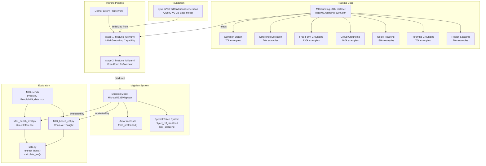
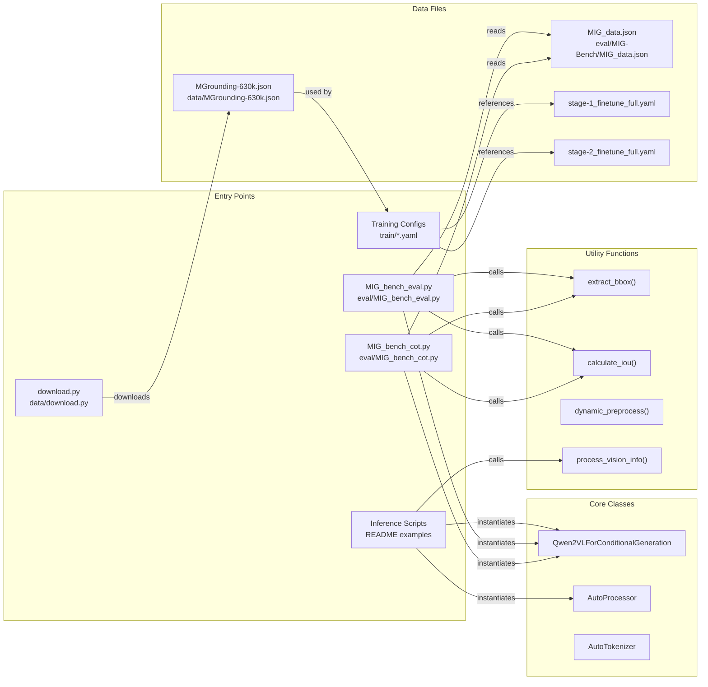
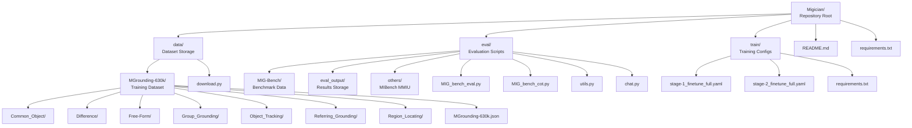

<!-- source: DeepWiki mcp.deepwiki.com · repo thunlp/Migician · page 1 Overview · fetched 2026-11-02 -->

# Overview

<details>
<summary>Relevant source files</summary>

The following files were used as context for generating this wiki page:

- [README.md](README.md)

</details>


## Purpose and Scope

This document provides a high-level introduction to Migician, the first competitive multi-image grounding MLLM (Multimodal Large Language Model). It covers the system's key innovations, main components, and architectural overview.

For detailed setup instructions, see [Getting Started](#2). For in-depth documentation of the training dataset, see [MGrounding-630k Dataset](#3). For model-specific technical details, see [Migician Model](#4). For evaluation procedures, see [Evaluation System](#6).

## What is Migician?

Migician is a multimodal large language model specialized in **free-form multi-image grounding** - the ability to locate and bound objects across multiple images based on natural language descriptions. Built on the `Qwen2VLForConditionalGeneration` foundation model (Qwen2-VL-7B), Migician achieves state-of-the-art performance on multi-image grounding tasks, outperforming the best existing MLLMs by 21.61% and even surpassing 70B-scale models.

The system addresses a critical gap in existing MLLMs: while they excel at single-image grounding and general multi-image comprehension, they struggle with precise grounding in complex multi-image scenarios. Migician solves this through:

1. **End-to-end multi-image grounding**: Direct inference without relying on unstable Chain-of-Thought frameworks
2. **Free-form natural language queries**: Unrestricted descriptions rather than template-constrained inputs
3. **Massive-scale training data**: 630k+ diverse multi-image grounding examples across 7 task types
4. **Specialized token system**: Dedicated tokens (`<|object_ref_start|>`, `<|object_ref_end|>`, `<|box_start|>`, `<|box_end|>`) for object references and bounding box outputs

**Sources**: [README.md:1-29]()

## Core Components

Migician consists of three main components that form a complete pipeline from training to evaluation:

| Component | Description | Scale | Hugging Face Repository |
|-----------|-------------|-------|------------------------|
| **Migician Model** | Qwen2-VL-7B fine-tuned for multi-image grounding | 7B parameters | `Michael4933/Migician` |
| **MGrounding-630k** | Training dataset with 7 task types | 630k+ examples | `Michael4933/MGrounding-630k` |
| **MIG-Bench** | Evaluation benchmark for multi-image grounding | 10 task types | `Michael4933/MIG-Bench` |

### Migician Model

The Migician model is a fine-tuned version of `Qwen2VLForConditionalGeneration` trained through a two-stage progressive process on 8x A100-80G GPUs. The model utilizes `flash_attention_2` for efficient inference and employs a special token system to handle multi-image grounding tasks.

For model architecture details, see [Model Architecture](#4.1). For inference usage, see [Inference Guide](#4.2).

### MGrounding-630k Dataset

The training dataset comprises 630k+ multi-image grounding examples across seven task categories, sourced from 10+ existing datasets including COCO, ImageNet, Object365, SA-1B, GOT-10k, LaSOT, and others:

- **Common Object Recognition** (70k): Identifying shared objects across images
- **Difference Detection** (70k): Comparing images to find differences  
- **Free-Form Grounding** (130k): Natural language-driven grounding
- **Group Grounding** (160k): Recognition (120k) + Registration (40k) tasks
- **Object Tracking** (130k): Cross-frame object matching
- **Referring Grounding** (70k): Description-based localization
- **Region Locating** (70k): Spatial understanding tasks

For detailed dataset structure, see [Dataset Structure](#3.1). For download instructions, see [Downloading the Dataset](#3.2).

### MIG-Bench Benchmark

MIG-Bench is a comprehensive evaluation benchmark designed specifically for multi-image grounding capabilities. It contains 10 diverse task types and uses IOU (Intersection Over Union) metrics at multiple thresholds (0.7, 0.5, 0.3) to measure grounding accuracy.

For benchmark details, see [MIG-Bench](#7.1).

**Sources**: [README.md:13-17](), [README.md:70-125](), [README.md:227-273]()

## System Architecture

### Component Dependencies



**Diagram: Migician System Component Dependencies**

This diagram illustrates how the foundation model (Qwen2-VL-7B) is transformed into Migician through the training pipeline, utilizing the MGrounding-630k dataset. The resulting model is then evaluated using specialized scripts (`MIG_bench_eval.py`, `MIG_bench_cot.py`) and benchmarks.

**Sources**: [README.md:165-221](), [README.md:227-273](), [README.md:278-286]()

### Code Entity Mapping



**Diagram: Code Entity Relationships**

This diagram maps the key code entities (classes, functions, files) and their relationships. Entry points like `download.py`, inference scripts, and evaluation scripts interact with core classes (`Qwen2VLForConditionalGeneration`, `AutoProcessor`) and utility functions (`extract_bbox()`, `calculate_iou()`) defined in `eval/utils.py`.

**Sources**: [README.md:78-79](), [README.md:172-221](), [README.md:242-246]()

## Multi-Image Grounding Workflow

### Inference Pipeline

The following table describes the end-to-end inference workflow from model loading to bounding box output:

| Step | Component | Input | Output | Code Reference |
|------|-----------|-------|--------|----------------|
| 1. Model Loading | `Qwen2VLForConditionalGeneration.from_pretrained()` | Model path string | Model instance | [README.md:177-182]() |
| 2. Processor Loading | `AutoProcessor.from_pretrained()` | Model path string | Processor instance | [README.md:183]() |
| 3. Message Formatting | User code | Images + text query | Messages list | [README.md:185-206]() |
| 4. Template Application | `processor.apply_chat_template()` | Messages dict | Formatted text string | [README.md:208]() |
| 5. Vision Processing | `process_vision_info()` | Messages dict | Image/video tensor inputs | [README.md:209]() |
| 6. Tokenization | `processor()` | Text + images | Input tensors (IDs, pixels) | [README.md:210]() |
| 7. Generation | `model.generate()` | Input tensors + config | Generated token IDs | [README.md:214]() |
| 8. Decoding | `processor.batch_decode()` | Token IDs | Text with bbox coordinates | [README.md:218-220]() |

### Special Token System

Migician uses four special tokens to structure multi-image grounding conversations:

| Token | Purpose | Usage Context |
|-------|---------|---------------|
| `<|object_ref_start|>` | Begin object reference | Marks start of target description in user query |
| `<|object_ref_end|>` | End object reference | Marks end of target description in user query |
| `<|box_start|>` | Begin bounding box | Precedes coordinate output in model response |
| `<|box_end|>` | End bounding box | Follows coordinate output in model response |

**Coordinate Format**: Bounding boxes are output in `(x1,y1),(x2,y2)` format with values normalized to 0-1000 scale. This normalization ensures resolution independence across images of different sizes.

**Example Input/Output**:
```
Input: "Please recognize <|object_ref_start|>the common person appearing in all these images<|object_ref_end|> and locate this person in all these image."

Output: "It's in the first image. <|box_start|>(408,656),(578,997)<|box_end|>"
```

For detailed special token documentation, see [Special Token System](#4.3).

**Sources**: [README.md:128-156](), [README.md:172-221]()

## Repository Structure



**Diagram: Repository Directory Structure**

The repository is organized into three primary directories: `data/` for dataset storage and downloading, `eval/` for evaluation scripts and benchmarks, and `train/` for training configurations. The `MGrounding-630k.json` file aggregates all training conversations for convenient access.

**Sources**: [README.md:80-125](), [README.md:228-247](), [README.md:280-286]()

## Performance Characteristics

### Benchmark Results

Migician demonstrates superior performance across multiple evaluation benchmarks:

| Benchmark | Metric Type | Migician Performance | Comparison |
|-----------|-------------|---------------------|------------|
| MIG-Bench | IOU@0.7, 0.5, 0.3 | State-of-the-art | +21.61% vs. best existing MLLM |
| MIG-Bench | Average IOU | Leading across 10 tasks | Outperforms 70B parameter models |
| MIBench | Accuracy | Competitive | General multi-image understanding |
| MMIU | Accuracy | Competitive | Forensic detection tasks |

### Supported Model Comparisons

The evaluation framework in `MIG_bench_eval.py` supports seven different MLLMs for comparative analysis:

1. **Migician** - `Michael4933/Migician`
2. **Qwen2-VL** - `Qwen/Qwen2-VL-7B-Instruct`
3. **InternVL2** - `OpenGVLab/InternVL2-8B`
4. **MiniCPM-V 2.6** - `openbmb/MiniCPM-V-2_6`
5. **LLaVA-OneVision** - `llava-hf/llava-onevision-qwen2-7b-ov-hf`
6. **mPLUG-Owl3** - `mPLUG/mPLUG-Owl3-7B-241101`
7. **Mantis** - `TIGER-Lab/Mantis-8B-Idefics2`

For detailed evaluation procedures, see [Direct Evaluation Script](#6.2).

### Training Infrastructure

The model training requires significant computational resources:

- **Hardware**: 8x NVIDIA A100-80G GPUs
- **Training Framework**: LlamaFactory (`github.com/hiyouga/LLaMA-Factory`)
- **Training Stages**: Two-stage progressive training
  - Stage 1: Full parameter fine-tuning for initial grounding capability
  - Stage 2: Full parameter fine-tuning for free-form refinement
- **Optimization**: Flash Attention 2 (`attn_implementation="flash_attention_2"`) for memory efficiency
- **Precision**: `torch.bfloat16` for training and inference

For training configuration details, see [Training Pipeline](#5).

**Sources**: [README.md:29-39](), [README.md:165](), [README.md:272-273](), [README.md:278]()

## Data Format Specifications

### Training Data Format

Each training example in `data/MGrounding-630k.json` follows this JSON structure:

```json
{
    "id": "unique_identifier",
    "images": [
        "./MGrounding-630k/path/to/image1.jpg",
        "./MGrounding-630k/path/to/image2.jpg"
    ],
    "conversations": [
        {
            "from": "human",
            "value": "<image>\n<image>\nQuery with <|object_ref_start|>target<|object_ref_end|>"
        },
        {
            "from": "gpt",
            "value": "Response with <|box_start|>(x1,y1),(x2,y2)<|box_end|>"
        }
    ],
    "type": "task_category"
}
```

**Key Fields**:
- `id`: Unique identifier (can be ignored)
- `images`: List of relative paths to image files
- `conversations`: Multi-turn dialogue with special tokens
- `type`: Task category label (e.g., `"gg_train"`, `"free_form"`, `"common_train"`)
- **Coordinate Scale**: Bounding boxes in training data use 0-1000 normalization

### Evaluation Data Format

Each evaluation example in `eval/MIG-Bench/MIG_data.json` follows this JSON structure:

```json
{
    "task": "task_name",
    "images": [
        "./MIG-Bench/images/category/image1.png",
        "./MIG-Bench/images/category/image2.png"
    ],
    "question": "Query text",
    "answer": [x1, y1, x2, y2],
    "additional_info": "Auxiliary information",
    "need_format": true
}
```

**Key Differences from Training Format**:
- Ground truth coordinates are normalized as floats within 0-1 range (not 0-1000)
- Coordinates follow `[x1, y1, x2, y2]` array format (top-left, bottom-right corners)
- Single-turn question-answer structure
- `need_format` flag indicates whether response requires bbox extraction

For detailed dataset structure documentation, see [Dataset Structure](#3.1).

**Sources**: [README.md:126-156](), [README.md:249-271]()

## Key Innovations

### 1. End-to-End Multi-Image Grounding

Unlike previous approaches that rely on Chain-of-Thought frameworks combining single-image grounding with multi-image comprehension, Migician performs direct end-to-end inference. This eliminates instability and improves the model's ability to capture abstract visual information.

The repository includes both approaches for comparison:
- **Direct inference**: `eval/MIG_bench_eval.py` for end-to-end evaluation
- **CoT framework**: `eval/MIG_bench_cot.py` for two-step reasoning evaluation

### 2. Free-Form Natural Language Queries

Migician supports unrestricted natural language descriptions rather than template-constrained inputs. The Free-Form Grounding subset (130k examples in `data/MGrounding-630k/Free-Form/`) specifically trains this capability, allowing diverse queries like:

```
"Please recognize <|object_ref_start|>the common person appearing in all these images<|object_ref_end|> and locate this person in all these image."
```

### 3. Resolution-Independent Coordinate System

The 0-1000 normalization scheme for bounding box coordinates ensures that predictions work consistently across images of different resolutions, making the model more robust to varying input sizes. The coordinate format is `(x1,y1),(x2,y2)` where values represent relative positions scaled to 1000.

### 4. Progressive Two-Stage Training

The training pipeline uses a progressive approach configured through YAML files:
- **Stage 1** (`train/stage-1_finetune_full.yaml`): Establishes basic grounding capability across all task types
- **Stage 2** (`train/stage-2_finetune_full.yaml`): Refines free-form understanding and grounding accuracy

This curriculum learning strategy improves final model performance by first establishing foundational capabilities before refining complex behaviors.

**Sources**: [README.md:27-29](), [README.md:98-100](), [README.md:242-243](), [README.md:278-286]()

## Getting Started Quick Reference

For users new to Migician, the typical workflow is:

1. **Environment Setup**: Create conda environment and install dependencies → See [Installation](#2.1)
2. **Dataset Download**: Download MGrounding-630k using `data/download.py` → See [Downloading the Dataset](#3.2)
3. **Model Inference**: Load model and run multi-image grounding → See [Inference Guide](#4.2)
4. **Evaluation**: Run benchmarks using `eval/MIG_bench_eval.py` → See [Evaluation System](#6)
5. **Fine-tuning** (Optional): Train on custom data using LlamaFactory configs → See [Training Pipeline](#5)

### Minimal Inference Example

The simplest way to use Migician for multi-image grounding:

```python
from transformers import Qwen2VLForConditionalGeneration, AutoProcessor
from qwen_vl_utils import process_vision_info
import torch

# Load model and processor
model = Qwen2VLForConditionalGeneration.from_pretrained(
    "Michael4933/Migician",
    torch_dtype=torch.bfloat16,
    attn_implementation="flash_attention_2",
    device_map="auto"
)
processor = AutoProcessor.from_pretrained("Michael4933/Migician")

# Prepare multi-image input with grounding query
messages = [{
    "role": "user",
    "content": [
        {"type": "image", "image": "image1.png"},
        {"type": "image", "image": "image2.png"},
        {"type": "text", "text": "Locate <|object_ref_start|>target object<|object_ref_end|>"}
    ]
}]

# Process and generate
text = processor.apply_chat_template(messages, tokenize=False, add_generation_prompt=True)
image_inputs, _ = process_vision_info(messages)
inputs = processor(text=[text], images=image_inputs, padding=True, return_tensors="pt")
inputs = inputs.to("cuda")

generated_ids = model.generate(**inputs, max_new_tokens=128)
generated_ids_trimmed = [out_ids[len(in_ids):] for in_ids, out_ids in zip(inputs.input_ids, generated_ids)]
output = processor.batch_decode(generated_ids_trimmed, skip_special_tokens=True, clean_up_tokenization_spaces=False)
print(output)  # Output includes bounding boxes in <|box_start|>(x1,y1),(x2,y2)<|box_end|> format
```

For complete setup and usage instructions, see [Getting Started](#2). For detailed inference documentation, see [Quick Start Guide](#2.2).

**Sources**: [README.md:41-66](), [README.md:164-221]()

## Related Resources

- **Project Page**: https://migician-vg.github.io/
- **Paper**: https://arxiv.org/abs/2501.05767 (ACL 2025)
- **Model**: https://huggingface.co/Michael4933/Migician
- **Training Dataset**: https://huggingface.co/datasets/Michael4933/MGrounding-630k
- **Evaluation Benchmark**: https://huggingface.co/datasets/Michael4933/MIG-Bench
- **Base Model**: https://huggingface.co/Qwen/Qwen2-VL-7B-Instruct
- **Training Framework**: https://github.com/hiyouga/LLaMA-Factory

**Sources**: [README.md:10-15](), [README.md:22](), [README.md:278]()

---

