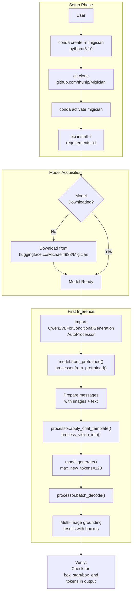
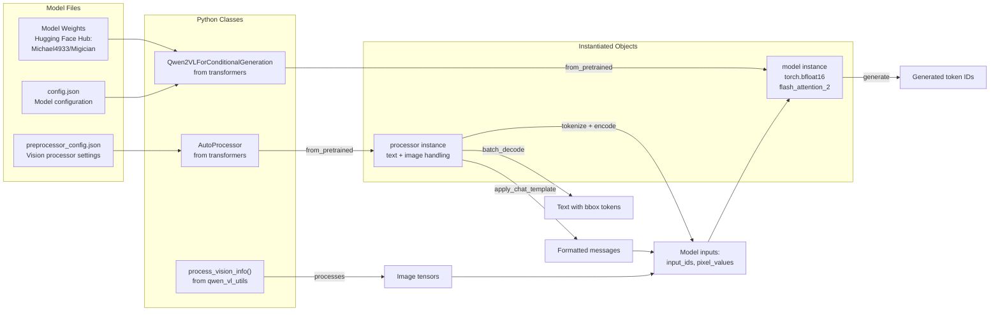

<!-- source: DeepWiki mcp.deepwiki.com · repo thunlp/Migician · page 2 Getting Started · fetched 2026-11-02 -->

# Getting Started

<details>
<summary>Relevant source files</summary>

The following files were used as context for generating this wiki page:

- [README.md](README.md)
- [requirements.txt](requirements.txt)

</details>


This document provides a complete setup guide for Migician, covering environment creation, dependency installation, and running your first multi-image grounding inference. By the end of this guide, you will have a working Migician installation capable of performing free-form multi-image grounding tasks.

**Scope**: This page provides an overview of the setup process and initial usage. For detailed installation instructions, see [Installation](#2.1). For more inference examples and usage patterns, see [Quick Start Guide](#2.2). For comprehensive model documentation, see [Migician Model](#4).

---

## Prerequisites

Before beginning the setup process, ensure you have:

| Requirement | Specification | Purpose |
|------------|---------------|---------|
| **Python** | 3.10 | Required runtime version |
| **CUDA** | Compatible with PyTorch 2.1.2 | GPU acceleration for inference |
| **GPU Memory** | ≥16GB VRAM recommended | Model loading and inference |
| **Disk Space** | ≥50GB free | Model weights and dependencies |
| **Network** | Stable internet connection | Downloading model from Hugging Face Hub |

**Note**: The model uses `flash_attention_2` for acceleration, which requires compatible CUDA compute capability (≥8.0 for Ampere and newer architectures).

Sources: [README.md:55-65](), [README.md:180]()

---

## Setup Overview

The following diagram illustrates the complete setup and first inference workflow:

### Setup and Inference Workflow



Sources: [README.md:55-65](), [README.md:165-222]()

---

## Installation Steps

The installation process consists of three primary stages:

### 1. Environment Creation

Create an isolated conda environment with Python 3.10:

```bash
conda create -n migician python=3.10
```

Activate the newly created environment:

```bash
conda activate migician
```

Sources: [README.md:58-63]()

### 2. Repository Setup

Clone the Migician repository:

```bash
git clone https://github.com/thunlp/Migician.git
cd Migician
```

Sources: [README.md:60-61]()

### 3. Dependency Installation

Install all required dependencies from the requirements file:

```bash
pip install -r requirements.txt
```

The `requirements.txt` includes critical packages:

| Package | Version | Purpose |
|---------|---------|---------|
| `transformers` | 4.45.2 | Core model loading and inference |
| `torch` | 2.1.2 | Deep learning framework |
| `flash-attn` | 2.3.4 | Efficient attention mechanism |
| `qwen-vl-utils` | 0.0.8 | Vision processing utilities |
| `accelerate` | 0.30.1 | Multi-GPU support |
| `bitsandbytes` | 0.43.3 | Quantization support |
| `peft` | 0.12.0 | Parameter-efficient fine-tuning |

For the complete dependency list, see [requirements.txt:1-65]().

**Detailed installation instructions**: See [Installation](#2.1).

Sources: [README.md:64](), [requirements.txt:1-65]()

---

## Model Components and Initialization

Understanding the key components involved in Migician inference:

### Component Architecture



Sources: [README.md:172-183](), [README.md:208-220]()

---

## First Inference Example

After installation, verify your setup with a minimal inference example:

### Loading the Model

```python
from transformers import Qwen2VLForConditionalGeneration, AutoProcessor
from qwen_vl_utils import process_vision_info
import torch

# Specify model path (local or Hugging Face Hub)
path = "Michael4933/Migician"  # or local path

# Load model with flash attention optimization
model = Qwen2VLForConditionalGeneration.from_pretrained(
    path,
    torch_dtype=torch.bfloat16,
    attn_implementation="flash_attention_2",
    device_map="auto",
)

# Load processor for text and image handling
processor = AutoProcessor.from_pretrained(path)
```

Key parameters:
- `torch_dtype=torch.bfloat16`: Reduces memory usage while maintaining precision
- `attn_implementation="flash_attention_2"`: Enables efficient attention computation
- `device_map="auto"`: Automatically distributes model across available GPUs

Sources: [README.md:172-183]()

### Constructing Inference Messages

Migician uses a structured message format with special tokens:

```python
messages = [
    {
        "role": "user",
        "content": [
            {"type": "image", "image": "path/to/image1.png"},
            {"type": "image", "image": "path/to/image2.png"},
            {
                "type": "text", 
                "text": "Please locate <|object_ref_start|>the person<|object_ref_end|> in these images."
            }
        ]
    }
]
```

**Special tokens** used for grounding:
- `<|object_ref_start|>` and `<|object_ref_end|>`: Delimit the grounding target in the query
- `<|box_start|>` and `<|box_end|>`: Delimit bounding box coordinates in the response

For details on the token system, see [Special Token System](#4.3).

Sources: [README.md:138-147](), [README.md:185-206]()

### Processing and Generation

```python
# Apply chat template and process vision information
text = processor.apply_chat_template(
    messages, tokenize=False, add_generation_prompt=True
)
image_inputs, video_inputs = process_vision_info(messages)

# Tokenize and encode inputs
inputs = processor(
    text=[text],
    images=image_inputs,
    videos=video_inputs,
    padding=True,
    return_tensors="pt"
)
inputs = inputs.to("cuda")

# Generate predictions
generated_ids = model.generate(**inputs, max_new_tokens=128)

# Decode output
generated_ids_trimmed = [
    out_ids[len(in_ids):] 
    for in_ids, out_ids in zip(inputs.input_ids, generated_ids)
]
output_text = processor.batch_decode(
    generated_ids_trimmed, 
    skip_special_tokens=False,  # Keep bbox tokens
    clean_up_tokenization_spaces=False
)

print(output_text)
```

**Expected output format**:
```
["It's in the first image. <|box_start|>(316,58),(764,999)<|box_end|>"]
```

Coordinates are normalized to 0-1000 scale in `(x1,y1),(x2,y2)` format.

Sources: [README.md:208-221]()

---

## Inference Pipeline Flow

The following diagram maps the inference process to actual code entities:

### Inference Execution Flow

```mermaid
sequenceDiagram
    participant User
    participant messages["messages<br/>(list of dicts)"]
    participant processor["AutoProcessor<br/>instance"]
    participant vision["process_vision_info()<br/>qwen_vl_utils"]
    participant model["Qwen2VLForConditionalGeneration<br/>instance"]
    participant output["output_text<br/>(list of strings)"]
    
    User->>messages: "Define content:<br/>images + text with<br/>object_ref tokens"
    
    messages->>processor: "apply_chat_template()<br/>tokenize=False"
    processor-->>User: "text (formatted prompt)"
    
    messages->>vision: "extract images"
    vision-->>User: "image_inputs, video_inputs"
    
    User->>processor: "processor(text, images)<br/>return_tensors='pt'"
    processor-->>User: "inputs dict:<br/>input_ids, pixel_values"
    
    User->>model: "generate(**inputs)<br/>max_new_tokens=128"
    model-->>User: "generated_ids (tokens)"
    
    User->>processor: "batch_decode(generated_ids)<br/>skip_special_tokens=False"
    processor-->>output: "text with box tokens"
    
    output-->>User: "Parse bbox coordinates<br/>from box_start/box_end"
```

Sources: [README.md:208-221]()

---

## Verification

After completing your first inference, verify the setup:

### Expected Behavior Checklist

| Check | Expected Result | Indicates |
|-------|----------------|-----------|
| Model loads without errors | No CUDA/memory errors | Correct GPU setup |
| Special tokens in output | `<|box_start|>` and `<|box_end|>` present | Token vocabulary loaded |
| Coordinates in range | Values between 0-1000 | Proper normalization |
| Response mentions image | "first image", "second image", etc. | Multi-image awareness |
| Generation completes | No timeout or OOM | Sufficient resources |

### Common Issues

If you encounter issues during setup or first inference:

1. **Import errors**: Ensure all dependencies from [requirements.txt:1-65]() are installed
2. **CUDA errors**: Verify PyTorch CUDA compatibility with your driver version
3. **Memory errors**: Model requires ~16GB VRAM; consider using `torch_dtype=torch.float16` or quantization
4. **Flash attention errors**: Requires CUDA compute capability ≥8.0; set `attn_implementation=None` for older GPUs

Sources: [README.md:172-222]()

---

## Next Steps

After successful setup and first inference:

1. **Explore inference patterns**: See [Quick Start Guide](#2.2) for various multi-image grounding scenarios
2. **Understand the model**: Review [Migician Model](#4) for architecture details and capabilities
3. **Download training data**: See [Downloading the Dataset](#3.2) to acquire MGrounding-630k
4. **Run evaluations**: See [Evaluation System](#6) to benchmark on MIG-Bench and other datasets
5. **Fine-tune the model**: See [Training Pipeline](#5) for two-stage training instructions

### File Structure After Setup

```
Migician/
├── requirements.txt          # Installed dependencies
├── README.md                 # Project documentation
├── data/                     # Dataset directory (see page 3.2)
├── eval/                     # Evaluation scripts (see page 6)
├── train/                    # Training configurations (see page 5)
└── figs/                     # Example images
```

Sources: [README.md:80-125](), [README.md:229-247](), [README.md:281-286]()

---

## Summary

This guide covered the essential steps to get started with Migician:

1. ✓ Created a Python 3.10 conda environment
2. ✓ Cloned the repository and installed dependencies
3. ✓ Loaded the Qwen2VLForConditionalGeneration model with flash attention
4. ✓ Performed first multi-image grounding inference with special tokens
5. ✓ Verified output format with bbox coordinates

You now have a working Migician installation capable of performing free-form multi-image grounding. The model uses special tokens (`<|object_ref_start|>`, `<|object_ref_end|>`, `<|box_start|>`, `<|box_end|>`) to structure grounding queries and responses, with coordinates normalized to 0-1000 scale.

Sources: [README.md:41-286]()

---

