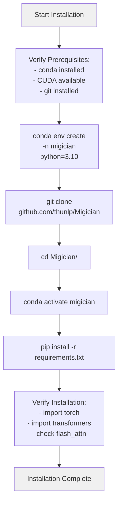
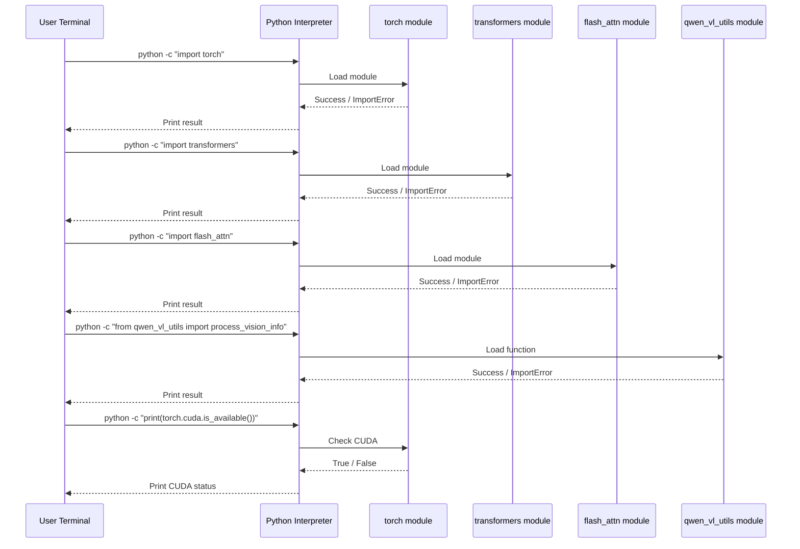
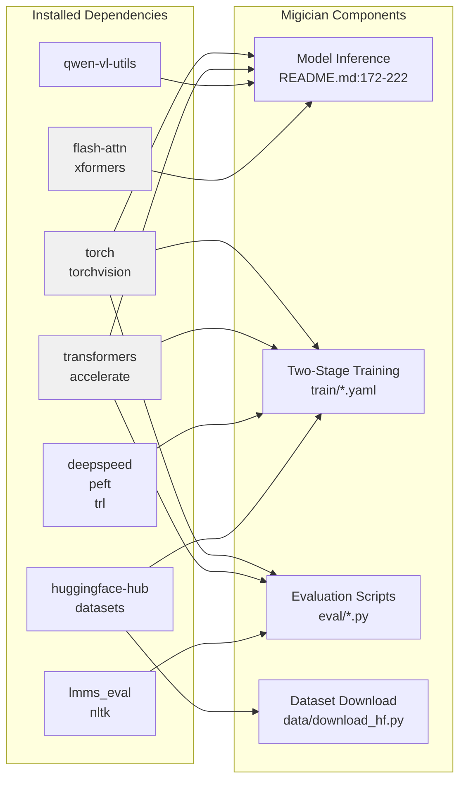

<!-- source: DeepWiki mcp.deepwiki.com · repo thunlp/Migician · page 2.1 Installation · fetched 2026-11-02 -->

# Installation

<details>
<summary>Relevant source files</summary>

The following files were used as context for generating this wiki page:

- [README.md](README.md)
- [requirements.txt](requirements.txt)

</details>


This document provides step-by-step instructions for setting up the Migician development environment, including Python environment creation, repository cloning, and dependency installation. This installation is required before training, inference, or evaluation can be performed with Migician.

For information about downloading the training dataset, see [Downloading the Dataset](#3.2). For information about running inference after installation, see [Quick Start Guide](#2.2).

---

## Prerequisites

Before beginning installation, ensure your system meets the following requirements:

### Hardware Requirements

| Component | Minimum Requirement | Recommended | Purpose |
|-----------|-------------------|-------------|---------|
| GPU | CUDA-compatible GPU | NVIDIA A100 (80GB) | Training requires 8x A100-80G; inference can use single GPU |
| RAM | 32 GB | 64+ GB | Loading model weights and processing multi-image inputs |
| Storage | 100 GB free | 500+ GB | MGrounding-630k dataset is large due to multi-image nature |
| Network | Stable connection | High bandwidth | Downloading model weights and datasets from Hugging Face |

### Software Requirements

- **Operating System**: Linux (Ubuntu 20.04+ recommended)
- **CUDA**: Version 11.8 or higher
- **conda**: Anaconda or Miniconda package manager
- **git**: Version control for cloning repository

---

## Installation Workflow

The following diagram illustrates the complete installation process from prerequisites to verification:



**Sources:** [README.md:54-65]()

---

## Step 1: Create Conda Environment

Create a dedicated Python 3.10 environment for Migician to isolate dependencies and prevent conflicts with other projects:

```bash
conda env create -n migician python=3.10
```

**Important Notes:**
- Python 3.10 is specifically required for compatibility with the PyTorch and Transformers versions used
- The environment name `migician` is referenced throughout the codebase documentation

**Sources:** [README.md:58]()

---

## Step 2: Clone Repository

Clone the Migician repository from GitHub:

```bash
git clone https://github.com/thunlp/Migician.git
cd Migician
```

This creates the following initial directory structure:

```
Migician/
├── README.md
├── requirements.txt
├── data/
├── eval/
├── train/
└── figs/
```

**Sources:** [README.md:60-61]()

---

## Step 3: Activate Environment

Activate the conda environment before installing dependencies:

```bash
conda activate migician
```

All subsequent installation commands must be executed with this environment activated.

**Sources:** [README.md:63]()

---

## Step 4: Install Dependencies

Install all required Python packages from the requirements file:

```bash
pip install -r requirements.txt
```

### Core Dependencies

The following diagram shows the major dependency categories and their relationships:

```mermaid
graph TD
    REQUIREMENTS["requirements.txt"]
    
    subgraph "Deep Learning Framework"
        TORCH["torch==2.1.2"]
        TORCHVISION["torchvision==0.16.2"]
        TORCHAUDIO["torchaudio==2.1.2"]
    end
    
    subgraph "Transformers Ecosystem"
        TRANSFORMERS["transformers==4.45.2"]
        ACCELERATE["accelerate==0.30.1"]
        PEFT["peft==0.12.0"]
        TRL["trl==0.9.6"]
        TOKENIZERS["tokenizers==0.20.3"]
    end
    
    subgraph "Vision Processing"
        QWEN_VL_UTILS["qwen-vl-utils==0.0.8"]
        OPENCV["opencv-python==4.10.0.84"]
        PILLOW["Pillow==10.1.0"]
        DECORD["decord==0.6.0"]
    end
    
    subgraph "Optimization Libraries"
        FLASH_ATTN["flash-attn==2.3.4"]
        XFORMERS["xformers==0.0.27.post2"]
        BITSANDBYTES["bitsandbytes==0.43.3"]
        DEEPSPEED["deepspeed==0.12.3"]
    end
    
    subgraph "Data Processing"
        DATASETS["datasets==2.16.1"]
        HUGGINGFACE_HUB["huggingface-hub==0.24.6"]
        PANDAS["pandas==2.2.2"]
        NUMPY["numpy==1.24.4"]
    end
    
    subgraph "Evaluation Tools"
        LMMS_EVAL["lmms_eval==0.2.4"]
        NLTK["nltk==3.8.1"]
        SCIPY["scipy==1.14.1"]
    end
    
    REQUIREMENTS --> TORCH
    REQUIREMENTS --> TRANSFORMERS
    REQUIREMENTS --> QWEN_VL_UTILS
    REQUIREMENTS --> FLASH_ATTN
    REQUIREMENTS --> DATASETS
    REQUIREMENTS --> LMMS_EVAL
    
    TORCH --> TORCHVISION
    TORCH --> TORCHAUDIO
    
    TRANSFORMERS --> ACCELERATE
    TRANSFORMERS --> PEFT
    TRANSFORMERS --> TRL
    TRANSFORMERS --> TOKENIZERS
    
    QWEN_VL_UTILS --> OPENCV
    QWEN_VL_UTILS --> PILLOW
    
    FLASH_ATTN --> XFORMERS
    
    DATASETS --> HUGGINGFACE_HUB
```



**Sources:** [requirements.txt:1-65]()

### Critical Dependencies Explained

| Package | Version | Purpose | Notes |
|---------|---------|---------|-------|
| `torch` | 2.1.2 | Core deep learning framework | Must match CUDA version on system |
| `transformers` | 4.45.2 | Qwen2VLForConditionalGeneration model loading | Required for model inference |
| `flash-attn` | 2.3.4 | Memory-efficient attention mechanism | Enables `attn_implementation="flash_attention_2"` |
| `qwen-vl-utils` | 0.0.8 | Vision-language utilities | Provides `process_vision_info` function |
| `accelerate` | 0.30.1 | Multi-GPU training support | Used in distributed training |
| `peft` | 0.12.0 | Parameter-efficient fine-tuning | Supports LoRA and other methods |
| `deepspeed` | 0.12.3 | Training optimization | Required for 8x A100 training setup |
| `datasets` | 2.16.1 | Hugging Face dataset loading | Used for MGrounding-630k access |
| `huggingface-hub` | 0.24.6 | Model and dataset downloading | Connects to Hugging Face Hub |

**Sources:** [requirements.txt:1-65]()

---

## Installation Verification

After installation completes, verify that all critical components are properly installed:

### Python Package Verification

The following sequence diagram shows the verification process:



**Sources:** [README.md:172-183]()

### Verification Commands

Run the following commands to verify successful installation:

```bash
# Verify PyTorch installation
python -c "import torch; print(f'PyTorch version: {torch.__version__}')"

# Verify CUDA availability
python -c "import torch; print(f'CUDA available: {torch.cuda.is_available()}')"

# Verify Transformers
python -c "import transformers; print(f'Transformers version: {transformers.__version__}')"

# Verify flash-attn (critical for Migician)
python -c "import flash_attn; print('flash_attn installed successfully')"

# Verify qwen-vl-utils
python -c "from qwen_vl_utils import process_vision_info; print('qwen_vl_utils installed successfully')"

# Verify Qwen2VL model classes
python -c "from transformers import Qwen2VLForConditionalGeneration, AutoProcessor; print('Qwen2VL imports successful')"
```

### Expected Output

All commands should complete without `ImportError` exceptions. The CUDA availability check should return `True` if you plan to use GPU acceleration.

**Sources:** [README.md:172-183]()

---

## Post-Installation Configuration

### Directory Structure After Installation

After completing installation, your directory structure should match:

```
Migician/
├── README.md
├── requirements.txt
├── data/
│   └── download_hf.py
├── eval/
│   ├── MIG_bench_eval.py
│   ├── MIG_bench_cot.py
│   ├── utils.py
│   ├── chat.py
│   └── requirements.txt
├── train/
│   ├── stage-1_finetune_full.yaml
│   ├── stage-2_finetune_full.yaml
│   └── requirements.txt
└── figs/
```

**Sources:** [README.md:80-125](), [README.md:228-247](), [README.md:280-286]()

### Environment Variables (Optional)

For Hugging Face Hub access, you may set:

```bash
export HF_HOME=/path/to/cache  # Custom cache directory for models/datasets
export CUDA_VISIBLE_DEVICES=0  # Specify which GPU(s) to use
```

These variables control where Hugging Face Hub caches downloaded models and which GPUs are visible to PyTorch.

---

## Troubleshooting Common Issues

### Issue 1: flash-attn Compilation Failure

**Symptom:** `pip install -r requirements.txt` fails during `flash-attn` installation with compilation errors.

**Solution:**
```bash
# Ensure CUDA development toolkit is installed
nvcc --version  # Should show CUDA 11.8+

# Install flash-attn separately with verbose output
pip install flash-attn==2.3.4 --no-build-isolation -v

# If still failing, check GCC version (requires GCC 7+)
gcc --version
```

**Sources:** [requirements.txt:10]()

### Issue 2: CUDA Version Mismatch

**Symptom:** `torch.cuda.is_available()` returns `False` despite having an NVIDIA GPU.

**Solution:**
```bash
# Check CUDA version
nvidia-smi  # Shows driver CUDA version

# Verify PyTorch CUDA version
python -c "import torch; print(torch.version.cuda)"

# If mismatch, reinstall PyTorch with correct CUDA version
pip install torch==2.1.2 torchvision==0.16.2 torchaudio==2.1.2 --index-url https://download.pytorch.org/whl/cu118
```

**Sources:** [requirements.txt:53-55]()

### Issue 3: Out of Memory During Package Installation

**Symptom:** `pip install` terminates with memory errors.

**Solution:**
```bash
# Install packages one at a time for large packages
pip install torch==2.1.2 --no-cache-dir
pip install transformers==4.45.2 --no-cache-dir
pip install flash-attn==2.3.4 --no-cache-dir

# Then install remaining packages
pip install -r requirements.txt --no-cache-dir
```

**Sources:** [requirements.txt:1-65]()

### Issue 4: transformers Version Conflict

**Symptom:** `ModuleNotFoundError: No module named 'transformers.models.qwen2_vl'`

**Solution:**
```bash
# Ensure correct transformers version (4.45.2 includes Qwen2-VL)
pip install transformers==4.45.2 --upgrade

# Verify Qwen2VL is available
python -c "from transformers import Qwen2VLForConditionalGeneration; print('Success')"
```

**Sources:** [requirements.txt:56](), [README.md:172]()

---

## Next Steps

After successful installation:

1. **Download Model Weights**: Obtain Migician model from [Hugging Face](https://huggingface.co/Michael4933/Migician)
2. **Download Dataset** (optional, for training): See [Downloading the Dataset](#3.2)
3. **Run Quick Start Example**: See [Quick Start Guide](#2.2) for first inference
4. **Set Up Evaluation** (optional): Prepare MIG-Bench benchmark - see [MIG-Bench](#7.1)

### Dependency Relationship to System Components

The following diagram shows how installed dependencies map to Migician's functional components:



**Sources:** [README.md:54-65](), [README.md:172-222](), [README.md:277-286](), [requirements.txt:1-65]()

---

## Summary

This installation process establishes the complete Migician environment by:

1. Creating an isolated Python 3.10 conda environment named `migician`
2. Cloning the repository from `https://github.com/thunlp/Migician.git`
3. Installing 65 dependencies including PyTorch 2.1.2, Transformers 4.45.2, and flash-attn 2.3.4
4. Verifying critical imports: `Qwen2VLForConditionalGeneration`, `process_vision_info`, and CUDA availability

The installation provides the foundation for:
- **Inference**: Using pre-trained Migician model for multi-image grounding
- **Training**: Fine-tuning on MGrounding-630k dataset with LlamaFactory
- **Evaluation**: Running MIG-Bench, MIBench, and MMIU benchmarks

**Total Installation Time:** Approximately 15-30 minutes depending on network speed and hardware.

**Sources:** [README.md:54-65](), [requirements.txt:1-65]()

---

