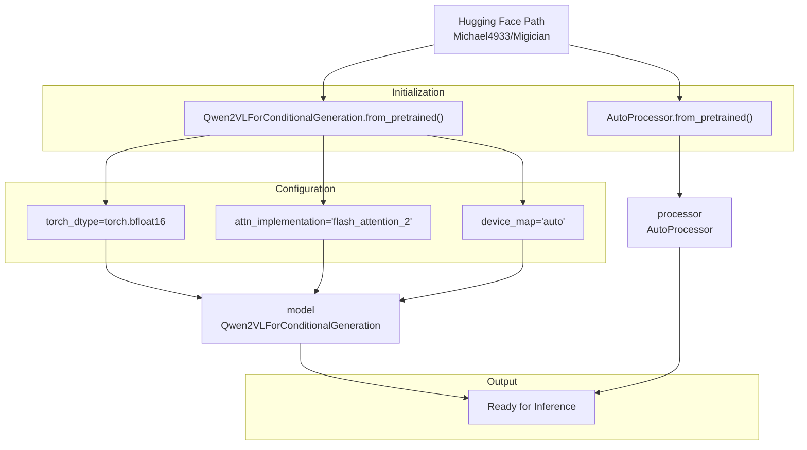
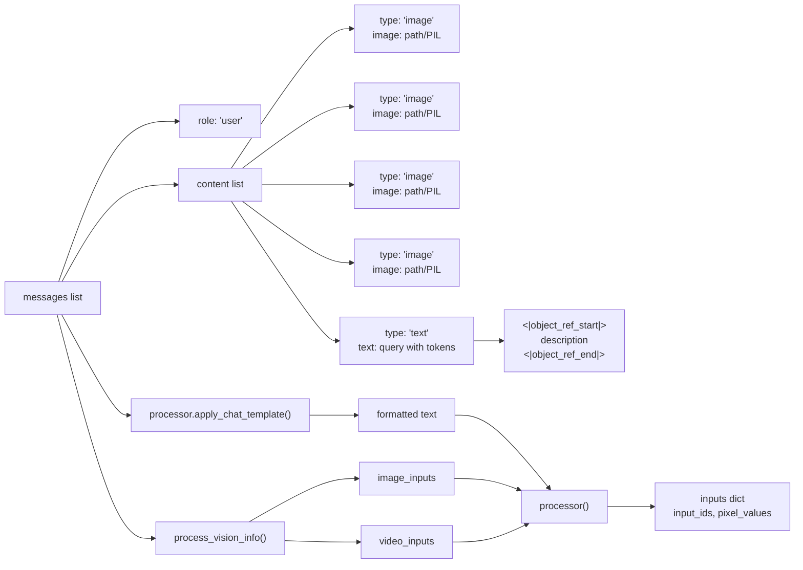
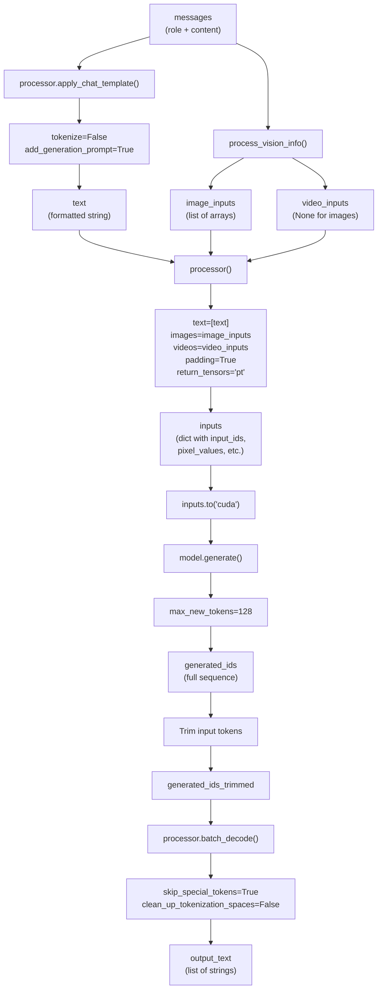
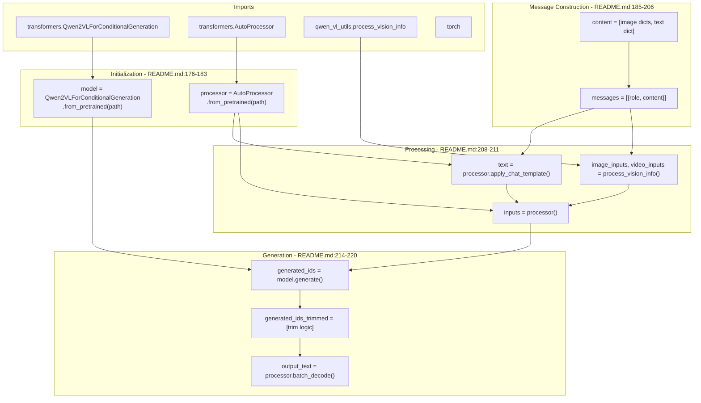

<!-- source: DeepWiki mcp.deepwiki.com · repo thunlp/Migician · page 2.2 Quick Start Guide · fetched 2026-11-02 -->

# Quick Start Guide

<details>
<summary>Relevant source files</summary>

The following files were used as context for generating this wiki page:

- [README.md](README.md)
- [eval/chat.py](eval/chat.py)

</details>


This page provides a practical introduction to using Migician for multi-image grounding inference. It covers loading the model, constructing prompts with special tokens, and interpreting the output bounding boxes. 

**Prerequisites**: Ensure you have completed the installation steps documented in [Installation](#2.1).

**For training**: See [Training Pipeline](#5) for information about the two-stage training process.

**For evaluation**: See [Evaluation System](#6) for benchmarking and metrics.

---

## Model Loading Architecture

The Migician model is built on `Qwen2VLForConditionalGeneration` and requires three core components for inference:

**Inference Component Initialization Flow**



**Sources**: [README.md:176-183](), [eval/chat.py:5-10]()

| Component | Class | Purpose |
|-----------|-------|---------|
| Model | `Qwen2VLForConditionalGeneration` | Core MLLM for generating text and bounding boxes |
| Processor | `AutoProcessor` | Handles tokenization and vision preprocessing |
| Vision Processor | `process_vision_info` (from `qwen_vl_utils`) | Extracts image inputs from message structure |

The model is loaded with `flash_attention_2` optimization for improved memory efficiency and speed, particularly important for multi-image scenarios.

**Sources**: [README.md:176-183](), [eval/chat.py:5-10]()

---

## Basic Multi-Image Grounding Example

The following example demonstrates locating a common person across four images:

**Message Construction and Processing Pipeline**



**Sources**: [README.md:185-211](), [eval/chat.py:12-43]()

The basic inference flow follows these steps:

1. **Construct messages**: Create a list with role `"user"` and content containing multiple images plus text query
2. **Apply chat template**: Convert messages to formatted text using `processor.apply_chat_template()`
3. **Process vision**: Extract image tensors using `process_vision_info()` from `qwen_vl_utils`
4. **Tokenize and encode**: Process text and images together with `processor()`
5. **Generate**: Call `model.generate()` with the processed inputs
6. **Decode**: Extract and decode the generated token IDs

**Sources**: [README.md:185-222](), [eval/chat.py:12-53]()

---

## Input Format Specification

### Message Structure

The input follows a standardized message format:

```python
messages = [
    {
        "role": "user",
        "content": [
            {"type": "image", "image": <path_or_PIL_image>},
            {"type": "image", "image": <path_or_PIL_image>},
            # ... more images ...
            {"type": "text", "text": "<query_with_special_tokens>"}
        ]
    }
]
```

**Sources**: [README.md:185-206](), [eval/chat.py:12-38]()

| Field | Type | Description |
|-------|------|-------------|
| `role` | string | Always `"user"` for inference queries |
| `content` | list | Ordered list of image and text entries |
| `type` | string | Either `"image"` or `"text"` |
| `image` | string or PIL.Image | File path or PIL Image object |
| `text` | string | Natural language query with special tokens |

### Special Tokens for Grounding

Grounding queries require wrapping target descriptions with delimiter tokens:

```
<|object_ref_start|>description of target object<|object_ref_end|>
```

Example query:
```
"Please recognize <|object_ref_start|>the common person appearing in all these images<|object_ref_end|> and locate this person in all these image."
```

**Sources**: [README.md:202](), [eval/chat.py:34]()

For detailed information about the complete special token system, see [Special Token System](#4.3).

---

## Processing and Generation

**Text and Vision Processing Flow**



**Sources**: [README.md:208-221](), [eval/chat.py:40-53]()

The processing happens in three stages:

1. **Text Templating**: `processor.apply_chat_template()` converts the message structure into a formatted prompt string with conversation markers
2. **Vision Processing**: `process_vision_info()` extracts image arrays from the message content
3. **Combined Processing**: `processor()` tokenizes text and processes images together into model-ready tensors

**Sources**: [README.md:208-211]()

### Generation Parameters

The generation call uses:

```python
generated_ids = model.generate(**inputs, max_new_tokens=128)
```

| Parameter | Value | Purpose |
|-----------|-------|---------|
| `max_new_tokens` | 128 | Limits output length; sufficient for multiple bounding boxes |
| `**inputs` | dict | Contains `input_ids`, `pixel_values`, `attention_mask` |

**Sources**: [README.md:214](), [eval/chat.py:46]()

### Token Trimming and Decoding

After generation, the output tokens include both the input and newly generated tokens. The trimming step isolates only the generated portion:

```python
generated_ids_trimmed = [
    out_ids[len(in_ids):] for in_ids, out_ids in zip(inputs.input_ids, generated_ids)
]
```

This is then decoded to text:

```python
output_text = processor.batch_decode(
    generated_ids_trimmed, 
    skip_special_tokens=True, 
    clean_up_tokenization_spaces=False
)
```

**Sources**: [README.md:215-220](), [eval/chat.py:47-52]()

---

## Output Format Specification

Migician outputs natural language responses with embedded bounding box coordinates using special tokens:

### Bounding Box Format

```
<|box_start|>(x1,y1),(x2,y2)<|box_end|>
```

Where:
- `x1, y1`: Top-left corner coordinates
- `x2, y2`: Bottom-right corner coordinates
- All coordinates normalized to **0-1000 scale** (not 0-1)
- Format: `x1 y1 x2 y2` (space-separated within parentheses)

**Sources**: [README.md:143]()

### Example Output

```
"It's in the third image. <|box_start|>(316,58),(764,999)<|box_end|>"
```

This indicates:
- The target object is in the third image (1-indexed)
- Bounding box: top-left at (31.6%, 5.8%), bottom-right at (76.4%, 99.9%) of image dimensions

**Sources**: [README.md:143]()

### Multiple Bounding Boxes

For queries involving multiple objects or images, the output contains multiple box specifications:

```
"It's in the first image. <|box_start|>(408,656),(578,997)<|box_end|>"
```

Each bounding box is accompanied by contextual text identifying which image and object it refers to.

**Sources**: [README.md:151]()

### Coordinate Normalization

| Scale Type | Range | Usage |
|------------|-------|-------|
| Model Output | 0-1000 | Migician's native output format |
| Ground Truth (MIG-Bench) | 0.0-1.0 | Evaluation benchmark format |
| Conversion | `coord / 1000.0` | Convert model output to ground truth format |

**Note**: When evaluating or comparing with ground truth, coordinates must be normalized by dividing by 1000.

**Sources**: [README.md:143](), [README.md:251-252]()

---

## Complete Code Reference

The complete inference code is located in two primary locations:

1. **README Example**: [README.md:171-222]() - Full documented example with imports
2. **Chat Script**: [eval/chat.py:1-54]() - Standalone executable version

**Inference Code Entity Mapping**



**Sources**: [README.md:171-222](), [eval/chat.py:1-54]()

### Key Functions and Methods

| Function/Method | Location | Purpose |
|-----------------|----------|---------|
| `from_pretrained()` | [README.md:177-182]() | Loads model weights and configuration |
| `apply_chat_template()` | [README.md:208]() | Formats messages into model input text |
| `process_vision_info()` | [README.md:209]() | Extracts and processes image data |
| `processor()` | [README.md:210]() | Tokenizes text and encodes images |
| `model.generate()` | [README.md:214]() | Generates output token sequence |
| `batch_decode()` | [README.md:218-220]() | Converts token IDs back to text |

---

## Common Usage Patterns

### Single vs. Multiple Images

Migician handles both single and multiple images in the same message format. Simply adjust the number of image entries in the content list:

**Single image**:
```python
content = [
    {"type": "image", "image": "image1.jpg"},
    {"type": "text", "text": "Locate <|object_ref_start|>the cat<|object_ref_end|>."}
]
```

**Multiple images**:
```python
content = [
    {"type": "image", "image": "image1.jpg"},
    {"type": "image", "image": "image2.jpg"},
    {"type": "image", "image": "image3.jpg"},
    {"type": "text", "text": "Find <|object_ref_start|>the common object<|object_ref_end|>."}
]
```

**Sources**: [README.md:185-206]()

### Image Input Types

The model accepts two image input formats:

1. **File paths** (string): `"./figs/multi_view_1.png"`
2. **PIL Image objects**: Pre-loaded images from `PIL.Image.open()`

Both types can be mixed within the same message.

**Sources**: [README.md:190](), [eval/chat.py:18]()

### Device Management

The model automatically distributes across available GPUs with `device_map="auto"`, but inputs must be explicitly moved to the target device:

```python
inputs = inputs.to("cuda")  # or "cpu" for CPU inference
```

**Sources**: [README.md:211](), [eval/chat.py:43]()

---

## Next Steps

After completing this quick start guide:

- **Understanding the model architecture**: See [Model Architecture](#4.1) for details on Migician's design
- **Learning the token system**: See [Special Token System](#4.3) for comprehensive token usage
- **Running evaluations**: See [Direct Evaluation Script](#6.2) for benchmarking on MIG-Bench
- **Training your own model**: See [Training Pipeline](#5) for two-stage training procedures

**Sources**: [README.md:41-51]()

---

