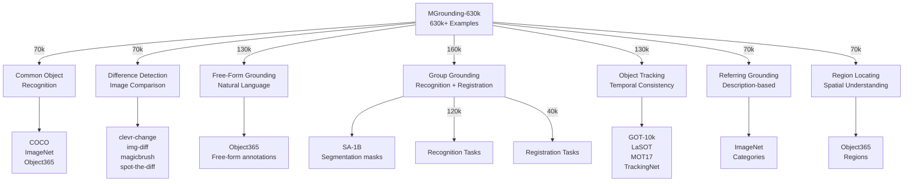
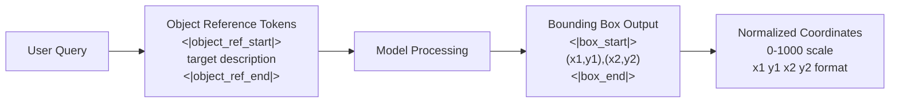
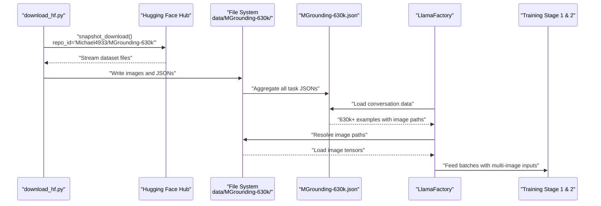

<!-- source: DeepWiki mcp.deepwiki.com · repo thunlp/Migician · page 3 MGrounding-630k Dataset · fetched 2026-11-02 -->

# MGrounding-630k Dataset

<details>
<summary>Relevant source files</summary>

The following files were used as context for generating this wiki page:

- [README.md](README.md)
- [data/download_hf.py](data/download_hf.py)

</details>


## Purpose and Scope

This document provides comprehensive documentation of the **MGrounding-630k** training dataset, which contains over 630,000 multi-image grounding examples used to train the Migician model. The dataset encompasses seven distinct task types derived from 10+ existing datasets, with a focus on free-form grounding capabilities.

For information about dataset structure and task type details, see [Dataset Structure](#3.1). For step-by-step download instructions, see [Downloading the Dataset](#3.2). For training pipeline usage of this dataset, see [Training Pipeline](#5).

**Sources:** [README.md:1-298]()

---

## Overview

MGrounding-630k is a heterogeneous multi-image grounding dataset designed specifically to enable free-form grounding in Multimodal Large Language Models (MLLMs). The dataset aggregates and synthesizes data from multiple source datasets, organizing them into task-specific categories that cover diverse multi-image grounding scenarios.

**Key Characteristics:**
- **Total Examples:** 630,000+ training instances
- **Task Types:** 7 distinct multi-image grounding tasks
- **Source Datasets:** 10+ existing computer vision datasets
- **Format:** JSON-based conversation format with image paths
- **Special Features:** Free-form natural language grounding instructions

Each training example involves multiple images, resulting in a substantially larger total number of images than the number of examples. The dataset is hosted on Hugging Face Hub at `Michael4933/MGrounding-630k` for convenient access.

**Sources:** [README.md:70-76](), [README.md:17-17]()

---

## Dataset Composition

MGrounding-630k consists of seven major task categories, each targeting specific multi-image grounding capabilities:



**Diagram: MGrounding-630k Task Composition and Source Datasets**

### Task Type Statistics

| Task Type | Example Count | Source Datasets | Primary Focus |
|-----------|--------------|-----------------|---------------|
| **Common Object Recognition** | 70,000 | COCO, ImageNet, Object365 | Multi-image identification of shared objects |
| **Difference Detection** | 70,000 | clevr-change, img-diff, magicbrush, spot-the-diff | Image comparison and change identification |
| **Free-Form Grounding** | 130,000 | Object365 | Natural language-driven grounding |
| **Group Grounding** | 160,000 | SA-1B | Multiple object sets (120k recognition, 40k registration) |
| **Object Tracking** | 130,000 | GOT-10k, LaSOT, MOT17, TrackingNet | Temporal consistency across frames |
| **Referring Grounding** | 70,000 | ImageNet | Description-based category mapping |
| **Region Locating** | 70,000 | Object365 | Spatial area identification |

**Sources:** [README.md:70-76]()

---

## File Organization Structure

The dataset is organized hierarchically by task type, with all images and metadata stored in a structured directory format:

```mermaid
graph TD
    ROOT["data/MGrounding-630k/"]
    
    ROOT --> JSON["MGrounding-630k.json<br/>All conversation data"]
    ROOT --> COMMON["Common_Object/"]
    ROOT --> DIFF["Difference/"]
    ROOT --> FREEFORM["Free-Form/"]
    ROOT --> GROUP["Group_Grounding/"]
    ROOT --> TRACK["Object_Tracking/"]
    ROOT --> REFER["Referring_Grounding/"]
    ROOT --> REGION["Region_Locating/"]
    
    COMMON --> COCO["COCO/<br/>images"]
    COMMON --> IMGNET1["ImageNet/<br/>images"]
    COMMON --> OBJ1["Object365/<br/>images"]
    COMMON --> CJSON["common_train_70k.json"]
    
    DIFF --> CLEVR["clevr-change/<br/>images"]
    DIFF --> IMGDIFF["img-diff/<br/>images"]
    DIFF --> MAGIC["magicbrush/<br/>images"]
    DIFF --> SPOT["spot-the-diff/<br/>images"]
    DIFF --> DJSON["diff_train_70k.json"]
    
    FREEFORM --> OBJ2["Object365/<br/>images"]
    FREEFORM --> FJSON["free_form_grounding_130k.json"]
    
    GROUP --> SA1B["SA-1B/<br/>images"]
    GROUP --> GGRECJSON["gg_train_120k.json<br/>Recognition"]
    GROUP --> GGREGJSON["_gg_reg_40k.json<br/>Registration"]
    
    TRACK --> GOT["GOT-10k/<br/>images"]
    TRACK --> LASOT["LaSOT/<br/>images"]
    TRACK --> MOT["MOT17_image/<br/>images"]
    TRACK --> TRACKNET["TrackingNet/<br/>images"]
    TRACK --> TJSON["ot_train_130k.json"]
    
    REFER --> IMGNET2["ImageNet/<br/>images"]
    REFER --> RJSON["refer_train_70k.json"]
    
    REGION --> OBJ3["Object365/<br/>images"]
    REGION --> REGJSON["region_train_70k.json"]
```



**Diagram: MGrounding-630k Directory Structure Mapping**

The centralized `MGrounding-630k.json` file at [data/MGrounding-630k.json]() aggregates all conversation data from individual task-specific JSON files, enabling convenient single-file access during training.

**Sources:** [README.md:80-125]()

---

## Data Format Specification

### JSON Structure

Each training example follows a standardized JSON format that specifies multiple images, multi-turn conversations, and task type labels:

```json
{
    "id": "5229016_8929009_6793119_3571391",
    "images": [
        "./MGrounding-630k/Group_Grounding/SA-1B/sa_5229016.jpg",
        "./MGrounding-630k/Group_Grounding/SA-1B/sa_8929009.jpg",
        "./MGrounding-630k/Group_Grounding/SA-1B/sa_6793119.jpg",
        "./MGrounding-630k/Group_Grounding/SA-1B/sa_3571391.jpg"
    ],
    "conversations": [
        {
            "from": "human",
            "value": "<image>\n<image>\n<image>\n<image>\nGive the bounding box of the region this sentence refers to: <|object_ref_start|>a statue of a man<|object_ref_end|>."
        },
        {
            "from": "gpt",
            "value": "It's in the third image. <|box_start|>(316,58),(764,999)<|box_end|>"
        },
        {
            "from": "human",
            "value": "Recognize the target region that this sentence refers to: <|object_ref_start|>a woman wearing an orange shirt<|object_ref_end|>."
        },
        {
            "from": "gpt",
            "value": "It's in the first image. <|box_start|>(408,656),(578,997)<|box_end|>"
        }
    ],
    "type": "gg_train"
}
```

**Sources:** [README.md:126-156]()

### Field Specifications

| Field | Type | Description |
|-------|------|-------------|
| `id` | string | Unique identifier (internal use, can be ignored) |
| `images` | array[string] | List of image file paths relative to dataset root |
| `conversations` | array[object] | Multi-turn dialogue with grounding instructions |
| `conversations[].from` | string | Speaker role: `"human"` or `"gpt"` |
| `conversations[].value` | string | Message content with special tokens |
| `type` | string | Task type label (e.g., `"gg_train"`, `"free_form"`) |

### Special Token System

MGrounding-630k uses a specialized token vocabulary to denote grounding targets and bounding boxes:



**Diagram: Special Token Flow in MGrounding-630k Format**

**Token Definitions:**
- **`<|object_ref_start|>` / `<|object_ref_end|>`**: Delimit the natural language description of the grounding target in user queries
- **`<|box_start|>` / `<|box_end|>`**: Delimit bounding box coordinates in model responses
- **Coordinate Format**: `(x1,y1),(x2,y2)` where values are normalized to 0-1000 scale
- **Coordinate System**: Relative positions with respect to image width (x) and height (y)

For detailed information on special token usage, see [Special Token System](#4.3).

**Sources:** [README.md:126-156](), [README.md:139-143]()

---

## Storage and Download Considerations

### Storage Requirements

Due to the multi-image nature of the dataset, storage requirements are substantial:

> **Important:** Each training example involves multiple images. The 630k+ examples collectively include a significantly larger number of individual images. Ensure sufficient hard disk storage before downloading.

**Minimum Requirements:**
- Hard disk space: Sufficient for 630k+ multi-image examples (exact size depends on image compression)
- Network: Stable internet connection for Hugging Face Hub download
- Download tool: `huggingface-hub` Python package with snapshot download support

**Sources:** [README.md:70-74]()

### Download Automation

The dataset can be downloaded automatically using the provided script at [data/download_hf.py:1-11]():

```python
from huggingface_hub import snapshot_download

snapshot_download(
    repo_id='Michael4933/MGrounding-630k',
    repo_type='dataset',
    local_dir='Your_Own_Path',
    force_download=False,
    max_workers=32,
)
```

**Key Parameters:**
- `repo_id`: `'Michael4933/MGrounding-630k'` (Hugging Face repository)
- `repo_type`: `'dataset'` (specifies dataset repository type)
- `local_dir`: Target directory path for downloaded data
- `max_workers`: Parallel download threads (32 recommended)
- `force_download`: Set to `False` to resume interrupted downloads

**Mirror Configuration (Optional):**
For regions with limited Hugging Face access, set the mirror endpoint before downloading:
```bash
export HF_ENDPOINT=https://hf-mirror.com
```

**Sources:** [data/download_hf.py:1-11](), [README.md:78-78]()

---

## Integration with Training Pipeline

### Data Loading Flow



**Diagram: MGrounding-630k Data Flow from Download to Training**

The dataset integrates with the training pipeline through the following code entities:
- **Download Script**: [data/download_hf.py:4-11]() handles automated retrieval
- **Centralized JSON**: [data/MGrounding-630k.json]() referenced by training configs
- **Training Configs**: [train/stage-1_finetune_full.yaml]() and [train/stage-2_finetune_full.yaml]() specify dataset paths
- **LlamaFactory Framework**: Orchestrates data loading and batching during training

**Sources:** [README.md:278-286](), [data/download_hf.py:1-11]()

---

## Task Type Labels

The `type` field in each JSON entry identifies the specific grounding task:

| Type Label | Task Name | Description |
|------------|-----------|-------------|
| `common_train` | Common Object Recognition | Identifying shared objects across images |
| `diff_train` | Difference Detection | Finding differences between image pairs |
| `free_form` | Free-Form Grounding | Natural language-driven flexible grounding |
| `gg_train` | Group Grounding (Recognition) | Recognizing object groups across images |
| `gg_reg` | Group Grounding (Registration) | Registering object correspondences |
| `ot_train` | Object Tracking | Tracking objects across temporal sequences |
| `refer_train` | Referring Grounding | Grounding based on descriptive references |
| `region_train` | Region Locating | Identifying spatial regions |

These labels enable task-specific filtering during training and analysis.

**Sources:** [README.md:80-125](), [README.md:154-154]()

---

