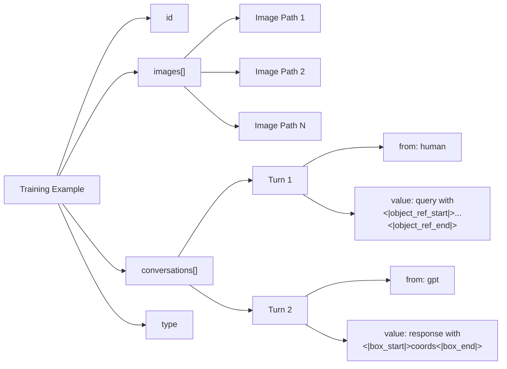
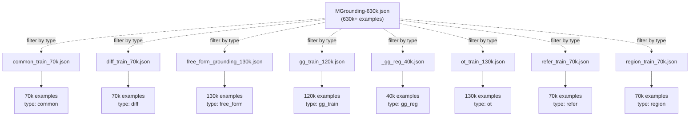
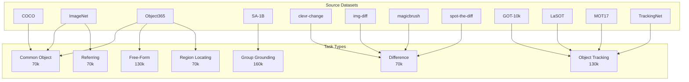
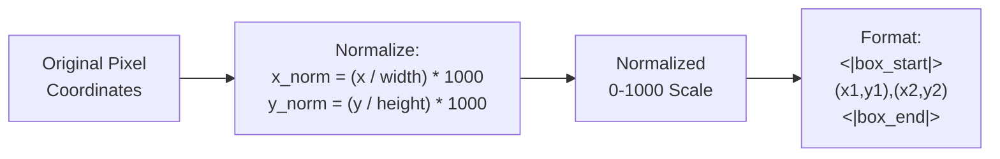

<!-- source: DeepWiki mcp.deepwiki.com · repo thunlp/Migician · page 3.1 Dataset Structure · fetched 2026-11-02 -->

# Dataset Structure

<details>
<summary>Relevant source files</summary>

The following files were used as context for generating this wiki page:

- [README.md](README.md)

</details>


This document provides a detailed breakdown of the MGrounding-630k dataset structure, including the seven task types, their source datasets, example counts, directory organization, and JSON data format specifications. For information on downloading the dataset, see [Downloading the Dataset](#3.2). For training with this dataset, see [Training Pipeline](#5).

---

## Overview

MGrounding-630k is a heterogeneous multi-image grounding dataset containing **630,000+** training examples organized into seven distinct task categories. Each task type is designed to develop specific multi-image grounding capabilities, from basic shared object recognition to complex free-form natural language grounding. The dataset aggregates data from over 10 different source datasets, ensuring diverse visual scenarios and robust generalization.

**Key Characteristics:**
- **Multi-image nature**: Each example involves multiple images (typically 2-8 images)
- **Task diversity**: Seven complementary task types covering different grounding scenarios
- **Unified format**: Standardized JSON structure with special token support
- **Normalized coordinates**: Bounding boxes use 0-1000 scale for resolution independence

Sources: [README.md:1-298]()

---

## Task Type Distribution

### Task Statistics

The following table summarizes the composition of MGrounding-630k:

| Task Type | Example Count | Source Datasets | Purpose |
|-----------|---------------|-----------------|---------|
| Common Object Recognition | 70,000 | COCO, ImageNet, Object365 | Identify shared objects across images |
| Difference Detection | 70,000 | clevr-change, img-diff, magicbrush, spot-the-diff | Detect changes between image pairs |
| Free-Form Grounding | 130,000 | Object365 | Ground objects from natural language descriptions |
| Group Grounding | 160,000 | SA-1B | Recognize and register multiple object sets |
| Object Tracking | 130,000 | GOT-10k, LaSOT, MOT17, TrackingNet | Track objects across sequential frames |
| Referring Grounding | 70,000 | ImageNet | Ground objects by category references |
| Region Locating | 70,000 | Object365 | Identify spatial regions by description |
| **Total** | **630,000** | 10+ datasets | Comprehensive multi-image grounding |

**Note**: Group Grounding contains two sub-tasks:
- Recognition (120,000 examples): Identify common objects across images
- Registration (40,000 examples): Map corresponding object locations

Sources: [README.md:70-125]()

---

## Task Type Breakdown

### 1. Common Object Recognition (70k)

**Purpose**: Identify and locate objects that appear across multiple images from different sources.

**Source Datasets**:
- **COCO**: Common objects in context
- **ImageNet**: ImageNet-scale object categories
- **Object365**: 365 object categories with dense annotations

**Directory**: `./data/MGrounding-630k/Common_Object/`

**Task Characteristics**:
- Requires cross-image object matching
- Tests basic multi-image correspondence
- Uses standard object categories

### 2. Difference Detection (70k)

**Purpose**: Identify what has changed between image pairs or detect differences across similar images.

**Source Datasets**:
- **clevr-change**: Synthetic scene changes
- **img-diff**: Natural image differences
- **magicbrush**: Image editing scenarios
- **spot-the-diff**: Visual puzzle differences

**Directory**: `./data/MGrounding-630k/Difference/`

**Task Characteristics**:
- Focuses on fine-grained visual comparison
- Requires attention to subtle variations
- Multiple specialized difference scenarios

### 3. Free-Form Grounding (130k)

**Purpose**: Ground objects based on unrestricted natural language descriptions without predefined categories.

**Source Datasets**:
- **Object365**: Free-form annotations generated from object descriptions

**Directory**: `./data/MGrounding-630k/Free-Form/`

**Task Characteristics**:
- Largest single-source task type (130k examples)
- Enables flexible, description-driven grounding
- Tests natural language understanding in multi-image contexts
- Critical for real-world application scenarios

### 4. Group Grounding (160k)

**Purpose**: Recognize and register multiple object groups across images, supporting both recognition and spatial correspondence tasks.

**Source Datasets**:
- **SA-1B** (Segment Anything): High-quality segmentation masks converted to bounding boxes

**Directory**: `./data/MGrounding-630k/Group_Grounding/`

**Sub-tasks**:
- **Recognition** (120k): Identify which objects appear in which images
- **Registration** (40k): Establish precise spatial correspondences

**Task Characteristics**:
- Largest task type overall (160k examples)
- Handles multiple objects per query
- Tests both categorical and spatial reasoning

### 5. Object Tracking (130k)

**Purpose**: Track objects across sequential frames, maintaining identity consistency through temporal sequences.

**Source Datasets**:
- **GOT-10k**: Generic object tracking
- **LaSOT**: Large-scale single object tracking
- **MOT17**: Multiple object tracking
- **TrackingNet**: Large-scale tracking dataset

**Directory**: `./data/MGrounding-630k/Object_Tracking/`

**Task Characteristics**:
- Temporal consistency across frames
- Tests cross-frame object correspondence
- Multiple tracking scenarios (single/multiple objects)

### 6. Referring Grounding (70k)

**Purpose**: Ground objects based on category names or referring expressions mapped to ImageNet taxonomy.

**Source Datasets**:
- **ImageNet**: Structured category hierarchy

**Directory**: `./data/MGrounding-630k/Referring_Grounding/`

**Task Characteristics**:
- Category-based object grounding
- Leverages semantic hierarchies
- Tests category understanding across images

### 7. Region Locating (70k)

**Purpose**: Identify and locate spatial regions based on descriptive queries.

**Source Datasets**:
- **Object365**: Region-level annotations

**Directory**: `./data/MGrounding-630k/Region_Locating/`

**Task Characteristics**:
- Spatial reasoning emphasis
- Region-level (vs. object-level) grounding
- Tests area identification capabilities

Sources: [README.md:70-125]()

---

## Directory Structure

### Complete Directory Hierarchy

```mermaid
graph TD
    ROOT["MGrounding-630k/"]
    
    ROOT --> COMMON["Common_Object/"]
    ROOT --> DIFF["Difference/"]
    ROOT --> FREE["Free-Form/"]
    ROOT --> GROUP["Group_Grounding/"]
    ROOT --> TRACK["Object_Tracking/"]
    ROOT --> REFER["Referring_Grounding/"]
    ROOT --> REGION["Region_Locating/"]
    ROOT --> JSON["MGrounding-630k.json"]
    
    COMMON --> C1["COCO/"]
    COMMON --> C2["ImageNet/"]
    COMMON --> C3["Object365/"]
    COMMON --> C4["common_train_70k.json"]
    
    DIFF --> D1["clevr-change/"]
    DIFF --> D2["img-diff/"]
    DIFF --> D3["magicbrush/"]
    DIFF --> D4["spot-the-diff/"]
    DIFF --> D5["diff_train_70k.json"]
    
    FREE --> F1["Object365/"]
    FREE --> F2["free_form_grounding_130k.json"]
    
    GROUP --> G1["SA-1B/"]
    GROUP --> G2["gg_train_120k.json<br/>(recognition)"]
    GROUP --> G3["_gg_reg_40k.json<br/>(registration)"]
    
    TRACK --> T1["GOT-10k/"]
    TRACK --> T2["LaSOT/"]
    TRACK --> T3["MOT17_image/"]
    TRACK --> T4["TrackingNet/"]
    TRACK --> T5["ot_train_130k.json"]
    
    REFER --> R1["ImageNet/"]
    REFER --> R2["refer_train_70k.json"]
    
    REGION --> RE1["Object365/"]
    REGION --> RE2["region_train_70k.json"]
```



### Task-to-Directory Mapping

The complete directory structure as organized in the repository:

```
Migician/data/MGrounding-630k/
├── Common_Object/
│   ├── COCO/
│   ├── ImageNet/
│   ├── Object365/
│   └── common_train_70k.json
├── Difference/
│   ├── clevr-change/
│   ├── img-diff/
│   ├── magicbrush/
│   ├── spot-the-diff/
│   └── diff_train_70k.json
├── Free-Form/
│   ├── Object365/
│   └── free_form_grounding_130k.json
├── Group_Grounding/
│   ├── SA-1B/
│   ├── gg_train_120k.json
│   └── _gg_reg_40k.json
├── Object_Tracking/
│   ├── GOT-10k/
│   ├── LaSOT/
│   ├── MOT17_image/
│   ├── TrackingNet/
│   └── ot_train_130k.json
├── Referring_Grounding/
│   ├── ImageNet/
│   └── refer_train_70k.json
├── Region_Locating/
│   ├── Object365/
│   └── region_train_70k.json
└── MGrounding-630k.json (consolidated)
```

**Key Files**:
- Each task directory contains task-specific JSON files with conversation data
- `MGrounding-630k.json`: Master file consolidating all 630k+ examples with task labels
- Image directories organized by source dataset within each task folder

Sources: [README.md:80-125]()

---

## JSON Data Format

### Conversation Structure

Each training example in MGrounding-630k follows a standardized JSON structure designed to support multi-turn grounding conversations with special token markers.

### Example Data Structure



### Complete Example

The following shows a complete Group Grounding example from the dataset:

```json
{
    "id": "5229016_8929009_6793119_3571391",
    "images": [
        "./MGrounding-630k/Group_Grounding/SA-1B/sa_5229016.jpg",
        "./MGrounding-630k/Group_Grounding/SA-1B/sa_8929009.jpg",
        "./MGrounding-630k/Group_Grounding/SA-1B/sa_6793119.jpg",
        "./MGrounding-630k/Group_Grounding/SA-1B/sa_3571391.jpg"
    ],
    "conversations": [
        {
            "from": "human",
            "value": "<image>\n<image>\n<image>\n<image>\nGive the bounding box of the region this sentence refers to: <|object_ref_start|>a statue of a man<|object_ref_end|>."
        },
        {
            "from": "gpt",
            "value": "It's in the third image. <|box_start|>(316,58),(764,999)<|box_end|>"
        },
        {
            "from": "human",
            "value": "Recognize the target region that this sentence refers to: <|object_ref_start|>a woman wearing an orange shirt<|object_ref_end|>."
        },
        {
            "from": "gpt",
            "value": "It's in the first image. <|box_start|>(408,656),(578,997)<|box_end|>"
        }
    ],
    "type": "gg_train"
}
```

Sources: [README.md:127-156]()

---

## Field Specifications

### Core Fields

| Field | Type | Description | Example |
|-------|------|-------------|---------|
| `id` | string | Unique identifier (can be ignored for training) | `"5229016_8929009_6793119_3571391"` |
| `images` | array[string] | Ordered list of relative image paths | `["./MGrounding-630k/Group_Grounding/SA-1B/sa_5229016.jpg", ...]` |
| `conversations` | array[object] | Multi-turn conversation with grounding queries | See below |
| `type` | string | Task type label for filtering | `"gg_train"`, `"free_form"`, etc. |

### Conversation Turn Structure

Each conversation turn contains:

| Field | Type | Values | Description |
|-------|------|--------|-------------|
| `from` | string | `"human"` or `"gpt"` | Speaker role |
| `value` | string | Text with special tokens | Query text (human) or response with bbox (gpt) |

### Special Token System

The dataset uses special tokens to delimit grounding targets and bounding boxes:

**Object Reference Tokens**:
- `<|object_ref_start|>`: Marks the beginning of an object description
- `<|object_ref_end|>`: Marks the end of an object description

**Bounding Box Tokens**:
- `<|box_start|>`: Marks the beginning of coordinate data
- `<|box_end|>`: Marks the end of coordinate data

**Coordinate Format**:
- Format: `(x1,y1),(x2,y2)`
- Scale: **0-1000** normalized coordinates (not 0-1)
- Coordinate system: `x1, y1` = top-left corner, `x2, y2` = bottom-right corner
- Relative positions regarding image width and height

For detailed information on the special token system, see [Special Token System](#4.3).

Sources: [README.md:127-156]()

---

## Task Type Labels

### Type Field Mapping

Each example's `type` field identifies its task category for data filtering and task-specific training:

| Type Value | Task Category | Example Count |
|------------|---------------|---------------|
| `"common"` | Common Object Recognition | 70,000 |
| `"diff"` | Difference Detection | 70,000 |
| `"free_form"` | Free-Form Grounding | 130,000 |
| `"gg_train"` | Group Grounding (Recognition) | 120,000 |
| `"gg_reg"` | Group Grounding (Registration) | 40,000 |
| `"ot"` | Object Tracking | 130,000 |
| `"refer"` | Referring Grounding | 70,000 |
| `"region"` | Region Locating | 70,000 |

### Task-Specific JSON Files

In addition to the consolidated `MGrounding-630k.json`, task-specific JSON files are provided:



Sources: [README.md:80-125](), [README.md:127-156]()

---

## Source Dataset Details

### Dataset Source Relationships

The following diagram shows how source datasets contribute to task types:



### Source Dataset Statistics

| Source Dataset | Task Types | Contribution |
|----------------|------------|--------------|
| **Object365** | Common Object, Free-Form, Region Locating | ~200k+ examples across 3 tasks |
| **SA-1B** | Group Grounding | 160k examples (full task) |
| **ImageNet** | Common Object, Referring Grounding | ~140k examples across 2 tasks |
| **Tracking Datasets** | Object Tracking | 130k examples (4 datasets) |
| **COCO** | Common Object | Partial contribution to 70k |
| **Difference Datasets** | Difference Detection | 70k examples (4 datasets) |

**Note**: Object365 is the most versatile source dataset, contributing to three different task types and demonstrating its rich annotation diversity.

Sources: [README.md:70-125]()

---

## Image Path Convention

### Relative Path Structure

All image paths in the JSON files use relative paths from the data root directory:

```
./MGrounding-630k/{TaskType}/{SourceDataset}/{image_file}
```

**Example Paths**:
```
./MGrounding-630k/Group_Grounding/SA-1B/sa_5229016.jpg
./MGrounding-630k/Free-Form/Object365/obj365_12345.jpg
./MGrounding-630k/Object_Tracking/LaSOT/lasot_video_001_0042.jpg
```

### Multi-Image Ordering

The `images` array maintains strict ordering:
- Array index corresponds to image position in conversation context
- Image tokens `<image>` in conversation refer to images in sequential order
- Model processes images according to array order

**Example**:
```json
"images": ["path/to/img1.jpg", "path/to/img2.jpg", "path/to/img3.jpg"]
"value": "<image>\n<image>\n<image>\nFind the object in the second image."
```
The query references "second image" = `path/to/img2.jpg` (index 1).

Sources: [README.md:127-156]()

---

## Coordinate Normalization

### Normalization Scheme

MGrounding-630k uses a **0-1000 scale** for bounding box coordinates, providing resolution-independent representation:



### Conversion Formula

For an image with dimensions `W × H` pixels:

- `x_normalized = (x_pixel / W) × 1000`
- `y_normalized = (y_pixel / H) × 1000`

**Example**:
```
Image: 800 × 600 pixels
Original bbox: (200, 150) to (400, 300) pixels

Normalized:
x1 = (200 / 800) × 1000 = 250
y1 = (150 / 600) × 1000 = 250
x2 = (400 / 800) × 1000 = 500
y2 = (300 / 600) × 1000 = 500

Output: <|box_start|>(250,250),(500,500)<|box_end|>
```

### Format Specifications

- **Coordinate order**: `(x1, y1), (x2, y2)` where `(x1, y1)` is top-left, `(x2, y2)` is bottom-right
- **Range**: Integer values from 0 to 1000
- **Precision**: Integer precision (no decimals in training data)
- **Multiple boxes**: Single box per grounding query in training data

Sources: [README.md:143](), [README.md:250-253]()

---

## Data Loading Considerations

### Storage Requirements

The multi-image nature of MGrounding-630k results in substantial storage needs:

- **630k+ training examples** with **multiple images per example**
- Total image count significantly exceeds example count
- Typical multi-image count: 2-8 images per example
- **Estimated total storage**: Requires significant disk space (exact size varies)

From [README.md:71-74]():
> Due to the nature of multi-image tasks, each training example involves multiple images. As a result, the 600k+ training examples collectively include an even larger number of images. Please ensure that you have sufficient hard disk storage and a stable internet connection.

### Loading Strategy

**Recommended Approach**:
1. Download complete dataset using `download_hf.py` (see [Downloading the Dataset](#3.2))
2. Extract all `.zip` files for each task type
3. Load `MGrounding-630k.json` for full dataset access
4. Use task-specific JSON files for filtered training

**Performance Considerations**:
- Images are loaded dynamically during training (not pre-cached)
- Multi-image batching requires careful memory management
- Consider preprocessing strategies for efficiency

Sources: [README.md:71-78]()

---

## Task-Specific Characteristics

### Conversation Patterns

Different task types exhibit distinct conversation patterns:

| Task Type | Typical Pattern | Image Count Range |
|-----------|-----------------|-------------------|
| Common Object | Single query across all images | 2-4 images |
| Difference | Comparative queries between image pairs | 2 images |
| Free-Form | Natural language object descriptions | 2-8 images |
| Group Grounding | Multiple object queries per conversation | 2-6 images |
| Object Tracking | Sequential frame analysis | 4-10 frames |
| Referring Grounding | Category-based queries | 2-4 images |
| Region Locating | Spatial region descriptions | 2-4 images |

### Multi-Turn Conversations

Many examples include multiple conversation turns, enabling:
- Progressive grounding refinement
- Multiple object queries in single example
- Context-dependent follow-up questions

**Example Turn Structure**:
```
Turn 1: Human asks about object A → GPT grounds object A
Turn 2: Human asks about object B → GPT grounds object B
Turn 3: Human asks comparative question → GPT responds with analysis
```

Sources: [README.md:127-156]()

---

## Data Quality and Annotations

### Annotation Sources

The dataset leverages multiple annotation sources:

1. **Existing Annotations**: COCO, ImageNet, Object365 provide high-quality ground truth
2. **Generated Annotations**: Free-form descriptions created from structured annotations
3. **Segmentation Conversions**: SA-1B masks converted to bounding boxes
4. **Tracking Annotations**: Temporal correspondences from tracking datasets

### Quality Characteristics

- **Bounding box precision**: Pixel-accurate bounding boxes from source datasets
- **Description diversity**: Natural language variations in free-form tasks
- **Multi-image consistency**: Cross-image annotations maintain object identity
- **Task-specific validation**: Each task type validated for its specific requirements

Sources: [README.md:70-125]()

---

