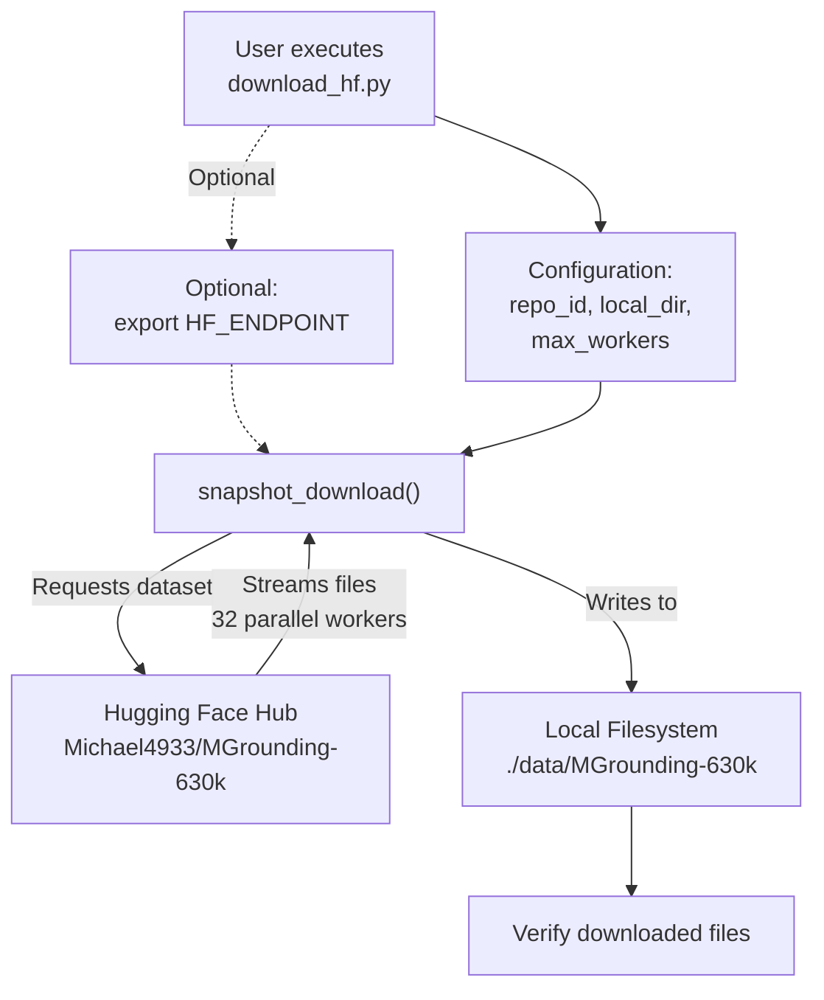
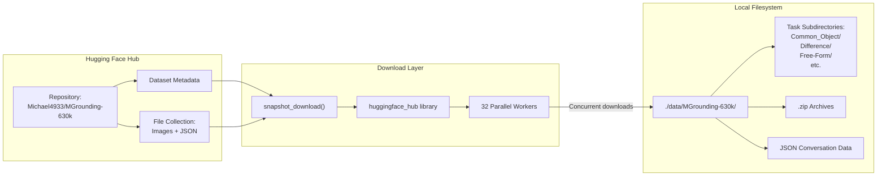

<!-- source: DeepWiki mcp.deepwiki.com · repo thunlp/Migician · page 3.2 Downloading the Dataset · fetched 2026-11-02 -->

# Downloading the Dataset

<details>
<summary>Relevant source files</summary>

The following files were used as context for generating this wiki page:

- [README.md](README.md)
- [data/download_hf.py](data/download_hf.py)

</details>


This document provides a step-by-step guide for downloading the MGrounding-630k dataset from Hugging Face Hub, including configuration options, mirror setup, and verification steps. For information about the dataset structure and task composition, see [Dataset Structure](#3.1).

## Overview

The MGrounding-630k dataset is hosted on Hugging Face at [Michael4933/MGrounding-630k](https://huggingface.co/datasets/Michael4933/MGrounding-630k). Due to the multi-image nature of the dataset, the 630k+ training examples collectively include a substantial number of image files, requiring significant disk storage and a stable internet connection.

**Storage Requirements:**
- Multiple gigabytes of disk space
- Stable high-speed internet connection recommended
- Sufficient bandwidth for concurrent downloads

**Sources:** [README.md:69-75]()

## Prerequisites

Before downloading, ensure the following dependencies are installed:

```bash
pip install huggingface_hub
```

The `huggingface_hub` library provides the `snapshot_download` and `hf_hub_download` functions used by the download script.

**Sources:** [data/download_hf.py:4]()

## Download Method: Using download_hf.py

### Script Overview

The repository provides an automated download script at [data/download_hf.py:1-11]() that handles the complete dataset acquisition process.

### Download Workflow Diagram



**Sources:** [data/download_hf.py:1-11]()

### Step-by-Step Instructions

#### Step 1: Configure Mirror (Optional)

For users in regions with limited Hugging Face access, configure a mirror endpoint before downloading:

```bash
export HF_ENDPOINT=https://hf-mirror.com
```

This environment variable redirects all Hugging Face API requests to the specified mirror.

**Sources:** [data/download_hf.py:1-2]()

#### Step 2: Modify Local Directory Path

Edit the `local_dir` parameter in [data/download_hf.py:8]() to specify your desired download location:

```python
snapshot_download(repo_id='Michael4933/MGrounding-630k',
                  repo_type='dataset',
                  local_dir='Your_Own_Path',  # Modify this
                  force_download=False,
                  max_workers=32,
                 )
```

For standard usage, set `local_dir` to `./data/MGrounding-630k` to match the expected structure referenced in training and evaluation scripts.

**Sources:** [data/download_hf.py:6-11]()

#### Step 3: Execute Download Script

```bash
cd data
python download_hf.py
```

The script will download all dataset files using 32 parallel workers (`max_workers=32`) for optimal throughput.

**Sources:** [data/download_hf.py:10]()

### snapshot_download Parameters

| Parameter | Value | Purpose |
|-----------|-------|---------|
| `repo_id` | `'Michael4933/MGrounding-630k'` | Hugging Face repository identifier |
| `repo_type` | `'dataset'` | Specifies dataset repository (not model) |
| `local_dir` | User-specified path | Destination directory for downloaded files |
| `force_download` | `False` | Skip re-downloading existing files |
| `max_workers` | `32` | Number of parallel download threads |

Setting `force_download=False` enables resume functionality—if the download is interrupted, running the script again will continue from where it left off rather than restarting.

**Sources:** [data/download_hf.py:6-11]()

## Data Flow Architecture



**Sources:** [README.md:76-125](), [data/download_hf.py:4-11]()

## Post-Download Steps

### Step 1: Verify Download

After download completes, verify the directory structure matches the expected format:

```
data/
└── MGrounding-630k/
    ├── Common_Object/
    ├── Difference/
    ├── Free-Form/
    ├── Group_Grounding/
    ├── Object_Tracking/
    ├── Referring_Grounding/
    ├── Region_Locating/
    └── MGrounding-630k.json
```

Each task subdirectory should contain both image folders and corresponding `.zip` files.

**Sources:** [README.md:80-125]()

### Step 2: Extract ZIP Archives

Navigate to each task subdirectory and extract the `.zip` files to access image data:

```bash
cd data/MGrounding-630k/Common_Object/COCO
unzip *.zip
```

Repeat for all task subdirectories as needed. The README notes that "additional .zip files at this level may be of limited help" [README.md:89](), suggesting the primary data is accessible from the main task directories.

**Sources:** [README.md:76-77]()

### Step 3: Verify JSON Structure

The main conversation data file is located at `./data/MGrounding-630k/MGrounding-630k.json`. This file contains all 630k+ training examples with task type labels. Each example follows this structure:

```json
{
    "id": "unique_identifier",
    "images": ["path/to/image1.jpg", "path/to/image2.jpg"],
    "conversations": [
        {"from": "human", "value": "..."},
        {"from": "gpt", "value": "..."}
    ],
    "type": "task_label"
}
```

Verify the file is valid JSON and contains the expected number of entries.

**Sources:** [README.md:122](), [README.md:126-156]()

## Expected Directory Structure

After successful download and extraction, the complete structure should match:

```
Migician/
├── data/
│   ├── MGrounding-630k/
│   │   ├── Common_Object/
│   │   │   ├── COCO/
│   │   │   ├── ImageNet/
│   │   │   ├── Object365/
│   │   │   └── common_train_70k.json
│   │   ├── Difference/
│   │   │   ├── clevr-change/
│   │   │   ├── img-diff/
│   │   │   ├── magicbrush/
│   │   │   ├── spot-the-diff/
│   │   │   └── diff_train_70k.json
│   │   ├── Free-Form/
│   │   │   ├── Object365/
│   │   │   └── free_form_grounding_130k.json
│   │   ├── Group_Grounding/
│   │   │   ├── SA-1B/
│   │   │   ├── _gg_reg_40k.json
│   │   │   └── gg_train_120k.json
│   │   ├── Object_Tracking/
│   │   │   ├── GOT-10k/
│   │   │   ├── LaSOT/
│   │   │   ├── MOT17_image/
│   │   │   ├── TrackingNet/
│   │   │   └── ot_train_130k.json
│   │   ├── Referring_Grounding/
│   │   │   ├── ImageNet/
│   │   │   └── refer_train_70k.json
│   │   ├── Region_Locating/
│   │   │   ├── Object365/
│   │   │   └── region_train_70k.json
│   │   └── MGrounding-630k.json
```

This structure is referenced by training scripts (see [Training Pipeline](#5)) and must be maintained for proper functionality.

**Sources:** [README.md:80-125]()

## Alternative Download: Manual Method

If the automated script encounters issues, download manually via the Hugging Face website:

1. Visit https://huggingface.co/datasets/Michael4933/MGrounding-630k
2. Navigate to the "Files and versions" tab
3. Download individual files or use the "Download dataset" option
4. Extract to `./data/MGrounding-630k`

This method provides more granular control but lacks parallel download optimization.

**Sources:** [README.md:70]()

## Mirror Configuration Details

### Supported Mirrors

The `HF_ENDPOINT` environment variable can be set to any Hugging Face-compatible mirror. Common options include:

- `https://hf-mirror.com` (Default mirror for restricted regions)
- Custom institutional mirrors
- Regional CDN endpoints

### Verification

To verify mirror configuration is active:

```bash
echo $HF_ENDPOINT
```

The download script will automatically use this endpoint for all API requests.

**Sources:** [data/download_hf.py:1-2]()

## Troubleshooting

### Issue: Connection Timeout

**Symptom:** Download stalls or times out repeatedly.

**Solution:**
1. Configure mirror: `export HF_ENDPOINT=https://hf-mirror.com`
2. Reduce `max_workers` to `8` or `16` in [data/download_hf.py:10]()
3. Verify network stability

### Issue: Insufficient Disk Space

**Symptom:** Download fails with disk space error.

**Solution:**
1. Check available space: `df -h`
2. Clear unnecessary files
3. Consider downloading to external storage with adequate capacity

### Issue: Partial Download

**Symptom:** Some files are missing after download completes.

**Solution:**
1. Re-run `python download_hf.py` (resume will be automatic with `force_download=False`)
2. If persistent, set `force_download=True` for complete re-download
3. Verify Hugging Face Hub availability

### Issue: Invalid JSON After Download

**Symptom:** `MGrounding-630k.json` fails to parse.

**Solution:**
1. Delete corrupted file
2. Re-download with `force_download=True`
3. Verify file integrity with checksums if available

**Sources:** [data/download_hf.py:6-11](), [README.md:69-75]()

## Integration with Training Pipeline

Once downloaded, the dataset is consumed by the LlamaFactory training framework (see [Training Pipeline](#5)). The training configuration files reference the dataset path:

- Stage 1: [train/stage-1_finetune_full.yaml]()
- Stage 2: [train/stage-2_finetune_full.yaml]()

Ensure the `local_dir` specified in `download_hf.py` matches the paths expected by these configuration files.

**Sources:** [README.md:278-286]()

## Related Resources

- For dataset composition and task breakdown, see [Dataset Structure](#3.1)
- For training setup using downloaded data, see [Training Pipeline](#5)
- For benchmark dataset download (MIG-Bench), modify `repo_id` to `'Michael4933/MIG-Bench'` in [data/download_hf.py:6]()

**Sources:** [README.md:227](), [data/download_hf.py:6]()

---

