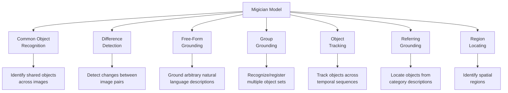
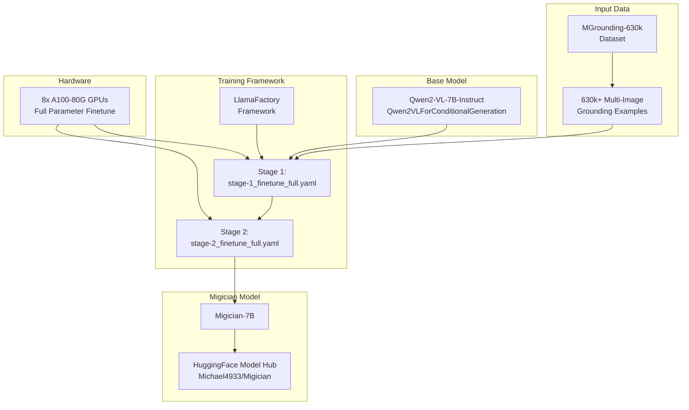
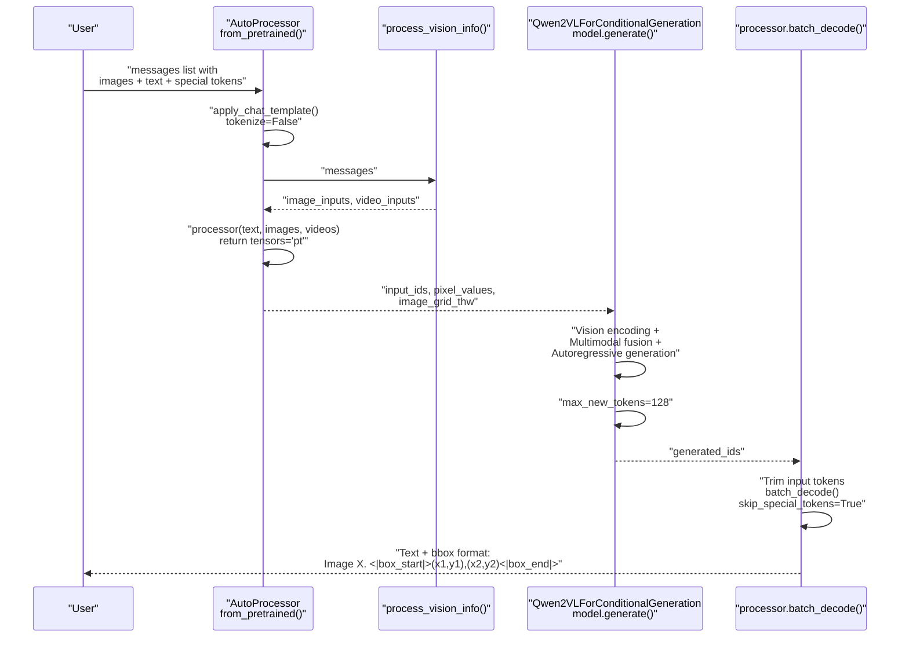
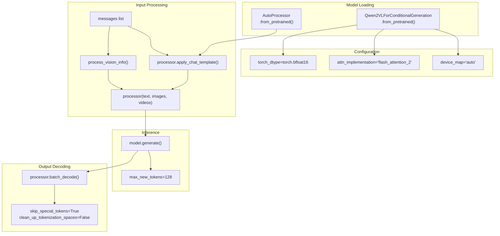
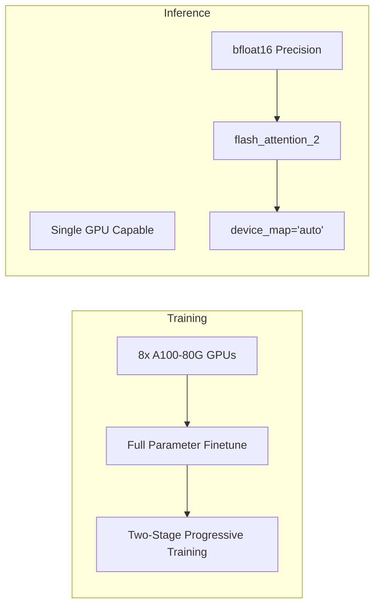

<!-- source: DeepWiki mcp.deepwiki.com · repo thunlp/Migician · page 4 Migician Model · fetched 2026-11-02 -->

# Migician Model

<details>
<summary>Relevant source files</summary>

The following files were used as context for generating this wiki page:

- [README.md](README.md)
- [eval/chat.py](eval/chat.py)

</details>


## Purpose and Scope

This page provides technical documentation of the Migician model, the first competitive multi-image grounding Multimodal Large Language Model (MLLM) capable of free-form grounding across multiple images. It covers the model's foundation, core capabilities, integration within the training and evaluation ecosystem, and high-level architectural characteristics.

For detailed architectural components and implementation details, see [Model Architecture](#4.1). For step-by-step inference usage, see [Inference Guide](#4.2). For special token format specifications, see [Special Token System](#4.3). For training procedures, see [Training Pipeline](#5).

**Sources:** [README.md:1-297]()

---

## Overview

Migician is a 7B parameter multi-image grounding model built on the Qwen2-VL-7B foundation. It addresses a critical gap in existing MLLMs: the inability to perform precise grounding in complex multi-image scenarios. While prior models excel at single-image grounding or general multi-image comprehension, Migician uniquely combines both capabilities through end-to-end training on the MGrounding-630k dataset.

The model's name "Migician" reflects its ability to perform seemingly magical multi-image grounding tasks—identifying, locating, and tracking objects across multiple images with natural language descriptions. It achieves performance superior to much larger 70B models on multi-image grounding benchmarks while maintaining competitive performance on general multi-image understanding tasks.

**Key Innovation:** Free-form grounding capability that accepts unrestricted natural language queries (e.g., "the common person appearing in all these images") and outputs precise bounding box coordinates for objects across multiple images.

**Sources:** [README.md:27-29](), [README.md:165]()

---

## Foundation: Qwen2-VL-7B

Migician is initialized from `Qwen2VLForConditionalGeneration`, the Qwen2-VL-7B-Instruct base model. This foundation provides:

| Component | Capability Inherited |
|-----------|---------------------|
| Vision Encoder | Multi-image visual feature extraction |
| Language Backbone | 7B parameter transformer for text generation |
| Multimodal Fusion | Cross-attention between vision and language |
| Instruction Following | Chat template and conversation format support |

The base model is extended with special tokens for grounding tasks and fine-tuned through a two-stage progressive training process. All backbone parameters undergo full fine-tuning rather than parameter-efficient methods, enabling comprehensive adaptation to multi-image grounding tasks.

**Model Loading Pattern:**
```python
from transformers import Qwen2VLForConditionalGeneration

model = Qwen2VLForConditionalGeneration.from_pretrained(
    path,
    torch_dtype=torch.bfloat16,
    attn_implementation="flash_attention_2",
    device_map="auto"
)
```

**Sources:** [README.md:165-182](), [README.md:277-278](), [eval/chat.py:1-10]()

---

## Core Capabilities

Migician supports seven distinct multi-image grounding task types, each requiring different reasoning patterns:



**Capability Matrix:**

| Task Type | Input Modality | Output Format | Primary Dataset Source |
|-----------|---------------|---------------|------------------------|
| Common Object | N images + query | Image ID + bbox | COCO, ImageNet, Object365 |
| Difference | 2+ images + query | Image ID + bbox | clevr-change, img-diff, magicbrush, spot-the-diff |
| Free-Form | N images + natural language | Image ID + bbox | Object365 (generated) |
| Group Grounding | N images + object list | Multiple bboxes | SA-1B |
| Object Tracking | N images + target object | Bboxes across frames | GOT-10k, LaSOT, MOT17, TrackingNet |
| Referring | N images + description | Image ID + bbox | ImageNet |
| Region Locating | N images + region description | Image ID + bbox | Object365 |

The model processes these tasks through a unified conversational interface, where grounding targets are delimited by special tokens (`<|object_ref_start|>`, `<|object_ref_end|>`) and outputs are formatted with bounding box tokens (`<|box_start|>`, `<|box_end|>`).

**Sources:** [README.md:70-155]()

---

## Model Position in Training Ecosystem



This diagram shows Migician's position as the output of a two-stage training pipeline that transforms the Qwen2-VL-7B base model using the MGrounding-630k dataset. The LlamaFactory framework orchestrates both training stages on high-performance hardware.

**Sources:** [README.md:165](), [README.md:277-286]()

---

## Input/Output Processing Flow



**Processing Components:**

1. **AutoProcessor** ([README.md:183]()): Handles both text tokenization via chat templates and vision preprocessing (resizing, normalization)
2. **process_vision_info** ([README.md:209]()): Extracts image and video inputs from message structure
3. **Model Generation** ([README.md:214]()): Produces token IDs including special tokens for bounding boxes
4. **Batch Decode** ([README.md:218-220]()): Converts token IDs to human-readable text, optionally preserving special tokens

**Coordinate Normalization:** Output bounding boxes use a 0-1000 normalized scale relative to image dimensions, formatted as `(x1,y1),(x2,y2)` where coordinates represent top-left and bottom-right corners.

**Sources:** [README.md:172-222](), [eval/chat.py:12-53]()

---

## Model Components and Code Entities



**Key Code Entities:**

| Entity | Location | Purpose |
|--------|----------|---------|
| `Qwen2VLForConditionalGeneration` | [README.md:177](), [eval/chat.py:5]() | Main model class for conditional generation |
| `AutoProcessor` | [README.md:183]() | Unified processor for text and vision inputs |
| `process_vision_info` | [README.md:209]() | Vision input extraction from qwen_vl_utils |
| `apply_chat_template` | [README.md:208]() | Formats messages into model-expected template |
| `flash_attention_2` | [README.md:180](), [eval/chat.py:8]() | Attention optimization for speed and memory |
| `max_new_tokens` | [README.md:214](), [eval/chat.py:46]() | Generation length control parameter |
| `batch_decode` | [README.md:218]() | Token ID to text conversion |

**Special Token Handling:**

The model uses a custom token vocabulary extension for grounding tasks:
- Input markers: `<|object_ref_start|>`, `<|object_ref_end|>` 
- Output markers: `<|box_start|>`, `<|box_end|>`

These tokens are processed during `apply_chat_template()` and preserved/parsed during inference. The `skip_special_tokens` parameter in `batch_decode()` can be set to `False` to retain these tokens for post-processing by evaluation utilities.

**Sources:** [README.md:172-222](), [eval/chat.py:1-53]()

---

## Performance Characteristics

### Computational Requirements



**Training Specifications:**
- **Hardware:** 8x NVIDIA A100-80GB GPUs
- **Training Method:** Full parameter fine-tuning (not LoRA or other PEFT)
- **Precision:** Mixed precision training
- **Framework:** LlamaFactory orchestration

**Inference Specifications:**
- **Minimum Hardware:** Single GPU with sufficient VRAM for 7B model
- **Precision:** bfloat16 recommended for efficiency
- **Optimization:** Flash Attention 2 enabled for acceleration
- **Memory Management:** Automatic device mapping for distributed loading

### Benchmark Performance

| Benchmark | Task Type | Metric | Performance |
|-----------|-----------|--------|-------------|
| MIG-Bench | Multi-Image Grounding | IOU@0.5 | Outperforms best existing MLLM by 21.61% |
| MIG-Bench | 10 Task Types | Average IOU | Surpasses 70B models |
| MIBench | Multi-Image Understanding | Accuracy | Competitive with larger models |
| MMIU | Forensic Detection | Accuracy | Strong performance |

The model achieves superior multi-image grounding capabilities while maintaining competitive performance on general multi-image understanding benchmarks, demonstrating effective specialization without catastrophic forgetting.

**Sources:** [README.md:29](), [README.md:32-39](), [README.md:165](), [README.md:277-278]()

---

## Model Distribution

Migician is publicly available through Hugging Face Hub at `Michael4933/Migician`. The model checkpoint includes:

- Model weights (7B parameters)
- Tokenizer configuration with special token vocabulary
- Processor configuration for vision and text inputs
- Compatible with Hugging Face `transformers` library (version constraints in requirements.txt)

**Loading Pattern:**
```python
path = "Michael4933/Migician"  # or local path
model = Qwen2VLForConditionalGeneration.from_pretrained(path, ...)
processor = AutoProcessor.from_pretrained(path)
```

The model can be loaded directly from Hugging Face Hub or from a local directory after manual download. For environment setup details, see [Installation](#2.1).

**Sources:** [README.md:13](), [README.md:24](), [README.md:176-183]()

---

