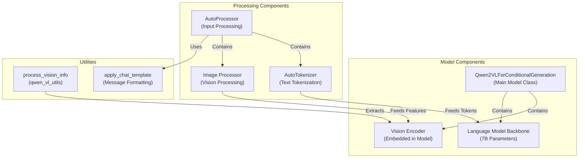
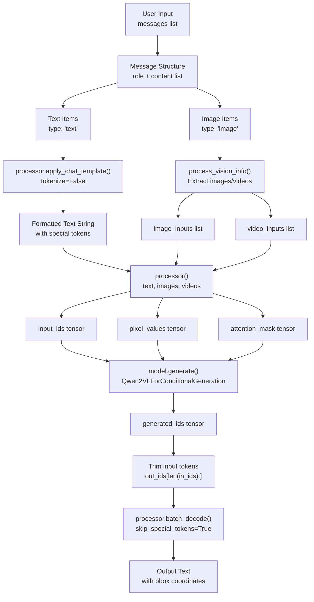

<!-- source: DeepWiki mcp.deepwiki.com · repo thunlp/Migician · page 4.1 Model Architecture · fetched 2026-11-02 -->

# Model Architecture

<details>
<summary>Relevant source files</summary>

The following files were used as context for generating this wiki page:

- [README.md](README.md)
- [eval/chat.py](eval/chat.py)

</details>


## Purpose and Scope

This document describes the technical architecture of the Migician model, including its foundation on Qwen2-VL-7B, core components, optimization techniques, and processing pipeline. For information about using the model for inference, see [Inference Guide](#4.2). For details about the special token system used for grounding, see [Special Token System](#4.3).

---

## Base Model Foundation

Migician is built upon **Qwen2-VL-7B-Instruct** as its base architecture. The model utilizes the complete `Qwen2VLForConditionalGeneration` class from the Transformers library without architectural modifications to the base model structure. Instead, Migician's multi-image grounding capabilities are achieved through specialized training on the MGrounding-630k dataset (see [MGrounding-630k Dataset](#3)).

The base model provides:
- **Vision-Language Integration**: Native support for processing multiple images with text through vision encoders
- **7 Billion Parameters**: LLM backbone with sufficient capacity for complex reasoning
- **Conditional Generation**: Autoregressive text generation conditioned on visual inputs

**Sources:** [README.md:165-182]()

---

## Core Components

### Component Diagram



**Sources:** [README.md:172-183](), [eval/chat.py:1-11]()

### Qwen2VLForConditionalGeneration

The primary model class that handles the end-to-end processing:
- Loads from pretrained weights at the specified model path
- Integrates vision encoding with language generation
- Supports both single-image and multi-image inputs
- Generates autoregressive text outputs with grounding coordinates

**Initialization Parameters:**
- `torch_dtype`: Set to `torch.bfloat16` for memory efficiency
- `attn_implementation`: Set to `"flash_attention_2"` for acceleration
- `device_map`: Set to `"auto"` for automatic device placement

**Sources:** [README.md:177-182]()

### AutoProcessor

Handles all input preprocessing:
- **Text Processing**: Applies chat templates and tokenizes text inputs
- **Image Processing**: Normalizes, resizes, and prepares image tensors
- **Message Formatting**: Converts conversation structures into model-compatible formats

The processor is loaded from the same pretrained path as the model and must match the model's expected input format.

**Sources:** [README.md:183]()

---

## Model Optimizations

### Flash Attention 2

Migician utilizes Flash Attention 2 for improved computational efficiency:

| Optimization | Benefit | Implementation |
|-------------|---------|----------------|
| **Memory Efficiency** | Reduced memory footprint for attention computation | `attn_implementation="flash_attention_2"` |
| **Speed Improvement** | Faster attention calculation, especially for multi-image scenarios | Enabled by default during model initialization |
| **Multi-Image Support** | Critical for handling multiple images simultaneously | Recommended for all inference tasks |

Flash Attention 2 is particularly important for Migician because multi-image grounding tasks require attending to visual features across multiple images simultaneously.

**Sources:** [README.md:180](), [eval/chat.py:8]()

### Mixed Precision Training

The model uses `torch.bfloat16` as its computation dtype:
- **Reduced Memory**: Halves memory requirements compared to fp32
- **Maintained Precision**: Better numerical stability than fp16
- **Training Compatibility**: Matches the precision used during the two-stage training process

**Sources:** [README.md:179]()

---

## Multi-Image Processing Architecture

### Processing Pipeline Diagram



**Sources:** [README.md:185-222](), [eval/chat.py:12-53]()

### Message Structure

Input messages follow a structured format:

```python
messages = [
    {
        "role": "user",
        "content": [
            {"type": "image", "image": <image_data>},
            {"type": "image", "image": <image_data>},
            {"type": "text", "text": "Query with <|object_ref_start|>target<|object_ref_end|>"}
        ]
    }
]
```

**Key Characteristics:**
- Each message has a `role` field (`"user"` or `"assistant"`)
- Content is a list of items with `type` and corresponding data
- Multiple images are provided as sequential `"image"` type items
- Text queries use special tokens to mark grounding targets (see [Special Token System](#4.3))

**Sources:** [README.md:185-206]()

### Vision Processing

The `process_vision_info` function from `qwen_vl_utils` extracts visual inputs:

```python
image_inputs, video_inputs = process_vision_info(messages)
```

This function:
- Separates image items from text items in the message structure
- Prepares images for the vision encoder
- Handles both image and video inputs (though Migician primarily uses images)
- Returns processed tensors ready for the model

**Sources:** [README.md:209](), [eval/chat.py:41]()

### Token Processing

The processor handles tokenization with special considerations:

1. **Chat Template Application**: Formats messages into the model's expected template
   ```python
   text = processor.apply_chat_template(messages, tokenize=False, add_generation_prompt=True)
   ```

2. **Batch Processing**: Combines text and vision inputs
   ```python
   inputs = processor(text=[text], images=image_inputs, videos=video_inputs, padding=True, return_tensors="pt")
   ```

3. **Device Placement**: Moves inputs to appropriate device
   ```python
   inputs = inputs.to("cuda")
   ```

**Sources:** [README.md:208-211](), [eval/chat.py:40-43]()

---

## Generation and Output Format

### Generation Process

The model generates outputs using the `generate()` method:

```python
generated_ids = model.generate(**inputs, max_new_tokens=128)
```

**Generation Parameters:**
- `max_new_tokens=128`: Limits output length to 128 new tokens
- Inherits other generation parameters from the base Qwen2-VL configuration

**Sources:** [README.md:214]()

### Output Decoding

The generated token IDs are processed to extract the response:

1. **Trim Input Tokens**: Remove input tokens from the generated sequence
   ```python
   generated_ids_trimmed = [
       out_ids[len(in_ids):] for in_ids, out_ids in zip(inputs.input_ids, generated_ids)
   ]
   ```

2. **Batch Decode**: Convert token IDs to text
   ```python
   output_text = processor.batch_decode(
       generated_ids_trimmed, 
       skip_special_tokens=True, 
       clean_up_tokenization_spaces=False
   )
   ```

**Sources:** [README.md:215-220]()

### Coordinate Format

Bounding box coordinates in the output follow a specific format:
- **Normalization**: Coordinates are normalized to 0-1000 scale
- **Format**: `<|box_start|>(x1,y1),(x2,y2)<|box_end|>`
- **Reference System**: Relative positions regarding image width and height
- **Box Encoding**: Top-left (x1, y1) and bottom-right (x2, y2) corners

Example output:
```
It's in the third image. <|box_start|>(316,58),(764,999)<|box_end|>
```

For detailed information about the coordinate system and special tokens, see [Special Token System](#4.3).

**Sources:** [README.md:143](), [README.md:151]()

---

## Hardware Requirements

Migician was trained and is optimized for the following hardware configuration:

| Resource | Training | Inference (Recommended) |
|----------|----------|------------------------|
| **GPUs** | 8x A100-80G | 1x A100-80G or equivalent |
| **Memory** | 640GB GPU memory | 40-80GB GPU memory |
| **Precision** | bfloat16 | bfloat16 |
| **Attention** | Flash Attention 2 | Flash Attention 2 |

The model can run on smaller GPUs with appropriate batch size adjustments, but Flash Attention 2 is strongly recommended for multi-image scenarios.

**Sources:** [README.md:165]()

---

## Architecture Summary

The Migician architecture consists of:

1. **Foundation**: Unmodified Qwen2VLForConditionalGeneration (7B parameters)
2. **Optimization**: Flash Attention 2 + bfloat16 precision
3. **Processing**: AutoProcessor with specialized message formatting
4. **Specialization**: Achieved through training on MGrounding-630k, not architectural changes
5. **Output**: Structured text with normalized bounding box coordinates

The architecture's strength lies in its ability to leverage the powerful base model while achieving specialized multi-image grounding capabilities through comprehensive training data and a carefully designed token system.

**Sources:** [README.md:165-222](), [eval/chat.py:1-53]()

---

