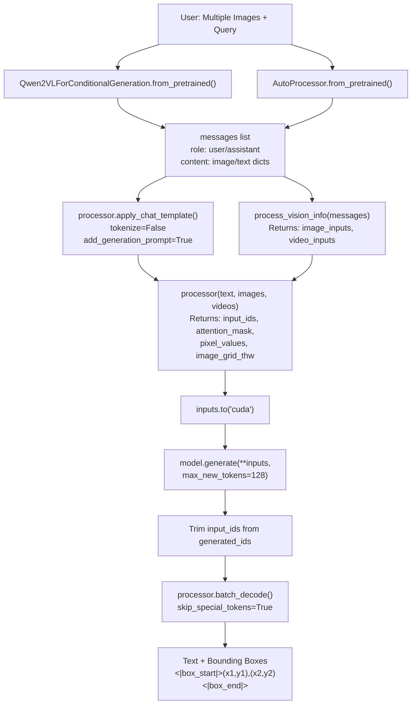
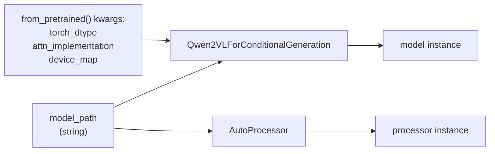
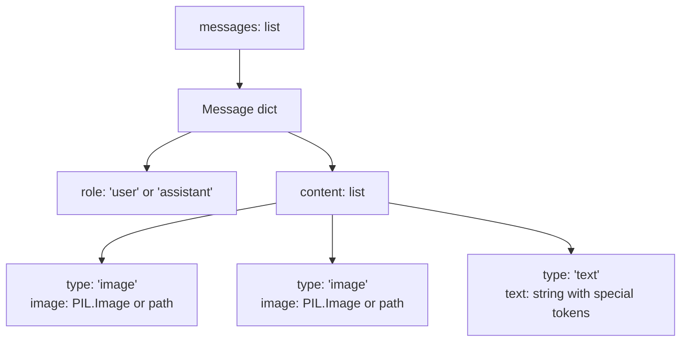
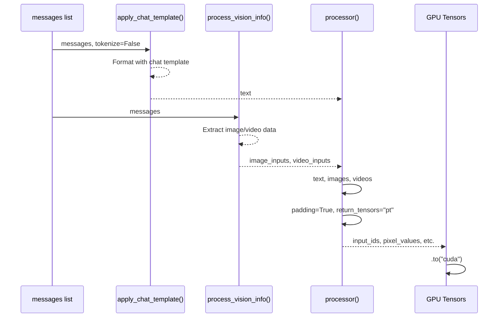
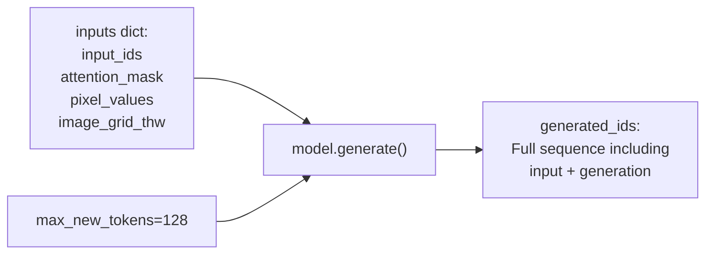
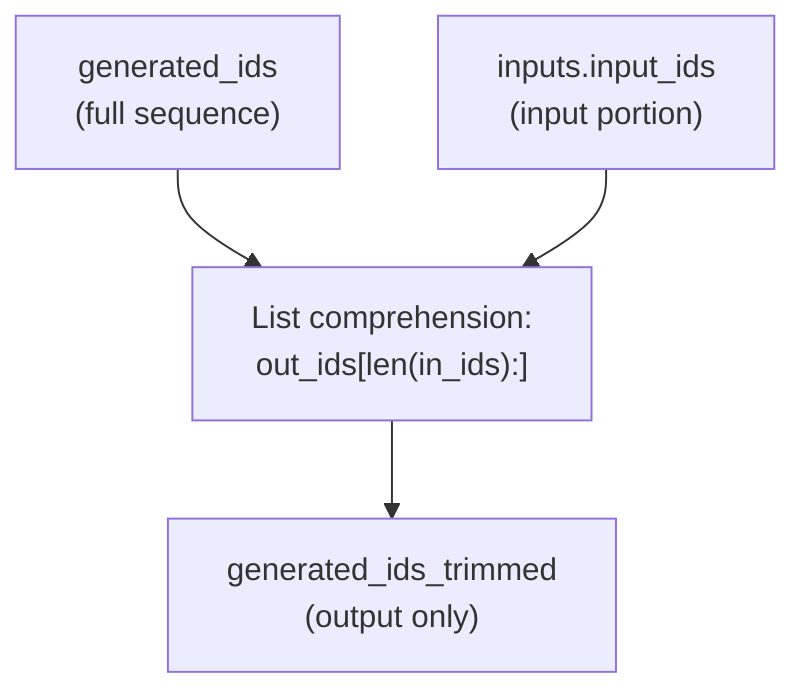
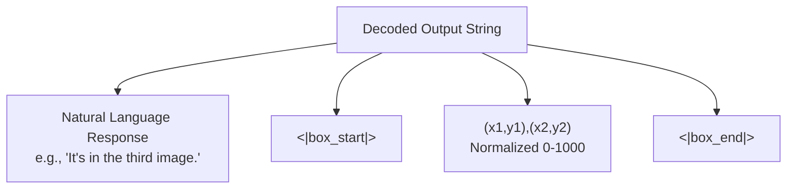
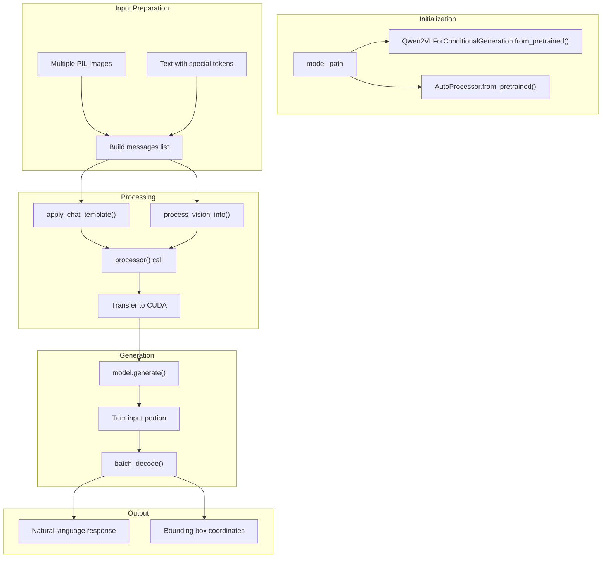
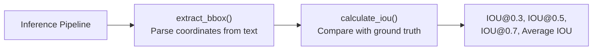

<!-- source: DeepWiki mcp.deepwiki.com · repo thunlp/Migician · page 4.2 Inference Guide · fetched 2026-11-02 -->

# Inference Guide

<details>
<summary>Relevant source files</summary>

The following files were used as context for generating this wiki page:

- [README.md](README.md)
- [eval/chat.py](eval/chat.py)

</details>


## Purpose and Scope

This document provides a comprehensive guide to performing inference with the Migician model. It covers model loading, prompt construction with special tokens, input processing, generation, and output parsing for multi-image grounding tasks. 

For information about Migician's underlying architecture and relationship to Qwen2-VL-7B, see [Model Architecture](#4.1). For detailed documentation of the special token system used in prompts and outputs, see [Special Token System](#4.3).

---

## Inference Pipeline Overview

The following diagram shows the complete inference pipeline with actual code entities:



**Sources:** [README.md:171-222](), [eval/chat.py:1-53]()

---

## Model and Processor Loading

Migician uses `Qwen2VLForConditionalGeneration` as its model class and `AutoProcessor` for input preprocessing. The model should be loaded with specific optimization settings:

### Loading Configuration

| Parameter | Value | Purpose |
|-----------|-------|---------|
| `torch_dtype` | `torch.bfloat16` | Memory efficiency and computational speed |
| `attn_implementation` | `"flash_attention_2"` | Accelerated attention computation |
| `device_map` | `"auto"` | Automatic device placement across GPUs |

The processor handles both text tokenization and vision encoding, supporting the special tokens required for grounding tasks.

### Code Structure



**Sources:** [README.md:177-183](), [eval/chat.py:5-10]()

---

## Message Construction

Messages follow a structured format where each message contains a role and content. The content is a list of dictionaries representing images and text.

### Message Structure



### Special Token Usage in Queries

Grounding targets are delimited using special tokens within the text content:

| Token | Position | Purpose |
|-------|----------|---------|
| `<|object_ref_start|>` | Before target description | Marks beginning of grounding target |
| `<|object_ref_end|>` | After target description | Marks end of grounding target |

Example query structure from [README.md:202]():
```
"Please recognize <|object_ref_start|>the common person appearing in all these images<|object_ref_end|> and locate this person in all these image."
```

**Sources:** [README.md:185-206](), [eval/chat.py:12-38]()

---

## Input Processing Pipeline

The following diagram maps the processing steps to actual code functions:



### Processing Steps

1. **Template Application**: `processor.apply_chat_template()` converts messages into the formatted text prompt expected by the model [README.md:208]()
2. **Vision Processing**: `process_vision_info()` extracts and prepares image/video data from messages [README.md:209]()
3. **Tokenization and Encoding**: `processor()` tokenizes text and encodes visual data into tensors [README.md:210]()
4. **Device Transfer**: `.to("cuda")` moves all tensors to GPU [README.md:211]()

**Sources:** [README.md:208-211](), [eval/chat.py:40-43]()

---

## Generation Process

### Generation Parameters

The `model.generate()` method produces output token sequences based on the processed inputs:



| Parameter | Value | Purpose |
|-----------|-------|---------|
| `max_new_tokens` | 128 | Maximum length of generated response |
| `**inputs` | All processed tensors | Input ids, attention masks, pixel values |

### Output Trimming

Generated sequences include both input and new tokens. Trimming isolates only the generated portion:



**Sources:** [README.md:214-217](), [eval/chat.py:46-49]()

---

## Output Decoding and Parsing

### Decoding Configuration

The processor's `batch_decode()` method converts token IDs back to text:

| Parameter | Value | Purpose |
|-----------|-------|---------|
| `skip_special_tokens` | `True` | Remove most special tokens from output |
| `clean_up_tokenization_spaces` | `False` | Preserve original spacing |

However, bounding box tokens (`<|box_start|>`, `<|box_end|>`) are preserved in the output for coordinate extraction.

### Output Format Structure



### Coordinate System

Bounding box coordinates follow this specification:
- **Format**: `(x1,y1),(x2,y2)` representing top-left and bottom-right corners
- **Normalization**: Integer values in range [0, 1000]
- **Reference**: Relative to image width and height
- **Conversion**: To absolute pixels, multiply by (image_width/1000, image_height/1000)

**Sources:** [README.md:218-221](), [eval/chat.py:50-53]()

---

## Complete Inference Example

The following diagram shows how all components interact in a complete inference workflow:



### Practical Considerations

1. **Image Preprocessing**: While the example in [README.md:190-200]() shows a `resize()` function call, this is user-defined. The processor handles internal resizing and normalization.

2. **Multi-Image Ordering**: Images are processed in the order they appear in the content list. The model's responses reference images by their position (e.g., "the third image").

3. **Batch Processing**: The processor supports batch processing through the `padding=True` parameter, though single-batch inference is most common for interactive use.

4. **Memory Management**: Flash Attention 2 significantly reduces memory usage for multi-image scenarios, as noted in [README.md:180]().

**Sources:** [README.md:171-222](), [eval/chat.py:1-53]()

---

## Integration with Evaluation Scripts

For automated evaluation workflows, inference is typically wrapped with additional utilities:



For details on these utilities and evaluation workflows, see:
- [Utility Functions](#6.1) for `extract_bbox()` and `calculate_iou()` implementations
- [Direct Evaluation Script](#6.2) for automated evaluation loops
- [Evaluation Metrics](#6.4) for IOU threshold specifications

**Sources:** [README.md:242-273]()

---

