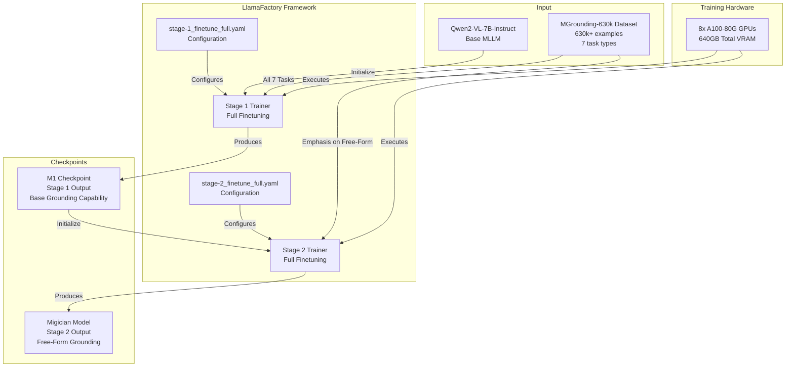
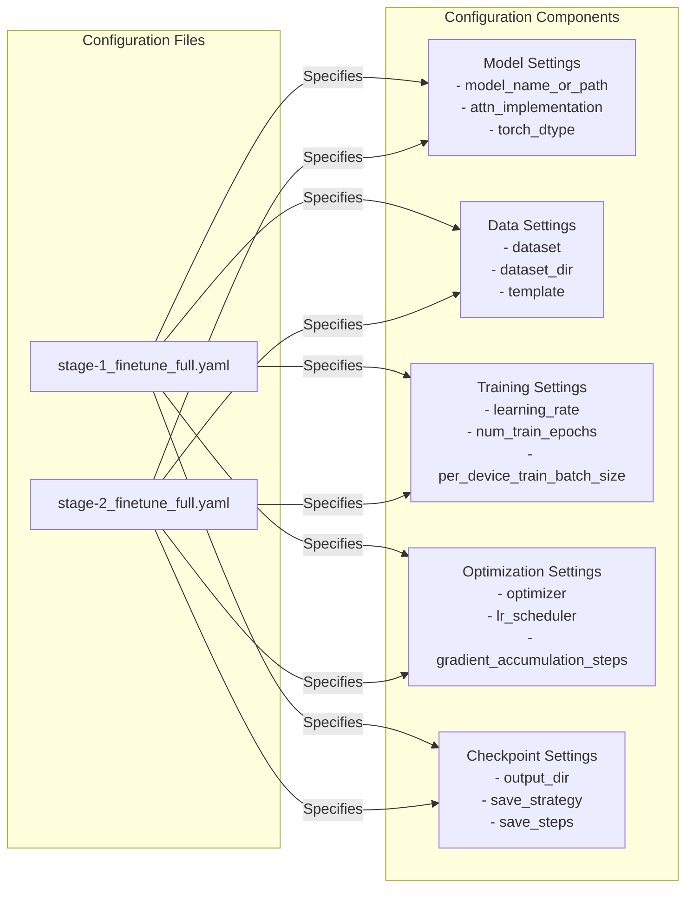
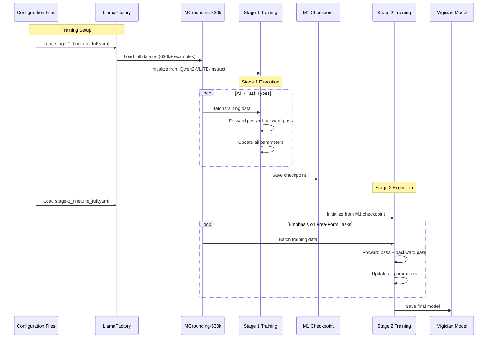
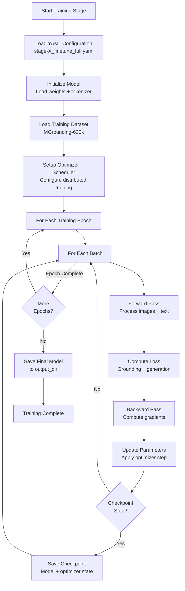

<!-- source: DeepWiki mcp.deepwiki.com · repo thunlp/Migician · page 5 Training Pipeline · fetched 2026-11-02 -->

# Training Pipeline

<details>
<summary>Relevant source files</summary>

The following files were used as context for generating this wiki page:

- [README.md](README.md)
- [train/requirements.txt](train/requirements.txt)

</details>


## Purpose and Scope

This document describes the two-stage progressive training process that transforms the Qwen2-VL-7B base model into Migician. It covers the training architecture, hardware requirements, configuration structure, and execution workflow. For details about the MGrounding-630k training dataset, see [MGrounding-630k Dataset](#3). For specifics about Stage 1 configuration and implementation, see [Stage 1: Initial Grounding](#5.1). For Stage 2 details, see [Stage 2: Free-Form Refinement](#5.2).

## Overview

Migician's training pipeline implements a **progressive two-stage full finetuning** approach, where all backbone parameters of the base model are updated. The training is orchestrated using the LlamaFactory framework and requires 8x A100-80G GPUs. The process begins with Qwen2-VL-7B-Instruct as the foundation model and produces a specialized multi-image grounding MLLM through sequential refinement.

**Key Characteristics:**
- **Training Framework**: LlamaFactory
- **Hardware**: 8x A100-80G GPUs (640GB total VRAM)
- **Training Method**: Full finetuning (all parameters trainable)
- **Dataset**: MGrounding-630k (630k+ examples)
- **Base Model**: Qwen2-VL-7B-Instruct
- **Training Stages**: 2 (progressive refinement)

Sources: [README.md:165](), [README.md:278-286]()

## Training Architecture



**Training Architecture Diagram**: This diagram shows how the base Qwen2-VL-7B model is progressively refined through two training stages orchestrated by LlamaFactory, producing the M1 checkpoint and final Migician model.

Sources: [README.md:165](), [README.md:278-286]()

## Training Framework: LlamaFactory

The training pipeline leverages **LlamaFactory** as the primary orchestration framework. LlamaFactory provides:

- **Flexible Configuration**: YAML-based training configuration
- **Efficient Training**: Optimized multi-GPU training with DeepSpeed support
- **Checkpoint Management**: Automatic checkpoint saving and loading
- **Vision-Language Support**: Native support for multimodal models like Qwen2-VL

The framework is integrated through configuration files that specify model paths, dataset locations, training hyperparameters, and optimization settings.

Sources: [README.md:278]()

## Hardware and Software Requirements

### Hardware Specifications

| Component | Specification | Purpose |
|-----------|--------------|---------|
| GPUs | 8x NVIDIA A100-80G | Parallel training execution |
| Total VRAM | 640GB | Full model parameters + gradients + optimizer states |
| GPU Memory per Device | 80GB | Per-GPU model sharding |
| Interconnect | NVLink/NVSwitch (recommended) | High-bandwidth GPU communication |

### Software Dependencies

The training environment requires specific versions of key libraries to ensure compatibility:

| Library | Version | Purpose |
|---------|---------|---------|
| `llamafactory` | 0.9.1 | Training orchestration framework |
| `transformers` | 4.45.0 | Model architecture and tokenization |
| `torch` | 2.4.0 | Deep learning backend |
| `deepspeed` | 0.15.3 | Distributed training optimization |
| `accelerate` | 0.34.2 | Multi-GPU coordination |
| `peft` | 0.12.0 | Parameter-efficient training utilities |
| `datasets` | 2.21.0 | Dataset loading and preprocessing |
| `qwen-vl-utils` | 0.0.8 | Qwen vision-language utilities |

Sources: [train/requirements.txt:1-125]()

## Configuration Structure



**Configuration Structure Diagram**: Shows the organization of YAML configuration files and the categories of settings they control for each training stage.

### Configuration File Locations

The training configurations are stored in the `train/` directory:

```
train/
├── stage-1_finetune_full.yaml    # Stage 1 configuration
├── stage-2_finetune_full.yaml    # Stage 2 configuration
└── requirements.txt               # Python dependencies
```

Each YAML file configures:
- **Model initialization**: Path to base model or checkpoint
- **Dataset specification**: Path to MGrounding-630k and data format
- **Training hyperparameters**: Learning rate, batch size, epochs
- **Distributed training**: Multi-GPU strategy and optimization
- **Checkpointing**: Save frequency and output location

Sources: [README.md:280-286]()

## Progressive Training Strategy

### Two-Stage Design Rationale

The progressive training approach divides the learning process into two distinct phases:

1. **Stage 1: Foundation Building** - Establishes basic multi-image grounding capabilities across all seven task types
2. **Stage 2: Capability Refinement** - Focuses on enhancing free-form grounding and instruction following

This strategy allows the model to:
- First learn fundamental grounding patterns across diverse tasks
- Then specialize in complex, natural language-driven grounding scenarios
- Avoid catastrophic forgetting by building on a stable foundation



**Progressive Training Sequence**: This diagram illustrates the temporal flow of the two-stage training process, showing how data flows through each stage and produces intermediate and final checkpoints.

### Stage Comparison

| Aspect | Stage 1 | Stage 2 |
|--------|---------|---------|
| **Initial Model** | Qwen2-VL-7B-Instruct | M1 Checkpoint (Stage 1 output) |
| **Training Focus** | All 7 task types equally | Free-form grounding emphasis |
| **Data Distribution** | Balanced across tasks | Weighted toward Free-Form tasks |
| **Goal** | Establish base grounding | Refine free-form capability |
| **Output** | M1 Checkpoint | Migician (final model) |

Sources: [README.md:165](), [README.md:278]()

## Data Flow and Task Distribution

### Stage 1: Comprehensive Task Coverage

Stage 1 training exposes the model to all seven task types from MGrounding-630k:

| Task Type | Examples | Purpose in Stage 1 |
|-----------|----------|-------------------|
| Common Object Recognition | 70k | Learn shared object identification |
| Difference Detection | 70k | Learn image comparison |
| Free-Form Grounding | 130k | Learn natural language grounding |
| Group Grounding | 160k | Learn multi-object recognition/registration |
| Object Tracking | 130k | Learn temporal consistency |
| Referring Grounding | 70k | Learn description-based localization |
| Region Locating | 70k | Learn spatial understanding |
| **Total** | **630k+** | **Comprehensive grounding foundation** |

### Stage 2: Free-Form Emphasis

Stage 2 adjusts the data sampling strategy to emphasize free-form grounding capabilities while maintaining exposure to other tasks. This ensures the model develops strong natural language-driven grounding while retaining its broad multi-image understanding.

Sources: [README.md:70-122]()

## Training Execution

### Preparation

Before executing training, ensure:

1. **Dataset is downloaded** - Follow the instructions in [Downloading the Dataset](#3.2)
2. **Environment is configured** - Install dependencies from `train/requirements.txt`
3. **Hardware is available** - Verify access to 8x A100-80G GPUs
4. **Configuration is adjusted** - Modify paths in YAML files as needed

### Execution Command Structure

Training is executed through LlamaFactory's command-line interface. While the exact commands are framework-specific, the general pattern involves:

```bash
# Stage 1 execution (conceptual)
llamafactory-cli train train/stage-1_finetune_full.yaml

# After Stage 1 completes, execute Stage 2
llamafactory-cli train train/stage-2_finetune_full.yaml
```

### Training Process Flow



**Training Process Flow Diagram**: Detailed flowchart showing the execution path during a training stage, from configuration loading through final model saving.

Sources: [README.md:278-286]()

## Model Optimization Techniques

### Full Finetuning Approach

Both training stages use **full finetuning**, meaning all parameters of the model are trainable:

- **Vision Encoder**: All parameters updated
- **Language Model Backbone**: All transformer layers updated
- **Projection Layers**: All cross-modal connectors updated
- **Token Embeddings**: Special tokens for grounding updated

This differs from parameter-efficient methods (LoRA, adapter-based) and ensures maximum adaptation to multi-image grounding tasks.

### Attention Implementation

The training leverages `flash_attention_2` for efficient attention computation:

```python
# As referenced in inference code (conceptual training equivalent)
attn_implementation="flash_attention_2"
```

This optimization:
- Reduces memory consumption during training
- Accelerates attention computation
- Enables larger batch sizes or longer sequences

Sources: [README.md:180]()

## Output Artifacts

### Stage 1 Output: M1 Checkpoint

After Stage 1 completes, the M1 checkpoint contains:
- Model weights with base grounding capabilities
- Tokenizer with special tokens configured
- Training state (for potential resumption)

This checkpoint serves as the initialization point for Stage 2.

### Stage 2 Output: Migician Model

The final Migician model produced by Stage 2 includes:
- Fully trained model weights
- Processor configuration
- Special token mappings for `<|object_ref_start|>`, `<|object_ref_end|>`, `<|box_start|>`, `<|box_end|>`

The final model is compatible with standard Hugging Face Transformers APIs and can be loaded using:

```python
from transformers import Qwen2VLForConditionalGeneration, AutoProcessor

model = Qwen2VLForConditionalGeneration.from_pretrained("path/to/migician")
processor = AutoProcessor.from_pretrained("path/to/migician")
```

Sources: [README.md:177-183]()

## Training Dataset Format

The MGrounding-630k dataset uses a specific JSON format that LlamaFactory processes during training:

```json
{
    "id": "example_id",
    "images": [
        "./MGrounding-630k/Task/Source/image1.jpg",
        "./MGrounding-630k/Task/Source/image2.jpg"
    ],
    "conversations": [
        {
            "from": "human",
            "value": "<image>\n<image>\nQuery with <|object_ref_start|>target<|object_ref_end|>"
        },
        {
            "from": "gpt",
            "value": "Response. <|box_start|>(x1,y1),(x2,y2)<|box_end|>"
        }
    ],
    "type": "task_type"
}
```

**Key Format Elements:**
- **images**: List of image paths (multiple images per example)
- **conversations**: Multi-turn dialogue with special tokens
- **type**: Task classification for sampling strategies
- **Bounding boxes**: Normalized to 0-1000 scale in format `(x1,y1),(x2,y2)`

Sources: [README.md:126-156]()

## Memory and Compute Considerations

### Memory Requirements

With 8x A100-80G GPUs (640GB total):

| Memory Consumer | Approximate Usage |
|----------------|------------------|
| Model Parameters (fp16/bf16) | ~14GB |
| Gradients | ~14GB |
| Optimizer States (AdamW) | ~28GB |
| Activation Memory | ~40-80GB (batch dependent) |
| **Total per Training Instance** | **~96-136GB** |

The distributed training strategy shards these components across GPUs, making efficient use of the 640GB total VRAM.

### Compute Characteristics

- **Training Duration**: Multiple epochs over 630k+ examples
- **Batch Processing**: Multi-image batches require coordinated image encoding
- **Gradient Accumulation**: May be used to simulate larger batch sizes
- **Mixed Precision**: bf16/fp16 for faster computation

## Integration with LlamaFactory

### Dataset Registration

LlamaFactory requires dataset registration through its configuration system:

```yaml
# Conceptual dataset configuration
dataset: mgrounding_630k
dataset_dir: ./data
template: qwen2_vl  # Vision-language template
```

### Training Template

The `qwen2_vl` template ensures proper formatting of:
- Multi-image inputs with `<image>` placeholders
- Special grounding tokens
- Bounding box format preservation
- Chat template application

Sources: [README.md:76-122]()

## Monitoring and Validation

During training, key metrics to monitor include:

| Metric | Purpose |
|--------|---------|
| Training Loss | Overall model convergence |
| Learning Rate | Scheduler progression |
| Gradient Norm | Training stability |
| GPU Memory Usage | Resource utilization |
| Throughput (samples/sec) | Training efficiency |

Validation on held-out data helps ensure the model generalizes beyond the training set before proceeding from Stage 1 to Stage 2.

## Relationship to Evaluation

After training completes, the Migician model is evaluated using scripts in the `eval/` directory:

- **MIG-Bench evaluation**: Tests multi-image grounding across 10 task types
- **MIBench evaluation**: Tests general multi-image understanding
- **MMIU evaluation**: Tests forensic detection capabilities

For details on evaluation procedures, see [Evaluation System](#6).

Sources: [README.md:224-273]()

---

