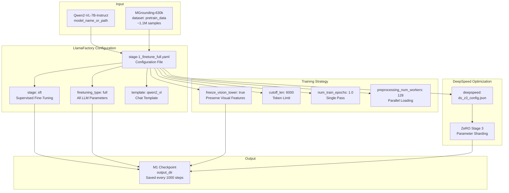
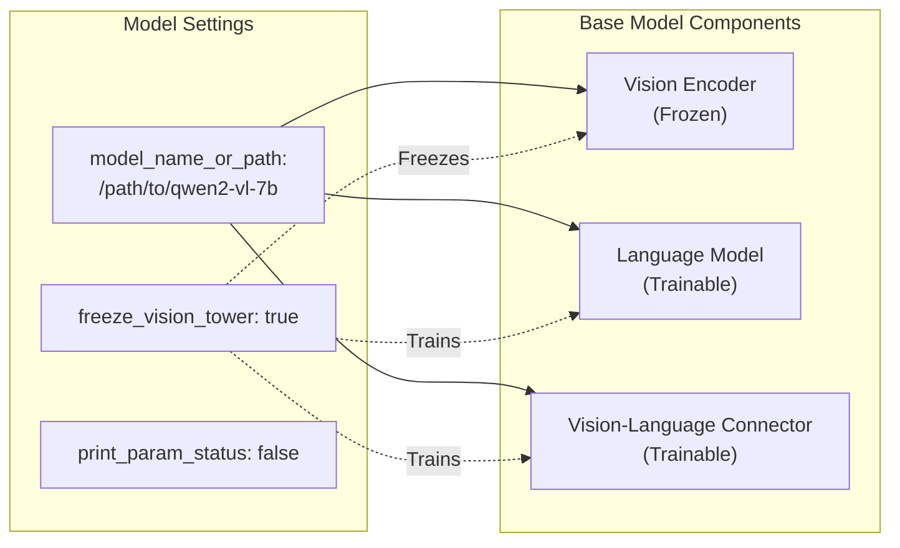
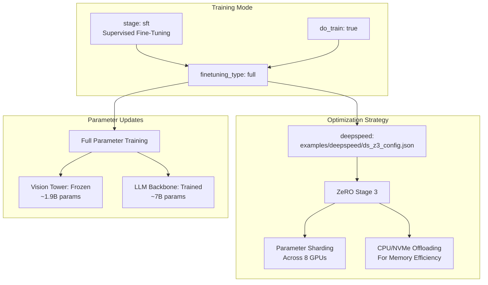
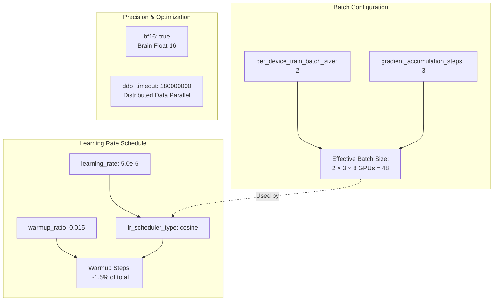
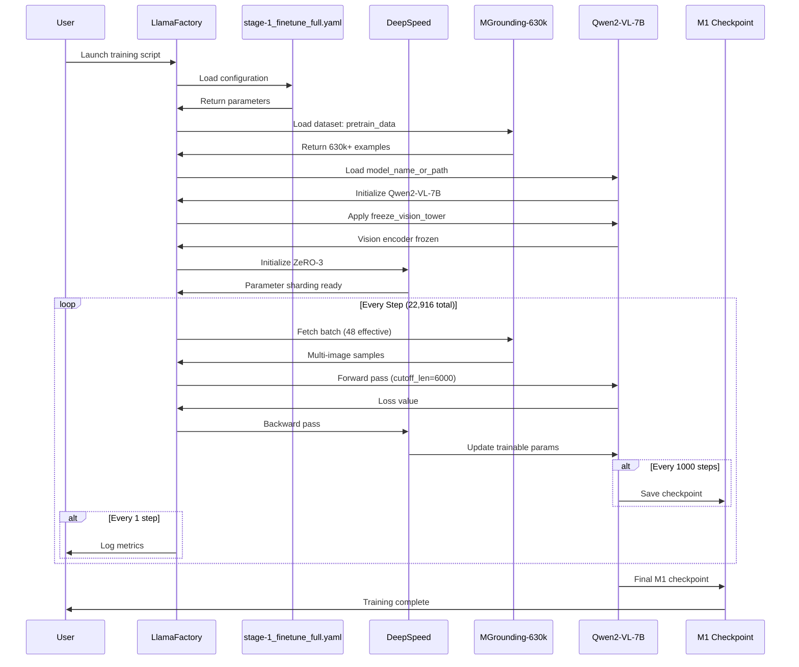
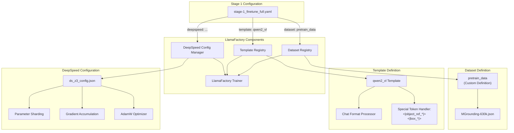

<!-- source: DeepWiki mcp.deepwiki.com · repo thunlp/Migician · page 5.1 Stage 1: Initial Grounding · fetched 2026-11-02 -->

# Stage 1: Initial Grounding

<details>
<summary>Relevant source files</summary>

The following files were used as context for generating this wiki page:

- [README.md](README.md)
- [train/stage-1_finetune_full.yaml](train/stage-1_finetune_full.yaml)

</details>


## Purpose and Scope

Stage 1 is the first phase of Migician's two-stage progressive training pipeline. This stage establishes the model's foundational multi-image grounding capabilities by performing full parameter fine-tuning on the Qwen2-VL-7B base model using the complete MGrounding-630k dataset. The training leverages LlamaFactory's supervised fine-tuning framework with DeepSpeed ZeRO-3 optimization on 8x A100-80G GPUs.

For the subsequent refinement phase, see [Stage 2: Free-Form Refinement](#5.2). For dataset details, see [MGrounding-630k Dataset](#3). For model architecture details, see [Model Architecture](#4.1).

---

## Training Objective

Stage 1 transforms the Qwen2-VL-7B base model into M1, an intermediate checkpoint with initial multi-image grounding capabilities. This stage processes all seven task types from MGrounding-630k simultaneously:

- Common Object Recognition (70k examples)
- Difference Detection (70k examples)
- Free-Form Grounding (130k examples)
- Group Grounding (160k examples: 120k recognition + 40k registration)
- Object Tracking (130k examples)
- Referring Grounding (70k examples)
- Region Locating (70k examples)

The training exposes the model to diverse grounding scenarios while freezing the vision tower to preserve pre-trained visual representations and focus parameter updates on the language model backbone and connector layers.

**Sources:** [README.md:1-297](), [train/stage-1_finetune_full.yaml:1-47]()

---

## Stage 1 Training Architecture



**Sources:** [train/stage-1_finetune_full.yaml:1-47](), [README.md:278-286]()

---

## Configuration File Structure

The training is controlled through `stage-1_finetune_full.yaml`, which defines all aspects of the training process. This configuration integrates with LlamaFactory's training pipeline.

### Model Configuration



The configuration specifies:
- **`model_name_or_path`**: Path to Qwen2-VL-7B-Instruct base model checkpoint
- **`freeze_vision_tower: true`**: Prevents gradient updates to vision encoder parameters, preserving pre-trained visual representations
- **`print_param_status: false`**: Disables parameter status logging for cleaner output

**Sources:** [train/stage-1_finetune_full.yaml:1-10]()

---

## Training Method Configuration



Key method parameters:
- **`stage: sft`**: Supervised fine-tuning mode in LlamaFactory
- **`do_train: true`**: Enables training (vs. evaluation only)
- **`finetuning_type: full`**: Trains all non-frozen parameters (vs. LoRA/QLoRA)
- **`deepspeed`**: References ZeRO stage 3 configuration for distributed training with parameter sharding and gradient accumulation across 8 GPUs

**Sources:** [train/stage-1_finetune_full.yaml:4-10]()

---

## Dataset Configuration

| Parameter | Value | Purpose |
|-----------|-------|---------|
| `dataset` | `pretrain_data` | References dataset definition in LlamaFactory's dataset registry pointing to MGrounding-630k |
| `template` | `qwen2_vl` | Applies Qwen2-VL chat template formatting for multi-image conversations |
| `cutoff_len` | `6000` | Maximum sequence length in tokens (handles multi-image contexts) |
| `max_samples` | `1100000` | Maximum training samples to load (covers all 630k+ examples with buffer) |
| `overwrite_cache` | `true` | Forces reprocessing of dataset cache |
| `preprocessing_num_workers` | `128` | Parallel workers for data preprocessing |
| `num_train_epochs` | `1.0` | Single complete pass through the dataset |

The `qwen2_vl` template processes conversations with special tokens:
- `<image>` placeholders for vision inputs
- `<|object_ref_start|>` and `<|object_ref_end|>` for grounding targets
- `<|box_start|>` and `<|box_end|>` for bounding box outputs (0-1000 normalized coordinates)

**Sources:** [train/stage-1_finetune_full.yaml:12-21](), [README.md:126-156]()

---

## Training Hyperparameters



### Detailed Parameter Analysis

**Batch Size Strategy:**
- `per_device_train_batch_size: 2` samples per GPU
- `gradient_accumulation_steps: 3` micro-batches before update
- Effective global batch size: 2 × 3 × 8 = **48 samples per update**

**Learning Rate Configuration:**
- `learning_rate: 5.0e-6` (5e-6): Conservative rate for full fine-tuning to prevent catastrophic forgetting
- `lr_scheduler_type: cosine`: Gradual decay from peak to near-zero
- `warmup_ratio: 0.015`: 1.5% of training steps for gradual ramp-up

**Optimization Settings:**
- `bf16: true`: BFloat16 mixed precision for memory efficiency and training stability
- `ddp_timeout: 180000000`: Extended timeout (50,000 hours) for long-running distributed training

**Sources:** [train/stage-1_finetune_full.yaml:40-47]()

---

## Output and Checkpointing

| Parameter | Value | Description |
|-----------|-------|-------------|
| `output_dir` | `Your_output_path` | Directory for checkpoints and logs (user-configurable) |
| `logging_steps` | `1` | Log training metrics every step |
| `save_steps` | `1000` | Save model checkpoint every 1000 steps |
| `plot_loss` | `true` | Generate loss curve visualization |
| `overwrite_output_dir` | `true` | Clear existing output directory before training |

With 1.1M max samples, batch size 48, and 1 epoch, the training runs for approximately **22,916 steps** (1,100,000 / 48), producing **23 checkpoints** throughout the process.

**Sources:** [train/stage-1_finetune_full.yaml:33-38]()

---

## Training Process Flow



**Sources:** [train/stage-1_finetune_full.yaml:1-47](), [README.md:278-286]()

---

## Hardware Requirements

Stage 1 training requires substantial computational resources:

### GPU Configuration
- **8x NVIDIA A100-80G GPUs** (640GB total GPU memory)
- **DeepSpeed ZeRO-3** for parameter sharding across devices
- **Flash Attention 2** support (implied by base model requirements)

### Memory Footprint
With `finetuning_type: full` and `freeze_vision_tower: true`:
- **Trainable parameters**: ~7B (LLM backbone + connector)
- **Frozen parameters**: ~1.9B (vision encoder)
- **Total model size**: ~8.9B parameters
- **Per-GPU memory**: ~40-50GB with ZeRO-3 sharding and bf16 precision
- **Gradient checkpointing**: Enabled through DeepSpeed for reduced memory

### Training Duration
Approximate timing:
- **22,916 steps** total (1 epoch over ~1.1M samples)
- **Checkpoints**: Every 1000 steps (23 total)
- **Estimated time**: 20-30 hours on 8x A100-80G (depends on data loading and `preprocessing_num_workers: 128`)

**Sources:** [README.md:165](), [train/stage-1_finetune_full.yaml:1-47]()

---

## Integration with LlamaFactory



LlamaFactory orchestrates the training by:
1. **Resolving dataset reference**: `dataset: pretrain_data` points to a custom dataset definition in LlamaFactory's registry that loads `MGrounding-630k.json`
2. **Applying template**: `template: qwen2_vl` formats conversations with proper token structure for multi-image grounding
3. **Initializing DeepSpeed**: `deepspeed: examples/deepspeed/ds_z3_config.json` configures ZeRO-3 optimization
4. **Managing training loop**: Handles data loading, forward/backward passes, checkpointing, and logging

**Sources:** [train/stage-1_finetune_full.yaml:1-47](), [README.md:278-286]()

---

## Expected Outputs

After Stage 1 completes, the following artifacts are produced:

### Checkpoint Structure
```
{output_dir}/
├── checkpoint-1000/
│   ├── model.safetensors
│   ├── optimizer.pt
│   ├── scheduler.pt
│   ├── trainer_state.json
│   └── training_args.bin
├── checkpoint-2000/
│   └── ...
├── ...
├── checkpoint-22000/
│   └── ...
├── checkpoint-23000/ (or similar, final)
│   └── ...
└── trainer_log.jsonl
```

### Model Capabilities (M1 Checkpoint)
The M1 checkpoint from Stage 1 exhibits:
- **Multi-image grounding**: Can identify and localize objects across multiple images
- **Task diversity**: Handles all seven task types from MGrounding-630k
- **Special token understanding**: Responds to `<|object_ref_start|>` and `<|object_ref_end|>` markers
- **Bounding box generation**: Outputs coordinates in `<|box_start|>(x1,y1),(x2,y2)<|box_end|>` format (0-1000 scale)
- **Initial free-form capability**: Basic understanding of natural language grounding queries (refined in Stage 2)

### Training Logs
The `trainer_log.jsonl` contains per-step metrics:
- Training loss
- Learning rate
- Gradient norm
- Step timing
- GPU memory usage

These logs enable monitoring convergence and identifying potential issues like overfitting or gradient instability.

**Sources:** [train/stage-1_finetune_full.yaml:33-38](), [README.md:165]()

---

## Alternative Configuration: Streaming Mode

The configuration file includes commented-out settings for streaming mode, which can be used for extremely large datasets that don't fit in memory:

```yaml
# buffer_size: 1024
# cutoff_len: 6000
# preprocessing_num_workers: 64
# streaming: true
# mix_strategy: interleave_over
# max_steps: 20916
# accelerator_config:
#   dispatch_batches: false
```

This alternative approach:
- Loads data incrementally with `buffer_size: 1024`
- Uses `max_steps` instead of `num_train_epochs` for step-based training
- Employs `mix_strategy: interleave_over` to mix different task types on-the-fly
- Sets `dispatch_batches: false` in accelerator config for better streaming performance

For the standard Stage 1 training, the non-streaming mode is used as the dataset fits in memory with sufficient preprocessing workers.

**Sources:** [train/stage-1_finetune_full.yaml:23-31]()

---

## Troubleshooting Common Issues

### Out of Memory (OOM) Errors
- **Symptom**: CUDA OOM during training
- **Solutions**: 
  - Reduce `per_device_train_batch_size` from 2 to 1
  - Increase `gradient_accumulation_steps` to maintain effective batch size
  - Verify DeepSpeed ZeRO-3 is properly configured
  - Enable CPU/NVMe offloading in `ds_z3_config.json`

### Slow Data Loading
- **Symptom**: Low GPU utilization, long step times
- **Solutions**:
  - Increase `preprocessing_num_workers` (current: 128)
  - Enable `streaming: true` mode if I/O bottleneck persists
  - Verify dataset is on fast storage (SSD/NVMe)

### Checkpoint Save Failures
- **Symptom**: Training crashes during checkpoint save at step 1000, 2000, etc.
- **Solutions**:
  - Ensure sufficient disk space in `output_dir`
  - Set `overwrite_output_dir: true` to prevent conflicts
  - Verify write permissions for output directory

### Vision Tower Not Frozen
- **Symptom**: Unexpectedly high GPU memory usage
- **Solutions**:
  - Verify `freeze_vision_tower: true` is set
  - Check `print_param_status: true` temporarily to confirm frozen parameters
  - Ensure LlamaFactory version supports vision tower freezing

**Sources:** [train/stage-1_finetune_full.yaml:1-47]()

---

