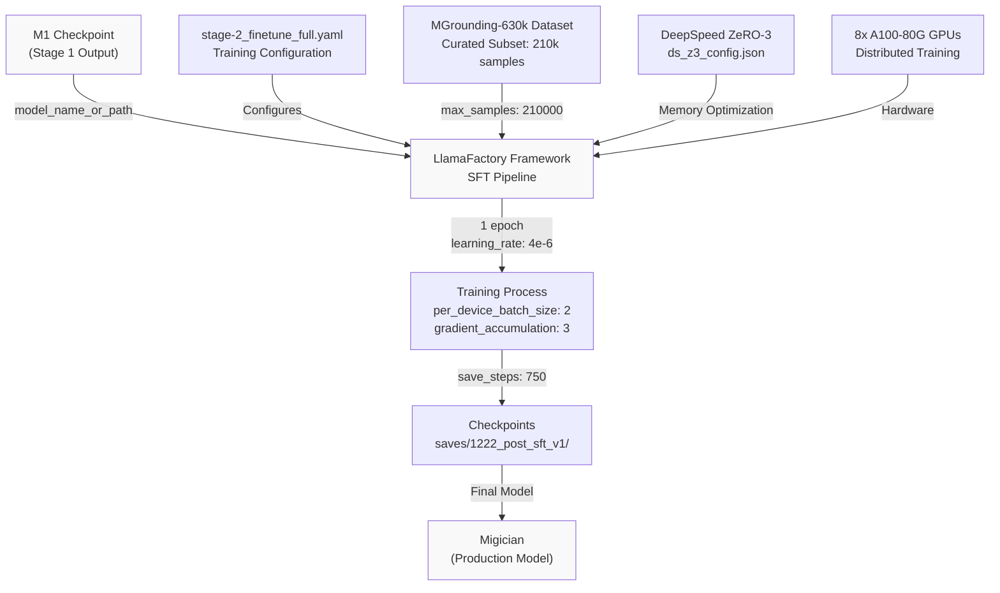
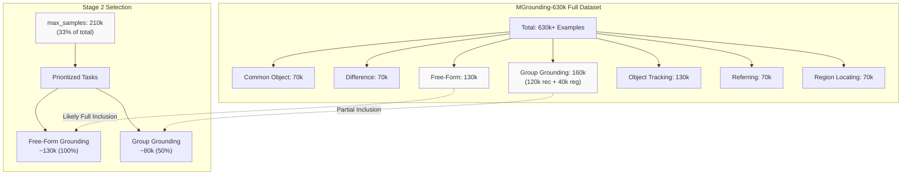
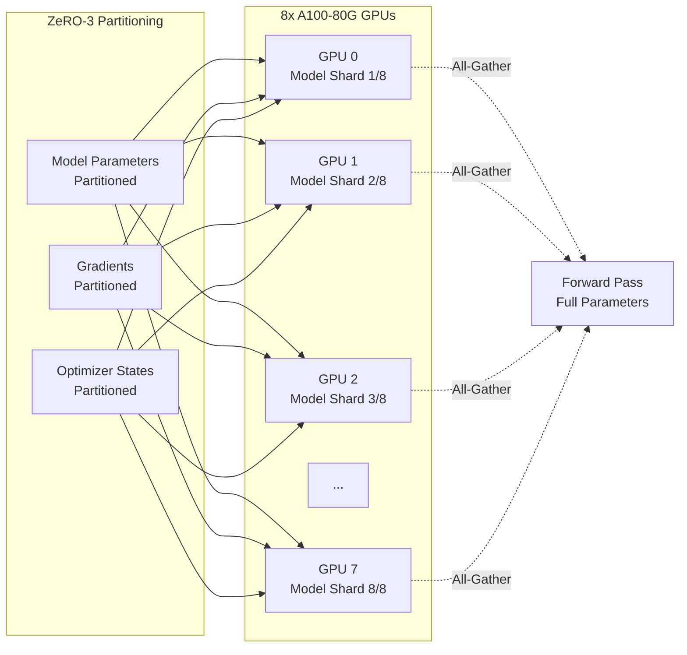
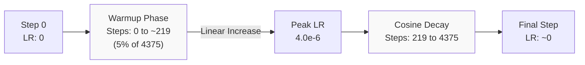
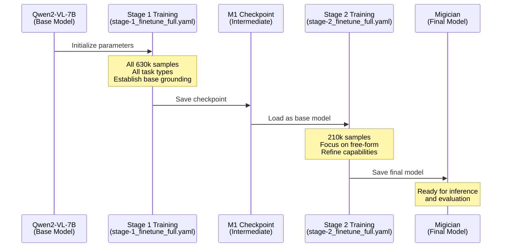

<!-- source: DeepWiki mcp.deepwiki.com · repo thunlp/Migician · page 5.2 Stage 2: Free-Form Refinement · fetched 2026-11-02 -->

# Stage 2: Free-Form Refinement

<details>
<summary>Relevant source files</summary>

The following files were used as context for generating this wiki page:

- [README.md](README.md)
- [train/stage-2_finetune_full.yaml](train/stage-2_finetune_full.yaml)

</details>


## Purpose and Scope

This document describes the second stage of Migician's two-stage progressive training pipeline, which refines the model's free-form multi-image grounding capabilities. Stage 2 takes the M1 checkpoint produced by Stage 1 (see [Stage 1: Initial Grounding](#5.1)) and applies focused fine-tuning with a curated subset of training data to enhance natural language-driven grounding performance.

The training is configured via the YAML file at [train/stage-2_finetune_full.yaml]() and executed using the LlamaFactory framework. This stage produces the final Migician model ready for inference and evaluation.

Sources: [README.md:278-286](), [train/stage-2_finetune_full.yaml]()

---

## Training Objective

Stage 2 performs **free-form refinement** by continuing full parameter fine-tuning from the M1 checkpoint. Unlike Stage 1 which establishes foundational multi-image grounding capabilities across all task types, Stage 2 focuses on enhancing the model's ability to handle unrestricted natural language descriptions in multi-image scenarios.

The key characteristic of free-form grounding is that users can describe target objects using arbitrary natural language without being constrained to predefined categories or rigid query formats. This enables more flexible and practical multi-image understanding.

**Diagram: Stage 2 Training Flow**



Sources: [train/stage-2_finetune_full.yaml:1-45](), [README.md:165-222](), [README.md:278-286]()

---

## Configuration Parameters

The Stage 2 training is fully specified in [train/stage-2_finetune_full.yaml](). Below is a breakdown of the critical configuration parameters and their roles:

### Model Configuration

| Parameter | Value | Purpose |
|-----------|-------|---------|
| `model_name_or_path` | `/home/liyou/training_data/zLLaMA-Factory-Qwen2-VL/saves_vital/M1` | Path to M1 checkpoint from Stage 1 |
| `stage` | `sft` | Supervised Fine-Tuning mode |
| `finetuning_type` | `full` | Full parameter training (not LoRA/adapter) |

The `model_name_or_path` parameter [train/stage-2_finetune_full.yaml:2]() points to the M1 checkpoint, establishing the progressive training chain from Stage 1. The `full` finetuning type means all model parameters are trainable, not just adapters.

Sources: [train/stage-2_finetune_full.yaml:1-7]()

### Dataset Configuration

| Parameter | Value | Purpose |
|-----------|-------|---------|
| `dataset` | `sft_data` | LlamaFactory dataset identifier |
| `template` | `qwen2_vl` | Chat template for Qwen2-VL format |
| `cutoff_len` | `8192` | Maximum sequence length (tokens) |
| `max_samples` | `210000` | Curated subset size (of 630k total) |
| `overwrite_cache` | `true` | Force dataset reprocessing |
| `preprocessing_num_workers` | `128` | Parallel data loading workers |
| `num_train_epochs` | `1.0` | Single epoch training |

The most significant parameter is `max_samples: 210000` [train/stage-2_finetune_full.yaml:15](). This indicates that Stage 2 uses approximately **33% of the full MGrounding-630k dataset** (210k out of 630k examples), suggesting a curated selection strategy that prioritizes free-form grounding tasks.

Sources: [train/stage-2_finetune_full.yaml:11-18]()

### Optimization Configuration

| Parameter | Value | Purpose |
|-----------|-------|---------|
| `per_device_train_batch_size` | `2` | Batch size per GPU |
| `gradient_accumulation_steps` | `3` | Effective batch size multiplier |
| `learning_rate` | `4.0e-6` | Lower LR than typical (fine-tuning) |
| `lr_scheduler_type` | `cosine` | Cosine annealing schedule |
| `warmup_ratio` | `0.05` | 5% warmup steps |
| `bf16` | `true` | BFloat16 mixed precision |

The **effective global batch size** is calculated as:
```
8 GPUs × 2 per_device_batch × 3 gradient_accumulation = 48 samples per update
```

The learning rate of `4.0e-6` [train/stage-2_finetune_full.yaml:41]() is notably conservative, reflecting the refinement nature of Stage 2 (Stage 1 likely used a higher learning rate for broader capability development).

Sources: [train/stage-2_finetune_full.yaml:39-44]()

---

## Data Selection Strategy

**Diagram: Dataset Composition Analysis for Stage 2**



While the exact task distribution for the 210k subset is not explicitly documented in the configuration file, the selection strategy can be inferred:

1. **Free-Form Grounding Priority**: The 130k free-form grounding examples [README.md:98-100]() are likely fully included, as this aligns with Stage 2's objective of enhancing free-form capabilities.

2. **Supplementary Tasks**: The remaining ~80k samples likely come from Group Grounding (160k available) and potentially other tasks that support free-form understanding.

3. **Data Efficiency**: By using 33% of the dataset, Stage 2 avoids overfitting while focusing on the most relevant examples for free-form refinement.

Sources: [train/stage-2_finetune_full.yaml:15](), [README.md:69-156]()

---

## DeepSpeed Integration

Stage 2 employs **DeepSpeed ZeRO-3** for distributed training optimization, configured via `deepspeed: examples/deepspeed/ds_z3_config.json` [train/stage-2_finetune_full.yaml:8]().

**Diagram: DeepSpeed ZeRO-3 Memory Distribution**



ZeRO-3 partitions model parameters, gradients, and optimizer states across all 8 GPUs, enabling full fine-tuning of the ~7B parameter Qwen2-VL backbone on A100-80G hardware. The `ddp_timeout: 180000000` [train/stage-2_finetune_full.yaml:45]() (50,000 hours) ensures training isn't interrupted during long checkpoint synchronization operations.

Sources: [train/stage-2_finetune_full.yaml:8](), [train/stage-2_finetune_full.yaml:45]()

---

## Training Execution

### Checkpoint Management

Stage 2 saves checkpoints every 750 steps to the `saves/1222_post_sft_v1` directory [train/stage-2_finetune_full.yaml:32]():

```
saves/1222_post_sft_v1/
├── checkpoint-750/
├── checkpoint-1500/
├── checkpoint-2250/
└── ...
```

With the configuration:
- `logging_steps: 1` [train/stage-2_finetune_full.yaml:33]() - Log metrics every step
- `save_steps: 750` [train/stage-2_finetune_full.yaml:34]() - Save checkpoint every 750 steps
- `plot_loss: true` [train/stage-2_finetune_full.yaml:35]() - Generate loss plots
- `overwrite_output_dir: true` [train/stage-2_finetune_full.yaml:36]() - Clear previous runs

Sources: [train/stage-2_finetune_full.yaml:31-36]()

### Training Duration Estimation

Given the configuration parameters, we can estimate training time:

```
Total samples: 210,000
Effective batch size: 48 (8 GPUs × 2 × 3)
Training steps per epoch: 210,000 / 48 ≈ 4,375 steps
Epochs: 1.0
Total training steps: ~4,375

Checkpoints saved: 4,375 / 750 ≈ 6 checkpoints
```

With 8× A100-80G GPUs and the efficiency of DeepSpeed ZeRO-3, Stage 2 training typically completes in several hours, producing the final Migician model from the last checkpoint.

Sources: [train/stage-2_finetune_full.yaml:15](), [train/stage-2_finetune_full.yaml:18](), [train/stage-2_finetune_full.yaml:39-40]()

---

## Learning Rate Schedule

The Stage 2 learning rate schedule uses cosine annealing with warmup:

**Diagram: Learning Rate Schedule**



The warmup ratio of 0.05 [train/stage-2_finetune_full.yaml:43]() means approximately 5% of total steps (≈219 steps) are used for learning rate warmup. This gradual increase prevents destabilization of the M1 checkpoint at the start of Stage 2 training.

The conservative peak learning rate of `4.0e-6` prevents catastrophic forgetting of capabilities learned in Stage 1, while still allowing refinement of free-form grounding performance.

Sources: [train/stage-2_finetune_full.yaml:41-43]()

---

## Relationship to Stage 1

**Diagram: Progressive Training Pipeline**



The progressive training strategy ensures:
1. **Stage 1** builds comprehensive multi-image grounding foundations across all task types
2. **Stage 2** refines free-form natural language understanding without forgetting Stage 1 capabilities
3. The final **Migician model** combines broad grounding skills with exceptional free-form performance

This two-stage approach mirrors curriculum learning principles, moving from diverse foundational tasks to specialized refinement.

Sources: [README.md:165](), [README.md:278-286](), [train/stage-2_finetune_full.yaml:2]()

---

## Output Model

Upon completion, Stage 2 produces the final Migician model stored in the checkpoint directory. This model:

- **Inherits** all multi-image grounding capabilities from M1 (Stage 1)
- **Enhances** free-form natural language-driven grounding performance
- **Maintains** compatibility with the Qwen2-VL architecture and special token system
- **Supports** inference via the standard `Qwen2VLForConditionalGeneration` interface

The final model can be directly loaded for inference as shown in [README.md:172-222]() or evaluated using the scripts in `eval/` (see [Direct Evaluation Script](#6.2) and [Chain-of-Thought Evaluation](#6.3)).

Sources: [train/stage-2_finetune_full.yaml:32](), [README.md:165-222]()

---

## Alternative Training Mode (Streaming)

The configuration file includes commented-out streaming mode parameters [train/stage-2_finetune_full.yaml:20-29]():

```yaml
# streaming: true
# buffer_size: 1024
# cutoff_len: 8192
# preprocessing_batch_size: 1024
# preprocessing_num_workers: 64
# mix_strategy: interleave_over
# max_steps: 3000
```

Streaming mode would enable:
- **Memory-efficient training** by loading data on-the-fly
- **Reduced preprocessing time** by eliminating full dataset caching
- **Step-based training** (`max_steps: 3000`) instead of epoch-based

This mode is not active in the default configuration but could be enabled for environments with limited disk space or for experimentation with different training schedules.

Sources: [train/stage-2_finetune_full.yaml:20-29]()

---

