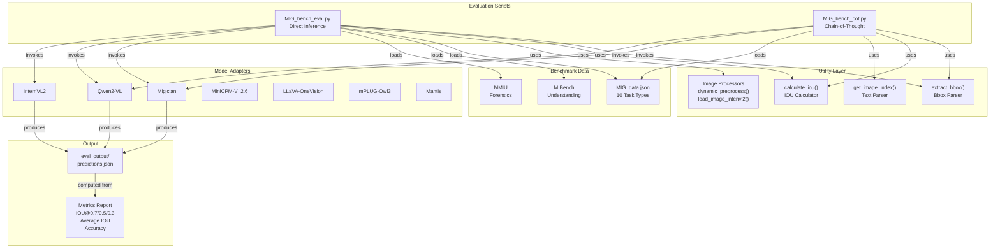
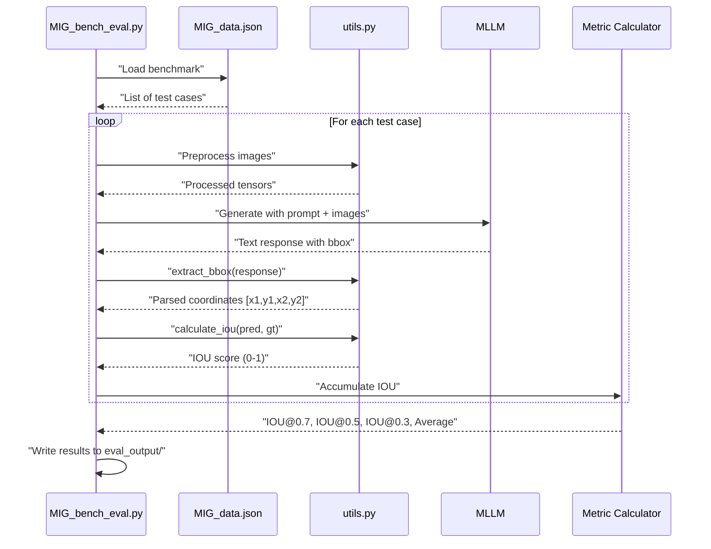
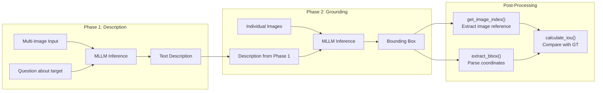
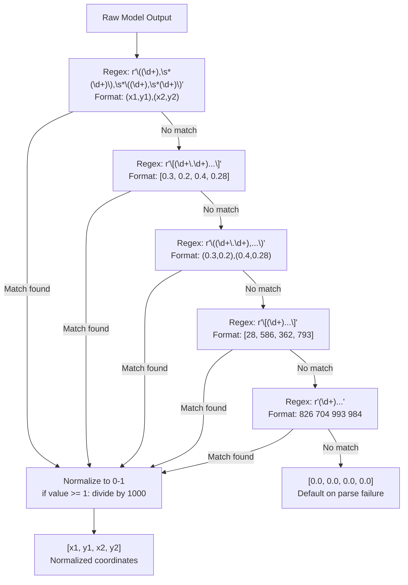
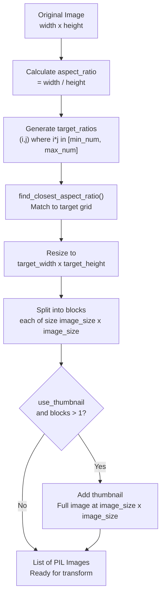
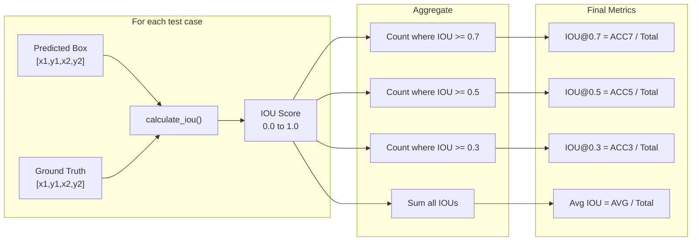

<!-- source: DeepWiki mcp.deepwiki.com · repo thunlp/Migician · page 6 Evaluation System · fetched 2026-11-02 -->

# Evaluation System

<details>
<summary>Relevant source files</summary>

The following files were used as context for generating this wiki page:

- [README.md](README.md)
- [eval/utils.py](eval/utils.py)

</details>


The Evaluation System provides a comprehensive framework for benchmarking multi-image grounding capabilities across multiple Multimodal Large Language Models (MLLMs). It supports two evaluation paradigms—direct inference and Chain-of-Thought reasoning—and tests models on three major benchmarks: MIG-Bench (multi-image grounding), MIBench (multi-image understanding), and MMIU (forensic detection). The system handles seven different MLLM architectures and provides standardized metrics including IOU-based grounding accuracy and multiple-choice accuracy.

For information about the benchmarks themselves (MIG-Bench structure, task types, and data format), see [Benchmarks](#7). For training the Migician model that this system evaluates, see [Training Pipeline](#5).

## Overview

The evaluation system is located in the `eval/` directory and provides infrastructure for consistent, reproducible benchmarking across multiple model architectures. It abstracts model-specific preprocessing, handles multi-image inputs, extracts bounding box predictions, and computes standardized metrics.

**Sources:** [README.md:225-273](), [eval/utils.py:1-270]()

## Directory Structure

The evaluation system follows this organization:

```
eval/
├── MIG-Bench/                    # MIG-Bench benchmark dataset
│   ├── images/                   # Image files organized by task
│   │   ├── common/
│   │   ├── correspondence/
│   │   ├── group_grounding/
│   │   └── ...                   # 10 task types total
│   └── MIG_data.json            # Evaluation dataset with ground truth
│
├── eval_output/                  # Generated predictions and results
│
├── others/                       # MIBench and MMIU benchmarks
│
├── MIG_bench_eval.py            # Direct inference evaluation script
├── MIG_bench_cot.py             # Chain-of-Thought evaluation script
├── utils.py                      # Shared utility functions
├── chat.py                       # Model-specific chat interfaces
└── requirements.txt              # Evaluation dependencies
```

**Sources:** [README.md:228-247]()

## System Architecture

The evaluation system orchestrates multiple components to provide standardized benchmarking:



**Sources:** [README.md:225-273](), [eval/utils.py:19-145]()

## Supported Models

The evaluation system provides adapters for seven MLLM architectures, each with model-specific preprocessing and inference logic:

| Model | Hugging Face Path | Special Requirements |
|-------|-------------------|---------------------|
| **Migician** | `Michael4933/Migician` | Special tokens: `<\|object_ref_start\|>`, `<\|box_start\|>` |
| **Qwen2-VL** | `Qwen/Qwen2-VL-7B-Instruct` | `process_vision_info()` from qwen_vl_utils |
| **InternVL2** | `OpenGVLab/InternVL2-8B` | `dynamic_preprocess()`, custom device mapping |
| **MiniCPM-V_2.6** | `openbmb/MiniCPM-V-2_6` | Standard vision-language interface |
| **LLaVA-OneVision** | `llava-hf/llava-onevision-qwen2-7b-ov-hf` | HF transformers pipeline |
| **mPLUG-Owl3** | `mPLUG/mPLUG-Owl3-7B-241101` | Custom chat template |
| **Mantis** | `TIGER-Lab/Mantis-8B-Idefics2` | Idefics2 architecture |

**Sources:** [README.md:272-273]()

## Evaluation Workflow

### Direct Inference Pipeline

The direct inference approach (`MIG_bench_eval.py`) performs end-to-end evaluation in a single forward pass:



**Sources:** [README.md:243-244](), [eval/utils.py:19-83]()

### Chain-of-Thought Pipeline

The Chain-of-Thought approach (`MIG_bench_cot.py`) decomposes multi-image grounding into two phases:



**Sources:** [README.md:242-243](), [eval/utils.py:131-144]()

## Core Utility Functions

The `utils.py` module provides shared functionality used by both evaluation scripts:

### Bounding Box Extraction

The `extract_bbox()` function parses multiple bounding box formats from model outputs:



The function handles Migician's native format `(x1,y1),(x2,y2)` as well as various alternative formats from other models. Coordinates are normalized to the 0-1 range for consistent IOU calculation.

**Sources:** [eval/utils.py:19-44]()

### IOU Calculation

The `calculate_iou()` function computes Intersection over Union between predicted and ground truth boxes:

**Formula:**
```
IOU = Intersection Area / Union Area
    = (Overlap Area) / (Area1 + Area2 - Overlap Area)
```

**Implementation Logic:**
1. Extract intersection bounds: `max(x1_a, x1_b)`, `max(y1_a, y1_b)`, `min(x2_a, x2_b)`, `min(y2_b, y2_b)`
2. Check for valid intersection: `x_right >= x_left` and `y_bottom >= y_top`
3. Calculate areas: intersection, box1, box2
4. Compute union: `area1 + area2 - intersection`
5. Return: `intersection / union`

**Sources:** [eval/utils.py:61-83]()

### Image Preprocessing

#### For Standard Models: `resize()`

Simple resizing to maximum dimension of 800 pixels while maintaining aspect ratio.

**Sources:** [eval/utils.py:85-93]()

#### For InternVL2: `dynamic_preprocess()`

Sophisticated preprocessing that splits images into grid blocks based on aspect ratio:



This function is critical for InternVL2's multi-scale image understanding. It divides images into an optimal grid layout (e.g., 2x3, 3x3) based on aspect ratio, then adds a thumbnail for global context.

**Sources:** [eval/utils.py:178-214](), [eval/utils.py:232-239]()

### Text Parsing

The `get_image_index()` function extracts image references from model responses:

| Pattern | Recognized Text | Returned Index |
|---------|----------------|----------------|
| 0 | `"first"`, `"Image-1"`, `"Image1"`, `"Image 1"`, `"1th"` | 0 |
| 1 | `"second"`, `"Image-2"`, `"Image2"`, `"Image 2"`, `"2th"` | 1 |
| 2 | `"third"`, `"Image-3"`, `"Image3"`, `"Image 3"`, `"3th"` | 2 |
| 3 | `"fourth"`, `"Image-4"`, `"Image4"`, `"Image 4"`, `"4th"` | 3 |
| 4 | `"fifth"`, `"Image-5"`, `"Image5"`, `"Image 5"`, `"5th"` | 4 |
| 5 | `"sixth"`, `"Image-6"`, `"Image6"`, `"Image 6"`, `"6th"` | 5 |
| -1 | No match found | -1 (error) |

This is essential for CoT evaluation where the model first identifies which image contains the target, then grounds it.

**Sources:** [eval/utils.py:131-144]()

## Benchmark Data Format

Test cases in `MIG_data.json` follow this structure:

```json
{
    "task": "reasoning",
    "images": [
        "./MIG-Bench/images/reasoning/case097_1.png",
        "./MIG-Bench/images/reasoning/case097_2.png"
    ],
    "question": "Which item in Image-2 share the similar feature of Image-1?",
    "answer": [0.418, 0.391, 0.595, 0.546],
    "additional_info": "Which item in Image-2 share the similar feature?",
    "need_format": true
}
```

**Key Fields:**
- `task`: Task type identifier (e.g., `"reasoning"`, `"common"`, `"correspondence"`)
- `images`: List of relative paths to image files
- `question`: Natural language query for the model
- `answer`: Ground truth bounding box `[x1, y1, x2, y2]` normalized to 0-1 range
- `additional_info`: Alternative question formulation (for CoT description phase)
- `need_format`: Boolean indicating whether post-processing is needed

**Sources:** [README.md:248-271]()

## Evaluation Metrics

The system reports multiple IOU-based metrics to capture grounding accuracy at different strictness levels:

### IOU Thresholds

| Metric | Threshold | Interpretation |
|--------|-----------|----------------|
| **IOU@0.7** | IOU ≥ 0.7 | Strict: High-precision localization required |
| **IOU@0.5** | IOU ≥ 0.5 | Moderate: Standard detection threshold (COCO-style) |
| **IOU@0.3** | IOU ≥ 0.3 | Loose: Partial overlap acceptable |
| **Average IOU** | Mean of all IOUs | Overall localization quality |

### Metric Calculation



**Sources:** [README.md:272-273](), [eval/utils.py:61-83]()

### Additional Accuracy Metrics

For understanding benchmarks (MIBench, MMIU), the system computes multiple-choice accuracy:

```
Accuracy = Correct Predictions / Total Questions
```

This is handled by the `calculate()` function which checks if the ground truth label appears in the model's response.

**Sources:** [eval/utils.py:46-56]()

## Model-Specific Adaptations

### InternVL2 Device Mapping

For multi-GPU inference, the `split_model()` function distributes InternVL2 layers across GPUs:

**Strategy:**
1. Vision model → GPU 0
2. MLP projector → GPU 0  
3. Language model layers → Distributed evenly
4. First GPU treated as "half" capacity (also handles vision)
5. Output head → GPU 0

**Sources:** [eval/utils.py:241-266]()

### Qwen2-VL Special Token Handling

Migician and Qwen2-VL use special tokens for structured grounding:

- **Input tokens:** `<|object_ref_start|>`, `<|object_ref_end|>` to delimit grounding targets
- **Output tokens:** `<|box_start|>`, `<|box_end|>` to delimit bounding box coordinates

The `extract_bbox()` function specifically handles the `(x1,y1),(x2,y2)` format that Migician outputs between box tokens.

**Sources:** [README.md:138-155](), [eval/utils.py:19-44]()

## Multiprocessing Support

For efficient evaluation, `MIG_bench_eval.py` supports parallel processing across multiple test cases. The evaluation scripts can be configured to use multiple worker processes to accelerate inference across the benchmark dataset.

## Output Format

Results are written to `eval_output/` with two types of files:

**Prediction Files:**
```json
{
    "task": "reasoning",
    "predicted_bbox": [0.421, 0.388, 0.598, 0.551],
    "ground_truth": [0.418, 0.391, 0.595, 0.546],
    "iou": 0.89,
    "response": "The target is in the second image. <|box_start|>(421,388),(598,551)<|box_end|>"
}
```

**Summary Reports:**
```
=== MIG-Bench Results ===
IOU@0.7: 78.3%
IOU@0.5: 91.2%
IOU@0.3: 96.8%
Average IOU: 0.812

Per-Task Breakdown:
  common: 0.835
  correspondence: 0.791
  reasoning: 0.806
  ...
```

**Sources:** [README.md:272-273]()

---

This evaluation system provides a standardized, extensible framework for benchmarking multi-image grounding capabilities across diverse MLLM architectures, enabling fair comparison and systematic analysis of model performance.

---

