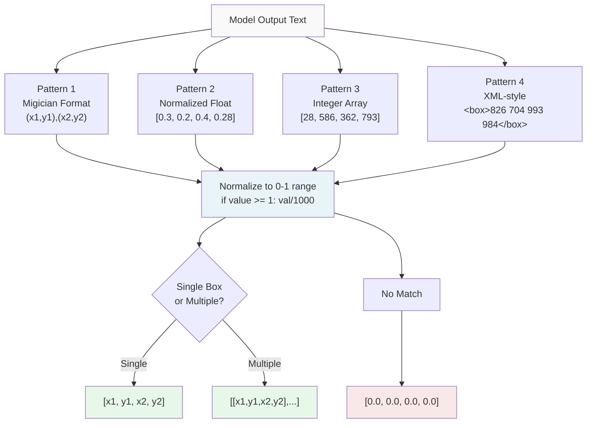
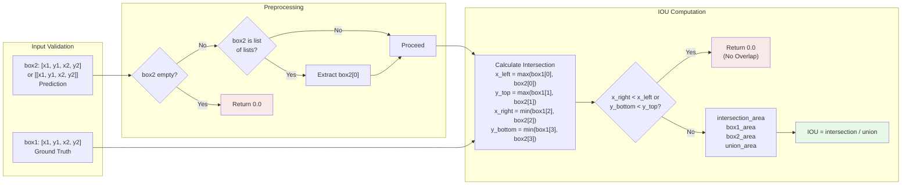
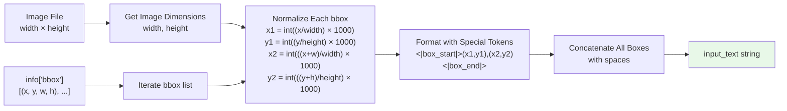
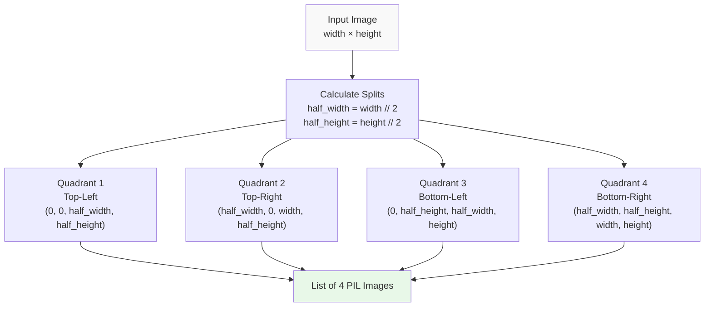
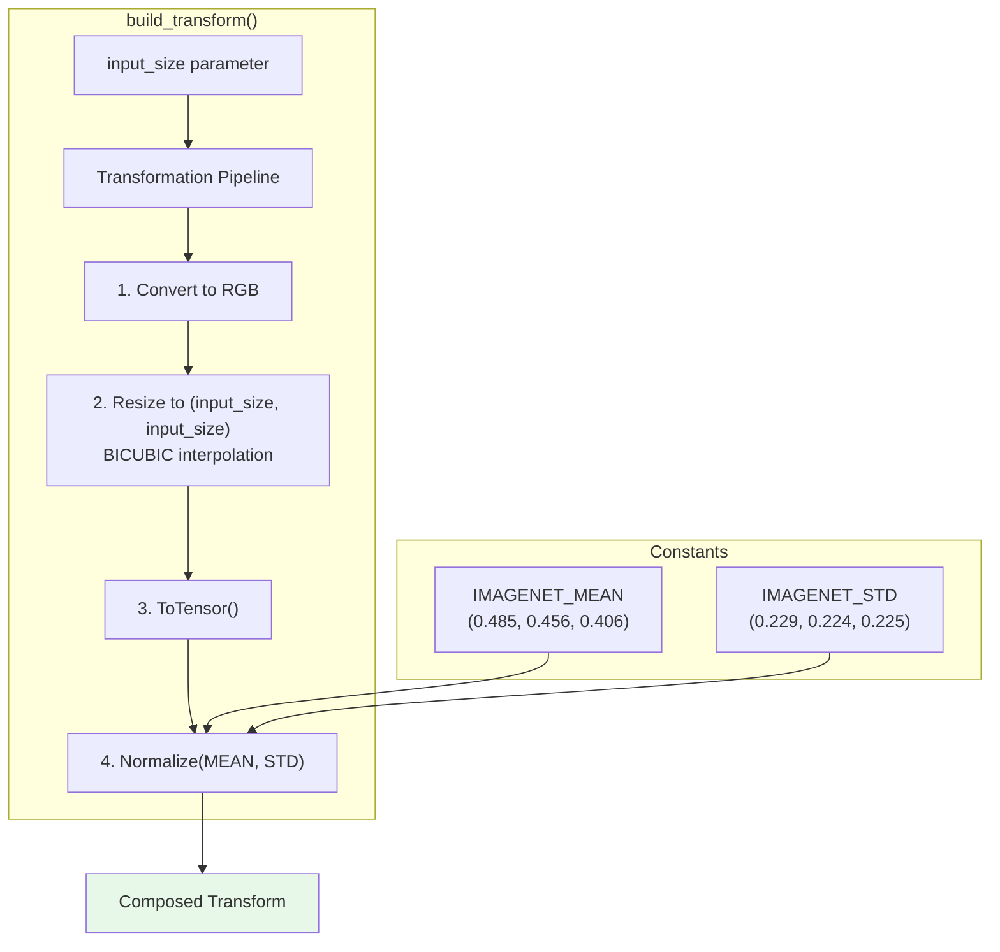
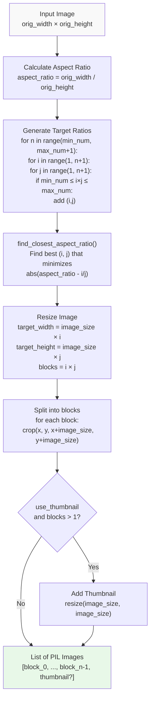
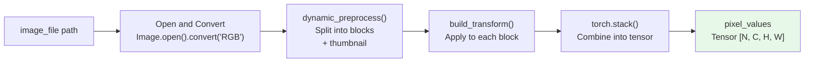
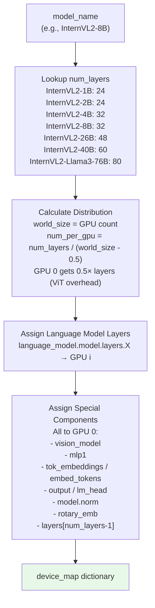
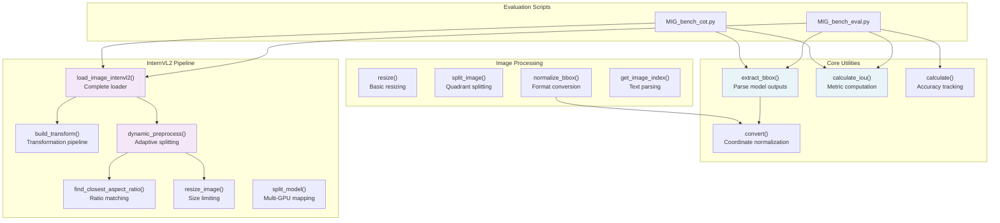
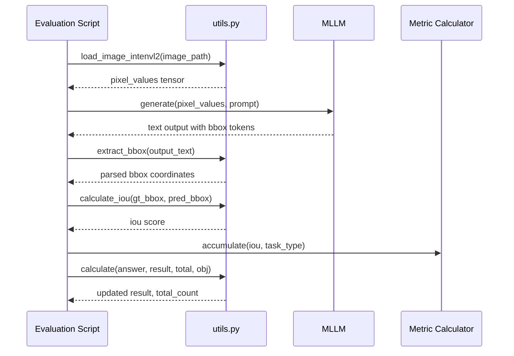

<!-- source: DeepWiki mcp.deepwiki.com · repo thunlp/Migician · page 6.1 Utility Functions · fetched 2026-11-02 -->

# Utility Functions

<details>
<summary>Relevant source files</summary>

The following files were used as context for generating this wiki page:

- [eval/utils.py](eval/utils.py)

</details>


This page documents the core utility functions in [eval/utils.py](). These functions provide essential functionality for the evaluation system, including bounding box extraction from model outputs, IOU (Intersection over Union) metric calculation, image preprocessing, and model-specific processing for InternVL2 models. These utilities are shared by both direct evaluation ([6.2](#6.2)) and Chain-of-Thought evaluation ([6.3](#6.3)) approaches.

For information about how these utilities are used in evaluation workflows, see [Direct Evaluation Script](#6.2) and [Chain-of-Thought Evaluation](#6.3). For details on the metrics calculated using these utilities, see [Evaluation Metrics](#6.4).

## Core Utility Functions

### Bounding Box Extraction

The `extract_bbox` function [eval/utils.py:19-44]() is responsible for parsing bounding box coordinates from model-generated text responses. This function handles multiple bbox format variations produced by different MLLMs.



**Supported Bounding Box Formats:**

| Format | Regex Pattern | Example | Typical Model |
|--------|--------------|---------|---------------|
| Point pairs (int) | `\((\d+),\s*(\d+)\),\s*\((\d+),\s*(\d+)\)` | `(28, 586), (362, 793)` | Migician, Qwen2-VL |
| Float array | `\[(\d+\.\d+),\s*(\d+\.\d+),\s*(\d+\.\d+),\s*(\d+\.\d+)\]` | `[0.3, 0.2, 0.4, 0.28]` | Various |
| Float point pairs | `\((\d+\.\d+),(\d+\.\d+)\),\((\d+\.\d+),(\d+\.\d+)\)` | `(0.3,0.2),(0.4,0.28)` | Qwen2-VL variants |
| Float tuple | `\((\d+\.\d+),\s*(\d+\.\d+),\s*(\d+\.\d+),\s*(\d+\.\d+)\)` | `(0.3, 0.2, 0.4, 0.28)` | Generic |
| Integer array | `\[(\d+),\s*(\d+),\s*(\d+),\s*(\d+)\]` | `[28, 586, 362, 793]` | Various |
| XML-style | `<box>(\d+)\s+(\d+)\s+(\d+)\s+(\d+)</box>` | `<box>826 704 993 984</box>` | Some MLLMs |

**Normalization Logic:**
- Values >= 1 are assumed to be in 0-1000 scale and divided by 1000
- Values < 1 are assumed to be already normalized and kept as-is
- Failed extractions return `[0.0, 0.0, 0.0, 0.0]` to avoid evaluation crashes

**Sources:** [eval/utils.py:19-44]()

### IOU Calculation

The `calculate_iou` function [eval/utils.py:61-83]() computes the Intersection over Union metric between predicted and ground truth bounding boxes.



**Mathematical Formula:**

```
IOU = Area(Intersection) / Area(Union)

where:
  intersection_area = (x_right - x_left) × (y_bottom - y_top)
  box1_area = (box1[2] - box1[0]) × (box1[3] - box1[1])
  box2_area = (box2[2] - box2[0]) × (box2[3] - box2[1])
  union_area = box1_area + box2_area - intersection_area
```

**Edge Case Handling:**
- Empty `box2`: Returns 0.0
- Nested list `box2`: Extracts first element `box2[0]`
- Non-overlapping boxes: Returns 0.0
- Invalid coordinates: Caught by try-except, prints notice, returns 0.0

**Sources:** [eval/utils.py:61-83]()

## Image Processing Functions

### Image Resizing

The `resize` function [eval/utils.py:85-93]() provides basic image resizing while maintaining aspect ratio.

```python
# Resizes image to fit within max_size × max_size box
resized_img = resize(image_path, max_size=800)
```

**Parameters:**
- `image_path`: Path to input image
- `max_size`: Maximum dimension (default: 800)

**Behavior:**
- Calculates scaling factor: `min(max_size/width, max_size/height)`
- Maintains original aspect ratio
- Returns PIL Image object

**Sources:** [eval/utils.py:85-93]()

### Bounding Box Normalization

The `normalize_bbox` function [eval/utils.py:95-110]() converts absolute bounding box coordinates to Migician's normalized format with special tokens.



**Input Format:** `bbox` list of tuples `(x, y, w, h)` in absolute coordinates

**Output Format:** String with Migician special tokens (see [4.3](#4.3)):
```
<|box_start|>(x1,y1),(x2,y2)<|box_end|> <|box_start|>(x3,y3),(x4,y4)<|box_end|> ...
```

**Coordinate Transformation:**
- Converts (x, y, width, height) to (x1, y1, x2, y2) format
- Normalizes to 0-1000 scale based on image dimensions
- x2 = x1 + width, y2 = y1 + height

**Sources:** [eval/utils.py:95-110]()

### Image Quadrant Splitting

The `split_image` function [eval/utils.py:112-129]() divides an image into four equal quadrants.



**Returns:** List of 4 PIL Image objects in order: [top-left, top-right, bottom-left, bottom-right]

**Sources:** [eval/utils.py:112-129]()

### Image Index Extraction

The `get_image_index` function [eval/utils.py:131-144]() parses image references from text descriptions.

**Pattern Matching Table:**

| Index | Keywords | Example Usage |
|-------|----------|---------------|
| 0 | `first`, `Image-1`, `Image1`, `Image 1`, `1th` | "The object in the first image" |
| 1 | `second`, `Image-2`, `Image2`, `Image 2`, `2th` | "The second image shows..." |
| 2 | `third`, `Image-3`, `Image3`, `Image 3`, `3th` | "Image-3 contains..." |
| 3 | `fourth`, `Image-4`, `Image4`, `Image 4`, `4th` | "In the fourth image..." |
| 4 | `fifth`, `Image-5`, `Image5`, `Image 5`, `5th` | "Image 5 displays..." |
| 5 | `sixth`, `Image-6`, `Image6`, `Image 6`, `6th` | "The 6th image..." |

**Returns:** Integer index (0-5) or -1 if no pattern matches

**Sources:** [eval/utils.py:131-144]()

## InternVL2-Specific Utilities

The utility file includes a suite of functions specifically designed for preprocessing images for InternVL2 models [eval/utils.py:147-269](). These functions implement dynamic resolution preprocessing to optimize visual understanding.

### Image Transformation Pipeline



**Sources:** [eval/utils.py:150-161]()

### Dynamic Preprocessing

The `dynamic_preprocess` function [eval/utils.py:178-214]() implements InternVL2's adaptive image splitting strategy to handle variable aspect ratios efficiently.



**Parameters:**
- `image`: PIL Image object
- `min_num`: Minimum number of blocks (default: 1)
- `max_num`: Maximum number of blocks (default: 12)
- `image_size`: Size of each square block (default: 448)
- `use_thumbnail`: Whether to append downsampled full image (default: False)

**Algorithm Steps:**

1. **Aspect Ratio Calculation**: Compute `orig_width / orig_height`

2. **Target Ratio Generation**: Create all valid (i, j) grid configurations where:
   - `min_num <= i × j <= max_num`
   - Sorted by total blocks

3. **Closest Match Selection**: Find (i, j) that minimizes `|aspect_ratio - i/j|`
   - Tiebreaker: Choose ratio where image area > 0.5 × target area

4. **Image Resizing**: Resize to `(image_size × i, image_size × j)`

5. **Block Splitting**: Crop into `i × j` blocks of size `image_size × image_size`

6. **Optional Thumbnail**: Add downsampled full image if `use_thumbnail=True`

**Example:**
- Image: 1920×1080 (aspect ratio ≈ 1.78)
- `image_size=448`, `max_num=12`
- Best ratio: (2, 1) = 2.0
- Result: Resize to 896×448, split into 2 blocks of 448×448

**Sources:** [eval/utils.py:178-214]()

### Loading Images for InternVL2

The `load_image_intenvl2` function [eval/utils.py:232-239]() provides a complete preprocessing pipeline for InternVL2 models.



**Returns:** PyTorch tensor with shape `[num_blocks, 3, input_size, input_size]`

**Usage in Evaluation Scripts:**
```python
pixel_values = load_image_intenvl2(image_path, input_size=448, max_num=12)
# pixel_values: [13, 3, 448, 448] (12 blocks + 1 thumbnail)
```

**Sources:** [eval/utils.py:232-239]()

### Multi-GPU Model Splitting

The `split_model` function [eval/utils.py:241-266]() generates device mapping for distributing InternVL2 models across multiple GPUs.

**Device Mapping Strategy:**



**Allocation Logic:**
- GPU 0 hosts vision model and gets ~50% of normal layer count
- Remaining layers distributed evenly across GPUs 1 to N-1
- All embedding and output layers pinned to GPU 0

**Example (4 GPUs, InternVL2-8B with 32 layers):**
- GPU 0: vision_model, mlp1, embeddings, output, layers 0-3
- GPU 1: layers 4-13
- GPU 2: layers 14-23
- GPU 3: layers 24-31

**Sources:** [eval/utils.py:241-266]()

## Helper Functions

### Accuracy Calculation

The `calculate` function [eval/utils.py:46-56]() tracks task-specific accuracy during evaluation.

**Parameters:**
- `answer`: Model's generated answer
- `result`: Dictionary accumulating correct counts per task
- `total_count`: Dictionary tracking total attempts per task
- `obj`: Evaluation object containing `'task'` and `'output'` keys

**Logic:**
```python
truth = obj['output'].strip().strip('.')
label = truth in answer  # Exact substring match

if label:
    result[obj['task']] += 1
total_count[obj['task']] += 1

return result, total_count
```

**Sources:** [eval/utils.py:46-56]()

### Coordinate Conversion

The `convert` function [eval/utils.py:58-59]() converts 0-1000 scale coordinates to 0-1 normalized scale.

```python
normalized = convert([28, 586, 362, 793])  # Returns [0.028, 0.586, 0.362, 0.793]
```

**Sources:** [eval/utils.py:58-59]()

## Function Dependency Map



## Usage Examples

### Basic Grounding Evaluation

```python
from eval.utils import extract_bbox, calculate_iou

# Extract predicted bounding box from model output
model_output = "The object is at <|box_start|>(120,450),(380,680)<|box_end|>."
pred_bbox = extract_bbox(model_output)  # [0.12, 0.45, 0.38, 0.68]

# Compare with ground truth
gt_bbox = [0.1, 0.4, 0.4, 0.7]
iou = calculate_iou(gt_bbox, pred_bbox)  # 0.85

# Check if passes IOU@0.7 threshold
passes = iou >= 0.7  # True
```

### InternVL2 Image Loading

```python
from eval.utils import load_image_intenvl2, split_model

# Load and preprocess image for InternVL2
pixel_values = load_image_intenvl2(
    'path/to/image.jpg',
    input_size=448,
    max_num=12
)
# Returns: tensor [N, 3, 448, 448] where N = num_blocks + 1 (thumbnail)

# Get device mapping for multi-GPU inference
device_map = split_model('InternVL2-8B')
# Maps model components to available GPUs
```

### Batch Processing Pattern

```python
from eval.utils import extract_bbox, calculate_iou

def evaluate_predictions(predictions, ground_truths):
    """Evaluate a batch of predictions."""
    ious = []
    
    for pred_text, gt_bbox in zip(predictions, ground_truths):
        pred_bbox = extract_bbox(pred_text)
        iou = calculate_iou(gt_bbox, pred_bbox)
        ious.append(iou)
    
    # Calculate metrics at different thresholds
    iou_at_07 = sum(iou >= 0.7 for iou in ious) / len(ious)
    iou_at_05 = sum(iou >= 0.5 for iou in ious) / len(ious)
    avg_iou = sum(ious) / len(ious)
    
    return {
        'IOU@0.7': iou_at_07,
        'IOU@0.5': iou_at_05,
        'Average IOU': avg_iou
    }
```

**Sources:** [eval/utils.py]()

## Integration with Evaluation Pipeline



This sequence diagram shows how utility functions are called throughout the evaluation workflow, from image loading through metric calculation.

**Sources:** [eval/utils.py]()

---

