<!-- source: DeepWiki mcp.deepwiki.com · repo thunlp/Migician · page 6.2 Direct Evaluation Script · fetched 2026-11-02 -->

# Direct Evaluation Script

<details>
<summary>Relevant source files</summary>

The following files were used as context for generating this wiki page:

- [README.md](README.md)
- [eval/MIG_bench_eval.py](eval/MIG_bench_eval.py)
- [eval/utils.py](eval/utils.py)

</details>


## Purpose and Scope

This page documents `MIG_bench_eval.py`, the primary evaluation script for performing end-to-end (direct inference) evaluation of multi-image grounding MLLMs. The script supports evaluating 7+ different model architectures across multiple benchmarks (MIG-Bench, MIBench, MMIU) using multiprocessing for efficient parallel execution.

For Chain-of-Thought evaluation that uses two-step reasoning, see [6.3](#6.3). For the underlying utility functions used by this script, see [6.1](#6.1). For detailed metric calculations, see [6.4](#6.4).

**Sources:** [eval/MIG_bench_eval.py:1-761](), [README.md:224-273]()

---

## Script Architecture

The direct evaluation script orchestrates model loading, input processing, inference execution, and metric computation through a multiprocessing framework that distributes tasks across multiple GPUs.

### Overall Evaluation Flow

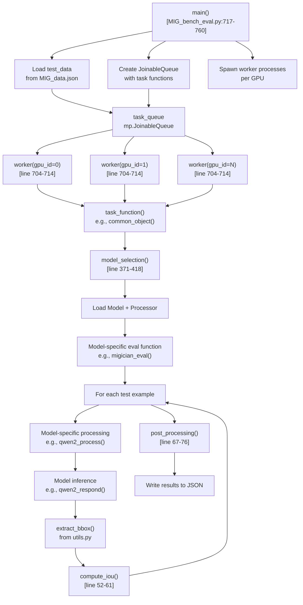

**Sources:** [eval/MIG_bench_eval.py:704-760](), [eval/MIG_bench_eval.py:371-418]()

---

## Supported Models

The script supports 7 mainstream multi-image MLLMs through model-specific processing and evaluation functions. Each model requires specific input formats and has dedicated handler functions.

| Model | Model Type | Evaluation Function | Processing Function | Response Function |
|-------|-----------|---------------------|---------------------|-------------------|
| Migician | `migician` | `migician_eval()` [230-250]() | `qwen2_process()` [79-86]() | `qwen2_respond()` [88-96]() |
| Qwen2-VL | `qwen2_vl` | `qwen2_vl_eval()` [214-228]() | `qwen2_process()` [79-86]() | `qwen2_respond()` [88-96]() |
| InternVL2 | `internvl2_8b` | `internvl2_eval()` [308-327]() | `internvl2_process()` [98-113]() | `model.chat()` [319]() |
| MiniCPM-V | `minicpm` | `minicpm_eval()` [329-346]() | `minicpm_process()` [115-125]() | `model.chat()` [339]() |
| LLaVA-OneVision | `llava_onevision` | `llava_eval()` [288-306]() | `llava_process()` [141-163]() | `model.generate()` [297]() |
| mPLUG-Owl3 | `mplug_owl3` | `mplug_eval()` [252-266]() | `mplug_process()` [165-187]() | `model.generate()` [259]() |
| Mantis | `mantis` | `mantis_eval()` [268-286]() | `mantis_process()` [127-139]() | `model.generate()` [278]() |
| CogVLM | `cogvlm` | `cogvlm_eval()` [348-369]() | `cogvlm_process()` [189-211]() | `model.generate()` [359]() |

**Sources:** [eval/MIG_bench_eval.py:371-418](), [eval/MIG_bench_eval.py:727-728]()

---

## Model Processing Pipeline

Each model requires specific input formatting. The script handles this through model-specific processing functions that convert the standardized test data format into model-appropriate inputs.

### Input Processing Flow

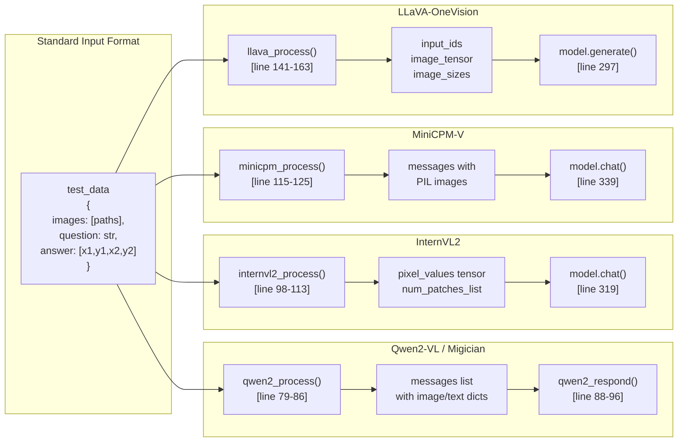

**Sources:** [eval/MIG_bench_eval.py:78-211]()

### Prompt Template Application

The script applies model-specific format templates to ensure consistent bbox output formatting:

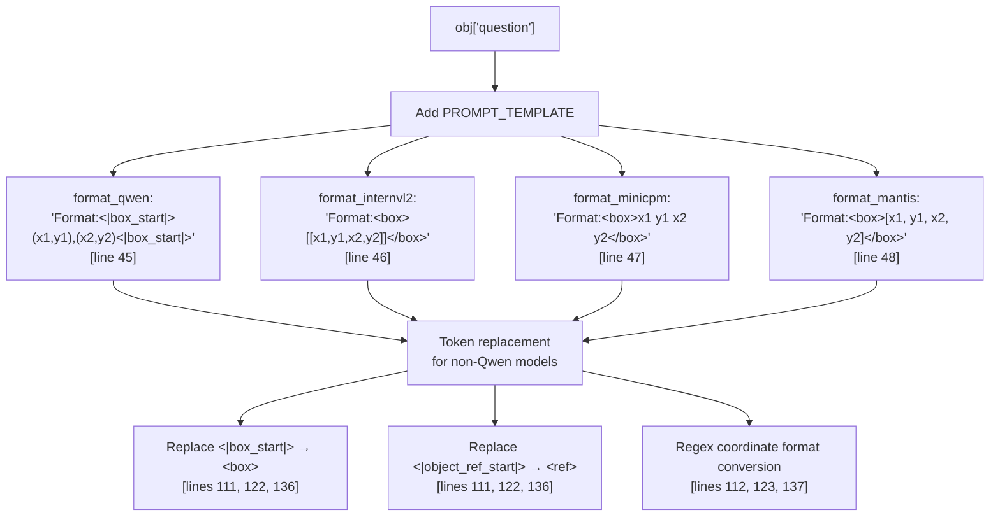

**Sources:** [eval/MIG_bench_eval.py:42-50](), [eval/MIG_bench_eval.py:111-137]()

---

## Evaluation Functions

Each model has a dedicated evaluation function that handles the complete evaluation loop for a specific task's test data.

### Migician Evaluation Function

The `migician_eval()` function includes special y-axis linear scaling to improve performance:

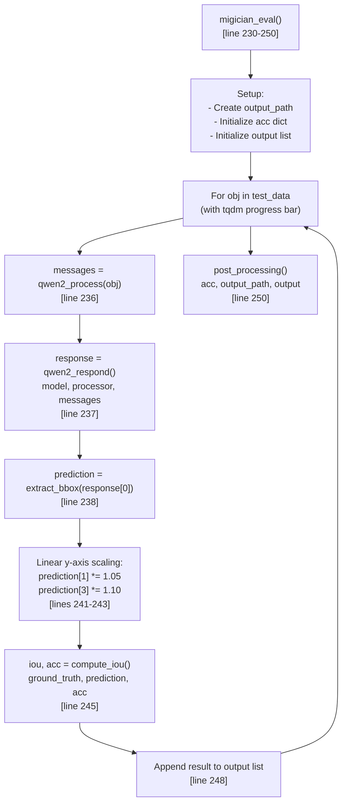

**Sources:** [eval/MIG_bench_eval.py:230-250]()

### IOU Computation

The `compute_iou()` function accumulates metrics across different IOU thresholds:

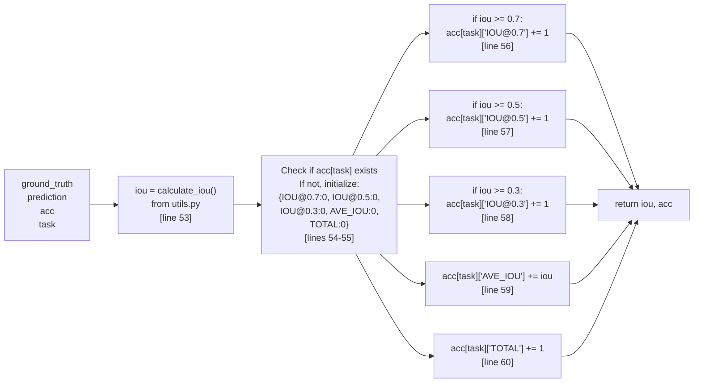

**Sources:** [eval/MIG_bench_eval.py:52-61]()

---

## Task-Specific Evaluation Functions

The script provides task-specific wrapper functions that filter test data by task type before calling `model_selection()`:

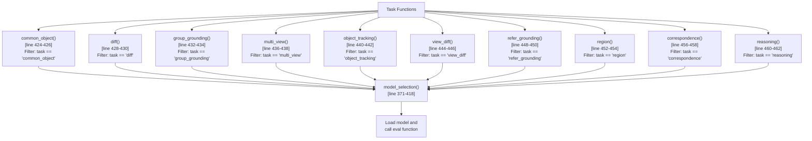

**Sources:** [eval/MIG_bench_eval.py:424-462]()

---

## Multiprocessing Architecture

The script uses Python's `multiprocessing` module to distribute tasks across multiple GPUs for efficient parallel evaluation.

### Multiprocessing Flow

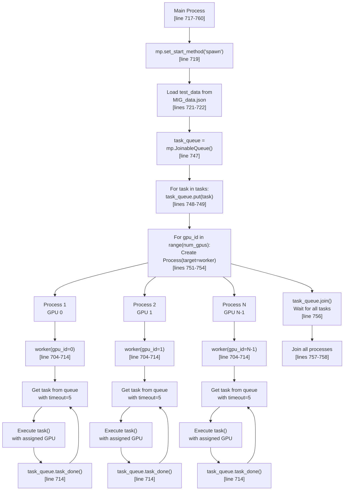

**Sources:** [eval/MIG_bench_eval.py:704-760]()

### Worker Function

The `worker()` function runs in each spawned process and handles task execution on a specific GPU:

```python
def worker(gpu_id, task_queue, model_type, test_data, model_path, output_path):
    os.environ["CUDA_VISIBLE_DEVICES"] = str(gpu_id)  # Set GPU visibility
    device = torch.device(f"cuda:{str(gpu_id)}")      # Create device
    
    while True:
        try:
            task = task_queue.get(timeout=5)           # Get task from queue
        except Empty:
            break                                      # Exit if queue empty
        task(model_type, model_path, test_data, device, output_path)
        task_queue.task_done()                         # Mark task complete
```

**Sources:** [eval/MIG_bench_eval.py:704-714]()

---

## Output Format

Results are written to timestamped JSON files in the specified `output_path` directory with detailed per-example predictions and aggregate metrics.

### Output File Structure

Each evaluation run produces a JSON file named `{model_type}_{task}_{timestamp}.json`:

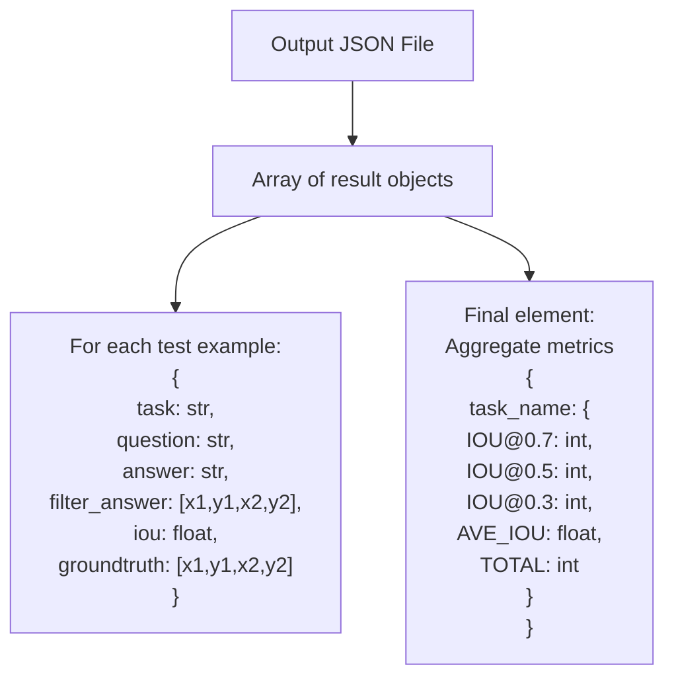

**Example Output Structure:**

```json
[
  {
    "task": "common_object",
    "question": "Locate the common object...",
    "answer": "It's in the first image. <|box_start|>(316,58),(764,999)<|box_end|>",
    "filter_answer": [0.316, 0.058, 0.764, 0.999],
    "iou": 0.8456,
    "groundtruth": [0.310, 0.055, 0.770, 0.995]
  },
  {
    "common_object": {
      "IOU@0.7": 145,
      "IOU@0.5": 178,
      "IOU@0.3": 192,
      "AVE_IOU": 123.456,
      "TOTAL": 200
    }
  }
]
```

**Sources:** [eval/MIG_bench_eval.py:226-228](), [eval/MIG_bench_eval.py:67-76]()

### Post-Processing Output

The `post_processing()` function computes percentages and writes results:

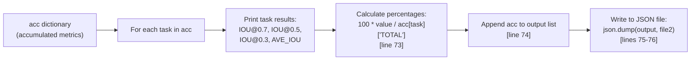

**Sources:** [eval/MIG_bench_eval.py:67-76]()

---

## Additional Benchmark Support

Beyond MIG-Bench, the script also supports evaluation on MIBench and MMIU benchmarks with specialized functions.

### MIBench Evaluation

The `mibench_eval()` function handles Multi-Image Instruction (MII) and Multimodal Knowledge Seeking (MKS) tasks:

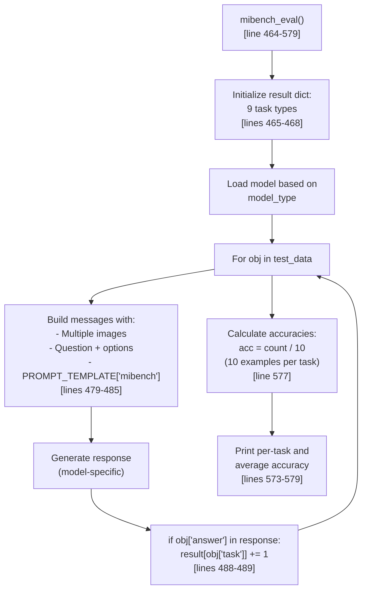

**Sources:** [eval/MIG_bench_eval.py:464-579](), [eval/MIG_bench_eval.py:581-589]()

### MMIU Benchmark Evaluation

The `mmiubench_eval()` function handles forensic detection tasks:

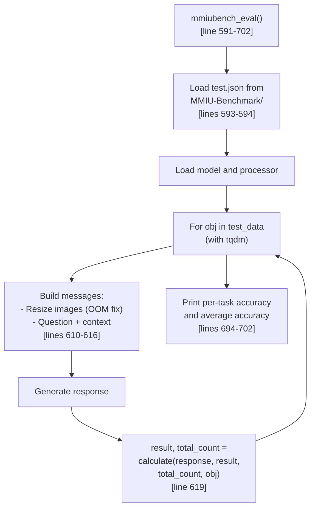

**Sources:** [eval/MIG_bench_eval.py:591-702]()

---

## Usage Example

The script is typically run from the command line with configuration specified in the main block:

```python
# Configuration at lines 730-732
num_gpus = 6
model_type = 'migician'
model_path = "/path/to/model"

# Define tasks to evaluate (lines 742)
tasks = [common_object, view_diff, correspondence, diff, 
         group_grounding, multi_view, region, refer_grounding, 
         object_tracking, reasoning]

# Multiprocessing execution (lines 745-758)
task_queue = mp.JoinableQueue()
for task in tasks:
    task_queue.put(task)

for gpu_id in range(num_gpus):
    p = mp.Process(target=worker, args=(gpu_id, task_queue, 
                                        model_type, test_data, 
                                        model_path, output_path))
    processes.append(p)
    p.start()

task_queue.join()
for p in processes:
    p.join()
```

### Supported Model Types

Configure `model_type` to one of:
- `'migician'` - Migician model with y-axis scaling
- `'qwen2_vl'` - Qwen2-VL base model
- `'internvl2_8b'` - InternVL2-8B model
- `'minicpm'` - MiniCPM-V 2.6 model
- `'llava_onevision'` - LLaVA-OneVision model
- `'mplug_owl3'` - mPLUG-Owl3 model (requires transformers==4.37.2)
- `'mantis'` - Mantis-8B model
- `'cogvlm'` - CogVLM model (limited multi-image support)

**Sources:** [eval/MIG_bench_eval.py:717-760](), [eval/MIG_bench_eval.py:727-732]()

---

## Dependencies and Requirements

The script requires multiple libraries with specific version requirements for different models:

| Library | Purpose | Notes |
|---------|---------|-------|
| `torch` | PyTorch framework | Core deep learning library |
| `transformers` | HuggingFace models | Version varies by model (4.37.2 for mPLUG-Owl3) |
| `qwen_vl_utils` | Qwen2-VL utilities | For `process_vision_info()` |
| `torch.multiprocessing` | Parallel execution | Spawn method required [line 719]() |
| `PIL` | Image processing | For image loading and resizing |
| `decord` | Video processing | For certain model requirements |
| `tqdm` | Progress bars | For tracking evaluation progress |

**Warning:** Different MLLMs may require conflicting `transformers` versions. Install the correct version for your target model.

**Sources:** [eval/MIG_bench_eval.py:1-34](), [README.md:38-40]()

---

