<!-- source: DeepWiki mcp.deepwiki.com · repo thunlp/Migician · page 6.3 Chain-of-Thought Evaluation · fetched 2026-11-02 -->

# Chain-of-Thought Evaluation

<details>
<summary>Relevant source files</summary>

The following files were used as context for generating this wiki page:

- [README.md](README.md)
- [eval/MIG_bench_cot.py](eval/MIG_bench_cot.py)
- [eval/utils.py](eval/utils.py)

</details>


## Purpose and Scope

This document describes the Chain-of-Thought (CoT) evaluation system implemented in [eval/MIG_bench_cot.py](). The CoT evaluation approach breaks down multi-image grounding into a two-stage reasoning process: first generating textual descriptions of target objects, then grounding those descriptions with bounding boxes. This method serves as an alternative to direct end-to-end inference covered in [Direct Evaluation Script](#6.2).

The CoT evaluation system supports three model architectures: Qwen2-VL (including Migician), InternVL2, and mPLUG-Owl3. It processes all ten task types from MIG-Bench using model-specific pipelines and multiprocessing for parallel execution across multiple GPUs. For information about evaluation metrics, see [Evaluation Metrics](#6.4).

---

## Chain-of-Thought Reasoning Framework

The CoT framework decomposes complex multi-image grounding into two sequential steps, allowing models to reason about visual content before performing spatial localization.

### Two-Stage Process

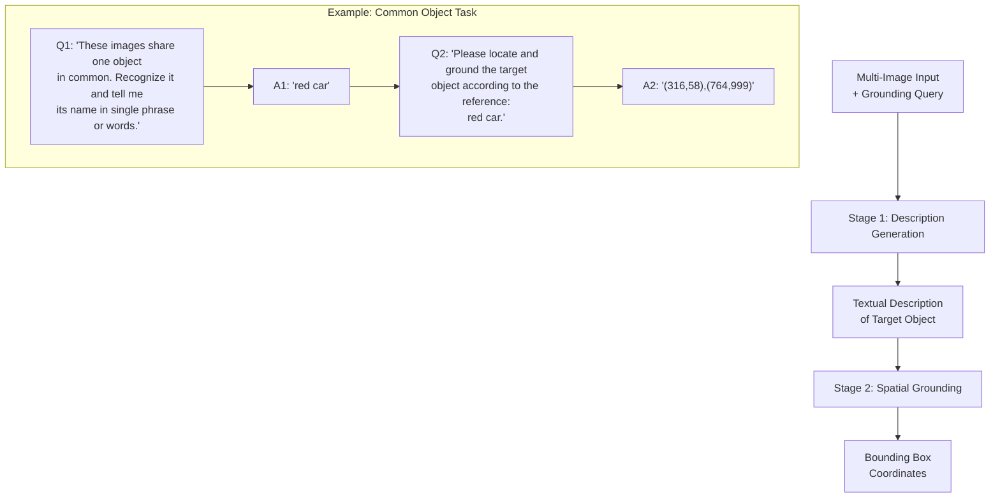

**Sources:** [eval/MIG_bench_cot.py:39-62](), [README.md:28-29]()

---

## Prompt Template System

The `PROMPT_TEMPLATE` dictionary defines task-specific prompts for both CoT stages and output formatting constraints.

### Template Structure

| Task Type | Stage 1 Prompt Key | Stage 2 Prompt Key | Purpose |
|-----------|-------------------|-------------------|---------|
| `common_object` | `common_object_1` | `common_object_2` | Identify shared objects across images |
| `correspondence` | `correspondence_1` | `correspondence_2` | Match semantic/functional features |
| `diff` | `diff_1` | `diff_2` | Detect and locate differences |
| `multi_view` | `multi_view_1` | `multi_view_2` | Track objects across viewpoints |
| `reasoning` | `reasoning_1` | `reasoning_2` | Infer and locate reasoning targets |
| `refer_grounding` | `refer_grounding_1` | `refer_grounding_2` | Ground category descriptions |
| `region` | `region_1` | `region_2` | Locate specific regions |
| `view_diff` | `view_diff_1` | `view_diff_2` | Ground prominent differences |
| `object_tracking` | `object_tracking_1` | `object_tracking_2` | Track moving objects |
| `group_grounding` | `group_grounding_1` | `group_grounding_2` | Identify image containing target |

### Format Specifications

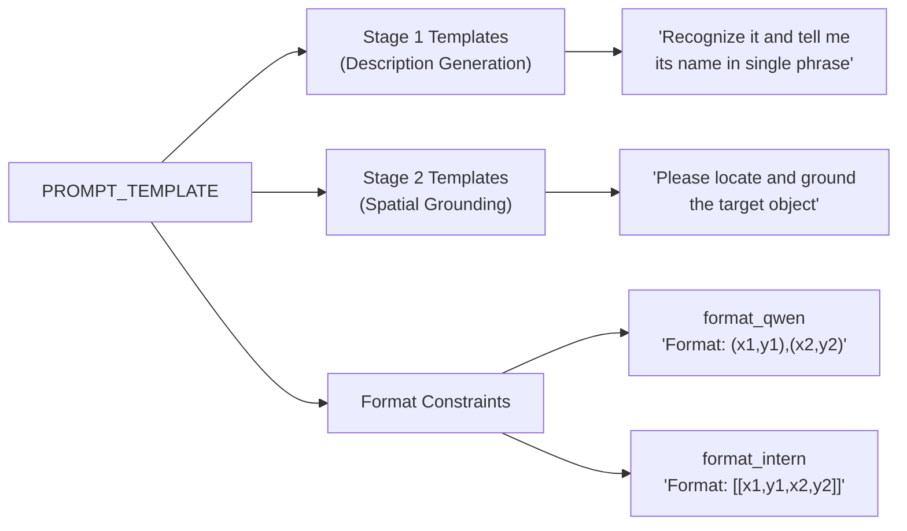

**Sources:** [eval/MIG_bench_cot.py:39-62]()

---

## Model-Specific Implementations

The CoT system provides specialized processing pipelines for three model families, each with single-image and multi-image variants.

### Qwen2-VL Pipeline

The Qwen2-VL implementation (including Migician) uses the `qwen2_process` and `qwen2_respond` functions for message formatting and inference.

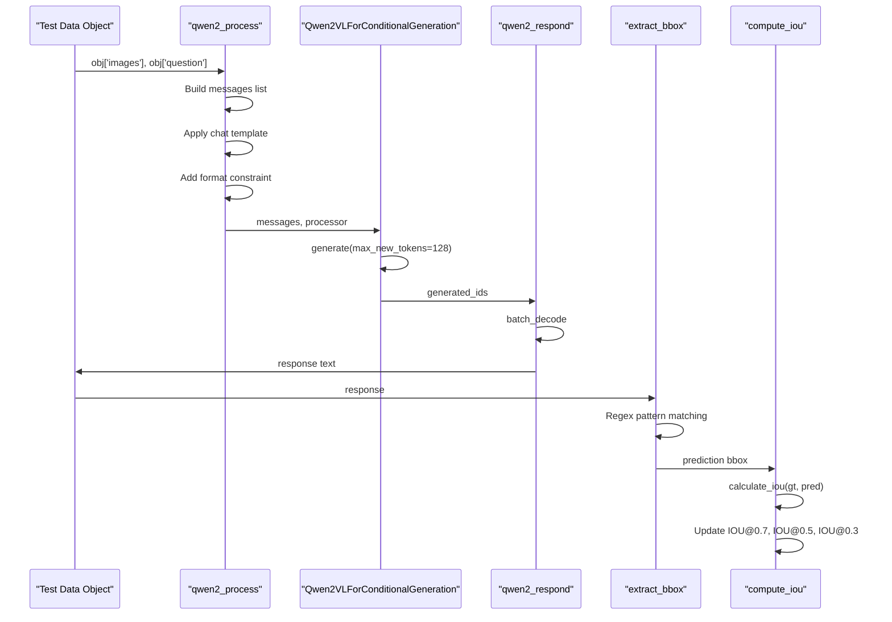

#### Single-Image CoT: `qwen2_single`

For tasks requiring grounding in a specific image, the function isolates the target image after Stage 1:

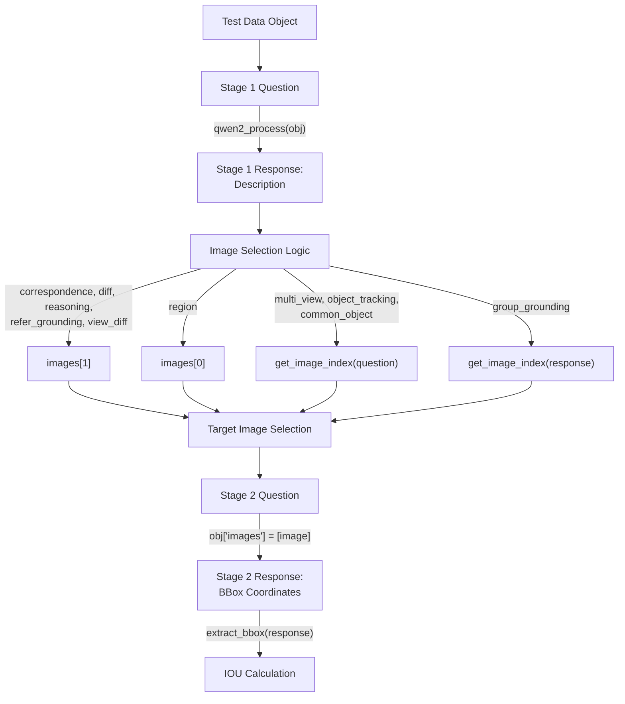

**Sources:** [eval/MIG_bench_cot.py:110-165]()

#### Multi-Image CoT: `qwen2_multi`

The multi-image variant maintains all images throughout both stages but explicitly directs attention to specific images:

- Uses directional prompts like `"Now ONLY look at Image2."`
- Maintains full image context for cross-image reasoning
- Implementation at [eval/MIG_bench_cot.py:167-218]()

**Sources:** [eval/MIG_bench_cot.py:90-108](), [eval/MIG_bench_cot.py:167-218]()

### InternVL2 Pipeline

The InternVL2 implementation uses `internvl2_process` to handle dynamic image preprocessing and pixel value concatenation.

#### Processing Function: `internvl2_process`

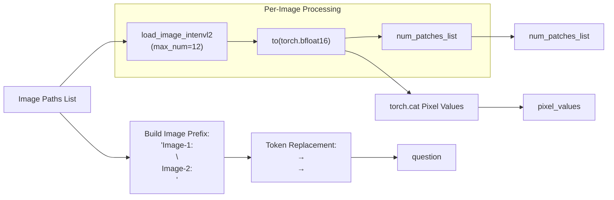

**Sources:** [eval/MIG_bench_cot.py:355-371](), [eval/utils.py:178-214]()

#### Single vs Multi Variants

| Function | Image Handling | History Management | Output Path Pattern |
|----------|---------------|-------------------|---------------------|
| `internvl2_single` | Isolates target image for Stage 2 | `history=None` for both stages | `internvl2_single_cot_{task}_{timestamp}.json` |
| `internvl2_multi` | Maintains all images | Passes Stage 1 history to Stage 2 | `internvl_multi_cot_{task}_{timestamp}.json` |

**Sources:** [eval/MIG_bench_cot.py:373-432](), [eval/MIG_bench_cot.py:434-488]()

### mPLUG-Owl3 Pipeline

The mPLUG-Owl3 implementation uses `mplug_process` for message formatting and the modelscope `AutoProcessor`.

#### Message Construction

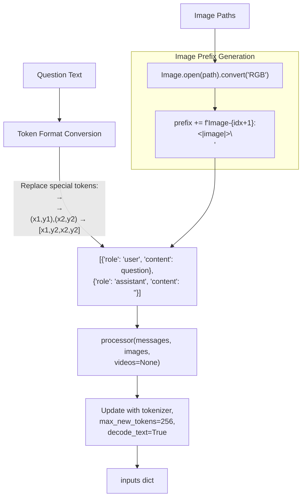

**Sources:** [eval/MIG_bench_cot.py:220-242](), [eval/MIG_bench_cot.py:244-299](), [eval/MIG_bench_cot.py:301-353]()

---

## Task-Specific Processing

Each of the ten task types has a dedicated wrapper function that filters test data and delegates to `model_selection`.

### Task Filter Functions

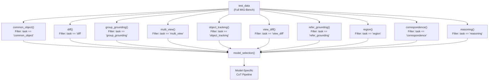

**Sources:** [eval/MIG_bench_cot.py:515-553]()

### Model Selection Routing

The `model_selection` function routes to the appropriate model pipeline based on `model_type`:

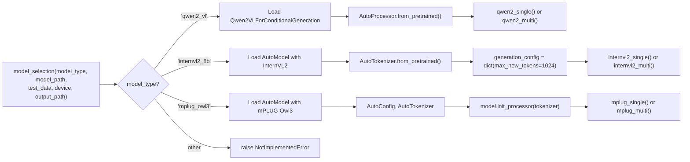

**Sources:** [eval/MIG_bench_cot.py:490-513]()

---

## IOU Computation and Accumulation

The `compute_iou` function calculates intersection-over-union metrics and accumulates results by task type.

### Accumulation Structure

```python
# acc dictionary structure per task:
{
    'task_name': {
        'IOU@0.7': count,  # Predictions with IOU >= 0.7
        'IOU@0.5': count,  # Predictions with IOU >= 0.5
        'IOU@0.3': count,  # Predictions with IOU >= 0.3
        'AVE_IOU': sum,    # Sum of all IOUs
        'TOTAL': count     # Total predictions
    }
}
```

### Processing Flow

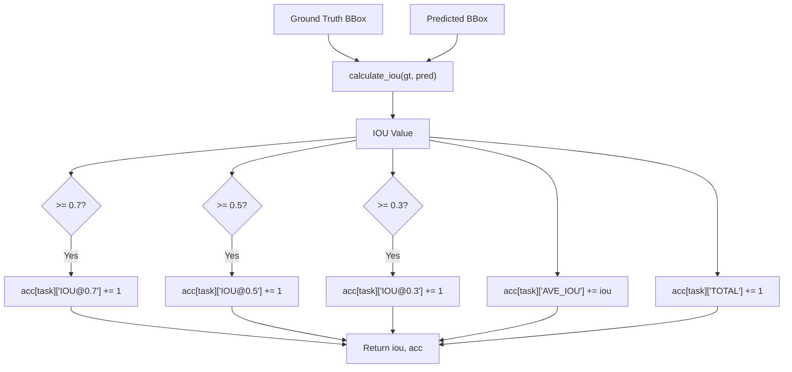

**Sources:** [eval/MIG_bench_cot.py:64-73](), [eval/utils.py:61-83]()

---

## Multiprocessing Execution System

The CoT evaluation system uses `torch.multiprocessing` to parallelize evaluation across multiple GPUs and tasks.

### Worker Architecture

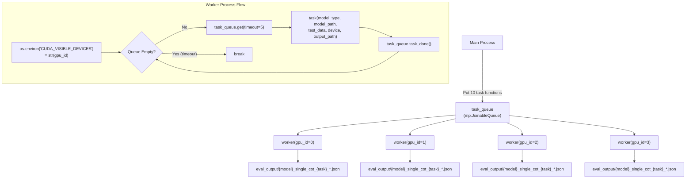

**Sources:** [eval/MIG_bench_cot.py:555-607]()

### Main Execution Flow

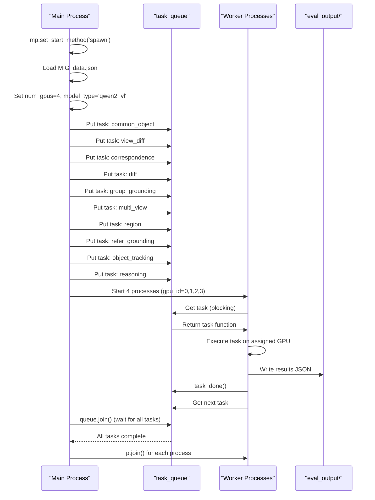

### Configuration

The main execution block configures:

| Parameter | Default Value | Purpose |
|-----------|--------------|---------|
| `num_gpus` | 4 | Number of parallel GPU workers |
| `model_type` | `'qwen2_vl'` | One of: `qwen2_vl`, `internvl2_8b`, `mplug_owl3` |
| `model_path` | `"YOUR_PATH"` | Path to model checkpoint |
| `tasks` | List of 10 task functions | Task processing pipeline |

**Sources:** [eval/MIG_bench_cot.py:568-609]()

---

## Post-Processing and Output

The `post_processing` function calculates percentage metrics and saves results to JSON files.

### Output Format

Each evaluation produces a JSON file with structure:

```json
[
    {
        "task": "common_object",
        "question": "Please locate and ground...",
        "answer": "raw model response",
        "filter_answer": [x1, y1, x2, y2],
        "iou": 0.8523,
        "groundtruth": [0.316, 0.058, 0.764, 0.999]
    },
    ...
    {
        "common_object": {
            "IOU@0.7": 45,
            "IOU@0.5": 67,
            "IOU@0.3": 89,
            "AVE_IOU": 56.234,
            "TOTAL": 100
        }
    }
]
```

### Metric Calculation

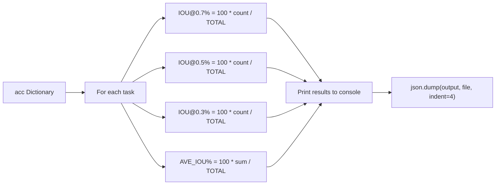

**Sources:** [eval/MIG_bench_cot.py:79-88]()

---

## Supported Models and Requirements

The CoT evaluation system supports three model families with specific requirements:

| Model Type | Key Value | Architecture | Special Dependencies |
|------------|-----------|-------------|---------------------|
| Migician / Qwen2-VL | `'qwen2_vl'` | `Qwen2VLForConditionalGeneration` | `transformers`, `qwen_vl_utils` |
| InternVL2 | `'internvl2_8b'` | `AutoModel` with `trust_remote_code=True` | `flash_attn`, custom image processing |
| mPLUG-Owl3 | `'mplug_owl3'` | `AutoModel` from modelscope | `transformers==4.37.2`, `modelscope` |

### Loading Configuration

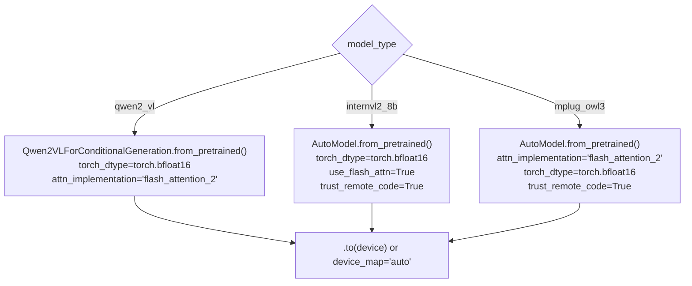

**Sources:** [eval/MIG_bench_cot.py:490-513](), [README.md:272]()

---

