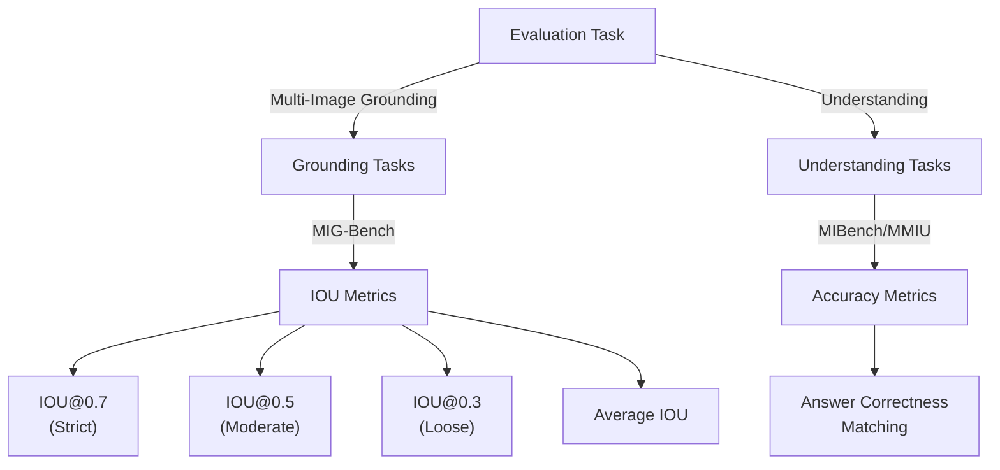
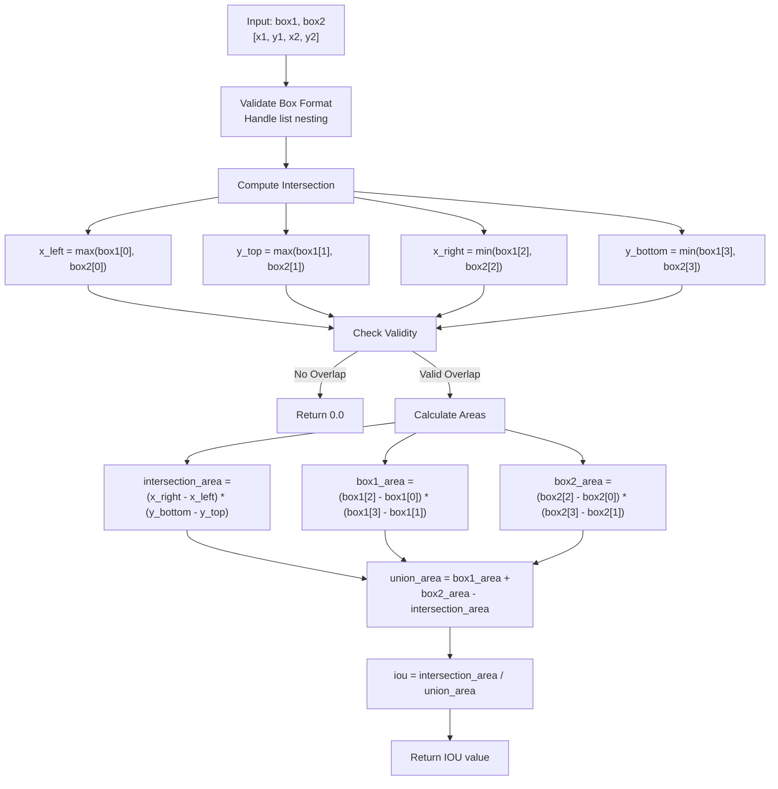
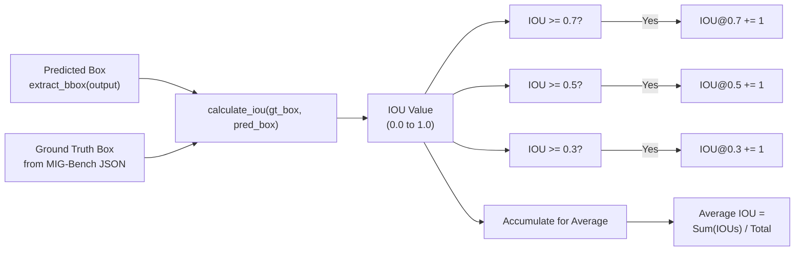
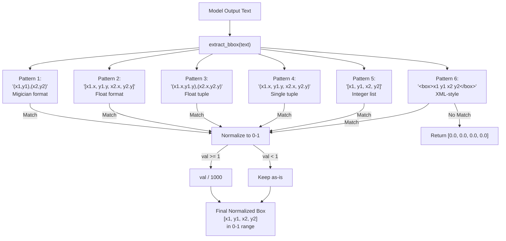
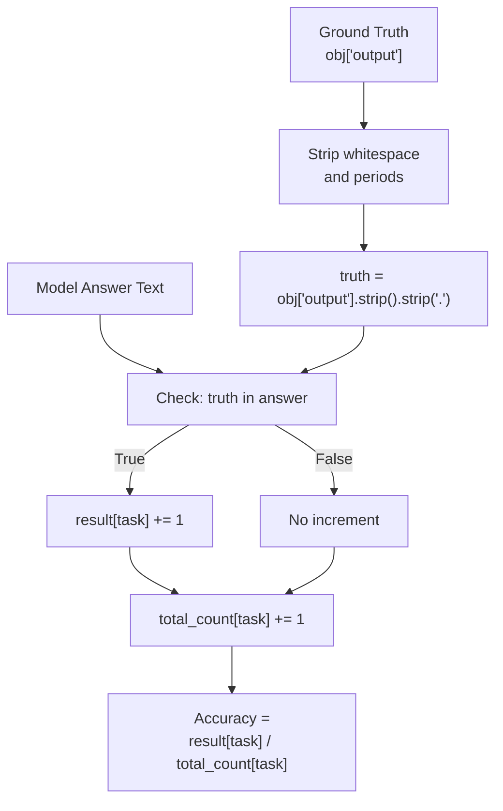
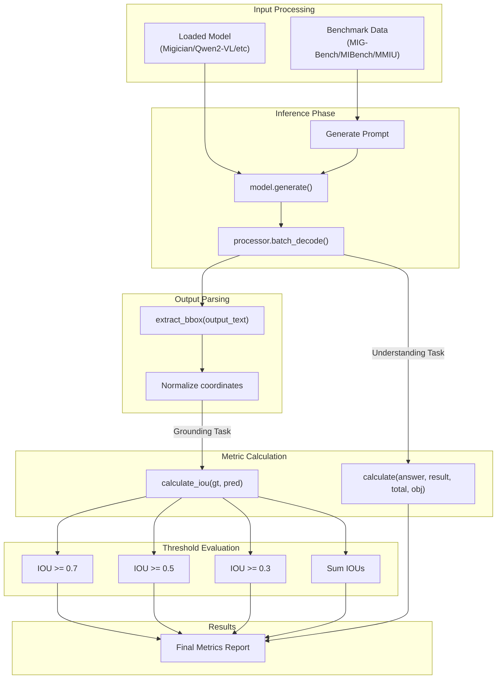

<!-- source: DeepWiki mcp.deepwiki.com · repo thunlp/Migician · page 6.4 Evaluation Metrics · fetched 2026-11-02 -->

# Evaluation Metrics

<details>
<summary>Relevant source files</summary>

The following files were used as context for generating this wiki page:

- [README.md](README.md)
- [eval/utils.py](eval/utils.py)

</details>


## Purpose and Scope

This document explains the metrics used to evaluate model performance in the Migician evaluation framework. These metrics quantify grounding accuracy and understanding capabilities across different benchmarks. For information about the evaluation scripts that compute these metrics, see [Direct Evaluation Script](#6.2) and [Chain-of-Thought Evaluation](#6.3). For details on the specific benchmarks, see [MIG-Bench](#7.1), [MIBench](#7.2), and [MMIU-Benchmark](#7.3).

---

## Metric Types Overview

The Migician evaluation system employs two primary metric categories depending on the task type:

| Metric Category | Task Type | Benchmarks | Purpose |
|----------------|-----------|------------|---------|
| **IOU Metrics** | Grounding | MIG-Bench | Measures spatial accuracy of predicted bounding boxes |
| **Accuracy** | Understanding | MIBench, MMIU | Measures correctness of multiple-choice answers |

**Metrics Type Selection Diagram**



Sources: [README.md:272](), [eval/utils.py:46-83]()

---

## IOU Metrics for Grounding Tasks

### Intersection over Union (IOU) Calculation

IOU measures the overlap between a predicted bounding box and the ground truth bounding box. It is calculated as the ratio of the intersection area to the union area of the two boxes.

**Mathematical Definition:**

```
IOU = (Intersection Area) / (Union Area)
    = (Intersection Area) / (Box1 Area + Box2 Area - Intersection Area)
```

The `calculate_iou` function implements this calculation:

**IOU Calculation Process**



Sources: [eval/utils.py:61-83]()

### Implementation Details

The `calculate_iou` function in `utils.py` handles several edge cases:

```python
def calculate_iou(box1, box2):
    # box1: ground truth [x1, y1, x2, y2]
    # box2: predicted bbox (may be nested list)
```

**Key behaviors:**
- Returns `0.0` if `box2` is empty or invalid
- Handles nested list format by extracting first element
- Returns `0.0` if boxes don't overlap (`x_right < x_left` or `y_bottom < y_top`)
- Prints error notice if coordinate extraction fails

Sources: [eval/utils.py:61-83]()

---

### IOU Threshold Metrics

The evaluation system reports IOU at multiple threshold levels to assess grounding performance at different strictness levels:

| Metric | Threshold | Description | Use Case |
|--------|-----------|-------------|----------|
| **IOU@0.7** | ≥ 0.7 | Strict matching | High-precision grounding |
| **IOU@0.5** | ≥ 0.5 | Moderate matching | Standard object detection threshold |
| **IOU@0.3** | ≥ 0.3 | Loose matching | Coarse localization assessment |
| **Average IOU** | N/A | Mean IOU across all predictions | Overall grounding quality |

**Threshold Interpretation:**

- **IOU@0.7**: Considered a match if IOU ≥ 0.7. Requires near-perfect alignment. Typical for applications requiring precise localization.
- **IOU@0.5**: The standard COCO detection threshold. Balances precision and recall.
- **IOU@0.3**: Lenient threshold. Useful for evaluating whether the model roughly understands the target region.
- **Average IOU**: Provides continuous measure of prediction quality regardless of threshold crossing.

**Threshold Evaluation Flow**



Sources: [README.md:272](), [eval/utils.py:61-83]()

---

### Coordinate Format and Normalization

**Bounding Box Representation:**

All bounding boxes in the Migician system use the **x1, y1, x2, y2** format:
- `x1, y1`: Top-left corner coordinates
- `x2, y2`: Bottom-right corner coordinates

**Normalization Scheme:**

| Context | Format | Range | Example |
|---------|--------|-------|---------|
| **Ground Truth** (MIG-Bench) | Float | 0.0 to 1.0 | `[0.418, 0.391, 0.595, 0.546]` |
| **Model Output** (Migician) | Integer | 0 to 1000 | `(316, 58), (764, 999)` |
| **Converted for IOU** | Float | 0.0 to 1.0 | `[0.316, 0.058, 0.764, 0.999]` |

The `extract_bbox` function handles multiple output formats and normalizes them to 0.0-1.0 range:

```python
boxes = [val/1000 if val>=1 else val for val in boxes]
```

**Coordinate Format Parsing**



Sources: [eval/utils.py:19-44](), [README.md:251]()

---

## Accuracy Metrics for Understanding Tasks

### Multiple Choice Accuracy

For understanding tasks on MIBench and MMIU, the evaluation uses exact string matching to determine correctness. The `calculate` function implements this:

**Calculation Method:**

1. Extract the correct answer from the ground truth (`obj['output']`)
2. Strip whitespace and trailing periods
3. Check if the correct answer appears in the model's response
4. Increment task-specific counters if match is found

**Accuracy Computation:**

```
Accuracy = (Number of Correct Answers) / (Total Questions)
```

**Accuracy Evaluation Flow**



Sources: [eval/utils.py:46-56]()

### Task-Level Aggregation

The `calculate` function maintains separate counters for each task type:

- `result`: Dictionary mapping task names to correct answer counts
- `total_count`: Dictionary mapping task names to total question counts

This enables per-task accuracy reporting, allowing analysis of model performance across different understanding task categories.

Sources: [eval/utils.py:46-56]()

---

## Metric Computation Pipeline

The following diagram shows how metrics flow through the evaluation system:

**End-to-End Metric Computation**



Sources: [eval/utils.py:19-83](), [README.md:272]()

---

## Metric Summary Table

The following table summarizes all metrics reported by the evaluation system:

| Metric | Formula | Range | Task Type | Benchmarks | Code Function |
|--------|---------|-------|-----------|------------|---------------|
| **IOU@0.7** | Count(IOU ≥ 0.7) / Total | 0.0 - 1.0 | Grounding | MIG-Bench | `calculate_iou` |
| **IOU@0.5** | Count(IOU ≥ 0.5) / Total | 0.0 - 1.0 | Grounding | MIG-Bench | `calculate_iou` |
| **IOU@0.3** | Count(IOU ≥ 0.3) / Total | 0.0 - 1.0 | Grounding | MIG-Bench | `calculate_iou` |
| **Average IOU** | Sum(IOU) / Total | 0.0 - 1.0 | Grounding | MIG-Bench | `calculate_iou` |
| **Accuracy** | Correct / Total | 0.0 - 1.0 | Understanding | MIBench, MMIU | `calculate` |

Sources: [eval/utils.py:46-83](), [README.md:272]()

---

## Code Entity Reference

**Core Metric Functions in `eval/utils.py`:**

| Function | Lines | Purpose | Input Format | Output Format |
|----------|-------|---------|--------------|---------------|
| `extract_bbox` | [19-44]() | Parse bbox from text | String (various formats) | `[x1, y1, x2, y2]` (0-1 normalized) |
| `calculate_iou` | [61-83]() | Compute IOU score | Two boxes: `[x1, y1, x2, y2]` | Float (0.0-1.0) |
| `calculate` | [46-56]() | Compute accuracy | Answer string, ground truth | Updated result/total_count dicts |
| `convert` | [58-59]() | Normalize coordinates | List of integers | List of floats (0-1) |

Sources: [eval/utils.py:19-83]()

---

