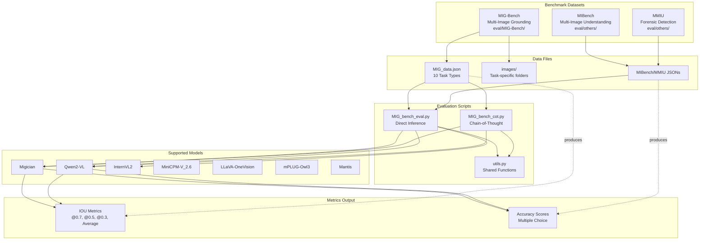
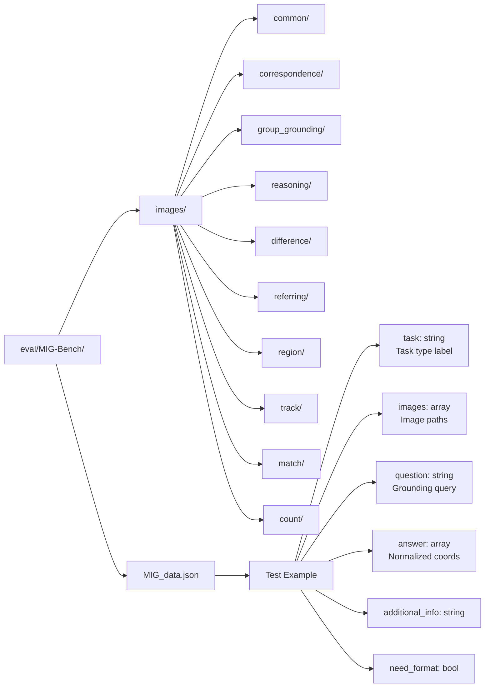
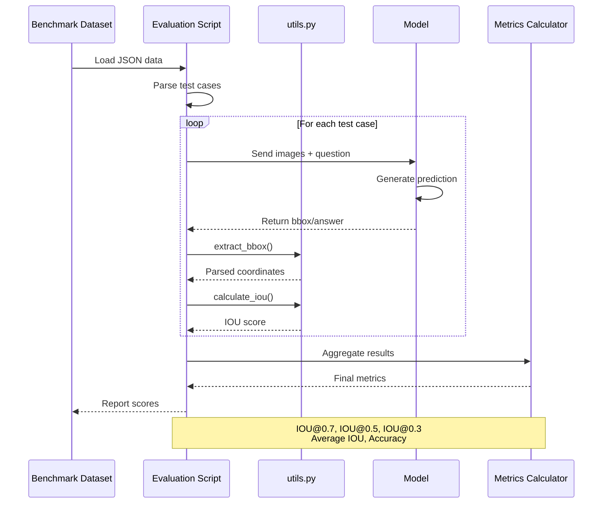
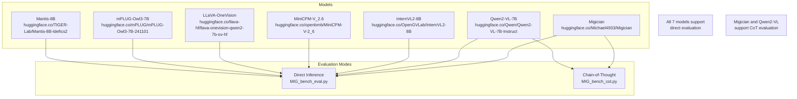
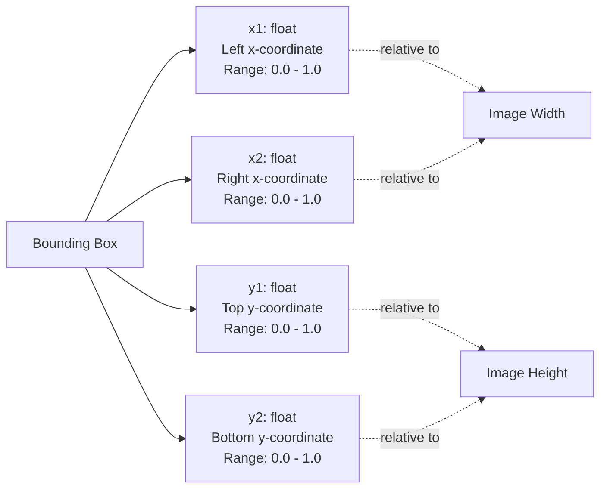

<!-- source: DeepWiki mcp.deepwiki.com · repo thunlp/Migician · page 7 Benchmarks · fetched 2026-11-02 -->

# Benchmarks

<details>
<summary>Relevant source files</summary>

The following files were used as context for generating this wiki page:

- [README.md](README.md)

</details>


This document provides an overview of the three evaluation benchmarks used to assess Migician's multi-image grounding and understanding capabilities: **MIG-Bench**, **MIBench**, and **MMIU**. These benchmarks collectively evaluate different aspects of multi-image processing, from precise object grounding to general understanding and forensic detection.

For detailed information about individual benchmarks, see:
- [MIG-Bench](#7.1) - Multi-image grounding capabilities across 10 task types
- [MIBench](#7.2) - Multi-image instruction following and knowledge seeking
- [MMIU-Benchmark](#7.3) - Multimodal forensic detection

For information about evaluation scripts and metrics used with these benchmarks, see [Evaluation System](#6).

---

## Purpose and Scope

The benchmark suite provides standardized evaluation datasets that test multi-image capabilities across three dimensions:

1. **Grounding Precision** (MIG-Bench): Tests the ability to locate objects across multiple images with bounding box predictions
2. **Understanding Capability** (MIBench): Evaluates multi-image comprehension and reasoning
3. **Forensic Analysis** (MMIU): Assesses real vs. fake photograph classification

All benchmarks are available on Hugging Face and can be evaluated using scripts in the `eval/` directory [eval/](). The evaluation system supports seven different MLLMs including Migician, Qwen2-VL, InternVL2, MiniCPM-V_2.6, LLaVA-OneVision, mPLUG-Owl3, and Mantis [README.md:272]().

---

## Benchmark Ecosystem Overview

The following diagram shows how the three benchmarks integrate with the evaluation infrastructure:



**Sources:** [README.md:227-273]()

---

## Benchmark Comparison

The following table summarizes the key characteristics of each benchmark:

| Benchmark | Primary Focus | Task Count | Metric Types | Data Format | Evaluation Script |
|-----------|--------------|------------|--------------|-------------|-------------------|
| **MIG-Bench** | Multi-image grounding precision | 10 task types | IOU@0.7, IOU@0.5, IOU@0.3, Average IOU | JSON with normalized bboxes (0-1) | `MIG_bench_eval.py`, `MIG_bench_cot.py` |
| **MIBench** | Multi-image understanding | Multi-Image Instruction + Knowledge Seeking | Accuracy (multiple choice) | JSON with image paths and questions | `MIG_bench_eval.py` |
| **MMIU** | Forensic detection | Real vs. fake classification | Accuracy | JSON with image pairs | `MIG_bench_eval.py` |

**Sources:** [README.md:227-273]()

---

## Data Structure and Format

### MIG-Bench Structure

The MIG-Bench dataset follows a structured format for grounding evaluation:



**Sources:** [README.md:227-247]()

### Example JSON Entry

Each test case in MIG-Bench contains the following fields as shown in [README.md:254-271]():

```json
{
    "task": "reasoning",
    "images": [
        "./MIG-Bench/images/reasoning/case097_1.png",
        "./MIG-Bench/images/reasoning/case097_2.png"
    ],
    "question": "Which item in Image-2 share the similar feature of Image-1? Find it and locate it in the second image.",
    "answer": [0.418, 0.391, 0.595, 0.546],
    "additional_info": "Which item in Image-2 share the similar feature of Image-1?",
    "need_format": true
}
```

**Note:** Ground truth coordinates are normalized as floats within [0, 1] following the `x1 y1 x2 y2` format, representing relative positions with respect to image width and height [README.md:251-253]().

**Sources:** [README.md:249-271]()

---

## Evaluation Pipeline

The following diagram illustrates how benchmarks flow through the evaluation pipeline:



**Sources:** [README.md:227-273]()

---

## Supported Models Matrix

The evaluation system provides comprehensive support for multiple state-of-the-art MLLMs:



**Sources:** [README.md:272]()

---

## Benchmark Access and Location

All benchmarks are hosted on Hugging Face and organized in the repository as follows:

### Repository Structure

```
Migician/
├── eval/
│   ├── MIG-Bench/
│   │   ├── images/
│   │   │   ├── common/
│   │   │   ├── correspondence/
│   │   │   ├── group_grounding/
│   │   │   └── ... (10 task folders)
│   │   └── MIG_data.json
│   ├── others/
│   │   ├── MIBench/
│   │   └── MMIU/
│   ├── MIG_bench_eval.py
│   ├── MIG_bench_cot.py
│   └── utils.py
```

**Sources:** [README.md:227-247]()

### Hugging Face Links

- **MIG-Bench**: [huggingface.co/datasets/Michael4933/MIG-Bench](https://huggingface.co/datasets/Michael4933/MIG-Bench) [README.md:14]()
- **MIBench**: [huggingface.co/datasets/StarBottle/MIBench](https://huggingface.co/datasets/StarBottle/MIBench) [README.md:272]()
- **MMIU**: [huggingface.co/MMIUBenchmark/MMIU](https://huggingface.co/MMIUBenchmark/MMIU) [README.md:272]()

---

## Coordinate Normalization Format

All bounding box predictions and ground truth annotations follow a standardized format:



The coordinates are normalized as floats within [0, 1], representing relative positions with respect to the image dimensions. This normalization ensures resolution independence across different image sizes [README.md:251-253]().

**Sources:** [README.md:249-271]()

---

## Metric Calculation

The evaluation system computes multiple metrics depending on the benchmark type:

### Grounding Metrics (MIG-Bench)

| Metric | Threshold | Purpose |
|--------|-----------|---------|
| `IOU@0.7` | 70% overlap | Strict precision requirement |
| `IOU@0.5` | 50% overlap | Moderate precision requirement |
| `IOU@0.3` | 30% overlap | Loose precision requirement |
| `Average IOU` | N/A | Overall grounding quality |

### Understanding Metrics (MIBench, MMIU)

- **Accuracy**: Percentage of correct answers in multiple-choice questions
- Calculated across all test cases in the benchmark

For detailed information about metric computation, see [Evaluation Metrics](#6.4).

**Sources:** [README.md:272]()

---

## One-Hit Evaluation

The evaluation scripts support batch evaluation of all benchmarks with a single command. The `MIG_bench_eval.py` script enables comprehensive testing across MIG-Bench, MIBench, and MMIU for all seven supported models [README.md:272]().

**Key Features:**
- Automated model loading and inference
- Multiprocessing support for parallel evaluation
- Unified output format across all benchmarks
- Results stored in `eval/eval_output/` directory

For usage instructions, see [Direct Evaluation Script](#6.2).

**Sources:** [README.md:272]()

---

